# Client L1 Interview (Round 1: Java requirement)

Technical questions for the first round: Java, Spring, messaging, data, and DevOps. ⭐ marks a question that also appears in the QuestioRex bank.

---

### 1. How would you remove duplicates from a list?

**Simple explanation:** A list can hold the same value more than once. To remove the repeats, keep only the first copy of each value. A set does this for you, because a set cannot hold two equal values.

**Interview answer:** "The simplest way is to copy the list into a `LinkedHashSet`. A set keeps only unique values, and `LinkedHashSet` keeps the original order. With streams, `distinct()` does the same job. If the order does not matter, a `HashSet` is enough. If I can change the list in place, I use `removeIf` with a seen set, which avoids making a copy."

**What it is:** Removing duplicates means producing a list where each value appears once. In Java, a `Set` is a collection that rejects repeated values. `LinkedHashSet` is a `Set` that also remembers insertion order.

**Why it matters:** Duplicate records can double count totals, send two emails, or charge a customer twice. A set removes them in one pass, without nested loops.

**When to use it:**
- The list is in memory and fits in RAM.
- Use a set-based copy when order must be kept, and a `HashSet` when it does not.
- Use `SELECT DISTINCT` instead when the data lives in a database table.

**How it works:**
1. Create an empty set, or copy the list into a `LinkedHashSet`.
2. Read the values from start to end.
3. Call `add` for each value. `add` returns `false` if the value is already present.
4. Keep the values whose `add` returned `true`, in order.

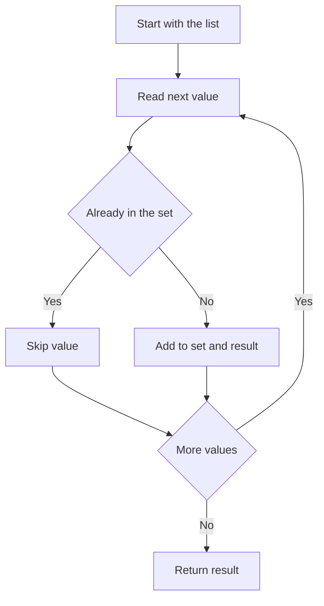

**Code example:** (compiled with JDK 21)

```java
import java.util.ArrayList;
import java.util.HashSet;
import java.util.LinkedHashSet;
import java.util.List;
import java.util.Set;

public class Dedupe {
    public static void main(String[] args) {
        List<Integer> data = List.of(4, 1, 4, 2, 1, 3);

        // 1. Copy into a LinkedHashSet: keeps first occurrence, keeps order
        List<Integer> unique = new ArrayList<>(new LinkedHashSet<>(data));
        System.out.println(unique);   // [4, 1, 2, 3]

        // 2. Stream version: distinct() keeps the first occurrence
        List<Integer> unique2 = data.stream().distinct().toList();
        System.out.println(unique2);  // [4, 1, 2, 3]

        // 3. In place on a mutable list: removeIf with a seen set
        List<Integer> mutable = new ArrayList<>(data);
        Set<Integer> seen = new HashSet<>();
        mutable.removeIf(x -> !seen.add(x));
        System.out.println(mutable);  // [4, 1, 2, 3]
    }
}
```

**Complexity:** Time is O(n) on average, because each `add` on a hash set is O(1) on average. Extra space is O(n) for the set and the result. Sorting first and scanning neighbours takes O(n log n) time, but needs no hash table.

**Dry run** on `[4, 1, 4, 2, 1, 3]`:
- `4`: not in set, add it. Result `[4]`.
- `1`: not in set, add it. Result `[4, 1]`.
- `4`: already in set, skip.
- `2`: not in set, add it. Result `[4, 1, 2]`.
- `1`: already in set, skip.
- `3`: not in set, add it. Result `[4, 1, 2, 3]`.

**Pitfalls and best practices:**
- Objects must implement `equals` and `hashCode` correctly, or duplicates stay. Records do this for you.
- Do not change a field of an object after you add it to a `HashSet`, because its hash code changes and the set can no longer find it.
- `List.of` returns an immutable list, so `removeIf` throws `UnsupportedOperationException`. Copy it into an `ArrayList` first.
- `distinct()` keeps the first occurrence only when the stream is ordered.
- To remove duplicates by one field, add that field to the seen set, not the whole object.

**Follow-up questions:**
- *What if the list is too big for memory?* Sort it on disk, use `SELECT DISTINCT` in a database, or process it in chunks with an external sort.
- *How do you remove duplicates by a key?* Keep a `Set` of the key and call `removeIf(x -> !keys.add(x.getId()))`.
- *Which is faster, a hash set or sorting?* A hash set is O(n) on average and simpler. Sorting is O(n log n) but uses no hash table.

### 2. Find the duplicate number in a linked list

*Note: the question is vague. I answer the most likely meaning, a plain linked list of values. I also cover the array version, where Floyd's cycle detection applies.*

**Simple explanation:** You walk along a chain of values and need the first value that appears twice. Keep a set of the values you have already seen. The first value that is already in the set is the duplicate.

**Interview answer:** "I walk the list once and record each value in a `HashSet`. The first value that is already in the set is the duplicate. That takes O(n) time and O(n) extra space. If the input is an array of values from 1 to n with one repeat, I use Floyd's cycle-detection method, which needs O(1) extra space. For a plain linked list I don't use Floyd's method, because the values are not pointers to other positions."

**What it is:** A linked list is a chain of nodes. Each node stores a value and a pointer to the next node. A duplicate is a value that appears at least twice. Floyd's algorithm is a two-pointer method, often called tortoise and hare, that finds a loop.

**Why it matters:** A repeated record can mean a data error, such as the same event loaded twice. Finding it quickly lets you stop the bad data before it spreads.

**When to use it:** The `HashSet` method works for any list. Floyd's method needs an array of n+1 numbers from 1 to n, where each number is an index.

**How it works:**
1. Create an empty set.
2. Start at the head node.
3. For each node, try to add its value to the set.
4. If `add` returns `false`, the value is already there. Return it.
5. If you reach the end, there is no duplicate. Return `null`.

For Floyd's method on an array, move `slow` one step and `fast` two steps, where a step means `nums[index]`. When they meet, reset `slow` to the start, move both one step at a time, and the meeting point is the duplicate.

**Code example:** (compiled with JDK 21)

```java
import java.util.HashSet;
import java.util.Set;

public class FindDuplicate {
    static class Node { int val; Node next; Node(int val, Node next) { this.val = val; this.next = next; } }

    static Integer firstDuplicateInList(Node head) {
        Set<Integer> seen = new HashSet<>();
        for (Node n = head; n != null; n = n.next) {
            if (!seen.add(n.val)) {
                return n.val;
            }
        }
        return null;
    }

    static int findDuplicateFloyd(int[] nums) {
        int slow = nums[0];
        int fast = nums[0];
        do {
            slow = nums[slow];
            fast = nums[nums[fast]];
        } while (slow != fast);
        slow = nums[0];
        while (slow != fast) {
            slow = nums[slow];
            fast = nums[fast];
        }
        return slow;
    }

    public static void main(String[] args) {
        Node list = new Node(5, new Node(3, new Node(7, new Node(3, null))));
        System.out.println(firstDuplicateInList(list));                  // 3
        System.out.println(findDuplicateFloyd(new int[]{1, 3, 4, 2, 2})); // 2
    }
}
```

**Complexity:** The set method takes O(n) time and O(n) extra space. Floyd's method takes O(n) time and O(1) extra space.

**Dry run** on the list `5 -> 3 -> 7 -> 3`:
- `5`: add succeeds. Set is `{5}`.
- `3`: add succeeds. Set is `{5, 3}`.
- `7`: add succeeds. Set is `{5, 3, 7}`.
- `3`: add fails, so return `3`.

**Dry run** of Floyd's method on `[1, 3, 4, 2, 2]`:
- Start with `slow = nums[0] = 1` and `fast = 1`.
- Step 1: `slow = nums[1] = 3`, `fast = nums[nums[1]] = nums[3] = 2`. Not equal.
- Step 2: `slow = nums[3] = 2`, `fast = nums[nums[2]] = nums[4] = 2`. Equal, so the loop stops.
- Reset `slow = 1`. Step: `slow = nums[1] = 3`, `fast = nums[2] = 4`. Not equal.
- Step: `slow = nums[3] = 2`, `fast = nums[4] = 2`. Equal. Return `2`.

**Pitfalls and best practices:**
- Floyd's method only works when the values are valid indexes. Check the input first.
- Compare `Integer` values with `equals`, not `==`. Values from -128 to 127 are cached, so `==` can give wrong results for others.
- `null` is allowed in a `HashSet`, so decide what a null value means in your data.

**Follow-up questions:**
- *How would you do it with O(1) extra space on a plain linked list?* Sort the list with merge sort, then scan for equal neighbours. Time is O(n log n). The list order changes.
- *Why does Floyd's method work?* The values act as pointers, so the array forms a loop. The duplicate is the entry point of that loop.

### 3. What are the different features of Java 17 compared with Java 8?

**Simple explanation:** Java 8 and Java 17 are both long-term support (LTS) releases. Java 17 adds newer language features that cut repeated code and make data classes safer. The most useful ones are records, switch expressions, and text blocks.

**Interview answer:** "Java 8 brought lambdas, streams, `Optional`, default methods, and the new date and time API. Java 9 through 17 added many smaller features, and Java 17 includes all of them. Records remove boilerplate for data classes, and they became final in Java 16. Sealed classes limit which classes can extend a type, and they became final in Java 17. Switch expressions, text blocks, and `instanceof` pattern matching are standard too. In a service, I'd use records for DTOs and sealed types for a fixed set of results."

**What it is:** Java 17 is an LTS release, so it gets updates for years. The features listed below were added between Java 9 and Java 17.

| Feature | Standard since | Notes |
|---|---|---|
| `var` local variable type inference | 10 | Local variables only |
| Records | 16 | Immutable data carriers |
| Sealed classes | 17 | Restrict which classes can extend a type |
| Text blocks | 15 | Multi-line string literals |
| Switch expressions | 14 | `->` arms and `yield` |
| `instanceof` pattern matching | 16 | `if (obj instanceof String s)` |
| `String` helpers (`isBlank`, `strip`, `lines`, `repeat`) | 11 | Useful for cleaning data |
| `Stream.toList()` | 16 | Shorter than `collect(Collectors.toList())` |
| Helpful NullPointerException messages | 15 | Names the null variable or field |
| Module system | 9 | `module-info.java` |

**Why it matters:** Each feature replaces a common pattern with less code. Records replace a class full of getters, `equals`, and `hashCode`. Switch expressions avoid fall-through bugs.

**When to use it:** Records for DTOs and events, sealed types for a fixed set of results, text blocks for SQL or JSON in tests, and `instanceof` patterns to remove casts.

**How it works:**
1. Declare a sealed interface with a `permits` list.
2. Declare each permitted type as a record or final class.
3. Handle each case with an `instanceof` check, or a switch on Java 21.

**Code example:** (compiled with `--release 17`, which also works on JDK 21)

```java
public class Java17Features {
    sealed interface Shape permits Circle, Square {}
    record Circle(double radius) implements Shape {}
    record Square(double side) implements Shape {}

    record Payment(String id, long cents) {
        Payment {
            if (cents < 0) throw new IllegalArgumentException("negative amount");
        }
    }

    static double area(Shape s) {
        if (s instanceof Circle c) return Math.PI * c.radius() * c.radius();
        if (s instanceof Square q) return q.side() * q.side();
        throw new IllegalStateException("unknown shape");
    }

    static String describe(Object obj) {
        if (obj instanceof String s && !s.isBlank()) {
            return "text of length " + s.length();
        }
        return "other";
    }

    static String dayType(String day) {
        return switch (day) {
            case "SAT", "SUN" -> "weekend";
            default -> "weekday";
        };
    }

    public static void main(String[] args) {
        String json = """
                {"id": 1, "status": "OK"}
                """;
        System.out.println(new Payment("p1", 500));  // Payment[id=p1, cents=500]
        System.out.printf("%.2f%n", area(new Circle(1.0)));  // 3.14
        System.out.println(describe("  "));         // other
        System.out.println(describe("hello"));      // text of length 5
        System.out.println(dayType("SAT"));         // weekend
        System.out.print(json);
        System.out.println(java.util.List.of(1, 2, 3).stream().toList());  // [1, 2, 3]
    }
}
```

**Pitfalls and best practices:**
- Pattern matching in `switch` became standard only in Java 21. On Java 17, use `instanceof` chains.
- A record is shallowly immutable. A `List` field can still change, so copy it with `List.copyOf` in the compact constructor.
- Compile with `--release 17` to confirm you do not use newer features by mistake.

**Follow-up questions:**
- *Which feature would you use in DTOs?* Records. They are immutable and generate `equals`, `hashCode`, and `toString`.
- *Is switch pattern matching in Java 17?* No. It is preview in 17 and standard in 21.

### 4. What is ExecutorService in Spring Boot, and how does it work?

**Simple explanation:** An `ExecutorService` is a pool of worker threads. You give it a task, and a free thread runs that task. This lets your app do work in the background without creating a new thread for every request.

**Interview answer:** "`ExecutorService` is the Java API for running tasks on a managed thread pool. I submit a task, and the pool runs it on one of its threads. In Spring Boot, I define the executor as a bean, so Spring owns its lifecycle and shuts it down when the application stops. For Spring's `@Async` support, a `TaskExecutor` such as `ThreadPoolTaskExecutor` wraps a standard Java thread pool. A fixed pool size stops too much parallel work from overloading the database or downstream services."

**What it is:** A thread pool is a set of reusable threads. `ExecutorService` is the interface for submitting tasks to a pool. A `Future` is a handle to a result that may not be ready yet.

**Why it matters:** Creating a new thread for each task is slow and uses memory. A pool reuses threads and limits how many run at the same time.

**When to use it:**
- Background work such as report generation or sending notifications.
- Calling several services in parallel and combining the results.
- Not for work the request must finish, unless you wait on the `Future`.

**How it works:**
1. Spring creates the executor bean at startup.
2. The caller submits a task and gets a `Future` back.
3. The pool gives the task to a free thread, or queues it if all threads are busy.
4. The task runs and stores its result in the `Future`.
5. The caller calls `get` to read the result, or continues.
6. On shutdown, Spring calls `shutdown` on the pool.

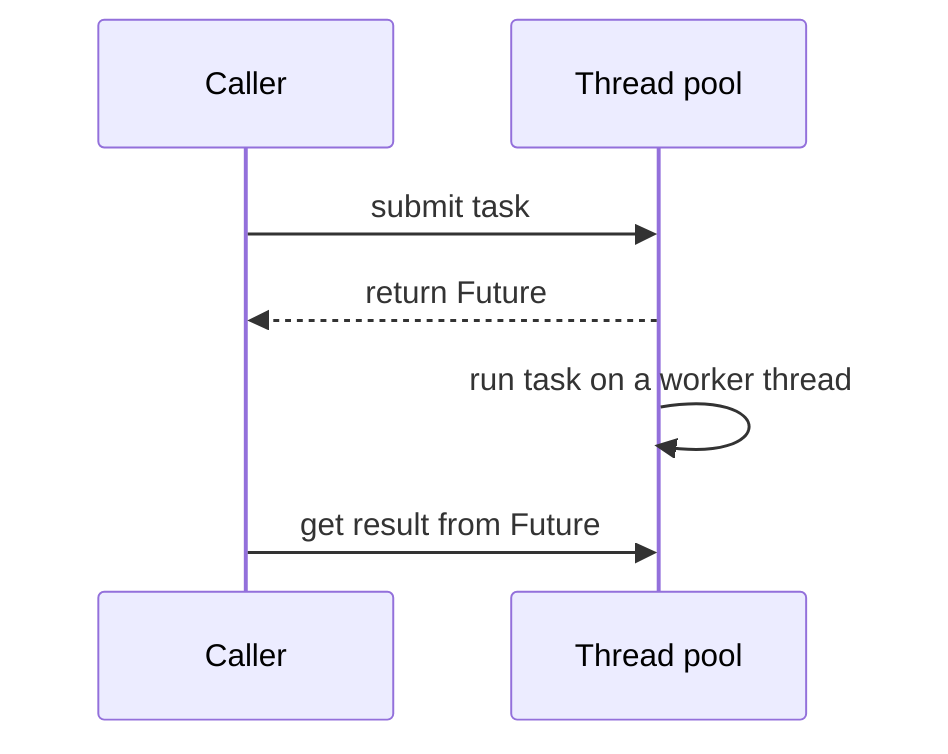

**Code example:** (library example, not compiled)

```java
import java.util.concurrent.ExecutorService;
import java.util.concurrent.Executors;
import java.util.concurrent.Future;
import org.springframework.context.annotation.Bean;
import org.springframework.context.annotation.Configuration;
import org.springframework.stereotype.Service;

@Configuration
public class ExecutorConfig {
    @Bean(destroyMethod = "shutdown")
    public ExecutorService reportExecutor() {
        return Executors.newFixedThreadPool(8);
    }
}

@Service
public class ReportService {
    private final ExecutorService executor;

    public ReportService(ExecutorService reportExecutor) {
        this.executor = reportExecutor;
    }

    public Future<String> generateAsync(String reportId) {
        return executor.submit(() -> "report-" + reportId + " ready");
    }
}
```

**Pitfalls and best practices:**
- Always shut the pool down when the application stops. `destroyMethod` makes Spring do this.
- `Executors.newFixedThreadPool` uses an unbounded queue. Under heavy load the queue grows until memory runs out. Use a `ThreadPoolExecutor` with a bounded queue for production.
- Do not block a pool thread while it waits for another task in the same pool. This can deadlock.
- If several `ExecutorService` beans exist, add `@Qualifier` to choose one.
- For I/O-heavy work on Java 21, Spring Boot 3.2 and later can use virtual threads with `spring.threads.virtual.enabled=true`.

**Follow-up questions:**
- *What is the difference between a fixed pool and a cached pool?* A fixed pool has a set number of threads and queues extra work. A cached pool creates threads as needed and can grow without limit under load.
- *What happens to exceptions in `submit`?* They are stored in the `Future` and only appear when you call `get`. With `execute`, they go to the thread's uncaught exception handler.
- *How do you combine the results of two tasks?* Use `CompletableFuture` with `thenCombine`, or `allOf` to wait for several.

### 5. What are transactions, and what are the propagation levels in Spring?

**Simple explanation:** A transaction is a group of database changes that either all save or all cancel. Propagation is a rule for what happens when one transactional method calls another. The default rule, `REQUIRED`, joins the outer transaction if one exists.

**Interview answer:** "A transaction groups several database operations so they succeed or fail together. This follows the ACID rules: atomic, consistent, isolated, and durable. In Spring, `@Transactional` starts or joins a transaction around a method, through a proxy, which is an object Spring wraps around my bean. Propagation controls what happens when a transactional method calls another one. The default is `REQUIRED`, and I change it only when the inner work must be independent, such as with `REQUIRES_NEW`."

**What it is:** A transaction is a unit of work with four ACID properties. Atomicity means all or nothing. Consistency means the rules still hold after. Isolation means concurrent work does not interfere. Durability means saved changes survive a crash.

| Propagation | Behaviour |
|---|---|
| `REQUIRED` (default) | Join the current transaction, or start a new one |
| `REQUIRES_NEW` | Suspend the current transaction and always start a new one |
| `NESTED` | Run inside a savepoint of the current transaction (JDBC only) |
| `SUPPORTS` | Join if a transaction exists, otherwise run without one |
| `NOT_SUPPORTED` | Run without a transaction, suspending any current one |
| `MANDATORY` | Must join an existing transaction, or throw an exception |
| `NEVER` | Must run without a transaction, or throw an exception |

**Why it matters:** Without transactions, a failure halfway through a payment could debit one account and never credit the other.

**When to use it:**
- Any method that changes more than one row or table.
- Read-only queries with `@Transactional(readOnly = true)`.
- Use `REQUIRES_NEW` only when the inner work must survive an outer failure.

**How it works:**
1. A call enters the Spring proxy for the bean.
2. The proxy asks the transaction manager to begin or join a transaction, based on propagation.
3. The method runs. Its database changes stay inside the transaction.
4. If the method ends normally, the proxy commits.
5. If a `RuntimeException` or `Error` escapes, the proxy rolls back.

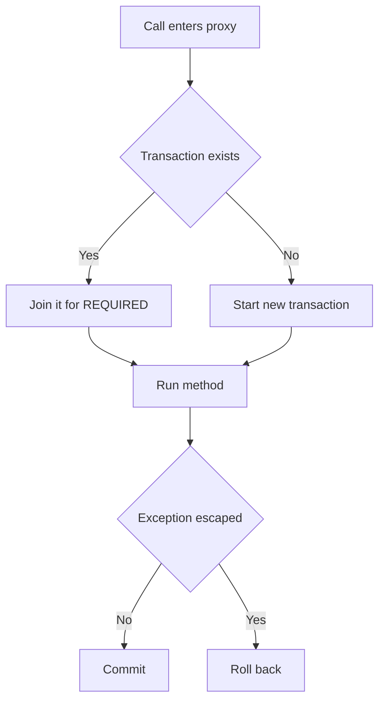

**Code example:** (library example, not compiled)

```java
@Service
public class OrderService {
    private final AuditService audit;

    public OrderService(AuditService audit) {
        this.audit = audit;
    }

    @Transactional                       // REQUIRED: starts a transaction
    public void placeOrder(Order order) {
        // save order rows
        audit.log(order);                // REQUIRED: joins the same transaction
    }
}

@Service
public class AuditService {
    @Transactional(propagation = Propagation.REQUIRED)
    public void log(Order order) {
        // insert audit row
    }
}
```

**Pitfalls and best practices:**
- Self-invocation bypasses the proxy. Calling a `@Transactional` method from the same class starts no transaction.
- Checked exceptions do not roll back by default. Add `rollbackFor = Exception.class` when needed.
- Transactions belong to one thread. Work on another thread is not part of them (see question 7).
- Keep transactions short. Do not call HTTP services inside them, because they hold a database connection.
- Put `@Transactional` on public methods, as Spring recommends.

**Follow-up questions:**
- *Why is the default propagation `REQUIRED`?* It joins existing work, so one business operation uses one transaction.
- *What does `readOnly = true` do?* It tells the framework and driver that no writes are expected. Hibernate skips dirty checking and flushing. It does not stop writes on every database.
- *What is an isolation level?* It controls what concurrent transactions can see. Many databases default to `READ_COMMITTED`.

### 6. How do you handle exceptions in nested transactions?

**Simple explanation:** When one transactional method calls another, they share a transaction by default. If the inner method fails, the whole shared transaction is marked for rollback. To keep the inner failure separate, give the inner method its own transaction with `REQUIRES_NEW`.

**Interview answer:** "It depends on how the inner method is called and which propagation it uses. With `REQUIRED`, a runtime exception from the inner method marks the shared transaction as rollback-only. After that, the outer method cannot commit, even if it catches the exception. If the inner work must be isolated, I use `REQUIRES_NEW`, so its failure rolls back only its own changes. I catch the exception in the outer method only when I can recover, and I log it with the order ID so I can trace it."

**What it is:** A nested transaction here means one transactional method called inside another. The rollback-only flag is a marker on the shared transaction. Once set, the transaction can never commit.

**Why it matters:** Without this knowledge, a failure in an optional step, such as an audit log, can silently kill the main order. The reverse also happens: the order commits while an important step is lost.

**When to use it:**
- `REQUIRED` when all steps must succeed or fail together.
- `REQUIRES_NEW` for work that must survive an outer failure, such as an audit attempt.
- `NESTED` with a savepoint, when only part of one transaction must be undone. It needs JDBC savepoint support.

**How it works:**
1. The outer method starts a transaction.
2. The inner method is called through the proxy.
3. With `REQUIRED`, the inner method joins the outer transaction.
4. If the inner method throws a `RuntimeException`, the proxy marks the shared transaction rollback-only.
5. If the outer method catches it and returns normally, the commit fails with `UnexpectedRollbackException`.
6. With `REQUIRES_NEW`, the inner method has its own transaction and commits or rolls back on its own.

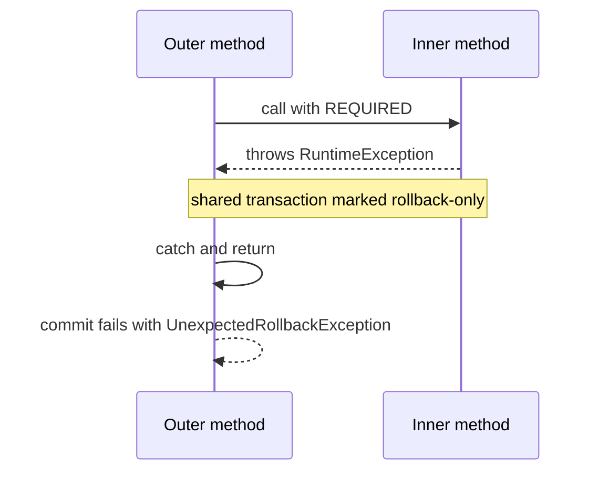

**Code example:** (library example, not compiled)

```java
import org.slf4j.Logger;
import org.slf4j.LoggerFactory;
import org.springframework.stereotype.Service;
import org.springframework.transaction.annotation.Propagation;
import org.springframework.transaction.annotation.Transactional;

@Service
public class OrderService {
    private static final Logger log = LoggerFactory.getLogger(OrderService.class);
    private final AuditService audit;

    public OrderService(AuditService audit) {
        this.audit = audit;
    }

    @Transactional
    public void placeOrder(Order order) {
        // save order rows
        try {
            audit.recordAttempt(order);      // REQUIRES_NEW: its own transaction
        } catch (RuntimeException ex) {
            log.warn("Audit failed for order {}", order.getId(), ex);
        }
    }
}

@Service
public class AuditService {
    @Transactional(propagation = Propagation.REQUIRES_NEW)
    public void recordAttempt(Order order) {
        // insert audit row
    }
}
```

**Pitfalls and best practices:**
- A `catch` inside a `REQUIRED` transaction does not clear the rollback-only flag. The commit still fails.
- `REQUIRES_NEW` uses a second database connection. If the pool is small, the outer transaction holds one connection while the inner one waits for another. This can exhaust the pool or deadlock on the same rows.
- Log the exception with context. Do not swallow it silently.
- Test rollback behaviour with an integration test. Mocks skip the proxy, so they hide these problems.
- Choose `REQUIRES_NEW` only when independence is a real requirement.

**Follow-up questions:**
- *What does `NESTED` give you that `REQUIRES_NEW` does not?* A savepoint inside one transaction. A failed nested block rolls back to the savepoint, and the outer transaction stays open. It depends on JDBC savepoint support.
- *How do you avoid `UnexpectedRollbackException`?* Let the exception escape, or make the inner method independent with `REQUIRES_NEW`.
- *Does a checked exception roll back the inner method?* No, not by default. Use `rollbackFor` to change that.

### 7. What is an asynchronous transaction?

*Note: "asynchronous transaction" is not a formal term. I take it to mean a unit of database work that runs on another thread, outside the caller's transaction.*

**Simple explanation:** A transaction belongs to one thread. Work started on a different thread does not join the first transaction. So that work saves on its own, and a rollback in the first thread does not undo it.

**Interview answer:** "A transaction is bound to one thread through a `ThreadLocal`, which is a per-thread storage slot. When I run work on another thread, such as with `@Async` or `CompletableFuture`, that thread has no transaction, so the work runs outside the original one. Its database changes commit separately, and a rollback in the caller does not undo them. To keep the work in the same transaction, I run it on the same thread. Otherwise I design it as its own unit, with its own transaction, retries, and compensating actions."

**What it is:** An asynchronous step runs on another thread, and the caller does not wait for it. In Spring, `@Async` runs a method on a task executor. `@EnableAsync` turns this feature on.

**Why it matters:** Background work keeps responses fast. But it splits one business operation into two commits, and you must plan for the case where one part fails.

**When to use it:**
- Work the user does not need to wait for, such as sending a receipt.
- Updating a read model or cache after a change.
- Not for steps that must succeed or fail together with the main change.

**How it works:**
1. The caller starts a transaction and changes rows.
2. The caller calls the `@Async` method.
3. Spring hands the call to an executor thread and returns at once.
4. The executor thread has no transaction, so `@Transactional` starts a new one there.
5. The new transaction commits or rolls back on its own.
6. If the caller rolls back later, the async work may already be committed.

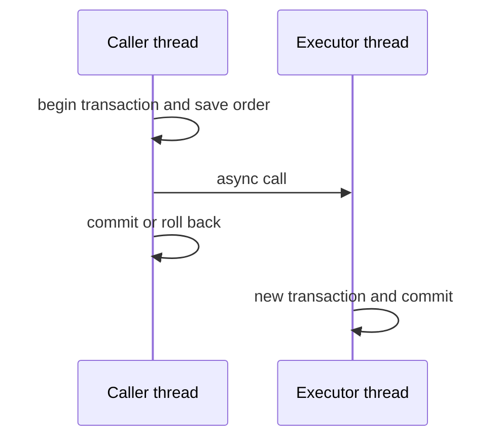

**Code example:** (library example, not compiled)

```java
@Configuration
@EnableAsync
public class AsyncConfig {
}

@Service
public class LedgerService {
    private final LedgerRepository ledger;

    public LedgerService(LedgerRepository ledger) {
        this.ledger = ledger;
    }

    @Async
    @Transactional(propagation = Propagation.REQUIRES_NEW)
    public CompletableFuture<Void> postLedgerEntry(Long paymentId, long cents) {
        ledger.save(new LedgerEntry(paymentId, cents));   // runs on the executor thread
        return CompletableFuture.completedFuture(null);
    }
}
```

**Pitfalls and best practices:**
- `@Async` is ignored on self-invocation, the same as `@Transactional`.
- Exceptions from an `@Async` method returning `void` do not reach the caller. Return a `CompletableFuture`, or configure an `AsyncUncaughtExceptionHandler`.
- Configure a bounded thread pool. Without one, work can pile up in memory.
- Make async work idempotent, so a retry is safe.
- Pass IDs to the async method, not JPA entities. Entities belong to the original persistence context and can be stale on another thread.

**Follow-up questions:**
- *How do you handle a failure in async work?* Log it, retry with a limit, send it to a dead-letter queue or an alert, and make the operation idempotent.
- *Is there a safer alternative?* Yes. `@TransactionalEventListener` with `AFTER_COMMIT` runs the work only after the main change commits (see question 8).
- *Why not run async work inside the same transaction?* The transaction is bound to one thread, so the other thread cannot join it.

### 8. What method or tool do you use for handling asynchronous transaction?

*Note: the question is vague. I read it as: which tools handle work that must run after, or outside, a transaction.*

**Simple explanation:** Some work must happen after a database change, but on another thread or in another service. The safe pattern is to start that work only after the main change has committed.

**Interview answer:** Template: "For work that must run outside the current transaction, I use [tool, for example `@Async` with `@TransactionalEventListener`, or Kafka with an outbox table]. I start the work [after commit, or from the saved outbox row], so it runs only when the main change succeeded. I make the handler [idempotent, with retries up to a limit], so a repeat is safe."

**Sample (replace with your own):** "For work after a commit, I use `@TransactionalEventListener` with phase `AFTER_COMMIT`, combined with `@Async`. This runs the work only when the order has committed. For work in another service, I use Kafka with a transactional outbox, so the event is saved in the same database transaction as the order and sent afterwards. Consumers are idempotent, so retries are safe."

**What it is:** A tool here means a Spring feature or a messaging pattern. `@TransactionalEventListener` runs a method only after a transaction reaches a given phase. An outbox table stores events in the same database transaction as the business data.

**Why it matters:** If you send a message before the commit and the commit fails, other systems act on data that does not exist. If you commit and then crash before sending, the event is lost. The outbox and `AFTER_COMMIT` address both problems.

**When to use it:**
- `AFTER_COMMIT` listeners for side effects inside one service, such as sending an email.
- An outbox with Kafka for events that other services must receive.

**How it works:**
1. Save the business rows and an outbox row in one transaction.
2. Commit.
3. A relay reads unsent outbox rows and publishes them to Kafka.
4. The relay marks each row as sent. If it crashes first, it sends again, so consumers must be idempotent.

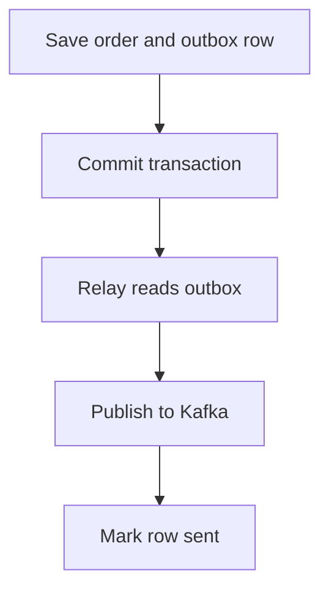

**Code example:** (library example, not compiled)

```java
@Service
public class OrderService {
    private final ApplicationEventPublisher events;

    public OrderService(ApplicationEventPublisher events) {
        this.events = events;
    }

    @Transactional
    public void placeOrder(Order order) {
        // save order
        events.publishEvent(new OrderPlaced(order.getId()));
    }
}

@Component
public class OrderPlacedHandler {
    @Async
    @TransactionalEventListener(phase = TransactionPhase.AFTER_COMMIT)
    public void onOrderPlaced(OrderPlaced event) {
        // send confirmation email; runs only after the commit
    }
}
```

**Pitfalls and best practices:**
- An `AFTER_COMMIT` handler that writes to the database needs its own transaction, such as `REQUIRES_NEW`, because the original one has finished.
- By default, an event published with no active transaction is dropped. Set `fallbackExecution = true` only if that is what you want.
- Use an outbox for events that leave the service. An in-process event cannot protect a Kafka send.
- Make every consumer idempotent, so duplicate events do no harm.
- A failed side effect cannot undo a commit. Log it, alert on it, and retry it.

**Follow-up questions:**
- *What if the relay publishes an event and then crashes before marking it sent?* The event is sent again. Consumers skip it by checking the event ID.
- *Why not send to Kafka inside the `@Transactional` method?* Kafka can accept the message even if the database commit fails, so the two systems disagree.
- *Is there a tool for one transaction across systems?* Sagas with compensating actions are the usual choice. Two-phase commit (XA) exists but is rarely used.

### 9. Where have you used Resilience4j in your application?

**Simple explanation:** Resilience4j is a library that protects your app when another service is slow or broken. A circuit breaker stops calls to a failing service for a short time. A fallback gives a safe answer in the meantime.

**Interview answer:** Template: "In [project], I used Resilience4j to protect calls to [downstream service]. I added a `@CircuitBreaker` with a `fallbackMethod`, which returns [safe default or cached value] when the service fails. I set a timeout of [duration] on the client, and a retry for [transient error type] on [idempotent operations only]. The circuit breaker opens when the failure rate passes [threshold], and it recovers after [wait time] with trial calls."

**Sample (replace with your own):** "In an order service, I used Resilience4j to protect calls to a pricing service. I added a circuit breaker with the default 50 percent failure-rate threshold. When it opens, the fallback returns the last price from a cache, and a log entry is written. I also set a two-second timeout on the client."

**What it is:** Resilience4j is a fault-tolerance library for Java. Its main parts are CircuitBreaker, Retry, TimeLimiter, Bulkhead, and RateLimiter. A circuit breaker has three states: closed (calls flow), open (calls are blocked and the fallback runs), and half-open (a few trial calls test recovery).

**Why it matters:** A failing dependency can hold threads and drain the connection pool, which takes your service down too. Failing fast keeps the rest of the system alive.

**When to use it:**
- Remote calls to services or databases that can fail or slow down.
- Retry only for transient errors, and only for operations that are safe to repeat.

**How it works:**
1. Each call passes through the circuit breaker.
2. In the closed state, the breaker counts results in a sliding window.
3. When the failure rate passes the threshold, the breaker opens.
4. In the open state, calls fail fast and the fallback method runs.
5. After the wait time, the breaker goes half-open and lets a few trial calls through.
6. If the trials succeed, it closes. If they fail, it opens again.

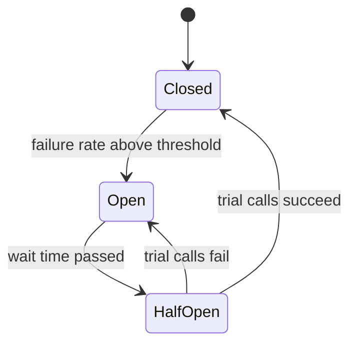

**Code example:** (library example, not compiled)

```java
import java.math.BigDecimal;
import io.github.resilience4j.circuitbreaker.annotation.CircuitBreaker;
import org.springframework.stereotype.Service;

@Service
public class PricingClient {

    @CircuitBreaker(name = "pricing", fallbackMethod = "priceFallback")
    public BigDecimal price(String sku) {
        // call the downstream pricing service
        return callPricingService(sku);
    }

    // Fallback: same parameters, plus the exception at the end
    BigDecimal priceFallback(String sku, Throwable ex) {
        // return a cached value or fail clearly; do not invent a price
        throw new IllegalStateException("pricing unavailable for " + sku, ex);
    }
}
```

**Pitfalls and best practices:**
- A fallback that returns zero for a price can cause wrong charges. Return a known good value, or fail clearly.
- Add a timeout as well as a breaker. A slow call holds a thread before it fails.
- Retry only idempotent calls. By default, Retry wraps CircuitBreaker, so each retry counts toward the breaker.
- Name one breaker per dependency, and tune each one separately.
- Expose breaker state and metrics through Actuator and Prometheus, so you can see when it opens.

**Follow-up questions:**
- *Why use a timeout as well as a circuit breaker?* A breaker counts failures. A slow call can tie up threads before it fails, and a timeout limits how long one call can hold a thread.
- *What is the half-open state for?* It tests recovery with a few calls, rather than sending full traffic to a service that may still be broken.
- *What is a bulkhead?* It limits concurrent calls to one dependency, so one slow service cannot use all the threads.

### 10. What are the key differences between SOAP and REST?

> ⭐ **STAR (important)**

**Simple explanation:** REST and SOAP are two ways for programs to talk over the web. REST uses plain HTTP and usually JSON, so it is light and easy to use. SOAP uses XML messages with a strict contract, so it is heavier, but it has built-in security and reliability standards.

**Interview answer:** "REST is an architectural style. It uses HTTP methods such as GET and POST on resources, usually with JSON, so it is simple, lightweight, and friendly to caching. SOAP is a protocol. It sends XML envelopes and uses a formal WSDL contract, with standards such as WS-Security built in. I'd choose REST for most web and mobile APIs and microservices. I'd keep SOAP where a partner or bank requires its strict contract and security standards."

**What it is:** REST stands for Representational State Transfer. A resource is a thing with a URL, such as `/orders/42`. SOAP is a messaging protocol that wraps each message in an XML envelope. WSDL, the Web Services Description Language, is an XML file that describes the SOAP operations.

| Aspect | REST | SOAP |
|---|---|---|
| Style | Architectural style | Protocol |
| Message format | JSON, XML, or others | XML envelope only |
| Contract | OpenAPI (optional) | WSDL (required) |
| Transport | Usually HTTP | HTTP, SMTP, and others |
| Caching | HTTP caching works well for GET | Usually not cacheable, since most calls are POST |
| Errors | HTTP status codes, often RFC 9457 problem details | SOAP Fault element inside the envelope |
| Security | HTTPS, OAuth 2.0, JWT | WS-Security, built in |
| Typical use | Public and internal APIs, microservices | Legacy and strict enterprise integrations |

**Why it matters:** The choice affects how easy the API is to use, how well it scales, and how it handles contracts and security. REST fits the web because browsers, proxies, and caches already understand HTTP.

**When to use it:**
- REST for public APIs, mobile apps, and microservices.
- SOAP for legacy enterprise systems, or when a partner requires WS-Security or a WSDL contract.

**How it works:**
1. REST: the client sends `GET /orders/42` with `Accept: application/json`.
2. The server returns status 200 and a JSON body.
3. SOAP: the client sends a POST with an XML envelope and a `SOAPAction` header.
4. The server returns an XML envelope, or a Fault element on error.
5. SOAP clients are generated from the WSDL. REST clients can use an OpenAPI file, though it is optional.

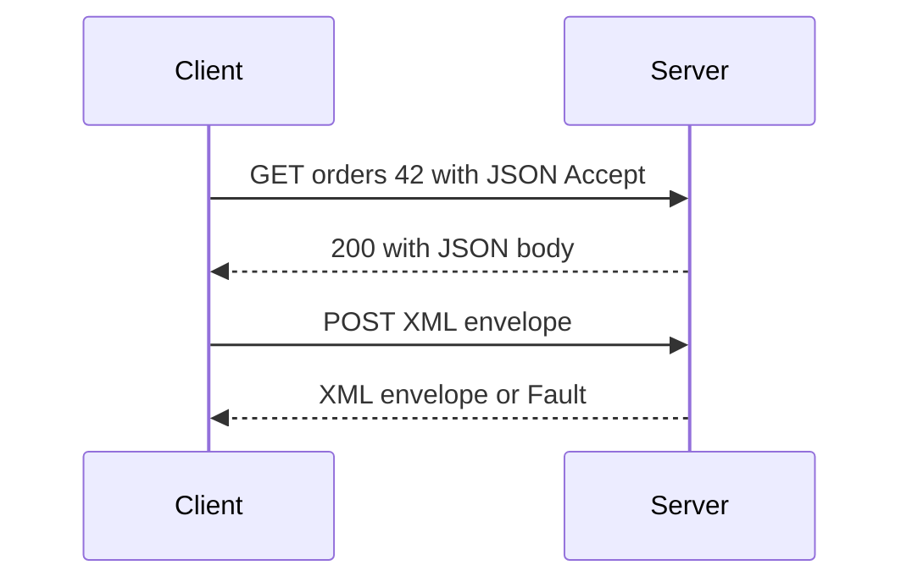

**Code example:** (compiled with JDK 21; builds two requests without sending them)

```java
import java.net.URI;
import java.net.http.HttpRequest;

public class RestVsSoap {
    public static void main(String[] args) {
        // REST: a resource URL and an HTTP verb
        HttpRequest rest = HttpRequest.newBuilder(URI.create("https://api.example.com/orders/42"))
                .header("Accept", "application/json")
                .GET()
                .build();

        // SOAP: one endpoint, always POST, with an XML envelope
        String envelope = """
                <soap:Envelope xmlns:soap="http://schemas.xmlsoap.org/soap/envelope/">
                  <soap:Body>
                    <GetOrder><OrderId>42</OrderId></GetOrder>
                  </soap:Body>
                </soap:Envelope>
                """;
        HttpRequest soap = HttpRequest.newBuilder(URI.create("https://api.example.com/OrderService"))
                .header("Content-Type", "text/xml; charset=utf-8")
                .header("SOAPAction", "\"GetOrder\"")
                .POST(HttpRequest.BodyPublishers.ofString(envelope))
                .build();

        System.out.println(rest.method() + " " + rest.uri());  // GET https://api.example.com/orders/42
        System.out.println(soap.method() + " " + soap.uri());  // POST https://api.example.com/OrderService
    }
}
```

**Pitfalls and best practices:**
- REST is a style, not a standard. Agree on conventions for status codes, naming, and versioning.
- Use the right HTTP verb. GET and PUT are safe to retry, but POST usually is not.
- SOAP messages are usually POST, so HTTP caches do not store them.
- Changing a WSDL can break generated clients. Version it.
- Use HTTPS for both, and add OAuth 2.0 tokens or WS-Security for access control.

**Follow-up questions:**
- *Can you convert a SOAP service to REST without breaking clients?* Yes. Put a facade or adapter in front that exposes REST and calls the SOAP operations. Move clients over in stages.
- *Is REST always faster than SOAP?* No. JSON is usually smaller than an XML envelope, but speed depends on the design, the payload, and the network.
- *When would you keep SOAP?* When a partner's contract, tooling, or WS-Security requirement makes REST costly to adopt.

### 11. Have you worked with Single Sign-On (SSO)?

**Simple explanation:** Single Sign-On (SSO) means a user logs in once, then opens several apps without logging in again. A central identity provider checks the user and gives each app a signed token. Each app trusts that token.

**Interview answer:** Template: "I've integrated [application] with [identity provider] for SSO. In [project], users signed in once through [provider], and the application verified the ID token. I configured the redirect URIs, the scopes, and the role mapping from [claim name], and I used those claims to authorize requests."

**Sample (replace with your own):** "I've integrated a web application with an enterprise identity provider using OpenID Connect. Users signed in once, and the application verified the ID token's issuer, audience, and expiry. I mapped roles from a groups claim to Spring authorities, and I restricted the redirect URIs to the exact production and test addresses."

**What it is:** SSO is a pattern, not one product. Two common standards are SAML 2.0, which uses XML assertions and browser redirects, and OpenID Connect (OIDC), which adds an ID token on top of OAuth 2.0. OAuth 2.0 alone covers authorization. OpenID Connect adds who the user is.

**Why it matters:** One login means fewer passwords for users. It also gives central control, so disabling an account in one place cuts off access to every app.

**When to use it:**
- Internal apps and employee logins.
- New web and mobile apps: use OpenID Connect.
- Older enterprise apps that already speak SAML.

**How it works:**
1. The user opens the app, which redirects the browser to the identity provider.
2. The user signs in there, and may use multi-factor authentication.
3. The provider redirects back with a short-lived code.
4. The app exchanges the code for tokens directly with the provider.
5. The app verifies the ID token and creates its own session.
6. Later requests carry the token, and roles come from its claims.

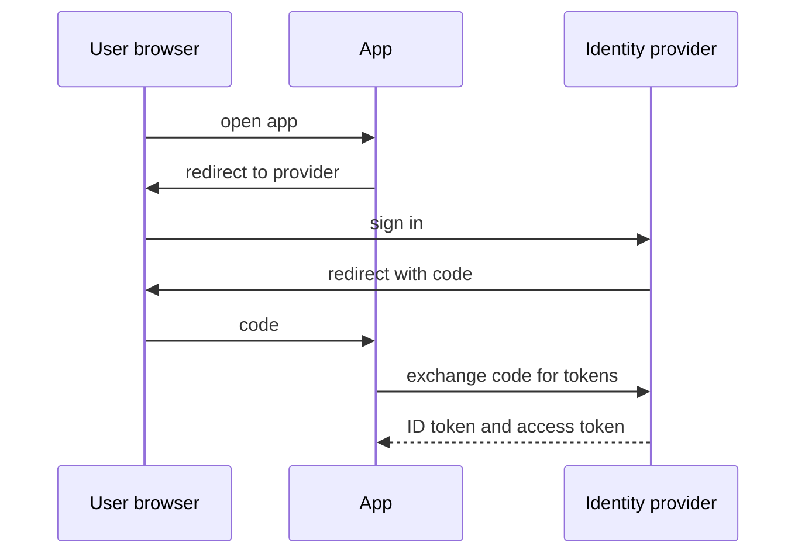

**Code example:** (library example, not compiled)

```java
import org.springframework.context.annotation.Bean;
import org.springframework.context.annotation.Configuration;
import org.springframework.security.config.Customizer;
import org.springframework.security.config.annotation.web.builders.HttpSecurity;
import org.springframework.security.config.annotation.web.configuration.EnableWebSecurity;
import org.springframework.security.web.SecurityFilterChain;

@Configuration
@EnableWebSecurity
public class SecurityConfig {

    @Bean
    SecurityFilterChain security(HttpSecurity http) throws Exception {
        http.authorizeHttpRequests(auth -> auth
                .requestMatchers("/public/**").permitAll()
                .requestMatchers("/admin/**").hasRole("ADMIN")
                .anyRequest().authenticated())
            .oauth2Login(Customizer.withDefaults());   // OpenID Connect login
        return http.build();
    }
}
```

**Pitfalls and best practices:**
- Verify every token: issuer, audience, expiry, and signature. A token being present is not enough.
- Use the authorization code flow with PKCE for browser and mobile apps. The implicit flow is no longer recommended.
- Keep redirect URIs exact. Loose matching lets an attacker receive tokens.
- Keep the client secret on the server only.
- Map roles from claims carefully. A wrong mapping gives wrong access.

**Follow-up questions:**
- *What happens at logout?* You can end the local session and call the provider's logout endpoint. Other apps keep their own sessions until they expire, so single sign-out is hard.
- *SAML or OpenID Connect?* SAML is XML-based and common in enterprise apps. OpenID Connect uses JSON and JWTs, and suits web and mobile apps.
- *How does a microservice check a token?* It verifies the JWT signature with the provider's public keys (JWKS), then checks issuer, audience, and expiry. It does not call the provider on every request.

### 12. How do multiple consumers read from a topic when there is only one producer?

> ⭐ **STAR (important)**

*Note: "topic" here means a Kafka topic. The same ideas apply to other brokers that have consumer groups.*

**Simple explanation:** A producer writes messages to a topic, which is a named log. Each group of consumers keeps its own read position, so every group gets all the messages. Inside one group, the consumers share the work, so each message is handled once.

**Interview answer:** "In Kafka, a topic is split into partitions, and each consumer group keeps its own offsets, which are read positions. Each group gets every message, so different groups can each read the full stream independently. Inside a group, the partitions are shared among the consumers, so each message is processed by one consumer in that group. One producer can serve any number of groups without any change to it."

**What it is:** A topic is a named stream of messages. A partition is an ordered part of a topic. A consumer group is a set of consumers that share the work of one subscription. An offset is the position of a consumer in a partition.

**Why it matters:** Several teams can use the same events without coordinating with the producer. The billing service and the analytics service can both process each order event.

**When to use it:**
- Use separate groups when different services need the same events.
- Use one group with several instances when you need to scale one service.

**How it works:**
1. The producer writes each message to one partition, chosen by the message key.
2. Each consumer group tracks its own offset in each partition.
3. Kafka assigns each partition to exactly one consumer in a group.
4. Group A and group B each read the same partition from their own offsets.
5. When a consumer stops, Kafka rebalances its partitions to the others in the group.

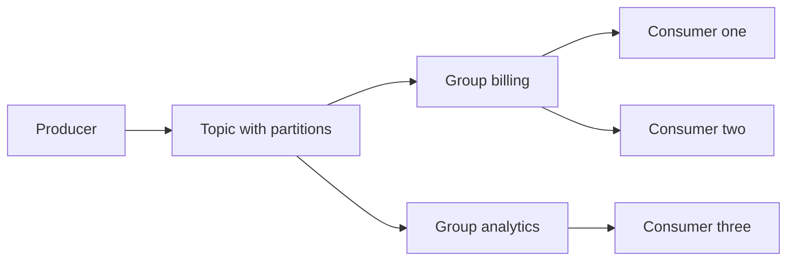

**Code example:** (library example, not compiled)

```java
import org.springframework.kafka.annotation.KafkaListener;
import org.springframework.stereotype.Component;

@Component
public class OrderEventListeners {

    // Same topic, different group IDs: each group gets every event
    @KafkaListener(topics = "orders", groupId = "billing")
    public void bill(OrderEvent event) {
        billing.charge(event);
    }

    @KafkaListener(topics = "orders", groupId = "analytics")
    public void track(OrderEvent event) {
        analytics.record(event);
    }
    // Running three instances of the billing service with the same
    // groupId splits the partitions among the three instances.
}
```

**Pitfalls and best practices:**
- The partition count caps parallelism. Extra consumers in a group sit idle.
- Choose message keys carefully. Messages with the same key go to the same partition, so they stay in order. A very common key creates a hot partition.
- Ordering is guaranteed only within a partition, not across the whole topic.
- A new group ID starts reading from the position set by `auto.offset.reset`, which is often the latest or earliest message.
- Do not reuse a group ID across unrelated services. They would split the messages between them.

**Follow-up questions:**
- *What happens if one consumer in a group fails?* Kafka rebalances its partitions to the remaining consumers. Messages that were not yet committed are read again.
- *Can two groups read the same partition?* Yes. Each group reads it independently, with its own offsets.
- *How do you replay old events for a new group?* Set `auto.offset.reset` to `earliest`, or seek to an offset. The data must still be within the topic's retention period.

### 13. How do you ensure a message has been delivered successfully in Kafka?

> ⭐ **STAR (important)**

**Simple explanation:** Kafka can lose or repeat messages if the settings are careless. On the producer side, you wait for the brokers to confirm each write. On the consumer side, you save your read position only after the work is done, and you make the work safe to repeat.

**Interview answer:** "Delivery has two sides. On the producer, I set `acks=all` and enable idempotence, so the broker confirms a write only after the in-sync replicas have it, and retries do not create duplicates. On the consumer, I commit the offset only after processing succeeds, and I make processing idempotent, so a repeated message has no extra effect. Kafka's normal guarantee is at-least-once, so I expect duplicates. If a read-process-write flow must be exactly-once inside Kafka, I use Kafka transactions."

**What it is:** There are three delivery guarantees. At-most-once means a message can be lost but is never repeated. At-least-once means it is never lost but can repeat. Exactly-once means each effect happens once, which needs transactions or idempotent processing.

**Why it matters:** A lost payment event leaves balances wrong. A repeated one can charge a customer twice. Both are costly, so the guarantee must match the business need.

**When to use it:**
- At-least-once with idempotent consumers for most business events.
- Kafka transactions for stream processing where the output goes back to Kafka.

**How it works:**
1. The producer sends with `acks=all` and idempotence on.
2. The broker writes to the leader and to in-sync followers.
3. The broker acknowledges the producer once the write is safe.
4. The consumer reads and processes the message.
5. The consumer saves its result, then commits the offset.
6. If the consumer crashes before step 5, the message is read again.

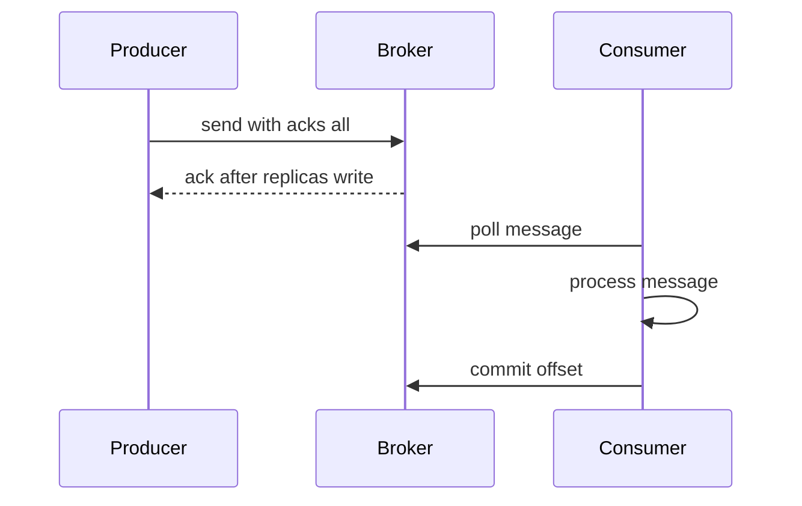

**Code example:** (library example, not compiled)

```properties
spring.kafka.producer.acks=all
spring.kafka.producer.properties.enable.idempotence=true
spring.kafka.consumer.enable-auto-commit=false
spring.kafka.listener.ack-mode=manual
```

```java
import org.springframework.kafka.annotation.KafkaListener;
import org.springframework.kafka.support.Acknowledgment;
import org.springframework.stereotype.Component;

@Component
public class PaymentListener {
    private final LedgerService ledger;

    public PaymentListener(LedgerService ledger) {
        this.ledger = ledger;
    }

    @KafkaListener(topics = "payments", groupId = "ledger")
    public void onPayment(PaymentEvent event, Acknowledgment ack) {
        ledger.applyOnce(event.eventId(), event);  // idempotent: keyed by event ID
        ack.acknowledge();                          // commit only after success
    }
}
```

**Pitfalls and best practices:**
- `min.insync.replicas=2` with `replication.factor=3` lets the topic survive one broker loss. With `acks=all`, a write fails instead of being lost when too few replicas are in sync.
- Auto-commit saves the offset before processing finishes. A crash then loses the message. Turn it off.
- The idempotent producer blocks duplicates caused by its own retries. It does not stop your application from sending the same event twice.
- Send failed messages to a dead-letter topic. Otherwise one bad message blocks its partition.
- Kafka transactions alone do not cover a database. Use an outbox, or store the processed event ID in the same database transaction.

**Follow-up questions:**
- *What if processing fails after the message is read?* Retry with backoff, then send the message to a dead-letter topic for inspection.
- *What is idempotent processing?* Store the IDs of processed events, and skip any that repeat. Do this in the same transaction as the business update.
- *Does `acks=all` give exactly-once delivery?* No. It prevents loss when a leader fails. It does not stop duplicates caused by application-level resends.

### 14. Do you have experience with NoSQL databases?

> ⭐ **STAR (important)**

**Simple explanation:** NoSQL databases store data in forms other than tables with fixed columns, such as key-value pairs or JSON-like documents. They scale out well, and each item can have its own shape. The trade-off is fewer features, such as complex joins.

**Interview answer:** Template: "Yes. In [project], I worked with [database, for example DynamoDB or MongoDB] for [workload, such as order events]. I designed the [partition key or document shape] around [access pattern], and I [result, such as cut read latency or avoided hot partitions]. I'd choose a NoSQL store when the access pattern is known, the data is grouped by a key, and the volume is high."

**Sample (replace with your own experience):** "In my last project, we stored order status events in DynamoDB. I chose the customer ID as the partition key and the order timestamp as the sort key, so one query returned a customer's recent orders. I'd choose NoSQL here because the access pattern was known and the volume was high."

**What it is:** NoSQL covers four main types. Key-value stores, such as Redis and DynamoDB in basic use, look up items by key. Document stores, such as MongoDB, hold JSON-like documents. Column-family stores, such as Cassandra, group columns by row. Graph stores, such as Neo4j, store nodes and relationships.

**Why it matters:** Relational databases scale mostly up, and joins across huge data sets are costly. NoSQL systems split data across many nodes by a partition key, so reads and writes spread out.

**When to use it:**
- The access patterns are known in advance.
- Data is naturally grouped by one key, such as a customer or device.
- The schema changes often, or the volume is very high.
- Keep a relational database for many joins, strong transactions across many tables, or ad hoc reports.

**How it works (DynamoDB-style design):**
1. List the queries the app must answer.
2. Pick a partition key that spreads items evenly across partitions.
3. Pick a sort key to order items inside a partition and to allow range queries.
4. Add a global secondary index for any other access pattern.
5. Check that no single key gets most of the traffic, which creates a hot partition.

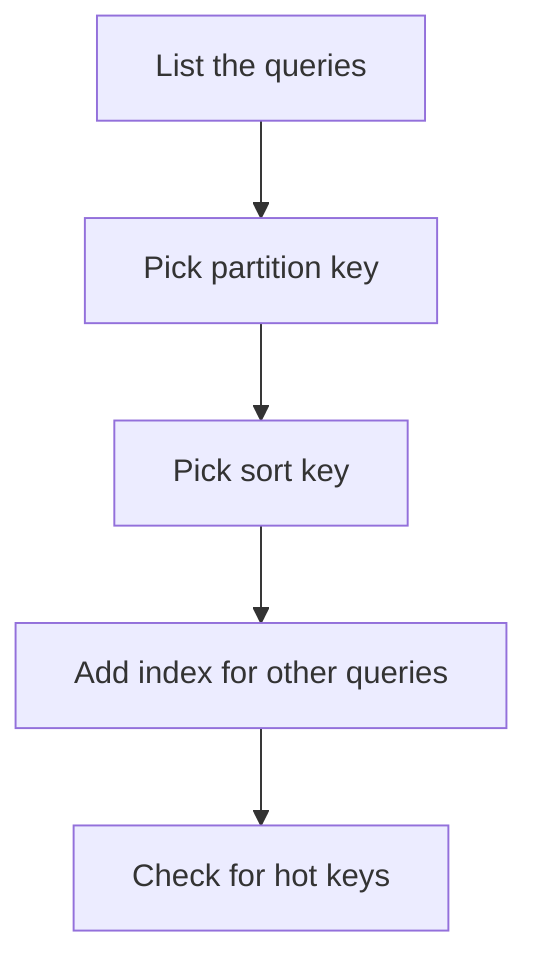

**Code example:** (compiled with JDK 21; an in-memory model of partition and sort keys)

```java
import java.util.Map;
import java.util.TreeMap;
import java.util.concurrent.ConcurrentHashMap;

// Models a NoSQL table: partition key -> items sorted by sort key
public class KeyValueDemo {

    static void put(Map<String, TreeMap<String, String>> table,
                    String partition, String sort, String item) {
        table.computeIfAbsent(partition, p -> new TreeMap<>()).put(sort, item);
    }

    public static void main(String[] args) {
        Map<String, TreeMap<String, String>> table = new ConcurrentHashMap<>();
        put(table, "customer-7", "order-2025-01-03", "{\"amount\": 40}");
        put(table, "customer-7", "order-2025-01-09", "{\"amount\": 15}");
        put(table, "customer-8", "order-2025-01-05", "{\"amount\": 99}");

        // Read one partition, then a range on the sort key
        TreeMap<String, String> part = table.getOrDefault("customer-7", new TreeMap<>());
        System.out.println(part.subMap("order-2025-01-01", "order-2025-01-31"));
        System.out.println(part.get("order-2025-01-03"));  // {"amount": 40}
    }
}
```

**Pitfalls and best practices:**
- Designing a NoSQL table like a normalized SQL schema fails. Design the table around the queries.
- A partition key with few values, such as a status field, creates hot partitions.
- A scan reads the whole table. Keep scans out of hot request paths.
- Reads can be stale. DynamoDB offers strongly consistent reads for the base table, but not for global secondary indexes.
- Describe only the databases you have actually used, with examples from your own work.

**Follow-up questions:**
- *How do you design a DynamoDB table?* Start from the queries, pick a partition key that spreads load, and add a sort key or a global secondary index for other access patterns.
- *Why not use NoSQL for everything?* Joins are weak or missing, and multi-item transactions are more limited. Relational data with many relations fits SQL better.
- *What is the difference between key-value and document stores?* A key-value store looks items up by key only. A document store also queries fields inside each document.

### 15. In which situations would you prefer JPA over native queries?

**Simple explanation:** JPA lets you save and load Java objects, and it writes most of the SQL for you. A native query is SQL that you write yourself and run as is. Use JPA for normal work, and native SQL when you need a database feature or a hand-tuned query.

**Interview answer:** "I use JPA for entity mapping, CRUD operations, and simple queries, because it keeps the code portable and object-oriented. It also handles relationships and the persistence context. I switch to native SQL when I need database-specific features, such as window functions, or a complex reporting query that is awkward in JPQL. I keep native queries in one place, and I map their results to a projection or DTO."

**What it is:** JPA (Jakarta Persistence API) maps Java classes to tables. JPQL is a query language written against entities, not tables. A native query is raw SQL for one specific database.

**Why it matters:** JPA keeps code portable and checks entity queries when the app starts. Native SQL gives full control and database features, but it ties the code to one database and skips the entity model.

**When to use it:**
- JPA for CRUD, mapping, and simple filters.
- Native SQL for window functions, vendor features, large reports, and hand-tuned queries.

**How it works:**
1. You write a repository method with `@Query`.
2. For JPQL, Spring Data checks the query when the app starts.
3. For native SQL, Spring sends the SQL as written, and nothing is checked until it runs.
4. JPQL returns managed entities. Native queries return rows, which you map to a DTO or an interface projection.

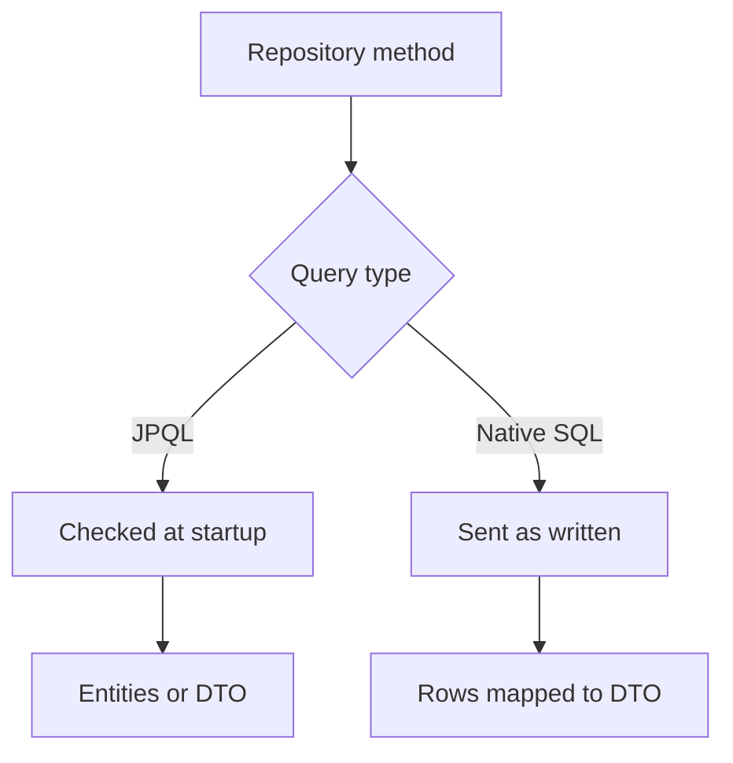

**Code example:** (library example, not compiled)

```java
public record PaymentSummary(String status, long total) {}

public interface PaymentRepository extends JpaRepository<Payment, Long> {

    // JPQL: portable and checked against the entity model at startup
    @Query("select new com.example.PaymentSummary(p.status, count(p)) " +
           "from Payment p group by p.status")
    List<PaymentSummary> summarise();

    // Native SQL: for database-specific features or hand-tuned queries
    @Query(value = "SELECT status, COUNT(*) AS total FROM payment GROUP BY status",
           nativeQuery = true)
    List<PaymentSummaryView> summariseNative();   // interface projection
}
```

**Pitfalls and best practices:**
- Map native results to a DTO or interface projection, not `Object[]`. Positional arrays break silently when a column moves.
- JPQL constructor expressions need the full class name and matching argument types.
- Watch for the N+1 problem: one query loads parents, then one query per parent loads children. Fix it with a join fetch or an entity graph.
- A native update does not refresh entities already loaded in the persistence context. Flush and clear the context first.
- Test native queries against the same database engine you use in production.

**Follow-up questions:**
- *What is the risk of native queries?* They are not validated at startup, so a typo shows up at runtime. Cover them with integration tests against the same database.
- *What is the N+1 problem?* One query loads a list, and then each item triggers another query for its children. Join fetch or a batch size setting fixes it.
- *Can you use both in one repository?* Yes. Mix JPQL and native methods in the same interface, and keep them together in one place.

### 16. Write a query for sorting.

*Note: the question is short. I read it as: write a SQL query that sorts rows with `ORDER BY`.*

**Simple explanation:** `ORDER BY` sorts the rows of a query result. List the column to sort by after `ORDER BY`. Add `ASC` for smallest first, or `DESC` for largest first.

**Interview answer:** "I use `ORDER BY` to sort results. I name each sort column with `ASC` or `DESC`, and I add a second column as a tie-breaker, so the order is stable. For the top N rows, I add `LIMIT` in PostgreSQL and MySQL, or `FETCH FIRST` in Oracle. For a large table, I make sure an index matches the sort, and I check the execution plan."

**What it is:** `ORDER BY` is the SQL clause that sorts a result. `ASC` means ascending, from A to Z or small to large. `DESC` means descending. Without `ORDER BY`, the database can return rows in any order.

**Why it matters:** Users expect lists in a sensible order, such as newest orders first. Reports and paging also need a stable order.

**When to use it:**
- Lists, reports, and top N results.
- Add an index on the sort columns for large tables.

**How it works:**
1. The database reads the rows that match `WHERE`.
2. It groups the rows if `GROUP BY` is used.
3. It sorts the rows by the `ORDER BY` columns, from left to right.
4. It returns the rows, cut to `LIMIT` if one is given.

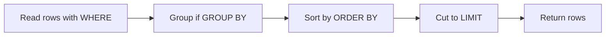

**Code example:**

```sql
-- Sort by one column, newest first
SELECT order_id, customer_id, created_at
FROM orders
ORDER BY created_at DESC;

-- Sort by several columns, with a tie-breaker
SELECT order_id, customer_id, amount
FROM orders
ORDER BY customer_id ASC, amount DESC;

-- Top N rows (PostgreSQL and MySQL)
SELECT order_id, amount
FROM orders
ORDER BY amount DESC
LIMIT 10;

-- Top N rows (Oracle 12c and later)
SELECT order_id, amount
FROM orders
ORDER BY amount DESC
FETCH FIRST 10 ROWS ONLY;
```

**Complexity:** Sorting n matching rows takes O(n log n) time and O(n) extra space. A top N query can use a heap and take O(n log k) time with O(k) space, where k is N.

**Dry run** on this sample table:

| order_id | customer_id | amount | created_at |
|---|---|---|---|
| 1 | 10 | 50 | 2025-03-01 |
| 2 | 11 | 20 | 2025-03-03 |
| 3 | 10 | 80 | 2025-02-20 |
| 4 | 12 | 20 | 2025-03-02 |
| 5 | 11 | 65 | 2025-03-05 |

- Query 1 (`created_at DESC`): 5, 2, 4, 1, 3.
- Query 2 (`customer_id ASC, amount DESC`): 3 (10, 80), 1 (10, 50), 5 (11, 65), 2 (11, 20), 4 (12, 20).
- Query 3 (`amount DESC LIMIT 2`): 3 (80), then 5 (65).

I checked these results by running the same data in SQLite.

**Pitfalls and best practices:**
- Without a tie-breaker, rows with equal values can come back in a different order on each run. This breaks paging. Add the primary key as the last sort column.
- NULL ordering differs by database. PostgreSQL puts NULLs last in ascending order, and MySQL puts them first. Be explicit.
- Sorting on an expression cannot use a plain index on the column. Check the plan with `EXPLAIN`.
- `OFFSET` paging slows down as the offset grows. Use keyset paging for deep pages.

**Follow-up questions:**
- *How do you sort NULLs first?* In PostgreSQL and Oracle, add `NULLS FIRST`. In MySQL, use `ORDER BY col IS NULL DESC, col`. The form `ORDER BY col IS NULL, col` puts NULLs last.
- *How do you page through results efficiently?* Keyset paging: `WHERE (created_at, order_id) < (last_created_at, last_id)` with `ORDER BY created_at DESC, order_id DESC LIMIT 10`.
- *When does ORDER BY use an index?* When the index columns and direction match the sort. Check with `EXPLAIN`.

### 17. Insert data using a SELECT query.

**Simple explanation:** `INSERT ... SELECT` copies rows from a query into a table, in one statement. It is faster than inserting rows one at a time. The columns must match in number, order, and type.

**Interview answer:** "I use `INSERT ... SELECT` when I need to copy or move many rows at once, such as archiving old orders. I list the target columns, and I write a `SELECT` that returns the same number of columns in the same order and types. I run it inside a transaction and check the row count before I commit. To make reruns safe, I add a `NOT EXISTS` check or a unique key, so the same rows are not inserted twice."

**What it is:** An `INSERT` statement adds rows. `INSERT ... SELECT` takes its rows from a query. That query can filter, join, and compute values.

**Why it matters:** One statement moves many rows and avoids the round trips of row-by-row code. The work also stays inside the database.

**When to use it:**
- Archiving old data.
- Loading staging tables.
- Copying data between schemas or building summaries.

**How it works:**
1. Name the target table and its columns.
2. Write the `SELECT` with the same number of columns, in the same order.
3. Filter with `WHERE`, so only the needed rows are copied.
4. Run it inside a transaction and check the row count.
5. Commit if the count is right. Roll back if it is not.

**Code example:**

```sql
-- Copy matching rows from one table into another
INSERT INTO archived_orders (order_id, customer_id, amount, archived_at)
SELECT order_id, customer_id, amount, CURRENT_TIMESTAMP
FROM orders
WHERE created_at < DATE '2025-01-01';
```

**Complexity:** Without an index on `created_at`, the database scans n rows, which is O(n). With an index, it finds the k matching rows in about O(k log n) time. Extra space depends on the rows written and the transaction log, which is O(k).

**Dry run** on this sample `orders` table, with the filter on `created_at < 2025-01-01`:

| order_id | customer_id | amount | created_at |
|---|---|---|---|
| 1 | 10 | 50 | 2024-12-31 |
| 2 | 11 | 20 | 2025-01-02 |
| 3 | 12 | 30 | 2024-11-15 |

- Row 1 matches and is copied, with `archived_at` set to the current time.
- Row 2 does not match and is skipped.
- Row 3 matches and is copied.
- The result is 2 rows archived, which is the row count to check before commit.

I checked this result by running the same data in SQLite.

**Pitfalls and best practices:**
- If the column list is missing, the values go into the table's columns in definition order. A change to the table then copies data into the wrong columns. Always name the columns.
- A large insert holds locks and fills the transaction log. Copy big tables in batches by key range, and commit each batch.
- A rerun without a guard creates duplicates. Use a unique constraint.
- Use a deterministic `ORDER BY` in the `SELECT` if the insert order matters, for example for generated IDs.
- Use date literals that your database supports. `DATE '2025-01-01'` is standard SQL, and SQLite uses plain strings.

**Follow-up questions:**
- *How do you avoid inserting duplicates on a rerun?* Add `WHERE NOT EXISTS` to the query, or a unique constraint with `ON CONFLICT DO NOTHING` in PostgreSQL.
- *How do you move rows instead of copying them?* In one transaction, run the `INSERT ... SELECT` and then a `DELETE` with the same filter. PostgreSQL can also use `DELETE ... RETURNING` to do both in one statement.
- *How do you copy a huge table without long locks?* Copy in batches by primary key range, and commit after each batch.

### 18. Describe a scenario where you used the ELK Stack.

**Simple explanation:** The ELK Stack is three tools for logs. Elasticsearch stores and searches them, Logstash cleans and routes them, and Kibana shows them in dashboards. Teams use it to find errors across many services quickly.

**Interview answer:** Template: "In [project], our services wrote [log format, such as JSON with a correlation ID], and [shipper, such as Filebeat or Logstash] sent them to Elasticsearch. I built Kibana dashboards for [what you watched, such as error rates and slow requests]. When [incident], I searched by [field] across services and found [the failing call] in [time]. I also set an alert on [metric and threshold]."

**Sample (replace with your own):** "In my last project, services wrote JSON logs with a correlation ID. Filebeat shipped them to Elasticsearch, and Kibana showed error rates by service. When a customer reported a failed order, I searched by correlation ID and found the failing call in a few minutes. I set an alert when the payment service logged more than a set number of errors in five minutes."

**What it is:** ELK stands for Elasticsearch (search and storage), Logstash (ingestion and transformation), and Kibana (dashboards). Beats, such as Filebeat, are light agents that ship log files from a host. Many teams now call the wider set the Elastic Stack.

**Why it matters:** With many services, logs sit on many machines. Central search lets you follow one request across all of them.

**When to use it:**
- Centralized logs, error search, and log dashboards.
- For metrics over time, Prometheus and Grafana usually fit better. ELK is strong at text search.

**How it works:**
1. Each service writes structured logs, such as JSON, to stdout or a file.
2. Filebeat reads the log files on each host and sends them on.
3. Logstash parses the lines and adds fields such as the service name.
4. Elasticsearch indexes the events.
5. Kibana queries the indexes for dashboards and alerts.

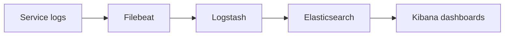

**Code example:** (library example, not compiled)

```java
import jakarta.servlet.FilterChain;
import jakarta.servlet.ServletException;
import jakarta.servlet.http.HttpServletRequest;
import jakarta.servlet.http.HttpServletResponse;
import java.io.IOException;
import java.util.Optional;
import java.util.UUID;
import org.slf4j.MDC;
import org.springframework.stereotype.Component;
import org.springframework.web.filter.OncePerRequestFilter;

@Component
public class CorrelationFilter extends OncePerRequestFilter {
    @Override
    protected void doFilterInternal(HttpServletRequest req, HttpServletResponse res,
                                    FilterChain chain) throws ServletException, IOException {
        String id = Optional.ofNullable(req.getHeader("X-Correlation-Id"))
                            .orElse(UUID.randomUUID().toString());
        MDC.put("correlationId", id);   // added to every log line in this request
        try {
            res.setHeader("X-Correlation-Id", id);
            chain.doFilter(req, res);
        } finally {
            MDC.clear();
        }
    }
}
```

**Pitfalls and best practices:**
- Logs without a correlation ID are hard to join across services. Pass the ID in headers and in messages.
- Never log secrets such as card numbers or tokens. Mask them before logging.
- Set index lifecycle policies to roll over and delete old indexes. Otherwise storage costs grow without limit.
- Avoid putting high-cardinality values, such as user IDs, into field names. This bloats the index.
- MDC is per thread. It does not follow work sent to an executor unless you copy it, for example with a task decorator.

**Follow-up questions:**
- *Why use Elasticsearch instead of a relational database for logs?* It handles free-text search and large append-only volumes well, and it is built for aggregations over time.
- *What is the difference between Filebeat and Logstash?* Filebeat is a light shipper on each host. Logstash is heavier and does parsing and enrichment.
- *What is MDC?* The Mapped Diagnostic Context is a per-thread set of key-value pairs that the logging framework adds to each log line.

### 19. How would you rate your expertise in CI/CD pipelines on a scale of 1 to 5?

**Simple explanation:** CI/CD means continuous integration, which builds and tests every change, and continuous delivery, which deploys it safely. The interviewer wants an honest rating that matches your real work. Give a number you can back up with examples.

**Interview answer:** Template: "I'd rate myself [number] out of 5. I'm strong in [what you did, such as triggering builds, updating deployment manifests, and verifying rollouts]. I'm weaker in [what you did not own, such as writing pipelines from scratch or managing runners]. I'm working on [specific gap]."

**Sample (replace with your own):** "I'd rate myself 3 out of 5. I'm strong in triggering builds, adding test stages to pipelines, and updating Kubernetes deployment manifests, and I verify rollouts with readiness checks. I'm weaker in writing a complete pipeline from scratch and managing build runners. I'm working on building a full pipeline for a small service, with code analysis and image scanning."

**What it is:** CI builds and tests code on every commit. CD deploys the tested build to test or production environments, often through stages that need approval. Common tools include Jenkins, GitHub Actions, GitLab CI, and Argo CD, which deploys from Git (GitOps).

**Why it matters:** An honest rating helps the interviewer place you correctly. An overrating leads to follow-up questions you cannot answer.

**When to use it:** Use this answer for any role that mentions DevOps, CI/CD, or Kubernetes. Use this guide to pick your number:
- 1: knows the terms only.
- 2: has triggered pipelines and read the logs.
- 3: has changed pipeline steps and deployment settings.
- 4: has built or owned pipelines for a team.
- 5: designs and runs pipelines and runners across several services.

**How it works:**
1. List what you personally did, such as triggering builds, editing pipeline files, or doing a rollback.
2. Match each item to the guide above.
3. Pick the lowest level that you can fully back with an example.
4. Name one gap, and the step you are taking to close it.

**Code example:** (library example, not compiled; a GitHub Actions workflow)

```yaml
name: build-and-deploy
on:
  push:
    branches: [main]
jobs:
  build:
    runs-on: ubuntu-latest
    steps:
      - uses: actions/checkout@v4
      - uses: actions/setup-java@v4
        with:
          distribution: temurin
          java-version: '21'
      - run: ./mvnw -B verify
      - name: Build image
        run: docker build -t my-service:${{ github.sha }} .
  deploy:
    needs: build
    runs-on: ubuntu-latest
    environment: test
    steps:
      - run: echo "update the Helm values or the Argo CD manifest here"
```

**Pitfalls and best practices:**
- Do not claim ownership of a pipeline you only triggered.
- Keep secrets in the CI secret store, never in the repository.
- Put tests and security scans before the deploy stage, and make them required.
- Build the image once and promote the same image through each environment.
- Plan the rollback before you need it. A tested rollback matters more than a fast deploy.

**Follow-up questions:**
- *What would move you up one point?* Write a complete pipeline for a small service: build, test, code analysis, image build, and deploy to a test environment.
- *How do you handle a failed deployment?* Roll back to the previous image or Helm revision, check readiness probes and logs, and then find the cause.
- *What is GitOps?* Git holds the desired state of the cluster, and a tool such as Argo CD keeps the cluster matched to it.


# Client Interview (Round 2)

Introduction, project, design, testing, and experience questions. Answers that describe your own work are templates with [brackets] to fill in. ⭐ marks a question that also appears in the QuestioRex bank.

---

### 1. Introduction

**Simple explanation:** This is a short talk about yourself. It usually lasts about one minute. It tells the interviewer your experience, your main skills, and the role you want next.

**Interview answer:**
Template: "I'm a [level] software developer with [number] years of backend experience, mostly in [domain]. I build [language and framework] services, including [REST APIs, microservices, or event processing]. I've deployed them on [cloud] and [platform]. I like owning problems from end to end, from [requirements] to [production monitoring]. I'm looking for a role where I can [goal]."

Sample (illustrative only, not a real profile): "I'm a senior software developer with six years of backend experience, mostly in order and payment systems. I build Java and Spring Boot services, including REST APIs and Kafka-based event processing. I've deployed them on AWS and Kubernetes. I like owning problems from end to end, from clarifying requirements to watching services in production. I'm looking for a role where I can design systems that handle high volume."

**What it is:** A short summary of your background. It is also called an elevator pitch.

**Why it matters:** The interviewer uses your first answer to plan the rest of the interview. A clear answer gives them good follow-up questions, and you can answer those well.

**When to use it:** At the start of any interview, and when a new team asks about you.

**How it works:**
1. Say your role and your years of experience.
2. Name your domain and your main technologies.
3. Name one result you are proud of.
4. Say what role you want next.

**Code example:** This question is about speaking, so the example fills a template with values. It uses a text block, which is a string written over several lines.

```java
public class IntroDemo {
    public static void main(String[] args) {
        String years = "[years]";
        String domain = "[domain]";
        String pitch = """
                I am a backend developer with %s years of experience in %s.
                I build Java and Spring Boot services for APIs and events.
                """.formatted(years, domain);
        System.out.print(pitch);
    }
}
```

**Pitfalls and best practices:**
- Keep it near one minute, about 120 to 150 words.
- Use the same core facts in every interview, so your story stays consistent.
- Do not claim skills you cannot back up with an example.
- Name your domain, not only your tools. Interviewers remember the problems you solved.

**Follow-up questions:**
- *Why are you looking to move?* Give a short, positive reason, such as more ownership or a new domain.
- *What is your strongest technical area?* Name one area and give a short project example.

---

### 2. Discuss the module you worked on in your recent project.

**Simple explanation:** A module is one part of a larger system that has one clear job. Here you describe the part you owned, what it did, and the hard problem you solved.

**Interview answer:**
Template: "In [project], I worked on the [module name] module. It [what it does, for example validates and routes incoming messages]. My part was [your specific work]. The main challenge was [challenge], so I [decision and why]. Because it handles [money or personal data], I also worked on [security or audit logging]."

Sample (illustrative only, not a real project): "In a sample card-processing system, I worked on the message router module. It checked incoming authorization and reversal messages and sent each one to the right handler. My part was the handlers for both message types. The main challenge was matching each reversal to its original authorization, so I stored the transaction ID with each record. Because it handles money, I also added audit logging for every decision."

**What it is:** A module is a bounded part of the code, with a clear input, a clear output, and one main job.

**Why it matters:** Interviewers use this question to check that you own real work. They also use your answer to ask deeper questions.

**When to use it:** When an interviewer asks about your recent project, or about a part you own.

**How it works:**
1. Receive a message from the outside system.
2. Read its type, using a sealed type so every case is known.
3. Send it to the matching handler.
4. Write an audit log for the decision.

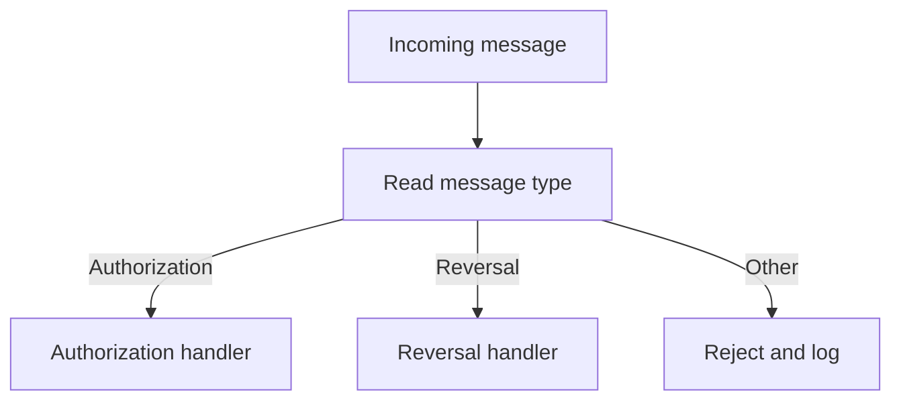

**Code example:** A sealed interface lists every message type. A `switch` with patterns must handle each one, so a new type cannot be missed silently.

```java
sealed interface PaymentMessage permits Authorization, Reversal, Unknown {}
record Authorization(String txnId, long amountCents) implements PaymentMessage {}
record Reversal(String originalTxnId, long amountCents) implements PaymentMessage {}
record Unknown(String rawType) implements PaymentMessage {}

public class RouterDemo {
    static String route(PaymentMessage msg) {
        return switch (msg) {
            case Authorization a -> "authorize " + a.txnId() + " for " + a.amountCents();
            case Reversal r -> "reverse " + r.originalTxnId();
            case Unknown u -> "reject unknown type " + u.rawType();
        };
    }

    public static void main(String[] args) {
        System.out.println(route(new Authorization("T1", 2500)));
        System.out.println(route(new Reversal("T1", 2500)));
        System.out.println(route(new Unknown("9999")));
    }
}
```

**Pitfalls and best practices:**
- Know your module's inputs, outputs, and failure cases in detail.
- Be ready to explain one decision you made, and why you made it.
- Do not describe code you did not write as your own work.
- In payment flows, make every handler idempotent, so a retried message is safe.

**Follow-up questions:**
- *What is the biggest technical risk in a payment flow?* Duplicate or lost messages, which can leave balances wrong. Use idempotent processing, reliable messaging, and reconciliation.
- *How do you match a reversal to its original authorization?* Use the original transaction ID as a key, look it up in the database, and reject a reversal that has no match.

---

### 3. What are the technology stacks you have used in your recent project?

**Simple explanation:** A technology stack is the set of tools that a system is built with. Group them by layer, such as language, data, messaging, and deployment, so the answer is easy to follow.

**Interview answer:**
Template: "In [project], the services are built with [language and version] and [framework]. Data is stored in [database], accessed through [JPA, MyBatis, or another tool]. Asynchronous work uses [messaging tool]. The services run in [container tool] on [orchestration platform], and we deploy with [CI/CD tool]. We monitor with [monitoring tools]."

Sample (illustrative only, not a real project): "The services are built with Java 17 and Spring Boot, with Spring Security for access control. Data is stored in PostgreSQL, accessed with Spring Data JPA. Kafka handles asynchronous processing. The services run in Docker containers on Kubernetes, and we deploy with Jenkins. Grafana shows dashboards for the team."

**What it is:** A list of the languages, frameworks, databases, and tools used in one project.

**Why it matters:** It shows the interviewer where you can contribute right away. It also gives them topics to ask about.

**When to use it:** When asked about your recent work, or when the interviewer wants to compare your skills with their team.

**How it works:**
1. Group the tools by layer: language and frameworks, data, messaging, infrastructure, and tooling.
2. Name the version for the language, since version differences matter.
3. Name the purpose of each tool in a few words.
4. Check each item against your own project before the interview.

**Code example:** A map keeps one entry per layer. A `TreeMap` sorts the keys, so the output is in a fixed order.

```java
import java.util.Map;
import java.util.TreeMap;

public class StackDemo {
    public static void main(String[] args) {
        Map<String, String> stack = new TreeMap<>(Map.of(
                "Language and frameworks", "Java 17, Spring Boot",
                "Data", "PostgreSQL, Spring Data JPA",
                "Messaging", "Kafka",
                "Infrastructure", "Docker, Kubernetes",
                "Tooling", "Jenkins, Grafana"));
        stack.forEach((layer, tools) -> System.out.println(layer + ": " + tools));
    }
}
```

**Pitfalls and best practices:**
- Do not list a tool you only read about. Follow-up questions expose it fast.
- Give versions for Java and Spring, since they change how features work.
- Say what each tool did for you, not only that you used it.
- Keep the list short. Name the main tools and offer more if asked.

**Follow-up questions:**
- *Why did you choose Kafka over a simple queue?* Kafka keeps messages for a set time, lets many consumer groups read the same events, and scales by partitions.
- *Why did you choose PostgreSQL?* It supports transactions, strong consistency, and good indexing for the queries the team needs.

---

### 4. What microservices do you use in your project, and how do they communicate?

> ⭐ **STAR (important)**

**Simple explanation:** A microservice is a small service that does one business job and runs on its own. Services talk to each other in two ways: a direct request that waits for an answer, and an event that is handled later.

**Interview answer:**
Template: "The main services in [project] handle [service names and jobs]. They talk in two ways. For answers needed right away, they use [REST or gRPC] with timeouts and [circuit breaker, if used]. For work that can happen later, they publish events to [Kafka or another broker], and consumers process them. An [API gateway or other tool] handles outside traffic, and [service discovery method] finds the services."

Sample (illustrative only, not a real project): "The main services handle order intake, authorization checks, routing, reconciliation, and notifications. They talk in two ways. For answers needed right away, they use REST with a two-second timeout. For work that can happen later, such as reconciliation and notifications, they publish events to Kafka. An API gateway handles outside traffic, and Kubernetes DNS finds the services."

**What it is:** Microservices are small services with their own code and data. Synchronous calls wait for an answer. Asynchronous calls send an event and do not wait.

**Why it matters:** Each kind of call has different risks. A slow synchronous call can hold threads. A duplicated event can cause double work. You need a rule for each kind.

**When to use it:**
- Use a synchronous REST or gRPC call when the caller needs the answer now.
- Use Kafka events when the work can happen later or many services need the same event.

**How it works:**
1. The client sends a request to the API gateway.
2. The gateway checks the token with the auth service over REST.
3. The order service creates the order and returns the result.
4. The order service publishes an event to Kafka.
5. Other services read the event in their own consumer group.

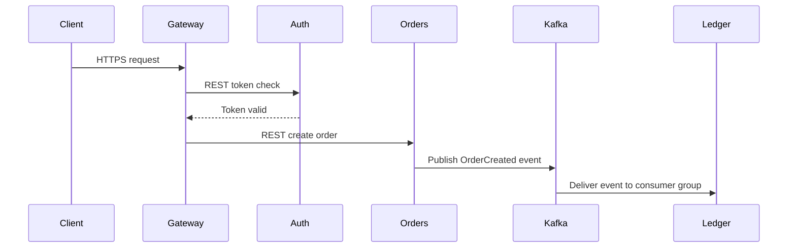

**Code example:** This is a Spring library example, so it is not compiled here. It shows one synchronous call with a timeout and one asynchronous publish.

```java
// (library example, not compiled)
@Service
public class OrderClient {
    private final WebClient authClient;                       // Spring HTTP client
    private final KafkaTemplate<String, OrderCreated> kafka;  // Spring Kafka sender

    public OrderClient(WebClient authClient, KafkaTemplate<String, OrderCreated> kafka) {
        this.authClient = authClient;
        this.kafka = kafka;
    }

    // Synchronous: the caller needs an answer now, so set a timeout
    public boolean isTokenValid(String token) {
        return Boolean.TRUE.equals(authClient.get()
                .uri("/tokens/{t}/valid", token)
                .retrieve()
                .bodyToMono(Boolean.class)
                .timeout(Duration.ofSeconds(2))
                .block());
    }

    // Asynchronous: publish and move on, consumers handle it later
    public void publishCreated(OrderCreated event) {
        kafka.send("orders.created", event.orderId(), event);
    }
}
```

**Pitfalls and best practices:**
- Always set a timeout on synchronous calls, so a slow service cannot hold your threads.
- Make event consumers idempotent, because Kafka can deliver a message more than once.
- Do not let services share one database. Each service owns its data.
- Add a trace ID to every request and event, so you can follow one flow across services.

**Follow-up questions:**
- *How do you keep data consistent across services?* Use the saga pattern, where each step has a compensating action if a later step fails. Or accept eventual consistency with idempotent handlers.
- *What do you do when a synchronous call times out?* Retry only if the operation is safe to repeat, use a circuit breaker to stop calls to a failing service, and return a clear error to the caller.

---

### 5. What is the total number of systems you communicate with in your project, and how?

**Simple explanation:** Count the other systems your project talks to, then group them by type. For each group, name the protocol, which is the set of rules for the messages.

**Interview answer:**
Template: "The project talks to about [number] external and internal systems. [Group 1, for example card networks] are reached through [protocol] over [transport]. [Group 2, for example internal services] use [REST, SOAP, or Kafka]. [Group 3, for example client channels] use [WebSocket or REST]. Each group is secured with [security control]. I counted these from [source, for example the architecture diagram]."

Sample (illustrative only, not a real project): "The project talks to about 12 systems. Three external payment networks are reached over HTTPS with mutual TLS. Five internal services use REST and Kafka. Two legacy back-end systems use SOAP. Two client channels use WebSocket and REST. I counted these from the architecture diagram."

**What it is:** A count of all the systems your project calls or receives calls from, with the protocol for each group.

**Why it matters:** It shows you understand the whole system, not only one service. It also shows you know where the risks are, such as external timeouts.

**When to use it:** When asked about the architecture, integrations, or your role in them.

**How it works:**
1. List every system your project connects to.
2. Group them by type: external, internal, legacy, and client.
3. Name the protocol and transport for each group.
4. Name the security control for each group.
5. Give the total only if you can defend it.

**Code example:** A record stores each link, and a stream counts the links per protocol. The `TreeMap` keeps the output in a fixed order.

```java
import java.util.List;
import java.util.Map;
import java.util.TreeMap;
import java.util.stream.Collectors;

public class SystemCountDemo {
    enum Protocol { REST, SOAP, KAFKA, WEBSOCKET }
    record Link(String system, Protocol protocol) {}

    public static void main(String[] args) {
        List<Link> links = List.of(
                new Link("card network A", Protocol.SOAP),
                new Link("card network B", Protocol.REST),
                new Link("orders service", Protocol.REST),
                new Link("ledger service", Protocol.KAFKA),
                new Link("channel app", Protocol.WEBSOCKET));

        Map<Protocol, Long> byProtocol = links.stream()
                .collect(Collectors.groupingBy(Link::protocol, TreeMap::new, Collectors.counting()));

        System.out.println("Total systems: " + links.size());
        byProtocol.forEach((p, n) -> System.out.println(p + ": " + n));
    }
}
```

**Pitfalls and best practices:**
- Do not round the number up. Count what you can name.
- Separate external partners from internal services, since their risks differ.
- Name the protocol for each group, not only for the total.
- Say where the count came from, so the interviewer knows it is based on a real diagram.

**Follow-up questions:**
- *Which external system causes the most issues?* Describe the failure pattern in general terms, such as timeouts, and the fix, such as a timeout and retry with backoff.
- *How do you secure a system call?* Use TLS for the transport, mutual TLS or tokens for identity, and allow-lists for who can call each endpoint.

---

### 6. How do you go about taking on a refactor task whenever you're implementing a feature?

**Simple explanation:** A refactor changes the structure of code without changing what it does. Make the change in small steps, and test after each step, so you can always tell what broke.

**Interview answer:** "I start by making sure the existing code has good tests, so I have a safety net. Then I look for code smells, such as long methods, duplicate code, or classes with many jobs. I make small changes, such as extracting a method, and I run the tests after each one. I commit the refactor on its own, so it is easy to review and roll back. Only then do I add the new feature on top of the cleaner code."

**What it is:** A refactor is a behaviour-preserving change to code. A code smell is a sign of a design problem, such as duplicate logic or a class that does too much.

**Why it matters:** Mixing a refactor with a feature makes bugs hard to find. If the tests pass before and after the refactor, you know the refactor did not change behaviour.

**When to use it:** Before adding a feature to code that is hard to change, such as a long method or a tangled class.

**How it works:**
1. Add or check tests for the current behaviour.
2. Find one code smell to fix.
3. Make one small change.
4. Run the tests.
5. Commit the refactor alone, then build the feature on top.

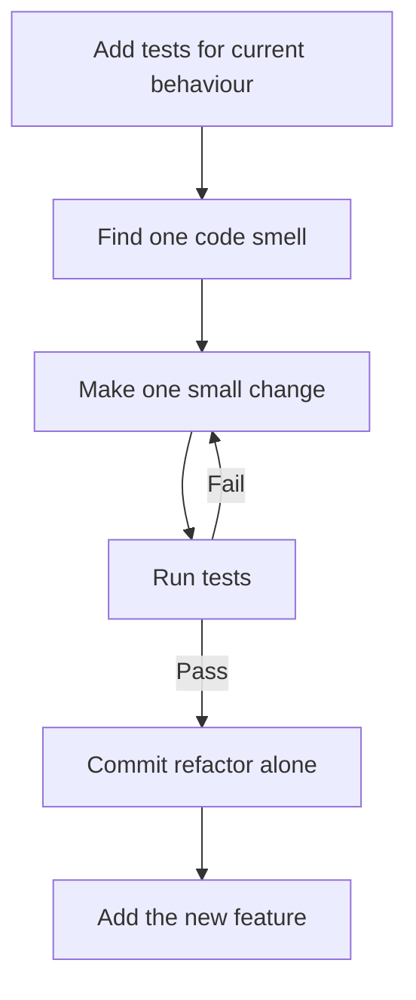

**Code example:** The old method mixes validation, summing, and formatting. The new version splits them into small methods. The check at the end confirms both give the same answer.

```java
import java.util.List;

public class RefactorDemo {
    // Before: one method does validation, summing, and formatting
    static String invoiceOld(List<Integer> prices) {
        int total = 0;
        for (int p : prices) {
            if (p < 0) throw new IllegalArgumentException("negative");
            total += p;
        }
        return "Total: " + total;
    }

    // After: small steps with the same behaviour
    static int validateAndSum(List<Integer> prices) {
        prices.forEach(RefactorDemo::requireNonNegative);
        return prices.stream().mapToInt(Integer::intValue).sum();
    }

    static void requireNonNegative(int p) {
        if (p < 0) throw new IllegalArgumentException("negative");
    }

    static String format(int total) {
        return "Total: " + total;
    }

    public static void main(String[] args) {
        List<Integer> prices = List.of(10, 20, 30);
        // Test first: both versions must give the same answer
        System.out.println(invoiceOld(prices).equals(format(validateAndSum(prices))));
    }
}
```

**Pitfalls and best practices:**
- Do not start a refactor without tests. Write characterization tests first, which record what the code does now.
- Do not mix refactoring and feature changes in one commit.
- Avoid big rewrites. They are hard to review and often break things in production.
- Stop when the code is clear enough for the feature. Refactoring has no natural end.

**Follow-up questions:**
- *What if there are no tests?* Add tests for the parts you will touch first, then refactor. Keep the first change very small.
- *How do you know a refactor is safe?* The tests pass before and after, and the code review shows no change in behaviour.

---

### 7. How do you go about breaking down a God interface without introducing risk to breaking other things?

**Simple explanation:** A God interface has too many methods, so every class that uses it depends on all of them. Split it into smaller interfaces, and move clients to the small ones one by one.

**Interview answer:** "I apply the Interface Segregation Principle, which says clients should not depend on methods they do not use. I create smaller interfaces, each with one focus. The existing class implements both the old interface and the new ones, so nothing breaks. I then move each client to the small interface it needs, one at a time. When no client uses the old interface, I deprecate it and remove it."

**What it is:** A God interface is a large interface that does many jobs. The Interface Segregation Principle (ISP) says it is better to have several small interfaces than one large one.

**Why it matters:** Large interfaces force every implementer to write methods it does not need. They also make tests harder, because a mock must cover many methods.

**When to use it:** When one interface has many unrelated methods, and different clients use different subsets.

**How it works:**
1. Create small interfaces, each grouping related methods.
2. Make the existing implementation class implement the old and the new interfaces.
3. Move each client to inject the small interface it needs.
4. Deprecate the old interface once no client uses it.
5. Remove it in a later release.

**Code example:** The checkout controller depends only on the placing interface. The implementation still satisfies the old big interface, so existing callers do not break.

```java
interface OrderOperations {
    void placeOrder(String id);
    void cancelOrder(String id);
    String orderReport(String id);
}

interface OrderPlacing { void placeOrder(String id); }
interface OrderCancelling { void cancelOrder(String id); }
interface OrderReporting { String orderReport(String id); }

class OrderServiceImpl implements OrderOperations, OrderPlacing, OrderCancelling, OrderReporting {
    public void placeOrder(String id) { System.out.println("placed " + id); }
    public void cancelOrder(String id) { System.out.println("cancelled " + id); }
    public String orderReport(String id) { return "report " + id; }
}

class CheckoutController {
    private final OrderPlacing placing;   // needs only one method

    CheckoutController(OrderPlacing placing) {
        this.placing = placing;
    }

    void checkout(String id) {
        placing.placeOrder(id);
    }
}

public class GodInterfaceDemo {
    public static void main(String[] args) {
        OrderServiceImpl svc = new OrderServiceImpl();
        new CheckoutController(svc).checkout("A1");
        System.out.println(svc.orderReport("A1"));
    }
}
```

**Pitfalls and best practices:**
- Do not delete the old interface on day one. Keep it until every client has moved.
- Split by client need, not by file size. Ask what each caller uses.
- Add a test for each small interface, so you know it works on its own.
- Track remaining users of the old interface, so you know when removal is safe.

**Follow-up questions:**
- *How do you find all the clients of the old interface?* Search the code for the type name, and check the IDE usages report. Also check other modules that depend on it.
- *Is one class implementing many interfaces a problem?* Not usually. The clients see only the interface they need, which is the point of the split.

---

### 8. How do we know which interface implementation to use for which specific controller when breaking down interfaces?

**Simple explanation:** When two classes implement the same interface, Spring must know which one to inject. You can tell it by name, by a default choice, by the environment, or by a key at runtime.

**Interview answer:** "Spring gives me several ways to choose. I use `@Qualifier` when one controller needs a specific bean by name. I use `@Primary` to set a default when most places want the same implementation. I use `@Profile` when the choice depends on the environment, such as dev or prod. When the choice depends on a value at runtime, I inject a map of beans, keyed by a name, and look up the right one."

**What it is:** A bean is an object that Spring creates and manages. When more than one bean matches a type, Spring needs a rule to pick one.

**Why it matters:** Without a rule, Spring fails at startup with an error about multiple candidates. Clear rules keep each controller on the right implementation.

**When to use it:**
- `@Qualifier` when one injection point needs one specific bean.
- `@Primary` when there is one normal default.
- `@Profile` when the environment decides the choice.
- A map of beans when the key comes from the request.

**How it works:**
1. Spring finds all beans that match the requested type.
2. If there is one, it injects it.
3. If there are several, it looks for `@Qualifier`.
4. If there is no qualifier, it uses the `@Primary` bean.
5. If there is still no winner, startup fails.

**Code example:** This plain Java version compiles on its own. A map picks the notifier from a key, which is the runtime lookup idea. Spring can inject the same map, with bean names as keys.

```java
import java.util.Map;

interface Notifier { String send(String msg); }
class EmailNotifier implements Notifier { public String send(String m) { return "email: " + m; } }
class SmsNotifier implements Notifier { public String send(String m) { return "sms: " + m; } }

public class NotifierLookupDemo {
    static final Map<String, Notifier> NOTIFIERS = Map.of(
            "email", new EmailNotifier(),
            "sms", new SmsNotifier());

    static String notify(String channel, String msg) {
        Notifier n = NOTIFIERS.get(channel);
        if (n == null) throw new IllegalArgumentException("no notifier for " + channel);
        return n.send(msg);
    }

    public static void main(String[] args) {
        System.out.println(notify("email", "order shipped"));
        System.out.println(notify("sms", "order shipped"));
    }
}
```

The Spring version of the qualifier and primary rules looks like this:

```java
// (library example, not compiled)
@Service
@Primary
public class EmailNotifier implements Notifier { /* ... */ }

@RestController
public class AlertController {
    private final Notifier notifier;

    public AlertController(@Qualifier("smsNotifier") Notifier notifier) {
        this.notifier = notifier;   // explicit choice wins over @Primary
    }
}
```

**Pitfalls and best practices:**
- Prefer one clear default with `@Primary`, and use `@Qualifier` only where needed.
- Do not rely on the order of injection. Use names or keys.
- Check which profile is active before you rely on `@Profile`.
- Keep the bean name stable, because `@Qualifier` uses it.

**Follow-up questions:**
- *What happens if two beans match and none is marked?* Startup fails with a NoUniqueBeanDefinitionException, so add `@Primary` or `@Qualifier`.
- *How is `@Profile` different from `@Conditional`?* `@Profile` is a common shortcut for checking the active profile. `@Conditional` lets you write any rule.

---

### 9. How does the application context get bootstrapped and initialize all the dependencies when Spring Boot starts up?

> ⭐ **STAR (important)**

**Simple explanation:** The application context is the container that holds all the beans. When Spring Boot starts, it reads the settings, finds the beans, builds them in the right order, and then starts the web server.

**Interview answer:** "When the main method calls `SpringApplication.run`, Spring Boot first prepares the environment, which holds the properties from files and environment variables. Next it creates the application context and scans for bean definitions, both from my packages and from auto-configuration. Then it refreshes the context, which creates the singleton beans and injects their dependencies in the right order. The embedded server, such as Tomcat, starts during this process, and the app starts taking requests."

**What it is:** The application context is the Spring container. It is the object that owns all beans and their wiring.

**Why it matters:** Knowing the startup order helps you debug failures. Most startup errors are either a missing property or a bean that cannot be built.

**When to use it:** When an app fails to start, when you add a new bean or property source, or when you explain Spring Boot in an interview.

**How it works:**
1. Execution starts at the `@SpringBootApplication` class, through `SpringApplication.run`.
2. Spring builds the `Environment` from `application.properties` or YAML, and from environment variables.
3. It creates the application context. For a web app this is a servlet web context.
4. It loads bean definitions by component scan, and auto-configuration from `AutoConfiguration.imports`.
5. It refreshes the context. It creates singletons and injects dependencies.
6. It starts the embedded server during the refresh.

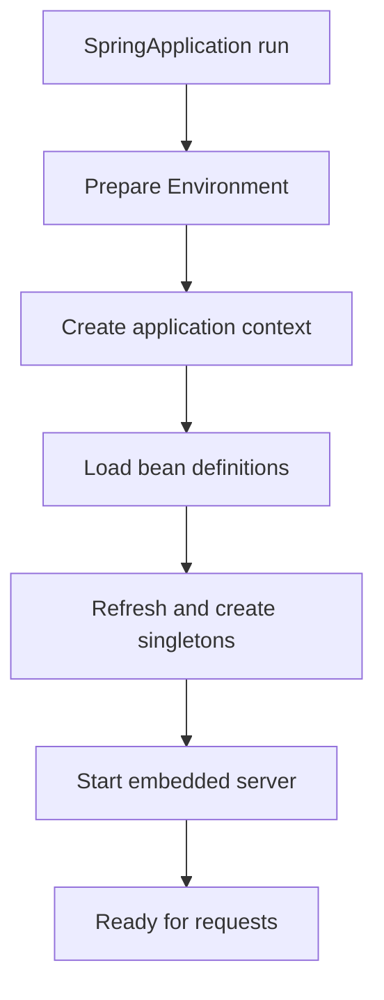

**Code example:** This is a Spring library example, so it is not compiled here. It shows the entry point and a simple check after startup.

```java
// (library example, not compiled)
@SpringBootApplication
public class ShopApplication {
    public static void main(String[] args) {
        ConfigurableApplicationContext ctx = SpringApplication.run(ShopApplication.class, args);
        // The context is ready here: beans are created and the server is listening
        System.out.println(ctx.getBeanDefinitionCount() + " bean definitions loaded");
    }
}
```

**Pitfalls and best practices:**
- Do not do slow work in a constructor. Use an `ApplicationRunner` or a `@PostConstruct` method with care.
- Check the auto-configuration report when a bean is missing, by starting with `--debug`.
- Keep properties in one place per environment, so the order of sources is clear.
- Circular dependencies fail at startup, so fix the design rather than hiding the error.

**Follow-up questions:**
- *What is a singleton bean?* One shared instance per application context. Spring creates it once and injects it wherever it is needed.
- *Where does auto-configuration come from?* Spring Boot reads its list of auto-configuration classes from `META-INF/spring` files, and each one applies only when its conditions match.

---

### 10. What does component scan do?

> ⭐ **STAR (important)**

**Simple explanation:** Component scan is how Spring finds your classes automatically. It searches a package and its sub-packages for classes marked as beans, so you do not register each one by hand.

**Interview answer:** "Component scan is how Spring finds beans without manual registration. `@SpringBootApplication` includes `@ComponentScan`, which starts at the package of the main class and checks every sub-package. It looks for classes marked `@Component`, `@Service`, `@Repository`, or `@Controller`. For each match, it creates a bean definition and registers it in the context. If a class is in a package outside that base, Spring does not see it."

**What it is:** A scan of packages for classes with stereotype annotations. A stereotype annotation tells Spring the role of a class.

**Why it matters:** It removes manual bean registration and keeps the wiring close to the code. It also explains why a bean sometimes seems missing.

**When to use it:** When you add a new service or repository, or when a bean is not found at startup.

**How it works:**
1. Spring starts at the base package, which is the package of the `@SpringBootApplication` class.
2. It walks every sub-package recursively.
3. It checks each class for a stereotype annotation.
4. For each match, it creates a `BeanDefinition`, which is a recipe for the bean.
5. It registers the definition, so Spring can create and inject the bean later.

**Code example:** This is a Spring library example, so it is not compiled here. It shows the base package rule and how to exclude a package.

```java
// (library example, not compiled)
// Package com.example.shop holds the main class       -> scanned
// Package com.example.shop.orders holds OrderService  -> scanned
// Package com.example.legacy is outside the base      -> not scanned

@SpringBootApplication
@ComponentScan(excludeFilters = @ComponentScan.Filter(
        type = FilterType.REGEX, pattern = "com\\.example\\.shop\\.legacy\\..*"))
public class ShopApplication { }

@Service
public class OrderService { }
```

**Pitfalls and best practices:**
- Put the main class in a root package, so the scan covers all your code.
- Do not use the default package. It is hard to scan and hard to read.
- A class outside the base package is a common reason for a missing bean.
- Avoid scanning huge packages you do not own, since it slows startup.

**Follow-up questions:**
- *How is `@Component` different from `@Service`?* They are the same for Spring's scan. `@Service` tells readers the role, which helps the code read well.
- *Can you exclude a class from the scan?* Yes, with `excludeFilters`, or by moving the class out of the base package.

---

### 11. Can you give me a breakdown on the differences between constructor and field injection?

> ⭐ **STAR (important)**

**Simple explanation:** Injection means Spring gives an object the other objects it needs. Constructor injection passes them in through the constructor. Field injection sets them directly on private fields, after the object is built.

**Interview answer:** "I prefer constructor injection. The dependencies are passed in the constructor and stored in final fields, so they cannot change and cannot be missing. The object is never created in a half-ready state. Tests are easy, because I can pass in fakes without starting Spring. Field injection with `@Autowired` on a field is harder to test, and it hides the dependencies. For these reasons I avoid it in new code."

| Feature | Constructor injection | Field injection |
|---|---|---|
| Syntax | Dependencies are passed through the constructor | `@Autowired` is placed on private fields |
| Immutability | Fields can be `final`, which helps thread safety | Fields cannot be `final` |
| Testability | Easy. Pass fakes in plain unit tests | Hard. Needs Spring or reflection to set values |
| Null safety | Guaranteed. The object needs its dependencies to exist | Risk of NullPointerException, since the object can exist half-built |
| Industry standard | Preferred | Discouraged in modern Spring code |

**What it is:** Dependency injection is the pattern where an object receives its collaborators from outside. Constructor and field injection are two ways to do it.

**Why it matters:** With constructor injection, a missing dependency fails fast. With field injection, the failure can show up later, at the first call.

**When to use it:**
- Use constructor injection for almost all new code.
- Use setter injection only for optional dependencies that can change.
- Avoid field injection in new code. It is common only in old code.

**How it works:**
1. Spring creates the dependency first.
2. Spring passes it to the constructor of the class that needs it.
3. The constructor stores it in a `final` field.
4. The object is ready only when all required dependencies exist.

**Code example:** This version is plain Java, so it compiles on its own. It creates the service in a test with a fake gateway, without starting Spring.

```java
import java.util.Objects;

interface PaymentGateway { String charge(int cents); }

class SimpleGateway implements PaymentGateway {
    public String charge(int cents) { return "charged " + cents; }
}

class CheckoutService {
    private final PaymentGateway gateway;   // final: set once, cannot change

    CheckoutService(PaymentGateway gateway) {
        this.gateway = Objects.requireNonNull(gateway, "gateway is required");
    }

    String pay(int cents) {
        return gateway.charge(cents);
    }
}

public class ConstructorInjectionDemo {
    public static void main(String[] args) {
        CheckoutService svc = new CheckoutService(new SimpleGateway());  // no Spring needed
        System.out.println(svc.pay(1999));
        // new CheckoutService(null) fails at once with a NullPointerException
    }
}
```

The field injection version looks like this in Spring:

```java
// (library example, not compiled)
@Service
public class CheckoutService {
    @Autowired
    private PaymentGateway gateway;   // filled in after construction, cannot be final
}
```

**Pitfalls and best practices:**
- With one constructor, Spring injects it automatically, so `@Autowired` is not needed.
- Use `final` fields for required dependencies. The compiler then checks they are set.
- Avoid a constructor with many parameters. It often means the class has too many jobs.
- Test with plain constructors, and use Spring only for integration tests.

**Follow-up questions:**
- *Why is field injection hard to test?* You cannot set a private field from a plain test without reflection, so you must start Spring or use reflection tricks.
- *What about circular dependencies?* Constructor injection fails at startup with a clear error. Fix the design, since field injection can hide the cycle.

---

### 12. What are all the different steps that happen within Spring Boot itself when a consumer makes a request to the controller?

**Simple explanation:** A request first reaches the server and passes through filters. Then Spring's front controller, called the DispatcherServlet, finds the right method, runs the interceptors, calls the method, and writes the response.

**Interview answer:** "The request arrives at the embedded server, such as Tomcat, and passes through the servlet filters, such as the security filter. Then the DispatcherServlet, which is Spring MVC's front controller, asks the handler mapping which controller method matches the URL. Interceptors run their preHandle checks, and the handler adapter calls my controller method. The return value is converted to JSON by an HTTP message converter, which writes the body. Then the postHandle and afterCompletion steps run."

**What it is:** The request lifecycle is the path a web request takes through Spring MVC, from the server to your controller and back.

**Why it matters:** When a request fails, you need to know which step failed. A security error comes from a filter, a 404 from the handler mapping, and a JSON error from the converter.

**When to use it:** When you debug a request, add a cross-cutting concern like logging or auth, or explain Spring MVC in an interview.

**How it works:**
1. The embedded server receives the HTTP request and runs the servlet filters.
2. The DispatcherServlet asks the handler mapping for the matching controller method.
3. The interceptors run `preHandle`. If one returns false, the request stops.
4. The handler adapter invokes the controller method with the converted arguments.
5. The controller calls the service layer and returns a value.
6. The message converter, such as Jackson, writes the JSON body to the response.
7. The interceptors run `postHandle` and `afterCompletion`.

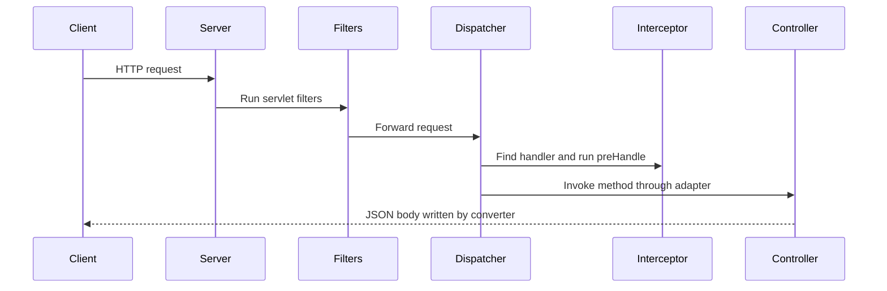

**Code example:** This is a Spring library example, so it is not compiled here. It shows an interceptor that times each request. It must be registered in a `WebMvcConfigurer`.

```java
// (library example, not compiled)
@Component
public class TimingInterceptor implements HandlerInterceptor {

    @Override
    public boolean preHandle(HttpServletRequest req, HttpServletResponse res, Object handler) {
        req.setAttribute("startNs", System.nanoTime());
        return true;   // false stops the request here
    }

    @Override
    public void afterCompletion(HttpServletRequest req, HttpServletResponse res,
                                Object handler, Exception ex) {
        long startNs = (long) req.getAttribute("startNs");
        long ms = (System.nanoTime() - startNs) / 1_000_000;
        System.out.println(req.getRequestURI() + " took " + ms + " ms");
    }
}
```

**Pitfalls and best practices:**
- `postHandle` runs after the controller returns, but for `@ResponseBody` the body is already written. You cannot change the body there.
- Put security in a filter or the security filter chain, so it runs before any controller.
- Keep interceptors light. They run on every request they match.
- Log the request ID at the start, so you can match logs across steps.

**Follow-up questions:**
- *What is the difference between a filter and an interceptor?* A filter is a servlet-level feature that wraps every request. An interceptor is Spring MVC-level and knows the handler.
- *What runs when the controller throws an exception?* The `@ControllerAdvice` handler, which maps the exception to a response.

---

### 13. What are all the different levels of testing that you have been doing or that you know that are required?

**Simple explanation:** Tests come in levels. Small unit tests check one class. Bigger tests check how parts work together. The top level checks the whole system, as a user would.

**Interview answer:** "I know the testing pyramid. At the bottom are unit tests, which check one class with mocks for its dependencies. Above them are slice tests and integration tests with `@SpringBootTest`, which check layers with a real or in-memory database. Contract tests check that an API keeps its request and response shape. At the top are end-to-end tests, which run the whole flow. In [project], I wrote [unit tests with Mockito] and [integration tests with a test database]."

**What it is:** A test level is a group of tests with the same scope. The pyramid says to have many small tests and few large ones.

**Why it matters:** Small tests are fast and point to the exact bug. Large tests are slow but show that the parts work together.

**When to use it:**
- Unit tests for business logic in one class.
- Integration tests for repositories, controllers, and database queries.
- Contract tests for APIs shared with other teams.
- End-to-end tests for a few key user flows.

**How it works:**
1. Write many unit tests for the business rules.
2. Add integration tests for each layer and database query.
3. Add contract tests for each API your team publishes or consumes.
4. Keep a small set of end-to-end tests for critical flows.
5. Run the fast tests on every commit, and the slow ones in the pipeline.

```mermaid
flowchart TD
    A[Few end to end tests] --> B[Contract tests]
    B --> C[Integration tests]
    C --> D[Many unit tests]
```

**Code example:** This is a Spring library example, so it is not compiled here. It calls the REST endpoint through `MockMvc`, with a real Spring context.

```java
// (library example, not compiled)
@SpringBootTest
@AutoConfigureMockMvc
class OrderApiIT {

    @Autowired
    MockMvc mvc;

    @Test
    void returnsOrderStatus() throws Exception {
        mvc.perform(get("/orders/o1"))
           .andExpect(status().isOk())
           .andExpect(jsonPath("$.status").value("PAID"));
    }
}
```

**Pitfalls and best practices:**
- Do not use `@SpringBootTest` for every test. It is slow, so use slice tests where they fit.
- Use a real database engine in integration tests when your queries are specific to it.
- Keep tests independent. Do not depend on the order they run in.
- Make the pipeline fail when coverage or key tests fail, so bugs cannot slip through.

**Follow-up questions:**
- *What is a slice test?* A test that loads only one part of Spring, such as the web layer with `@WebMvcTest`, which is faster than a full context.
- *Who writes the tests?* Developers write unit and integration tests in the pipeline. Testers add functional and end-to-end tests.

---

### 14. What is the difference between unit testing and functional or end-to-end testing, and what are developer responsibilities?

**Simple explanation:** A unit test checks one small piece of code, with fake parts around it. An end-to-end test checks a whole user flow across many real systems.

**Interview answer:** "A unit test checks one class in isolation, and it uses fakes or mocks for other parts, so it is fast and points to the exact problem. An end-to-end test checks a real user flow across the API, the database, and the message queue, so it shows the system works together. As a developer, I write and maintain unit and integration tests in the pipeline. I aim for high coverage of business rules, and I make sure no regression reaches QA or user acceptance testing."

**What it is:** Unit testing checks the smallest units, such as methods or classes. Functional and end-to-end testing check features from the user's side.

**Why it matters:** Unit tests catch errors early and cheaply. End-to-end tests catch problems between systems that unit tests cannot see.

**When to use it:**
- Unit tests for every business rule.
- End-to-end tests for a few critical flows, such as placing an order.

**How it works:**
1. A unit test creates the class with fakes for its dependencies.
2. It calls one method and checks the result.
3. An end-to-end test starts the full system, or a close copy of it.
4. It runs a real user flow, such as an API call that writes to the database.
5. It checks the final state in each system.

**Code example:** This unit test is plain Java. The tax rule is a fake that always returns 10, so the test checks only the total logic.

```java
interface TaxRules { int taxFor(int amount); }

class OrderTotal {
    private final TaxRules rules;

    OrderTotal(TaxRules rules) {
        this.rules = rules;
    }

    int total(int amount) {
        return amount + rules.taxFor(amount);
    }
}

public class UnitTestDemo {
    public static void main(String[] args) {
        TaxRules fakeRule = amount -> 10;   // fake: fixed answer, no real tax service
        OrderTotal total = new OrderTotal(fakeRule);
        check(total.total(100) == 110, "total with fixed tax");
        System.out.println("all unit checks passed");
    }

    static void check(boolean ok, String name) {
        if (!ok) throw new AssertionError(name);
    }
}
```

An end-to-end test is written as a scenario, like this:

```text
Scenario: customer places an order
  Given the customer has a valid cart
  When the customer calls POST /orders with the cart
  Then the order API returns 201
  And the database has one new order with status PAID
  And a payment event is published to the queue
```

**Pitfalls and best practices:**
- Do not use end-to-end tests to check every rule. They are slow and fragile.
- Keep unit tests free of network and database calls.
- Use test data that is clean and reset between runs.
- Treat a failing test as a bug, and fix it before adding new code.

**Follow-up questions:**
- *What is a mock?* A test double that records calls and returns set answers. A fake is a simpler working version, like an in-memory list.
- *Who owns end-to-end tests?* Often a QA team, with developers helping to keep them up to date.

---

### 15. Do you have experience with the client previously?

**Simple explanation:** The interviewer wants to know if you have worked with this client before. Answer honestly, then show how your experience fits their scale and needs.

**Interview answer:**
Template: "[Yes: I worked with [client] on [project], where I [your work].] [No: I have not worked with [client] directly, but I have built [similar system] that handles [volume] requests per second, using [patterns, for example queues, caching, or bounded thread pools].]"

Sample (illustrative only, not the candidate's real history): "I have not worked with this client before. However, I have built order services that handle a few thousand requests per second. I used bounded thread pools, Kafka queues, and caching to keep them stable under load. I understand the reliability and scale needs of a large retail system."

**What it is:** A direct question about past work with the client. The answer should be true, short, and tied to the role.

**Why it matters:** Interviewers check honesty first. A false claim will be exposed by the first follow-up question.

**When to use it:** When an interviewer asks about past work with the client, or about domain fit.

**How it works:**
1. Answer yes or no in the first sentence.
2. Describe the closest real experience in one or two sentences.
3. Name the scale or pattern that matches the client's needs.
4. Ask a question about their systems, to show interest.

**Code example:** This question is not about code, so the example shows a pattern that matches high-volume work. A bounded pool with a bounded queue limits the load, and `CallerRunsPolicy` slows the producer when the queue is full.

```java
import java.util.concurrent.ArrayBlockingQueue;
import java.util.concurrent.ExecutorService;
import java.util.concurrent.ThreadPoolExecutor;
import java.util.concurrent.TimeUnit;

public class BoundedPoolDemo {
    public static void main(String[] args) throws InterruptedException {
        // 4 threads and a queue of 100. When the queue is full, the caller runs the task.
        ExecutorService pool = new ThreadPoolExecutor(
                4, 4, 0L, TimeUnit.MILLISECONDS,
                new ArrayBlockingQueue<>(100),
                new ThreadPoolExecutor.CallerRunsPolicy());

        for (int i = 1; i <= 500; i++) {
            final int id = i;
            pool.submit(() -> handle(id));
        }
        pool.shutdown();
        pool.awaitTermination(30, TimeUnit.SECONDS);
        System.out.println("all requests handled");
    }

    static void handle(int id) {
        if (id % 100 == 0) System.out.println("handled " + id);   // stands in for real work
    }
}
```

**Pitfalls and best practices:**
- Never claim experience you do not have. Interviewers check it.
- Keep the answer under 30 seconds, then move to the strengths that matter.
- Name the scale in numbers, since large clients care about volume.
- Ask a short question about their architecture at the end.

**Follow-up questions:**
- *What would you need to learn first?* The client's internal platform, their release process, and their domain rules.
- *How do you handle very high load?* Use bounded queues, caching, timeouts, and horizontal scaling behind a load balancer.

---

### 16. Do you have experience with containers and Docker?

> ⭐ **STAR (important)**

**Simple explanation:** Docker packages an app with everything it needs into a container, which runs the same way on any machine. An image is the blueprint, and a container is a running copy of it.

**Interview answer:**
Template: "[Yes: In [project], I used Docker to [package services, write Dockerfiles, run local stacks with docker-compose]. I [networks and volumes detail]. / I have a foundational understanding of Docker. I know how to write a Dockerfile, build an image, manage networks and volumes, and use docker-compose for multi-container setups.]"

Sample (illustrative only, not the candidate's real history): "I have used Docker to package Spring Boot services as images, with multi-stage Dockerfiles that keep the final image small. I run local stacks with docker-compose, which starts the service, a database, and a broker together. I know how volumes keep data and how networks let containers talk by name. I have not run containers in production myself, but I understand how Kubernetes runs the same images."

**What it is:** A container is an isolated process with its own files and network view. Docker is the common tool that builds and runs containers. An image is a read-only template.

**Why it matters:** The same image runs in dev, test, and production, so "it works on my machine" problems drop. It also makes deployments repeatable.

**When to use it:**
- Package each service as an image.
- Run local stacks with docker-compose for development and integration tests.
- Use the same image in the CI/CD pipeline.

**How it works:**
1. Write a Dockerfile with the base image, the build steps, and the start command.
2. Build the image with `docker build`.
3. Run a container from the image with `docker run`.
4. Use a volume to keep data outside the container.
5. Use docker-compose to start several containers that talk on one network.

**Code example:** Not Java, so there is no compile check. The first block is a multi-stage Dockerfile, and the second is a docker-compose file.

```dockerfile
FROM eclipse-temurin:21-jdk AS build
WORKDIR /app
COPY . .
RUN ./mvnw -q package -DskipTests

FROM eclipse-temurin:21-jre
WORKDIR /app
COPY --from=build /app/target/app.jar app.jar
EXPOSE 8080
ENTRYPOINT ["java", "-jar", "app.jar"]
```

```yaml
services:
  app:
    build: .
    ports:
      - "8080:8080"
    depends_on:
      - db
  db:
    image: postgres:16
    environment:
      POSTGRES_PASSWORD: example
    volumes:
      - dbdata:/var/lib/postgresql/data
volumes:
  dbdata:
```

**Pitfalls and best practices:**
- Use multi-stage builds, so the final image has no build tools.
- Do not put secrets in the image. Pass them at run time.
- Use a specific image tag, not `latest`, so builds are repeatable.
- Run the container as a non-root user where possible.

**Follow-up questions:**
- *What is the difference between an image and a container?* An image is the read-only template. A container is a running instance of it.
- *How do containers talk to each other?* On a user-defined Docker network, they reach each other by service name.

---

### 17. Other than Singleton, can you give me a design pattern that you've used and explain how it works and its use cases?

> ⭐ **STAR (important)**

**Simple explanation:** A design pattern is a known solution to a common design problem. The Factory pattern picks the right class to create at runtime. The Builder pattern creates a complex object step by step.

**Interview answer:**
Template: "In [project], I used the [pattern name] pattern to [problem it solved]. It works by [how it works in your code]. For example, [specific class or feature]. I also used [second pattern] to [problem]. Without it, [what would have gone wrong]."

Sample (illustrative only, not the candidate's real history): "In a sample order service, I used the Factory pattern to pick a payment processor at runtime, based on the payment type. The factory returns the right processor, so the caller never uses an if-else chain. I also used the Builder pattern to create immutable order objects with many optional fields. Without it, the constructors would have many parameters and be hard to read."

**What it is:** Factory means one place decides which concrete class to create. Builder means you set fields one at a time, then call `build` to create the final object.

**Why it matters:** Both patterns keep the caller simple. The factory hides the choice of class. The builder hides the many steps needed to make an object.

**When to use it:**
- Factory: when the class to create depends on a type or a value at runtime.
- Builder: when an object has many fields, some optional, and you want it immutable.

**How it works:**
1. Factory: take a type and return the matching class as a common interface.
2. Builder: a nested class holds the fields, with one setter per field that returns the builder.
3. Builder: `build` checks the required fields and creates the immutable object.

**Code example:** This code is plain Java and compiles on its own. The factory picks the processor by type. The builder creates an immutable `Order`.

```java
import java.util.ArrayList;
import java.util.List;

interface PaymentProcessor { String pay(long cents); }
class CardProcessor implements PaymentProcessor { public String pay(long c) { return "card paid " + c; } }
class WalletProcessor implements PaymentProcessor { public String pay(long c) { return "wallet paid " + c; } }

final class PaymentFactory {
    static PaymentProcessor create(String type) {
        return switch (type) {
            case "CARD" -> new CardProcessor();
            case "WALLET" -> new WalletProcessor();
            default -> throw new IllegalArgumentException("unknown type " + type);
        };
    }
}
final class Order {
    private final String id;
    private final String customer;
    private final List<String> items;

    private Order(Builder b) {
        this.id = b.id;
        this.customer = b.customer;
        this.items = List.copyOf(b.items);
    }

    static Builder builder() { return new Builder(); }

    @Override
    public String toString() { return id + " " + customer + " " + items; }

    static final class Builder {
        private String id;
        private String customer;
        private final List<String> items = new ArrayList<>();
        Builder id(String v) { this.id = v; return this; }
        Builder customer(String v) { this.customer = v; return this; }
        Builder item(String v) { items.add(v); return this; }

        Order build() {
            if (id == null) throw new IllegalStateException("id required");
            return new Order(this);
        }
    }
}

public class PatternDemo {
    public static void main(String[] args) {
        System.out.println(PaymentFactory.create("CARD").pay(500));
        System.out.println(Order.builder().id("o1").customer("ann").item("pen").item("ink").build());
    }
}
```

**Pitfalls and best practices:**
- Do not add a factory for one class that never changes. It adds code without value.
- In Spring, a factory is often replaced by a map of beans, which is simpler.
- Keep the builder's `build` method as the only place that checks required fields.
- Make the built object immutable, so it is safe to share.

**Follow-up questions:**
- *Why use Builder instead of a constructor with many parameters?* The calls read clearly, optional fields are easy to skip, and the object is built in one checked step.

---

### 18. Can you walk me through the repository service controller pattern?

**Simple explanation:** This is the standard layered design for web services. The controller handles HTTP, the service holds the business rules, and the repository talks to the database. Each layer does one job.

**Interview answer:** "I use a layered design. The controller is the entry point, and it handles routing, parameter binding, validation, and the HTTP status code. It has no business logic. The service holds the business rules and coordinates the work, and it owns the transaction boundary with `@Transactional`. The repository handles database access, using Spring Data JPA or MyBatis. This keeps each layer small, testable, and easy to change."

**What it is:** A layered architecture splits code into layers with one direction of calls. The main layers are controller, service, and repository.

**Why it matters:** Each layer can be tested and changed on its own. A change to the database does not touch the HTTP code.

**When to use it:** For most web services with business rules and a database.

**How it works:**
1. The controller receives the HTTP request and validates it.
2. The controller calls one service method.
3. The service applies the business rules and calls one or more repositories.
4. The repository reads or writes the database.
5. The result returns up the layers, and the controller maps it to a response.

```mermaid
flowchart TD
    A[HTTP request] --> B[Controller layer]
    B --> C[Service layer]
    C --> D[Repository layer]
    D --> E[Database]
```

**Code example:** This plain Java version compiles on its own. The service depends on a repository interface, so the database can be replaced in tests.

```java
import java.util.Map;
import java.util.Optional;

interface OrderRepository {
    Optional<String> findStatus(String id);
}

class InMemoryOrderRepository implements OrderRepository {
    private final Map<String, String> rows = Map.of("o1", "PAID");

    public Optional<String> findStatus(String id) {
        return Optional.ofNullable(rows.get(id));
    }
}

class OrderService {
    private final OrderRepository repo;

    OrderService(OrderRepository repo) {
        this.repo = repo;
    }

    String statusFor(String id) {
        return repo.findStatus(id)
                .orElseThrow(() -> new IllegalArgumentException("unknown order " + id));
    }
}

public class LayeredDemo {
    public static void main(String[] args) {
        OrderService service = new OrderService(new InMemoryOrderRepository());
        // A controller would call this method and map the result to an HTTP response
        System.out.println("o1 -> " + service.statusFor("o1"));
    }
}
```

**Pitfalls and best practices:**
- Do not put business rules in the controller. Keep it thin.
- Do not let a controller call a repository directly, since it skips the rules.
- Put `@Transactional` on the service, not on the controller.
- Return DTOs from the controller, not entities. See the entities and DTOs question.

**Follow-up questions:**
- *Why not put everything in one class?* It is faster at first, but the class becomes hard to test and change as the rules grow.
- *Is this the same as hexagonal architecture?* It is related. Hexagonal design puts the domain at the center, with ports for the outside world.

---

### 19. Have you used any ORM frameworks and how does that influence code writing?

**Simple explanation:** An ORM, or object-relational mapper, maps Java objects to database tables. You work with objects, and the framework writes most of the SQL for you.

**Interview answer:**
Template: "Yes, I have used [Spring Data JPA with Hibernate, or MyBatis] in [project]. It helped me [what it did, for example map entities to tables and write simple queries]. It changed how I write code, because I work with objects and [repository methods]. I watch for [N+1 queries or other traps], and I check the SQL in tests when a query is important."

Sample (illustrative only, not the candidate's real history): "Yes, I have used Spring Data JPA with Hibernate. It maps my order entities to tables, and it writes simple queries from method names. It changed how I write code, because I work with objects and repository methods, not raw SQL strings. I watch for N+1 queries, and I check the generated SQL in tests when a query is important."

**What it is:** JPA is the Java standard for object-relational mapping. Hibernate is a common implementation of JPA. Spring Data JPA adds repository interfaces on top.

**Why it matters:** It removes a lot of repeated SQL code. It also adds traps, such as lazy loading that runs many small queries.

**When to use it:** For standard CRUD and relationships. For heavy reporting, native SQL is often better.

**How it works:**
1. Mark a class as an entity, and map its fields to columns.
2. Declare a repository interface for the entity.
3. Spring Data creates the implementation at startup.
4. Hibernate tracks changes to loaded entities and writes updates on commit.
5. A lazy relation loads only when it is first read.

**Code example:** This is a JPA library example, so it is not compiled here. It shows the N+1 trap and a fix with `join fetch`.

```java
// (library example, not compiled)
@Entity
public class Order {
    @Id Long id;

    @OneToMany(mappedBy = "order", fetch = FetchType.LAZY)
    List<OrderLine> lines;
}

public interface OrderRepository extends JpaRepository<Order, Long> {

    // One query for orders and their lines. Without this, loading 100 orders
    // and reading each one's lines runs about 101 queries (the N+1 problem).
    @Query("select distinct o from Order o left join fetch o.lines")
    List<Order> findAllWithLines();
}
```

**Pitfalls and best practices:**
- Watch for the N+1 select problem, where one query leads to many lazy loads.
- Keep transactions short, so the session does not stay open too long.
- Use DTO projections for read-only screens, so you load only the needed columns.
- Check important queries in integration tests against the same database engine.

**Follow-up questions:**
- *What is dirty checking?* Hibernate compares loaded entities with their original state, and writes only the changed fields on commit.
- *When do you choose MyBatis?* When you want full control of the SQL, and the mapping is simple.

---

### 20. How do entities and DTOs relate, why is there separation, and would you return raw entities to the response?

**Simple explanation:** An entity maps to a database table. A DTO, or data transfer object, is the shape of data sent to or from the API. Keep them separate, so the database shape does not leak to clients.

**Interview answer:** "Entities map to database tables, and DTOs map to API requests and responses. I keep them separate for three reasons. Entities can hold sensitive fields, such as password hashes or internal IDs, that clients must never see. The DTO also decouples the API from the table, so a database change does not break clients. Finally, the API often needs a different shape, such as a flattened or summed view. So I return DTOs, and I never return raw entities."

**What it is:** An entity is a class linked to a table through JPA. A DTO is a simple class, often a record, that carries data across a boundary.

**Why it matters:** Returning entities can leak secrets, tie clients to the schema, and cause infinite loops in JSON when two entities point to each other.

**When to use it:** Almost always for API responses. Use DTOs for request bodies too, so clients cannot set internal fields.

**How it works:**
1. The service loads an entity from the repository.
2. The service maps the entity to a response DTO.
3. The DTO includes only the fields the client should see.
4. The controller returns the DTO.
5. Jackson turns the DTO into JSON.

```mermaid
flowchart TD
    A[Database row] --> B[Entity]
    B --> C[Service maps fields]
    C --> D[Response DTO]
    D --> E[JSON to client]
```

**Code example:** This plain Java version compiles on its own. The entity holds a password hash, and the response record includes only the safe fields.

```java
import java.time.Instant;

class UserEntity {                       // maps to the users table
    final long id;
    final String email;
    final String passwordHash;           // sensitive: must never leave the service
    final Instant createdAt;

    UserEntity(long id, String email, String passwordHash, Instant createdAt) {
        this.id = id;
        this.email = email;
        this.passwordHash = passwordHash;
        this.createdAt = createdAt;
    }
}

record UserResponse(long id, String email) {   // the API shape
    static UserResponse from(UserEntity e) {
        return new UserResponse(e.id, e.email);
    }
}

public class DtoDemo {
    public static void main(String[] args) {
        UserEntity entity = new UserEntity(7, "ann@example.com", "hash-xyz", Instant.now());
        UserResponse response = UserResponse.from(entity);
        System.out.println(response);   // the password hash is not in the output
    }
}
```

**Pitfalls and best practices:**
- Never return an entity with a password, token, or internal audit field.
- Avoid bidirectional relations in JSON. Use DTOs to break the loop.
- Use a mapper, such as MapStruct, for large mappings, and test it.
- Validate request DTOs, so bad input never reaches the service.

**Follow-up questions:**
- *Why not use the entity as the DTO to save code?* It saves a few lines but couples the API to the table and risks leaking fields later.
- *What causes an infinite JSON loop?* Two entities that point to each other, such as parent and child, which Jackson follows forever. A DTO that holds only IDs or simple fields avoids it.

# Client QuestioRex Question Bank

All questions from the QuestioRex list in the client notes, with detailed answers, grouped by topic. ⭐ marks a question that is also in the L1 or client interview list.

---

## Collections

### Difference between List and Set

**Simple explanation:** A List keeps items in order and allows duplicates. A Set keeps only unique items, and most Sets do not promise any order.

**Interview answer:** "List and Set both belong to the Java Collections Framework, which is the set of standard data containers in Java. A List keeps items in order, so each item has an index, and it allows duplicates. A Set does not allow duplicates, so adding the same item twice keeps one copy. HashSet has no order, LinkedHashSet keeps insertion order, and TreeSet keeps sorted order. I use a List when order or repeats matter, and a Set when I need uniqueness or fast contains checks."

**What it is:** List is an ordered collection with indexes. Set is a collection with no duplicates.

**Why it matters:** Choosing the right type avoids bugs like duplicate records, and gives faster lookups.

**When to use it:**
- Use List for cart line items, where order and repeats matter.
- Use Set for unique email addresses or tags.

**How it works:**
1. A List stores items in order and keeps each item's position.
2. add on a List always appends, even if the value already exists.
3. A Set checks equals and hashCode before it adds an item.
4. If the item already exists, the Set ignores the add call.
5. Iteration order depends on the Set type.

**Code example:**
```java
import java.util.*;

public class Main {
    public static void main(String[] args) {
        List<String> list = new ArrayList<>();
        list.add("apple");
        list.add("apple");
        list.add("banana");
        System.out.println("List: " + list);              // [apple, apple, banana]
        System.out.println("List index 0: " + list.get(0)); // apple

        Set<String> set = new LinkedHashSet<>();
        set.add("apple");
        set.add("apple");
        set.add("banana");
        System.out.println("Set: " + set);                // [apple, banana]
        System.out.println("Set size: " + set.size());    // 2
    }
}
```

**Pitfalls and best practices:**
- Objects put in a HashSet need correct equals and hashCode, or duplicates appear.
- Do not assume HashSet keeps insertion order. Use LinkedHashSet for that.
- Use List.of or Set.of for immutable collections in Java 9 and later.
- get(index) on a LinkedList is slow, because it walks the chain.

**Follow-up questions:**
- Which Set is fastest? HashSet, with constant average time for add and contains.
- Can a List hold null? Yes, ArrayList allows null. Set.of does not allow null.

### Tree Set in Collections

**Simple explanation:** A TreeSet is a Set that keeps its items sorted at all times. It also has no duplicates.

**Interview answer:** "TreeSet is a Set that stores items in sorted order. Internally it uses a red-black tree, which is a self-balancing binary search tree. Add, remove and contains take logarithmic time, so the time grows slowly as the set grows. Items must be comparable, either by implementing Comparable or by passing a Comparator. TreeSet also has useful range methods such as first, ceiling and headSet."

**What it is:** A sorted Set based on a red-black tree. A red-black tree rebalances itself after each change.

**Why it matters:** You get uniqueness and sorting in one structure, with no separate sort step.

**When to use it:**
- Keep a sorted list of unique scores.
- Find the nearest value, such as the next free time slot.

**How it works:**
1. Each new item is placed by comparing it with nodes in the tree.
2. Smaller items go left, and bigger items go right.
3. If the comparison returns zero, the item is a duplicate and is not added.
4. The tree rebalances after inserts and deletes.
5. Iteration walks the tree in sorted order.

**Code example:**
```java
import java.util.*;

public class Main {
    public static void main(String[] args) {
        TreeSet<Integer> nums = new TreeSet<>();
        nums.add(40);
        nums.add(10);
        nums.add(30);
        nums.add(10);                                  // duplicate, ignored
        System.out.println(nums);                      // [10, 30, 40]
        System.out.println("first: " + nums.first());  // 10
        System.out.println("ceiling of 25: " + nums.ceiling(25)); // 30
        System.out.println("headSet of 30: " + nums.headSet(30)); // [10]
    }
}
```

**Pitfalls and best practices:**
- A TreeSet cannot hold null. It throws NullPointerException.
- Items need a consistent compareTo, or lookups break.
- If compareTo returns 0 for different objects, the TreeSet treats them as the same item.
- Add and contains cost O(log n) time, and the space is O(n).

**Follow-up questions:**
- TreeSet or HashSet? TreeSet is sorted with O(log n) operations. HashSet is unordered with O(1) on average.
- How do you reverse the order? Pass Comparator.reverseOrder() to the constructor.

### In collections what kind of data set we used for sorting

(Interpretation: the question is vague. The most likely meaning is "which collection keeps data sorted, or how do I sort a collection".)

**Simple explanation:** Use TreeSet or TreeMap when data must stay sorted all the time. Use a List and sort it once when you only need sorting now and then.

**Interview answer:** "If I need sorted data at all times, I use TreeSet for unique values or TreeMap for sorted keys. Both keep order on every insert. If I only need to sort a list once, I call list.sort with a Comparator. Java uses TimSort for objects, which is a merge-based sort that takes O(n log n) time. I choose based on whether I sort once or keep data sorted all the time."

**What it is:** Sorting puts items in order by a rule, such as by number or by name.

**Why it matters:** Sorted data makes search, ranges and reports easier.

**When to use it:**
- TreeMap for a leaderboard keyed by score.
- list.sort for a one-time report.

**How it works:**
1. For a List, list.sort applies TimSort with a Comparator.
2. TimSort takes O(n log n) time in the worst case.
3. For TreeSet or TreeMap, each insert keeps the order, at O(log n) time per insert.

**Code example:**
```java
import java.util.*;

public class Main {
    public static void main(String[] args) {
        List<String> names = new ArrayList<>(List.of("Mango", "apple", "Banana"));
        names.sort(String.CASE_INSENSITIVE_ORDER);
        System.out.println(names);                     // [apple, Banana, Mango]

        TreeSet<String> sorted = new TreeSet<>(names);
        System.out.println(sorted);                    // [Banana, Mango, apple]
    }
}
```

**Pitfalls and best practices:**
- A TreeSet uses natural order, where uppercase letters come before lowercase.
- A Comparator that is not consistent can give wrong or failing sorts.
- Use String.CASE_INSENSITIVE_ORDER for a case-insensitive sort.

**Follow-up questions:**
- What is TimSort? A hybrid of merge sort and insertion sort, which is stable and fast on partly sorted data.
- Is List.sort stable? Yes, equal items keep their original order.

### Linked List that adds elements at the beginning.

(Interpretation: the question asks which collection adds items at the front. The answer is LinkedList with addFirst.)

**Simple explanation:** A LinkedList stores each item in a node that points to the next node. Adding at the beginning is fast, because only the first pointer changes.

**Interview answer:** "LinkedList is a doubly linked list, so each node points to the next and the previous node. Adding to the front with addFirst takes constant time, because the list only updates the head pointer. ArrayList is slower for front inserts, because it must shift every item. If I only need a queue or stack, I might use ArrayDeque, which is usually faster."

**What it is:** A linked list is a chain of nodes. Each node holds a value and links to other nodes.

**Why it matters:** Front inserts are O(1), so they do not slow down as the list grows.

**When to use it:**
- A queue or undo stack where items enter at the front.
- Many inserts at the head, with few index lookups.

**How it works:**
1. The list keeps a pointer to the first node, called head.
2. addFirst creates a new node with the value.
3. The new node points to the old head.
4. The list moves head to the new node.
5. No other items move, so the time is constant.

**Code example:**
```java
import java.util.*;

public class Main {
    public static void main(String[] args) {
        LinkedList<Integer> list = new LinkedList<>();
        list.addFirst(3);                    // [3]
        list.addFirst(2);                    // [2, 3]
        list.addFirst(1);                    // [1, 2, 3]
        System.out.println(list);            // [1, 2, 3]
        System.out.println(list.getFirst()); // 1
    }
}
```
Complexity: each addFirst takes O(1) time and O(1) extra space. n adds take O(n) time and O(n) space.
Dry run: start empty. addFirst(3) gives [3]. addFirst(2) puts 2 in front, giving [2, 3]. addFirst(1) gives [1, 2, 3].

**Pitfalls and best practices:**
- get(index) on a LinkedList takes O(n) time, so avoid it in loops.
- LinkedList uses more memory per item than ArrayList, because of the pointers.
- ArrayDeque is often a better choice for stacks and queues.

**Follow-up questions:**
- What is the difference between addFirst and push? For a LinkedList, push is the same as addFirst.
- Is LinkedList thread safe? No. Use a concurrent queue for shared work.

## Core Java

### How do you handle the failure retry in the application?

(Template: this asks about your own project. Fill in the brackets with your real work.)

**Simple explanation:** A retry means trying the same action again after a short wait when it fails for a temporary reason, such as a network timeout.

**Interview answer (template):** "In [project name], when [call to a service or database] fails, I retry it [number] times. I wait a little longer after each try, using exponential backoff. I retry only temporary errors, such as timeouts and HTTP 503, and not errors like invalid input. After the last try, I [send to a dead letter queue, or log and alert]. I also make sure the operation is idempotent, so a retry does not create duplicate records."

**Sample answer (sample, not a real experience):** "In an order service, when the payment call times out, I retry three times with waits of 1, 2 and 4 seconds. If it still fails, I save the order as pending and alert the support team."

**What it is:** A retry repeats a failed action, with rules for how many times and how long to wait.

**Why it matters:** Many failures are short and go away on their own. Retry keeps the user from seeing an error.

**When to use it:**
- Network calls to other services.
- Database lock timeouts or deadlocks.

**How it works:**
1. Run the action.
2. If it works, return the result.
3. If it fails with a retryable error, wait for the backoff time.
4. Double the wait after each failure.
5. Stop after the maximum number of tries and raise the error.

**Code example:**
```java
import java.util.concurrent.Callable;

public class Main {
    static <T> T retry(Callable<T> task, int maxAttempts) throws Exception {
        long waitMs = 100;
        for (int attempt = 1; ; attempt++) {
            try {
                return task.call();
            } catch (Exception e) {
                if (attempt >= maxAttempts) {
                    throw e;
                }
                System.out.println("Attempt " + attempt + " failed, retrying in " + waitMs + " ms");
                Thread.sleep(waitMs);
                waitMs *= 2;
            }
        }
    }

    public static void main(String[] args) throws Exception {
        int[] calls = {0};
        String result = retry(() -> {
            calls[0]++;
            if (calls[0] < 3) throw new RuntimeException("temporary failure");
            return "ok after " + calls[0] + " calls";
        }, 5);
        System.out.println(result);
    }
}
```
Complexity: at most maxAttempts calls, so O(k) time for k tries and O(1) extra space.
Dry run: call 1 fails and waits 100 ms. Call 2 fails and waits 200 ms. Call 3 succeeds and returns "ok after 3 calls". The output is two retry lines, then the result.

**Pitfalls and best practices:**
- Retry only errors that may go away. Do not retry bad input.
- Use exponential backoff with jitter, so many clients do not retry at the same moment.
- Make the action idempotent, so running it twice gives the same result.
- Set an overall timeout so retries do not hang forever.

**Follow-up questions:**
- What is a circuit breaker? A pattern that stops calls after many failures, then tests again later.
- What tools help in Spring? Spring Retry and Resilience4j provide retry annotations.

### Use of static, final, this and super keywords

**Simple explanation:** static means one copy shared by all objects. final means a value, method or class cannot change. this points to the current object, and super points to the parent class.

**Interview answer:** "static belongs to the class, not to one object, so all objects share it. final stops a variable from being changed after it is set, stops a method from being overridden, and stops a class from being extended. this refers to the current object, and I use it to tell fields apart from parameters, or to call another constructor. super refers to the parent class, and I use it to call a parent constructor or method."

**What it is:** Four Java keywords with different jobs. static is for class-level members, final fixes a value, and this and super refer to objects in a class hierarchy.

**Why it matters:** They control memory sharing, safety and inheritance.

**When to use it:**
- static for constants and helper methods.
- final for values that must not change, such as IDs.
- this in constructors and setters.
- super to reuse parent code.

**How it works:**
1. static members are loaded once, with the class.
2. A final field must be set once, in the constructor or at its declaration.
3. this.name refers to the field, not to a parameter with the same name.
4. super(...) must be the first line of a constructor.

**Code example:**
```java
public class Main {
    static class Animal {
        static int count = 0;            // shared by all objects
        final String kind;               // set once
        String name;

        Animal(String name) {
            this(name, "unknown");       // calls the other constructor
        }
        Animal(String name, String kind) {
            this.name = name;            // the field, not the parameter
            this.kind = kind;
            count++;
        }
        void speak() { System.out.println(name + " makes a sound"); }
    }

    static class Dog extends Animal {
        Dog(String name) {
            super(name, "dog");          // calls the parent constructor
        }
        @Override
        void speak() {
            super.speak();               // calls the parent method
            System.out.println(name + " barks");
        }
    }

    public static void main(String[] args) {
        Dog d = new Dog("Rex");
        d.speak();
        System.out.println("kind=" + d.kind + ", objects=" + Animal.count);
    }
}
```
Output: "Rex makes a sound", "Rex barks", "kind=dog, objects=1".

**Pitfalls and best practices:**
- A static method cannot use this, because no object exists.
- A final reference can still point to an object whose contents change. Only the reference is fixed.
- Call this or super only as the first statement of a constructor.
- Avoid many static fields, because they act like global state.

**Follow-up questions:**
- Can a constructor be final? No. Constructors are not inherited, so final makes no sense.
- What is a static block? Code that runs once, when the class loads.

### Difference between Class and Interface

**Simple explanation:** A class is a blueprint that can hold data and code. An interface is a contract that lists what a class must be able to do.

**Interview answer:** "A class can have fields, constructors and full method code, and it can extend only one other class. An interface lists methods that a class must provide, and a class can implement many interfaces. Since Java 8, interfaces can have default and static methods, and since Java 9 they can have private methods. I use interfaces to define behaviour, and classes to hold state and logic."

**What it is:** A class is a full type with state and code. An interface is a type that describes behaviour.

**Why it matters:** Interfaces let unrelated classes be used the same way, which makes code flexible and easy to test.

**When to use it:**
- Use an interface when many unrelated classes need the same method, such as Payable.
- Use a class when you need fields and shared logic.

**How it works:**
1. A class uses extends for one parent class.
2. A class uses implements for any number of interfaces.
3. The class must write code for every abstract method.
4. A default method gives an interface shared code.

**Code example:**
```java
public class Main {
    interface Payable {
        double TAX = 0.18;                            // constant
        void pay(double amount);                      // abstract method
        default String currency() { return "USD"; }   // default method
    }

    static class Card implements Payable {
        @Override
        public void pay(double amount) {
            System.out.println("Paid " + amount + " " + currency());
        }
    }

    public static void main(String[] args) {
        Payable p = new Card();
        p.pay(100.0);                                  // Paid 100.0 USD
        System.out.println("tax rate " + Payable.TAX); // tax rate 0.18
    }
}
```

**Pitfalls and best practices:**
- Interface fields are public static final by default.
- Two inherited default methods with the same name must be overridden in the class.
- Do not use an interface only to hold constants. Use a class or enum.

**Follow-up questions:**
- Can an interface have a constructor? No, because it cannot create objects.
- What is a functional interface? An interface with one abstract method, which works with lambdas.

### What is Primitive Data Types

**Simple explanation:** Primitive types hold simple values, such as whole numbers, decimals, one character, or true or false. They are not objects, so they are small and fast.

**Interview answer:** "Java has eight primitive types: byte, short, int, long, float, double, char and boolean. The integer types store whole numbers in sizes from 8 bits for byte to 64 bits for long. float and double store decimal numbers, and double is the default for decimals. char stores one 16-bit Unicode character, and boolean stores true or false. Primitives have no methods, so Java provides wrapper classes such as Integer for when an object is needed."

**What it is:** A primitive type is a built-in type that holds one simple value.

**Why it matters:** Primitives are fast and use little memory.

**When to use it:**
- int for counters and indexes.
- long for large IDs or timestamps.
- double for normal decimal math, and BigDecimal for money.

**How it works:**
1. Each primitive has a fixed size.
2. Assigning a primitive copies its value.
3. Integer overflow wraps around without an error.
4. A wrapper such as Integer boxes a primitive into an object.

**Code example:**
```java
public class Main {
    public static void main(String[] args) {
        byte b = 100;
        short s = 30000;
        int i = 2_000_000_000;
        long l = 10_000_000_000L;     // L suffix for long literals
        float f = 3.14f;              // f suffix for float
        double d = 3.14159;
        char c = 'A';
        boolean flag = true;
        System.out.println(b + " " + s + " " + i + " " + l);
        System.out.println(f + " " + d + " " + c + " " + flag);
        System.out.println("max int = " + Integer.MAX_VALUE);
    }
}
```

**Pitfalls and best practices:**
- Do not use float or double for money. Use BigDecimal.
- Integer overflow is silent. Use Math.addExact to detect it.
- Compare wrapper objects with equals, not ==.
- A primitive cannot hold null. Use the wrapper type when null is valid.

**Follow-up questions:**
- What is the default value of an int field? 0. boolean is false, and object fields are null.
- Why is char 16 bits? Java characters use UTF-16.

### Output of below code: String s = null; System.out.println(s.length());

**Simple explanation:** The code compiles, but it crashes at run time. s is null, so there is no string object, and calling length on it throws NullPointerException.

**Interview answer:** "The code compiles, because the compiler only checks types. At run time, s holds null, which means no object exists. Calling length on null throws a NullPointerException, and the program stops with a stack trace. The fix is to check for null first, or to use Optional. I also try not to return null from methods when I can avoid it."

**What it is:** The output is an exception, not a number. The line s.length() fails.

**Why it matters:** NullPointerException is one of the most common runtime errors in Java.

**When to use it:** This question tests how well you understand null and how to guard against it.

**How it works:**
1. String s = null sets the reference to nothing.
2. s.length() asks the object for its length.
3. There is no object, so the JVM throws NullPointerException.
4. Without a catch block, the program prints the stack trace and exits.

**Code example:**
```java
public class Main {
    public static void main(String[] args) {
        String s = null;
        try {
            System.out.println(s.length());       // throws NullPointerException
        } catch (NullPointerException e) {
            System.out.println("Caught: NullPointerException");
        }
        System.out.println(s == null ? "s is null" : "s has a value");
    }
}
```
Output: "Caught: NullPointerException", then "s is null".

**Pitfalls and best practices:**
- Write "literal".equals(value), so a null value does not crash.
- Check for null before calling methods, or use Objects.requireNonNull early.
- Do not catch NullPointerException as normal flow. Fix the cause.

**Follow-up questions:**
- What does println print for a null string? It prints "null".
- What does s + "x" give when s is null? It gives "nullx", because concatenation handles null.

### What is NullPointerException?

**Simple explanation:** NullPointerException is an error thrown when your code uses an object reference that points to nothing (null).

**Interview answer:** "NullPointerException is a runtime exception, so the compiler does not force me to catch it. It happens when I call a method, or read or write a field, on a variable that holds null. I prevent it by checking for null, by returning Optional instead of null for missing values, and by using Objects.requireNonNull for required inputs. Since Java 14, the error message names the variable that was null, which makes debugging faster."

**What it is:** A RuntimeException in the java.lang package.

**Why it matters:** An unhandled NullPointerException crashes a request or a thread.

**When to use it:** You do not throw it yourself in normal code. You fix the code that causes it.

**How it works:**
1. A variable is declared, but no object is assigned.
2. Code calls a method on that variable.
3. The JVM sees null and throws NullPointerException.
4. The stack trace shows the line where it happened.

**Code example:**
```java
import java.util.Optional;

public class Main {
    static String findName(int id) {
        return id == 1 ? "Asha" : null;        // null when not found
    }

    public static void main(String[] args) {
        String name = findName(2);
        int safeLength = Optional.ofNullable(name).map(String::length).orElse(0);
        System.out.println("length = " + safeLength);  // length = 0
        String shown = (name != null) ? name : "Guest";
        System.out.println("name = " + shown);         // name = Guest
    }
}
```

**Pitfalls and best practices:**
- Returning null from a collection method is a common cause. Return an empty list instead.
- Use Optional for return values, not for fields or parameters.
- Unboxing a null Integer into an int also throws NullPointerException.

**Follow-up questions:**
- How do you see which variable was null? Java 14 and later name it in the helpful NPE message.
- Is NullPointerException checked? No, it is unchecked.

### Loose coupling and tight coupling in java, which one is better and why?

**Simple explanation:** Coupling is how much one class depends on another. Tight coupling means a class creates its own helper directly. Loose coupling means it depends on an interface and gets the helper from outside.

**Interview answer:** "Loose coupling is better. When a class depends on an interface, I can swap the implementation without changing the class. It also makes testing easy, because I can pass in a fake. Tight coupling means one class builds a concrete class with new, so a change in that class forces changes in the caller. I get loose coupling by using dependency injection."

**What it is:** Coupling is the level of dependence between parts of a program.

**Why it matters:** Low coupling makes code easier to change, test and reuse.

**When to use it:** Aim for loose coupling between layers, such as a service and a payment gateway.

**How it works:**
1. Tight coupling: a class calls new on a concrete class.
2. Loose coupling: a class depends on an interface.
3. The object is passed in through the constructor.
4. The caller chooses which implementation to pass.

```mermaid
classDiagram
    class OrderService
    class PaymentGateway
    class CardGateway
    class FakeGateway
    OrderService --> PaymentGateway
    CardGateway ..|> PaymentGateway
    FakeGateway ..|> PaymentGateway
```

**Code example:**
```java
public class Main {
    interface PaymentGateway { void charge(double amount); }

    static class CardGateway implements PaymentGateway {
        public void charge(double amount) { System.out.println("Charged " + amount); }
    }

    static class TightOrderService {
        private final CardGateway gateway = new CardGateway();    // tight
        void checkout(double total) { gateway.charge(total); }
    }

    static class LooseOrderService {
        private final PaymentGateway gateway;                      // loose
        LooseOrderService(PaymentGateway gateway) { this.gateway = gateway; }
        void checkout(double total) { gateway.charge(total); }
    }

    public static void main(String[] args) {
        new TightOrderService().checkout(25.0);                    // Charged 25.0
        new LooseOrderService(new CardGateway()).checkout(40.0);   // Charged 40.0
        PaymentGateway fake = amount -> System.out.println("Fake charge " + amount);
        new LooseOrderService(fake).checkout(5.0);                 // Fake charge 5.0
    }
}
```

**Pitfalls and best practices:**
- Too many interfaces for simple code add noise. Use them where change or testing is likely.
- Keep the wiring in one place, such as a Spring configuration or main.
- Do not let domain code depend on concrete infrastructure classes.

**Follow-up questions:**
- What is dependency injection? Giving an object its dependencies from outside, instead of creating them.
- Why does loose coupling help tests? You can pass a fake or a mock.

### Difference between IS-A and HAS-A relationship in java.

**Simple explanation:** IS-A means one class is a kind of another, and Java shows it with extends or implements. HAS-A means one class holds another as a field.

**Interview answer:** "IS-A is inheritance. A Sedan is a Car, so Sedan extends Car, and a Sedan can be used wherever a Car is expected. HAS-A is composition. A Car has an Engine, so Car holds an Engine field. I prefer HAS-A when the goal is reuse, because it is more flexible and avoids deep inheritance trees. I use IS-A only when the subtype truly fits every rule of the parent."

**What it is:** IS-A and HAS-A are two ways to reuse code between classes.

**Why it matters:** The wrong choice leads to rigid designs or broken substitution.

**When to use it:**
- IS-A for true subtypes, such as Dog and Animal.
- HAS-A for parts, such as Car and Engine.

**How it works:**
1. IS-A uses extends or implements.
2. HAS-A uses a field of another type.
3. HAS-A can delegate calls to the contained object.
4. IS-A lets a subclass be used as its parent.

```mermaid
classDiagram
    class Car
    class Sedan
    class Engine
    Car <|-- Sedan
    Car *-- Engine
```

**Code example:**
```java
public class Main {
    static class Engine {
        void start() { System.out.println("Engine started"); }
    }

    static class Car {                                     // HAS-A Engine
        private final Engine engine = new Engine();
        void drive() {
            engine.start();
            System.out.println("Car driving");
        }
    }

    static class Sedan extends Car {                       // IS-A Car
        @Override
        void drive() {
            System.out.println("Sedan cruising");
            super.drive();
        }
    }

    public static void main(String[] args) {
        Car c = new Sedan();
        c.drive();
    }
}
```
Output: "Sedan cruising", "Engine started", "Car driving".

**Pitfalls and best practices:**
- Do not extend a class only to reuse a few methods. Use HAS-A.
- A Square extending Rectangle is a classic IS-A mistake.
- Prefer composition when the parent may change.

**Follow-up questions:**
- What is composition? A HAS-A where the part cannot exist without the whole.
- What is aggregation? A HAS-A where the part can exist on its own.

### What are shallow copy and deep copy in java?

**Simple explanation:** A shallow copy makes a new object, but its fields still point to the same inner objects. A deep copy also makes new copies of those inner objects.

**Interview answer:** "A shallow copy copies each field's value. For primitive fields, the value is copied. For object fields, only the reference is copied, so both objects share the same inner object. A deep copy also creates new inner objects, so the two are fully separate. Object.clone gives a shallow copy by default. For a deep copy, I write a copy method or a copy constructor that copies each nested object."

**What it is:** Copy depth describes how far a copy goes into nested objects.

**Why it matters:** A shallow copy can cause surprise changes when one copy is edited.

**When to use it:**
- A shallow copy is fine when the fields are immutable, such as String.
- A deep copy is needed when nested objects can change.

**How it works:**
1. The copy gets a new top-level object.
2. Primitive fields are copied by value.
3. In a shallow copy, reference fields are copied as pointers.
4. A deep copy creates new objects for each reference field.

```mermaid
graph TD
    A[Original Person] --> L1[tags list]
    B[Shallow copy] --> L1
    C[Deep copy] --> L2[new tags list]
```

**Code example:**
```java
import java.util.ArrayList;
import java.util.List;

public class Main {
    static class Address { String city; Address(String c) { city = c; } }

    static class Person implements Cloneable {
        String name;
        List<String> tags;
        Address address;
        Person(String n, List<String> t, Address a) { name = n; tags = t; address = a; }

        @Override
        public Person clone() {                                // shallow copy
            try { return (Person) super.clone(); }
            catch (CloneNotSupportedException e) { throw new AssertionError(e); }
        }

        Person deepCopy() {                                    // deep copy
            return new Person(name, new ArrayList<>(tags), new Address(address.city));
        }
    }

    public static void main(String[] args) {
        Person p = new Person("Ravi", new ArrayList<>(List.of("a")), new Address("Pune"));
        Person shallow = p.clone();
        shallow.tags.add("b");
        shallow.address.city = "Delhi";
        System.out.println(p.tags + " " + p.address.city);     // [a, b] Delhi
        Person deep = p.deepCopy();
        deep.tags.add("c");
        deep.address.city = "Mumbai";
        System.out.println(p.tags + " " + p.address.city);     // [a, b] Delhi
    }
}
```
Complexity: a deep copy of n nested items takes O(n) time and O(n) extra space.
Dry run: the shallow copy shares the tags list, so adding "b" also changes p. The deep copy has its own list, so adding "c" changes only the copy.

**Pitfalls and best practices:**
- clone needs the class to implement Cloneable, or it throws an exception.
- A copy constructor is often clearer than clone.
- Deep copy of object graphs with cycles needs extra care, or it loops forever.

**Follow-up questions:**
- Is a String copy shallow or deep? String is immutable, so sharing it is safe.
- Is serialization a deep copy? It can be, but it is slow.

### Differentiate between Heap memory and Stack memory

**Simple explanation:** The stack holds method calls and local variables. The heap holds all objects. Each thread has its own stack, but all threads share the heap.

**Interview answer:** "Each thread gets a stack, which stores method frames and local variables. When a method ends, its frame is removed. Objects are created on the heap, and the stack holds only a reference to them. The heap is shared by all threads and is cleaned by the garbage collector. Too much recursion fills the stack and causes StackOverflowError, and too many live objects fill the heap and cause OutOfMemoryError."

**What it is:** Stack and heap are two memory areas used by the JVM.

**Why it matters:** Knowing where data lives explains StackOverflowError, OutOfMemoryError and garbage collection.

**When to use it:** Background for debugging memory errors and tuning.

**How it works:**
1. Calling a method pushes a frame on the stack.
2. Local primitives are stored in the frame.
3. new creates the object on the heap.
4. The stack holds a reference to the heap object.
5. When the method returns, its frame is removed.

```mermaid
flowchart TD
    A[Method main called] --> B[Frame pushed on stack]
    B --> C[x stored in frame]
    B --> D[sb reference stored in frame]
    D --> E[StringBuilder object on heap]
```

**Code example:**
```java
public class Main {
    static int counter = 0;                          // static field, shared

    static void recurse(int depth) {                 // each call adds a stack frame
        int local = depth * 2;                       // primitive local in the frame
        counter++;
        if (depth < 3) recurse(depth + 1);
    }

    public static void main(String[] args) {
        int x = 5;                                   // primitive on the stack
        StringBuilder sb = new StringBuilder("hi");  // object on the heap
        recurse(0);
        System.out.println("x=" + x + ", sb=" + sb + ", calls=" + counter);
    }
}
```
Output: "x=5, sb=hi, calls=4".

**Pitfalls and best practices:**
- Deep recursion causes StackOverflowError. Use iteration or limit the depth.
- Objects kept in a static list stay on the heap and can cause OutOfMemoryError.
- Local variables do not keep objects alive after the method returns.

**Follow-up questions:**
- Where are static fields stored? In class metadata, not in the per-object part of the heap.
- How do you change the stack size? Use -Xss when starting the JVM.

### Types of Logs

(Interpretation: the question is vague. The most likely meaning is the log levels used in Java logging, from least to most serious.)

**Simple explanation:** Log levels tell you how serious a message is. The common levels are TRACE, DEBUG, INFO, WARN and ERROR.

**Interview answer:** "I use log levels to control how much detail is written. TRACE and DEBUG are for developers while they investigate. INFO records normal events, such as an order created. WARN marks a problem the app can survive, such as a retry. ERROR marks a failure that needs attention. In production I usually set INFO or WARN, and turn on DEBUG for one package when I need detail. Logs must never contain passwords or personal data."

**What it is:** A log is a text message written by the program. A level is a label for how important the message is.

**Why it matters:** Good levels make logs easy to filter and keep costs down.

**When to use it:**
- DEBUG for values during testing.
- INFO for business events.
- WARN for retries and fallbacks.
- ERROR for failed requests.

**How it works:**
1. Each message has a level.
2. The logger has a threshold level.
3. Messages below the threshold are skipped.
4. Messages at or above the threshold are written out.

**Code example:**
```java
import java.util.logging.Level;
import java.util.logging.Logger;

public class Main {
    private static final Logger LOG = Logger.getLogger(Main.class.getName());

    public static void main(String[] args) {
        LOG.setLevel(Level.FINE);                // show FINE and above
        LOG.severe("Database is down");          // like ERROR
        LOG.warning("Disk 80 percent full");     // like WARN
        LOG.info("Order 42 created");            // like INFO
        LOG.fine("Cache hit for key 42");        // like DEBUG
        LOG.finest("Not shown");                 // like TRACE, below FINE
    }
}
```

**Pitfalls and best practices:**
- With SLF4J, use placeholders such as {} instead of string concatenation.
- Never log passwords, tokens or card numbers.
- Log an exception with its stack trace once, not at every layer.

**Follow-up questions:**
- Which logging library is common? SLF4J as the API, with Logback or Log4j2 underneath.
- What is an audit log? A record of who did what, kept for compliance.

### Abstract class with concrete method

**Simple explanation:** An abstract class can have methods with no body that subclasses must write, and also methods with full code that subclasses can reuse.

**Interview answer:** "An abstract class cannot be created with new. It can mix abstract methods, which children must implement, and concrete methods, which children inherit. I use it when related classes share some code and each must fill in a few steps itself. This is the template method idea. Java allows only one parent class, so I use abstract classes carefully."

**What it is:** A class marked abstract. It is a partial design for child classes.

**Why it matters:** It removes duplicate code and forces children to fill in the key parts.

**When to use it:** When subclasses share a common flow, such as a report with a changing data source.

**How it works:**
1. Mark the class with abstract.
2. Write normal methods with full code.
3. Write abstract methods with no body.
4. A child extends the class and implements the abstract methods.

**Code example:**
```java
public class Main {
    static abstract class Shape {
        private final String color;
        Shape(String color) { this.color = color; }

        abstract double area();                        // child must implement

        String describe() {                            // concrete, shared code
            return color + " shape with area " + area();
        }
    }

    static class Square extends Shape {
        private final double side;
        Square(String color, double side) { super(color); this.side = side; }
        @Override double area() { return side * side; }
    }

    public static void main(String[] args) {
        Shape s = new Square("red", 3);
        System.out.println(s.describe());   // red shape with area 9.0
    }
}
```

**Pitfalls and best practices:**
- You cannot create an abstract class with new.
- Keep the concrete part small, so children are not forced into a fixed design.
- Use protected for helpers that children need.

**Follow-up questions:**
- Can an abstract class have a constructor? Yes, it runs when a child is created.
- Can an abstract class be final? No, because it could never be used.

### Abstract class with only abstract method

**Simple explanation:** An abstract class with only abstract methods is a pure contract. Every child must write all of the methods.

**Interview answer:** "If an abstract class has only abstract methods, it works like an interface, but it is still a class. A child uses extends, so it cannot inherit from another class at the same time. I would normally use an interface for this case, because it is more flexible. I might still use an abstract class if I need a constructor or fields shared by the children."

**What it is:** A class where every method is abstract and has no body.

**Why it matters:** It forces every child to follow the same shape of behaviour.

**When to use it:** Rarely. Use it when you need a constructor or fields, not only behaviour.

**How it works:**
1. Each method is marked abstract, with no body.
2. The class is marked abstract.
3. Each child must implement all methods, or be abstract itself.

**Code example:**
```java
public class Main {
    static abstract class Notifier {
        abstract void send(String message);
        abstract String channel();
    }

    static class EmailNotifier extends Notifier {
        @Override void send(String message) { System.out.println("Email: " + message); }
        @Override String channel() { return "email"; }
    }

    public static void main(String[] args) {
        Notifier n = new EmailNotifier();
        System.out.println(n.channel());   // email
        n.send("Order shipped");           // Email: Order shipped
    }
}
```

**Pitfalls and best practices:**
- Prefer an interface when there are no shared fields or constructors.
- A child that does not implement every method must also be abstract.
- A class uses up its only extends slot on this parent.

**Follow-up questions:**
- Can it have a static method? Yes, static methods are allowed.
- How is it different from an interface? It can hold state and constructors.

### Drawback of Abstract Class

**Simple explanation:** The main drawback is that Java lets a class extend only one class. So an abstract class blocks other parents.

**Interview answer:** "The biggest drawback is single inheritance. Once a class extends an abstract class, it cannot extend another class, which limits reuse. Abstract classes also tie parent and child closely, so a change in the parent can break many children. Interfaces avoid both problems, because a class can implement many of them. I still use abstract classes when they give real shared state."

**What it is:** A drawback is a limit or cost of using a design.

**Why it matters:** Knowing the limit helps you choose a better design.

**When to use it:** Keep it in mind whenever you choose extends.

**How it works:**
1. A class can have only one direct superclass.
2. A new parent cannot be added.
3. Changes to the abstract base affect every child.

**Code example:**
```java
public class Main {
    interface Flying { void fly(); }
    interface Swimming { void swim(); }

    // Not allowed: class Duck extends Flyer, Swimmer
    static class Duck implements Flying, Swimming {
        public void fly() { System.out.println("Duck flies"); }
        public void swim() { System.out.println("Duck swims"); }
    }

    public static void main(String[] args) {
        Duck d = new Duck();
        d.fly();
        d.swim();
    }
}
```

**Pitfalls and best practices:**
- Use interfaces for capabilities, and abstract classes for shared state.
- Keep abstract base classes small.
- Avoid deep chains of abstract classes.

**Follow-up questions:**
- Can an interface have state? No, only constants.
- What is the diamond problem? Two parents give the same default method, and Java forces you to resolve it.

### Abstract Class and Interface

**Simple explanation:** An interface lists what a class can do. An abstract class is a partial class that can hold shared fields and some code.

**Interview answer:** "Both can have abstract methods, and both let me write code against a common type. An abstract class can have fields, constructors and method bodies with state, and a class can extend only one. An interface has constants and methods, and a class can implement many. Since Java 8, interfaces can have default methods, which narrows the gap. I use an interface for a capability, and an abstract class for a shared base with state."

**What it is:** Two Java tools for abstraction, with different rules.

**Why it matters:** The choice affects reuse, flexibility and how tests are written.

**When to use it:**
- An interface for roles such as Printable or Payable.
- An abstract class for a shared base with fields.

**How it works:**
1. An abstract class uses extends, and allows one parent.
2. An interface uses implements, and allows many.
3. Interface fields are public static final.
4. An abstract class can have protected members and constructors.

```mermaid
classDiagram
    class Printer
    class BaseLogger
    class ConsoleLogger
    Printer <|.. BaseLogger
    BaseLogger <|-- ConsoleLogger
```

**Code example:**
```java
public class Main {
    interface Printer {
        void log(String msg);
        default void info(String msg) { log("INFO " + msg); }
    }

    static abstract class BaseLogger implements Printer {
        protected int count = 0;                        // state in abstract class
        public void log(String msg) { count++; write(msg); }
        protected abstract void write(String msg);      // child decides output
    }

    static class ConsoleLogger extends BaseLogger {
        protected void write(String msg) { System.out.println(msg); }
    }

    public static void main(String[] args) {
        ConsoleLogger l = new ConsoleLogger();
        l.info("started");                              // INFO started
        l.log("done");                                  // done
        System.out.println("count=" + l.count);         // count=2
    }
}
```

**Pitfalls and best practices:**
- Do not put state in an interface. Use a field in an abstract class or the implementation.
- Default methods change the interface for every implementer, so add them carefully.
- Prefer interfaces for public APIs, so you can change the internals later.

**Follow-up questions:**
- Which should you pick by default? An interface, unless you need shared state.
- Can an abstract class implement an interface without writing its methods? Yes, but a child must write them.

### Difference between Comparator and Comparable

**Simple explanation:** Comparable is built into a class and defines its natural order. Comparator is a separate object that defines any custom order.

**Interview answer:** "Comparable is implemented by the class itself, with one method, compareTo. It sets the default order, such as sorting students by marks. Comparator is a separate object with a compare method, so I can have many orders for the same class, such as by name or by age. Collections.sort and TreeSet use Comparable by default. I pass a Comparator when I need a different order or cannot change the class."

**What it is:** Both give a rule for ordering objects. Comparable is in java.lang and Comparator is in java.util.

**Why it matters:** Sorting and sorted collections need a rule for which object comes first.

**When to use it:**
- Comparable for one natural order.
- Comparator for extra orders, or when you cannot edit the class.

**How it works:**
1. compareTo returns a negative, zero or positive number.
2. Comparator's compare does the same job for two objects.
3. Sorting calls the rule for pairs of items.

**Code example:**
```java
import java.util.*;

public class Main {
    static class Student implements Comparable<Student> {
        final String name;
        final int marks;
        Student(String name, int marks) { this.name = name; this.marks = marks; }

        @Override
        public int compareTo(Student other) {               // natural order: marks
            return Integer.compare(marks, other.marks);
        }

        @Override
        public String toString() { return name + "(" + marks + ")"; }
    }

    public static void main(String[] args) {
        List<Student> list = new ArrayList<>(List.of(
            new Student("Asha", 82), new Student("Ben", 75), new Student("Chen", 90)));
        Collections.sort(list);
        System.out.println(list);   // [Ben(75), Asha(82), Chen(90)]
        list.sort(Comparator.comparing((Student s) -> s.name).reversed());
        System.out.println(list);   // [Chen(90), Ben(75), Asha(82)]
    }
}
```

**Pitfalls and best practices:**
- compareTo should agree with equals, especially for TreeSet.
- Do not compare ints by subtraction, because overflow gives wrong results. Use Integer.compare.
- Use thenComparing to sort by a second key.

**Follow-up questions:**
- What is Comparator.naturalOrder? A Comparator that uses the Comparable order.
- Does TreeMap use Comparable? Yes, unless you pass a Comparator.

### Java concepts – OOPS, Multi-threading and Exception Handling

**Simple explanation:** These are three core Java ideas. OOP organises code into objects, threads run work at the same time, and exceptions handle errors in a controlled way.

**Interview answer:** "OOP means organising code into classes and objects, using encapsulation, inheritance, polymorphism and abstraction. Multi-threading runs several tasks in one program, which helps speed and responsiveness, but shared data must be protected with synchronization. Exception handling uses try, catch and finally to deal with errors, and I catch only what I can handle. Together they keep a Java program organised, fast and safe when things go wrong."

**What it is:** A short tour of three big topics.

**Why it matters:** Real systems use all three together.

**When to use it:** Every Java program uses OOP and exceptions. Threads are used when work can run in parallel.

**How it works:**
1. Classes hold data and behaviour.
2. Threads run code at the same time.
3. Synchronized code lets one thread change shared data at a time.
4. try and catch handle an error, and the program continues.

**Code example:**
```java
public class Main {
    static class Account {
        private int balance;
        synchronized void deposit(int amt) {
            if (amt <= 0) throw new IllegalArgumentException("amount must be positive");
            balance += amt;
        }
        synchronized int getBalance() { return balance; }
    }

    public static void main(String[] args) throws InterruptedException {
        Account acc = new Account();
        Thread t1 = new Thread(() -> { for (int i = 0; i < 1000; i++) acc.deposit(1); });
        Thread t2 = new Thread(() -> { for (int i = 0; i < 1000; i++) acc.deposit(1); });
        t1.start();
        t2.start();
        t1.join();
        t2.join();
        System.out.println("balance=" + acc.getBalance());   // balance=2000
        try {
            acc.deposit(-5);
        } catch (IllegalArgumentException e) {
            System.out.println("error: " + e.getMessage());  // error: amount must be positive
        }
    }
}
```

**Pitfalls and best practices:**
- Keep synchronized blocks small, so threads do not wait long.
- Never swallow an exception silently.
- Use try-with-resources for files and connections.

**Follow-up questions:**
- What is the modern thread tool? ExecutorService, and virtual threads in Java 21.
- What is the difference between checked and unchecked exceptions? Checked ones must be caught or declared.

### JSP explicit object

(Typo: "explicit" is most likely "implicit". JSP implicit objects are ready-made variables in a JSP page.)

**Simple explanation:** JSP implicit objects are variables that the server gives every JSP page, such as request and session. You do not create them yourself.

**Interview answer:** "A JSP is a web page that mixes HTML with Java. The server gives each page ready-made objects, called implicit objects. request holds data sent by the browser, response sends data back, and out writes text to the page. session keeps data for one user across pages, and application is shared by all users. I keep Java logic out of JSP and in servlets or controllers, so the page stays simple."

**What it is:** Predefined variables such as request, response, out, session, application, config, pageContext, page and exception.

**Why it matters:** They save setup code and give access to web data.

**When to use it:** Inside scriptlets and expressions in a JSP. Modern apps use Spring MVC and template engines.

**How it works:**
1. The browser sends a request.
2. The JSP container turns the page into a servlet.
3. The implicit objects are set up for each request.
4. The page writes output through out.

**Code example (library example, not compiled):**
```jsp
<%@ page import="java.util.Date" %>
<html><body>
<%
  String user = request.getParameter("name");   // implicit request
  session.setAttribute("lastUser", user);       // implicit session
  out.println("Hello " + user);                 // implicit out
%>
<p>Server time: <%= new Date() %></p>
</body></html>
```

**Pitfalls and best practices:**
- Avoid heavy Java code inside JSP. Use a controller and a view.
- Escape user input to prevent cross-site scripting.
- Session data uses memory, so store only what you need.

**Follow-up questions:**
- Request scope or session scope? Request lasts one call, and session lasts across calls for one user.
- What does <%= ... %> do? It prints the value of an expression.

### Write the step for JDBC connection (also explain about Statement, Prepared Statement, and Callable Statement

**Simple explanation:** JDBC is Java's standard way to talk to a database. You open a connection, run SQL with a statement object, read the results, and close everything.

**Interview answer:** "To use JDBC, I open a Connection with a URL, user and password, create a statement, run the SQL, read the ResultSet, and close the resources. A Statement runs plain SQL text, which is risky with user input. A PreparedStatement has ? placeholders and sends values separately, which prevents SQL injection and can be reused. A CallableStatement calls a stored procedure. I use try-with-resources, so resources close even when an error happens."

**What it is:** JDBC stands for Java Database Connectivity. It is the API in java.sql.

**Why it matters:** Most Java database tools, including JPA, sit on top of JDBC.

**When to use it:** Plain JDBC suits small tools, or when you need full control of the SQL.

**How it works:**
1. Load the driver. Modern drivers load automatically.
2. Open a Connection with DriverManager.
3. Create a Statement, PreparedStatement or CallableStatement.
4. Execute the query and read the ResultSet.
5. Close all resources.

**Code example:**
```java
import java.sql.*;

public class Main {
    public static void main(String[] args) throws SQLException {
        String url = "jdbc:postgresql://localhost:5432/shop";   // placeholder URL
        try (Connection con = DriverManager.getConnection(url, "user", "pass")) {
            // Statement: plain SQL, no parameters
            try (Statement st = con.createStatement();
                 ResultSet rs = st.executeQuery("SELECT id, name FROM product")) {
                while (rs.next()) {
                    System.out.println(rs.getInt("id") + " " + rs.getString("name"));
                }
            }
            // PreparedStatement: ? placeholder, safe from SQL injection
            String sql = "SELECT name FROM product WHERE id = ?";
            try (PreparedStatement ps = con.prepareStatement(sql)) {
                ps.setInt(1, 7);
                try (ResultSet rs = ps.executeQuery()) {
                    if (rs.next()) System.out.println(rs.getString(1));
                }
            }
            // CallableStatement: call a stored procedure
            try (CallableStatement cs = con.prepareCall("{call get_order_total(?, ?)}")) {
                cs.setInt(1, 7);
                cs.registerOutParameter(2, Types.DECIMAL);
                cs.execute();
                System.out.println("total=" + cs.getBigDecimal(2));
            }
        }
    }
}
```
The code compiles. At run time it needs a real database and driver, so without one it throws SQLException.

**Pitfalls and best practices:**
- Never join user input into SQL text. Use PreparedStatement.
- Use a connection pool such as HikariCP, not a new connection per request.
- Close ResultSet, Statement and Connection, or use try-with-resources.

**Follow-up questions:**
- Why is PreparedStatement faster when reused? The database can reuse the query plan.
- What is the difference between executeQuery and executeUpdate? executeQuery returns rows, and executeUpdate returns a count of changed rows.

### What is out of memory, how will get, give example (hint if your loop condition is running infinite times then it will give java.lang.OutOfMemoryError)

**Simple explanation:** OutOfMemoryError happens when the JVM cannot find more heap memory for new objects. A loop that keeps adding objects forever is a common cause.

**Interview answer:** "OutOfMemoryError is an error thrown when the heap is full and the garbage collector cannot free enough space. The usual cause is objects that stay reachable, such as a list that grows in a loop with no limit. I find the cause by taking a heap dump and checking which objects use the most memory. I fix it by removing references or using a bounded cache. I raise the heap size only after I know the cause."

**What it is:** An Error, not an Exception. It signals a serious JVM problem.

**Why it matters:** The app can crash or slow down badly.

**When to use it:** You do not use it on purpose. You learn it to debug memory problems.

**How it works:**
1. Code creates objects and keeps references to them.
2. The garbage collector cannot free those objects.
3. The heap fills up.
4. The next allocation fails and throws java.lang.OutOfMemoryError.

```mermaid
flowchart TD
    A[Loop adds objects to list] --> B[Objects stay reachable]
    B --> C[Garbage collector frees nothing]
    C --> D[Heap is full]
    D --> E[OutOfMemoryError thrown]
```

**Code example:**
```java
import java.util.ArrayList;
import java.util.List;

public class Main {
    public static void main(String[] args) {
        List<byte[]> hog = new ArrayList<>();
        int chunks = 0;
        while (true) {                              // infinite loop, never stops
            hog.add(new byte[10 * 1024 * 1024]);    // 10 MB kept alive by the list
            chunks++;
            if (chunks % 50 == 0) {
                System.out.println("allocated " + chunks * 10 + " MB");
            }
        }
        // Eventually: java.lang.OutOfMemoryError: Java heap space
        // Do not run this on a shared machine.
    }
}
```
Dry run: each loop adds 10 MB to the list, and the list keeps every chunk. Once the heap is full, the next add throws OutOfMemoryError.

**Pitfalls and best practices:**
- Set the heap with -Xmx, and use -XX:+HeapDumpOnOutOfMemoryError to get a dump.
- Use bounded caches with a maximum size.
- Close streams and connections, because they hold memory and system resources.
- Catching OutOfMemoryError is rarely right. Fix the leak.

**Follow-up questions:**
- What is the difference between a memory leak and OutOfMemoryError? A leak is the cause, and OOM is the symptom.
- Which tool shows heap usage? jcmd, jmap, VisualVM or Java Flight Recorder.

### Private method can we override?

**Simple explanation:** No. A private method is hidden from child classes, so a child cannot override it. If a child writes a method with the same name, it is a new, separate method.

**Interview answer:** "A private method belongs only to its own class, so a subclass cannot see it and cannot override it. If the child writes a method with the same signature, the compiler treats it as a new method. Calls inside the parent always use the parent's private method, because private methods are not dispatched at run time. This is one reason I make helper methods private, since it avoids surprises in subclasses."

**What it is:** Overriding means a child replaces a parent method with its own version.

**Why it matters:** It prevents bugs where you expect a child to change behaviour but it does not.

**When to use it:** Use private for helper methods that subclasses should not touch.

**How it works:**
1. Private methods are not inherited.
2. Private calls are fixed at compile time, with no dynamic lookup.
3. A same-named method in a child is a brand new method.
4. Adding @Override to such a child method is a compile error.

**Code example:**
```java
public class Main {
    static class Parent {
        private void secret() { System.out.println("Parent secret"); }
        void callSecret() { secret(); }             // always calls Parent version
    }

    static class Child extends Parent {
        void secret() { System.out.println("Child secret"); }   // new method, not override
    }

    public static void main(String[] args) {
        Parent p = new Child();
        p.callSecret();                              // Parent secret
        ((Child) p).secret();                        // Child secret
    }
}
```

**Pitfalls and best practices:**
- Do not expect a private method to change in a child.
- Add @Override on real overrides, so the compiler catches mistakes.
- Use protected or public only when subclasses should change the behaviour.

**Follow-up questions:**
- Can a static method be overridden? No, it is hidden instead.
- Can a final method be overridden? No, the compiler rejects it.

### Overriding / overloading concept

**Simple explanation:** Overloading means two methods share a name but differ in parameters, and Java picks one at compile time. Overriding means a child replaces a parent method, and Java picks the child version at run time.

**Interview answer:** "Overloading happens when methods have the same name and different parameter lists, in the same class or in a subclass. The compiler picks the method from the argument types. Overriding happens when a child class provides a method with the same name and parameters as a parent method. The JVM picks the child version at run time, which is called dynamic dispatch. I use @Override so the compiler checks my overrides."

**What it is:** Two ways to reuse a method name. Overloading depends on parameters, and overriding depends on inheritance.

**Why it matters:** These are core to polymorphism and come up in almost every interview.

**When to use it:**
- Overload for convenience methods with different inputs.
- Override to change behaviour in a subclass.

**How it works:**
1. Overloading: the compiler matches arguments to parameter types.
2. Overriding: the JVM looks up the real class of the object at run time.
3. An overriding method must have the same name and compatible parameters.
4. The return type can be a subtype, which is called covariant return.

**Code example:**
```java
public class Main {
    static class Printer {
        void print(String s) { System.out.println("String: " + s); }   // overload
        void print(int n) { System.out.println("int: " + n); }         // overload
        void show() { System.out.println("Printer show"); }
    }

    static class ColorPrinter extends Printer {
        @Override
        void show() { System.out.println("ColorPrinter show"); }        // override
    }

    public static void main(String[] args) {
        Printer p = new ColorPrinter();
        p.print("hi");       // String: hi, chosen at compile time
        p.print(5);          // int: 5
        p.show();            // ColorPrinter show, chosen at run time
    }
}
```

**Pitfalls and best practices:**
- Use @Override every time you override.
- Passing null to overloaded methods can be ambiguous.
- Do not change the meaning of an overridden method, because it breaks substitution.

**Follow-up questions:**
- Can you overload by return type alone? No, the compiler rejects it.
- What is the access rule for overriding? A child method cannot be less visible than the parent method.

### What is dependency injection in java?

**Simple explanation:** Dependency injection means giving an object the other objects it needs, instead of letting it create them itself.

**Interview answer:** "Dependency injection means a class receives its dependencies from outside, usually through its constructor. This makes the class loosely coupled, so I can swap a real database for a fake in tests. In Spring, the framework creates the objects and passes them in, using annotations such as @Service and constructor injection. Plain Java works too, because I can wire the objects together in main."

**What it is:** A design technique. A dependency is any object a class needs to do its job.

**Why it matters:** It keeps classes small, easy to test and easy to change.

**When to use it:** Almost always, for services that call other services or databases.

**How it works:**
1. A class declares what it needs in its constructor.
2. The caller, or a container, creates those objects.
3. The objects are passed into the constructor.
4. The class uses them through their interface.

```mermaid
flowchart TD
    A[Wiring code in main] --> B[Create SmsSender]
    A --> C[Create OrderNotifier with SmsSender]
    C --> D[notifyShipped uses sender]
```

**Code example:**
```java
public class Main {
    interface MessageSender { void send(String text); }

    static class SmsSender implements MessageSender {
        public void send(String text) { System.out.println("SMS: " + text); }
    }

    static class OrderNotifier {
        private final MessageSender sender;                            // dependency
        OrderNotifier(MessageSender sender) { this.sender = sender; }  // injected

        void notifyShipped(String orderId) {
            sender.send("Order " + orderId + " shipped");
        }
    }

    public static void main(String[] args) {
        OrderNotifier n = new OrderNotifier(new SmsSender());
        n.notifyShipped("A-17");                                       // SMS: Order A-17 shipped
    }
}
```

**Library example (Spring, not compiled):**
```java
@Service
public class OrderNotifier {
    private final MessageSender sender;
    public OrderNotifier(MessageSender sender) { this.sender = sender; }
}
```

**Pitfalls and best practices:**
- Prefer constructor injection, so fields can be final.
- Avoid field injection with @Autowired, because it hides dependencies and makes tests harder.
- Do not have a class look up its own dependencies from a global registry.

**Follow-up questions:**
- What is inversion of control? The framework controls object creation. DI is one way to do it.
- What happens if a Spring dependency is missing? The application fails at startup.

### Oops concept with example (abstraction, polymorphism, inheritance, and encapsulation)

**Simple explanation:** OOP organises code around objects. Four ideas make it work: abstraction hides details, encapsulation protects data, inheritance reuses code, and polymorphism lets one call act differently for each type.

**Interview answer:** "Abstraction means showing only what matters, such as a sound method, and hiding how it works. Encapsulation keeps fields private and gives controlled access through methods. Inheritance lets a child class reuse and extend a parent class. Polymorphism lets one reference type call different code at run time, such as an Animal array that holds a Dog and a Cat. Together they make code easier to change and reuse."

**What it is:** Object-oriented programming is a style built on classes and objects.

**Why it matters:** It keeps large programs organised and safe to change.

**When to use it:** In almost all Java code, but do not overuse inheritance.

**How it works:**
1. Abstraction: an abstract class or interface defines what to do.
2. Encapsulation: private fields with getters and setters.
3. Inheritance: extends reuses code from a parent.
4. Polymorphism: a parent reference calls the child version.

**Code example:**
```java
public class Main {
    static abstract class Animal {                    // abstraction
        private String name;                          // encapsulation
        Animal(String name) { this.name = name; }
        public String getName() { return name; }
        abstract String sound();
    }

    static class Dog extends Animal {                 // inheritance
        Dog(String name) { super(name); }
        @Override String sound() { return "Woof"; }
    }

    static class Cat extends Animal {
        Cat(String name) { super(name); }
        @Override String sound() { return "Meow"; }
    }

    public static void main(String[] args) {
        Animal[] zoo = { new Dog("Rex"), new Cat("Tom") };
        for (Animal a : zoo) {                        // polymorphism
            System.out.println(a.getName() + " says " + a.sound());
        }
    }
}
```
Output: "Rex says Woof" and "Tom says Meow".

**Pitfalls and best practices:**
- Prefer composition over inheritance when reuse is the only goal.
- Do not expose mutable fields. Return copies of lists.
- Keep each class focused on one job.

**Follow-up questions:**
- Is Java fully object-oriented? Mostly. Primitives are not objects.
- What is the difference between abstraction and encapsulation? Abstraction hides complexity, and encapsulation hides data.

### What are the types of exception handling in java?

(Interpretation: the question asks about the kinds of exceptions and the ways to handle them.)

**Simple explanation:** Java has checked exceptions, which you must handle or declare, and unchecked exceptions, which you do not have to. You handle them with try, catch, finally and try-with-resources.

**Interview answer:** "Java exceptions fall into three groups. Checked exceptions, such as IOException, must be caught or declared with throws. Unchecked exceptions extend RuntimeException, such as NullPointerException, and need no declaration. Errors, such as OutOfMemoryError, are serious problems that I usually do not catch. I use try-catch for recovery, finally for cleanup, and try-with-resources to close files and connections automatically."

**What it is:** Exceptions are objects that describe a problem. Java checks some of them at compile time.

**Why it matters:** Good handling keeps programs running and avoids resource leaks.

**When to use it:**
- Catch checked exceptions where you can recover.
- Let unchecked exceptions reach a global handler in web apps.

**How it works:**
1. Code that may fail goes in a try block.
2. A matching catch block handles the error.
3. finally runs whether or not an error happened.
4. try-with-resources closes resources at the end.

```mermaid
flowchart TD
    A[try block runs] --> B{Error thrown}
    B -->|No| C[finally runs]
    B -->|Yes| D[Matching catch runs]
    D --> C
```

**Code example:**
```java
import java.io.*;

public class Main {
    static void readConfig(String path) throws IOException {   // checked
        if (path.isEmpty()) throw new IOException("empty path");
    }

    static int divide(int a, int b) {                          // unchecked
        return a / b;
    }

    public static void main(String[] args) {
        try {
            readConfig("");
        } catch (IOException e) {
            System.out.println("checked: " + e.getMessage());   // checked: empty path
        } finally {
            System.out.println("finally always runs");
        }

        try {
            System.out.println(divide(10, 0));
        } catch (ArithmeticException e) {
            System.out.println("unchecked: " + e.getMessage());  // unchecked: / by zero
        }

        try (StringReader r = new StringReader("abc")) {         // try-with-resources
            System.out.println("first char: " + (char) r.read()); // first char: a
        } catch (IOException e) {
            System.out.println("io: " + e.getMessage());
        }
    }
}
```

**Pitfalls and best practices:**
- Do not catch Exception or Throwable broadly, unless you rethrow or log it.
- Never leave a catch block empty.
- Keep the original exception as the cause when you wrap it.

**Follow-up questions:**
- What is the difference between throw and throws? throw raises one exception, and throws declares the possible ones.
- Does finally always run? Almost always. It does not run if the JVM exits, for example with System.exit.

### What is garbage collection java?

**Simple explanation:** Garbage collection is the JVM's automatic clean-up. It finds objects that the program can no longer reach and frees their memory.

**Interview answer:** "The garbage collector tracks which objects are still reachable from live references, such as local variables, static fields and active threads. Anything unreachable can be freed. So I do not free memory by hand, as in C. I still must avoid leaks, because an object held by a static list stays reachable forever. Modern collectors such as G1 and ZGC run mostly in the background and try to keep pauses short."

**What it is:** An automatic process that frees unused heap memory.

**Why it matters:** It prevents many memory bugs, but it cannot free objects you still hold by mistake.

**When to use it:** You rarely call it. You tune it only when pauses or memory use are a problem.

**How it works:**
1. The collector starts from roots, such as stack variables and static fields.
2. It marks every object reachable from those roots.
3. Unmarked objects are garbage.
4. The collector frees their memory, and some collectors also compact the heap.

```mermaid
flowchart TD
    A[GC roots such as stack and statics] --> B[Mark reachable objects]
    B --> C[Unmarked objects are garbage]
    C --> D[Free their memory]
```

**Code example:**
```java
import java.lang.ref.WeakReference;

public class Main {
    static class BigObject {
        byte[] data = new byte[1024 * 1024];     // 1 MB
    }

    public static void main(String[] args) {
        BigObject strong = new BigObject();      // strong reference keeps it alive
        WeakReference<BigObject> weak = new WeakReference<>(new BigObject());
        System.out.println("before GC, weak alive: " + (weak.get() != null));
        System.gc();                              // a hint only, the JVM may ignore it
        System.out.println("strong still alive: " + (strong.data.length > 0));
    }
}
```
Dry run: strong holds a reference, so the collector keeps that object. The weak reference does not stop collection, so after GC it may return null.

**Pitfalls and best practices:**
- Do not call System.gc in normal code. It is only a hint.
- Static collections are a common source of leaks.
- GC does not close files or sockets, so close resources yourself.
- Do not rely on finalize, which is deprecated.

**Follow-up questions:**
- What is a stop-the-world pause? A short time when all application threads pause while the GC works.
- What is the difference between minor and major GC? Minor GC cleans the young generation, and major GC cleans older objects.

## Design Patterns

### Explain about Builder Design Pattern & Decorator Pattern
> ⭐ **STAR (important)** — also asked in QuestioRex.

**Simple explanation:** Builder creates an object step by step, with a clear name for each option. Decorator wraps an object to add behaviour, without changing its class.

**Interview answer:** "Builder is a creational pattern for objects with many optional fields. The caller sets each option by name, and build creates the object. Decorator is a structural pattern. It wraps an object that has the same interface, and adds behaviour before or after each call. I can stack decorators in any order, such as milk and sugar on a coffee, instead of making a subclass for every mix. Both follow the open-closed principle, which means open for extension and closed for change."

**What it is:** Builder separates the steps of building an object from the object itself. Decorator adds features by wrapping an object with the same interface.

**Why it matters:** Builder avoids constructors with long parameter lists. Decorator adds features at run time, without a subclass for each mix.

**When to use it:** Builder for objects with many optional fields, such as a pizza. Decorator for adding logging, caching or extra charges.

**How it works (Builder):**
1. Each setter stores a value and returns the builder, so calls chain.
2. build calls a private constructor of the final object.

```mermaid
classDiagram
    class Pizza
    class Builder {
        +cheese
        +build
    }
    Builder ..> Pizza
```

**How it works (Decorator):**
1. Each decorator implements Coffee and holds another Coffee.
2. A call passes through each layer, and each layer adds its part.

```mermaid
classDiagram
    class Coffee {
        +cost
    }
    class SimpleCoffee
    class CoffeeDecorator
    class MilkDecorator
    Coffee <|.. SimpleCoffee
    Coffee <|.. CoffeeDecorator
    CoffeeDecorator <|-- MilkDecorator
    CoffeeDecorator o-- Coffee
```

**Code example (Builder):**
```java
public class Main {
    static class Pizza {
        private final String size;
        private final boolean cheese;
        private Pizza(Builder b) { size = b.size; cheese = b.cheese; }

        static class Builder {
            private final String size;
            private boolean cheese;
            Builder(String size) { this.size = size; }
            Builder cheese(boolean v) { this.cheese = v; return this; }
            Pizza build() { return new Pizza(this); }
        }

        @Override
        public String toString() { return size + " cheese=" + cheese; }
    }

    public static void main(String[] args) {
        Pizza p = new Pizza.Builder("Large").cheese(true).build();
        System.out.println(p);   // Large cheese=true
    }
}
```

**Pitfalls and best practices:**
- Builder: check required fields in build, and make the result immutable.
- Decorator: the order of decorators can change the result.
- Decorator: long chains are hard to debug, so keep them short.

**Follow-up questions:**
- Builder or a constructor with parameters? Use a builder when there are more than three or four optional fields.
- Decorator or inheritance? Decorator adds features at run time, while inheritance is fixed at compile time.

### Behavioural design patterns explanation and examples
> ⭐ **STAR (important)** — also asked in QuestioRex.

**Simple explanation:** Behavioural patterns describe how objects talk to each other and share work. Strategy swaps an algorithm, and Observer tells listeners when something changes.

**Interview answer:** "Behavioural patterns handle communication between objects. Strategy puts each algorithm behind one interface, so I can swap it at run time, such as regular or festive pricing. Observer lets a subject keep a list of listeners and notify them on each change, such as a price update. Other examples are Command, which wraps a request as an object, and Template Method, which fixes the steps of an algorithm in a base class. I use them to avoid long if-else chains."

**What it is:** Patterns about how objects share responsibility and communicate.

**Why it matters:** They replace long if-else chains and make behaviour easy to swap.

**When to use it:** Strategy for many ways to do one job. Observer when many parts react to one event.

**How it works (Strategy):**
1. The context holds a reference to an interface.
2. Each algorithm is one class that implements the interface.
3. The caller can swap the strategy at run time.

```mermaid
classDiagram
    class PricingStrategy {
        +price
    }
    class RegularPricing
    class FestivePricing
    class Checkout
    PricingStrategy <|.. RegularPricing
    PricingStrategy <|.. FestivePricing
    Checkout o-- PricingStrategy
```

**How it works (Observer):**
1. A listener subscribes to the subject.
2. When the state changes, the subject calls every listener.

```mermaid
classDiagram
    class PriceFeed {
        +subscribe
        +publish
    }
    class Listener {
        +onPriceChanged
    }
    PriceFeed o-- Listener
```

**Code example (Strategy):**
```java
public class Main {
    interface PricingStrategy { double price(double base); }

    static class RegularPricing implements PricingStrategy {
        public double price(double base) { return base; }
    }

    static class FestivePricing implements PricingStrategy {
        public double price(double base) { return base * 0.5; }
    }

    static class Checkout {
        private PricingStrategy strategy;
        Checkout(PricingStrategy s) { strategy = s; }
        void setStrategy(PricingStrategy s) { strategy = s; }
        double total(double base) { return strategy.price(base); }
    }

    public static void main(String[] args) {
        Checkout c = new Checkout(new RegularPricing());
        System.out.println(c.total(100.0));   // 100.0
        c.setStrategy(new FestivePricing());
        System.out.println(c.total(100.0));   // 50.0
    }
}
```

**Pitfalls and best practices:**
- Observer: a slow listener slows the subject, so consider async handling.
- Observer: remove listeners you no longer need, or they leak memory.
- Do not add patterns to simple code. Use them when the need is clear.

**Follow-up questions:**
- Strategy or State? Both swap behaviour, but State changes itself based on its own state.
- What is Command? A pattern that wraps a request as an object, so it can be queued or undone.

### Creative design pattern explanation and examples
> ⭐ **STAR (important)** — also asked in QuestioRex.

(Interpretation: "Creative" means creational patterns, which control how objects are made.)

**Simple explanation:** Creational patterns hide how objects are created. Prototype copies an existing object, and Abstract Factory creates a matching family of objects.

**Interview answer:** "Creational patterns keep the caller away from concrete classes. Prototype makes a new object by copying a ready-made one, which helps when building from scratch is costly. Abstract Factory gives one interface for a family of related objects, such as light or dark UI parts that must match. The client calls the factory and never names a concrete class. Singleton, Factory Method and Builder are the other creational patterns, covered in other answers."

**What it is:** A group of patterns about object creation.

**Why it matters:** Callers depend on interfaces, so the concrete classes can change safely.

**When to use it:** Prototype for copies of a template object. Abstract Factory for a set of objects that must match.

**How it works (Prototype):**
1. The class implements Cloneable and overrides clone.
2. clone copies the fields without calling the constructor.

```mermaid
classDiagram
    class Shape {
        +clone
    }
    class Cloneable
    Shape ..|> Cloneable
```

**How it works (Abstract Factory):**
1. One interface per product type, such as Button.
2. One factory interface creates all the products.
3. Each concrete factory creates one matching family.

```mermaid
classDiagram
    class UiFactory {
        +createButton
        +createCheckbox
    }
    class DarkFactory
    class LightFactory
    class Button
    class Checkbox
    UiFactory <|.. DarkFactory
    UiFactory <|.. LightFactory
    UiFactory ..> Button
    UiFactory ..> Checkbox
```

**Code example (Abstract Factory):**
```java
public class Main {
    interface Button { String render(); }
    interface Checkbox { String render(); }

    interface UiFactory {
        Button createButton();
        Checkbox createCheckbox();
    }

    static class DarkFactory implements UiFactory {
        public Button createButton() { return () -> "dark button"; }
        public Checkbox createCheckbox() { return () -> "dark checkbox"; }
    }

    public static void main(String[] args) {
        UiFactory f = new DarkFactory();
        System.out.println(f.createButton().render());     // dark button
        System.out.println(f.createCheckbox().render());   // dark checkbox
    }
}
```

**Pitfalls and best practices:**
- Prototype: a shallow clone shares inner objects, so deep copy when needed.
- Abstract Factory: adding a new product type means changing every factory.
- Keep factories small, with no business logic.

**Follow-up questions:**
- Abstract Factory or Factory Method? Abstract Factory makes families of products, and Factory Method makes one product through inheritance.
- Why not call new everywhere? new ties code to one class, which makes change hard.

### Factory Design pattern
> ⭐ **STAR (important)** — also asked in QuestioRex.

**Simple explanation:** A factory is a method or class that creates objects for you. The caller asks for a type, and the factory returns the right class.

**Interview answer:** "The Factory pattern moves object creation into one place. The caller asks for a notification type, and the factory returns the right class behind a common interface. The caller never calls new on each class, so adding a new type means changing only the factory. I use it when the exact type is chosen at run time, such as a payment method picked from user input."

**What it is:** A creational pattern that hides which concrete class is created.

**Why it matters:** The caller depends on an interface, not on each class.

**When to use it:**
- A type is chosen from input, such as a payment method.
- Creation logic is complex and belongs in one place.

**How it works:**
1. Define a common interface for the products.
2. Write one class for each product.
3. The factory takes a type value and returns the matching object.
4. The caller uses only the interface.

```mermaid
classDiagram
    class Notification {
        +send
    }
    class EmailNotification
    class SmsNotification
    class NotificationFactory {
        +create
    }
    Notification <|.. EmailNotification
    Notification <|.. SmsNotification
    NotificationFactory ..> Notification
```

**Code example:**
```java
public class Main {
    interface Notification { void send(String msg); }

    static class EmailNotification implements Notification {
        public void send(String msg) { System.out.println("Email: " + msg); }
    }

    static class SmsNotification implements Notification {
        public void send(String msg) { System.out.println("SMS: " + msg); }
    }

    static class NotificationFactory {
        static Notification create(String type) {
            return switch (type) {
                case "email" -> new EmailNotification();
                case "sms" -> new SmsNotification();
                default -> throw new IllegalArgumentException("unknown type: " + type);
            };
        }
    }

    public static void main(String[] args) {
        NotificationFactory.create("email").send("Welcome");   // Email: Welcome
        NotificationFactory.create("sms").send("OTP 4821");    // SMS: OTP 4821
    }
}
```

**Pitfalls and best practices:**
- A big switch grows with each type. Consider a map from type name to supplier.
- Return the interface type, not the concrete class.
- Throw a clear error for unknown types.

**Follow-up questions:**
- Simple factory or Factory Method? A simple factory is one class with a switch. Factory Method uses subclasses.
- How does Spring relate? Spring creates beans for you, which is a kind of factory.

### Singleton classes. Write the code for singleton in eclipse.
> ⭐ **STAR (important)** — also asked in QuestioRex.

**Simple explanation:** A Singleton is a class that allows only one object. Everyone uses that same object.

**Interview answer:** "A Singleton has a private constructor, so no other code can call new. It holds one static instance, and a static getInstance method returns it. The instance can be created when the class loads, which is simple and thread safe. Or it can be created on first use, which needs care for threads. I avoid Singletons when I can, because they act like global state and make testing hard. In Eclipse, I create a class, make the constructor private, and add getInstance."

**What it is:** A creational pattern that limits a class to one instance.

**Why it matters:** Some objects should exist only once, such as a configuration holder.

**When to use it:** Config holders, logging setup or a shared cache. Use it sparingly.

**How it works:**
1. Make the constructor private.
2. Create one static instance.
3. Expose it through a static getInstance method.
4. Callers always use getInstance.

```mermaid
classDiagram
    class AppConfig {
        -INSTANCE
        -AppConfig
        +getInstance
        +env
    }
```

**Code example:**
```java
public class Main {
    static class AppConfig {
        private static final AppConfig INSTANCE = new AppConfig();   // eager
        private final String env;

        private AppConfig() { env = "prod"; }

        static AppConfig getInstance() { return INSTANCE; }
        String env() { return env; }
    }

    static class Registry {
        private static Registry instance;

        private Registry() { }

        static synchronized Registry getInstance() {                 // lazy, thread safe
            if (instance == null) {
                instance = new Registry();
            }
            return instance;
        }
    }

    public static void main(String[] args) {
        System.out.println(AppConfig.getInstance() == AppConfig.getInstance());   // true
        System.out.println(AppConfig.getInstance().env());                        // prod
        System.out.println(Registry.getInstance() == Registry.getInstance());     // true
    }
}
```
Complexity: getInstance takes O(1) time and O(1) extra space.
Dry run: the first call to Registry.getInstance creates the object. The second call sees it is not null and returns the same object, so == is true.

**Pitfalls and best practices:**
- A lazy Singleton needs synchronization, or two threads can each create one.
- Reflection and serialization can create a second instance. An enum avoids this.
- Singletons hide dependencies. Prefer passing them in.
- Tests need a way to reset state, which is hard with static instances.

**Follow-up questions:**
- Why is an enum a good Singleton? The JVM guarantees one instance and handles serialization.
- What is double-checked locking? Checking for null twice, with a volatile field, so the lock is taken only once.

### Different design patterns
> ⭐ **STAR (important)** — also asked in QuestioRex.

**Simple explanation:** Design patterns are named solutions to common design problems. The classic list has 23 patterns in three groups: creational, structural and behavioural.

**Interview answer:** "Design patterns come from the Gang of Four book. Creational patterns control how objects are made, such as Singleton, Factory Method, Abstract Factory, Builder and Prototype. Structural patterns combine classes, such as Adapter, Decorator, Facade and Proxy. Behavioural patterns handle communication, such as Strategy, Observer, Command and Template Method. I pick a pattern only when it solves a real problem, because an early pattern adds complexity."

**What it is:** A catalogue of reusable designs for common problems.

**Why it matters:** Shared names help a team discuss design quickly.

**When to use it:** When you see a problem a pattern solves. Do not force patterns into simple code.

**How it works:**
1. Find the problem, such as changing a behaviour at run time.
2. Pick the group the problem belongs to.
3. Choose the pattern that fits.
4. Keep the code as simple as the pattern allows.

| Group | Examples | Main purpose |
|---|---|---|
| Creational | Singleton, Factory Method, Abstract Factory, Builder, Prototype | Create objects |
| Structural | Adapter, Decorator, Facade, Proxy | Combine objects |
| Behavioural | Strategy, Observer, Command, Template Method | Share work and communicate |

```mermaid
classDiagram
    class Target {
        +request
    }
    class Adaptee {
        +specificRequest
    }
    class Adapter {
        -adaptee
        +request
    }
    Target <|.. Adapter
    Adapter o-- Adaptee
```

**Code example (Adapter, a structural pattern):**
```java
public class Main {
    interface Target { String request(); }

    static class Adaptee {
        String specificRequest() { return "legacy data"; }
    }

    static class Adapter implements Target {
        private final Adaptee adaptee;
        Adapter(Adaptee a) { adaptee = a; }
        public String request() { return "adapted: " + adaptee.specificRequest(); }
    }

    public static void main(String[] args) {
        Target t = new Adapter(new Adaptee());
        System.out.println(t.request());   // adapted: legacy data
    }
}
```

**Pitfalls and best practices:**
- Do not use a pattern because it sounds good. Use it for a clear need.
- Know the intent of each pattern, not only its name.
- Many Java library classes already use patterns, such as Iterator in collections.
- Keep names honest. A class named Factory should really create objects.

**Follow-up questions:**
- What is the Gang of Four? The four authors of the 1994 design patterns book.
- Adapter or Decorator? Adapter changes the interface, and Decorator keeps the interface and adds behaviour.

### Implementation of Factory pattern
> ⭐ **STAR (important)** — also asked in QuestioRex.

**Simple explanation:** This is the classic Factory Method. A base class has an abstract method that creates an object, and each subclass decides which object to create.

**Interview answer:** "In the Factory Method pattern, a base class calls a creator method, but subclasses decide which object to return. For example, an application base class has a createDocument method. A Word application returns a Word document, and a PDF application returns a PDF document. The base class code stays the same, so adding a new document type means adding a new subclass. This is the most common form of the Factory pattern."

**What it is:** A creational pattern where a method or subclass chooses the object to create.

**Why it matters:** New types can be added without changing the code that uses them.

**When to use it:** When a base class needs a product, but a subclass knows which one to use.

**How it works:**
1. Define a product interface.
2. Define an abstract creator with a factory method.
3. Each concrete creator overrides the factory method.
4. The base code calls the factory method and uses the product.

```mermaid
classDiagram
    class Document {
        +open
    }
    class PdfDocument
    class WordDocument
    class Application {
        +createDocument
        +newDocument
    }
    class PdfApp
    class WordApp
    Document <|.. PdfDocument
    Document <|.. WordDocument
    Application <|-- PdfApp
    Application <|-- WordApp
    PdfApp ..> PdfDocument
    WordApp ..> WordDocument
```

**Code example:**
```java
public class Main {
    interface Document { void open(); }

    static class PdfDocument implements Document {
        public void open() { System.out.println("Opening PDF"); }
    }

    static class WordDocument implements Document {
        public void open() { System.out.println("Opening Word"); }
    }

    static abstract class Application {
        abstract Document createDocument();               // factory method
        void newDocument() { createDocument().open(); }
    }

    static class PdfApp extends Application {
        Document createDocument() { return new PdfDocument(); }
    }

    static class WordApp extends Application {
        Document createDocument() { return new WordDocument(); }
    }

    public static void main(String[] args) {
        Application app = new WordApp();
        app.newDocument();                // Opening Word
        new PdfApp().newDocument();       // Opening PDF
    }
}
```
Complexity: creating one object takes O(1) time and O(1) extra space.
Dry run: newDocument calls createDocument. WordApp returns a WordDocument, whose open prints "Opening Word". PdfApp does the same with the PDF class.

**Pitfalls and best practices:**
- Keep the factory method simple, with no side effects.
- Return the interface type from the factory method.
- Many subclasses are hard to manage. A simple static factory may be enough.

**Follow-up questions:**
- Factory Method or Abstract Factory? Factory Method makes one product, and Abstract Factory makes a family.
- Is a constructor a factory? No, but a static method can act as a named factory.

## Java8

### What are some typical coding questions that test Java 8 features?

**Simple explanation:** Interviewers often ask you to filter, transform and group a list in one stream pipeline, instead of writing loops.

**Interview answer:** "Typical questions ask me to filter a list by a condition, map it to another value, sort it, and group it, such as total salary per department. I use stream with filter, map, sorted and collect. For grouping, I use Collectors.groupingBy. I explain that these pipelines run in one pass over the data, so the time is linear in the number of items. I also mention when a plain loop is clearer."

**What it is:** Coding questions that check how well you use lambdas, streams and collectors.

**Why it matters:** They show whether you can write clear data code in fewer lines.

**When to use it:** For transforming collections, where each step reads like a sentence.

**How it works:**
1. stream turns the list into a pipeline.
2. filter keeps only items that match.
3. map changes each item into a new value.
4. collect gathers the result into a List or Map.

**Code example:**
```java
import java.util.*;
import java.util.stream.*;

public class Main {
    record Employee(String name, String dept, int salary) {}

    public static void main(String[] args) {
        List<Employee> staff = List.of(
            new Employee("Asha", "IT", 900),
            new Employee("Ben", "HR", 500),
            new Employee("Chen", "IT", 1200));

        // Names of IT staff earning over 1000, sorted
        List<String> rich = staff.stream()
            .filter(e -> e.dept().equals("IT"))
            .filter(e -> e.salary() > 1000)
            .map(Employee::name)
            .sorted()
            .collect(Collectors.toList());
        System.out.println(rich);                         // [Chen]

        // Total salary per department
        Map<String, Integer> totals = staff.stream()
            .collect(Collectors.groupingBy(Employee::dept, TreeMap::new,
                     Collectors.summingInt(Employee::salary)));
        System.out.println(totals);                       // {HR=500, IT=2100}
    }
}
```
Complexity: the pipeline reads each item once, so the time is O(n log n) with the sort, or O(n) without it. The extra space for the result is O(n).
Dry run: for the first query, Asha (900) fails the salary test, Ben fails the department test, and Chen (1200) passes. For grouping, IT gets 900 + 1200 = 2100 and HR gets 500.

**Pitfalls and best practices:**
- Streams can be used only once. A second use throws IllegalStateException.
- Keep lambdas short. Move long logic into named methods.
- Do not use parallelStream by default. It helps only with large data and heavy work.

**Follow-up questions:**
- What is the difference between map and flatMap? map gives one output per item, and flatMap flattens many outputs into one stream.
- Is toList() different from Collectors.toList()? Java 16 added Stream.toList(), which returns an unmodifiable list.

### What is JPA?

**Simple explanation:** JPA is the Java Persistence API. It maps Java objects to database tables, so you can save and load objects without writing most SQL by hand.

**Interview answer:** "JPA is a standard specification for object-relational mapping, which is the link between Java objects and database rows. I mark a class with @Entity and map fields to columns. An EntityManager or a Spring Data repository saves and finds objects. Hibernate is the most common implementation of JPA. JPA is built on JDBC, and it adds caching, relationships and transactions. I still check the SQL it generates when a query is slow."

**What it is:** A Java standard, in the jakarta.persistence package since Java EE moved to Jakarta EE. Hibernate is the usual provider.

**Why it matters:** It removes much repetitive JDBC code and keeps the mapping in one place.

**When to use it:** CRUD-heavy apps where objects and tables map closely.

**How it works:**
1. A class is marked @Entity, with a primary key marked @Id.
2. The provider, such as Hibernate, reads the mapping.
3. A repository or EntityManager sends save and find calls.
4. The provider writes the SQL and maps the rows back to objects.

**Code example (library example, not compiled):**
```java
@Entity
@Table(name = "product")
public class Product {
    @Id
    @GeneratedValue
    private Long id;
    private String name;
    private double price;
}

public interface ProductRepository extends JpaRepository<Product, Long> {
    List<Product> findByNameStartingWith(String prefix);
}
```

**Pitfalls and best practices:**
- Watch for the N+1 query problem, where loading a list fires one query per item.
- Use lazy loading carefully, or it can fail outside a transaction.
- Keep transactions short.

**Follow-up questions:**
- What is the difference between JPA and Hibernate? JPA is the specification, and Hibernate is an implementation.
- What does @Transactional do? It wraps a method in a database transaction.

### For lambda expressions, streams and optional was able to write code with the same.

(Template: this asks about your own experience. Fill in the brackets with your real work.)

**Simple explanation:** A lambda is a short inline function. A stream processes a collection in steps. Optional is a box that may or may not hold a value.

**Interview answer (template):** "In [project or module], I used lambdas and streams to [describe the task], such as filtering [data] and mapping it to [result]. I used Optional for [method name] so callers must handle a missing value, instead of getting a null. One example is [short example]. I am comfortable reading and writing these, and I avoid long pipelines that hurt readability."

**Sample answer (sample, not a real experience):** "In an order service, I used streams to filter cancelled orders and sum the totals per customer. I used Optional for a lookup by ID, so the caller must handle the case where no order exists."

**What it is:** Three Java 8 features that often work together.

**Why it matters:** They shorten code and make missing values explicit.

**When to use it:** Data transformation, and methods that may return nothing.

**How it works:**
1. A lambda gives behaviour to a functional interface.
2. A stream applies steps such as filter and map.
3. Optional wraps a result that may be missing.
4. orElse or ifPresent handles the missing case.

**Code example:**
```java
import java.util.*;

public class Main {
    static Optional<String> findEmail(String user) {
        return user.equals("asha") ? Optional.of("asha@example.com") : Optional.empty();
    }

    public static void main(String[] args) {
        List<String> users = List.of("asha", "ben");
        users.stream()
             .map(Main::findEmail)                 // Optional per user
             .flatMap(Optional::stream)            // keep only present values
             .forEach(System.out::println);        // asha@example.com
        System.out.println(findEmail("ben").orElse("no email"));  // no email
    }
}
```

**Pitfalls and best practices:**
- Do not call Optional.get without checking. Use orElse, orElseThrow or ifPresent.
- Do not use Optional for fields or method parameters.
- Keep lambdas simple, so they are easy to read in a code review.

**Follow-up questions:**
- What is the difference between orElse and orElseGet? orElseGet runs its supplier only when the value is missing.
- Can a lambda change a local variable? No, it must be effectively final.

### Advantages/disadvantages of Java 8 features

**Simple explanation:** Java 8 features make code shorter and clearer, but they can be harder to debug and can be misused.

**Interview answer:** "The main advantages are shorter code, clear data pipelines, and explicit handling of missing values with Optional. Default methods let interfaces grow without breaking old code. The disadvantages are that long stream chains are hard to debug, stack traces through lambdas are harder to read, and parallel streams can slow things down on small data. Some teams also find the functional style harder at first. I use the features where they make the code clearer."

**What it is:** A review of the trade-offs of lambdas, streams, Optional, default methods and the date API.

**Why it matters:** Good engineers choose features for the right reasons.

**When to use it:** Use them where they make code clearer. Avoid them where a loop is simpler.

**How it works:**
1. Lambdas replace anonymous classes with shorter code.
2. Streams describe what to do, not how to loop.
3. Optional makes missing values visible.
4. Default methods let interfaces add methods safely.

**Code example:**
```java
import java.util.*;

public class Main {
    public static void main(String[] args) {
        List<Integer> nums = List.of(1, 2, 3, 4, 5);

        // Before Java 8
        int sumOld = 0;
        for (int n : nums) {
            sumOld += n;
        }

        // Java 8 style
        int sumNew = nums.stream().mapToInt(Integer::intValue).sum();

        System.out.println(sumOld + " " + sumNew);   // 15 15
    }
}
```

**Pitfalls and best practices:**
- Advantage: fewer lines, but the loop version can be faster for small tasks.
- Disadvantage: debugging a long chain needs peek or breakpoints.
- Disadvantage: parallel streams use the common pool, which can hurt other work.
- Keep the team's style consistent.

**Follow-up questions:**
- Are lambdas slower than anonymous classes? Usually not in modern JVMs.
- What is the diamond problem with default methods? Two defaults with the same signature must be resolved in the class.

### What is stream API in java with example?

**Simple explanation:** The Stream API lets you process a sequence of data in steps, such as filter, map and reduce, without writing loops by hand.

**Interview answer:** "A Stream is a sequence of items that supports operations in a pipeline. Intermediate operations, such as filter and map, are lazy and build the pipeline. A terminal operation, such as collect or sum, starts the work. A stream does not store data, and it can be used only once. I use it for clear data transformations, and I use a loop when the logic is complex or needs an early exit."

**What it is:** An API in java.util.stream for processing collections of data.

**Why it matters:** It reads like a list of steps and avoids temporary lists.

**When to use it:** Filtering, mapping, grouping and summing collections.

**How it works:**
1. Create a stream from a list with stream().
2. Add intermediate steps, such as filter and map.
3. Call a terminal step, such as collect or sum.
4. Java runs the pipeline one item at a time.

**Code example:**
```java
import java.util.*;
import java.util.stream.*;

public class Main {
    public static void main(String[] args) {
        List<Integer> nums = List.of(1, 2, 3, 4, 5, 6);

        List<Integer> squaresOfEven = nums.stream()
            .filter(n -> n % 2 == 0)     // keep 2, 4, 6
            .map(n -> n * n)             // 4, 16, 36
            .collect(Collectors.toList());

        int total = squaresOfEven.stream().reduce(0, Integer::sum);   // 56
        System.out.println(squaresOfEven + " total=" + total);       // [4, 16, 36] total=56
    }
}
```
Complexity: one pass over n items gives O(n) time and O(n) extra space for the result list.
Dry run: the values 1 to 6 go through filter, which keeps 2, 4 and 6. Then map gives 4, 16 and 36. The sum is 4 + 16 + 36 = 56.

**Pitfalls and best practices:**
- A stream can be consumed only once.
- Avoid side effects inside map or filter.
- Use IntStream for primitives, to avoid boxing cost.

**Follow-up questions:**
- What is lazy evaluation? Intermediate steps run only when a terminal step asks for results.
- What is the difference between map and filter? map changes each item, and filter removes items.

### What is flat map in java?

**Simple explanation:** flatMap takes a stream of lists and turns it into one flat stream of all the items. It flattens one level of nesting.

**Interview answer:** "map gives one output for each input. If each input is a list, map gives a stream of lists. flatMap takes each inner stream and joins them into one stream. For example, a list of orders, where each order has items, becomes one stream of all items. I can then apply distinct or count across all items. flatMap is also useful for Optional values, where it keeps only the present ones."

**What it is:** A stream operation that maps each item to a stream and then flattens the result.

**Why it matters:** It removes nested loops from data processing.

**When to use it:** When each item holds a collection, and you need all the inner items together.

**How it works:**
1. For each outer item, flatMap creates a stream.
2. It reads each inner stream in order.
3. It joins all the items into one stream.

**Code example:**
```java
import java.util.*;
import java.util.stream.*;

public class Main {
    public static void main(String[] args) {
        List<List<String>> orders = List.of(
            List.of("pen", "book"),
            List.of("bag"),
            List.of("pen", "cup"));

        List<String> items = orders.stream()
            .flatMap(List::stream)       // many lists become one stream
            .distinct()
            .collect(Collectors.toList());
        System.out.println(items);       // [pen, book, bag, cup]

        long orderCount = orders.stream().count();
        System.out.println(orderCount);  // 3
    }
}
```
Complexity: flatMap visits each inner item once, so the time is O(total items) and the space is O(total items) for the result.
Dry run: the outer list has three lists. flatMap gives pen, book, then bag, then pen, cup. distinct removes the second pen, leaving pen, book, bag, cup.

**Pitfalls and best practices:**
- flatMap flattens only one level.
- Do not confuse flatMap with map when the result is a list of lists.
- Be careful with large inner collections, which can use a lot of memory.

**Follow-up questions:**
- How do you flatten Optional values? Use flatMap(Optional::stream) in Java 9 and later.
- What is the difference between map and flatMap? map keeps the nesting, and flatMap removes one level.

### What are the main features of java 8?

**Simple explanation:** Java 8 added lambdas, streams, Optional, default methods, method references and a new date and time API.

**Interview answer:** "Java 8 was a big update. Lambda expressions let me pass behaviour as a short function. The Stream API processes collections in a pipeline. Optional handles missing values more clearly. Default and static methods let interfaces grow safely. Method references such as String::length make lambdas shorter. The new java.time package replaced the old Date and Calendar classes, and it is thread safe and easier to use."

**What it is:** A list of the main new features in Java 8, released in 2014.

**Why it matters:** These features are used in almost all modern Java code.

**When to use it:** Use them when they make the code clearer.

**How it works:**
1. A lambda implements a functional interface with one abstract method.
2. A method reference points to an existing method.
3. A default method adds code to an interface.
4. java.time handles dates such as LocalDate.

**Code example:**
```java
import java.time.LocalDate;
import java.util.*;

public class Main {
    interface Greeter {
        String name();
        default String greet() { return "Hello, " + name(); }   // default method
    }

    public static void main(String[] args) {
        Greeter g = () -> "Asha";                                // lambda
        System.out.println(g.greet());                           // Hello, Asha

        List<String> names = new ArrayList<>(List.of("bob", "Al"));
        names.forEach(System.out::println);                      // method reference

        System.out.println(LocalDate.of(2026, 1, 15).getDayOfWeek());  // THURSDAY
    }
}
```

**Pitfalls and best practices:**
- Java 8 is old. Newer versions add records, switch expressions and virtual threads.
- Do not use the old Date class in new code.
- Use default methods carefully, because they change every implementer.

**Follow-up questions:**
- What is a functional interface? An interface with exactly one abstract method.
- What is the difference between a lambda and a method reference? A method reference names an existing method, and a lambda writes the body inline.

## Threads & Concurrency

### What is thread and write the program for simple thread. (just start the thread and print any think in run method)

**Simple explanation:** A thread is a path of code that runs at the same time as other paths. You create one, call start, and Java runs its run method.

**Interview answer:** "A thread is a lightweight unit of execution inside a process. In Java, I can extend Thread or implement Runnable, then call start. start creates a new thread that runs the run method. Calling run directly would not create a new thread, so that is a common mistake. I use join to wait for the thread to finish when the main code needs its result."

**What it is:** A thread is an independent flow of work with its own call stack, sharing the process memory.

**Why it matters:** Threads let a program do work at the same time, such as handling many requests.

**When to use it:** Background work, parallel tasks and waiting on slow I/O.

**How it works:**
1. Create a Thread object with a Runnable or a subclass.
2. Call start, which asks the OS for a new thread.
3. The new thread runs run.
4. join waits until the thread ends.

**Code example:**
```java
public class Main {
    static class Worker extends Thread {
        @Override
        public void run() {
            System.out.println("Hello from the worker thread");
        }
    }

    public static void main(String[] args) throws InterruptedException {
        Thread t = new Worker();
        t.start();          // starts a new thread that runs run()
        t.join();           // wait for it to finish
        System.out.println("main done");
    }
}
```
Complexity: starting one thread costs O(1) time and O(1) extra space, with a fixed stack size.
Dry run: main creates a Worker and calls start. The worker prints its line. join makes main wait. Then main prints "main done".

**Pitfalls and best practices:**
- Calling run instead of start runs the code on the same thread.
- Each platform thread uses memory for its stack, so do not create thousands of them. Use a pool or virtual threads.
- Always handle InterruptedException.

**Follow-up questions:**
- Extends Thread or implements Runnable? Prefer Runnable, because Java allows only one parent class.
- What is a virtual thread? A light thread in Java 21 that the JVM schedules on a few OS threads.

### What is Thread pool and write the program for print 1 to 100 in eclipse?

**Simple explanation:** A thread pool is a set of reusable threads. You send tasks to the pool, and it runs them on its threads, instead of making a new thread for each task.

**Interview answer:** "Creating a thread for every task is slow and uses a lot of memory. A thread pool keeps a fixed number of threads and reuses them. I submit tasks to an ExecutorService, and the pool runs them as threads are free. For the print-1-to-100 question, I use a single-thread pool, so the numbers print in order. With more threads, the order can mix. I always call shutdown so the program can exit."

**What it is:** A pool is a manager of worker threads that run submitted tasks.

**Why it matters:** It limits the number of threads and avoids the cost of creating threads.

**When to use it:** Many short tasks, such as request handling or batch jobs.

**How it works:**
1. Create a pool with Executors.
2. Submit a task for each unit of work.
3. The pool queues tasks and runs them on its threads.
4. shutdown stops new tasks, and awaitTermination waits for the rest.

**Code example:**
```java
import java.util.concurrent.*;

public class Main {
    public static void main(String[] args) throws InterruptedException {
        ExecutorService pool = Executors.newSingleThreadExecutor();   // one worker, keeps order
        for (int i = 1; i <= 100; i++) {
            final int n = i;
            pool.submit(() -> System.out.println(n));                 // one task per number
        }
        pool.shutdown();                                              // accept no new tasks
        pool.awaitTermination(1, TimeUnit.MINUTES);                   // wait for all tasks
        System.out.println("done");
    }
}
```
Complexity: printing 100 numbers takes O(n) time, with n = 100, and O(n) space for the queued tasks.
Dry run: the pool has one thread and a queue. Task 1 is queued first, then 2, up to 100. The single thread runs them in that order, so the output is 1, 2, ..., 100, then "done".
Note: with newFixedThreadPool(4), the numbers still print, but their order is not guaranteed.

**Pitfalls and best practices:**
- Always call shutdown, or the JVM may not exit.
- Do not use Executors.newFixedThreadPool with an unbounded queue for huge input, because the queue can grow too much.
- Prefer ThreadPoolExecutor with clear sizes in production.

**Follow-up questions:**
- What is the difference between submit and execute? submit returns a Future, and execute returns nothing.
- What is a Future? An object that holds the result of a task that may finish later.

### What is demon Thread?

**Simple explanation:** A daemon thread is a background helper thread. The JVM exits when only daemon threads are left, so daemon threads do not keep the program alive.

**Interview answer:** "A daemon thread is a background thread, such as a cleaner or a monitor. A normal user thread keeps the JVM running until it ends. When all user threads finish, the JVM exits, even if daemon threads are still running. I set a thread as a daemon with setDaemon(true) before start. I do not use daemon threads for work that must finish, such as writing data, because the JVM can stop them at any time."

**What it is:** A thread flagged as a background service.

**Why it matters:** It lets helper work stop automatically when the program ends.

**When to use it:** Background tasks such as logging flushes, cache cleanup or heartbeats.

**How it works:**
1. Call setDaemon(true) before start.
2. The thread runs in the background.
3. When all user threads end, the JVM stops daemon threads.

**Code example:**
```java
public class Main {
    public static void main(String[] args) throws InterruptedException {
        Thread background = new Thread(() -> {
            while (true) {                                  // runs forever
                try {
                    Thread.sleep(200);
                } catch (InterruptedException e) {
                    return;
                }
                System.out.println("background tick");
            }
        });
        background.setDaemon(true);      // JVM may exit while this runs
        background.start();

        Thread.sleep(500);               // main thread works for a while
        System.out.println("main ends, JVM exits");
    }
}
```
Dry run: main sleeps for 500 ms. The daemon prints about two ticks. When main prints its last line and ends, the JVM exits and the daemon stops with it. The number of ticks can vary a little.

**Pitfalls and best practices:**
- setDaemon must be called before start, or it throws IllegalThreadStateException.
- Do not use daemon threads for work that must finish.
- A daemon thread can be stopped while holding a lock or half-written data.

**Follow-up questions:**
- Are threads in a pool daemon? By default, Executors threads are non-daemon.
- Is the GC thread a daemon? Yes, the JVM's internal threads are daemons.

### How do you create multi threads in java

**Simple explanation:** You can create threads by extending Thread, by implementing Runnable, by using a lambda, or by using an ExecutorService. Implementing Runnable or using a lambda is the most common today.

**Interview answer:** "I create threads in three common ways. I can extend Thread and override run, but this uses up the only parent class slot. I can implement Runnable and pass it to a Thread, which is more flexible. For short tasks, I use a lambda that becomes a Runnable. For real applications, I use an ExecutorService to reuse threads. Each thread runs its code on its own, so I must protect shared data."

**What it is:** Several ways to give work to a new thread.

**Why it matters:** The choice affects flexibility and resource use.

**When to use it:**
- Runnable or lambda for a single task.
- ExecutorService for many tasks.

**How it works:**
1. Write the work as a Runnable or lambda.
2. Create a Thread with that Runnable.
3. Call start on each thread.
4. Call join when the main code needs to wait.

**Code example:**
```java
public class Main {
    static class Printer implements Runnable {
        private final String label;
        Printer(String label) { this.label = label; }

        @Override
        public void run() {
            for (int i = 1; i <= 2; i++) {
                System.out.println(label + " step " + i);
            }
        }
    }

    public static void main(String[] args) throws InterruptedException {
        Thread a = new Thread(new Printer("A"));
        Thread b = new Thread(() -> System.out.println("B lambda"));
        a.start();
        b.start();
        a.join();
        b.join();
        System.out.println("all threads finished");
    }
}
```
Dry run: thread A and thread B start in any order. The lines may mix, but "all threads finished" always prints last, because main joins both threads first.

**Pitfalls and best practices:**
- Do not call start twice on the same thread. It throws IllegalThreadStateException.
- Threads are not free. Prefer a pool for many tasks.
- Shared mutable data needs synchronization or atomic types.

**Follow-up questions:**
- Why is Runnable better than extending Thread? It separates the task from the thread and leaves the parent class free.
- What does Thread.currentThread return? The thread that is running the current code.

### What is Multithreading, and how we implement it?

**Simple explanation:** Multithreading means running several threads inside one program. Each thread can do part of the work, so the program can finish faster or stay responsive.

**Interview answer:** "Multithreading splits work across threads so that they run at the same time on multiple CPU cores. I implement it by creating tasks as Runnable or Callable, submitting them to an ExecutorService, and collecting results with Future. For a sum, I can split the range into two halves, run each half on its own thread, and join the results. I must avoid data races by keeping shared data in atomic types or by using locks."

**What it is:** The ability to run multiple threads, sharing the same process memory.

**Why it matters:** It makes use of many CPU cores and keeps the app responsive.

**When to use it:** CPU-heavy work that can be split, or I/O work that waits on the network.

**How it works:**
1. Split the work into independent parts.
2. Give each part to a thread.
3. Wait for all threads to finish.
4. Combine the results safely.

**Code example:**
```java
import java.util.concurrent.atomic.AtomicLong;

public class Main {
    public static void main(String[] args) throws InterruptedException {
        AtomicLong sum = new AtomicLong();
        Runnable part1 = () -> { for (int i = 1; i <= 500; i++) sum.addAndGet(i); };
        Runnable part2 = () -> { for (int i = 501; i <= 1000; i++) sum.addAndGet(i); };

        Thread t1 = new Thread(part1);
        Thread t2 = new Thread(part2);
        t1.start();
        t2.start();
        t1.join();
        t2.join();
        System.out.println("sum 1..1000 = " + sum.get());   // sum 1..1000 = 500500
    }
}
```
Complexity: the work is still O(n) for n = 1000 numbers, split across two threads. The space is O(1) extra.
Dry run: t1 adds 1 to 500, and t2 adds 501 to 1000, in any order. AtomicLong makes each add safe. The total is 500500 once both joins finish.

**Pitfalls and best practices:**
- Threads do not always make code faster. The overhead can be bigger than the gain on small work.
- Use AtomicInteger or AtomicLong for simple counters.
- Use ExecutorService and CompletableFuture for larger designs.

**Follow-up questions:**
- What is a race condition? A bug where the result depends on the timing of threads.
- What is the difference between concurrency and parallelism? Concurrency is managing many tasks, and parallelism is running them at the same time.

### Code implementation for thread and how threads work.

**Simple explanation:** A thread goes through states: NEW before start, RUNNABLE when it can run, and TERMINATED when it ends. The OS scheduler decides when each runnable thread gets CPU time.

**Interview answer:** "A thread is created in the NEW state. When I call start, it becomes runnable, and the OS scheduler gives it CPU time slices. It can wait for a lock, sleep, or wait for another thread, and then it moves to a blocked, waiting or timed-waiting state. When run finishes, it becomes TERMINATED. I can check the state with getState. Each thread has its own stack, and all threads share the heap."

**What it is:** Threads are created and scheduled by the JVM, which asks the operating system to run them.

**Why it matters:** Knowing the states helps you debug stuck or slow code.

**When to use it:** When you need to see what a thread is doing, for example during a hang.

**How it works:**
1. new Thread creates the object in the NEW state.
2. start makes it RUNNABLE.
3. The scheduler runs it for short slices of time.
4. sleep or wait puts it in a waiting state.
5. When run ends, the thread is TERMINATED.

```mermaid
stateDiagram-v2
    [*] --> NEW
    NEW --> RUNNABLE : start
    RUNNABLE --> WAITING : wait or join
    WAITING --> RUNNABLE : notified
    RUNNABLE --> TERMINATED : run ends
    TERMINATED --> [*]
```

**Code example:**
```java
public class Main {
    public static void main(String[] args) throws InterruptedException {
        Thread t = new Thread(() -> {
            try {
                Thread.sleep(100);
            } catch (InterruptedException e) {
                return;
            }
            System.out.println("worker running");
        });

        System.out.println("state after new: " + t.getState());     // NEW
        t.start();
        System.out.println("state after start: " + t.getState());   // RUNNABLE or TIMED_WAITING
        t.join();
        System.out.println("state after join: " + t.getState());    // TERMINATED
    }
}
```
Dry run: the thread is NEW when created. After start, it is RUNNABLE, or TIMED_WAITING if it is already in sleep. It prints "worker running" after 100 ms. After join, the state is TERMINATED.

**Pitfalls and best practices:**
- Use getState and thread dumps (jstack) to find stuck threads.
- Do not rely on sleep for ordering. Use join or proper signals.
- Catch InterruptedException and restore the interrupt flag, or stop the work.

**Follow-up questions:**
- What does interrupt do? It sets a flag, and a blocked thread can stop with InterruptedException.
- Why is run called inside start? start asks the OS for a new thread, and that new thread calls run.

### Difference between thread and Process

**Simple explanation:** A process is a running program with its own memory. A thread is one flow of work inside a process, and threads in the same process share memory.

**Interview answer:** "A process has its own address space, so processes are isolated from each other. Starting one is slow, and passing data between processes needs pipes, sockets or files. A thread lives inside a process and shares its memory with other threads, so it is faster to create and to share data. But a bug in one thread can break the whole process, and shared data needs synchronization. A process is a better fit when isolation matters, such as running separate apps."

**What it is:** A process is a running program. A thread is a unit of execution inside a process.

**Why it matters:** It affects speed, safety and how data is shared.

**When to use it:**
- Threads for work that shares data, such as request handling in one server.
- Processes for isolation, such as running separate services.

**How it works:**
1. The OS creates a process with its own memory.
2. The process starts one or more threads.
3. Threads share the process heap and static fields.
4. Each thread has its own stack.

**Code example:**
```java
public class Main {
    static int shared = 0;                       // one copy, visible to all threads

    public static void main(String[] args) throws InterruptedException {
        Runnable task = () -> {
            synchronized (Main.class) {
                shared++;
            }
        };
        Thread t1 = new Thread(task);
        Thread t2 = new Thread(task);
        t1.start();
        t2.start();
        t1.join();
        t2.join();
        System.out.println("shared = " + shared);    // shared = 2
    }
}
```
Dry run: both threads add 1 to the same static variable. The variable is in the shared process memory, so the result is 2. Two separate processes would each have their own copy, so each would show 1.

**Pitfalls and best practices:**
- A crash in one thread can take down the whole process.
- Sharing memory needs locks, so race conditions are possible.
- To start a separate process in Java, use ProcessBuilder.

**Follow-up questions:**
- Is a thread lighter than a process? Yes, creating and switching threads costs less.
- What is context switching? The OS saving one thread's state and loading another's.

### When I will use Synchronization

**Simple explanation:** Use synchronization when two or more threads can change the same data at the same time. It makes sure only one thread runs the protected code at a time.

**Interview answer:** "I use synchronization when shared mutable state can be changed by more than one thread, such as a counter or a shared map. Without it, updates can be lost, because count++ is three steps: read, add and write. The synchronized keyword makes a method or block take a lock, so only one thread can enter at a time. For a simple counter, AtomicInteger is often better. I keep synchronized blocks small, so threads are not blocked for long."

**What it is:** A way to protect shared data by letting one thread at a time into a section of code.

**Why it matters:** Without it, a program can give wrong results that change from run to run.

**When to use it:** Any shared data that changes, when no safer tool fits.

**How it works:**
1. A thread asks for the object's lock.
2. If the lock is free, the thread gets it and enters.
3. Other threads wait until the lock is released.
4. The lock is released when the block ends.

**Code example:**
```java
public class Main {
    static class UnsafeCounter {
        private int count = 0;
        void increment() { count++; }              // not atomic
        int get() { return count; }
    }

    static class SafeCounter {
        private int count = 0;
        synchronized void increment() { count++; } // one thread at a time
        synchronized int get() { return count; }
    }

    public static void main(String[] args) throws InterruptedException {
        UnsafeCounter u = new UnsafeCounter();
        SafeCounter s = new SafeCounter();
        Runnable task = () -> {
            for (int i = 0; i < 100_000; i++) {
                u.increment();
                s.increment();
            }
        };
        Thread t1 = new Thread(task);
        Thread t2 = new Thread(task);
        t1.start();
        t2.start();
        t1.join();
        t2.join();
        System.out.println("safe = " + s.get());       // always 200000
        System.out.println("unsafe = " + u.get());     // often less than 200000
    }
}
```
Complexity: each increment is O(1), so 200000 increments take O(n) time. The space is O(1).
Dry run: two threads read count = 5 at the same time. Both add 1 and write 6. One update is lost. The synchronized version forces the second thread to wait, so both updates count.

**Pitfalls and best practices:**
- count++ is not atomic, even though it looks like one step.
- Keep the locked code short, to avoid slow threads.
- Lock on private objects, not on public ones.
- Use AtomicInteger, ConcurrentHashMap or locks from java.util.concurrent for common cases.

**Follow-up questions:**
- What is the difference between synchronized and volatile? volatile makes changes visible, but it does not make a compound action atomic.
- What is a reentrant lock? A lock that the same thread can take again without blocking itself.

### What is deadlocked and write the program for deadlock in eclipse

**Simple explanation:** A deadlock happens when two threads each hold a lock the other needs. Both wait forever, and the program hangs.

**Interview answer:** "A deadlock needs four conditions: mutual exclusion, hold and wait, no preemption and circular wait. In practice, the usual cause is two threads taking two locks in opposite orders. Thread 1 holds lock A and waits for B, while thread 2 holds B and waits for A. I prevent it by always taking locks in the same order, by using tryLock with a timeout, and by keeping locked sections short. I find a live deadlock with a thread dump from jstack."

**What it is:** A permanent stuck state where threads wait for each other in a circle.

**Why it matters:** The program stops responding, and the bug can be hard to reproduce.

**When to use it:** This is a bug to avoid. The example below shows it on purpose.

**How it works:**
1. Thread 1 locks A.
2. Thread 2 locks B.
3. Thread 1 waits for B, which thread 2 holds.
4. Thread 2 waits for A, which thread 1 holds.
5. Neither thread can continue.

```mermaid
flowchart TD
    A[Thread 1 holds lock A] --> B[Thread 1 waits for lock B]
    C[Thread 2 holds lock B] --> D[Thread 2 waits for lock A]
    B --> C
    D --> A
```

**Code example (this program hangs on purpose, stop it with Ctrl+C):**
```java
public class Main {
    static final Object lockA = new Object();
    static final Object lockB = new Object();

    static void pause() {
        try { Thread.sleep(100); } catch (InterruptedException e) { }
    }

    public static void main(String[] args) {
        Thread t1 = new Thread(() -> {
            synchronized (lockA) {
                pause();
                synchronized (lockB) {
                    System.out.println("t1 got both");
                }
            }
        });
        Thread t2 = new Thread(() -> {
            synchronized (lockB) {               // opposite order: B then A
                pause();
                synchronized (lockA) {
                    System.out.println("t2 got both");
                }
            }
        });
        t1.start();
        t2.start();                              // usually hangs here
    }
}
```
Dry run: t1 takes lock A. t2 takes lock B. After the pause, t1 wants B and t2 wants A. Neither releases its lock, so the program never prints a line.

**Pitfalls and best practices:**
- Always take locks in one agreed order, for example A then B in every thread. This is the fix.
- Use tryLock with a timeout on java.util.concurrent locks, to back out safely.
- Keep locked sections short, and avoid calling other code while holding a lock.
- Use jstack or jcmd Thread.print to find a deadlock in a running app.

**Follow-up questions:**
- What is livelock? Threads keep changing state in response to each other, but make no progress.
- What is starvation? A thread never gets the lock because others keep getting it first.

## OOPS

### What are the four pillars of Object-Oriented Programming (OOP), and can you explain each with an example?

**Simple explanation:** The four pillars are abstraction, encapsulation, inheritance and polymorphism. Together they help you organise code around objects that hide details and share behaviour.

**Interview answer:** "Abstraction shows only what matters, such as a Payment with a pay method, and hides how each payment type works. Encapsulation keeps the amount private and changes it only through checked methods. Inheritance lets a card payment and a UPI payment reuse the shared Payment code. Polymorphism lets me call pay on a Payment reference and get the right behaviour for each type at run time. These four ideas together make code easier to extend and test."

**What it is:** Four core ideas of object-oriented design.

**Why it matters:** They help you change one part of a system without breaking the others.

**When to use it:** Almost every Java class uses at least one of them.

**How it works:**
1. Abstraction: define the contract, such as an abstract pay method.
2. Encapsulation: keep fields private, and check changes in methods.
3. Inheritance: a child class extends a parent and reuses its code.
4. Polymorphism: a parent reference calls the child method at run time.

```mermaid
classDiagram
    class Payment {
        -amount
        +getAmount
        +pay
    }
    class CardPayment
    class UpiPayment
    Payment <|-- CardPayment
    Payment <|-- UpiPayment
```

**Code example:**
```java
public class Main {
    static abstract class Payment {                   // abstraction
        private final double amount;                  // encapsulation: private field
        protected Payment(double amount) { this.amount = amount; }
        public double getAmount() { return amount; }
        public abstract String pay();                 // each type decides how
    }

    static class CardPayment extends Payment {        // inheritance
        CardPayment(double a) { super(a); }
        @Override public String pay() { return "Card charge " + getAmount(); }
    }

    static class UpiPayment extends Payment {
        UpiPayment(double a) { super(a); }
        @Override public String pay() { return "UPI transfer " + getAmount(); }
    }

    public static void main(String[] args) {
        Payment[] list = { new CardPayment(250.0), new UpiPayment(99.5) };
        for (Payment p : list) {
            System.out.println(p.pay());              // polymorphism
        }
    }
}
```
Output: "Card charge 250.0" and "UPI transfer 99.5".

**Pitfalls and best practices:**
- Prefer composition when inheritance only reuses code.
- Keep fields private, and expose behaviour rather than data.
- Do not create deep inheritance trees. Two or three levels is usually enough.
- Use interfaces to define abstraction when many unrelated classes share it.

**Follow-up questions:**
- What is the difference between abstraction and encapsulation? Abstraction hides complexity, and encapsulation hides data.
- What is polymorphism at compile time? Overloading, where the compiler picks the method.
## Java Programs (QuestioRex)

All Java code below was compiled with javac 21 (`--release 21 -Xlint:all`) and run. Outputs shown are from those runs.

### 1. Write a Java program to check if a given string is a palindrome.

**Problem in plain words:** A palindrome reads the same forwards and backwards, like "madam". We must decide yes or no for a given string.

**Simple explanation:** Put one finger on the first letter and one on the last letter. If they match, move both fingers toward the middle and check again. If any pair differs, it is not a palindrome.

**Interview answer:** I would use two pointers, one at each end of the string. I compare the characters and move the pointers inward on each step. If I find a mismatch I return false right away. If the pointers meet in the middle, every pair matched, so I return true. This takes one pass and needs no extra memory.

**What it is:** Two pointers is a technique where two indexes move toward each other through a sequence.

**Why it matters:** It avoids building a reversed copy of the string, so it uses O(1) extra space.

**When to use it:** Palindrome checks, and any "compare from both ends" problem on arrays or strings.

**How it works:**
1. Set left = 0 and right = last index.
2. While left is less than right, compare the two characters.
3. If they differ, return false.
4. Otherwise move left forward and right backward.
5. If the loop finishes, return true.

**Code example:**
```java
public class Q01Palindrome {
    static boolean isPalindrome(String s) {
        int left = 0, right = s.length() - 1;
        while (left < right) {
            if (s.charAt(left) != s.charAt(right)) return false;
            left++;
            right--;
        }
        return true;
    }

    public static void main(String[] args) {
        String[] tests = {"madam", "hello", "racecar", "a"};
        for (String t : tests) System.out.println(t + " -> " + isPalindrome(t));
    }
}
```
Output: `madam -> true`, `hello -> false`, `racecar -> true`, `a -> true`.

**Complexity:** Time O(n), where n is the string length. Space O(1).

**Dry run on "madam":** left=0 'm' vs right=4 'm' match. left=1 'a' vs right=3 'a' match. left=2 equals right, so the loop stops. Result: true. For "hello": 'h' vs 'o' differ at the first step, so result: false.

**Pitfalls and best practices:**
- The check above is case-sensitive, so "Madam" is not a palindrome here. Use `Character.toLowerCase` if case should be ignored.
- If spaces and punctuation should be ignored, skip non-letter characters the same way as in question 14.
- Avoid `new StringBuilder(s).reverse()` in tight loops, since it allocates a copy.

**Follow-ups:**
1. Q: How would you ignore case and punctuation? A: Skip characters that are not letters or digits with `Character.isLetterOrDigit`, and compare lower-cased characters.
2. Q: Can you do it recursively? A: Yes, check the ends and recurse on the inner substring. It is O(n) time but uses O(n) stack space, so the loop is better.

### 2. Find the second largest number from Int a[]= {1,2,3,6,5}

**Problem in plain words:** Given an int array, return the second biggest value. Here the answer for {1,2,3,6,5} is 5.

**Simple explanation:** Keep two notes: the biggest number seen so far and the second biggest. Walk through the array once and update the notes when a new number beats them.

**Interview answer:** I would scan the array once and track two variables, first and second. When a number is bigger than first, the old first becomes second. When a number is between second and first, it becomes the new second. I skip values equal to first so duplicates do not count twice. The answer is null when there is no second distinct value.

**What it is:** A single-pass scan that keeps running best values.

**Why it matters:** Sorting would work but costs O(n log n). A single pass costs O(n).

**When to use it:** Top-k style questions where k is small, such as first, second, or third largest.

**How it works:**
1. Start both trackers as null.
2. For each number x, if x is bigger than first, shift first to second, then set first = x.
3. Else if x is different from first and bigger than second, set second = x.
4. Return second.

**Code example:**
```java
public class Q02SecondLargest {
    static Integer secondLargest(int[] a) {
        Integer first = null, second = null;
        for (int x : a) {
            if (first == null || x > first) {
                if (first != null && x != first) second = first;
                first = x;
            } else if (x != first && (second == null || x > second)) {
                second = x;
            }
        }
        return second;
    }

    public static void main(String[] args) {
        System.out.println(secondLargest(new int[]{1, 2, 3, 6, 5}));
        System.out.println(secondLargest(new int[]{6, 6, 5}));
        System.out.println(secondLargest(new int[]{4}));
    }
}
```
Output: `5`, `5`, `null`.

**Complexity:** Time O(n). Space O(1).

**Dry run on {1,2,3,6,5}:** 1 sets first=1. 2 is bigger, so second=1, first=2. 3 gives second=2, first=3. 6 gives second=3, first=6. 5 is not bigger than 6, and 5 is bigger than second 3, so second=5. Result: 5.

**Pitfalls and best practices:**
- Using `Integer.MIN_VALUE` as a start value fails when the array holds only that value. Null is clearer.
- Handle duplicates: for {6,6,5} the answer is 5, not 6.
- Arrays with fewer than two distinct values need a clear answer, such as null or an exception.

**Follow-ups:**
1. Q: How would you find the kth largest? A: Use a min-heap of size k (`PriorityQueue`). Time O(n log k).
2. Q: What if the array is sorted? A: Read the second element from the end, in O(1).

### 3. Given a LinkedList : 1-4-2-8-10-null Update value of node with following condition - (i) If value is even put 0 (ii) If value is odd put 1

**Problem in plain words:** Walk a singly linked list (each node points to the next one). Change each node's value to 0 when it is even, and to 1 when it is odd.

**Simple explanation:** A linked list is a chain of boxes, and each box knows where the next box is. Visit each box from the head, check if its number is even or odd, and overwrite it.

**Interview answer:** I would walk the list once with a loop that starts at the head and stops at null. For each node I check the value with the modulo operator. Even values become 0 and odd values become 1. I change values in place, so no new nodes or extra memory are needed.

**What it is:** A singly linked list is a sequence of nodes, each with a value and a pointer to the next node.

**Why it matters:** A linked list has no index, so the only way to reach a node is to walk from the head. Updating in place avoids copying the list.

**When to use it:** Any per-node update on a linked list, such as mapping, filtering in place, or resetting values.

**How it works:**
1. Start a pointer at the head.
2. While the pointer is not null, check value modulo 2.
3. Set the value to 0 for even and 1 for odd.
4. Move the pointer to the next node.

**Code example:**
```java
public class Q03LinkedListUpdate {
    static class Node {
        int value;
        Node next;

        Node(int value) {
            this.value = value;
        }
    }

    static Node updateNodes(Node head) {
        for (Node cur = head; cur != null; cur = cur.next) {
            cur.value = (cur.value % 2 == 0) ? 0 : 1;
        }
        return head;
    }

    static void print(Node head) {
        StringBuilder sb = new StringBuilder();
        for (Node cur = head; cur != null; cur = cur.next) sb.append(cur.value).append("-");
        sb.append("null");
        System.out.println(sb);
    }

    public static void main(String[] args) {
        Node head = new Node(1);
        head.next = new Node(4);
        head.next.next = new Node(2);
        head.next.next.next = new Node(8);
        head.next.next.next.next = new Node(10);
        print(head);
        print(updateNodes(head));
    }
}
```
Output: `1-4-2-8-10-null`, then `1-0-0-0-0-null`.

**Complexity:** Time O(n). Space O(1), because values change in place.

**Dry run on 1-4-2-8-10:** 1 is odd, becomes 1. 4 is even, becomes 0. 2 becomes 0. 8 becomes 0. 10 becomes 0. Result: 1-0-0-0-0-null.

**Pitfalls and best practices:**
- Check for a null head before reading `.value`. The loop form above handles it.
- Do not write `cur = cur.next` before reading `cur.value`, or you skip nodes.
- For negative numbers `% 2` returns -1 for odd values, so test `== 0` for even and treat everything else as odd, as done here.

**Follow-ups:**
1. Q: What if you must not change the original nodes? A: Build a new list while walking, creating a new node for each result. Time O(n), space O(n).
2. Q: How would you delete the even nodes instead? A: Keep a previous pointer and skip the even nodes by re-linking `prev.next`.

### 4. Find the count of feature passed in each service. // Input: "Service1-Feture1-Passed" "Service1-Feture2-Failed" "Service2-Feture1-Passed" "Service2-Feture2-Passed"

**Problem in plain words:** Each line has a service name, a feature name, and a status. Count how many features passed for each service. The source spells "Feture"; I read it as "Feature".

**Simple explanation:** Split each line at the dashes. The first part is the service and the last part is the status. If the status is Passed, add one to that service's count.

**Interview answer:** I would split each line on the dash character and read the service and status fields. I keep a map from service name to count. For each line I make sure the service exists in the map, then add one if the status is Passed. A TreeMap keeps the services in sorted order for the output.

**What it is:** A map is a key-value store. Here the key is the service name and the value is its pass count.

**Why it matters:** One pass over the input gives counts for every service, with no nested loops.

**When to use it:** Grouping and counting records by a key, such as log analysis or test reports.

**How it works:**
1. For each line, split on "-".
2. Read the service (index 0) and status (index 2).
3. Make sure the service is in the map with a count of 0.
4. If the status is Passed, increase the count by one.

**Code example:**
```java
import java.util.*;

public class Q04FeatureCount {
    static Map<String, Integer> countPassed(List<String> lines) {
        Map<String, Integer> passed = new TreeMap<>();
        for (String line : lines) {
            String[] parts = line.split("-");
            if (parts.length < 3) continue;
            String service = parts[0];
            String status = parts[2];
            passed.putIfAbsent(service, 0);
            if (status.equalsIgnoreCase("Passed")) passed.merge(service, 1, Integer::sum);
        }
        return passed;
    }

    public static void main(String[] args) {
        List<String> input = List.of(
                "Service1-Feature1-Passed",
                "Service1-Feature2-Failed",
                "Service2-Feature1-Passed",
                "Service2-Feature2-Passed");
        System.out.println(countPassed(input));
    }
}
```
Output: `{Service1=1, Service2=2}`.

**Complexity:** Time O(L log S), where L is the number of lines and S is the number of services (TreeMap). With a HashMap it is O(L). Space O(S).

**Dry run:** Line 1 creates Service1 at 0, then Passed makes it 1. Line 2 keeps Service1 at 1 because Failed does not count. Line 3 creates Service2 and makes it 1. Line 4 makes Service2 2. Result: {Service1=1, Service2=2}.

**Pitfalls and best practices:**
- Use `putIfAbsent` so a service with zero passes still appears in the output.
- Use `equalsIgnoreCase` or trim spaces if the input may be messy.
- Check the number of parts before reading index 2, so a bad line does not crash the program.

**Follow-ups:**
1. Q: How would you count failures too? A: Store a small record with passed and failed counts, or use two maps.
2. Q: How would this scale to millions of lines? A: Stream the file line by line and use `Collectors.groupingBy` with `Collectors.summingInt`, or run a parallel stream.

### 5. Print all permutation of a string. Input: String s = "ABC"

**Problem in plain words:** A permutation is one way to reorder all the letters. For "ABC" there are 6 orders: ABC, ACB, BAC, BCA, CBA, CAB.

**Simple explanation:** Pick each letter in turn to be the first letter. Then find all orders of the remaining letters. Undo each swap after the recursion so the next choice starts clean.

**Interview answer:** I would use backtracking. For each position I swap every remaining character into that position, recurse on the next position, and then swap back. When the position reaches the end of the array, I have one full permutation. The total work is about n factorial, which is the best possible because there are that many outputs.

**What it is:** Backtracking is trying each choice, going deeper, and undoing the choice to try the next one.

**Why it matters:** It generates every arrangement without building huge lists of partial strings.

**When to use it:** Generating combinations or permutations, N-Queens, Sudoku, and subset problems.

**How it works:**
1. If the start index equals the length, save the current array as a string.
2. For each index i from start to the end, swap start and i.
3. Recurse with start plus one.
4. Swap start and i back.

**Code example:**
```java
import java.util.*;

public class Q05Permutations {
    static void permute(char[] chars, int start, List<String> out) {
        if (start == chars.length) {
            out.add(new String(chars));
            return;
        }
        for (int i = start; i < chars.length; i++) {
            swap(chars, start, i);
            permute(chars, start + 1, out);
            swap(chars, start, i);   // undo the swap (backtrack)
        }
    }

    static void swap(char[] a, int i, int j) {
        char tmp = a[i];
        a[i] = a[j];
        a[j] = tmp;
    }

    static List<String> permutations(String s) {
        List<String> out = new ArrayList<>();
        permute(s.toCharArray(), 0, out);
        return out;
    }

    public static void main(String[] args) {
        System.out.println(permutations("ABC"));
    }
}
```
Output: `[ABC, ACB, BAC, BCA, CBA, CAB]`.

**Complexity:** Time O(n * n!), since there are n! outputs and each copy takes O(n). Space O(n) for the recursion depth, plus the output list, which is O(n * n!).

**Dry run on "ABC":** start=0, i=0 keeps ABC. Recurse at start=1: i=1 gives ABC, then i=2 swaps to ACB. Back at start=0, i=1 swaps to BAC. Recurse: BAC, then BCA. Back at start=0, i=2 swaps to CBA. Recurse: CBA, then CAB. Output order: ABC, ACB, BAC, BCA, CBA, CAB.

**Pitfalls and best practices:**
- Forgetting the undo swap gives wrong or missing permutations.
- If the input has repeated letters, the output has duplicates. Sort the characters and skip a letter already used at the same level, or use a `TreeSet` to remove them.
- Do not use recursion on very long strings. The output size is already factorial, so keep inputs small.

**Follow-ups:**
1. Q: How would you remove duplicates for "AAB"? A: Sort the characters, then at each level skip a character if it equals one already tried at that level.
2. Q: How would you print combinations instead? A: Use a start index and only pick letters after it, so the order of picks does not matter.

### 6. Find the flight paths between source A airport to destination D airport. List of airports {A, B, C, D, E}. Flight path list {A-C, B-D, B-C, B-E, A-B, C-D}

**Problem in plain words:** Flights are one-way routes such as A to C. Find every route from A to D that does not visit an airport twice. I assume a flight "A-C" means you can fly from A to C only (a directed graph). Under that assumption the answer is three paths.

**Simple explanation:** Treat airports as dots and flights as arrows. Start at A and follow arrows. When you reach D, write down the path. If you reach a dead end or a place you already visited on this path, step back and try another arrow.

**Interview answer:** I would model the flights as a directed graph with a map from each airport to its outgoing flights. Then I run depth-first search from A, keeping the current path in a stack and a set of visited airports. When I reach D I copy the path into the results. After exploring a node I remove it from the visited set, so other routes can use it. This finds every simple path.

**What it is:** A directed graph has arrows between nodes. Depth-first search explores one route as far as it can before going back.

**Why it matters:** It finds all routes, not just one, and the backtracking keeps the code short.

**When to use it:** Route finding, dependency paths, and any "list all paths between two nodes" problem.

**How it works:**
1. Build a map from each airport to a list of its destinations.
2. Start DFS at A with an empty path and visited set.
3. Add the current airport to the path.
4. If it is D, save a copy of the path.
5. Otherwise, mark it visited, try each unvisited destination, then unmark it.
6. Remove the current airport from the path before returning.

**Code example:**
```java
import java.util.*;

public class Q06FlightPaths {
    static Map<String, List<String>> buildGraph(String[] flights) {
        Map<String, List<String>> graph = new LinkedHashMap<>();
        for (String f : flights) {
            String[] p = f.split("-");
            graph.computeIfAbsent(p[0], k -> new ArrayList<>()).add(p[1]);
        }
        return graph;
    }

    static void dfs(String node, String target, Map<String, List<String>> graph,
                    Deque<String> path, Set<String> visited, List<List<String>> result) {
        path.addLast(node);
        if (node.equals(target)) {
            result.add(new ArrayList<>(path));
        } else {
            visited.add(node);
            for (String next : graph.getOrDefault(node, List.of())) {
                if (!visited.contains(next)) dfs(next, target, graph, path, visited, result);
            }
            visited.remove(node);
        }
        path.removeLast();
    }

    static List<List<String>> findPaths(String[] flights, String from, String to) {
        List<List<String>> result = new ArrayList<>();
        dfs(from, to, buildGraph(flights), new ArrayDeque<>(), new HashSet<>(), result);
        return result;
    }

    public static void main(String[] args) {
        String[] flights = {"A-C", "B-D", "B-C", "B-E", "A-B", "C-D"};
        System.out.println(findPaths(flights, "A", "D"));
    }
}
```
Output: `[[A, C, D], [A, B, D], [A, B, C, D]]`.

**Complexity:** Time is O(V + E) for each path found, and O(V! ) worst case for all paths in a dense graph. Space O(V) for the path and visited set, plus the results.

**Dry run:** Graph: A to [C, B], B to [D, C, E], C to [D]. Start at A, path [A]. Try C: path [A, C], C to D, path [A, C, D], saved. Back to A, try B: path [A, B]. B to D: [A, B, D], saved. B to C: [A, B, C], C to D: [A, B, C, D], saved. B to E: E has no outgoing flights, so it is a dead end. Result: 3 paths.

**Pitfalls and best practices:**
- If the flights are two-way, add both directions. The number of paths then grows a lot.
- Always remove the node from `visited` and `path` on return, or later searches miss routes.
- Check the airport list too, so a flight to an unknown airport is flagged.

**Follow-ups:**
1. Q: How would you find only the shortest path? A: Use BFS, which visits airports by number of hops, and stop at the first time D is reached. Time O(V + E).
2. Q: How would you handle flights with prices? A: Use Dijkstra with a priority queue, which handles weighted edges in O((V + E) log V).

### 7. Given two tables Order and Customer. Order (Id, Customer id, Item, Qty, Date) Customer (Id, Name, Age). i) Find out all the order details for a customer by using name. (Not using SQL queries) ii) Define the API's to implement this using JPA with spring boot. iii) Group order details by Items.

**Problem in plain words:** (i) Given a customer name, return that customer's orders without writing SQL. (ii) Define the layers and methods for a Spring Boot JPA API. (iii) Group the orders by item name.

**Simple explanation:** First find the customer id from the name. Then pick every order that has that id. For grouping, put orders in a map where the key is the item name and the value is the list of orders for that item.

**Interview answer:** For part one, I would look up the customer id by name, using a case-insensitive comparison. Then I filter the orders by that id using streams, which is plain Java and needs no SQL. For the API, I would use a controller, a service, and repositories built on JPA, with a method to find orders by customer id. For grouping, I would use a HashMap from item to list of orders, or a TreeMap if I want sorted item names.

**What it is:** A stream is a chain of filter and map steps over a collection. A map is a key-value store.

**Why it matters:** Grouping by a key is a core need in reports and APIs. A map gives fast lookup per item.

**When to use it:** In-memory filtering and grouping of data already loaded from a database or a cache.

**How it works:**
1. Find all customer ids whose name matches, ignoring case.
2. Keep orders whose customer id is in that set.
3. For grouping, walk the orders and add each one to the list for its item key.

**Code example:**
```java
import java.util.*;
import java.util.stream.*;

public class Q07OrderCustomer {
    record Customer(int id, String name, int age) {}
    record Order(int id, int customerId, String item, int qty, String date) {}

    // Part i: all orders for a customer name, in plain Java (no SQL)
    static List<Order> ordersByCustomerName(String name, List<Customer> customers, List<Order> orders) {
        Set<Integer> ids = customers.stream()
                .filter(c -> c.name().equalsIgnoreCase(name))
                .map(Customer::id)
                .collect(Collectors.toSet());
        return orders.stream()
                .filter(o -> ids.contains(o.customerId()))
                .toList();
    }

    // Part iii: group orders by item (TreeMap keeps item names sorted)
    static Map<String, List<Order>> groupByItem(List<Order> orders) {
        return orders.stream()
                .collect(Collectors.groupingBy(Order::item, TreeMap::new, Collectors.toList()));
    }

    public static void main(String[] args) {
        List<Customer> customers = List.of(new Customer(1, "Asha", 30), new Customer(2, "Ravi", 41));
        List<Order> orders = List.of(
                new Order(101, 1, "Pen", 2, "2026-01-05"),
                new Order(102, 2, "Book", 1, "2026-01-06"),
                new Order(103, 1, "Book", 3, "2026-01-07"),
                new Order(104, 1, "Bag", 1, "2026-01-09"));
        System.out.println(ordersByCustomerName("asha", customers, orders).stream().map(Order::id).toList());
        Map<String, List<Order>> grouped = groupByItem(orders);
        grouped.forEach((item, list) -> System.out.println(item + " -> " + list.size()));
    }
}
```
Output: `[101, 103, 104]`, then `Bag -> 1`, `Book -> 2`, `Pen -> 1`.

**Part ii: JPA API layers (library example, not compiled):**
```java
// (library example, not compiled)
// Entities: @Entity class Customer { @Id Long id; String name; int age; }
//           @Entity class Order { @Id Long id; Long customerId; String item; int qty; LocalDate date; }

interface CustomerRepository extends JpaRepository<Customer, Long> {
    List<Customer> findByNameIgnoreCase(String name);
}

interface OrderRepository extends JpaRepository<Order, Long> {
    List<Order> findByCustomerIdIn(List<Long> customerIds);
}

@Service
class OrderService {
    List<Order> getOrdersByCustomerName(String name) { /* find customer ids, then orders */ }
    Map<String, List<Order>> getOrdersGroupedByItem(String name) { /* group the result */ }
}

@RestController
@RequestMapping("/api/orders")
class OrderController {
    @GetMapping("/by-customer")
    List<Order> byCustomer(@RequestParam String name) { /* call service */ }
}
```

**Part iii: data structure choice:** Use a `HashMap<String, List<Order>>` for O(1) average lookup by item. Use a `TreeMap` when item names must be sorted. Use `LinkedHashMap` to keep the first-seen order.

**Complexity (part i):** Time O(C + O) for C customers and O orders, using a set for the ids. Space O(C + O) for the lists.
**Complexity (part iii):** Time O(O log I) with TreeMap, or O(O) with HashMap, where I is the number of distinct items. Space O(O).

**Dry run (part i) for "asha":** Customers with name Asha match id 1. Orders with customerId 1 are 101, 103, 104. Result: [101, 103, 104].

**Pitfalls and best practices:**
- Name lookup can return several customers with the same name. Return all of their orders, as done here.
- For a large table, filter in the database with an index instead of loading all orders.
- Do not expose JPA entities directly in the API. Map them to DTOs.

**Follow-ups:**
1. Q: Why store orders keyed by customer id instead of name? A: Names can repeat or change, while ids are stable and indexed.
2. Q: How would you page the results? A: Add a `Pageable` parameter to the repository method, so the database returns one page at a time.

### 8. Parking lot system design (small, medium, large categories for two wheelers, four wheelers and heavy-duty vehicles). a. Design, architecture, tech stack and database. b. Multiple malls. c. Concurrent vehicles at check points.

**Problem in plain words:** A mall has three parking areas: small for two wheelers, medium for four wheelers, and large for heavy-duty vehicles. A vehicle parks in its matching area if there is space, otherwise the system says the area is full. The system must later work for many malls, and must handle many vehicles arriving at once.

**Simple explanation:** Each area has a fixed number of spots and a counter of spots taken. When a car arrives, the system checks the matching counter. If there is room, it adds one and gives a ticket. If not, it says full. A lock makes sure two cars cannot take the last spot at the same time.

**Interview answer (a):** I would start with a modular monolith, one Spring Boot service with clear modules for parking, tickets, and reporting, because one mall has low traffic and the team stays small. The tech stack is Java 21, Spring Boot, PostgreSQL, and an optional Redis cache. The main tables are lots, parking_areas with a version column, and tickets. Each area row holds capacity and occupied count.

**Interview answer (b):** For many malls I add a lot_id to every area and ticket, and move to a multi-tenant design. If malls are far apart or traffic grows, I split the parking service per region, behind an API gateway. Each mall keeps its own database rows, and reports are built from events.

**Interview answer (c):** Each check point is a gate that calls the same park method. In one process, a lock per area makes the check and update safe. Across many servers, I use database row locking (`SELECT ... FOR UPDATE`) or an optimistic version column, or I send gate events to Kafka and process each area's events in order.

**What it is:** A system design with one class per real thing (lot, area, vehicle, ticket) and a lock for each shared counter.

**Why it matters:** Two gates can read the same free count at once. Without a lock, both would park a car in the last spot.

**When to use it:** Any resource with limited capacity and many users, such as seats, tickets, or stock.

**How it works:**
1. Map vehicle type to category: two wheeler to SMALL, four wheeler to MEDIUM, heavy duty to LARGE.
2. Lock the category area.
3. If occupied is below capacity, add one and return a ticket message.
4. If full, return the full message.
5. Unlock. On exit, lock and subtract one.

```mermaid
classDiagram
    class ParkingLot {
        +String lotId
        +park(VehicleType) String
        +leave(VehicleType) void
    }
    class ParkingArea {
        -Category category
        -int capacity
        -int occupied
        +tryPark() boolean
        +release() void
    }
    class VehicleType {
        <<enumeration>>
        TWO_WHEELER
        FOUR_WHEELER
        HEAVY_DUTY
    }
    class Category {
        <<enumeration>>
        SMALL
        MEDIUM
        LARGE
    }
    ParkingLot "1" *-- "3" ParkingArea
    ParkingArea --> Category
    ParkingLot ..> VehicleType
```

```mermaid
flowchart TD
    A[Vehicle arrives at a check point] --> B[Find category for the vehicle type]
    B --> C[Lock that category area]
    C --> D{Occupied less than capacity}
    D -- Yes --> E[Add one to occupied and issue ticket]
    D -- No --> F[Return parking is full message]
    E --> G[Unlock the area]
    F --> G
```

**Code example (multithreaded, compiled):**
```java
import java.util.*;
import java.util.concurrent.*;
import java.util.concurrent.atomic.AtomicInteger;
import java.util.concurrent.locks.ReentrantLock;

public class Q08ParkingLot {
    enum VehicleType { TWO_WHEELER, FOUR_WHEELER, HEAVY_DUTY }
    enum Category { SMALL, MEDIUM, LARGE }

    static Category categoryFor(VehicleType type) {
        return switch (type) {
            case TWO_WHEELER -> Category.SMALL;
            case FOUR_WHEELER -> Category.MEDIUM;
            case HEAVY_DUTY -> Category.LARGE;
        };
    }

    // One area per category. Its lock makes the check and the update one safe step.
    static class ParkingArea {
        private final int capacity;
        private int occupied = 0;
        private final ReentrantLock lock = new ReentrantLock();

        ParkingArea(int capacity) {
            this.capacity = capacity;
        }

        boolean tryPark() {
            lock.lock();
            try {
                if (occupied >= capacity) return false;
                occupied++;
                return true;
            } finally {
                lock.unlock();
            }
        }

        void release() {
            lock.lock();
            try {
                occupied--;
            } finally {
                lock.unlock();
            }
        }
    }

    static class ParkingLot {
        private final Map<Category, ParkingArea> areas = new EnumMap<>(Category.class);

        ParkingLot(Map<Category, Integer> capacities) {
            capacities.forEach((cat, cap) -> areas.put(cat, new ParkingArea(cap)));
        }

        String park(VehicleType type) {
            Category cat = categoryFor(type);
            return areas.get(cat).tryPark() ? "Parked in " + cat : "Parking is full for " + cat;
        }

        void leave(VehicleType type) {
            areas.get(categoryFor(type)).release();
        }
    }

    public static void main(String[] args) {
        ParkingLot lot = new ParkingLot(Map.of(Category.SMALL, 10, Category.MEDIUM, 5, Category.LARGE, 2));
        AtomicInteger parked = new AtomicInteger();
        try (ExecutorService pool = Executors.newFixedThreadPool(8)) {
            for (int i = 0; i < 30; i++) {
                pool.submit(() -> {
                    if (lot.park(VehicleType.TWO_WHEELER).startsWith("Parked")) parked.incrementAndGet();
                });
            }
        }
        System.out.println("Two wheelers parked: " + parked.get());
        System.out.println(lot.park(VehicleType.HEAVY_DUTY));
        System.out.println(lot.park(VehicleType.HEAVY_DUTY));
        System.out.println(lot.park(VehicleType.HEAVY_DUTY));
    }
}
```
Output: `Two wheelers parked: 10`, then `Parked in LARGE`, `Parked in LARGE`, `Parking is full for LARGE`. Thirty attempts run on 8 threads against a 10-spot area give exactly 10 successes.

**Database design (a):**
- `parking_lot` (lot_id PK, name, address)
- `parking_area` (area_id PK, lot_id FK, category, capacity, occupied, version)
- `vehicle_ticket` (ticket_id PK, lot_id FK, area_id FK, vehicle_type, plate_number, entry_time, exit_time, status)
- Index on (lot_id, category) for fast checks.

**Complexity:** Each park or leave is O(1) time and O(1) extra space. Lock waits depend on contention.

**Pitfalls and best practices:**
- Do not check the count outside the lock. That is a race condition.
- Release the lock in a `finally` block so a crash does not block the area forever.
- Keep the check and the update in one locked step, as done here.
- For many servers, a shared lock in one JVM is not enough. Use the database or a shared store.

**Follow-ups:**
1. Q: How would you handle a lost connection at a gate during exit? A: Use idempotent exit events with a ticket id, so a repeated exit does not free two spots.
2. Q: How would you show live free counts to customers? A: Publish area changes as events, and have a read model or cache serve the counts.

### 9. We wanted to design a system Price comparator. Write REST API that takes product name, calls the REST APIs of four e-commerce platforms with a 5 second SLA each, and returns the lowest price platform. Use multithreading.

**Problem in plain words:** Given a product name, ask four shop APIs for the price at the same time, wait at most 5 seconds for each, and return the platform with the lowest price. The source names the shops; I use generic names here.

**Simple explanation:** Instead of asking the shops one after another, ask all of them at once. Each question gets a 5 second timer. Then compare the answers and pick the cheapest.

**Interview answer:** I would expose one REST endpoint that takes the product name as a query parameter. Inside the service I start one asynchronous call per platform on a thread pool, and I give each call a 5 second timeout with `orTimeout`. A failed or slow platform is skipped, so one bad shop does not break the answer. When all calls finish, I pick the minimum price. The total time is about the slowest call, not the sum of all calls.

**What it is:** A fan-out and gather pattern. Many calls run in parallel, and one step collects the results.

**Why it matters:** Sequential calls take the sum of all the delays. Parallel calls take about the maximum, and a timeout caps the wait.

**When to use it:** Aggregating data from several external services, such as price comparison or search.

**How it works:**
1. The endpoint receives the product name.
2. The comparator starts one async call per platform.
3. Each call has a 5 second timeout and skips on error.
4. The comparator waits for all calls to finish.
5. It picks the lowest price and returns the platform and price.

```mermaid
classDiagram
    class PriceComparator {
        -List clients
        -ExecutorService pool
        +lowestPrice(product) Optional
    }
    class PlatformClient {
        <<interface>>
        +name() String
        +fetchPrice(product) PriceQuote
    }
    class FakePlatform {
        -double price
        -long delayMs
    }
    class PriceQuote {
        +String platform
        +double price
    }
    PriceComparator --> PlatformClient
    PlatformClient <|.. FakePlatform
    PriceComparator ..> PriceQuote
```

```mermaid
flowchart TD
    A[Client calls GET prices with product name] --> B[Start one async call per platform]
    B --> C[Each call has a 5 second timeout]
    C --> D{Reply received in time}
    D -- Yes --> E[Keep the price quote]
    D -- No --> F[Skip that platform]
    E --> G[Wait until all calls finish]
    F --> G
    G --> H[Pick the lowest price]
    H --> I[Return platform name and price]
```

**Code example (multithreaded, compiled):**
```java
import java.util.*;
import java.util.concurrent.*;

public class Q09PriceComparator {
    record PriceQuote(String platform, double price) {}

    interface PlatformClient {
        String name();
        PriceQuote fetchPrice(String product) throws Exception;
    }

    // Stand-in for a real REST call: sleeps to mimic network delay.
    static class FakePlatform implements PlatformClient {
        private final String name;
        private final double price;
        private final long delayMs;

        FakePlatform(String name, double price, long delayMs) {
            this.name = name;
            this.price = price;
            this.delayMs = delayMs;
        }

        public String name() { return name; }

        public PriceQuote fetchPrice(String product) throws InterruptedException {
            Thread.sleep(delayMs);
            return new PriceQuote(name, price);
        }
    }

    static class PriceComparator {
        private static final long SLA_SECONDS = 5;
        private final List<PlatformClient> clients;
        private final ExecutorService pool;

        PriceComparator(List<PlatformClient> clients) {
            this.clients = clients;
            this.pool = Executors.newFixedThreadPool(clients.size());
        }

        Optional<PriceQuote> lowestPrice(String product) {
            List<CompletableFuture<PriceQuote>> futures = clients.stream()
                    .map(c -> CompletableFuture.supplyAsync(() -> callPlatform(c, product), pool)
                            .orTimeout(SLA_SECONDS, TimeUnit.SECONDS)   // 5 second SLA per platform
                            .exceptionally(ex -> null))                 // a failed or slow platform is skipped
                    .toList();
            CompletableFuture.allOf(futures.toArray(new CompletableFuture<?>[0])).join();
            return futures.stream()
                    .map(CompletableFuture::join)
                    .filter(Objects::nonNull)
                    .min(Comparator.comparingDouble(PriceQuote::price));
        }

        private PriceQuote callPlatform(PlatformClient c, String product) {
            try {
                return c.fetchPrice(product);
            } catch (Exception e) {
                throw new CompletionException(e);
            }
        }

        void shutdown() {
            pool.shutdown();
        }
    }

    public static void main(String[] args) {
        PriceComparator comparator = new PriceComparator(List.of(
                new FakePlatform("Platform A", 40000, 100),
                new FakePlatform("Platform B", 40600, 150),
                new FakePlatform("Platform C", 42000, 120),
                new FakePlatform("Platform D", 39900, 200),
                new FakePlatform("Slow Platform", 38000, 9000)));
        System.out.println(comparator.lowestPrice("Sample Phone"));
        comparator.shutdown();
    }
}
```
Output: `Optional[PriceQuote[platform=Platform D, price=39900.0]]`. The "Slow Platform" offers the lowest price but takes 9 seconds, so the 5 second timeout drops it.

**REST endpoint (library example, not compiled):**
```java
// (library example, not compiled)
@RestController
@RequestMapping("/api")
class PriceController {
    private final PriceComparator comparator;   // a Spring bean wrapping the class above

    PriceController(PriceComparator comparator) {
        this.comparator = comparator;
    }

    @GetMapping("/prices")
    ResponseEntity<PriceQuote> lowest(@RequestParam String product) {
        return comparator.lowestPrice(product)
                .map(ResponseEntity::ok)
                .orElse(ResponseEntity.notFound().build());
    }
}
```

**Complexity:** Time is O(P) work for P platforms, and about max of the platform delays in wall-clock time, capped at 5 seconds. Space O(P) for the futures and results.

**Dry run:** Four quick platforms reply at 100, 150, 120, and 200 ms. Their prices are 40000, 40600, 42000, and 39900. The "Slow Platform" reply is at 9000 ms, so its future times out at 5000 ms and returns null. The filter keeps four quotes. The minimum is 39900 from Platform D.

**Pitfalls and best practices:**
- Use a dedicated thread pool sized to the number of platforms. The common pool can be shared with other work.
- Call `shutdown` when the service stops, or threads keep running.
- A timed-out call keeps its thread busy until the sleep or network call ends. Use client-level timeouts too.
- Use `java.net.http.HttpClient` with `sendAsync` for real HTTP calls, which avoids a thread per call.

**Follow-ups:**
1. Q: How would you cache prices? A: Store results in Redis with a short TTL, such as 60 seconds, keyed by product name.
2. Q: What if one platform is down for a long time? A: Add a circuit breaker, such as Resilience4j, so calls to that platform are skipped for a while.

### 10. Given a set of songs, say 10 songs. Play the songs such that all the songs get played, in random order. (Pseudo code and Big O(n) time and space.)

**Problem in plain words:** Shuffle the list of songs so that every song plays exactly once, in a random order.

**Simple explanation:** Start at the last song. Pick a random song from the songs before it and including it, and swap them. Move one step left and repeat. Every song ends up in one random spot.

**Interview answer:** I would use the Fisher-Yates shuffle. It walks from the end of the list to the start, and at each index it swaps with a random index at or before it. That gives every order the same chance, and every song is used exactly once because a swap never copies or drops an item. It takes O(n) time. Copying the playlist costs O(n) extra space, and the shuffle itself is in place.

**What it is:** Fisher-Yates is an unbiased in-place shuffle algorithm.

**Why it matters:** A naive method, such as picking a random index for each slot, gives uneven odds or repeats songs. Fisher-Yates is correct and fast.

**When to use it:** Shuffle playlists, deal cards, or randomize any list.

**How it works (pseudo code):**
```
function shuffle(songs):
    for i from n - 1 down to 1:
        j = random integer from 0 to i inclusive
        swap songs[i] and songs[j]
    return songs
```

**Code example:**
```java
import java.util.*;

public class Q10ShuffleSongs {
    // Fisher-Yates shuffle: each song lands in exactly one spot, every order equally likely.
    static void shuffle(List<String> songs, Random rnd) {
        for (int i = songs.size() - 1; i > 0; i--) {
            int j = rnd.nextInt(i + 1);
            String tmp = songs.get(i);
            songs.set(i, songs.get(j));
            songs.set(j, tmp);
        }
    }

    public static void main(String[] args) {
        List<String> playlist = new ArrayList<>();
        for (int i = 1; i <= 10; i++) playlist.add("Song " + i);
        List<String> original = new ArrayList<>(playlist);
        shuffle(playlist, new Random(7));
        System.out.println("Played order: " + playlist);
        boolean allPlayed = new HashSet<>(playlist).equals(new HashSet<>(original));
        System.out.println("All songs present: " + allPlayed + ", count=" + playlist.size());
    }
}
```
Output (seed 7): `Played order: [Song 1, Song 2, Song 10, Song 4, Song 8, Song 5, Song 9, Song 6, Song 3, Song 7]`, then `All songs present: true, count=10`. A different seed gives a different order.

**Complexity:** Time O(n), one swap per position. Space O(n) for the playlist (the shuffle itself uses O(1) extra space).

**Dry run on [A, B, C] with random values j=1 then j=0:** i=2, j=1: swap C and B, giving [A, C, B]. i=1, j=0: swap C and A, giving [C, A, B]. All three songs are present once.

**Pitfalls and best practices:**
- Do not use "pick a random index for every slot" with repeated picks, since songs can repeat or be missed.
- Do not sort by a random comparator, since that is not uniform and is O(n log n).
- Use a seeded `Random` only for tests. Use a secure or default generator for real playback.

**Follow-ups:**
1. Q: How would you avoid playing the same artist twice in a row? A: After the shuffle, do a retry or a greedy pass that swaps a conflicting song with a later one.
2. Q: How would you play songs from a stream of unknown size? A: Use reservoir sampling for a random pick, or buffer the songs and then shuffle.

### 11. Array Sort Problem: 1, 1, 0, 1, 0, 1, 0, 0, 0 Elements in Array - Binary array. Dynamically find number of 0 and 1. a. Explain the approach. b. To add element in tree set, what is the Logic to add?

**Problem in plain words:** The array holds only 0s and 1s. Count the zeros and ones, and sort the array so all 0s come first. (b) Explain how a TreeSet decides where a new element goes.

**Simple explanation:** Walk from both ends. When the left side has a 1 and the right side has a 0, swap them. Keep going until the two sides meet. Zeros collect on the left and ones collect on the right.

**Interview answer (a):** I would count the zeros and ones in one pass, then use two pointers: low starts at the left and high at the right. If the left value is 0 I move low right. If the right value is 1 I move high left. If left is 1 and right is 0 I swap and move both. The whole array is sorted in one pass with O(1) extra memory. The counts come from the same pass.

**Interview answer (b):** A TreeSet is a sorted set backed by a red-black tree, which is a self-balancing binary search tree. To add a value, it starts at the root and compares the new value with each node, going left if smaller and right if bigger. If an equal value exists, it returns false and adds nothing. Otherwise it inserts a leaf and rebalances with rotations. Each add is O(log n).

**What it is:** The Dutch national flag or two-pointer partition, applied to a 0 and 1 array.

**Why it matters:** Sorting with a general sort costs O(n log n). This method does it in O(n).

**When to use it:** Partitioning by a yes or no flag, such as quicksort's partition step.

**How it works:**
1. Count zeros and ones in one loop.
2. Set low = 0 and high = last index.
3. If a[low] is 0, move low right.
4. Else if a[high] is 1, move high left.
5. Else swap a[low] and a[high], and move both pointers.

**Code example:**
```java
import java.util.*;

public class Q11BinarySort {
    // Two pointers: low looks for a 1 from the left, high looks for a 0 from the right.
    static void sortInPlace(int[] a) {
        int low = 0, high = a.length - 1;
        while (low < high) {
            if (a[low] == 0) {
                low++;
            } else if (a[high] == 1) {
                high--;
            } else {
                int tmp = a[low];
                a[low] = a[high];
                a[high] = tmp;
                low++;
                high--;
            }
        }
    }

    public static void main(String[] args) {
        int[] a = {1, 1, 0, 1, 0, 1, 0, 0, 0};
        int zeros = 0, ones = 0;
        for (int x : a) {
            if (x == 0) zeros++;
            else ones++;
        }
        System.out.println("zeros=" + zeros + " ones=" + ones);
        sortInPlace(a);
        System.out.println(Arrays.toString(a));

        // Part b: a TreeSet keeps only one copy of each value.
        TreeSet<Integer> set = new TreeSet<>();
        System.out.println(set.add(1) + " " + set.add(1) + " " + set);
    }
}
```
Output: `zeros=5 ones=4`, `[0, 0, 0, 0, 0, 1, 1, 1, 1]`, `true false [1]`.

**Complexity:** Counting is O(n) time. The sort is O(n) time and O(1) extra space. TreeSet add is O(log n) time.

**Dry run on [1,1,0,1,0,1,0,0,0]:** low=0 (1), high=8 (0): swap, giving [0,1,0,1,0,1,0,0,1]. low=1 (1), high=7 (0): swap, giving [0,0,0,1,0,1,0,1,1]. low=2 is 0, so low=3. low=3 (1), high=6 (0): swap, giving [0,0,0,0,0,1,1,1,1]. low=5 meets high=5, so it stops. Counts: 5 zeros and 4 ones.

**Pitfalls and best practices:**
- A TreeSet cannot hold duplicates, so it cannot store counts of 0 and 1. Use counters or a map for counts.
- Use `set.add` return value to detect duplicates.
- Give a TreeSet a comparator if the elements are objects without `Comparable`.

**Follow-ups:**
1. Q: Why is the two-pointer method better than sorting? A: It runs in O(n) with no extra array, while sorting is O(n log n).
2. Q: How would you handle values other than 0 and 1? A: Use the three-way partition (Dutch national flag) with three pointers, or counting sort.

### 12. Find Output: public static void main (String args[]) { System.out.println(100 + 100 + "Str"); System.out.println(Str" + 100 + 100); }

**Problem in plain words:** Predict the two printed lines. The second line in the source has a missing opening quote before Str. I read it as `"Str" + 100 + 100`.

**Simple explanation:** Java runs `+` from left to right. Two numbers added together give a number. Once a string appears, `+` joins text instead.

**Interview answer:** Java evaluates the `+` operators from left to right. In `100 + 100 + "Str"` the two numbers add first to give 200, then the string is appended, so the output is 200Str. In `"Str" + 100 + 100` the first operand is already a string, so every later `+` is string concatenation, giving Str100100.

**What it is:** Operator precedence and left-to-right evaluation, plus string concatenation rules.

**Why it matters:** Mixed numbers and strings are a common source of bugs.

**When to use it:** Predicting output, and building messages from mixed types.

**How it works:**
1. Read the expression from left to right.
2. If both sides are numbers, add them.
3. Once one side is a String, every further `+` joins text.

**Code example:**
```java
public class Q12OutputQuestion {
    public static void main(String[] args) {
        System.out.println(100 + 100 + "Str");
        System.out.println("Str" + 100 + 100);
    }
}
```
Output:
```
200Str
Str100100
```

**Complexity:** Constant time and space.

**Dry run:** Line 1: 100 + 100 = 200 (int), then 200 + "Str" = "200Str". Line 2: "Str" + 100 = "Str100", then "Str100" + 100 = "Str100100".

**Pitfalls and best practices:**
- Use parentheses to make intent clear, such as `100 + (100 + "Str")` gives `100100Str`.
- Use `String.format` or a `StringBuilder` for complex messages.

**Follow-ups:**
1. Q: What does `'a' + 1` print? A: 98. A char is a number in arithmetic, so 'a' is 97 and 97 + 1 is 98.
2. Q: What does `"" + 'a' + 'b'` print, and `'a' + 'b' + ""`? A: `ab` and `195`. The second adds two chars first (97 + 98 = 195), then appends an empty string.

### 13. Write a program to find middle element of list (not using inbuilt function)

**Problem in plain words:** Return the middle value of a list without using library helpers like `size()` or `get(index)`. I use a singly linked list. For an even length I return the second of the two middle values.

**Simple explanation:** Use two runners. The slow runner takes one step each turn and the fast runner takes two. When the fast runner reaches the end, the slow runner is at the middle.

**Interview answer:** I would use the slow and fast pointer technique on a singly linked list. Both start at the head. Each loop, slow moves one node and fast moves two, stopping when fast cannot move two more steps. When the loop ends, slow points at the middle. This takes one pass and no counting, so it is O(n) time and O(1) space.

**What it is:** Slow and fast pointers, also called the tortoise and hare method.

**Why it matters:** A linked list has no index, so you cannot jump to the middle. This finds it in one pass.

**When to use it:** Middle of a list, detecting cycles, and finding the middle to split a list.

**How it works:**
1. If the list is empty, return null.
2. Set slow and fast to the head.
3. While fast and fast.next are not null, move slow by one and fast by two.
4. Return slow.

**Code example:**
```java
public class Q13MiddleElement {
    static class Node {
        int value;
        Node next;

        Node(int value, Node next) {
            this.value = value;
            this.next = next;
        }
    }

    // Slow pointer moves 1 step, fast pointer moves 2. When fast hits the end, slow is in the middle.
    static Node middle(Node head) {
        if (head == null) return null;
        Node slow = head, fast = head;
        while (fast != null && fast.next != null) {
            slow = slow.next;
            fast = fast.next.next;
        }
        return slow;
    }

    static Node build(int... values) {
        Node head = null;
        for (int i = values.length - 1; i >= 0; i--) head = new Node(values[i], head);
        return head;
    }

    public static void main(String[] args) {
        System.out.println(middle(build(1, 2, 3, 4, 5)).value);
        System.out.println(middle(build(1, 2, 3, 4, 5, 6)).value);
        System.out.println(middle(build(9)).value);
        System.out.println(middle(null));
    }
}
```
Output: `3`, `4`, `9`, `null`.

**Complexity:** Time O(n), one pass. Space O(1).

**Dry run on 1,2,3,4,5,6:** Start slow=1, fast=1. Step 1: slow=2, fast=3. Step 2: slow=3, fast=5. Step 3: fast.next is 6 and fast.next.next is null, so fast moves to null after the check: slow=4, fast=null. Loop stops. Result: 4 (the second middle).

**Pitfalls and best practices:**
- Check `fast.next != null` before moving `fast.next.next`, or you get a null pointer error.
- For an array, the middle is simply `arr[arr.length / 2]` in O(1).
- Decide and state the rule for even lengths. Here it is the second middle.

**Follow-ups:**
1. Q: How do you get the first middle for even lengths? A: Move fast only when fast.next.next is not null, or keep a previous pointer. Change the loop check to `while (fast.next != null && fast.next.next != null)`.
2. Q: How would you find the middle of a list without knowing the length, in one pass? A: The slow and fast method already does this in one pass.

### 14. Write a program for Reverse a string without affecting special characters (Input: str = "Wal@ma&rt" Output: str = "tra@ml&aW")

**Problem in plain words:** Reverse the letters of a string, but keep special characters such as @ and & in their original positions. For "Wal@ma&rt" the output is "tra@ml&aW". I treat only letters as the characters to reverse. Digits are treated as special.

**Simple explanation:** Put one finger at the start and one at the end. Skip any finger that lands on a special character. When both fingers are on letters, swap them and move both inward.

**Interview answer:** I would use two pointers on a char array. The left pointer moves right until it finds a letter, and the right pointer moves left until it finds a letter. When both point at letters, I swap them and move both inward. Special characters never move, so they stay in place. This takes one pass and O(n) space for the char array.

**What it is:** A two-pointer swap with a filter that skips non-letters.

**Why it matters:** Reversing the whole string would move the special characters, which breaks the requirement.

**When to use it:** Text cleanup and formatting tasks where some characters must stay in fixed places.

**How it works:**
1. Copy the string into a char array.
2. Set l = 0 and r = last index.
3. If c[l] is not a letter, move l right.
4. Else if c[r] is not a letter, move r left.
5. Else swap c[l] and c[r], then move both pointers.
6. Build a new string from the array.

**Code example:**
```java
public class Q14ReverseKeepSpecial {
    // Two pointers: swap only letters. Special characters stay where they are.
    static String reverseLettersOnly(String s) {
        char[] c = s.toCharArray();
        int l = 0, r = c.length - 1;
        while (l < r) {
            if (!Character.isLetter(c[l])) {
                l++;
            } else if (!Character.isLetter(c[r])) {
                r--;
            } else {
                char tmp = c[l];
                c[l] = c[r];
                c[r] = tmp;
                l++;
                r--;
            }
        }
        return new String(c);
    }

    public static void main(String[] args) {
        System.out.println(reverseLettersOnly("Wal@ma&rt"));
    }
}
```
Output: `tra@ml&aW`.

**Complexity:** Time O(n). Space O(n) for the char array (the copy of the string).

**Dry run on "Wal@ma&rt":** Indexes 0 to 8 are W a l @ m a & r t. Step 1: swap W and t, giving t a l @ m a & r W. Step 2: swap a and r, giving t r l @ m a & a W. Step 3: index 6 is &, so r moves to 5. Step 4: swap l (index 2) and a (index 5), giving t r a @ m l & a W. Step 5: index 3 is @, so l moves to 4, and l meets r at 4. Result: tra@ml&aW.

**Pitfalls and best practices:**
- `Character.isLetter` handles Unicode letters. If digits should also stay fixed, use `isLetter` (as here), and state the rule.
- Do not call `reverse()` on the whole string, since it moves special characters.
- Build the result from the char array once, instead of concatenating strings in a loop.

**Follow-ups:**
1. Q: What if digits must be reversed too? A: Use `Character.isLetterOrDigit` in both checks.
2. Q: How would you do it with a stack instead? A: Push all letters onto a stack, then walk the original string and pop a letter whenever you see one. Special characters are copied as they are. Time O(n), space O(n).
## CI/CD

### Have you worked with Docker or other CI/CD tools?
> ⭐ **STAR (important)** — also asked in QuestioRex.

**Simple explanation:** CI/CD means continuous integration (CI) and continuous delivery or deployment (CD). Docker packs an app with everything it needs, so it runs the same way on any computer.

**Interview answer:** "Yes. I have used Docker to package [service name] into a container image. For CI, I used [Jenkins, GitHub Actions or GitLab CI], so every commit builds the code and runs the tests. For CD, the pipeline pushes the image to [registry name] and deploys it to [environment]. In one project, I set up a pipeline that stopped the release when a test failed, which kept broken builds out of production. I would replace the brackets with my real tools and results."

*Template note: this asks about your own experience. Fill in the brackets with facts you can verify.*

**What it is:** Docker is a tool that builds and runs containers. A container is a small, isolated package that holds an app and its libraries. CI means building and testing code automatically on every change. CD means delivering the tested build to a test or live environment automatically.

**Why it matters:** Without automation, people deploy by hand. This causes "it works on my machine" bugs and slow, risky releases.

**When to use it:** Any team that releases often. Any service that must behave the same in dev, test and production.

**How it works:**
1. A developer pushes code to a Git branch. Git is a version control tool.
2. The CI server pulls the code and runs the build with Maven or Gradle.
3. Tests run. If a test fails, the pipeline stops.
4. Docker builds an image from a Dockerfile, which is the recipe for the image.
5. The image is pushed to a registry, a storage place for images.
6. The CD tool deploys the new image to the target environment.

```mermaid
flowchart TD
    A[Push code to Git] --> B[CI builds the code]
    B --> C{Tests pass}
    C -->|yes| D[Build Docker image]
    C -->|no| E[Stop and notify developer]
    D --> F[Push image to registry]
    F --> G[CD deploys to environment]
```

**Code example:** (not Java, not compiled)
```dockerfile
FROM eclipse-temurin:21-jre
WORKDIR /app
COPY target/order-service.jar app.jar
EXPOSE 8080
ENTRYPOINT ["java", "-jar", "app.jar"]
```
```bash
mvn clean verify
docker build -t order-service:1.0.0 .
docker push registry.example.com/order-service:1.0.0
```

**Pitfalls and best practices:**
- Never put passwords or keys inside the image. Pass them in at runtime.
- Use fixed version tags such as 1.0.0. Avoid the tag latest, because you cannot tell which version is running.
- Run the tests before building the image, so broken code is never packaged.
- Use a small base image, such as a JRE image, to keep the image small and reduce the attack surface.

**Follow-up questions:**
- **What is the difference between a container and a virtual machine?** A container shares the host operating system kernel, so it is light and starts fast. A virtual machine (VM) runs a full operating system of its own, so it is heavier.
- **What is the difference between continuous delivery and continuous deployment?** Delivery stops before production and waits for a person to approve. Deployment goes to production automatically.
- **Why use a registry?** It stores and versions images, so any server can pull the same image.

## Cloud

### How do you set up a virtual machine on Google Cloud?

**Simple explanation:** A virtual machine (VM) is a computer that runs inside Google's data center. You create one in the console or with the gcloud command line tool, choose its size and operating system, and then log in over SSH (a secure remote login).

**Interview answer:** "I would create a Compute Engine VM. Compute Engine is Google Cloud's VM service. First I would select the project and enable the Compute Engine API. Then I would pick a machine type, an OS image, and a region close to the users. I would attach a service account with only the permissions the app needs. I would connect over SSH, install Java 21, and open only the ports the app uses with a firewall rule. For repeatable setups, I would use Terraform instead of clicking in the console."

**What it is:** Compute Engine is the Google Cloud service for VMs. A machine type sets the CPU and memory. A firewall rule allows or blocks network traffic.

**Why it matters:** A VM gives full control of the operating system. This suits legacy apps and custom software.

**When to use it:** When you need a full OS or custom agents. For a simple web API, a managed service such as Cloud Run is often easier.

**How it works:**
1. Create or select a project and enable the Compute Engine API.
2. Choose the region, zone, machine type and boot image. A zone is one isolated location inside a region.
3. Attach a service account with minimal roles.
4. Add SSH access with OS Login or an SSH key.
5. Create firewall rules for the app ports only.
6. Connect over SSH and install the runtime.

```mermaid
sequenceDiagram
    participant Dev as Developer
    participant GC as Google Cloud
    Dev->>GC: Create VM with gcloud
    GC-->>Dev: VM is running
    Dev->>GC: SSH into the VM
    Dev->>GC: Install Java and start the app
```

**Code example:** (shell commands, not Java, not compiled)
```bash
gcloud config set project my-project-id
gcloud services enable compute.googleapis.com
gcloud compute instances create app-vm --zone=us-central1-a \
  --machine-type=e2-medium --image-family=debian-12 \
  --image-project=debian-cloud --tags=app-server
gcloud compute ssh app-vm --zone=us-central1-a
```

**Pitfalls and best practices:**
- Do not use the default service account with broad rights. Create one with only the roles needed.
- Do not open SSH (port 22) to the whole internet. Limit it to known IP ranges.
- Stop or delete unused VMs. A running VM costs money every hour.
- Use Terraform or a startup script, so the setup can be repeated.

**Follow-up questions:**
- **What is a managed instance group?** A group of identical VMs that Google can scale up or down and replace when one fails.
- **What is the difference between a region and a zone?** A region is a geographic area. A zone is an isolated location inside it. Spread VMs across zones for availability.
- **Read more:** https://cloud.google.com/docs

### How does GCP support scalability and reliability for large-scale data applications?

**Simple explanation:** GCP (Google Cloud Platform) has managed services that add capacity on their own. It also keeps copies of data in more than one place. Scalability means handling more load. Reliability means the system keeps working when parts fail.

**Interview answer:** "GCP helps in three ways. First, managed services such as BigQuery, Pub/Sub and Dataflow scale automatically, so I do not run servers. Second, data is replicated across zones or regions, so one failure does not lose data. Third, autoscaling adds workers when traffic grows. I would design each pipeline stage to scale on its own and watch it with Cloud Monitoring. This lets a small team handle very large data volumes."

**What it is:** Scalability is the ability to handle growth. Reliability is the ability to keep working correctly. Replication means keeping copies of the same data in more than one place.

**Why it matters:** Data jobs can grow from gigabytes to terabytes. Manual scaling is slow and error-prone.

**When to use it:** Event streams, analytics on large tables, and batch or streaming pipelines.

**How it works:**
1. Events arrive in Pub/Sub, a message queue that absorbs traffic spikes.
2. Dataflow, a managed Apache Beam service, reads and transforms the events. It adds workers as needed.
3. Results go to BigQuery, a serverless data warehouse.
4. Raw files are kept in Cloud Storage, which stores copies across locations.
5. Monitoring and alerts track lag and errors.

```mermaid
flowchart LR
    A[Events] --> B[Pub Sub queue]
    B --> C[Dataflow autoscaling workers]
    C --> D[BigQuery warehouse]
    C --> E[Cloud Storage copies]
    D --> F[Dashboards and reports]
```

**Code example:** (SQL, not Java, not compiled)
```sql
-- BigQuery spreads this query over many machines automatically
SELECT region, COUNT(*) AS orders
FROM `my-project.sales.orders`
WHERE order_date >= '2026-01-01'
GROUP BY region;
```

**Pitfalls and best practices:**
- Managed does not mean no design work. Partition large tables by date so queries read less data.
- Pick the location carefully. Multi-region storage gives more durability. A single region costs less and has lower latency.
- Set budget alerts and quotas, so a bad job cannot run up a large bill.
- Test failover in practice. Replication alone is not proof of recovery.

**Follow-up questions:**
- **What does autoscaling mean?** The service adds or removes workers based on load.
- **Why put Pub/Sub between a producer and a consumer?** It decouples them. A spike in events waits in the queue instead of overloading the consumer.
- **Read more:** https://cloud.google.com/docs

### How to deploy application in cloud ?

**Simple explanation:** Deploying means putting a built app on cloud servers so users can reach it. You build a package once, store it, and then run it the same way every time.

**Interview answer:** "I follow the same path for every release. The CI pipeline builds and tests the app and produces an artifact, which is the built package, such as a Docker image. The image goes to a registry. The CD step deploys it to the target, such as Cloud Run or GKE, using a rolling update so users see no downtime. Secrets come from a secret manager, not from the code. After deploy, I check the health endpoint, and I roll back if it fails."

**What it is:** An artifact is the built output, such as a jar or a container image. A rolling update replaces instances a few at a time. A health check is an endpoint that says whether the app can serve requests.

**Why it matters:** Releases become repeatable and safe, with no manual steps to forget.

**When to use it:** Every release. Pick the target by workload. Serverless suits small APIs. Kubernetes suits many services.

**How it works:**
1. Build and test the code in CI.
2. Create an image or jar with a version number.
3. Push the artifact to a registry or storage bucket.
4. Deploy the new version to a staging environment.
5. Run smoke tests, which are quick checks that the main paths work.
6. Send traffic to the new version. Keep the old version ready for rollback.

```mermaid
sequenceDiagram
    participant CI as CI pipeline
    participant REG as Registry
    participant RUN as Cloud runtime
    CI->>REG: Push image 1.4.0
    CI->>RUN: Deploy 1.4.0
    RUN-->>CI: Health check passed
    CI->>RUN: Send traffic to 1.4.0
```

**Code example:** (shell command, not Java, not compiled)
```bash
gcloud run deploy order-service \
  --image=us-central1-docker.pkg.dev/my-project/apps/order-service:1.4.0 \
  --region=us-central1 --port=8080 --no-allow-unauthenticated
```

**Pitfalls and best practices:**
- Never deploy the latest tag. Use a version tag, so you know what is running.
- Keep secrets in a secret manager, never in git.
- Always have a rollback plan that you have tested.
- Set resource limits and autoscaling, so one bad release cannot use all capacity.

**Follow-up questions:**
- **What is the difference between blue-green and rolling deployment?** Blue-green runs two full environments and switches traffic at once. Rolling replaces instances in steps.
- **What is a health check?** A URL, such as /actuator/health, that returns UP when the app is ready.
- **Where do config values come from?** Environment variables or a config service, injected at deploy time.

### How does the client integrate and utilize Google Cloud Platform (GCP) within its operations and infrastructure?

*Note: I do not have verified internal details about how this company uses GCP. The answer below describes common patterns for large retailers. Check the company's public engineering posts before the interview.*

**Simple explanation:** Large retailers often use GCP for data analytics, online services and running apps at scale. You can explain the common patterns, but you should not claim internal facts you cannot verify.

**Interview answer:** "I have not seen the internal setup, so I would describe common patterns. Large retailers often use BigQuery for analytics, Pub/Sub for event streams, and GKE, the managed Kubernetes service, for online services. They store raw data in Cloud Storage and control access with IAM. I would read the company's public case studies first. In the interview, I would ask which services the team uses today. That shows interest without guessing."

**What it is:** A list of common GCP uses in large companies. It is general knowledge, not a fact about one company.

**Why it matters:** It shows you understand how cloud services support business systems.

**When to use it:** When an interviewer asks about a company's cloud use and you have no internal knowledge.

**How it works:**
1. Data arrives from stores, apps and devices.
2. Pub/Sub or Cloud Storage takes the data in.
3. Dataflow or Dataproc processes it.
4. BigQuery stores the results for reports.
5. GKE or Cloud Run serves the online apps.
6. IAM controls who can access each part.

```mermaid
flowchart LR
    A[Apps and devices] --> B[Pub Sub and Cloud Storage]
    B --> C[Dataflow processing]
    C --> D[BigQuery reports]
    E[GKE online services] --> A
```

**Code example:** (shell command, not Java, not compiled)
```bash
gcloud services list --enabled --project=PROJECT_ID
```

**Pitfalls and best practices:**
- Do not state internal facts you cannot verify.
- Do not mix up GCP with AWS or Azure services.
- Know the core services: Compute Engine, GKE, Cloud Storage, BigQuery, Pub/Sub and IAM.

**Follow-up questions:**
- **What is GKE?** Google Kubernetes Engine, a managed Kubernetes service that runs containers.
- **What is IAM?** Identity and Access Management. It decides who can do what in Google Cloud.
- **What if you do not know the answer?** Say so, explain how you would find out, and then give the closest general answer.
## Kafka

### How are messages consumed and processed by consumers in a Kafka consumer group?
> ⭐ **STAR (important)** — also asked in QuestioRex.

**Simple explanation:** Kafka stores messages in topics (named streams). A consumer group is a set of consumers that share the work, so each message is handled by only one consumer in the group. Each consumer reads its own partitions (parts of a topic) and saves its progress as an offset (a position number).

**Interview answer:** "In a consumer group, Kafka gives each partition to exactly one consumer. A consumer polls, which means it asks Kafka for a batch of records. It processes them and then commits the offset, which records how far it has read. If a consumer crashes, Kafka moves its partitions to another consumer in the group, which resumes from the last committed offset. This gives parallel processing and no duplicate handling by two members of the same group at once. Processing is usually at least once, so the logic should be idempotent, meaning safe to repeat."

**What it is:** A consumer group is a named set of consumers. Kafka tracks the committed offset for each group and partition.

**Why it matters:** It lets you scale reading by adding consumers, up to the number of partitions.

**When to use it:** Any time many instances of one service must share the load of one topic.

**How it works:**
1. A consumer joins the group with a group.id setting.
2. Kafka assigns partitions to the consumers in the group.
3. The consumer calls poll to fetch a batch of records.
4. The consumer processes each record.
5. The consumer commits the offset after processing.
6. If a consumer leaves, Kafka rebalances, which means it reassigns the partitions.

**Code example:** (library example, not compiled)
```java
// Kafka Java client, kafka-clients library
Properties props = new Properties();
props.put("bootstrap.servers", "localhost:9092");
props.put("group.id", "order-workers");
props.put("enable.auto.commit", "false");
props.put("key.deserializer", "org.apache.kafka.common.serialization.StringDeserializer");
props.put("value.deserializer", "org.apache.kafka.common.serialization.StringDeserializer");
KafkaConsumer<String, String> consumer = new KafkaConsumer<>(props);
consumer.subscribe(List.of("orders"));
while (true) {
    ConsumerRecords<String, String> batch = consumer.poll(Duration.ofMillis(500));
    for (ConsumerRecord<String, String> rec : batch) {
        process(rec.value());
    }
    consumer.commitSync(); // commit only after the batch is processed
}
```

**Pitfalls and best practices:**
- Commit offsets after processing, not before, to avoid losing work.
- Make the handler idempotent, because a crash can cause a message to be read again.
- Extra consumers beyond the partition count sit idle.
- Keep each poll loop fast, or the consumer may be removed for taking too long.

**Follow-up questions:**
- **What happens when a consumer crashes?** Kafka rebalances, and another consumer in the group takes its partitions from the last committed offset.
- **Can two consumer groups read the same topic?** Yes. Each group keeps its own offsets, so each gets a full copy of the data.
- **What is at least once delivery?** Each message is processed one or more times. Duplicates are possible after a crash.

### What is a leader in Kafka and what role does it play?

**Simple explanation:** Each Kafka partition has one leader. The leader is the broker (Kafka server) that handles all reads and writes for that partition. Other brokers keep copies called followers.

**Interview answer:** "For each partition, one broker is the leader. Producers write to the leader, and consumers read from it by default. The leader appends each message to its log and then the followers copy it. The leader is picked from the in-sync replicas, the set of copies that are fully up to date. If the leader fails, the controller picks a new leader from that set. This keeps the partition available with no data loss when acks is set to all."

**What it is:** The leader is the replica that serves reads and writes for one partition. The controller is the broker that chooses leaders.

**Why it matters:** Having one leader per partition keeps the order of messages simple and clear.

**When to use it:** You do not choose leaders by hand. You only need to understand them when you debug a slow or failing partition.

**How it works:**
1. A topic partition has a set of replicas on different brokers.
2. One replica is marked as the leader.
3. Producers send writes to the leader.
4. Followers fetch the new records from the leader.
5. If the leader fails, the controller elects a new leader from the in-sync replicas.

```mermaid
flowchart TD
    P[Producer] --> L[Leader on broker 1]
    L --> F1[Follower on broker 2]
    L --> F2[Follower on broker 3]
    C[Consumer] --> L
```

**Code example:** (shell command, not Java, not compiled)
```bash
kafka-topics.sh --bootstrap-server localhost:9092 --describe --topic orders
```

**Pitfalls and best practices:**
- A leader on a busy broker can slow the partition. Spread leaders evenly across brokers.
- Do not confuse the Kafka leader with a consumer group leader, which is a consumer that helps assign partitions.
- Check the Isr column after a broker restart to confirm that it has caught up.

**Follow-up questions:**
- **What is preferred leader election?** Kafka can move leadership back to the first replica in the list once it is healthy again, which restores the balance.
- **Can a follower serve reads?** Yes, with rack-aware settings for fetching from the closest replica.
- **What is the controller?** A broker that manages leader elections and partition state.

### If a new consumer joins an existing consumer group, how can it read data from the start of the topic?

**Simple explanation:** A consumer in an existing group continues from the group's saved offset. It does not restart from the beginning. To read from the start, you can use a new group or move the offset back to the beginning.

**Interview answer:** "Kafka saves a committed offset for each group and partition. A new member of an existing group picks up from that saved offset, not from the start. So I have two options. The first is to use a new group.id, together with auto.offset.reset set to earliest, so the group starts at the first message. The second is to keep the group and call seek to beginning for its partitions, or use the reset tool. I would choose based on whether the old group's progress still matters."

**What it is:** The offset is the position of the next message the group will read. The setting auto.offset.reset decides where to start when no offset is saved.

**Why it matters:** Reprocessing old data is common when you fix a bug or build a new feature.

**When to use it:** A new downstream service, a rebuilt cache, or a reprocessing job.

**How it works:**
1. Kafka looks up the committed offset for the group and partition.
2. If one exists, the consumer starts there.
3. If none exists, auto.offset.reset decides: earliest starts at the first message, latest starts at the end.
4. A reset tool or seek call can move the offset back.

**Code example:** (shell commands, not Java, not compiled)
```bash
kafka-console-consumer.sh --bootstrap-server localhost:9092 \
  --topic orders --group reprocess-v2 --from-beginning

kafka-consumer-groups.sh --bootstrap-server localhost:9092 \
  --group order-workers --topic orders --reset-offsets --to-earliest --execute
```

**Pitfalls and best practices:**
- Stop all consumers in the group before a reset. Otherwise the reset fails or is overwritten.
- Using a new group.id means the old group keeps its own progress, which is safer.
- Reprocessing can send duplicate side effects, such as emails. Check that the handler is idempotent.

**Follow-up questions:**
- **What does auto.offset.reset do exactly?** It only applies when no committed offset exists for the group.
- **What if the data is past retention?** Kafka deletes old data after the retention period, so the earliest available message may not be the true first one.
- **What is seek?** A consumer method that jumps to a given offset.

### What is a consumer group in Kafka?

**Simple explanation:** A consumer group is a named team of consumers that reads one topic together. Kafka shares the topic's partitions among the team, so the work is split and no message is handled twice inside the group.

**Interview answer:** "A consumer group is a set of consumers with the same group.id. Kafka assigns each partition of the topic to one consumer in the group. This lets me add more instances to handle more load, as long as I have enough partitions. Different groups are independent. Each one keeps its own offsets, so two services can read the same topic at their own speed. This is how Kafka supports both work sharing and publish and subscribe."

**What it is:** A group is identified by group.id. Kafka stores the committed offsets per group.

**Why it matters:** It is how Kafka scales reading and lets many services use one topic without interfering.

**When to use it:** Use one group per service that needs the full stream. Scale instances inside the group.

**How it works:**
1. Each consumer sets the same group.id.
2. The group coordinator, a broker, tracks the members.
3. Partitions are divided among members.
4. Members that stop sending heartbeats are removed, and a rebalance happens.

**Code example:** (shell command, not Java, not compiled)
```bash
kafka-consumer-groups.sh --bootstrap-server localhost:9092 --describe --group order-workers
```

**Pitfalls and best practices:**
- Using the same group.id by accident makes two services share messages, which is a common bug.
- Lag is the gap between the newest message and the committed offset. Watch it.
- Set max.poll.interval.ms high enough for slow work, or the consumer is removed during processing.

**Follow-up questions:**
- **Can a partition have two consumers in one group?** No. Within one group, each partition has one consumer at a time.
- **What is a rebalance?** A reassignment of partitions when members join or leave.
- **What is the difference between a group and a topic?** A topic is the stream of messages. A group is a set of readers of that stream.

### What are the main components of Kafka?

**Simple explanation:** Kafka has producers that write messages, brokers that store them, topics that name the streams, and consumers that read them. A cluster of brokers works together. ZooKeeper or KRaft keeps the cluster metadata.

**Interview answer:** "The main parts are producers, which send records, and consumers, which read them. Brokers are the servers that store the records on disk. Each topic is split into partitions, and each partition is replicated across brokers. A controller manages leaders. Newer Kafka versions use KRaft, which is built-in metadata management, in place of ZooKeeper. Together these parts let Kafka handle high throughput and keep data after failures."

**What it is:** A broker is one Kafka server. A cluster is a group of brokers. A topic is a named log. A partition is an ordered part of a topic. A replica is a copy of a partition.

**Why it matters:** Knowing the parts helps you reason about speed, failures and data safety.

**When to use it:** In design reviews, when sizing a cluster, and when debugging.

**How it works:**
1. Producers send records to a topic.
2. The topic splits records into partitions.
3. Brokers store each partition as an append-only log on disk.
4. Replicas copy each partition to other brokers.
5. Consumers read the records by offset.
6. The controller or KRaft quorum stores cluster metadata.

**Code example:** (shell command, not Java, not compiled)
```bash
kafka-topics.sh --bootstrap-server localhost:9092 --create \
  --topic orders --partitions 6 --replication-factor 3
```

**Pitfalls and best practices:**
- Do not treat Kafka as a database for queries. It stores ordered logs.
- Choose the partition count with future growth in mind, because increasing it later can change key-based ordering.
- Use a replication factor of 3 for production topics.

**Follow-up questions:**
- **What is a log segment?** A file piece of a partition log. Old segments are deleted or compacted.
- **What is KRaft?** Kafka's built-in consensus protocol for cluster metadata, which replaces ZooKeeper.
- **Read more:** https://kafka.apache.org/documentation/

### How have you used Apache Kafka in your previous project?

**Simple explanation:** This asks about your own work. Describe one real project, the topic, the producers, the consumers, and the result. Keep the answer about facts you can verify.

**Interview answer (template):** "In [project name], I used Kafka to [purpose, for example send order events from the order service to billing and shipping]. The producer was [service name], which published to the topic [topic name] with [number] partitions. I wrote the consumers in [language] as part of the group [group name]. I chose [key, for example order id] as the message key so that events for one order stayed in order. The result was [measurable result, such as handling X events per second or cutting delay from Y to Z]. If I had more time, I would add [improvement]."

*Sample answer (for practice only, not my real work):* "I used Kafka to send order events from an order service to a billing service. I keyed each message by order id, so events for one order stayed in order. The billing consumers ran in one group with six partitions, so six instances could share the load."

**What it is:** A story about your work using Kafka concepts such as topics, keys, partitions and consumer groups.

**Why it matters:** Interviewers want proof you have used Kafka, not only read about it.

**When to use it:** When the interviewer asks about your past projects.

**How it works:**
1. Describe the business problem first.
2. Name the topic, producers and consumers.
3. Explain one design choice, such as the key or partition count.
4. Give one result with a number, if you have one.

**Code example:** (not applicable, this is a spoken answer. Shell check for your own setup)
```bash
kafka-topics.sh --bootstrap-server localhost:9092 --describe --topic [your-topic-name]
```

**Pitfalls and best practices:**
- Do not invent numbers. Use only facts you can check.
- Name the concepts you used, such as offsets, consumer groups and acks.
- Be ready to explain one failure you handled, such as a consumer crash.

**Follow-up questions:**
- **How did you handle duplicates?** Explain the idempotent handler or the unique id check you used.
- **How did you choose the partition count?** Explain the expected throughput and the number of consumers.
- **What would you change?** Give one honest improvement.

### Have you worked on Kafka Streams? How would you develop an application that consumes data, transforms it, and then produces the transformed data?

**Simple explanation:** Kafka Streams is a Java library. It reads from a topic, transforms each record, and writes the result to another topic. The app runs as normal Java processes, with no separate cluster to manage.

**Interview answer:** "[Experience: I have / have not used Kafka Streams. Fill in with a real project if you have one.] If I build it, I would create a Streams application. I would define the input topic, then add steps such as filter, map or group by key. I would write the result to an output topic with produce. I would set the application.id, which names the app and its state. I would test with the TopologyTestDriver, which runs the topology without a real broker. I would deploy several copies, and Kafka Streams would split the partitions among them."

**What it is:** A library for stream processing. A topology is the graph of steps. A KStream is a stream of records. A KTable is a changelog view of the latest value per key.

**Why it matters:** It processes data near the source, with no extra cluster, and it can keep state with fault tolerance.

**When to use it:** Enrichment, filtering, aggregations and joins on Kafka data.

**How it works:**
1. Set the application.id and bootstrap servers.
2. Build a topology from the input topic.
3. Apply transformations, such as filter and mapValues.
4. Write the result to the output topic with to.
5. Start the app. It joins the group and gets partitions.
6. Stateful steps store data in local state stores, backed up to Kafka topics.

**Code example:** (library example, not compiled)
```java
// Kafka Streams library, kafka-streams
StreamsBuilder builder = new StreamsBuilder();
KStream<String, String> orders = builder.stream("orders");
orders.filter((key, value) -> value.contains("PAID"))
      .mapValues(value -> value.toUpperCase())
      .to("paid-orders");
KafkaStreams streams = new KafkaStreams(builder.build(), props);
streams.start();
```

**Pitfalls and best practices:**
- Keep the application.id stable. Changing it creates new state and new offsets.
- Test with TopologyTestDriver before deploying.
- Plan the state store size, because local disks hold the state.
- Avoid slow calls to outside services inside the topology.

**Follow-up questions:**
- **What is the difference between KStream and KTable?** A KStream treats each record as a new event. A KTable treats each key's latest record as the current value.
- **Is Kafka Streams a cluster?** No. It is a library that runs inside your application.
- **Do I need [Spark or Flink] for this?** Not usually. Use Kafka Streams for simple per-record logic and Spark or Flink for large jobs.

### Can you explain the concept of acknowledgments (acks) in Kafka?
> ⭐ **STAR (important)** — also asked in QuestioRex.

**Simple explanation:** The acks setting tells the producer how many brokers must confirm a write before it counts as successful. More confirmations mean safer data but slower writes.

**Interview answer:** "The acks setting controls how safe a producer write is. With acks equals 0, the producer does not wait for any answer, so messages can be lost, but it is fastest. With acks equals 1, the leader confirms after it writes, so a leader crash right after the write can lose data. With acks equals all, which is the same as -1, the leader waits until all in-sync replicas have the message. I use all with idempotence for data I cannot lose. The trade-off is a little more latency."

**What it is:** An acknowledgment (ack) is the reply from a broker that a write is stored. ISR means in-sync replicas, the copies that are up to date.

**Why it matters:** It decides whether a message can be lost during a crash.

**When to use it:** Use all for orders and payments. Use 1 or 0 only for metrics where some loss is fine.

**How it works:**
1. The producer sends a record to the leader.
2. With acks 0, it does not wait.
3. With acks 1, it waits for the leader to write.
4. With acks all, it waits until all in-sync replicas have the record.
5. The producer retries if the ack is missing, depending on the retries setting.

```mermaid
sequenceDiagram
    participant P as Producer
    participant L as Leader
    participant F as Follower
    P->>L: Send record with acks all
    L->>F: Replicate record
    F-->>L: Copy saved
    L-->>P: Acknowledged
```

**Code example:** (properties file, not Java, not compiled)
```properties
acks=all
enable.idempotence=true
retries=2147483647
delivery.timeout.ms=120000
```

**Pitfalls and best practices:**
- acks=1 can lose data if the leader fails before the followers copy the record.
- Combine acks=all with min.insync.replicas=2 on the topic, so writes fail when too few copies exist.
- Idempotence stops duplicate writes caused by retries.

**Follow-up questions:**
- **What does min.insync.replicas do?** It sets the minimum number of in-sync copies needed for a write with acks all.
- **Is acks=0 ever useful?** Yes, for logs where speed matters more than loss.
- **What is idempotence?** A producer feature that stops duplicate records from one producer session.

### What are some ways to improve Kafka consumer performance?

**Simple explanation:** A consumer is slow when it waits for data or spends too long on each record. You can fetch bigger batches, process in parallel, and avoid slow steps inside the loop.

**Interview answer:** "I would first measure consumer lag, which is how far behind the consumer is. Then I would tune the fetch settings, such as fetch.min.bytes and max.poll.records, so each poll brings a useful batch. I would add more consumer instances, up to the partition count. I would move slow work, such as database calls, to batches or async calls, and I would avoid committing after every record. Finally I would check the partition count, because it limits the parallelism."

**What it is:** Consumer performance means how fast the group reads and processes records without falling behind.

**Why it matters:** Lag grows if consumers are slower than producers, and then data arrives late.

**When to use it:** When lag grows, or when the consumer uses too much CPU or waits too much.

**How it works:**
1. Measure lag per partition.
2. Increase fetch sizes for throughput.
3. Tune max.poll.records to balance batch size and processing time.
4. Scale out with more consumers, up to the partition count.
5. Commit offsets in batches, not per record.

**Code example:** (properties file, not Java, not compiled)
```properties
fetch.min.bytes=65536
fetch.max.wait.ms=200
max.poll.records=500
max.partition.fetch.bytes=1048576
enable.auto.commit=false
```

**Pitfalls and best practices:**
- More consumers than partitions does not help.
- Large batches with slow processing can exceed max.poll.interval.ms.
- Batch database writes, because one call per record is slow.
- Measure before and after each change.

**Follow-up questions:**
- **What is consumer lag?** The number of records between the committed offset and the newest offset.
- **Why does commit frequency matter?** Each commit is a request, so committing per record costs time.
- **What limits parallelism?** The number of partitions in the topic.

### How would you improve Kafka producer performance?

**Simple explanation:** A producer is faster when it sends records in larger batches and compresses them. It also waits a short time to fill each batch. The trade-off is slightly more delay.

**Interview answer:** "I would tune batching first. I would raise batch.size and set linger.ms to a small value, such as 10 milliseconds, so the producer fills batches. I would turn on compression, such as lz4 or zstd, to send fewer bytes. I would use asynchronous sends and avoid waiting for each reply. I would check that the partitions are spread across brokers, so one broker is not a hot spot. I would keep acks at a safe level, and I would measure the throughput before and after each change."

**What it is:** A batch is a group of records sent in one request. Compression makes the batch smaller. linger.ms is how long the producer waits to fill a batch.

**Why it matters:** Fewer requests and fewer bytes mean more throughput and lower cost.

**When to use it:** High-volume topics, such as clickstreams and logs.

**How it works:**
1. Records wait in a buffer per partition.
2. The producer sends a batch when it is full or when linger.ms passes.
3. Compression shrinks the batch before sending.
4. Asynchronous sends keep many batches in flight.
5. Brokers write the batch in one disk operation.

**Code example:** (properties file, not Java, not compiled)
```properties
batch.size=65536
linger.ms=10
compression.type=lz4
buffer.memory=67108864
max.in.flight.requests.per.connection=5
acks=all
```

**Pitfalls and best practices:**
- Higher linger.ms adds delay. Keep it small for latency-sensitive data.
- Compression uses CPU. Test which codec gives the best balance.
- Idempotence allows up to five in-flight requests while keeping order.
- Avoid a single hot key that sends all traffic to one partition.

**Follow-up questions:**
- **What is a hot partition?** A partition that gets far more traffic than the others, usually from a bad key.
- **Does compression change the message?** The producer compresses the batch, and consumers decompress it. The message content is the same.
- **What is buffer.memory?** The memory the producer uses to hold records waiting to be sent.

### Can you explain spark streaming with kafka source?

**Simple explanation:** Spark Streaming reads records from Kafka in small time slices, processes them with Spark, and writes results. Spark divides the Kafka partitions across its executors (worker processes).

**Interview answer:** "Spark Structured Streaming can read from Kafka with the kafka source. Each micro-batch, which is a small slice of data, reads the offsets from Kafka, and Spark maps each Kafka partition to a Spark task. I use checkpointing to store the offsets, so a restart continues where it stopped. I then transform the data with DataFrame operations and write the result to a sink, such as a database or another topic. With exactly-once sinks and checkpoints, the output is consistent."

**What it is:** Structured Streaming is Spark's streaming API. A micro-batch is a short batch of new records. A checkpoint is saved progress data, such as offsets.

**Why it matters:** It lets one framework do streaming and batch work on Kafka data, with fault tolerance.

**When to use it:** Heavy transformations, joins with large datasets, and machine learning on streams.

**How it works:**
1. Spark reads the Kafka source with the topic and bootstrap servers.
2. Each micro-batch reads the new offsets for each partition.
3. Spark turns the key and value bytes into columns.
4. The transform step runs, such as a window aggregation.
5. The sink writes the results.
6. The checkpoint records the offsets for recovery.

**Code example:** (library example, not compiled, Python PySpark)
```python
df = (spark.readStream.format("kafka")
      .option("kafka.bootstrap.servers", "localhost:9092")
      .option("subscribe", "orders")
      .load())
orders = df.selectExpr("CAST(key AS STRING) AS id", "CAST(value AS STRING) AS body")
query = (orders.writeStream.format("console")
         .option("checkpointLocation", "/tmp/chk/orders")
         .start())
query.awaitTermination()
```

**Pitfalls and best practices:**
- Always set checkpointLocation. Without it, restarts may reprocess or lose data.
- Use the kafka.* prefix for Kafka client options.
- Watch trigger timing, so micro-batches do not pile up.
- Use the Kafka version that matches your Spark connector package.

**Follow-up questions:**
- **What is a window aggregation?** Counting or summing records over a time window, such as five minutes.
- **What is the difference between a micro-batch and continuous mode?** Micro-batch runs small batches on a schedule. Continuous mode has lower latency but fewer features.
- **How does Spark know which offsets to read?** From the checkpoint, or from startingOffsets on the first run.

### How does Kafka handle partitions when a server goes down? Explain the role of replicas and leader failover in ensuring data availability.

**Simple explanation:** Each partition has copies on several brokers. If the broker with the leader copy fails, Kafka picks another up-to-date copy as the new leader. Clients switch to it, so the partition stays available.

**Interview answer:** "When a broker goes down, the controller notices and finds the partitions that had that broker as leader. For each one, it picks a new leader from the in-sync replicas. Those replicas already have the data, so the change is quick. Producers and consumers get a metadata update and send their requests to the new leader. Partitions that only had followers on the failed broker are marked under-replicated until the broker returns and catches up. The replication factor and the acks setting decide how much data is safe."

**What it is:** Leader failover is the change of the leader to another replica. Under-replicated means fewer copies than the replication factor.

**Why it matters:** It keeps the service running and protects data during hardware or network failure.

**When to use it:** This is a built-in behavior. You must set replication factor and min.insync.replicas correctly.

**How it works:**
1. The broker stops sending heartbeats to the controller.
2. The controller marks the broker as offline.
3. For each partition led by that broker, the controller picks a new leader from the ISR.
4. The new leader list is sent to all brokers and clients.
5. When the old broker returns, it catches up as a follower.

```mermaid
sequenceDiagram
    participant C as Controller
    participant B1 as Broker 1 leader
    participant B2 as Broker 2 follower
    participant B3 as Broker 3 follower
    B1 --x C: Heartbeat stops
    C->>B2: Elect as new leader
    C->>B3: Update metadata
```

**Code example:** (shell command, not Java, not compiled)
```bash
kafka-topics.sh --bootstrap-server localhost:9092 --describe --under-replicated-partitions
kafka-topics.sh --bootstrap-server localhost:9092 --describe --topic orders
```

**Pitfalls and best practices:**
- Use replication factor 3 and min.insync.replicas 2 for important topics.
- With unclean leader election enabled, a non-ISR replica can become leader and lose data. Keep it false for critical topics.
- Watch under-replicated partition counts in monitoring.

**Follow-up questions:**
- **What is unclean leader election?** Electing an out-of-sync replica as leader. It keeps availability but can lose data.
- **Can a producer write during failover?** Writes may briefly fail or retry until the new leader is ready.
- **What is the ISR?** The set of replicas that are fully caught up with the leader.

### What are the differences between a secure and an unsecured Kafka cluster? How would you configure Kafka for encryption and authentication?

**Simple explanation:** An unsecured cluster accepts any client on the network, and its traffic is readable. A secure cluster uses TLS (encryption of the connection) and SASL (a login method) so only known clients can connect.

**Interview answer:** "An unsecured cluster uses plain text and trusts every client. A secure cluster uses SSL/TLS for encryption, so traffic cannot be read on the network. It uses SASL for authentication, such as SCRAM or Kerberos, so each client must prove who it is. I would also add ACLs, which are access control lists that limit each user to certain topics and groups. I would set the security protocol to SASL_SSL on the brokers and clients, store the keystores and passwords in a secret manager, and test with a client before rollout."

**What it is:** TLS encrypts data on the wire. SASL is a framework for login methods. ACL means access control list, a list of allowed actions per user.

**Why it matters:** Kafka often carries personal or financial data, so unprotected access is a security risk.

**When to use it:** Any shared or production cluster, and any cluster with data that must be protected.

**How it works:**
1. Create a certificate authority and keystores for brokers.
2. Enable a SASL_SSL listener on the brokers.
3. Create users with SCRAM credentials.
4. Add ACLs for each user on topics and groups.
5. Configure each client with the same security settings.

**Code example:** (properties and CLI, not Java, not compiled)
```properties
security.protocol=SASL_SSL
sasl.mechanism=SCRAM-SHA-512
sasl.jaas.config=org.apache.kafka.common.security.scram.ScramLoginModule required username="order-app" password="${KAFKA_PASSWORD}";
ssl.truststore.location=/etc/kafka/secrets/client.truststore.jks
ssl.truststore.password=${TRUSTSTORE_PASSWORD}
```
```bash
kafka-acls.sh --bootstrap-server localhost:9092 --command-config admin.properties \
  --add --allow-principal User:order-app --operation Read --topic orders --group order-workers
```

**Pitfalls and best practices:**
- Do not write passwords in files committed to git. Use environment variables or a secret manager.
- Encrypting only the inside traffic does not protect the clients if they are unauthenticated.
- Plain text listeners should be closed in production.
- Rotate certificates and credentials on a schedule.

**Follow-up questions:**
- **What is the difference between SSL and TLS?** TLS is the newer standard. SSL is the older name that many tools still use.
- **What is SCRAM?** A password-based SASL method that does not send the password in clear text.
- **What is mTLS?** Mutual TLS, where the client also presents a certificate.

### What are the critical configurations for a Kafka producer, and how do they impact the delivery guarantees?
> ⭐ **STAR (important)** — also asked in QuestioRex.

**Simple explanation:** The producer settings decide if a message can be lost, duplicated or reordered. The main ones are acks, retries, idempotence, and the number of in-flight requests.

**Interview answer:** "The most important setting is acks. With acks equals all, a write is safe after all in-sync replicas have it. I also enable idempotence, which gives each producer a sequence number so retries do not create duplicates within a partition. Retries with a high retry count and a delivery timeout keep sends going during short outages. For order, I set max.in.flight.requests.per.connection to 5 or less when idempotence is on. These settings together give exactly-once writes into a single partition, and the guarantee across consumers depends on their processing."

**What it is:** Delivery guarantees are the promises about loss and duplicates. At most once, at least once, and exactly once are the three levels.

**Why it matters:** Your business rules decide which guarantee you need. Payments need no loss and no duplicates.

**When to use it:** Set these on every producer, and review them when traffic or risk changes.

**How it works:**
1. acks decides how many copies must confirm the write.
2. enable.idempotence adds sequence numbers.
3. retries and delivery.timeout.ms keep trying on short failures.
4. max.in.flight.requests.per.connection limits the requests that can be in flight.
5. Once the send succeeds, the write is durable for the chosen acks level.

**Code example:** (properties file, not Java, not compiled)
```properties
acks=all
enable.idempotence=true
retries=2147483647
delivery.timeout.ms=120000
max.in.flight.requests.per.connection=5
linger.ms=5
```

**Pitfalls and best practices:**
- With idempotence off, retries can reorder or duplicate records.
- Idempotence needs acks all. The client sets acks to all for you when you enable it.
- At most once means no retries, which can lose data.
- Exactly once end to end also needs transactions and idempotent consumers.

**Follow-up questions:**
- **What is exactly once in Kafka?** Writes are not duplicated within the system when using idempotent producers and transactions. End-to-end depends on your consumer side too.
- **What is a transaction in Kafka?** A set of writes across partitions that commit or abort together.
- **What does delivery.timeout.ms do?** It sets the total time allowed for a send, including retries.

### What makes Kafka resilient to failures, and how do replication and ISR contribute to its fault tolerance?

**Simple explanation:** Kafka copies each partition to several brokers. The ISR is the list of copies that are fully up to date. If a broker fails, a copy from the ISR takes over, so no data is lost when settings are right.

**Interview answer:** "Kafka is resilient because each partition has a replication factor, usually 3. Copies live on different brokers. The ISR, which is the in-sync replica set, tracks which copies have the latest records. A replica that falls too far behind is removed from the ISR. When the leader fails, a new leader comes only from the ISR, so committed data is kept. Combined with acks all and min.insync.replicas, a write is confirmed only when enough copies have it. Consumers resume from their committed offsets, so processing continues after the failure."

**What it is:** Replication is copying data to other brokers. Fault tolerance is the ability to keep working after failures.

**Why it matters:** Servers do fail. Kafka keeps the service running and the data safe.

**When to use it:** Configure it for every production topic.

**How it works:**
1. Each partition has one leader and several followers.
2. Followers fetch records from the leader.
3. A follower that keeps up stays in the ISR.
4. A follower that lags is removed from the ISR.
5. With acks all, a write waits for the ISR.
6. A failure triggers leader election from the ISR.

```mermaid
flowchart LR
    W[Write with acks all] --> L[Leader]
    L --> R1[ISR replica 1]
    L --> R2[ISR replica 2]
    R1 --> OK[Write confirmed]
    R2 --> OK
```

**Code example:** (shell command, not Java, not compiled)
```bash
kafka-topics.sh --bootstrap-server localhost:9092 --create --topic payments \
  --partitions 6 --replication-factor 3 \
  --config min.insync.replicas=2 --config unclean.leader.election.enable=false
```

**Pitfalls and best practices:**
- Replication factor 1 has no fault tolerance.
- Set min.insync.replicas to 2 with replication factor 3, so one broker can fail.
- Keep unclean leader election disabled for important data.
- Watch the ISR shrink rate in monitoring.

**Follow-up questions:**
- **What happens if the ISR drops below min.insync.replicas?** Writes with acks all fail, which protects data but reduces availability.
- **Why is replication factor 3 common?** It survives one failure during maintenance and one unexpected failure.
- **Can consumers read uncommitted data?** Consumers read only up to the high watermark, which is the offset all ISR replicas have.

### What is the difference between Kafka and Azure Service Bus?

**Simple explanation:** Kafka is a log-based streaming system. It keeps ordered records for a long time, and consumers track their own position. Azure Service Bus is a managed message broker. It delivers messages through queues and topics and removes them after they are handled.

**Interview answer:** "Both move messages between services, but they suit different needs. Kafka keeps an ordered log that many consumer groups can replay, and it is built for very high throughput and event streams. Azure Service Bus is a managed broker with queues, topics with subscriptions, sessions and dead-letter queues. Messages are removed once a consumer completes them, and it has rich routing and transactions. I would choose Kafka for event streams with replay, and Service Bus for enterprise messaging with simpler setup in Azure."

**What it is:** Kafka is a distributed commit log. Azure Service Bus is a message broker. A dead-letter queue holds messages that cannot be processed.

**Why it matters:** Choosing the wrong tool causes rework, such as needing replay when the broker deletes messages.

**When to use it:** Kafka for streams and replay. Service Bus for work queues, workflow and Azure-native integration.

**How it works:**
1. Kafka keeps records for a retention period and consumers track offsets.
2. Service Bus holds a message until a receiver completes it.
3. Kafka scales by partitions. Service Bus scales by queue or topic settings.
4. Service Bus has built-in dead-letter handling. Kafka uses your own retry topics.

**Code example:** (not Java, not compiled, comparison table)
```text
Feature          Kafka                        Azure Service Bus
Model            Log, consumers track offset  Queue or topic, message removed when done
Replay           Yes, within retention        Not by default
Ordering         Per partition                Per session or queue
Dead letters     Build your own               Built in
```

**Pitfalls and best practices:**
- Do not use Kafka as a simple job queue without thinking about retries and dead letters.
- Do not assume Service Bus can replay old messages.
- Check the pricing model and throughput limits for your volume.

**Follow-up questions:**
- **What is a dead-letter queue?** A place for messages that failed too many times.
- **Which one gives ordering?** Kafka orders within a partition. Service Bus orders within a session.
- **Can they work together?** Yes. A bridge can copy events between them.

### What projects have you completed using Kafka?

**Simple explanation:** This asks about your own projects. List two or three real projects and the Kafka role in each. Keep each one short and specific.

**Interview answer (template):** "I have completed [number] projects that used Kafka. The first was [project name], where I [your role, for example built the producer for order events]. The second was [project name], where I [your role]. In each one, I worked with topics like [topic names], consumer groups like [group names], and settings like [acks or partitions]. The biggest result was [measurable outcome]. I can walk through the design of any of them."

*Sample answer (for practice only, not my real work):* "I built an order event pipeline. The order service published to an orders topic with six partitions, and billing and shipping consumed it in separate groups."

**What it is:** A short list of your Kafka projects with your role in each.

**Why it matters:** It shows real experience and lets the interviewer ask deeper questions.

**When to use it:** When asked about past work or the depth of your Kafka knowledge.

**How it works:**
1. Choose the two or three most relevant projects.
2. Name the topic and the role you played.
3. Mention one design choice and why you made it.
4. End with a result or lesson learned.

**Code example:** (not applicable, this is a spoken answer. Shell check for your own setup)
```bash
kafka-topics.sh --bootstrap-server localhost:9092 --list
```

**Pitfalls and best practices:**
- Do not exaggerate your role. Say what you did yourself.
- Be ready for follow-ups about partitions, offsets and failures.
- Keep it to facts you can prove, such as a diagram or a code sample.

**Follow-up questions:**
- **What was the hardest Kafka problem you solved?** Give a real example, such as lag or duplicates.
- **How did you monitor the cluster?** Name the tools you used, such as Prometheus or Grafana.
- **Which Kafka setting did you change most?** Explain why.

### What are some common scenario-based questions related to Apache Kafka?

*Note: the question is broad. I assume it asks for typical real-world scenarios and how to handle them.*

**Simple explanation:** Interviewers often describe a problem, such as lag, duplicates, or lost messages, and ask how you would fix it. Learn the common scenarios and the steps to diagnose each one.

**Interview answer:** "Common scenarios include rising consumer lag, duplicate messages, lost messages, ordering problems, and a broker failure. For lag, I check the consumer rate, add consumers up to the partition count, and tune batch settings. For duplicates, I make the consumer idempotent and check producer retries. For lost messages, I check acks, replication factor and min.insync.replicas. For ordering, I check the message key. For a broker failure, I check the under-replicated partitions and the leader elections. I explain the steps in order and I name the metrics I would check."

**What it is:** A set of standard problems with known fixes.

**Why it matters:** Real systems fail in patterns. Knowing them helps you act fast.

**When to use it:** Design interviews, operational reviews and incident reviews.

**How it works:**
1. Identify the symptom, such as lag or missing data.
2. Check metrics: lag, under-replicated partitions, error rates.
3. Check settings: acks, retries, partitions, keys.
4. Apply the fix and monitor the result.

**Code example:** (shell command, not Java, not compiled)
```bash
kafka-consumer-groups.sh --bootstrap-server localhost:9092 --describe --group order-workers
kafka-topics.sh --bootstrap-server localhost:9092 --describe --under-replicated-partitions
```

**Pitfalls and best practices:**
- Do not change many settings at once. Change one, then measure.
- Ordering needs a key. Without a key, records spread across partitions.
- Duplicates are normal with at least once delivery. Design for them.

**Follow-up questions:**
- **What causes ordering problems?** Records sent with no key, or retries without idempotence.
- **What causes lost messages?** acks 0 or 1, replication factor 1, or unclean leader election.
- **What causes rising lag?** A slow consumer, too few partitions, or a slow database call inside the loop.

### How does Apache Kafka function internally?

**Simple explanation:** Kafka writes each record to a log file on disk, in order, and gives it an offset number. Brokers copy the log to other brokers. Consumers read the log by offset, so reading does not delete data.

**Interview answer:** "Internally, Kafka stores each partition as an append-only log made of segment files on disk. Each record gets a sequential offset. Writes are fast because they are sequential disk writes, and the OS page cache helps reads. The leader handles reads and writes, and followers replicate the log. Consumers track their own offsets, so many groups can read the same data. Kafka uses batching and zero-copy transfer to move data quickly. Metadata is kept by the controller or KRaft."

**What it is:** An append-only log is a file that only grows at the end. Zero-copy means data moves from disk to network without copying through the app.

**Why it matters:** Knowing this explains why Kafka is fast and why data stays for replay.

**When to use it:** When explaining design choices or tuning disks and memory.

**How it works:**
1. A producer sends a batch to the partition leader.
2. The leader appends the batch to the active segment file.
3. The OS writes it to disk and keeps recent data in the page cache.
4. Followers fetch the batch and append it to their logs.
5. Consumers fetch batches by offset and track their progress.
6. Old segments are deleted or compacted based on retention.

**Code example:** (shell command, not Java, not compiled)
```bash
ls /var/lib/kafka/data/orders-0/
```

**Pitfalls and best practices:**
- Give Kafka fast disks and enough RAM for the page cache.
- Do not run Kafka on disks shared with busy apps.
- Set retention based on how far back consumers may need to replay.

**Follow-up questions:**
- **Why is sequential disk I/O fast?** Disks handle long sequential writes much faster than random writes.
- **What is the page cache?** Memory the OS uses to keep recent file data, which speeds up reads.
- **What is compaction?** Keeping only the latest record for each key in a log.
### What is the architecture of Apache Kafka, including its key components and how they interact to facilitate high-throughput, distributed messaging?

**Simple explanation:** Kafka is a cluster of brokers. Producers write records to topics. Each topic is split into partitions, and each partition is copied to several brokers. Consumers read the partitions, and a controller keeps the cluster in order.

**Interview answer:** "Kafka's architecture has a few clear parts. Producers send records to topics. Each topic has partitions spread across brokers, and each partition has one leader and some followers. Consumers read in groups, and each partition goes to one consumer in a group. The controller, or the KRaft quorum in newer versions, manages metadata and elects leaders. Throughput is high because writes are sequential, batched and compressed. Replication gives fault tolerance. Together these parts let many producers and consumers share one stream at high volume."

**What it is:** Architecture is the set of parts and how they connect. The main parts are brokers, topics, partitions, replicas, producers, consumers, consumer groups and the controller.

**Why it matters:** The design explains why Kafka is fast, scalable and durable at the same time.

**When to use it:** When designing a messaging system or explaining Kafka in an interview.

**How it works:**
1. Producers serialize records and send them to the leader of a partition.
2. The leader appends records to its log and followers copy them.
3. Consumers pull batches by offset from the leader.
4. Consumer groups share partitions among their members.
5. The controller tracks broker health and elects leaders.

```mermaid
flowchart TD
    P1[Producer 1] --> T[Topic orders]
    P2[Producer 2] --> T
    T --> B1[Broker 1 leader]
    T --> B2[Broker 2 follower]
    T --> B3[Broker 3 follower]
    B1 --> G[Consumer group]
    G --> C1[Consumer A]
    G --> C2[Consumer B]
```

**Code example:** (shell command, not Java, not compiled)
```bash
kafka-topics.sh --bootstrap-server localhost:9092 --describe --topic orders
```

**Pitfalls and best practices:**
- Do not treat the topic as one ordered log across partitions. Order is kept only within a partition.
- Balance partitions and leaders across brokers.
- Monitor under-replicated partitions and consumer lag.

**Follow-up questions:**
- **Why is Kafka fast?** Sequential disk writes, batching, compression, the OS page cache and zero-copy transfer.
- **What is a broker?** One Kafka server in the cluster.
- **Read more:** https://kafka.apache.org/documentation/

### What is the process of building and deploying a real-time streaming application in Apache Spark for processing data sourced from a Kafka topic?

*Note: the source includes a hint. The hint asks for these steps: set up Kafka as the source, define the logic such as windows and aggregations, and deploy to a Spark cluster.*

**Simple explanation:** You read a Kafka topic with Spark, group the events into time windows, compute totals, and write the results to a sink. Then you package the app and submit it to a Spark cluster.

**Interview answer:** "I would use Spark Structured Streaming. First I would set up the Kafka source with the topic, bootstrap servers and starting offsets. Then I would parse the value into a schema and define the logic, such as a five-minute window count per product, with a watermark to handle late events. I would write the result to a sink, such as a database or a Kafka topic, with a checkpoint location. I would package the app as a jar or Python file and submit it with spark-submit to a cluster, such as Kubernetes or YARN. Then I would monitor the query progress and restart on failure from the checkpoint."

**What it is:** A real-time streaming app processes events as they arrive. A window groups events by time. A watermark tells Spark how long to wait for late events.

**Why it matters:** Live dashboards, fraud checks and alerts need results in seconds, not hours.

**When to use it:** Live metrics, anomaly detection and continuous ETL from Kafka into a warehouse.

**How it works:**
1. Configure the Kafka source with the topic and the bootstrap servers.
2. Parse the value bytes into a typed schema.
3. Add the logic: filter, window, aggregate.
4. Set a watermark for late data.
5. Choose a sink and a checkpoint location.
6. Submit the app with spark-submit to the cluster.
7. Monitor progress and restart from the checkpoint if needed.

```mermaid
flowchart LR
    K[Kafka topic] --> S[Spark source read]
    S --> P[Parse and window]
    P --> A[Aggregate counts]
    A --> SK[Sink database or topic]
    SK --> M[Monitoring]
```

**Code example:** (library example, not compiled, Python PySpark)
```python
from pyspark.sql import SparkSession
from pyspark.sql.functions import window, col, count

spark = SparkSession.builder.appName("order-stream").getOrCreate()
raw = (spark.readStream.format("kafka")
       .option("kafka.bootstrap.servers", "localhost:9092")
       .option("subscribe", "orders").load())
events = raw.selectExpr("CAST(value AS STRING) AS product")
counts = (events.withWatermark("timestamp", "2 minutes")
          .groupBy(window(col("timestamp"), "5 minutes"), col("product"))
          .agg(count("*").alias("orders")))
query = (counts.writeStream.outputMode("update").format("console")
         .option("checkpointLocation", "/data/chk/orders").start())
query.awaitTermination()
```
```bash
spark-submit --master k8s://https://api.example.com --deploy-mode cluster order_stream.py
```

**Pitfalls and best practices:**
- Always set a checkpoint location, so restarts resume safely.
- Use a watermark, or state grows without limit.
- Use the Kafka timestamp or an event time field, not processing time, when accuracy matters.
- Test the query with a small topic before the full load.

**Follow-up questions:**
- **What is a watermark?** A cut-off time after which late events are ignored for a window.
- **What is the difference between update and append output mode?** Update writes changed rows. Append writes only final rows once a window closes.
- **How do you deploy safely?** Use a versioned image, a restart policy and alerts on query failure.

### Discuss considerations such as fault tolerance, scalability, and monitoring for real-time streaming applications.

**Simple explanation:** A streaming app must keep running after failures, handle more data over time, and show its health. Fault tolerance is recovery. Scalability is growth. Monitoring is seeing what is happening.

**Interview answer:** "For fault tolerance, I use checkpoints and replayable sources, so the app can restart from the last saved offsets. For scalability, I match the partition count to the parallelism I need and scale Spark executors or consumer instances. For monitoring, I track input rate, processing rate, lag, batch duration and errors, and I set alerts on them. I also plan for late and bad data, using watermarks and dead-letter topics. I test failure scenarios, such as killing an executor, before going live."

**What it is:** Fault tolerance means recovering from failures without losing data. Scalability means handling larger loads. Observability means measuring health with metrics and logs.

**Why it matters:** Streaming jobs run all day. A small failure can cause missing or late results.

**When to use it:** When designing or reviewing any streaming pipeline.

**How it works:**
1. Use replayable sources such as Kafka, so data can be read again.
2. Store checkpoints for offsets and state.
3. Scale by partitions, executors and consumer instances.
4. Track lag, throughput, batch time and error counts.
5. Alert on lag growth and failed queries.
6. Test restarts and node loss before production.

**Code example:** (library example, not compiled, Python PySpark)
```python
query = (counts.writeStream.format("console")
         .option("checkpointLocation", "/data/chk/orders")
         .trigger(processingTime="30 seconds")
         .start())
progress = query.lastProgress  # dict with inputRowsPerSecond and batchDuration
print(progress["inputRowsPerSecond"], progress["durationMs"]["triggerExecution"])
```

**Pitfalls and best practices:**
- Without a checkpoint, a restart can lose or repeat work.
- Scaling executors past the partition count does not add parallelism for that source.
- A slow sink can hold up the whole query. Make the sink fast or buffer it.
- Send bad records to a dead-letter topic instead of failing the query.

**Follow-up questions:**
- **What is backpressure?** A way to slow the input when processing falls behind.
- **Which metric shows a problem first?** Consumer lag or batch duration growing over time.
- **How do you test fault tolerance?** Kill a worker during a load test and confirm no data is lost.

### How Kafka consumer will consume different partions?
> ⭐ **STAR (important)** — also asked in QuestioRex.

*Note: "partions" is a typo for "partitions". This answer assumes that.*

**Simple explanation:** Kafka gives each partition to one consumer in a group. If a group has three consumers and six partitions, each consumer gets two partitions. A consumer can read several partitions, but a partition is never read by two consumers in the same group.

**Interview answer:** "A consumer group shares the partitions of a topic. The group coordinator assigns each partition to one member, using an assignor such as range, round robin or cooperative sticky. A consumer reads its assigned partitions in order, one partition at a time within each poll. If I add a consumer, the partitions are rebalanced. If there are more consumers than partitions, the extra consumers sit idle. So the partition count sets the maximum parallelism for the group."

**What it is:** A partition assignor is the rule that decides which partitions go to which consumer.

**Why it matters:** It decides how work is spread and how much parallelism you get.

**When to use it:** When scaling consumers, or when one consumer is overloaded.

**How it works:**
1. Each consumer joins the group and sends a heartbeat.
2. The group leader consumer receives the member list.
3. The assignor creates the partition map.
4. Each consumer gets its partitions and starts from the committed offsets.
5. A join or leave starts a new rebalance.

```mermaid
flowchart TD
    T[Topic with 6 partitions] --> P0[Partition 0 and 1]
    T --> P2[Partition 2 and 3]
    T --> P4[Partition 4 and 5]
    P0 --> C1[Consumer 1]
    P2 --> C2[Consumer 2]
    P4 --> C3[Consumer 3]
```

**Code example:** (library example, not compiled)
```java
// Kafka Java client, choose the assignor
props.put("partition.assignment.strategy",
          "org.apache.kafka.clients.consumer.CooperativeStickyAssignor");
```

**Pitfalls and best practices:**
- Use the cooperative sticky assignor to reduce disruption during rebalances.
- Watch for a rebalance storm, where members keep joining and leaving.
- Adding more consumers than partitions wastes resources.

**Follow-up questions:**
- **What is a rebalance?** Reassigning partitions when members change.
- **What is a sticky assignor?** It keeps most partitions with their current consumer when a rebalance happens.
- **Can one consumer read two partitions of one topic?** Yes, if the assignor gives it both.

### How pub / sub model works with kafka?

**Simple explanation:** In publish and subscribe, a publisher sends a message to a topic and many subscribers get a copy. In Kafka, each consumer group acts as one subscriber, and each group gets the full stream.

**Interview answer:** "Kafka supports publish and subscribe through topics and consumer groups. A producer publishes events to a topic. Each subscribing service uses its own consumer group. Every group receives all the messages, so billing, shipping and analytics can each read the same order events. Within one group, the partitions are shared, so the work is spread across instances. This decouples the publisher from the subscribers, which can be added later without changing the producer."

**What it is:** Publish and subscribe is a pattern where publishers and subscribers do not know each other. A topic is the channel between them.

**Why it matters:** New services can join without changing the publisher. Services stay loosely coupled.

**When to use it:** Events that several services care about, such as order placed or user signed up.

**How it works:**
1. A publisher writes an event to a topic.
2. Each subscriber service has its own consumer group.
3. Each group reads the full topic at its own pace.
4. Inside a group, instances share the partitions.
5. A new subscriber starts a new group and reads from its chosen offset.

```mermaid
flowchart LR
    PUB[Order service publishes] --> TOP[Topic order events]
    TOP --> G1[Group billing]
    TOP --> G2[Group shipping]
    TOP --> G3[Group analytics]
```

**Code example:** (shell command, not Java, not compiled)
```bash
kafka-console-consumer.sh --bootstrap-server localhost:9092 --topic order-events --group billing
kafka-console-consumer.sh --bootstrap-server localhost:9092 --topic order-events --group shipping
```

**Pitfalls and best practices:**
- Kafka is pull-based, which differs from push-based brokers. Consumers ask for data.
- Use separate groups for separate services. Sharing one group splits the messages.
- Make consumers idempotent, since at least once delivery can repeat messages.

**Follow-up questions:**
- **What is the difference from a work queue?** In a queue, one message goes to one consumer. In Kafka, each group gets a full copy.
- **How do you add a subscriber later?** Start a consumer with a new group id.
- **What is a fan-out?** One event sent to many consumers.

### Explain, if there are 100 microservices and they are communicating to each other; how to configure them in Kafka.

*Note: the question is vague. I assume it asks how to set up topics, groups and access for 100 services.*

**Simple explanation:** You do not give each service its own cluster. You give each service a user, a client id and a consumer group. You also give it access rules, so it can only use the topics it needs.

**Interview answer:** "With 100 services, I would keep one shared cluster and use naming rules. Each service gets its own user and client.id, so logs and metrics show which service sent each record. Each service that reads gets its own group.id. I would name topics by domain, such as orders.created, and give each service only the read or write access it needs through ACLs. I would use a schema registry so message formats stay compatible. I would use a central config store for the shared settings and keep service-specific values in each service."

**What it is:** A topic is a named stream. An ACL is an access rule. A schema registry stores message formats and checks changes.

**Why it matters:** Without rules, 100 services create a mess of topics, duplicate groups and risky access.

**When to use it:** Large companies with many microservices sharing events.

**How it works:**
1. Define topic naming rules by business domain.
2. Create a user for each service with its own credentials.
3. Set client.id and group.id per service.
4. Create ACLs so each service has only the rights it needs.
5. Register message schemas and check compatibility.
6. Monitor by service, using client.id as a label.

```mermaid
flowchart TD
    S1[Order service] --> T1[Topic orders created]
    S2[Payment service] --> T2[Topic payments done]
    T1 --> S3[Shipping service group]
    T2 --> S3
    T1 --> S4[Billing service group]
    SR[Schema registry] -.-> T1
```

**Code example:** (properties and CLI, not Java, not compiled)
```properties
bootstrap.servers=kafka-1:9093,kafka-2:9093
client.id=shipping-service
group.id=shipping-service-group
security.protocol=SASL_SSL
```
```bash
kafka-acls.sh --bootstrap-server kafka-1:9093 --command-config admin.properties \
  --add --allow-principal User:shipping-service --operation Read \
  --topic orders.created --group shipping-service-group
```

**Pitfalls and best practices:**
- Do not share one group.id across services.
- Use separate credentials per service, so one leak does not expose all topics.
- Plan topic counts and retention, because 100 services can create many topics.
- Use a schema registry with compatibility rules to avoid breaking consumers.

**Follow-up questions:**
- **Should each service have its own cluster?** Usually no. One shared cluster with ACLs is simpler, unless isolation rules require more.
- **How do you handle a breaking message change?** Add a new topic or a new version, and move consumers over.
- **How do you find who is consuming a topic?** List the groups with kafka-consumer-groups.sh.

### What is consumer Group?

**Simple explanation:** A consumer group is a team of consumers that share one topic. Kafka gives each partition to one member of the team. Each group keeps its own progress.

**Interview answer:** "A consumer group is a set of consumers with the same group.id. Within the group, each partition goes to one consumer at a time. This lets me scale reads by adding instances. Two different groups both get the full stream, so they do not affect each other. Kafka stores the committed offsets per group, so a restart resumes where that group stopped."

**What it is:** A named set of consumers identified by group.id, with committed offsets stored by Kafka.

**Why it matters:** It lets work be shared and keeps different readers separate.

**When to use it:** One group per service, with several instances inside each group.

**How it works:**
1. Consumers set the same group.id.
2. Kafka assigns partitions to the members.
3. Members read and commit offsets.
4. A failed member's partitions move to another member.

```mermaid
flowchart TD
    TP[Topic orders] --> Q0[Partition 0]
    TP --> Q1[Partition 1]
    TP --> Q2[Partition 2]
    Q0 --> M1[Member 1 of group A]
    Q1 --> M2[Member 2 of group A]
    Q2 --> M2
    TP --> N0[Group B reads all partitions]
```

**Code example:** (shell command, not Java, not compiled)
```bash
kafka-consumer-groups.sh --bootstrap-server localhost:9092 --list
kafka-consumer-groups.sh --bootstrap-server localhost:9092 --describe --group order-workers
```

**Pitfalls and best practices:**
- Use stable group.id values. A new name starts from scratch.
- Keep the number of members at or below the partition count.
- Watch lag per group, not only per topic.

**Follow-up questions:**
- **Can two groups share one partition?** Yes. Different groups each read the partition on their own.
- **What is a group coordinator?** A broker that manages membership for a group.
- **How is this different from pub sub?** It is the same mechanism, seen from the consumer side.

### What is Partion in Kafka and how to configure it

*Note: "Partion" is a typo for "partition". This answer assumes that.*

**Simple explanation:** A partition is a part of a topic. Each partition is an ordered log. More partitions let more consumers read in parallel. You set the count when you create the topic, and you can increase it later.

**Interview answer:** "A partition is one ordered, append-only log inside a topic. Kafka orders records only within one partition. The key of a message decides its partition, so records with the same key stay in order. I configure the count when I create the topic. A common rule is to plan for the peak number of consumers and for future growth. I can increase the count later, but that changes how keys map to partitions, so I plan it early. I also set the replication factor for each partition."

**What it is:** A partition is an ordered part of a topic, stored on brokers, with replicas for safety.

**Why it matters:** It is the unit of parallelism and ordering in Kafka.

**When to use it:** When creating a topic or planning throughput.

**How it works:**
1. The producer computes a partition from the key, usually with a hash.
2. Records go to that partition in order.
3. The partition is stored on brokers with its replicas.
4. Consumers in a group each get some partitions.

**Code example:** (shell command, not Java, not compiled)
```bash
kafka-topics.sh --bootstrap-server localhost:9092 --create --topic orders \
  --partitions 12 --replication-factor 3
kafka-topics.sh --bootstrap-server localhost:9092 --alter --topic orders --partitions 18
```

**Pitfalls and best practices:**
- You can increase partitions but not decrease them.
- Increasing partitions changes the key-to-partition mapping, so ordering for existing keys may change.
- Too many partitions add overhead for brokers and leaders.
- Pick a key with good spread, such as an order id, to avoid hot partitions.

**Follow-up questions:**
- **Why does a key keep order?** The same key always hashes to the same partition.
- **What is the default partitioner?** A hash of the key. Records without a key are spread across partitions.
- **How many partitions should I pick?** Start from the target throughput divided by the speed of one consumer, then add headroom.

### Explain about Producer in Kafka?

**Simple explanation:** A producer is the app that writes records to Kafka topics. It chooses the partition, batches records, and waits for acknowledgments based on the acks setting.

**Interview answer:** "A producer is any client that sends records to a topic. It serializes the key and value, chooses a partition by the key or round robin, and adds the record to a batch for that partition. A background sender thread sends batches to the leader. The producer handles retries and reports success or failure based on acks. I set idempotence and acks all for important data, and I tune batch size and linger time for speed. The producer does not know who the consumers are."

**What it is:** A producer is a client library instance that writes records to Kafka. A serializer converts objects to bytes.

**Why it matters:** The producer settings decide the speed, safety and order of every message.

**When to use it:** Any service that publishes events, such as orders, payments or logs.

**How it works:**
1. The app creates a record with a topic, key and value.
2. The serializer converts key and value to bytes.
3. The partitioner picks a partition.
4. The record joins a batch for that partition.
5. The sender thread sends the batch to the leader.
6. The producer retries or reports the result.

**Code example:** (library example, not compiled)
```java
// Kafka Java client, kafka-clients library
Properties props = new Properties();
props.put("bootstrap.servers", "localhost:9092");
props.put("acks", "all");
props.put("enable.idempotence", "true");
props.put("key.serializer", "org.apache.kafka.common.serialization.StringSerializer");
props.put("value.serializer", "org.apache.kafka.common.serialization.StringSerializer");
try (KafkaProducer<String, String> producer = new KafkaProducer<>(props)) {
    producer.send(new ProducerRecord<>("orders", "order-42", "{\"status\":\"PAID\"}"),
        (metadata, error) -> {
            if (error != null) System.err.println("send failed: " + error);
        });
}
```

**Pitfalls and best practices:**
- Always close the producer, so buffered records are flushed.
- Check the callback or the future, because send is asynchronous.
- Use keys when order matters for an entity.
- Reuse one producer per application, not one per message.

**Follow-up questions:**
- **What is the partitioner?** The part that decides which partition gets a record.
- **What does flush do?** It waits until all buffered records are sent.
- **Is send blocking?** No. It returns a future, and the result comes in the callback.

### What is Kafka and how it is used?

**Simple explanation:** Kafka is a system for sending large numbers of messages between apps, quickly and reliably. Apps publish events to topics, and other apps read them. It is used for event streams, logs, and data pipelines.

**Interview answer:** "Kafka is a distributed event streaming platform. Producers write events to topics, and Kafka stores them as ordered logs across a cluster of brokers. Consumers read them at their own speed, in groups. I use Kafka to decouple services, so one service can publish an order event and many services react to it. It is also used for log collection, real-time analytics and feeding data lakes. Its strengths are high throughput, durability through replication, and replay of old data."

**What it is:** Apache Kafka is an open source event streaming platform. An event is a fact that something happened, such as an order was placed.

**Why it matters:** It lets services talk without direct calls, and it handles large volumes safely.

**When to use it:** Event-driven designs, high-volume messages, data pipelines and replay needs.

**How it works:**
1. A producer sends an event to a topic.
2. Kafka stores the event in a partition on a broker.
3. The event is copied to replica brokers.
4. Consumers read the event by offset.
5. Consumers commit their offsets and continue.

```mermaid
sequenceDiagram
    participant Prod as Producer
    participant Broker as Kafka broker
    participant Cons as Consumer
    Prod->>Broker: Send order event
    Broker->>Broker: Store in partition log
    Cons->>Broker: Poll for new events
    Broker-->>Cons: Return batch
    Cons->>Broker: Commit offset
```

**Code example:** (shell commands, not Java, not compiled)
```bash
kafka-topics.sh --bootstrap-server localhost:9092 --create --topic orders --partitions 6 --replication-factor 3
kafka-console-producer.sh --bootstrap-server localhost:9092 --topic orders
kafka-console-consumer.sh --bootstrap-server localhost:9092 --topic orders --from-beginning
```

**Pitfalls and best practices:**
- Kafka is not a replacement for a relational database. Use it for events, not for ad hoc queries.
- Design events as facts with a clear schema.
- Plan retention, partitions and replication before going live.

**Follow-up questions:**
- **What is the difference between Kafka and a traditional message queue?** Kafka keeps messages for a period, so many readers can replay them. Traditional queues usually delete a message after one consumer takes it.
- **What is replay?** Reading old events again by moving the offset back.
- **Read more:** https://kafka.apache.org/documentation/
## Kubernetes

### What steps would you take to analyze and resolve a Pod failure caused by an environment or code issue in Kubernetes?

**Simple explanation:** A pod is the smallest unit Kubernetes runs. It holds one or more containers. When a pod fails, you check its status, its events and its logs, then fix the cause, such as a bad setting or a code bug.

**Interview answer:** "I would start with the status. I run kubectl get pods to see the state, such as CrashLoopBackOff or ImagePullBackOff. Then I run kubectl describe pod, which shows events like failed probes, image pull errors, or an OOMKilled container, which means it ran out of memory. Next I read the logs with kubectl logs, and with --previous for a container that restarted. For environment issues, I check the ConfigMap and Secret values the pod uses. For code issues, I reproduce the failure in a test environment and fix it. Then I roll out a new version and watch the pod until it is ready."

**What it is:** A pod failure is any state where a pod does not run as expected. CrashLoopBackOff means a container keeps crashing and Kubernetes waits longer before each restart.

**Why it matters:** Fast diagnosis reduces downtime. A systematic path avoids guessing.

**When to use it:** When a deployment does not reach ready state, or when a pod restarts often.

**How it works:**
1. Check the pod status with kubectl get pods.
2. Read the events with kubectl describe pod.
3. Read the current and previous logs.
4. Check environment variables, ConfigMaps and Secrets.
5. Check resource limits and probes.
6. Fix the cause and redeploy.

```mermaid
flowchart TD
    A[Pod not ready] --> B[kubectl get pods]
    B --> C[kubectl describe pod events]
    C --> D{Image or config problem}
    D -->|yes| E[Fix image tag or config]
    D -->|no| F[kubectl logs previous]
    F --> G{Code error or OOM}
    G -->|code| H[Fix code and redeploy]
    G -->|OOM| I[Raise memory limit or fix leak]
```

**Code example:** (shell commands, not Java, not compiled)
```bash
kubectl get pods -n orders
kubectl describe pod order-service-7d9f8 -n orders
kubectl logs order-service-7d9f8 -n orders --previous
kubectl get events -n orders --sort-by=.lastTimestamp
kubectl set env deployment/order-service -n orders --list
```

**Pitfalls and best practices:**
- Read the previous container logs. The current container may have just started and show nothing useful.
- Check resource limits. An OOMKilled pod needs more memory or a fix for a leak.
- Check liveness and readiness probes. A slow app can fail its probe and restart forever.
- Roll back with kubectl rollout undo if the fix takes time.

**Follow-up questions:**
- **What does ImagePullBackOff mean?** Kubernetes cannot pull the image. Check the image name, tag and registry credentials.
- **What is a liveness probe?** A check that restarts the container if it is stuck.
- **Read more:** https://kubernetes.io/docs/concepts/workloads/pods/

### How do you add secrets in Kubernetes, and how can you configure their behavior within the environment?

**Simple explanation:** A Kubernetes Secret stores sensitive values, such as passwords or keys. Pods read secrets as environment variables or as files. You can limit who can read them with access rules.

**Interview answer:** "I create a Secret object with kubectl or with a YAML file. The values are stored base64 encoded, which is an encoding, not encryption. So I make sure encryption at rest is enabled in the cluster, and I limit access with RBAC, which is role-based access control. In the deployment, I mount the secret as a read-only volume or inject keys as environment variables. For production, I prefer an external secret manager synced into Kubernetes. I rotate the values and restart the pods that use them."

**What it is:** A Secret is an API object that holds small sensitive values. Base64 is a way to write bytes as text, and it does not hide the value.

**Why it matters:** Hard-coded passwords in images or Git are a common security leak.

**When to use it:** Database passwords, API keys, TLS certificates and tokens.

**How it works:**
1. Create the secret with kubectl or a manifest.
2. Reference it in the pod spec as env or as a volume.
3. Kubelet provides the values to the container when it starts.
4. Restrict reads with RBAC rules.
5. Rotate the value and restart pods to pick it up.

**Code example:** (shell and YAML, not Java, not compiled)
```bash
kubectl create secret generic db-secret -n orders --from-literal=password=change-me
```
```yaml
apiVersion: apps/v1
kind: Deployment
metadata:
  name: order-service
  namespace: orders
spec:
  replicas: 2
  selector:
    matchLabels:
      app: order-service
  template:
    metadata:
      labels:
        app: order-service
    spec:
      containers:
        - name: app
          image: registry.example.com/order-service:1.4.0
          env:
            - name: DB_PASSWORD
              valueFrom:
                secretKeyRef:
                  name: db-secret
                  key: password
          volumeMounts:
            - name: certs
              mountPath: /etc/certs
              readOnly: true
      volumes:
        - name: certs
          secret:
            secretName: db-secret
            defaultMode: 0400
```

**Pitfalls and best practices:**
- Do not commit secret YAML with real values to Git.
- Env vars are visible in process listings and logs, so mounted files are often safer.
- Enable encryption at rest for the etcd store.
- Restrict get and list on secrets with RBAC.

**Follow-up questions:**
- **Is a Kubernetes Secret encrypted?** Not by default. It is base64 encoded. Enable encryption at rest.
- **Do pods see secret updates?** Mounted volumes update over time. Environment variables need a pod restart.
- **What is an external secret manager?** A service such as Google Secret Manager or HashiCorp Vault that holds the source of truth.

### Can you explain the architecture of Kubernetes and how its key components, such as the API server, etcd, controller manager, and scheduler, interact with each other?

**Simple explanation:** Kubernetes has a control plane that makes decisions and worker nodes that run the containers. The API server is the front door. etcd stores the cluster state. The controller manager and scheduler keep the cluster in the state you asked for.

**Interview answer:** "Kubernetes has a control plane and worker nodes. Every change goes through the API server, which validates it and stores it in etcd, a key-value store that holds the whole cluster state. The controller manager runs control loops. Each loop compares the desired state with the actual state and makes changes, such as creating a replacement pod. The scheduler finds a suitable node for each new pod, based on resources and rules. On each worker node, the kubelet starts the containers and reports status. The kube-proxy handles service networking. Components talk only through the API server, and they watch for changes."

**What it is:** The control plane is the set of components that manage the cluster. A node is a worker machine. A control loop is a process that keeps reconciling state.

**Why it matters:** This design explains how self-healing and scaling happen.

**When to use it:** In design interviews and when debugging why a change did not take effect.

**How it works:**
1. You send a desired state to the API server with kubectl.
2. The API server stores it in etcd.
3. The controller manager sees a new deployment and creates a replica set.
4. The scheduler assigns each new pod to a node.
5. The kubelet on that node starts the containers.
6. The kubelet reports status back through the API server.

```mermaid
flowchart TD
    U[kubectl user] --> API[API server]
    API --> E[etcd state store]
    CM[Controller manager] --> API
    SCH[Scheduler] --> API
    API --> K1[Kubelet on node 1]
    API --> K2[Kubelet on node 2]
    K1 --> P1[Pods]
    K2 --> P2[Pods]
```

**Code example:** (shell commands, not Java, not compiled)
```bash
kubectl cluster-info
kubectl get pods -n kube-system
kubectl get nodes -o wide
```

**Pitfalls and best practices:**
- Do not write directly to etcd. Always go through the API server.
- Back up etcd regularly. It holds the entire cluster state.
- Use managed Kubernetes, such as GKE, when you do not want to run the control plane yourself.

**Follow-up questions:**
- **What is a reconciliation loop?** A loop that compares desired and actual state and makes them match.
- **What does the scheduler consider?** Resource requests, node labels, taints, affinity and free capacity.
- **Read more:** https://kubernetes.io/docs/home/

## Microservices

### What challenges did you face when migrating to a microservice architecture?

*Template note: this asks about your own project. Fill in the brackets. The sample below describes common challenges.*

**Simple explanation:** A microservice is a small service that does one job and runs on its own. Moving from one big app to many services brings new problems, such as network failures, data split across services and harder debugging.

**Interview answer:** "In [project name], the biggest challenge was [challenge, for example splitting one shared database]. We had to decide the boundaries of each service, which took time. Calls that used to be in-process became network calls, so we added timeouts, retries and a circuit breaker, which stops calls to a failing service. Debugging was harder, so we added distributed tracing and a correlation id in every log line. We also set up CI/CD per service. The result was [measurable result]."

*Sample answer (for practice only, not my real work):* "We split a shared database and used events for data that other services needed. We added timeouts and a circuit breaker to stop one slow service from taking down all the others."

**What it is:** The common migration problems are service boundaries, data ownership, network failure, testing, deployment and observability.

**Why it matters:** Knowing the problems shows you have thought beyond the code.

**When to use it:** When an interviewer asks about past migrations or about the risks of a move.

**How it works:**
1. Find natural boundaries, based on business areas.
2. Give each service its own data.
3. Replace in-process calls with network calls that can fail.
4. Add timeouts, retries and circuit breakers.
5. Add tracing, metrics and centralized logs.
6. Automate build and deploy for each service.

**Code example:** (library example, not compiled, Spring Boot configuration)
```yaml
resilience4j:
  circuitbreaker:
    instances:
      inventory:
        slidingWindowSize: 20
        failureRateThreshold: 50
        waitDurationInOpenState: 10s
  timelimiter:
    instances:
      inventory:
        timeoutDuration: 2s
```

**Pitfalls and best practices:**
- Do not split too early. A bad split creates a distributed monolith.
- Each service should own its data. Shared databases create hidden coupling.
- Always set timeouts on network calls.
- Plan for partial failure, where one service is down and others are not.

**Follow-up questions:**
- **What is a distributed monolith?** Many services that must be deployed together, which gives all the costs of microservices and none of the benefits.
- **What is a circuit breaker?** A pattern that stops calls to a failing service for a while, then tests again.
- **Read more:** https://martinfowler.com/articles/microservices.html

### How would you handle exceptions globally for a microservice? Write a global exception handler to return a proper error response for a "Resource Not Found" exception.

**Simple explanation:** A global exception handler is one class that catches errors from all controllers. It turns each error into a clear HTTP response, such as 404 for a missing resource, with a JSON body that explains the problem.

**Interview answer:** "I use one class annotated with RestControllerAdvice. Inside it, I write an ExceptionHandler method for each exception type. For ResourceNotFoundException, it returns HTTP 404 with a ProblemDetail body, which follows the RFC 9457 format. The body has a title, the status, and a detail message. A fallback handler returns 500 for unexpected errors and logs the stack trace, but it does not expose internal details to the client. This keeps error responses consistent across all services."

**What it is:** A @RestControllerAdvice class applies error handling to all controllers. ProblemDetail is Spring's class for the RFC 9457 error format.

**Why it matters:** Clients get the same error shape every time, and no stack trace leaks to users.

**When to use it:** Every REST service. Put the handler in a shared library if you have many services.

**How it works:**
1. A service method throws ResourceNotFoundException when the record is missing.
2. The exception passes out of the controller.
3. Spring finds the matching ExceptionHandler in the advice class.
4. The handler builds a ProblemDetail with status 404.
5. Spring returns the response as JSON.

**Code example:** (library example, not compiled, Spring Boot)
```java
public class ResourceNotFoundException extends RuntimeException {
    public ResourceNotFoundException(String message) { super(message); }
}

@RestControllerAdvice
public class GlobalExceptionHandler {

    @ExceptionHandler(ResourceNotFoundException.class)
    public ResponseEntity<ProblemDetail> handleNotFound(ResourceNotFoundException ex) {
        ProblemDetail body = ProblemDetail.forStatusAndDetail(HttpStatus.NOT_FOUND, ex.getMessage());
        body.setTitle("Resource Not Found");
        return ResponseEntity.status(HttpStatus.NOT_FOUND).body(body);
    }

    @ExceptionHandler(Exception.class)
    public ResponseEntity<ProblemDetail> handleOther(Exception ex) {
        // log ex here; do not send details to the client
        ProblemDetail body = ProblemDetail.forStatusAndDetail(HttpStatus.INTERNAL_SERVER_ERROR, "Unexpected error");
        return ResponseEntity.status(HttpStatus.INTERNAL_SERVER_ERROR).body(body);
    }
}
```

**Complexity:** Time is O(1) per error, because it is a single lookup of the handler and one object built. Space is O(1) for the response body.

**Dry run:** A client calls GET /api/orders/99. The service finds no order and throws ResourceNotFoundException with the message "Order 99 not found". Spring sends it to the first handler, which sets status 404 and title "Resource Not Found". The response body is a JSON object with status 404, title "Resource Not Found", detail "Order 99 not found" and type "about:blank".

**Pitfalls and best practices:**
- Do not return stack traces or SQL errors to clients.
- Map validation errors to 400 and conflicts to 409 in the same class.
- Log the full error on the server with a request id.
- Keep error bodies the same shape across all services.

**Follow-up questions:**
- **Why return ProblemDetail?** It is a standard shape from RFC 9457, so clients can parse errors the same way.
- **What if two handlers match?** Spring picks the most specific exception type.
- **Read more:** https://www.rfc-editor.org/rfc/rfc9457

### If data is not appearing in a specific section of the user interface in a microservices environment, how would you approach troubleshooting the issue?

**Simple explanation:** Follow the data from the screen back to where it comes from. Check the browser first, then the API, then the service that owns the data, then the stored data. Find the first point where the data is wrong or missing.

**Interview answer:** "I would start in the browser, and check the network tab for the API call and its response. If the response is empty or an error, I would call the same endpoint with curl, using the same parameters. If it is correct there, the problem is in the UI code or cache. If the API is wrong, I would look at the gateway routing and then the service logs for the request id. I would check whether the data came from a recent event. If the event consumer is behind, the data is late. Finally I would query the database to confirm the stored value. I write down each finding so I can explain the root cause."

**What it is:** A troubleshooting path follows the request through each hop: UI, gateway, service, event consumer and database.

**Why it matters:** Microservices spread the data across many places, so guessing wastes time.

**When to use it:** Any time a screen shows stale, empty or wrong data.

**How it works:**
1. Check the UI network call and its response.
2. Repeat the call with curl or Postman.
3. Check the gateway route and the service health.
4. Check logs and traces with the request or trace id.
5. Check event consumer lag if the data comes from events.
6. Query the database to confirm the stored value.

```mermaid
flowchart TD
    A[UI section empty] --> B[Check network call in browser]
    B --> C{Response correct}
    C -->|no| D[Call API with curl]
    C -->|yes| E[Check UI code and cache]
    D --> F{Service returns data}
    F -->|no| G[Check service logs by trace id]
    F -->|yes| H[Check gateway routing]
    G --> I[Check events and database]
```

**Code example:** (shell commands, not Java, not compiled)
```bash
curl -i "https://api.example.com/api/v1/customers/42/orders" -H "X-Request-Id: debug-123"
kubectl logs -l app=order-service -n orders --since=15m | grep debug-123
kubectl exec -it deploy/order-service -n orders -- wget -qO- localhost:8080/actuator/health
```

**Pitfalls and best practices:**
- Use a request id or trace id from the UI to follow one request through all services.
- Check caches. A stale cache can look like a missing data problem.
- Do not assume the UI is at fault. Check the API first.
- Write down each check, so the team can see what was ruled out.

**Follow-up questions:**
- **What if the data is only missing for some users?** Compare the data and the access rules for those users.
- **What is eventual consistency?** Data in different services may be updated at different times, so a short delay can be normal.
- **How do you prevent this next time?** Add contract tests and alerts on empty responses.

### How does distributed tracing operate in microservices, and what format is used for trace IDs?

**Simple explanation:** Distributed tracing follows one user request across many services. Each request gets a trace id, and each step gets a span id. Every service passes these ids on, so the full path can be seen in one view.

**Interview answer:** "Each incoming request gets a trace id when it first enters the system. Every service that handles the request creates a span, which is one unit of work, with its own span id and a link to its parent. The ids travel in HTTP headers, using the W3C traceparent format. The format is version, trace id, parent span id and flags, with the trace id as 32 hex characters. A tool such as OpenTelemetry collects the spans, and Jaeger or Zipkin shows them. I add the trace id to my logs too, so I can search one request across services."

**What it is:** A trace is the full path of one request. A span is one step in that path. The W3C traceparent header is the standard header for passing these ids.

**Why it matters:** It shows where time is spent and where a request failed.

**When to use it:** Debugging slow requests, errors across services, and latency analysis.

**How it works:**
1. The first service creates a trace id and a span id.
2. It sends the traceparent header with each downstream call.
3. The next service reads the header and creates a child span.
4. Each service exports its spans to a collector.
5. The tracing backend joins the spans by trace id.

```mermaid
sequenceDiagram
    participant C as Client
    participant G as Gateway
    participant O as Order service
    participant P as Payment service
    C->>G: Request with new trace id
    G->>O: traceparent header
    O->>P: traceparent header with child span
    P-->>O: Response
    O-->>G: Response
```

**Code example:** (plain Java, compiled and run on Java 21)
```java
import java.security.SecureRandom;
import java.util.HexFormat;

public class TraceIdDemo {
    private static final SecureRandom RANDOM = new SecureRandom();

    static String randomHex(int bytes) {
        byte[] data = new byte[bytes];
        RANDOM.nextBytes(data);
        return HexFormat.of().formatHex(data);
    }

    // W3C traceparent format: version-traceId-parentSpanId-flags
    static String newTraceparent() {
        String traceId = randomHex(16); // 32 hex characters
        String spanId = randomHex(8);   // 16 hex characters
        return "00-" + traceId + "-" + spanId + "-01";
    }

    public static void main(String[] args) {
        String header = newTraceparent();
        String[] parts = header.split("-");
        System.out.println("version=" + parts[0]);
        System.out.println("traceId length=" + parts[1].length());
        System.out.println("spanId length=" + parts[2].length());
        System.out.println(header.matches("00-[0-9a-f]{32}-[0-9a-f]{16}-01"));
    }
}
```
*Dry run output:* `version=00`, `traceId length=32`, `spanId length=16`, `true`. The trace id is random, so only its length and format are fixed. *Complexity:* time O(1) and space O(1), since the sizes are fixed.

**Pitfalls and best practices:**
- Do not create a new trace id at each service. Pass the incoming one on.
- Propagate the header in async calls and messages too, such as Kafka headers.
- Sample traces in production, because tracing every request costs storage.
- Put the trace id in every log line.

**Follow-up questions:**
- **What is the difference between a trace and a span?** A trace is the whole request. A span is one step inside it.
- **What is OpenTelemetry?** An open standard and SDK set for traces, metrics and logs.
- **Read more:** https://opentelemetry.io/docs/
## REST API

### Explain about the Communication types in microservices?
> ⭐ **STAR (important)** — also asked in QuestioRex.

**Simple explanation:** Services talk in two main ways. Synchronous means the caller waits for an answer, like a phone call. Asynchronous means the caller sends a message and carries on, like an email.

**Interview answer:** "There are two main styles. In synchronous communication, one service calls another over HTTP REST or gRPC and waits for the response. It is simple, but the caller depends on the other service being up. In asynchronous communication, a service publishes an event to a broker such as Kafka or RabbitMQ, and other services react when they are ready. This is looser coupling and handles spikes better, but it is harder to debug and gives eventual consistency. I choose synchronous for queries that need an answer now, and asynchronous for events that other services need to react to."

**What it is:** Synchronous communication is request and response. Asynchronous communication is message or event based. Coupling means how much one service depends on another.

**Why it matters:** The style decides how failures spread and how fast the system responds.

**When to use it:** Use synchronous calls for reads and checks that need a reply. Use events for state changes that many services need.

**How it works:**
1. Synchronous: the caller sends an HTTP request and waits for the response.
2. Asynchronous: the producer publishes an event to a topic or queue.
3. The broker keeps the message until a consumer reads it.
4. The consumer processes the event at its own speed.
5. Retries and timeouts protect the caller in both styles.

```mermaid
sequenceDiagram
    participant O as Order service
    participant I as Inventory service
    participant K as Kafka topic
    participant S as Shipping service
    O->>I: HTTP GET stock check
    I-->>O: Stock response
    O->>K: Publish order placed event
    K->>S: Deliver event
```

**Code example:** (shell command, not Java, not compiled)
```bash
curl -s -X GET "http://inventory-service:8080/api/v1/stock/SKU-100" -H "Accept: application/json"
```

**Pitfalls and best practices:**
- Synchronous chains of many calls add latency and multiply failure risk.
- Always set timeouts on synchronous calls.
- Events need idempotent consumers, because redelivery can happen.
- Do not hide an async flow behind a synchronous wait.

**Follow-up questions:**
- **What is gRPC?** A binary RPC protocol over HTTP/2, often faster than JSON over REST.
- **What is eventual consistency?** Data in different services becomes the same after a short delay.
- **What is a message broker?** A system such as Kafka or RabbitMQ that stores and delivers messages.

### What to do if an API has high response?

*Note: "high response" is read as "high response time", meaning the API is slow.*

**Simple explanation:** First measure how slow the API is and which part is slow. Then fix that part, such as a slow database query, a slow outside call, or too much data returned.

**Interview answer:** "I start by measuring. I look at the p95 and p99 latency, which are the times that 95 and 99 percent of requests beat. I use tracing or profiling to find the slow step. Common causes are slow database queries, N plus one query problems, large payloads, and calls to slow services. I fix the cause first. Then I add caching for data that does not change often, pagination for large lists, and timeouts with fallbacks. If the load is high, I scale out the service. I check the result against the same metric to prove the fix worked."

**What it is:** Response time is the time from request to response. p95 means 95 percent of requests are at or below that time.

**Why it matters:** Slow APIs hurt users and can cause timeouts across other services.

**When to use it:** When latency alerts fire, or when users report slow pages.

**How it works:**
1. Measure p95 and p99 latency per endpoint.
2. Trace one slow request to find the slow step.
3. Fix the cause, such as an index or a query change.
4. Add caching, pagination or smaller responses.
5. Add timeouts and fallbacks for outside calls.
6. Scale the service if load is the cause.

```mermaid
flowchart TD
    A[Slow API alert] --> B[Measure p95 and p99]
    B --> C[Trace slow request]
    C --> D{Where is time spent}
    D -->|database| E[Add index or fix query]
    D -->|outside call| F[Add timeout and cache]
    D -->|large payload| G[Paginate response]
    E --> H[Measure again]
    F --> H
    G --> H
```

**Code example:** (plain Java, compiled and run on Java 21)
```java
import java.time.Duration;
import java.util.function.Supplier;

public class ApiTimer {
    static <T> T timed(String name, long slowMillis, Supplier<T> call) {
        long start = System.nanoTime();
        try {
            return call.get();
        } finally {
            Duration took = Duration.ofNanos(System.nanoTime() - start);
            if (took.toMillis() > slowMillis) {
                System.out.println("SLOW " + name + " took " + took.toMillis() + " ms");
            }
        }
    }

    public static void main(String[] args) {
        String result = timed("orders", 50, () -> {
            try {
                Thread.sleep(80);
            } catch (InterruptedException e) {
                Thread.currentThread().interrupt();
            }
            return "ok";
        });
        System.out.println(result);
    }
}
```
*Dry run:* the call sleeps 80 ms, which is above the 50 ms limit. The output is `SLOW orders took 80 ms` (about 80 ms, the exact value varies) and then `ok`. *Complexity:* time is O(1) for the timing wrapper, plus the time of the call itself. Space is O(1).

**Pitfalls and best practices:**
- Do not guess. Measure first, because the slow part is often not the one you expect.
- Average latency hides slow outliers. Use p95 and p99.
- Caching can serve stale data. Set expiry times.
- Scaling does not fix a slow query. It only spreads the load.

**Follow-up questions:**
- **What is the N plus one problem?** One query for a list, then one extra query per item. Fix it with a join or batch fetch.
- **What is a timeout?** A limit on how long a call may wait before it fails.
- **Why use percentiles?** They show the experience of the slowest users, which averages hide.

### What to do if an API is throwing 5xx error? How to know it's due to which exception and how to deal with it thereafter?

**Simple explanation:** A 5xx status code means the server failed, not the client. Find the request in the logs, read the exception and stack trace, fix the cause, and protect callers while you fix it.

**Interview answer:** "A 5xx error means the server had a problem. I first find the failing requests by status code and time in the dashboard. Then I search the logs by request id or trace id, and read the exception type and stack trace. That tells me if it is a null pointer, a database timeout, or a downstream failure. I fix the root cause and add a test that reproduces it. To protect users in the meantime, I return a clear error, use retries with backoff for transient errors, and use a circuit breaker for failing dependencies. I also map known exceptions to the right status codes, so only true server failures return 500."

**What it is:** 5xx means a server-side error. 500 is the general one. 503 means the service is unavailable, often during overload or restart.

**Why it matters:** The client cannot fix a 5xx. The team must find and fix the cause.

**When to use it:** On error-rate alerts or when clients report server errors.

**How it works:**
1. Check the error rate and the status code in metrics.
2. Find a sample request by time and request id.
3. Read the exception type and stack trace in the logs.
4. Find the root cause, such as a missing value or a timeout.
5. Fix the bug, add a test, and deploy.
6. Map known exceptions to 4xx codes, and keep 500 for unknown errors.

**Code example:** (plain Java, compiled and run on Java 21)
```java
public class ErrorMapper {
    static class ResourceNotFound extends RuntimeException {
        ResourceNotFound(String message) { super(message); }
    }

    static int toStatus(RuntimeException ex) {
        return switch (ex) {
            case ResourceNotFound r -> 404;
            case IllegalArgumentException a -> 400;
            case IllegalStateException s -> 409;
            default -> 500;
        };
    }

    public static void main(String[] args) {
        System.out.println(toStatus(new ResourceNotFound("order 7")));
        System.out.println(toStatus(new IllegalArgumentException("bad quantity")));
        System.out.println(toStatus(new NullPointerException()));
    }
}
```
*Dry run:* the first exception maps to 404, the second to 400, and the NullPointerException matches no known case, so it maps to 500. Output is `404`, `400`, `500`. *Complexity:* time O(1) for each mapping, because the switch checks a fixed number of cases. Space O(1).

**Pitfalls and best practices:**
- Do not return 500 for client mistakes. Use 400 or 404 for those.
- Do not expose stack traces to clients. Log them on the server.
- Retry only safe or idempotent requests, and use backoff so retries do not flood the service.
- Add alerts on 5xx rate, not only on single errors.

**Follow-up questions:**
- **What is exponential backoff?** Waiting longer after each failed retry, such as 1s, 2s, 4s.
- **When should a circuit breaker open?** When the failure rate passes a set limit in a time window.
- **What is a correlation id?** An id added to each request and each log line, so you can find all related logs.

### HTTP response status codes

**Simple explanation:** An HTTP status code is a three-digit number that tells the client what happened. 2xx means success, 3xx means redirect, 4xx means the client made a mistake, and 5xx means the server failed.

**Interview answer:** "Status codes sort responses into five groups. The 2xx codes mean success, such as 200 OK for a read, 201 Created for a new resource, and 204 No Content for a delete. The 3xx codes mean redirects. The 4xx codes mean the client made an error: 400 for bad input, 401 when the user is not logged in, 403 when the user lacks permission, 404 when the resource does not exist, and 409 for a conflict. The 5xx codes mean server errors, such as 500 for an unexpected failure and 503 when the service is unavailable. I return the most specific code so clients can react correctly."

**What it is:** The status line in every HTTP response. The meanings are defined in the HTTP standard, RFC 9110.

**Why it matters:** Clients and monitoring tools use the code to decide what to do.

**When to use it:** Every API response. Choose the code that matches the outcome.

**How it works:**
1. 1xx: informational, rarely used in REST APIs.
2. 2xx: success, such as 200, 201 and 204.
3. 3xx: redirect, such as 301 and 304.
4. 4xx: client error, such as 400, 401, 403, 404 and 409.
5. 5xx: server error, such as 500 and 503.

**Code example:** (plain Java, compiled and run on Java 21)
```java
public class StatusCodes {
    static String meaning(int code) {
        return switch (code) {
            case 200 -> "OK";
            case 201 -> "Created";
            case 204 -> "No Content";
            case 400 -> "Bad Request";
            case 401 -> "Unauthorized (not logged in)";
            case 403 -> "Forbidden (logged in but no permission)";
            case 404 -> "Not Found";
            case 409 -> "Conflict";
            case 429 -> "Too Many Requests";
            case 500 -> "Internal Server Error";
            case 503 -> "Service Unavailable";
            default -> "Other";
        };
    }

    public static void main(String[] args) {
        int[] codes = {200, 404, 503};
        for (int c : codes) System.out.println(c + " " + meaning(c));
    }
}
```
*Dry run:* the loop checks 200, 404 and 503. Output is `200 OK`, `404 Not Found`, `503 Service Unavailable`. *Complexity:* time O(1) per lookup, since the switch has fixed cases. Space O(1).

**Pitfalls and best practices:**
- Do not return 200 with an error inside the body. Use the right status code.
- Use 401 for login problems and 403 for permission problems. Mixing them up confuses clients.
- Use 201 with a Location header for created resources.
- Use 429 with a Retry-After header for rate limits.

**Follow-up questions:**
- **What is the difference between 401 and 403?** 401 means not authenticated. 403 means authenticated but not allowed.
- **Why is 204 used for delete?** It means success with no body to return.
- **Read more:** https://www.rfc-editor.org/rfc/rfc9110

### Authorization, Authentication explanation and differences in Rest API

**Simple explanation:** Authentication answers "who are you?" It checks a login or token. Authorization answers "what are you allowed to do?" It checks roles or permissions after the identity is known.

**Interview answer:** "Authentication proves identity. In a REST API, the client sends a token, such as a JWT in the Authorization header, and the server checks its signature and expiry. Authorization decides what that identity can do. The server checks roles or scopes, for example whether the user can read or cancel an order. If the token is missing or invalid, the API returns 401. If the token is valid but the user lacks permission, it returns 403. I enforce both checks on the server, never only in the UI."

**What it is:** Authentication is identity checking. Authorization is permission checking. A JWT (JSON Web Token) is a signed token that carries claims about the user.

**Why it matters:** Mixing the two causes security holes and confusing errors.

**When to use it:** On every protected endpoint.

**How it works:**
1. The client sends credentials to a login endpoint.
2. The server verifies them and returns a signed token.
3. The client sends the token with each request in the Authorization header.
4. The server verifies the token signature and expiry.
5. The server checks the roles or scopes for the requested action.
6. The server returns the data, or 401 or 403.

```mermaid
sequenceDiagram
    participant U as Client app
    participant A as Auth server
    participant R as REST API
    U->>A: Login with credentials
    A-->>U: Signed JWT token
    U->>R: Request with Bearer token
    R->>R: Check signature and roles
    R-->>U: 200 data or 403 forbidden
```

**Code example:** (shell command, not Java, not compiled)
```bash
curl -i https://api.example.com/api/v1/orders/42 \
  -H "Authorization: Bearer <token-from-login>"
```

**Pitfalls and best practices:**
- Check permissions on the server for every request, not only in the UI.
- Keep tokens short-lived and verify the signature and expiry.
- Do not put secrets or personal data inside a JWT, because it is only encoded, not encrypted.
- Use the principle of least privilege, meaning give only the needed roles.

**Follow-up questions:**
- **What is a JWT?** A token with three parts, a header, claims and a signature. The standard is RFC 7519.
- **What is OAuth 2.0?** An authorization framework that issues tokens to clients for limited access.
- **Read more:** https://jwt.io/introduction

### How to increase security for REST APIs Identification in Rest API

*Note: "Identification" is read as "authentication", the step that identifies the caller.*

**Simple explanation:** Protect the API with encryption, strong identity checks, and limits on abuse. Each layer blocks a different kind of attack.

**Interview answer:** "I would use HTTPS everywhere, so traffic is encrypted. For identity, I use OAuth 2.0 with short-lived JWT tokens for users, and API keys or client credentials for service-to-service calls. I check permissions on the server for each request. I validate all input to stop injection attacks, and I limit request sizes. I add rate limiting to stop abuse, and I set CORS rules so only known front ends can call the API from a browser. I keep secrets in a secret manager, rotate them, and log security events with request ids."

**What it is:** API security is a set of controls: encryption, identity, access rules, input checks and rate limits. OWASP publishes a top ten list of common web risks.

**Why it matters:** APIs are a common target. A single weak endpoint can expose all the data.

**When to use it:** Every public and internal API.

**How it works:**
1. Require HTTPS for all calls.
2. Authenticate each caller with a token or a key.
3. Authorize each action on the server.
4. Validate and limit input.
5. Apply rate limits per client.
6. Log and alert on failed logins and denied calls.

**Code example:** (shell commands, not Java, not compiled)
```bash
curl -s https://api.example.com/api/v1/profile \
  -H "Authorization: Bearer ${ACCESS_TOKEN}" -H "Accept: application/json"

curl -sI http://api.example.com/api/v1/profile
```

**Pitfalls and best practices:**
- Never send tokens in the URL, because URLs are logged.
- Use rate limits with status 429 and a Retry-After header.
- Keep CORS allow-lists short. Do not use a wildcard with credentials.
- Test your API against the OWASP top ten.

**Follow-up questions:**
- **What is an API key?** A secret string that identifies an app. It is weaker than a user token, so pair it with other checks.
- **What is CORS?** Cross-Origin Resource Sharing. A browser rule that limits which websites can call the API.
- **Read more:** https://owasp.org/www-project-top-ten/

### Definition of base path URL for RESTFUL Services

**Simple explanation:** The base path is the fixed start of every URL for an API, such as /api/v1. Each resource is added after it, such as /orders, so the full address is clear and stable.

**Interview answer:** "The base path is the common prefix for all endpoints of one API. It often includes the host, the context path and the version, such as https://api.example.com/api/v1. Under it, resources are nouns in the plural, such as /orders and /orders/42. I put the version in the base path, so old clients keep working when I release a new version. I keep the base path the same across services where possible, so the API is easy to learn."

**What it is:** A base URL is the root address. A base path is the part after the host, such as /api/v1. A resource is a thing the API manages, such as an order.

**Why it matters:** A clear base path keeps the API consistent and makes versioning and routing simple.

**When to use it:** When you design a new API or set up a gateway route.

**How it works:**
1. Pick the host, such as api.example.com.
2. Add the base path with the version, such as /api/v1.
3. Name resources with plural nouns, such as /orders.
4. Use the HTTP method to say what action to take.

**Code example:** (library example, not compiled, Spring Boot)
```java
@RestController
@RequestMapping("/api/v1/orders")
public class OrderController {

    @GetMapping
    public List<OrderDto> list() { return List.of(); }

    @GetMapping("/{id}")
    public OrderDto get(@PathVariable long id) { return null; }
}
```

**Pitfalls and best practices:**
- Use nouns for resources, not verbs. Do not use /getOrders.
- Put the version in the base path, such as /v1, not in the headers only.
- Keep the path lowercase and use hyphens, such as /order-items.
- Do not nest too deeply. Two levels are usually enough.

**Follow-up questions:**
- **Why put the version in the URL?** It is visible and easy to route, so clients can move to a new version on their own schedule.
- **What is a context path?** A prefix the server adds to every URL for the app.
- **Read more:** https://spec.openapis.org/oas/latest.html

### How to communicate one microservice to another microservice
> ⭐ **STAR (important)** — also asked in QuestioRex.

**Simple explanation:** Services can call each other directly over HTTP, or they can send events through a message broker. A service registry or DNS helps one service find another.

**Interview answer:** "For a direct request that needs an answer, I use an HTTP client such as Spring RestClient or WebClient, or gRPC. I call the other service by a stable name, which DNS or a service registry resolves. I always set timeouts and retries with backoff, and a circuit breaker for failing services. For changes that other services need to react to, I publish an event to Kafka, so the callers do not wait. I pass the trace id and an auth token on every call. This keeps each service independent."

**What it is:** Service-to-service communication is the calls and messages between microservices. A service registry is a directory of service addresses.

**Why it matters:** Services must talk reliably, or the whole system fails when one part is slow.

**When to use it:** Any time one service needs data or actions from another.

**How it works:**
1. The caller looks up the target by name.
2. It sends an HTTP request or publishes an event.
3. Timeouts stop long waits.
4. Retries with backoff handle short failures.
5. A circuit breaker stops calls to a failing service.

**Code example:** (library example, not compiled, Spring Boot)
```java
@Service
public class InventoryClient {
    private final RestClient restClient;

    public InventoryClient(RestClient.Builder builder) {
        this.restClient = builder.baseUrl("http://inventory-service:8080").build();
    }

    public int stockFor(String sku) {
        StockDto dto = restClient.get()
                .uri("/api/v1/stock/{sku}", sku)
                .retrieve()
                .body(StockDto.class);
        return dto.quantity();
    }

    public record StockDto(String sku, int quantity) {}
}
```

**Pitfalls and best practices:**
- Always set timeouts. A call without one can hang forever.
- Retry only safe or idempotent calls.
- Avoid long chains of synchronous calls.
- Pass the trace id and the auth token on every call.

**Follow-up questions:**
- **What is a service registry?** A directory that maps service names to live addresses, such as Eureka or Kubernetes DNS.
- **When use gRPC?** For fast internal calls with strict contracts.
- **What is a circuit breaker?** A pattern that stops calls to a failing service for a short time.

### Session tracking in servlet

**Simple explanation:** A servlet is a Java class that handles web requests. HTTP is stateless, so the server cannot tell one request from the next by default. Session tracking links requests to one user, usually with a session id cookie.

**Interview answer:** "A servlet container gives each user an HttpSession object. The server creates a session id, sends it to the browser in a JSESSIONID cookie, and stores the data for that session on the server. On each request, the browser sends the cookie back, so the server finds the same session. The servlet API has four ways to track sessions: cookies, URL rewriting, hidden form fields, and the HttpSession object. In practice I use cookies with HttpSession. For REST APIs, I prefer stateless tokens, so any server instance can handle the request."

**What it is:** A session is server-side data for one user across requests. The JSESSIONID cookie holds the session id.

**Why it matters:** Shopping carts and logins need memory across requests.

**When to use it:** Traditional server-rendered web apps. For REST APIs, tokens are usually better.

**How it works:**
1. The first request calls getSession with create set to true.
2. The container creates a session id and stores a session object.
3. The response sends the JSESSIONID cookie to the browser.
4. Later requests send the cookie back.
5. The container finds the session and its attributes.
6. The session expires after a timeout or on logout.

```mermaid
sequenceDiagram
    participant B as Browser
    participant S as Servlet container
    B->>S: First request
    S-->>B: Set cookie JSESSIONID
    B->>S: Next request with cookie
    S->>S: Find session data
    S-->>B: Response with cart data
```

**Code example:** (library example, not compiled, Servlet API)
```java
@WebServlet("/cart")
public class CartServlet extends HttpServlet {
    @Override
    @SuppressWarnings("unchecked")
    protected void doPost(HttpServletRequest req, HttpServletResponse resp) throws IOException {
        HttpSession session = req.getSession(true);
        List<String> cart = (List<String>) session.getAttribute("cart");
        if (cart == null) {
            cart = new ArrayList<>();
            session.setAttribute("cart", cart);
        }
        cart.add(req.getParameter("item"));
        resp.getWriter().write("items in cart=" + cart.size());
    }
}
```

**Pitfalls and best practices:**
- Session data in memory is lost when the server restarts. Use a shared session store for clusters.
- Set a session timeout, so idle sessions are cleaned up.
- Mark session cookies as HttpOnly and Secure.
- Avoid putting large objects in the session. It uses server memory.

**Follow-up questions:**
- **What is URL rewriting?** Adding the session id to the URL. It is less safe, because URLs are logged.
- **What is session fixation?** An attack where the attacker sets a known session id. Change the id after login.
- **How does this differ from a JWT?** A session stores data on the server. A JWT carries the data in the token.

### What is difference between REST and SOAP?
> ⭐ **STAR (important)** — also asked in QuestioRex.

**Simple explanation:** REST is a style that uses plain HTTP methods and usually JSON. SOAP is a strict protocol that uses XML messages with a formal contract called WSDL.

**Interview answer:** "REST uses HTTP verbs such as GET, POST, PUT and DELETE, with resources in URLs and usually JSON bodies. It is lightweight, easy to cache, and easy for web and mobile clients. SOAP is a protocol with XML envelopes, a formal contract in WSDL, and built-in standards for security and transactions, such as WS-Security. SOAP is heavier, but it suits enterprise systems that need strict contracts and formal security. I choose REST for most public APIs, and SOAP when a partner or legacy system requires it."

**What it is:** REST is an architecture style. SOAP is a messaging protocol. WSDL (Web Services Description Language) describes a SOAP service.

**Why it matters:** The choice affects how easy the API is to use, cache and secure.

**When to use it:** REST for web and mobile APIs. SOAP for legacy enterprise and strict contract needs.

**How it works:**
1. REST: the client sends an HTTP request with a verb and a URL.
2. REST: the server replies with a status code and a JSON body.
3. SOAP: the client sends an XML envelope with a header and body.
4. SOAP: the server replies with an XML envelope or a fault.
5. SOAP contracts are defined in WSDL files.

**Code example:** (not Java, not compiled, comparison of two requests)
```http
GET /api/v1/orders/42 HTTP/1.1
Host: api.example.com
Accept: application/json
```
```xml
POST /OrderService HTTP/1.1
Host: api.example.com
Content-Type: text/xml; charset=utf-8
SOAPAction: "GetOrder"

<soap:Envelope xmlns:soap="http://schemas.xmlsoap.org/soap/envelope/">
  <soap:Body>
    <GetOrder><id>42</id></GetOrder>
  </soap:Body>
</soap:Envelope>
```

**Pitfalls and best practices:**
- REST is not a strict standard. Many APIs that call themselves REST do not follow all its rules.
- SOAP messages are larger and slower to parse.
- REST responses are easier to cache with HTTP caching headers.
- Choose the style based on the client and the contract needs.

**Follow-up questions:**
- **Is REST always faster?** Usually lighter, but speed depends on payload size and the work done.
- **What is WS-Security?** A SOAP standard for signing and encrypting messages.
- **Can a service offer both?** Yes, but it doubles the maintenance work.

### Difference between monolithic and microservice architecture

**Simple explanation:** A monolith is one app with all features in one deployable unit. Microservices split the app into small services that each do one job and deploy on their own.

**Interview answer:** "A monolith is simpler to build, test and deploy at the start. All code runs in one process and shares one database, so calls are fast and transactions are easy. Its weakness is that a change to one part means deploying all of it, and it can be hard to scale one part alone. Microservices split the system by business area. Each service has its own data and team, and it can scale and deploy alone. The costs are network calls, distributed data and more operations work. I choose a monolith for small teams and a clear domain, and microservices when teams and scale need independence."

**What it is:** A monolith is one deployable application. A microservice is one small service with its own data and deployment.

**Why it matters:** The choice shapes team work, deploy speed, scaling and failure behavior.

**When to use it:** A monolith for small teams and new products. Microservices for large teams that need independent release and scaling.

**How it works:**
1. Monolith: one codebase, one build, one deploy, one database.
2. Microservices: many codebases or modules, each built and deployed alone.
3. Monolith: calls are in-process method calls.
4. Microservices: calls go over the network and can fail.
5. Monolith: one transaction covers many features.
6. Microservices: each service owns its data, so cross-service consistency needs events or sagas.

```mermaid
flowchart LR
    subgraph Monolith
        M[One app with orders, billing and shipping]
    end
    subgraph Microservices
        A[Orders service] --> D1[Orders database]
        B[Billing service] --> D2[Billing database]
        C[Shipping service] --> D3[Shipping database]
    end
```

**Code example:** (not Java, not compiled, project layout)
```text
monolith/
  src/main/java/shop/
    orders/   billing/   shipping/     one build, one deploy

microservices/
  orders-service/      own pom.xml, own Dockerfile, own database
  billing-service/     own pom.xml, own Dockerfile, own database
  shipping-service/    own pom.xml, own Dockerfile, own database
```

**Pitfalls and best practices:**
- Do not start with microservices for a small team. Start with a modular monolith.
- Each service must own its data, or the split is fake.
- Microservices need strong monitoring, tracing and CI/CD.
- Plan for network failure in every call.

**Follow-up questions:**
- **What is a modular monolith?** One deployable app with clear module boundaries that can later be split.
- **What is a saga?** A way to handle a business transaction across services, with compensating steps for failures.
- **Read more:** https://martinfowler.com/articles/microservices.html

### Write code for various APIs of library management system.

*Note: this is a coding task. The code below is plain Java with one method per API endpoint, so it compiles and runs. In a Spring Boot app, each method maps to a controller endpoint.*

**Simple explanation:** A library API lets clients add books, find a book, search by title, borrow and return a book, and delete a book. Each action is one method here, and the comment above it shows the matching HTTP endpoint.

**Interview answer:** "I would model a Book with an isbn, a title and an availability flag. The REST endpoints are POST for adding a book, GET for finding one or searching, PUT for borrowing and returning, and DELETE for removing. I use a map keyed by isbn, so lookups are fast. The API returns 404 when a book is missing, and 409 when a borrow or add conflicts with the current state. In a Spring Boot app, these methods become controller methods, and the storage moves to a database table with a unique constraint on the isbn."

**What it is:** A service class with methods for each library action. A record is a short, immutable data class in Java.

**Why it matters:** It separates the rules, such as no double borrow, from the HTTP layer.

**When to use it:** As the core of the library API, with a controller and a database on top.

**How it works:**
1. POST /api/books calls addBook.
2. GET /api/books/{isbn} calls getBook.
3. PUT /api/books/{isbn}/borrow calls setAvailable with false.
4. PUT /api/books/{isbn}/return calls setAvailable with true.
5. GET /api/books?title=text calls searchByTitle.
6. DELETE /api/books/{isbn} calls deleteBook.

**Code example:** (plain Java, compiled and run on Java 21)
```java
import java.util.*;

public class LibraryApi {
    record Book(String isbn, String title, boolean available) {}
    private final Map<String, Book> books = new HashMap<>();

    // POST /api/books
    public Book addBook(String isbn, String title) {
        if (books.containsKey(isbn)) throw new IllegalStateException("409 duplicate");
        return put(new Book(isbn, title, true));
    }

    // GET /api/books/{isbn}
    public Optional<Book> getBook(String isbn) {
        return Optional.ofNullable(books.get(isbn));
    }

    // PUT /api/books/{isbn}/borrow (available=false) and /return (available=true)
    public Book setAvailable(String isbn, boolean available) {
        Book b = getBook(isbn).orElseThrow(() -> new NoSuchElementException("404 not found"));
        if (b.available() == available) throw new IllegalStateException("409 no change");
        return put(new Book(isbn, b.title(), available));
    }

    // GET /api/books?title=text
    public List<Book> searchByTitle(String text) {
        return books.values().stream()
                .filter(b -> b.title().toLowerCase().contains(text.toLowerCase()))
                .toList();
    }

    // DELETE /api/books/{isbn}
    public void deleteBook(String isbn) {
        if (books.remove(isbn) == null) throw new NoSuchElementException("404 not found");
    }

    private Book put(Book b) {
        books.put(b.isbn(), b);
        return b;
    }

    public static void main(String[] args) {
        LibraryApi lib = new LibraryApi();
        lib.addBook("111", "Java Basics");
        lib.setAvailable("111", false);
        System.out.println(lib.getBook("111").orElseThrow());
        System.out.println(lib.searchByTitle("java").size());
    }
}
```
*Dry run:* addBook("111", "Java Basics") stores the book with available true. setAvailable("111", false) finds available is true, which differs from false, so it stores a copy with available false. getBook prints `Book[isbn=111, title=Java Basics, available=false]`. searchByTitle("java") finds one book, so it prints `1`.
*Complexity:* addBook, getBook, setAvailable and deleteBook take O(1) on average, because they use a HashMap. searchByTitle takes O(n) time, where n is the number of books, because it checks every book. Space is O(n) for the stored books, and the search result adds up to O(k) for k matches.

**Pitfalls and best practices:**
- A HashMap is in memory only. Use a database with a unique key on the isbn in production.
- Make the code thread safe in a server, for example with a database transaction or locking.
- Search over many books needs an index, not a full scan.
- Return 201 for add, 200 for borrow and return, and 204 for delete.

**Follow-up questions:**
- **How would you prevent two people borrowing the same book at once?** Use a database update with a condition, such as where available is true, and check the row count.
- **Why use PUT for borrow?** PUT replaces the state of the resource, so repeating it gives the same result.
- **How would you test this?** Use JUnit tests for each method and cases for 404 and 409.
## Database

### Which NoSQL databases have you used and for what use cases?

Note: this asks about your own work. Replace the [brackets] with your real facts. The sample is only an example.

**Simple explanation:** A NoSQL database stores data in a shape other than fixed tables. The interviewer wants to see that you can match a database to a problem. Name each database and the job it did.

**Interview answer:** "I have used [database 1] for [use case], because [reason]. I have also used [database 2] for [use case], because [reason]. I know the trade-offs, such as weaker joins, and I planned for them."

Sample answer (not a real history): "I have used MongoDB for a product catalog, because each product has different fields. I have also used Redis for caching login sessions, because reads from memory are very fast."

**What it is:** A NoSQL database stores data as documents, key-value pairs, wide columns or graphs. It does not need a fixed table schema.

**Why it matters:** Each NoSQL type fits a different job. Picking the right one avoids slow queries and data models that are hard to change.

**When to use it:**
- Key-value (Redis): caching, sessions, counters.
- Document (MongoDB): flexible records such as product or profile data.
- Wide column (Cassandra): very high write volume, time-series data.
- Graph (Neo4j): data where the relationships are the main focus.

**How it works:**
1. List each database you used.
2. For each one, name the use case and the shape of the data.
3. State the reason you chose it over the others.
4. Name one limit you handled, for example no joins, so the data was copied or read in two steps.

**Code example:** A plain key-value store in Java. It is a stand-in for the GET and SET idea of Redis.

```java
import java.util.Map;
import java.util.Optional;
import java.util.concurrent.ConcurrentHashMap;

public class Main {
    // A tiny in-memory key-value store, similar in idea to Redis GET and SET
    static class KeyValueStore {
        private final Map<String, String> data = new ConcurrentHashMap<>();

        void put(String key, String value) {
            data.put(key, value);
        }

        Optional<String> get(String key) {
            return Optional.ofNullable(data.get(key));
        }
    }

    public static void main(String[] args) {
        KeyValueStore store = new KeyValueStore();
        store.put("session:42", "logged-in");
        System.out.println(store.get("session:42").orElse("not found"));
        System.out.println(store.get("session:99").orElse("not found"));
    }
}
```

Output: `logged-in`, then `not found`.

**Pitfalls and best practices:**
- Give only real examples. Interviewers ask follow-up questions about the details.
- Name the exact product (MongoDB, Redis, DynamoDB), not just "NoSQL".
- Explain why you chose it, not only what you used.
- Mention the trade-off: most NoSQL stores give weaker joins and a different consistency model.

**Follow-up questions:**
- **Q:** What is a document database? **A:** It stores JSON-like documents, and each document can have its own fields.
- **Q:** What is eventual consistency? **A:** Copies of the data may briefly differ, but they become the same after a short time.

### Do you have experience working with NoSQL databases?
> ⭐ **STAR (important)** — also asked in QuestioRex.

Note: this is also about your own work. Fill in the [brackets].

**Simple explanation:** Say yes only if it is true, then show what you did. A short example with a real database name is better than a general answer.

**Interview answer:** "Yes. I have worked with [database] for [time period] on [feature]. My main task was [task]. I learned [one lesson], such as designing the data around the queries, not around the tables."

Sample answer (not a real history): "Yes. I have worked with MongoDB for about one year on a product catalog. My main task was the schema design. I learned to design the documents around the queries the app runs most."

**What it is:** Experience means you have used a NoSQL database in a real project, not only in a tutorial.

**Why it matters:** NoSQL designs are different from SQL designs. Interviewers check that you know how to model data for the queries you need.

**When to use it:** Use this answer when the interviewer asks about your background in data stores.

**How it works:**
1. Name the database and the project type.
2. Describe one feature and the data shape it needed.
3. Describe one design choice, such as embedding or referencing data.
4. End with one lesson learned.

**Code example:** A sample document for a NoSQL store. Documents often nest related data, so there is no join.

```json
{
  "_id": "P-100",
  "name": "Laptop",
  "specs": { "ram": "16GB", "cpu": "8 core" },
  "tags": ["electronics", "sale"]
}
```

**Pitfalls and best practices:**
- Do not claim experience you do not have. Ask for a follow-up topic instead.
- Describe the access pattern first. Most NoSQL design starts from the queries.
- Avoid saying NoSQL means no schema. Most NoSQL stores still need a planned data shape.
- Mention indexing: many NoSQL stores need an index for each query field.

**Follow-up questions:**
- **Q:** Embed or reference? **A:** Embed data that is always read together. Reference data that is shared or changes often.
- **Q:** How did you test the data model? **A:** I wrote the top queries first and checked that each one ran with an index.

### What databases did you use in your application? Why did you choose DynamoDB over other NoSQL databases?

Note: this is about your own project. Fill in the [brackets]. The sample is only an example.

**Simple explanation:** Name the databases your app used, then give the reason for DynamoDB. The reason should match your real workload, such as high traffic or a simple key lookup.

**Interview answer:** "We used [database 1] for [data] and [database 2] for [data]. We chose DynamoDB for [data] because [reason]. For example, it is fully managed, it scales on its own, and it returns single-digit millisecond reads for key lookups. Its trade-off is that we must design the access patterns up front, and it does not support joins."

Sample answer (not a real history): "We used PostgreSQL for orders, because orders need joins and strict transactions. We used DynamoDB for user sessions, because the reads are key lookups and the traffic is spiky."

**What it is:** DynamoDB is a managed key-value and document database from AWS. You do not manage servers.

**Why it matters:** The reason for a choice shows that you thought about cost, scale and team effort, not only the features.

**When to use it:** Use DynamoDB when access is by a known key, the traffic is high or spiky, and you want no server management.

**How it works:**
1. Name each database and the data it held.
2. Give the reason per data type, not one reason for everything.
3. Explain DynamoDB's main model: a partition key, an optional sort key, and secondary indexes.
4. State the trade-off you accepted.

**Code example (library example, not compiled):**

```java
// Reads one item by its partition key using the AWS SDK for Java v2
GetItemResponse response = dynamo.getItem(GetItemRequest.builder()
        .tableName("Sessions")
        .key(Map.of("session_id", AttributeValue.fromS("S-1001")))
        .build());
```

**Pitfalls and best practices:**
- Do not pick DynamoDB only because it is popular. Compare it with the query needs.
- Plan the partition key so traffic spreads across many keys, not one hot key.
- Remember the item size limit (400 KB per item).
- Mention the cost model: on demand or provisioned capacity.

**Follow-up questions:**
- **Q:** What is a hot partition? **A:** One partition key gets most of the traffic, so one partition becomes the bottleneck.
- **Q:** Why not MongoDB? **A:** Either can work. MongoDB gives richer queries; DynamoDB gives less to manage on AWS.

### What are the key steps in setting up HADR for a database system?

Note: HADR (High Availability Disaster Recovery) is a term used by IBM Db2. The steps below follow Db2. Other databases use similar ideas under other names: PostgreSQL streaming replication, Oracle Data Guard and SQL Server Always On.

**Simple explanation:** HADR keeps a second copy of your database on another server. If the main server fails, the copy takes over, so the downtime is short.

**Interview answer:** "To set up HADR, I first check that both servers have the same OS and database version. Then I back up the primary database and restore it on the standby in standby mode. Next I set the HADR parameters on both servers, such as host names, ports and the sync mode. I start the standby first, then the primary, and check the status. Last, I test a planned takeover before go-live."

**What it is:** HADR copies the database log records from a primary server to a standby server, in near real time.

**Why it matters:** It protects against a server or site failure and cuts the downtime from hours to minutes.

**When to use it:** Production databases that need high availability, or disaster recovery to another site.

**How it works:**
1. Check both servers: same OS, same database version, same storage layout.
2. Back up the primary database.
3. Restore the backup on the standby, with the standby option and without roll forward.
4. Set the HADR parameters on both: local and remote host, local and remote service port, remote instance, and sync mode.
5. Start the standby first, then the primary.
6. Check the status with the monitoring command, then test a takeover.

```mermaid
flowchart TD
    A[Primary takes writes] --> B[Logs shipped to standby]
    B --> C[Standby replays logs]
    C --> D[Primary fails]
    D --> E[Takeover on standby]
```

**Code example (commands, not run):**

```text
-- Standby first
db2 "START HADR ON DATABASE SAMPLE AS STANDBY"
-- Then primary
db2 "START HADR ON DATABASE SAMPLE AS PRIMARY"
-- Check status
db2pd -db SAMPLE -hadr
-- Planned switch, run on the standby
db2 "TAKEOVER HADR ON DATABASE SAMPLE"
```

**Pitfalls and best practices:**
- Keep the standby hardware and software the same as the primary.
- Pick the sync mode with care. SYNC is the safest but slowest. ASYNC is faster but can lose the latest transactions if the primary fails.
- Open the HADR ports in the firewall between the two servers.
- Test takeover and failback on a schedule, not only once at setup.

**Follow-up questions:**
- **Q:** What is the difference between takeover and failover? **A:** Takeover is the action that makes the standby the new primary. Failover is the whole event of moving traffic to the new primary.
- **Q:** Is HADR a backup? **A:** No. A backup is a point-in-time copy. HADR is a live standby. Use both.

### How do you optimize the data load process for large datasets in a database system?

**Simple explanation:** Inserting millions of rows one at a time is slow. Load the data in big batches with the database's bulk tool, and build indexes after the load.

**Interview answer:** "I load large data in batches, not row by row. I use the database's bulk loader and commit in chunks, so the log does not grow too large. During the load I drop or defer non-key indexes and check constraints, then rebuild them. I sort the data by the main key where I can. After the load I check row counts and refresh the table statistics, so the query optimizer picks good plans."

**What it is:** Data load optimization means making bulk inserts fast and safe.

**Why it matters:** Row-by-row inserts with many indexes can make a load run for hours. Batching cuts the time a lot.

**When to use it:** Nightly imports, data migrations, and first-time loads of large tables.

**How it works:**
1. Stage the data in a staging table or a file.
2. Use the bulk loader: LOAD (Db2), COPY (PostgreSQL), LOAD DATA (MySQL), or SQL*Loader (Oracle).
3. Remove or defer indexes and foreign key checks during the load.
4. Commit in batches of about 1,000 to 10,000 rows.
5. Rebuild the indexes, check the row counts, and refresh the statistics.

**Code example:** JDBC batch insert in Java. It compiles and runs without a database. Pass a JDBC URL to run it for real.

```java
import java.sql.Connection;
import java.sql.DriverManager;
import java.sql.PreparedStatement;
import java.sql.SQLException;
import java.util.List;

public class Main {
    private static final int BATCH_SIZE = 1000;

    // Inserts names in batches of 1000 and commits after each batch
    static void loadNames(Connection conn, List<String> names) throws SQLException {
        conn.setAutoCommit(false);
        try (PreparedStatement ps = conn.prepareStatement("INSERT INTO people (name) VALUES (?)")) {
            int count = 0;
            for (String name : names) {
                ps.setString(1, name);
                ps.addBatch();
                count++;
                if (count % BATCH_SIZE == 0) {
                    ps.executeBatch();
                    conn.commit();
                }
            }
            ps.executeBatch();
            conn.commit();
        }
    }

    public static void main(String[] args) throws SQLException {
        if (args.length == 0) {
            System.out.println("Pass a JDBC URL to run this example against a real database.");
            return;
        }
        try (Connection conn = DriverManager.getConnection(args[0])) {
            loadNames(conn, List.of("Asha", "Ravi", "Meena"));
        }
    }
}
```

Output with no argument: `Pass a JDBC URL to run this example against a real database.`

**Pitfalls and best practices:**
- Do not commit after every row. Do not commit once at the end of a huge load either, because the log can fill up.
- Tune the batch size by testing. A common range is 1,000 to 10,000 rows.
- Turning off constraints skips their checks. Check for duplicates and bad rows first.
- Always check counts and errors after a load. A silent partial load is risky.

**Follow-up questions:**
- **Q:** Does parallel loading help? **A:** Yes, if the table is partitioned or the loads go to different tables. Many loads into one hot table can cause lock waits.
- **Q:** What is usually the fastest way to load? **A:** The native bulk tool, such as COPY in PostgreSQL, is usually faster than JDBC batches.
- **Q:** How do you handle bad rows? **A:** Load into a staging table, validate, move the good rows, and write the bad rows to an error table.

### When designing database relationships, what is meant by a bidirectional relationship, and how can it be effectively implemented to ensure data consistency and accuracy?

**Simple explanation:** A bidirectional relationship means both sides can reach each other. An order knows its items, and each item knows its order. The database stores one foreign key, but the code must keep both sides in sync.

**Interview answer:** "A bidirectional relationship means each side can navigate to the other. In the database I store one foreign key, on the many side, which is the owning side. In Java I keep both references in sync with one helper method, such as addItem, which sets the link on both objects. I save both in one transaction and add constraints, so bad rows cannot be stored."

**What it is:** Two-way navigation between two entities. In the database it is still one foreign key. The second direction exists only in the code.

**Why it matters:** Navigation is easy with a two-way link, but if only one side is updated, the objects disagree.

**When to use it:** Parent and child data, such as Order and OrderItem, or Author and Book.

**How it works:**
1. Pick the owning side: the table that holds the foreign key.
2. Put the foreign key on the many side, for example order_item.order_id.
3. In code, write one helper method that updates both sides.
4. Mark the other side as the inverse side (mappedBy in JPA), so the foreign key is not written twice.
5. Save both objects in one transaction.

**Code example:** A plain Java model with a helper that keeps both sides in sync. It compiles and runs.

```java
import java.util.ArrayList;
import java.util.List;

public class Main {
    static class Order {
        private final String id;
        private final List<OrderItem> items = new ArrayList<>();

        Order(String id) { this.id = id; }

        // Keeps both sides of the relationship in sync
        void addItem(OrderItem item) {
            items.add(item);
            item.setOrder(this);
        }

        List<OrderItem> getItems() { return items; }
        String getId() { return id; }
    }

    static class OrderItem {
        private final String name;
        private Order order;

        OrderItem(String name) { this.name = name; }

        void setOrder(Order order) { this.order = order; }
        Order getOrder() { return order; }
        String getName() { return name; }
    }

    public static void main(String[] args) {
        Order order = new Order("O-1001");
        order.addItem(new OrderItem("Keyboard"));
        order.addItem(new OrderItem("Mouse"));
        for (OrderItem item : order.getItems()) {
            System.out.println(item.getName() + " belongs to " + item.getOrder().getId());
        }
    }
}
```

Output: `Keyboard belongs to O-1001`, then `Mouse belongs to O-1001`.

**Pitfalls and best practices:**
- If you set only one side, the objects go out of sync. Always use the helper method.
- Choose one owning side. Two owners can overwrite each other.
- Printing or serializing both sides can loop forever. Use DTOs or ignore the back-reference in JSON.
- Use cascade rules with care. Cascade delete can remove more rows than you expect.

**Follow-up questions:**
- **Q:** What does mappedBy do in JPA? **A:** It names the owning side, so the foreign key is written only once.
- **Q:** Does a bidirectional link change the schema? **A:** No. The schema still has one foreign key. The second direction is only in the code.
- **Q:** How do you avoid the N+1 query problem? **A:** Load the children in one query, for example with JOIN FETCH or an entity graph.

### How does the rank function work in data analysis, and in what situations would you choose to utilize the rank function to derive meaningful insights from your datasets?

**Simple explanation:** RANK() gives each row a position in an ordered list, such as 1st, 2nd and 3rd. Rows with the same value get the same rank. You can rank inside each group, such as each department.

**Interview answer:** "RANK is a window function. It numbers rows in an order, such as salary from high to low, and gives ties the same number. The next rank skips numbers. I use PARTITION BY to rank inside each group. I use it for top-N questions, such as the top three products per region or the highest-paid person per team. I use DENSE_RANK when I do not want gaps, and ROW_NUMBER when I need exactly one row per group."

**What it is:** A window function that adds a rank to each row without collapsing the rows.

**Why it matters:** GROUP BY collapses rows into one per group. A window function keeps every row and adds the rank beside it.

**When to use it:** Leaderboards, top-N per group, finding outliers, and comparing each row with its group.

**How it works:**
1. Choose the group with PARTITION BY. This step is optional.
2. Choose the order with ORDER BY inside OVER.
3. RANK gives equal values the same rank, then skips the next numbers.
4. Filter on the rank in an outer query, because window functions cannot be used in WHERE.

**Code example (SQL, checked by hand with the sample data in the SQL section):**

```sql
SELECT emp_name, dept_id, salary,
       RANK() OVER (PARTITION BY dept_id ORDER BY salary DESC) AS salary_rank
FROM employee;
```

Hand check:
- Dept 1: Ravi 120000 and Meena 120000 tie at rank 1. Asha 90000 gets rank 3, because rank 2 is skipped.
- Dept 2: Leela 85000 = 1, Kiran 70000 = 2, Asha 50000 = 3.
- Dept 3: Arjun 60000 = 1. Dept 5: Divya 65000 = 1.

Expected output (ties can appear in either order):

| emp_name | dept_id | salary | salary_rank |
|---|---|---|---|
| Ravi | 1 | 120000 | 1 |
| Meena | 1 | 120000 | 1 |
| Asha | 1 | 90000 | 3 |
| Leela | 2 | 85000 | 1 |
| Kiran | 2 | 70000 | 2 |
| Asha | 2 | 50000 | 3 |
| Arjun | 3 | 60000 | 1 |
| Divya | 5 | 65000 | 1 |

Complexity: the database sorts each partition, so time is about O(n log n) and extra space is about O(n).

**Pitfalls and best practices:**
- You cannot filter on RANK() in WHERE. Wrap the query in a subquery or CTE.
- RANK skips numbers, DENSE_RANK does not, and ROW_NUMBER breaks ties in an arbitrary way. Add a second sort column for a stable result.
- Decide where NULLs go in the order. Some databases put NULLs first.
- An index that matches PARTITION BY and ORDER BY helps large tables.

**Follow-up questions:**
- **Q:** RANK, DENSE_RANK or ROW_NUMBER? **A:** With two 120000 salaries: RANK gives 1, 1, 3; DENSE_RANK gives 1, 1, 2; ROW_NUMBER gives 1, 2, 3.
- **Q:** Can I rank after GROUP BY? **A:** Yes. Window functions run after GROUP BY, so rank the grouped results.
- **Q:** Is it the same in Excel? **A:** Excel RANK.EQ also gives ties the same rank and skips the next number.

### Write an SQL query to achieve a join between two tables, ensuring that the result includes all records from the left table (table1) and the matching records from the right table (table2)?

Note: this needs a LEFT OUTER JOIN. The example uses employee as table1 and department as table2.

**Simple explanation:** A LEFT JOIN keeps every row of the first table. It adds the matching data from the second table. If there is no match, the second table's columns are NULL.

**Interview answer:** "I write SELECT from table1 LEFT JOIN table2 ON the key columns. Every row of table1 is returned. If table2 has no match, its columns are NULL. I put a filter on the right table in the ON clause, not in WHERE, because a WHERE filter on the right table removes the NULL rows and turns the join into an inner join."

**What it is:** A LEFT OUTER JOIN. The word OUTER is optional.

**Why it matters:** Sometimes a missing match is valid data, such as an employee with no department.

**When to use it:** Reports that list all parents, even those without children. You can also find missing rows with WHERE right.key IS NULL.

**How it works:**
1. Pick table1 as the left table: the one whose rows you must keep.
2. Write the join condition in ON.
3. Select columns from both tables. Right-side columns can be NULL.
4. Check for duplicates: if table2 has many matches, table1 rows repeat.

**Code example:**

```sql
SELECT e.emp_id, e.emp_name, e.dept_id, d.dept_name
FROM employee e
LEFT JOIN department d ON e.dept_id = d.dept_id;
```

Hand check: 8 employees go in, so 8 rows come out. Divya (dept 5) has no matching department, so dept_name is NULL.

| emp_id | emp_name | dept_id | dept_name |
|---|---|---|---|
| 1 | Asha | 1 | Engineering |
| 2 | Ravi | 1 | Engineering |
| 3 | Meena | 1 | Engineering |
| 4 | Kiran | 2 | Sales |
| 5 | Leela | 2 | Sales |
| 6 | Arjun | 3 | HR |
| 7 | Asha | 2 | Sales |
| 8 | Divya | 5 | NULL |

Complexity: a hash join runs in about O(n + m) time. Extra space is about O(m) for the hash table.

**Pitfalls and best practices:**
- A filter on the right table in WHERE removes the NULL rows. Put it in ON instead.
- Duplicate keys on the right side multiply the left rows.
- Check the result count by hand on small data.
- Make sure the join columns have the same type.

**Follow-up questions:**
- **Q:** How do I find employees with no department? **A:** Add WHERE d.dept_id IS NULL. The result is Divya.
- **Q:** Is LEFT JOIN faster than INNER JOIN? **A:** Not always. The optimizer chooses the plan. The join type is about which rows you keep.

### Given a user table with (id, name, age) find all users whose name starts with a and age is more than 30.

Note: I read "starts with a" as ignoring case, so "Alex" and "alex" both match. I use the table name users, because user is a reserved word in PostgreSQL.

**Simple explanation:** Use WHERE to keep rows that match two rules: the name begins with a, and the age is greater than 30.

**Interview answer:** "I use WHERE with two conditions joined by AND. For the name, I use LIKE with a percent sign at the end, so it matches any name that starts with a. I use LOWER so the match ignores case. For the age, I use a strict greater-than, so 30 is not included. I also note that wrapping the name in LOWER stops a normal index from being used."

**What it is:** A filter query using LIKE for a prefix match and a comparison for a number.

**Why it matters:** Simple filters like this run on every list page. Their speed depends on indexes.

**When to use it:** Search boxes, autocomplete, and admin filters.

**How it works:**
1. Start with SELECT the three columns FROM users.
2. Write LOWER(name) LIKE 'a%'. The % matches any characters after the a.
3. Write age > 30. Strictly greater, not greater than or equal.
4. Join the two conditions with AND.

**Code example:**

```sql
SELECT id, name, age
FROM users
WHERE LOWER(name) LIKE 'a%'
  AND age > 30;
```

Hand check with sample data: (1, Anita, 35), (2, Arjun, 30), (3, Bala, 40), (4, alex, 31), (5, Asha, 45).
- Anita: starts with a, age 35 is more than 30. Match.
- Arjun: starts with a, but age 30 is not more than 30. No match.
- Bala: does not start with a. No match.
- alex: LOWER gives alex, which starts with a, age 31. Match.
- Asha: starts with a, age 45. Match.

Result: ids 1, 4 and 5. Without LOWER, alex does not match, and the result is ids 1 and 5.

Complexity: without an index this scans all n rows, so time is O(n). Extra space is O(result size).

**Pitfalls and best practices:**
- Wrapping the column in LOWER stops a normal index on name from being used. Create a function-based index, or store a lowercase copy of the name.
- Use > for "more than" and >= for "at least".
- A leading % (for example '%a') cannot use an index.
- LIKE case rules differ: PostgreSQL LIKE is case sensitive; use ILIKE there for case-insensitive matches.

**Follow-up questions:**
- **Q:** What does _ do in LIKE? **A:** It matches exactly one character.
- **Q:** How do I make it fast on a big table? **A:** Use a functional or case-insensitive index on name, and check the plan with EXPLAIN.

### Difference between MySQL and NoSQL 

Note: MySQL is one database product. NoSQL is a group of database types. So this answer compares MySQL, a relational database, with NoSQL databases in general.

**Simple explanation:** MySQL stores data in fixed tables with rows and columns. NoSQL stores data in more flexible shapes, such as documents, and usually spreads data across many servers more easily.

**Interview answer:** "MySQL is a relational database. It has a fixed schema, uses SQL and joins, and gives strong ACID transactions. NoSQL is a family of databases, such as MongoDB, Redis and Cassandra. They offer flexible schemas and easier horizontal scaling. I pick MySQL when the data is related and must be consistent, such as orders and payments. I pick NoSQL when the data shape changes often, or when the load is very high and simple lookups are enough."

**What it is:** MySQL is a relational (SQL) database. NoSQL is a non-relational category.

**Why it matters:** The choice affects the data model, query power, scaling and consistency.

**When to use it:** MySQL for related data that needs joins and transactions. NoSQL for flexible documents, caching, very high write volume, or huge horizontal scale.

**How it works:**
1. Look at the shape of the data: fixed or changing.
2. Check the relationships: do you need joins?
3. Check the scale and the consistency needs.
4. Pick the type that fits the most important needs.

| Topic | MySQL (relational) | NoSQL |
|---|---|---|
| Schema | Fixed, defined first | Flexible, can differ per record |
| Data model | Tables, rows, columns | Documents, key-value, wide column, graph |
| Queries | SQL with joins | Key lookups, document queries, limited joins |
| Transactions | Strong ACID | Varies; many offer limited multi-record transactions |
| Scaling | Mostly scale up; sharding is harder | Built to spread across many nodes |

**Code example:** The same order in both models.

```text
MySQL table orders
 id | customer_id | total
 1  | 42          | 499.00

NoSQL document in collection orders
{ "id": 1, "customer": { "name": "Asha" }, "items": [ { "sku": "K-1", "qty": 2 } ] }
```

**Pitfalls and best practices:**
- Do not say NoSQL is always faster. It depends on the query.
- Do not say MySQL cannot scale. It scales with replicas and sharding, but that takes more work.
- Using NoSQL for highly related data can create copies that drift apart.
- Modern MySQL also has a JSON column type, so the line is not always sharp.

**Follow-up questions:**
- **Q:** Which one for a payment system? **A:** A relational database, because strong consistency matters most.
- **Q:** Can MySQL store JSON? **A:** Yes. You can mix a relational model with JSON columns.

### What is a NoSQL database? Advantages of NoSQL.

**Simple explanation:** A NoSQL database is a database that does not use fixed tables with joins as its main model. It stores data in a shape that is close to how the app uses it, such as a document.

**Interview answer:** "NoSQL stands for not only SQL. These databases store data as documents, key-value pairs, wide columns or graphs. The main advantages are a flexible schema, easy horizontal scaling by adding nodes, high write throughput, and data stored in the shape the app reads. The trade-offs are weaker joins and, in many systems, eventual consistency. So I choose it for a clear access pattern and high scale."

**What it is:** A family of non-relational databases. The name means "not only SQL".

**Why it matters:** Some apps need huge scale, flexible data, or fast lookups by key. A relational model can struggle with those needs.

**When to use it:** Large user data, catalogs with changing fields, caches, event logs, and session stores.

**How it works:**
1. Choose the type: key-value, document, wide column or graph.
2. Design the data around the queries you need.
3. Add the nodes you need to scale out.
4. Accept the trade-offs: fewer joins, and maybe eventual consistency.

**Code example:** A product stored as a nested map, like a JSON document. It compiles and runs.

```java
import java.util.LinkedHashMap;
import java.util.List;
import java.util.Map;

public class Main {
    public static void main(String[] args) {
        // A document is a nested map, like a JSON object
        Map<String, Object> product = new LinkedHashMap<>();
        product.put("id", "P-100");
        product.put("name", "Laptop");
        product.put("specs", Map.of("ram", "16GB", "cpu", "8 core"));
        product.put("tags", List.of("electronics", "sale"));

        // Another product can have other fields, which a fixed table does not allow
        Map<String, Object> book = new LinkedHashMap<>();
        book.put("id", "B-200");
        book.put("name", "Java Basics");
        book.put("pages", 350);

        System.out.println(product.get("name"));
        System.out.println(book.get("pages"));
    }
}
```

Output: `Laptop`, then `350`.

**Pitfalls and best practices:**
- Do not treat NoSQL as "no schema". Plan the shape of the data anyway.
- Do not use NoSQL for data with many relations and strict rules without a clear reason.
- Model the data for the queries you run most.
- Check which consistency level your database gives, and whether it matches the business rule.

**Follow-up questions:**
- **Q:** What is horizontal scaling? **A:** Adding more machines, instead of making one machine bigger.
- **Q:** What is eventual consistency? **A:** Replicas can briefly show old data, then they catch up.

### Explain about relational DB.

**Simple explanation:** A relational database stores data in tables. Tables link to each other through keys. You ask questions in SQL.

**Interview answer:** "A relational database stores data in tables of rows and columns. Each table has a primary key that identifies each row. Related tables link through foreign keys. I query with SQL, and the database checks rules such as NOT NULL and UNIQUE. It also gives ACID transactions, so data stays correct. Examples are PostgreSQL, MySQL, Oracle and SQL Server."

**What it is:** A database based on the relational model. E. F. Codd described it in 1970.

**Why it matters:** The model reduces duplicate data through normalization, and it keeps the data consistent.

**When to use it:** Business data with clear relationships, such as customers, orders and payments.

**How it works:**
1. Create tables with columns and data types.
2. Set a primary key on each table.
3. Link tables with foreign keys.
4. Query with SQL joins.
5. Use transactions when several rows must change together.

**Code example:**

```sql
CREATE TABLE customer (
    customer_id INT PRIMARY KEY,
    name        VARCHAR(100) NOT NULL
);

CREATE TABLE orders (
    order_id    INT PRIMARY KEY,
    customer_id INT NOT NULL,
    total       DECIMAL(10, 2) NOT NULL,
    FOREIGN KEY (customer_id) REFERENCES customer (customer_id)
);
```

**Pitfalls and best practices:**
- Normalize enough to avoid duplicate data, but not so far that every query needs many joins.
- Give every table a primary key.
- Choose data types with care. Money should use DECIMAL, not FLOAT.
- Plan schema changes. Large tables can take a long time to change.

**Follow-up questions:**
- **Q:** What is normalization? **A:** Splitting data into related tables so each fact is stored once.
- **Q:** Why is ACID important here? **A:** It keeps related changes all-or-nothing and consistent.

### What is Relational Mapping.

Note: I read "relational mapping" as mapping Java objects to database tables (ORM, such as JPA or Hibernate). The answer also covers the relationships between tables.

**Simple explanation:** Relational mapping connects Java classes to database tables. Each class becomes a table, each field becomes a column, and a link between classes becomes a foreign key.

**Interview answer:** "Relational mapping means connecting objects in code to rows in tables. With JPA and Hibernate I mark a class with @Entity and a field with @Id. Relationships use annotations such as @OneToMany and @ManyToOne. This removes most hand-written JDBC code. I still check the SQL that is generated, because lazy loading can cause extra queries."

**What it is:** Object-relational mapping (ORM). It converts between objects and table rows.

**Why it matters:** It cuts boilerplate code and keeps the Java model and the table design in step.

**When to use it:** CRUD-heavy apps that use a relational database.

**How it works:**
1. Mark the class with @Entity and its key with @Id.
2. Map columns with @Column, or use the default names.
3. Map relationships: @OneToMany on the parent, @ManyToOne and @JoinColumn on the child.
4. The provider (Hibernate) builds SQL at run time from these mappings.

```mermaid
classDiagram
    Department --> Employee : has many
```

**Code example (library example, not compiled):**

```java
import jakarta.persistence.*;
import java.util.List;

@Entity
@Table(name = "department")
public class Department {
    @Id
    @GeneratedValue(strategy = GenerationType.IDENTITY)
    private Long id;

    private String name;

    @OneToMany(mappedBy = "department", cascade = CascadeType.ALL)
    private List<Employee> employees;
}

@Entity
@Table(name = "employee")
class Employee {
    @Id
    @GeneratedValue(strategy = GenerationType.IDENTITY)
    private Long id;

    private String name;

    @ManyToOne
    @JoinColumn(name = "dept_id")
    private Department department;
}
```

**Pitfalls and best practices:**
- Watch for the N+1 query problem: one query for parents, then one per child.
- Lazy loading outside a transaction throws LazyInitializationException.
- Be careful with cascade types. CascadeType.ALL includes delete.
- Do not base equals and hashCode on a generated id alone.

**Follow-up questions:**
- **Q:** What is the difference between JPA and Hibernate? **A:** JPA is the specification. Hibernate is one implementation of it.
- **Q:** What is lazy loading? **A:** Related data is loaded only when the code first reads it.

### Identifying which fields to index in Database

**Simple explanation:** An index is a sorted copy of one or more columns. It helps the database find rows quickly, like the index at the back of a book. Index the columns you search, join and sort on most often.

**Interview answer:** "I index columns in WHERE, JOIN ON and ORDER BY clauses. Foreign keys are good candidates, and so are columns with many distinct values, such as email. I avoid indexing columns with very few values, such as a yes-or-no flag, and I do not add too many indexes on write-heavy tables, because each insert must update them too. I confirm the result with EXPLAIN."

**What it is:** A structure, usually a B-tree, that maps column values to row locations.

**Why it matters:** Without an index the database scans every row. With an index it can jump straight to the matching rows.

**When to use it:** Frequent lookups, joins, sorting and unique rules.

**How it works:**
1. Find the slow queries with the slow query log or statistics views.
2. List the columns used in WHERE, JOIN ON and ORDER BY.
3. Check how many distinct values each column has.
4. Create the index. In a multi-column index, put the most-used column first (the leftmost prefix rule).
5. Check the plan with EXPLAIN, and measure again.

**Code example:**

```sql
-- Single column index for lookups by email
CREATE INDEX idx_customer_email ON customer (email);

-- Composite index for queries that filter by dept and sort by salary
CREATE INDEX idx_employee_dept_salary ON employee (dept_id, salary);

-- Show the plan
EXPLAIN SELECT emp_name FROM employee WHERE dept_id = 1 ORDER BY salary;
```

Hand check: the composite index starts with dept_id, which matches WHERE dept_id = 1. Its second column is salary, which matches ORDER BY salary. So the database can read dept 1 in salary order from the index, with no extra sort. The rows in that order are Asha 90000, Ravi 120000 and Meena 120000.

**Pitfalls and best practices:**
- Too many indexes slow down writes and use extra storage.
- The leftmost prefix rule: an index on (a, b) helps queries on a, but not on b alone.
- Calling a function on the column, such as LOWER(name), stops a normal index from being used.
- A UNIQUE constraint creates an index automatically.

**Follow-up questions:**
- **Q:** Clustered or non-clustered? **A:** A clustered index sets the physical row order. A non-clustered index is a separate structure that points to the rows.
- **Q:** Why not index every column? **A:** Writes get slower and storage grows.

### Foreign key concepts in Database

**Simple explanation:** A foreign key is a column that points to the primary key of another table. The database blocks any row that points to nothing.

**Interview answer:** "A foreign key links a child row to a parent row, such as an order to a customer. The database enforces it, so I cannot insert an order for a customer who does not exist. I choose the delete rule with care: RESTRICT blocks deleting a parent that has children, CASCADE deletes the children too, and SET NULL keeps the child with an empty link. I also index the foreign key column, because joins and deletes use it."

**What it is:** A constraint that enforces referential integrity between two tables.

**Why it matters:** It prevents orphan rows, which are child rows whose parent is missing.

**When to use it:** Any parent and child relationship.

**How it works:**
1. The parent table has a primary key.
2. The child table has a column of the same type.
3. Add FOREIGN KEY ... REFERENCES in the child table.
4. Choose the ON DELETE and ON UPDATE rule.
5. Index the child column. MySQL InnoDB does this automatically, but PostgreSQL does not.

```mermaid
classDiagram
    orders --> customer : customer_id foreign key
```

**Code example:**

```sql
CREATE TABLE orders (
    order_id    INT PRIMARY KEY,
    customer_id INT NOT NULL,
    CONSTRAINT fk_orders_customer
        FOREIGN KEY (customer_id)
        REFERENCES customer (customer_id)
        ON DELETE RESTRICT
);

-- Fails if no customer with id 999 exists
INSERT INTO orders (order_id, customer_id) VALUES (50, 999);
```

Hand check: the customer table in the sample has ids 1 to 5 only. No row with id 999 exists, so the INSERT is rejected with a foreign key error.

**Pitfalls and best practices:**
- CASCADE delete can remove a large part of the data without warning.
- Bulk loads are slower with foreign key checks. Disable them only with care.
- The types of the two columns must match.
- A foreign key must point to a PRIMARY KEY or a UNIQUE column.

**Follow-up questions:**
- **Q:** Primary key or foreign key? **A:** A primary key identifies a row in its own table. A foreign key points to a row in another table.
- **Q:** CASCADE or SET NULL? **A:** CASCADE when children cannot exist without the parent. SET NULL when they can.

### How to maintain isolation in database design

**Simple explanation:** Isolation means two transactions running at the same time should not break each other's work. The database uses locks or row versions to keep them apart.

**Interview answer:** "Isolation makes concurrent transactions behave as if they ran one after another. I pick the level that fits the risk. READ COMMITTED is a common default. I use REPEATABLE READ or SERIALIZABLE where exact reads matter. To prevent lost updates I use optimistic locking with a version column, or SELECT ... FOR UPDATE for pessimistic locking on critical rows. I keep transactions short, so locks are held briefly."

**What it is:** The I in ACID. It controls how concurrent transactions see each other's changes.

**Why it matters:** Without it you get dirty reads, non-repeatable reads, phantom reads and lost updates.

**When to use it:** Any app with concurrent writes, such as payments, stock levels and seat booking.

**How it works:**
1. Know the problems. A dirty read sees uncommitted data. A non-repeatable read sees a row change between two reads. A phantom read sees new rows appear. A lost update overwrites another write.
2. Choose the level: READ UNCOMMITTED, READ COMMITTED, REPEATABLE READ or SERIALIZABLE.
3. Use optimistic locking: an update only succeeds if the version is unchanged.
4. Use pessimistic locking for critical rows with SELECT ... FOR UPDATE.
5. Keep transactions short and lock rows in the same order, to avoid deadlocks.

```mermaid
sequenceDiagram
    participant T1 as Transaction 1
    participant T2 as Transaction 2
    participant DB as Database
    T1->>DB: Read balance 100
    T2->>DB: Read balance 100
    T1->>DB: Write balance 150
    T2->>DB: Write balance 120
    Note over DB: Lost update, the 150 write is gone
```

**Code example:** Set the isolation level in JDBC, and run a transaction. It compiles and runs.

```java
import java.sql.Connection;
import java.sql.SQLException;

public class Main {
    static void runSerializable(Connection conn) throws SQLException {
        // Strongest standard level: transactions behave as if run one at a time
        conn.setTransactionIsolation(Connection.TRANSACTION_SERIALIZABLE);
        conn.setAutoCommit(false);
        try {
            // Your SQL work goes here
            conn.commit();
        } catch (SQLException e) {
            conn.rollback();
            throw e;
        }
    }

    public static void main(String[] args) {
        System.out.println("Read committed = " + Connection.TRANSACTION_READ_COMMITTED
                + ", serializable = " + Connection.TRANSACTION_SERIALIZABLE);
    }
}
```

Output: `Read committed = 2, serializable = 8`.

Optimistic locking in SQL:

```sql
UPDATE account SET balance = 120, version = version + 1
WHERE id = 1 AND version = 7;
-- 1 row updated: nobody changed the row since version 7 was read
-- 0 rows updated: another transaction changed it, so reload and retry
```

**Pitfalls and best practices:**
- SERIALIZABLE gives the strongest safety but the lowest throughput.
- Long transactions hold locks for a long time and cause waits.
- Check-then-act in code is a race. Do the check inside the database, with the update.
- The default level differs by database. Check it before you rely on it.

**Follow-up questions:**
- **Q:** What is a dirty read? **A:** Reading data that another transaction has not committed yet, and which may be rolled back.
- **Q:** What is a deadlock? **A:** Two transactions wait for each other's locks. The database detects it and rolls one back.

### ACID properties in Database

**Simple explanation:** ACID is a set of four promises a database makes for a transaction. They are Atomicity, Consistency, Isolation and Durability. They keep the data correct even when something fails in the middle.

**Interview answer:** "ACID means: Atomicity, the whole transaction succeeds or none of it does. Consistency, every rule, such as a foreign key, holds before and after. Isolation, concurrent transactions do not corrupt each other. Durability, once committed, the data survives a crash, because it was written to the log on disk. For a bank transfer, the debit and the credit both happen, or neither does."

**What it is:** Four properties of a transaction in a relational database.

**Why it matters:** They stop half-finished updates and corrupted data, which are very hard to repair later.

**When to use it:** Money transfers, order placement and inventory changes.

**How it works:**
1. Atomicity: all steps succeed, or the database rolls back all of them.
2. Consistency: constraints stay true. The data moves from one valid state to another.
3. Isolation: concurrent transactions do not interfere (see the isolation question).
4. Durability: the commit is written to the log on disk before success is returned.

```mermaid
flowchart TD
    A[Begin transaction] --> B[Debit account A]
    B --> C[Credit account B]
    C --> D[Both steps ok]
    D --> E[Commit]
    C --> F[Error]
    F --> G[Rollback]
```

**Code example:** A transfer in JDBC that is atomic. It compiles and runs with a live connection.

```java
import java.sql.Connection;
import java.sql.PreparedStatement;
import java.sql.SQLException;

public class Main {
    // Moves money between two accounts inside one transaction
    static void transfer(Connection conn, long fromId, long toId, long amount) throws SQLException {
        conn.setAutoCommit(false);
        try (PreparedStatement debit = conn.prepareStatement(
                 "UPDATE account SET balance = balance - ? WHERE id = ?");
             PreparedStatement credit = conn.prepareStatement(
                 "UPDATE account SET balance = balance + ? WHERE id = ?")) {
            debit.setLong(1, amount);
            debit.setLong(2, fromId);
            debit.executeUpdate();

            credit.setLong(1, amount);
            credit.setLong(2, toId);
            credit.executeUpdate();

            conn.commit();     // both changes become permanent together
        } catch (SQLException e) {
            conn.rollback();   // undo the debit if the credit failed
            throw e;
        }
    }

    public static void main(String[] args) {
        System.out.println("transfer() needs a live JDBC connection to run.");
    }
}
```

**Pitfalls and best practices:**
- JDBC auto-commit is on by default. Turn it off for multi-step work.
- Always roll back on error. Swallowing an exception and committing breaks atomicity.
- Add a CHECK constraint, such as balance >= 0, so consistency is enforced by the database.
- One database transaction does not cover several services. That needs a saga or two-phase commit.

**Follow-up questions:**
- **Q:** What does durability cost? **A:** A disk flush on each commit. Some systems allow a small risk to gain speed.
- **Q:** Is ACID the same as CAP? **A:** No. ACID is about transactions. CAP is about what a distributed system gives up during a network split.

### Atomicity in Database

**Simple explanation:** Atomicity means a group of changes is all or nothing. If one step fails, the earlier steps are undone.

**Interview answer:** "Atomicity means a transaction cannot be half done. If I insert an order and its items, either both rows are saved or neither is. I wrap the steps in BEGIN and COMMIT. If one step fails I run ROLLBACK, and the database undoes the earlier steps. Spring's @Transactional gives the same guarantee in Java code."

**What it is:** The A in ACID. A transaction is one unit of work.

**Why it matters:** It stops partial data, such as an order with no items.

**When to use it:** Any change that touches more than one row or table.

**How it works:**
1. Start a transaction with BEGIN or turn off auto-commit.
2. Run each change.
3. If every step works, COMMIT.
4. If a step fails, ROLLBACK.
5. Keep the transaction short, so locks are not held long.

**Code example:**

```sql
BEGIN;
INSERT INTO orders (order_id, customer_id, total) VALUES (60, 1, 250.00);
INSERT INTO order_item (order_id, sku, qty) VALUES (60, 'K-1', 2);
COMMIT;

-- If the second INSERT had failed, run this instead:
-- ROLLBACK;   -- order 60 is removed as well
```

Hand check: with both inserts working, the tables gain 1 order row and 1 item row. If the item insert fails and you roll back, the tables gain 0 rows, so no order is left without items.

**Pitfalls and best practices:**
- Forgetting ROLLBACK in the error path leaves the transaction open.
- Catching an exception and continuing to COMMIT breaks atomicity.
- Atomicity works inside one database. Across two databases it needs more work.
- Some DDL statements in MySQL cause an implicit commit, so do not mix them into a transaction.

**Follow-up questions:**
- **Q:** What happens if the server crashes in the middle? **A:** Uncommitted changes are rolled back when the database restarts.
- **Q:** What are savepoints? **A:** A marker inside a transaction, so you can roll back to it without losing the whole transaction.

### Concept of Joins in SQL

**Simple explanation:** A join combines rows from two tables using a shared column. The join type decides which rows are kept when there is no match.

**Interview answer:** "A join combines tables on a key, such as employee.dept_id equal to department.dept_id. INNER JOIN keeps only the matches. LEFT JOIN keeps every row of the left table. RIGHT JOIN is the mirror image. FULL OUTER JOIN keeps unmatched rows from both sides. CROSS JOIN makes every combination of rows. A SELF JOIN joins a table to itself, such as an employee to their manager."

**What it is:** A way to combine rows from two or more tables in one query.

**Why it matters:** Relational data is split across tables. Joins rebuild the full picture in one result.

**When to use it:** Reports, lookups and any query that spans related tables.

**How it works:**
1. Pick the tables and the join key.
2. Pick the join type, which decides what to keep when there is no match.
3. Write the join condition in ON.
4. Check the row count by hand on small data.

Using the sample data in the SQL section:

| Join | Rows returned | Why |
|---|---|---|
| INNER JOIN | 7 | Divya (dept 5) and Finance (no staff) have no match |
| LEFT JOIN, keeps every employee | 8 | Keeps Divya with a NULL department |
| RIGHT JOIN, keeps every department | 8 | Keeps Finance with a NULL employee |
| FULL OUTER JOIN | 9 | Keeps both unmatched rows |

**Code example:**

```sql
-- INNER JOIN: only matching rows
SELECT e.emp_name, d.dept_name
FROM employee e
INNER JOIN department d ON e.dept_id = d.dept_id;

-- Result: 7 rows, Divya is not included
```

**Pitfalls and best practices:**
- Always write the ON condition. Without it you get a cartesian product (every row with every row).
- A filter on the right table in WHERE turns a LEFT JOIN into an INNER JOIN.
- MySQL does not support FULL OUTER JOIN. Use a LEFT JOIN and a RIGHT JOIN combined with UNION.
- NULL keys do not match each other in a join.

**Follow-up questions:**
- **Q:** How many rows does CROSS JOIN give? **A:** Rows of the first table times rows of the second. 4 departments and 8 employees give 32 rows.
- **Q:** What is a SELF JOIN? **A:** A table joined to itself, using two aliases, such as employee e and employee m for the manager.

### Use of count and group by in SQL

**Simple explanation:** COUNT counts rows. GROUP BY puts rows into groups, so you can count or total each group. HAVING filters the groups after they are counted.

**Interview answer:** "COUNT(*) counts all rows, and COUNT(column) skips NULLs. GROUP BY groups rows by one or more columns, and aggregates such as COUNT, SUM, AVG, MIN and MAX run per group. WHERE filters rows before grouping, and HAVING filters groups after. For example, to find departments with more than two employees, I group by department and use HAVING COUNT(*) > 2."

**What it is:** COUNT is an aggregate function. GROUP BY splits rows into groups for the aggregates.

**Why it matters:** Summary reports and checks, such as counts per category, need this.

**When to use it:** Totals per category, duplicate checks, and dashboards.

**How it works:**
1. Choose the grouping column or columns.
2. Choose the aggregate, such as COUNT(*).
3. Use WHERE to filter rows before grouping.
4. Use HAVING to filter groups after grouping.
5. Every selected column that is not an aggregate must be in GROUP BY.

**Code example:**

```sql
-- Employees per department
SELECT dept_id, COUNT(*) AS emp_count
FROM employee
GROUP BY dept_id
ORDER BY dept_id;

-- Only departments with more than two employees
SELECT dept_id, COUNT(*) AS emp_count
FROM employee
GROUP BY dept_id
HAVING COUNT(*) > 2;
```

Hand check: the first query gives dept 1 = 3, dept 2 = 3, dept 3 = 1, dept 5 = 1. The second query keeps only groups with more than 2 rows, so the result is dept 1 = 3 and dept 2 = 3.

Complexity: a hash aggregate takes about O(n) time, and extra space is about O(g), where g is the number of groups.

**Pitfalls and best practices:**
- Selecting a plain column that is not in GROUP BY causes an error in most databases.
- COUNT(column) skips NULL values. COUNT(*) counts every row.
- Use HAVING for conditions on aggregates. WHERE cannot use COUNT(*).
- NULL values in the group column form one group together.

**Follow-up questions:**
- **Q:** Difference between COUNT(*) and COUNT(col)? **A:** COUNT(*) counts all rows. COUNT(col) counts the rows where col is not NULL.
- **Q:** How do I count distinct values? **A:** COUNT(DISTINCT column).
## General Questions

### What is your role and responsibility in previous organization?

Note: this is about your own work. Replace each [bracket] with your real facts. Do not name the employer in the answer.

**Simple explanation:** Say your job title, the team you worked in, and the main duties. Keep it to a short, clear summary and give one example.

**Interview answer:** "I worked as a [job title] in a [team type] team for [time period]. I was responsible for [main duty 1], [main duty 2] and [main duty 3]. For example, I [one concrete task and its result]. I worked closely with [roles, such as QA or product owners]."

Sample answer (not a real history): "I worked as a Java backend developer in a payments team for two years. I was responsible for REST APIs, database changes and production support. For example, I cut the time of one slow report from ten seconds to under one second by adding an index."

**What it is:** A short summary of your role, scope and results.

**Why it matters:** The interviewer wants to know what you owned, so they can ask deeper questions about it.

**When to use it:** The opening question of most interviews.

**How it works:**
1. Start with your title and team.
2. List three to four duties, from most to least important.
3. Give one example with a number or result.
4. Mention who you worked with.

**Code example:** No code is needed. This plain-text template is the example.

```text
Role: [title] in [team type], [years]
Duties: [duty 1], [duty 2], [duty 3]
Example: [task] led to [result, with a number if you have one]
Worked with: [roles]
```

**Pitfalls and best practices:**
- Do not read a long list of tasks. Keep it under one minute.
- Use "I" for your work and "we" for team results.
- Do not invent a title or scope. Interviewers check with follow-up questions.
- Prepare one example that you can explain in depth.

**Follow-up questions:**
- **Q:** What did you enjoy most? **A:** Answer honestly, then link it to the role you want.
- **Q:** Why are you leaving? **A:** Keep it positive: you want more [scope, learning or challenge].

### How do you decide which frameworks and packages to use for a given project, and what factors influence your decision?

**Simple explanation:** Pick a framework or library that solves your problem well, that your team can support, and that will still be maintained later. Test your top choices with a small trial before you commit.

**Interview answer:** "I start from the problem and the constraints, such as latency, team skills and budget. I check the library's maturity, release activity, licence, security advisories and community. I run a small proof of concept with the top two choices. I also check how well it fits our current stack. I write the decision down, so the team knows why we chose it."

**What it is:** A decision process for choosing third-party code.

**Why it matters:** A wrong choice is costly to change later. It can add security risk, slow the team and cause upgrade problems.

**When to use it:** New projects, new features, and when a library is out of date.

**How it works:**
1. Write down the problem and the needs: performance, scale, security, and team skill.
2. List two or three candidates.
3. Check each one: latest release, open issues, licence, security reports, documentation.
4. Run a short proof of concept with the top choice.
5. Record the decision and the reasons.

**Code example:** A Maven dependency entry. Versions are set in a parent or BOM, so they are not shown here.

```xml
<!-- (library example, not compiled) -->
<dependency>
    <groupId>org.springframework.boot</groupId>
    <artifactId>spring-boot-starter-data-jpa</artifactId>
</dependency>
```

**Pitfalls and best practices:**
- Do not pick a library only because it is popular or new.
- Check the transitive dependencies. One library can bring in many more.
- Pin versions, and run a security scan in the build.
- Avoid a library for one small function that you could write in ten lines.

**Follow-up questions:**
- **Q:** What if the library is abandoned later? **A:** Wrap it behind your own interface, so you can swap it with less change.
- **Q:** How do you check security? **A:** Use a dependency scanner and read the advisories for the version you use.

### What event-driven programming techniques are you familiar with?

**Simple explanation:** In event-driven programming, code reacts to events, such as an order placed, instead of running in a fixed order. Parts of the system publish events, and other parts listen and react.

**Interview answer:** "I have used the observer pattern, where listeners subscribe to an event source. I have used publish and subscribe with message brokers such as Kafka, where producers publish and consumers react. In Spring I use ApplicationEvent and @EventListener for in-process events. I also know callbacks and CompletableFuture chaining, and the event loop model used by reactive frameworks."

Note: list only the techniques you really used. Replace the examples with your own.

**What it is:** A style where the flow of the program is driven by events, such as a click, a message or a timer.

**Why it matters:** Events decouple the parts of a system. The sender does not need to know who reacts.

**When to use it:** Notifications, audit logs, updates across services, and workflows with many steps.

**How it works:**
1. An event happens, such as OrderPlaced.
2. The publisher sends the event to a bus or a broker.
3. Each subscriber receives the event.
4. Each subscriber reacts on its own. Failures are handled per subscriber.

**Code example:** A tiny publish-subscribe bus in Java. It compiles and runs.

```java
import java.util.ArrayList;
import java.util.List;
import java.util.function.Consumer;

public class Main {
    record OrderPlaced(String orderId, double total) {}

    // A tiny publish-subscribe bus: listeners subscribe, events are published to them
    static class EventBus {
        private final List<Consumer<OrderPlaced>> listeners = new ArrayList<>();

        void subscribe(Consumer<OrderPlaced> listener) {
            listeners.add(listener);
        }

        void publish(OrderPlaced event) {
            for (Consumer<OrderPlaced> listener : listeners) {
                listener.accept(event);
            }
        }
    }

    public static void main(String[] args) {
        EventBus bus = new EventBus();
        bus.subscribe(e -> System.out.println("Send email for " + e.orderId()));
        bus.subscribe(e -> System.out.println("Update stock, total " + e.total()));
        bus.publish(new OrderPlaced("O-7", 25.5));
    }
}
```

Output: `Send email for O-7`, then `Update stock, total 25.5`.

**Pitfalls and best practices:**
- Events make the flow harder to follow. Log the event ID at each step.
- Make handlers idempotent, because a broker may deliver an event twice.
- Handle failures: retry, then send to a dead-letter queue.
- Do not put a long chain of events in one request thread.

**Follow-up questions:**
- **Q:** Synchronous or asynchronous events? **A:** Synchronous runs the listener inside the same call. Asynchronous hands the event to a queue or thread.
- **Q:** What is event sourcing? **A:** Storing every event as the record of truth, and rebuilding the state by replaying them.

### Why is effective communication essential in software development teams?

**Simple explanation:** Developers, testers and business users must agree on what to build. Clear communication stops misunderstandings, which cause rework and bugs.

**Interview answer:** "Good communication keeps requirements clear, so we build the right thing the first time. It makes code reviews useful, and it helps during incidents, when minutes matter. It also helps remote teams stay aligned. I write clear tickets and pull request descriptions, I ask questions early, and I share what I learned with the team."

**What it is:** The ability to share information clearly, both in writing and in speech.

**Why it matters:** Most bugs and delays come from unclear requirements or hidden assumptions, not from hard code.

**When to use it:** Planning, design, code reviews, incidents and handovers.

**How it works:**
1. Confirm the requirement in writing before coding.
2. Raise risks and blockers early, in the team channel.
3. Write pull request descriptions that say what changed and why.
4. Share decisions in a short note, so people who were absent can follow.

**Code example:** A pull request description template, written as plain text.

```text
What: Adds a retry to the payment call
Why: Payment timeouts caused failed orders in production
How: Three retries with exponential backoff, then a dead-letter queue
Test: Unit tests for the retry, and a manual check in staging
Risk: Retries can repeat a charge, so the call uses an idempotency key
```

**Pitfalls and best practices:**
- Do not assume others know your context. Write it down.
- Ask a clarifying question early instead of after a week of coding.
- Give feedback on code, not on the person.
- Keep messages short and specific.

**Follow-up questions:**
- **Q:** How do you handle a disagreement? **A:** Discuss the trade-offs with data, then agree on a decision and move on.
- **Q:** How do you explain a technical topic to a non-technical person? **A:** Start with the business effect, then add detail only when asked.

### What were some significant learnings from your past projects?

Note: this is about your own work. Replace the [brackets] with your real learnings.

**Simple explanation:** Pick one or two lessons that show growth. Give the situation, what you learned, and how you use it now.

**Interview answer:** "One big learning was [lesson]. In [project], we [what happened]. I learned that [insight]. Now I [change in how I work]. Another learning was [second lesson], which taught me [insight]."

Sample answer (not a real history): "In one project we deployed without a rollback plan, and a bad release took the service down for an hour. I learned to always write a rollback step and test it. Now I check the rollback plan in every release review."

**What it is:** A short story about a lesson learned, with the result.

**Why it matters:** It shows self-awareness and how you improve over time.

**When to use it:** Questions about growth, mistakes and past projects.

**How it works:**
1. Pick a real project and a real lesson.
2. Describe the situation in one or two sentences.
3. Say what you learned, in plain words.
4. Say what you do differently now.

**Code example:** No code is needed. This plain-text template is the example.

```text
Project: [name, without client names]
Situation: [what happened]
Learning: [one clear lesson]
Change: [what you do now, with an example]
```

**Pitfalls and best practices:**
- Choose a lesson about you, not only about the tools.
- Do not blame others in the story.
- Keep it to about one minute.
- Be ready for a follow-up on the details.

**Follow-up questions:**
- **Q:** What would you do differently? **A:** Name one concrete step, such as a design review or a load test before release.
- **Q:** What is a mistake you made? **A:** Use a real one with a clear fix.

### Suggest a collection to store Country-State-Capital. What Collection should provide easy insert and read, explain? Example: IN KAR BGL

Note: the source splits this question over two lines, so the two lines are joined into one heading. I read the example as country code IN, state code KAR, and capital code BGL.

**Simple explanation:** The data has three levels: country, state and capital. A map of maps is a clean fit. Each level is a key lookup, so insert and read are fast.

**Interview answer:** "I would use a HashMap of country codes, where each value is another HashMap of state codes to capital codes. Insert and read are O(1) on average, because the hash lookup goes straight to the bucket. If I need the keys in sorted order, I use a TreeMap, which costs O(log n) per operation. A HashMap is the default choice for fast lookups."

**What it is:** A HashMap is a key-value store backed by a hash table. A nested map adds the extra level.

**Why it matters:** Lookups by country and state should not scan the whole list.

**When to use it:** Reference data that is read often and changes rarely.

**How it works:**
1. The outer map key is the country code, such as IN.
2. The value is an inner map from state code to capital code.
3. Insert: put the state into the country's inner map. Create the inner map if it is missing.
4. Read: get the country, then get the state. Each step is a hash lookup.

**Code example:** A nested HashMap with insert and read. It compiles and runs.

```java
import java.util.HashMap;
import java.util.Map;

public class Main {
    public static void main(String[] args) {
        // Country code -> (state code -> capital code)
        Map<String, Map<String, String>> places = new HashMap<>();

        places.computeIfAbsent("IN", k -> new HashMap<>()).put("KAR", "BGL");
        places.computeIfAbsent("IN", k -> new HashMap<>()).put("MH", "BOM");

        // Read: country first, then state. Each step is about O(1) on average
        String capital = places.get("IN").get("KAR");
        System.out.println("IN KAR -> " + capital);
    }
}
```

Output: `IN KAR -> BGL`.

**Pitfalls and best practices:**
- Use `computeIfAbsent` so you do not lose an inner map by mistake.
- HashMap does not keep order. Use LinkedHashMap for insertion order, or TreeMap for sorted keys.
- Handle missing keys: `get` returns null, so check it or use Optional.
- Do not use a plain HashMap in several threads without care. Use ConcurrentHashMap if needed.

**Follow-up questions:**
- **Q:** Why not a List? **A:** Finding an item in a list takes O(n) time, so it gets slower as the data grows.
- **Q:** When is TreeMap better? **A:** When you need sorted keys or range queries, such as all states from A to K.

### What will you do if you find an application is down/crashed?

**Simple explanation:** First confirm the outage and tell people. Then restore service, usually by a rollback or a restart. After that, find the root cause and prevent a repeat.

**Interview answer:** "I first confirm the outage with the health check, the dashboards and the alerts, and I check how many users are affected. I open an incident channel and tell the stakeholders. I look at the last deployment and the recent changes. If a recent release is the cause, I roll back. If not, I check the logs, metrics and traces, and restart or scale the service to restore it. Once it is stable, I write a post-incident review with the root cause and the fixes."

**What it is:** An incident response process for a service that is not working.

**Why it matters:** Fast, calm steps cut the downtime and the business loss.

**When to use it:** Any outage, crash, or a major slowdown.

**How it works:**
1. Confirm: check the health endpoint, dashboards and alerts. Find the scope.
2. Communicate: open the incident, post updates, notify the owners.
3. Stabilize: check recent deploys, then roll back, restart, scale out or fail over.
4. Diagnose: read logs, metrics and stack traces to find the cause.
5. Fix and verify: deploy the fix, then watch the metrics.
6. Learn: write a post-incident review with actions to prevent a repeat.

**Code example:** A health check in Java with a timeout. It compiles and runs. The example URL is closed on purpose, so the output is false.

```java
import java.io.IOException;
import java.net.URI;
import java.net.http.HttpClient;
import java.net.http.HttpRequest;
import java.net.http.HttpResponse;
import java.time.Duration;

public class Main {
    // Returns true only when the health endpoint answers 200 within 3 seconds
    static boolean isHealthy(String healthUrl) {
        HttpClient client = HttpClient.newBuilder()
                .connectTimeout(Duration.ofSeconds(3))
                .build();
        HttpRequest request = HttpRequest.newBuilder(URI.create(healthUrl))
                .timeout(Duration.ofSeconds(3))
                .GET()
                .build();
        try {
            HttpResponse<String> response = client.send(request, HttpResponse.BodyHandlers.ofString());
            return response.statusCode() == 200;
        } catch (InterruptedException e) {
            Thread.currentThread().interrupt();
            return false;
        } catch (IOException e) {
            return false;
        }
    }

    public static void main(String[] args) {
        System.out.println(isHealthy("http://localhost:1/actuator/health"));
    }
}
```

Output: `false`.

**Pitfalls and best practices:**
- Do not restart again and again without reading the logs first. You may lose the evidence.
- Change one thing at a time, so you know what fixed it.
- Check for data loss before a restart, especially with queues.
- Tell people early, even when you do not know the cause yet.

**Follow-up questions:**
- **Q:** How do you know it crashed and not just slowed down? **A:** Use liveness and readiness probes, and compare the error rate with the latency graph.
- **Q:** What is a rollback? **A:** Deploying the last known good version. Keep the previous image ready.

### Discussion on any P1 or P2 incidents that you came across.

> Note: STAR-style answer template. — Situation, Task, Action, Result. Fill in every [bracket] with a real incident. Keep the timeline short and the numbers exact.

Note: this is about your own work. The sample is an example, not a real incident.

**Simple explanation:** P1 is the most urgent severity: a full outage or a major business loss. P2 is high severity: a major feature is broken, but there is a workaround. Tell one real story using STAR, and show how you helped.

**Interview answer (STAR):**
- **Situation:** "In [project], a [P1 or P2] incident happened on [date]. [Effect on users, with numbers]."
- **Task:** "My job was to [restore service or find the cause] within [time]."
- **Action:** "I [first step, such as checking the dashboards], then [second step, such as a rollback], and I [communication step]."
- **Result:** "Service was back after [time]. The root cause was [cause]. We added [prevention, such as an alert or a test]."

Sample answer (not a real history): "Situation: a P1 happened when checkout returned errors for 25 percent of users. Task: restore checkout fast. Action: I checked the dashboards, saw the error started right after a release, and rolled back. I posted updates every 15 minutes. Result: checkout was back in 40 minutes. The cause was a missing config value. We added a startup check and a staging test."

**What it is:** A severity-based incident. P1 is critical and P2 is major. Each team defines the exact limits.

**Why it matters:** It shows that you can stay calm, act fast and learn from the event.

**When to use it:** Interviews that ask about outages, pressure and teamwork.

**How it works:**
1. Pick one incident you handled, with a clear result.
2. Write the four STAR parts in short sentences.
3. Add the numbers: users affected, minutes to recover.
4. Describe the prevention step you were part of.

**Code example:** A STAR template, written as plain text.

```text
Severity: [P1 or P2], [date], [system]
Situation: [what broke, who was affected, how many]
Task: [your role and the goal]
Action: [steps you took, in order]
Result: [time to recover, root cause, prevention]
```

**Pitfalls and best practices:**
- Do not blame a person. Talk about the process and the fix.
- Be clear about your own part. Use "I" for your actions.
- Give the timeline. Interviewers look for speed and calm.
- Practise the story in about two minutes.

**Follow-up questions:**
- **Q:** What is the difference between P1 and P2? **A:** P1 is a full outage or a critical loss. P2 is a major feature down with a workaround.
- **Q:** What was the root cause? **A:** Use the real cause, and then the fix and the prevention step.

### CPU optimization - Best Practices

**Simple explanation:** CPU optimization means making the code do less work. Measure first, fix the slowest part, and prefer simple, efficient algorithms and fewer allocations.

**Interview answer:** "I start by measuring with a profiler, such as Java Flight Recorder or async-profiler, so I fix the real hot spot. Then I improve the algorithm, for example from O(n squared) to O(n) with a HashSet. I avoid creating many temporary objects in hot loops and reuse StringBuilder. I cache results that are expensive and often repeated. I size thread pools to the number of cores for CPU-bound work, and I check the GC logs. Then I measure again to prove the gain."

**What it is:** A set of practices that cut the CPU time a program uses for the same job.

**Why it matters:** Less CPU means lower cloud cost, lower latency and more capacity on the same servers.

**When to use it:** A service with high CPU, slow responses, or a rising cloud bill.

**How it works:**
1. Measure: use a profiler on a realistic load.
2. Find the hot spot: the method that takes most of the CPU time.
3. Improve the algorithm or the data structure.
4. Cut waste: fewer allocations, fewer repeated calls, and caching.
5. Tune the runtime: thread pool size and garbage collector settings.
6. Measure again and keep the change only if the gain is real.

**Code example:** Finding duplicates, first with an O(n squared) loop and then with a HashSet. It compiles and runs.

```java
import java.util.HashSet;
import java.util.Set;

public class Main {
    // Slow: compares every pair. O(n squared) time, O(1) extra space
    static boolean hasDuplicateSlow(int[] nums) {
        for (int i = 0; i < nums.length; i++) {
            for (int j = i + 1; j < nums.length; j++) {
                if (nums[i] == nums[j]) {
                    return true;
                }
            }
        }
        return false;
    }

    // Fast: one pass with a HashSet. O(n) time, O(n) extra space
    static boolean hasDuplicateFast(int[] nums) {
        Set<Integer> seen = new HashSet<>();
        for (int n : nums) {
            if (!seen.add(n)) {
                return true;
            }
        }
        return false;
    }

    public static void main(String[] args) {
        int[] data = {4, 9, 2, 9, 7};
        System.out.println(hasDuplicateSlow(data));
        System.out.println(hasDuplicateFast(data));
    }
}
```

Dry run with {4, 9, 2, 9, 7}:
- Slow: the pairs are checked in order. 9 at index 1 equals 9 at index 3, so it returns true.
- Fast: add 4, add 9, add 2 all return true from `add`. Add 9 returns false, because 9 is already in the set, so the method returns true.

Output: `true`, then `true`.

**Pitfalls and best practices:**
- Do not optimize before measuring. Guessing often picks the wrong spot.
- Autoboxing (int to Integer) in hot loops creates objects. Use primitive arrays where it matters.
- Parallel streams use the shared pool. They can make things slower for small or I/O-bound work.
- Cache with a size limit and an expiry. Otherwise the cache can use all the memory.
- Check the number of threads. Too many threads cause context switching.

**Follow-up questions:**
- **Q:** What tool shows where the CPU goes? **A:** A sampling profiler, such as Java Flight Recorder or async-profiler, shows the hot methods.
- **Q:** What is a hot loop? **A:** A loop that runs very often, so a small cost inside it adds up.
## Spring Boot

### Show a basic layout or structure of an EmployeeController in Spring Boot. 

**Simple explanation:** A controller receives HTTP requests and sends them to a service. It does not hold business logic itself. The layout is one class with a base path, one method per action, and a constructor that receives the service.

**Interview answer:** "I mark the class with @RestController, so the return values become JSON. I put @RequestMapping on the class to set the base path, /api/employees. The controller gets the service through its constructor. Each method uses one HTTP annotation, such as @GetMapping or @PostMapping, and calls the service. The controller only maps requests and responses. The business rules live in the service."

**What it is:** A Spring MVC REST controller for the Employee resource.

**Why it matters:** A clear layout keeps the HTTP layer thin, so the logic is easy to test.

**When to use it:** Any REST API that manages a resource with CRUD actions.

**How it works:**
1. @RestController marks the class as a web controller that returns data.
2. @RequestMapping sets the base URL.
3. The constructor receives EmployeeService (constructor injection).
4. Each method uses @GetMapping, @PostMapping, @PutMapping or @DeleteMapping, plus @PathVariable or @RequestBody when needed.
5. The method returns the data, or a ResponseEntity when the status code must be set.

**Code example (library example, not compiled):**

```java
package com.example.employee;

import java.util.List;
import org.springframework.http.HttpStatus;
import org.springframework.http.ResponseEntity;
import org.springframework.web.bind.annotation.*;

@RestController
@RequestMapping("/api/employees")
public class EmployeeController {

    private final EmployeeService employeeService;

    public EmployeeController(EmployeeService employeeService) {
        this.employeeService = employeeService;
    }

    @GetMapping
    public List<EmployeeDto> list() {
        return employeeService.findAll();
    }

    @GetMapping("/{id}")
    public EmployeeDto getById(@PathVariable Long id) {
        return employeeService.findById(id);
    }

    @PostMapping
    public ResponseEntity<EmployeeDto> create(@RequestBody EmployeeDto body) {
        EmployeeDto saved = employeeService.create(body);
        return ResponseEntity.status(HttpStatus.CREATED).body(saved);
    }

    @PutMapping("/{id}")
    public EmployeeDto update(@PathVariable Long id, @RequestBody EmployeeDto body) {
        return employeeService.update(id, body);
    }

    @DeleteMapping("/{id}")
    public ResponseEntity<Void> delete(@PathVariable Long id) {
        employeeService.delete(id);
        return ResponseEntity.noContent().build();
    }
}
```

**Pitfalls and best practices:**
- Keep business rules out of the controller. Put them in the service.
- Do not return JPA entities directly. Return DTOs, so the API does not leak database fields.
- Use constructor injection, so the dependency is required and can be final.
- Use plural nouns in the URL, such as /api/employees.

**Follow-up questions:**
- **Q:** Where do validation annotations go? **A:** On the DTO fields, such as @NotBlank, with @Valid on the @RequestBody parameter.
- **Q:** Why is the create method return type a ResponseEntity? **A:** To return the 201 Created status and the body together.

### Can you explain how you would design REST controller endpoints for basic CRUD operations? 

**Simple explanation:** CRUD means Create, Read, Update and Delete. Map each one to an HTTP method and a URL. Use the plural resource name, and use the id in the path to pick one item.

**Interview answer:** "I use one resource URL, /api/employees, and let the HTTP method show the action. GET on the collection lists items, and GET with an id reads one. POST creates an item and returns 201 with the new location. PUT replaces an item, and PATCH changes only some fields. DELETE returns 204 when it works. I return 404 for a missing id and 400 for bad input, and I add paging to the list."

**What it is:** A standard REST mapping of CRUD to HTTP methods.

**Why it matters:** Clients can guess the URLs and the behaviour, so the API is easy to use.

**When to use it:** Any resource API, such as employees, orders or books.

**How it works:**
1. GET /api/employees returns a page of employees. Use query parameters such as page and size.
2. GET /api/employees/{id} returns one employee, or 404.
3. POST /api/employees creates one, returns 201, and sends a Location header.
4. PUT /api/employees/{id} replaces one, or PATCH changes some fields.
5. DELETE /api/employees/{id} removes one and returns 204.

| Action | Method and path | Success status |
|---|---|---|
| List | GET /api/employees | 200 |
| Read one | GET /api/employees/{id} | 200 |
| Create | POST /api/employees | 201 |
| Replace | PUT /api/employees/{id} | 200 |
| Partial update | PATCH /api/employees/{id} | 200 |
| Delete | DELETE /api/employees/{id} | 204 |

**Code example (library example, not compiled):**

```java
@RestController
@RequestMapping("/api/employees")
public class EmployeeController {

    @GetMapping
    public Page<EmployeeDto> list(@RequestParam(defaultValue = "0") int page,
                                  @RequestParam(defaultValue = "20") int size) {
        return employeeService.findPage(page, size);
    }

    @GetMapping("/{id}")
    public EmployeeDto getById(@PathVariable Long id) {
        return employeeService.findById(id);
    }

    @DeleteMapping("/{id}")
    public ResponseEntity<Void> delete(@PathVariable Long id) {
        employeeService.delete(id);
        return ResponseEntity.noContent().build();
    }
}
```

**Pitfalls and best practices:**
- Do not use verbs in the URL, such as /createEmployee. The method already says the action.
- A GET must not change data.
- Use the same error format for all endpoints (see the success and error question below).
- Pagination is needed for lists, or a large table can overload the server.

**Follow-up questions:**
- **Q:** PUT or PATCH? **A:** PUT sends the whole resource. PATCH sends only the changed fields.
- **Q:** Why is DELETE safe to repeat? **A:** It is idempotent. Deleting the same item twice leaves the same final state.

### What is your favorite feature in Spring Boot?

Note: this is an opinion question. The sample is an example. Replace it with your own choice and reason.

**Simple explanation:** Pick one feature you use often, explain what it does, and why it helps you. Auto-configuration is a common and strong choice.

**Interview answer:** "My favourite feature is auto-configuration. Spring Boot looks at the libraries on the classpath and sets up the beans for them. For example, if Spring Data JPA and an H2 driver are present, it creates the data source. This saves a lot of setup code, and I can still override any setting in application.properties."

Sample answer (not my own choice): "My favourite is auto-configuration, because it sets up common beans for me and lets me override them when needed."

**What it is:** Auto-configuration is Spring Boot's way of creating beans from the libraries it finds on the classpath.

**Why it matters:** It removes a large amount of manual configuration, so the team starts faster.

**When to use it:** Almost every Spring Boot app. You can turn off parts with exclude or with your own beans.

**How it works:**
1. Spring Boot reads the dependencies on the classpath.
2. It checks conditions, such as "is this class present" or "is this property set".
3. If the conditions match, it creates a default bean.
4. If you define your own bean, the default backs off.

**Code example:** A property file that overrides one default.

```text
spring.datasource.url=jdbc:postgresql://localhost:5432/shop
spring.jpa.open-in-view=false
```

**Pitfalls and best practices:**
- Learn what the defaults do, or they can surprise you in production.
- Check the auto-configuration report with the debug flag when a bean is missing.
- Do not confuse "magic" with "unknown". Know which class sets up what.
- Override a default by defining your own bean, not by editing the library.

**Follow-up questions:**
- **Q:** How do you see what auto-configuration did? **A:** Start the app with --debug, or look at the conditions report.
- **Q:** How do you turn off one auto-configuration? **A:** Use exclude in @SpringBootApplication or a property.

### Why did you choose Spring Boot over the traditional Spring Framework?

Note: this is about your choice. Replace the [brackets] with your real reasons. The sample is an example.

**Simple explanation:** Spring Boot is Spring with fewer setup steps. It gives sensible defaults, an embedded server, and ready-made starters, so you can start a service quickly.

**Interview answer:** "I chose Spring Boot because it removes most of the XML and setup code of traditional Spring. Starter dependencies bring in matching library versions. Tomcat is embedded, so the app runs as one jar. Actuator gives health checks and metrics out of the box. The trade-off is that some defaults hide detail, so I still learn what they do."

Sample answer (not a real project): "For our new service, I chose Spring Boot because it cut the setup time from days to hours, and the embedded server made deployment simple."

**What it is:** Spring Boot is built on the Spring Framework. It adds conventions, auto-configuration and an embedded server.

**Why it matters:** Teams spend less time on setup and more time on features.

**When to use it:** New services, microservices, and most web apps. Plain Spring still fits when you need full control or you maintain an older app.

**How it works:**
1. Starters bring in a tested set of libraries.
2. Auto-configuration creates the default beans.
3. An embedded Tomcat runs the app from a jar.
4. You override the defaults where needed.

**Code example (library example, not compiled):**

```java
// (library example, not compiled)
@SpringBootApplication
public class ShopApplication {
    public static void main(String[] args) {
        SpringApplication.run(ShopApplication.class, args);
    }
}
```

**Pitfalls and best practices:**
- Do not say Spring Boot replaces Spring. It is built on top of it.
- Know that defaults can hide a setting you need to change.
- Pin the Boot version, and upgrade it on a plan.
- Use the same starter family, so the library versions match.

**Follow-up questions:**
- **Q:** What is a starter? **A:** A dependency that bundles related libraries with tested versions.
- **Q:** Does Spring Boot need a server installed? **A:** No. It starts an embedded server such as Tomcat.

### How spring boot application works ?
> ⭐ **STAR (important)** — also asked in QuestioRex.

**Simple explanation:** You start the app with one main method. Spring Boot builds the application context, which holds all the beans. It finds your classes, adds the default beans, starts the embedded server, and then waits for requests.

**Interview answer:** "The main class has @SpringBootApplication, which combines configuration, component scan and auto-configuration. SpringApplication.run creates the application context. It scans the base package for components, such as controllers and services. It applies auto-configuration based on the classpath and the properties. Then it starts the embedded Tomcat, and the DispatcherServlet sends each HTTP request to the right controller method."

**What it is:** Spring Boot startup and request flow, from main method to controller.

**Why it matters:** Knowing the startup order helps you debug missing beans and slow startup.

**When to use it:** Interviews and debugging of startup problems.

**How it works:**
1. The main method calls SpringApplication.run.
2. The context is created and the component scan finds beans.
3. Auto-configuration adds default beans where the conditions match.
4. The embedded server starts and registers the DispatcherServlet.
5. A request arrives, matches a mapping, and runs the controller method.

```mermaid
flowchart TD
    A[main calls SpringApplication run] --> B[Context created]
    B --> C[Component scan finds beans]
    C --> D[Auto-configuration adds defaults]
    D --> E[Embedded server starts]
    E --> F[Request arrives]
    F --> G[DispatcherServlet picks controller method]
```

**Code example (library example, not compiled):**

```java
@SpringBootApplication
public class ShopApplication {
    public static void main(String[] args) {
        SpringApplication.run(ShopApplication.class, args);
    }
}
```

**Pitfalls and best practices:**
- Put the main class in the root package, so the component scan finds all the other classes.
- A missing bean usually means the class is outside the scanned package or has no stereotype annotation.
- Slow startup often comes from long auto-configuration or database checks.
- Read the startup log: it shows the port, the active profiles and any warnings.

**Follow-up questions:**
- **Q:** What is DispatcherServlet? **A:** The front controller that receives every request and sends it to the right handler.
- **Q:** Where does the embedded server come from? **A:** From a starter, such as spring-boot-starter-web, which includes Tomcat.

### What should the structure of a successful and an error response look like in a Spring Boot application? Provide examples.

**Simple explanation:** A success response returns the data with a 2xx status. An error response returns a clear status code and a body with a type, a title, a status, and a detail. The standard for this is RFC 9457, Problem Details.

**Interview answer:** "For success, I return the resource with 200 or 201 and a consistent shape. For errors, I use RFC 9457 Problem Details, so every error has the same fields: type, title, status, detail and instance. The HTTP status tells the client the category, and the body tells what went wrong. I return the same format from a global exception handler, so the clients can handle errors in one place."

**What it is:** A consistent JSON shape for successful and failed API calls.

**Why it matters:** Clients can handle errors the same way for every endpoint. It also avoids leaking stack traces.

**When to use it:** Every REST API.

**How it works:**
1. Success: return the resource, or a page wrapper with items and paging data.
2. Error: set the status code (400, 404, 409, 500).
3. Body: use Problem Details fields: type, title, status, detail, instance.
4. Keep stack traces and internal messages out of the body. Log them on the server instead.

**Code example:** A success response and an error response. These are JSON examples.

```json
{
  "id": 42,
  "name": "Asha",
  "department": "Engineering"
}
```

```json
{
  "type": "https://example.com/problems/user-not-found",
  "title": "Resource Not Found",
  "status": 404,
  "detail": "User with id 42 was not found",
  "instance": "/api/users/42"
}
```

**Pitfalls and best practices:**
- Do not return a 200 status with an error inside the body. Use the real status code.
- Do not show stack traces to clients.
- Keep the field names the same across all endpoints.
- Spring 6 and later support ProblemDetail, so use it instead of your own format.

**Follow-up questions:**
- **Q:** Why a type URL? **A:** It identifies the kind of problem. It can be a documentation link.
- **Q:** What about validation errors? **A:** Add an errors list with the field name and the message.

### Given the method getUserDetails(), how would you map it to the endpoint /api/users/{id}? Explain the role of the API mapping versus the method name.

**Simple explanation:** The URL comes from the annotations, not from the method name. The class-level @RequestMapping sets the base path. The method-level @GetMapping sets the rest of the path. The method name only matters to Java developers.

**Interview answer:** "I put @RequestMapping("/api/users") on the controller class and @GetMapping("/{id}") on getUserDetails. Spring combines them into GET /api/users/{id}. The {id} part is a path variable, and @PathVariable gives its value to the method. The method name does not affect routing. I still name it clearly, because it is the code's documentation."

**What it is:** Request mapping in Spring MVC. Annotations decide which URL and HTTP method call a method.

**Why it matters:** Mapping decides the public API. The method name is internal, so you can change it without changing the URL.

**When to use it:** Any controller method that handles a request.

**How it works:**
1. The class has @RequestMapping("/api/users").
2. The method has @GetMapping("/{id}").
3. Spring joins them into GET /api/users/{id}.
4. @PathVariable Long id copies the id from the URL into the parameter.
5. Spring calls getUserDetails with that id.

**Code example (library example, not compiled):**

```java
@RestController
@RequestMapping("/api/users")
public class UserController {

    private final UserService userService;

    public UserController(UserService userService) {
        this.userService = userService;
    }

    @GetMapping("/{id}")
    public UserDto getUserDetails(@PathVariable("id") Long id) {
        return userService.getUser(id);
    }
}
```

**Pitfalls and best practices:**
- Two methods with the same HTTP method and path cause an "ambiguous mapping" error at startup.
- If the path variable name differs from the parameter name, set it: @PathVariable("id").
- Do not put the verb in the path. The HTTP method already gives the action.
- A missing @GetMapping means the method is not exposed.

**Follow-up questions:**
- **Q:** What if I rename the method? **A:** The URL stays the same, because routing does not use the method name.
- **Q:** What does @RequestMapping with no method do? **A:** It matches all HTTP methods, so prefer the specific annotations.

### Which type of autowiring is recommended in Spring Boot, and why? Provide examples of constructor and setter injection.
> ⭐ **STAR (important)** — also asked in QuestioRex.

**Simple explanation:** Constructor injection is the recommended choice. The required dependencies go through the constructor, so the object is always complete. Setter injection is for optional dependencies.

**Interview answer:** "I use constructor injection. The dependencies are final fields set once, so the object cannot be half built. It makes required dependencies clear, and it is easy to test, because I can pass mocks in the constructor. Since Spring 4.3, a single constructor does not need @Autowired. I use setter injection only for optional settings that can change after creation."

**What it is:** Constructor injection passes dependencies through the constructor. Setter injection passes them through a setter method.

**Why it matters:** Constructor injection makes the code safer and easier to test, and it fails at startup if a bean is missing.

**When to use it:** Constructor for required dependencies. Setter for optional ones.

**How it works:**
1. Declare the dependency as a private final field.
2. Add a constructor that takes it. Spring calls the constructor with the bean.
3. For an optional dependency, add a setter with @Autowired(required = false).
4. Test the class with plain constructor calls, without Spring.

**Code example (library example, not compiled):**

```java
// Constructor injection (recommended)
@Service
public class OrderService {
    private final PaymentClient paymentClient;

    public OrderService(PaymentClient paymentClient) {
        this.paymentClient = paymentClient;
    }
}

// Setter injection (for optional dependencies)
@Service
public class ReportService {
    private MetricsClient metricsClient;

    @Autowired(required = false)
    public void setMetricsClient(MetricsClient metricsClient) {
        this.metricsClient = metricsClient;
    }
}
```

**Pitfalls and best practices:**
- Avoid field injection (@Autowired on a field). It hides dependencies and is hard to test.
- Constructor injection with final fields makes missing dependencies fail at startup.
- Circular dependencies fail with constructor injection. Fix the design, not the wiring.
- If a class has too many constructor parameters, it probably does too much.

**Follow-up questions:**
- **Q:** Why not field injection? **A:** The class cannot be created without Spring, and the dependencies are hidden.
- **Q:** What is a circular dependency? **A:** Two beans need each other. Break it with a new class or an event.

### Write code for a GET API to retrieve user details by ID. Include classes for Controller, Service, Repository, and a global Exception Handler to handle "Resource Not Found" exceptions.

**Simple explanation:** The controller takes the id from the URL and calls the service. The service asks the repository for the user. If the user is missing, the service throws an exception, and a global handler turns it into a 404 response.

**Interview answer:** "The controller gets the id with @PathVariable and calls the service. The service calls findById on the repository, which returns an Optional. If it is empty, the service throws ResourceNotFoundException. A @RestControllerAdvice class catches that exception and returns 404 with a Problem Details body. This keeps the controller simple and puts the error format in one place."

**What it is:** A layered GET endpoint with a global error handler.

**Why it matters:** Each layer has one job, and every error gets the same response.

**When to use it:** Any read-by-id endpoint.

**How it works:**
1. Controller: maps GET /api/users/{id} and returns the DTO.
2. Service: finds the user or throws ResourceNotFoundException.
3. Repository: Spring Data JPA gives findById for free.
4. Global handler: @RestControllerAdvice maps the exception to 404.

**Code example (library example, not compiled; User and UserDto are assumed to exist):**

```java
// Controller
@RestController
@RequestMapping("/api/users")
public class UserController {
    private final UserService userService;

    public UserController(UserService userService) { this.userService = userService; }

    @GetMapping("/{id}")
    public UserDto getUserDetails(@PathVariable Long id) {
        return userService.getUser(id);
    }
}

// Service
@Service
public class UserService {
    private final UserRepository userRepository;

    public UserService(UserRepository userRepository) { this.userRepository = userRepository; }

    public UserDto getUser(Long id) {
        User user = userRepository.findById(id)
                .orElseThrow(() -> new ResourceNotFoundException("User " + id + " not found"));
        return new UserDto(user.getId(), user.getName());
    }
}

// Repository (Spring Data JPA)
public interface UserRepository extends JpaRepository<User, Long> { }

// Exception and global handler
public class ResourceNotFoundException extends RuntimeException {
    public ResourceNotFoundException(String message) { super(message); }
}

@RestControllerAdvice
public class GlobalExceptionHandler {
    @ExceptionHandler(ResourceNotFoundException.class)
    public ResponseEntity<ProblemDetail> handleNotFound(ResourceNotFoundException ex) {
        ProblemDetail pd = ProblemDetail.forStatusAndDetail(HttpStatus.NOT_FOUND, ex.getMessage());
        pd.setTitle("Resource Not Found");
        return ResponseEntity.status(HttpStatus.NOT_FOUND).body(pd);
    }
}
```

Complexity: findById uses the primary key index, so it takes about O(log n) time in the database, or O(1) for a hash index. Extra space is O(1) per request.

Dry run: GET /api/users/42. The repository returns an empty Optional, so the service throws, the handler catches it, and the client gets 404 with the title Resource Not Found and the detail "User 42 not found".

**Pitfalls and best practices:**
- Do not return null for a missing user. Return a clear 404.
- Catch only the exceptions you expect in the handler. Let the rest return 500.
- Log the error on the server, but keep the response short.
- Do not return entities directly. Map them to a DTO.

**Follow-up questions:**
- **Q:** Why is the handler in a separate class? **A:** One place handles errors for all controllers.
- **Q:** What does Optional help with? **A:** It forces the code to handle the missing case.

### What are the steps to integrate Liquibase into a Spring Boot application?

**Simple explanation:** Liquibase keeps your database schema in version-controlled change files. Spring Boot runs these files at startup, so every environment gets the same changes in the same order.

**Interview answer:** "I add the liquibase-core dependency. I create a master changelog file under db/changelog and add each change as a changeSet with a unique id and an author. I point spring.liquibase.change-log to the master file. When the app starts, Liquibase checks the DATABASECHANGELOG table and runs only the changes that are new. I never edit a changeSet that already ran, because the checksum would fail."

**What it is:** Liquibase is a tool that applies and tracks database schema changes from change files.

**Why it matters:** Schema changes become repeatable, reviewed and the same in every environment.

**When to use it:** Any project with a relational database that changes over time.

**How it works:**
1. Add the dependency org.liquibase:liquibase-core.
2. Create db/changelog/db.changelog-master.yaml.
3. Add changeSets with a unique id and author. Each one has one change, such as createTable or addColumn.
4. Set spring.liquibase.change-log=classpath:db/changelog/db.changelog-master.yaml.
5. Start the app. Liquibase runs the new changeSets and records them in DATABASECHANGELOG.

**Code example:**

```yaml
databaseChangeLog:
  - changeSet:
      id: 1
      author: asha
      changes:
        - createTable:
            tableName: employee
            columns:
              - column:
                  name: id
                  type: BIGINT
                  autoIncrement: true
                  constraints:
                    primaryKey: true
              - column:
                  name: name
                  type: VARCHAR(100)
                  constraints:
                    nullable: false
```

```text
spring.liquibase.change-log=classpath:db/changelog/db.changelog-master.yaml
```

**Pitfalls and best practices:**
- Never change a changeSet after it has run. Add a new one instead.
- Give each changeSet a unique id and author.
- Keep one change per changeSet, so a failure is easy to find.
- Use a separate schema or user for migrations in production, with least privilege.

**Follow-up questions:**
- **Q:** XML, YAML or SQL? **A:** Any of them. Pick one format for the team and stick to it.
- **Q:** How do you roll back? **A:** Write a rollback block in the changeSet, or use the Liquibase rollback command.

### Difference between @RestContoller and @controller

Note: the source has "@RestContoller", a typo. I read it as @RestController.

**Simple explanation:** @Controller returns a view name, such as an HTML page. @RestController returns the data directly, such as JSON. @RestController is @Controller plus @ResponseBody on every method.

**Interview answer:** "@Controller is for MVC. A method returns a view name, and Spring renders that page. To return data, the method needs @ResponseBody. @RestController is @Controller with @ResponseBody added to every method, so each return value is written to the response body as JSON or text. I use @RestController for REST APIs and @Controller when I render server-side pages."

**What it is:** Two stereotype annotations for web controllers.

**Why it matters:** Using the wrong one returns a "view not found" error instead of your data.

**When to use it:** @RestController for APIs. @Controller for server-rendered pages.

**How it works:**
1. @Controller marks the class as a web component.
2. A method returns a String, which Spring treats as a view name.
3. @ResponseBody on the method writes the value to the response instead.
4. @RestController applies @ResponseBody to all methods of the class.

**Code example (library example, not compiled):**

```java
@Controller
public class PageController {
    @GetMapping("/home")
    public String home(Model model) {
        model.addAttribute("name", "Asha");
        return "home";                    // view named home
    }

    @GetMapping("/api/ping")
    @ResponseBody
    public String ping() {
        return "pong";                    // text written to the body
    }
}

@RestController
class PingController {
    @GetMapping("/api/pong")
    public String pong() {
        return "pong";                    // same as @ResponseBody on each method
    }
}
```

**Pitfalls and best practices:**
- Returning a String from @RestController gives text, not a view name.
- Do not mix view rendering and REST in one controller unless you need both.
- Use @RestController for JSON APIs, so you do not add @ResponseBody everywhere.
- A 404 "template not found" error often means a @Controller was used for JSON.

**Follow-up questions:**
- **Q:** Can @RestController return a view? **A:** Not directly. Use @Controller, or return a ModelAndView from it only in special cases.
- **Q:** What does @ResponseBody do? **A:** It writes the return value to the HTTP body, using a message converter such as Jackson.

### Conditional beam creation in Spring

Note: "beam" is a typo for "bean". I answer about conditional bean creation.

**Simple explanation:** A conditional bean is created only when a rule is true. The rule can check a property, a class on the classpath, another bean, or the active profile.

**Interview answer:** "I use conditional annotations on @Bean methods or classes. @ConditionalOnProperty creates a bean when a property has a value, which is good for feature switches. @ConditionalOnClass checks for a library. @ConditionalOnMissingBean gives a default bean that the user can replace. @Profile is for environment-specific beans. This lets one codebase behave differently in each environment."

**What it is:** Beans that are registered only when a condition matches.

**Why it matters:** Feature flags and environment switches work without code changes.

**When to use it:** Feature toggles, optional integrations, and default implementations.

**How it works:**
1. Pick a condition: a property, a class, a bean, or a profile.
2. Put the annotation on the @Bean method or the @Component class.
3. Spring checks the condition at startup.
4. If it is true, the bean is registered. If not, it is skipped.

**Code example (library example, not compiled):**

```java
@Configuration
public class CacheConfig {

    @Bean
    @ConditionalOnProperty(name = "app.cache.enabled", havingValue = "true")
    public CacheService redisCache() {
        return new RedisCacheService();
    }

    @Bean
    @ConditionalOnMissingBean(CacheService.class)
    public CacheService inMemoryCache() {
        return new InMemoryCacheService();
    }
}
```

**Pitfalls and best practices:**
- @ConditionalOnMissingBean depends on the order of processing. Use it in auto-configuration, or after the user beans are known.
- Property names must match exactly. A typo quietly skips the bean.
- Use @Profile for environment choices, and @ConditionalOn... for feature checks.
- Test both branches of a condition.

**Follow-up questions:**
- **Q:** What does @Profile do? **A:** It registers the bean only when that profile is active, such as dev or prod.
- **Q:** How do you see which conditions matched? **A:** Start with --debug, or read the conditions report.

### Dependency injection means.

**Simple explanation:** Dependency injection means an object gets the objects it needs from outside, instead of creating them itself. The caller passes them in, usually through the constructor.

**Interview answer:** "Dependency injection means a class does not call new for its collaborators. It receives them, usually through the constructor. This is how I can swap a real payment gateway for a fake one in tests, or change the implementation without changing the class. In Spring, the container creates the objects and injects them."

**What it is:** A design technique where dependencies are given to a class from outside.

**Why it matters:** The class is loosely coupled and easy to test.

**When to use it:** Any class that uses another service, repository or client.

**How it works:**
1. The class declares what it needs, usually as an interface.
2. The constructor takes those dependencies as parameters.
3. The caller, or the Spring container, creates the objects and passes them in.
4. The class uses them without knowing how they were built.

**Code example:** Dependency injection by hand, with no framework. It compiles and runs.

```java
public class Main {
    interface PaymentGateway {
        String charge(double amount);
    }

    static class CardGateway implements PaymentGateway {
        public String charge(double amount) {
            return "Charged " + amount + " by card";
        }
    }

    // OrderService does not create its gateway. It receives one.
    static class OrderService {
        private final PaymentGateway gateway;

        OrderService(PaymentGateway gateway) {
            this.gateway = gateway;
        }

        String placeOrder(double amount) {
            return gateway.charge(amount);
        }
    }

    public static void main(String[] args) {
        OrderService service = new OrderService(new CardGateway());
        System.out.println(service.placeOrder(49.99));
    }
}
```

Output: `Charged 49.99 by card`.

**Pitfalls and best practices:**
- Inject interfaces, not concrete classes, where a swap is likely.
- Too many injected dependencies is a sign the class does too much.
- A service locator (asking a registry for objects) is not the same as injection.
- Do not inject a bean with a short life into one with a long life, unless you know the scopes.

**Follow-up questions:**
- **Q:** Constructor or setter injection? **A:** Constructor for required dependencies, setter for optional ones.
- **Q:** Is DI the same as IoC? **A:** No. DI is one way to achieve IoC. See the IoC question.

### Spring is based on the basic concepts of ______.

**Simple explanation:** The blank is Inversion of Control (IoC), and its main form is Dependency Injection (DI). Spring also uses aspect-oriented programming (AOP) for cross-cutting work, such as logging and transactions.

**Interview answer:** "Spring is based on Inversion of Control and Dependency Injection. The container creates and wires the beans, so my code does not control object creation. Spring also uses AOP for cross-cutting concerns, such as transactions and security. Together they make the code loosely coupled and easy to test."

**What it is:** The core ideas behind the Spring Framework: IoC, DI, and AOP.

**Why it matters:** These ideas explain why Spring code is structured the way it is.

**When to use it:** Any time you need to explain how Spring works.

**How it works:**
1. The container reads the configuration and the annotations.
2. It creates the beans and their dependencies.
3. It injects the dependencies into the beans.
4. It wraps some beans with AOP proxies for transactions and logging.

**Code example (library example, not compiled):**

```java
@Component
public class ReportService {
    private final ReportRepository repository;

    public ReportService(ReportRepository repository) {   // injected by the container
        this.repository = repository;
    }

    @Transactional                                         // AOP proxy adds transaction handling
    public void publish() { /* ... */ }
}
```

**Pitfalls and best practices:**
- Do not call a @Transactional method from the same class. The proxy is skipped.
- Learn the container lifecycle, so you know when beans are created.
- Use the interface or the annotation that shows intent.
- Read the Spring Framework reference for the concepts, not only the annotations.

**Follow-up questions:**
- **Q:** What is AOP? **A:** A way to add behaviour, such as logging, around many methods without changing them.
- **Q:** What is a proxy? **A:** A wrapper object that Spring creates to run extra code around a bean's method.

### Configuring bean in Spring boot

**Simple explanation:** A bean is an object managed by Spring. You can create a bean in three common ways: mark a class with a stereotype annotation, or declare a @Bean method in a @Configuration class, or use properties to choose which bean to create.

**Interview answer:** "For my own classes I use stereotypes: @Service, @Repository, @Component or @Controller. Spring finds them with component scan. For a third-party class, or when I need custom setup, I write a @Configuration class with @Bean methods. I keep the default scope, which is singleton, and I use @Profile or properties when the setup differs by environment."

**What it is:** The way you tell Spring which objects to create and how to set them up.

**Why it matters:** It defines the objects in your app and their lifetime.

**When to use it:** Every app. Use stereotypes for your classes, and @Bean for library classes.

**How it works:**
1. Mark your classes with @Component, @Service, @Repository or @Controller. They are found by the component scan.
2. For a library class, write a @Configuration class with a @Bean method that returns it.
3. Choose the scope: singleton (the default) or prototype (a new object each time).
4. Use @Value or @ConfigurationProperties to read settings.

**Code example (library example, not compiled):**

```java
@Configuration
public class AppConfig {

    @Bean
    public Clock systemClock() {          // library class, so we create it with @Bean
        return Clock.systemUTC();
    }

    @Bean
    @Scope("prototype")                   // a new instance each time it is injected
    public Report report() {
        return new Report();
    }
}

@Service                                  // found by component scan
public class OrderService {
    private final Clock clock;

    public OrderService(Clock clock) {
        this.clock = clock;
    }
}
```

**Pitfalls and best practices:**
- A singleton bean must be thread-safe, because many threads share it.
- The bean name is the method name by default. Use @Bean("name") if you need another.
- Do not use @Autowired on a bean of a class that is not in a scanned package.
- Keep config classes small and grouped by feature.

**Follow-up questions:**
- **Q:** What is the default scope? **A:** Singleton: one instance per container.
- **Q:** What is the difference between @Component and @Bean? **A:** @Component is on your class, found by scanning. @Bean is a method that creates an object, often a library class.

### Difference between IOC and DI

**Simple explanation:** Inversion of Control (IoC) is the principle: the framework controls the flow and the object creation, not your code. Dependency Injection (DI) is one way to do IoC: the framework passes in the dependencies.

**Interview answer:** "IoC is the general idea that the framework calls my code, and it controls the creation and lifecycle of objects. DI is a specific form of IoC, where the dependencies of an object are given to it from outside. Other forms of IoC include template methods, callbacks and event listeners. In Spring, the container is the IoC part, and constructor injection is the DI part."

**What it is:** IoC is a principle. DI is a technique that uses it.

**Why it matters:** Knowing the difference shows you understand the design, not only the annotations.

**When to use it:** Any time you design a class that depends on other classes.

**How it works:**
1. IoC: your code does not create or control the main flow. The framework does.
2. DI: a class receives its dependencies through its constructor, setter or field.
3. The container connects the two: it creates the objects and passes them in.

**Code example:** A class that creates its own dependency, then the same class with DI. It compiles and runs.

```java
public class Main {
    interface Mailer {
        String send(String to);
    }

    static class SmtpMailer implements Mailer {
        public String send(String to) {
            return "Mail sent to " + to;
        }
    }

    // Without DI: the class creates its own dependency
    static class SignupWithoutDi {
        private final Mailer mailer = new SmtpMailer();

        String signUp(String email) {
            return mailer.send(email);
        }
    }

    // With DI: the dependency is given from outside
    static class SignupWithDi {
        private final Mailer mailer;

        SignupWithDi(Mailer mailer) {
            this.mailer = mailer;
        }

        String signUp(String email) {
            return mailer.send(email);
        }
    }

    public static void main(String[] args) {
        System.out.println(new SignupWithoutDi().signUp("a@example.com"));
        System.out.println(new SignupWithDi(new SmtpMailer()).signUp("b@example.com"));
    }
}
```

Output: `Mail sent to a@example.com`, then `Mail sent to b@example.com`.

**Pitfalls and best practices:**
- Do not say IoC and DI are the same. DI is a subset of IoC.
- Inject interfaces so the class does not depend on one implementation.
- The "without DI" class is hard to test, because you cannot replace the mailer.
- Use the container to manage lifecycles, not your own factories everywhere.

**Follow-up questions:**
- **Q:** Name other forms of IoC. **A:** Template method, callbacks, event listeners, and strategy objects passed in.
- **Q:** Which one does Spring use? **A:** Both. The container is IoC, and it uses DI to wire beans.

### What is Actuator and its use?

**Simple explanation:** Spring Boot Actuator adds ready-made endpoints that show the health, metrics and settings of a running app. Monitoring tools and Kubernetes use them.

**Interview answer:** "Actuator gives production features with one starter. The most used endpoint is /actuator/health, which shows UP or DOWN, and load balancers and Kubernetes probes use it. Others show metrics, environment settings and info. I expose only the endpoints I need, and I secure the rest, because some endpoints show sensitive data."

**What it is:** A Spring Boot module that adds operational endpoints.

**Why it matters:** You can see if the app is healthy, and you can measure it, without writing your own endpoints.

**When to use it:** Every service that runs in production.

**How it works:**
1. Add spring-boot-starter-actuator.
2. Choose which endpoints to expose in application.properties.
3. Call /actuator/health to check the status.
4. Connect metrics to Prometheus or another tool.
5. Secure the endpoints that show sensitive data.

**Code example:**

```text
management.endpoints.web.exposure.include=health,info,metrics
management.endpoint.health.probes.enabled=true
```

Example response from GET /actuator/health:

```json
{ "status": "UP" }
```

**Pitfalls and best practices:**
- Do not expose every endpoint. The env and heapdump endpoints can leak secrets.
- Secure the actuator paths, or serve them on a separate management port.
- Use the health probes in Kubernetes: liveness and readiness.
- Watch the cost of metrics with many tags, because each unique tag value adds a time series.

**Follow-up questions:**
- **Q:** Liveness or readiness? **A:** Liveness says the app should be restarted. Readiness says it can take traffic.
- **Q:** How do you expose metrics to Prometheus? **A:** Add the micrometer-registry-prometheus dependency and expose the prometheus endpoint.

### Inversion of control in spring

**Simple explanation:** In normal code, your code calls the library. With inversion of control, the framework calls your code. Spring owns the objects and the flow, and your classes are called when needed.

**Interview answer:** "In Spring, the container creates my beans, wires them, manages their lifecycle, and calls my methods at the right time, such as request handlers or @PostConstruct. I write the parts I own, and the container controls the rest. That is inversion of control, sometimes called the Hollywood principle: don't call us, we will call you."

**What it is:** The principle that the framework controls the program flow, not your code.

**Why it matters:** Your classes can focus on the business logic, and the framework handles wiring, lifecycle and cross-cutting work.

**When to use it:** Framework-based development, such as Spring, Jakarta EE or a UI framework.

**How it works:**
1. You register your classes with the container: annotations or @Bean methods.
2. The container creates and wires the objects.
3. The container calls your methods, such as a controller handler, at the right time.
4. You implement hooks, such as an interface or a callback, and the container invokes them.

**Code example:** A small framework that calls a user's handler, so the control is inverted. It compiles and runs.

```java
public class Main {
    interface Handler {
        void handle(String event);
    }

    // The framework owns the loop and calls the handler
    static class Framework {
        private final Handler handler;

        Framework(Handler handler) {
            this.handler = handler;
        }

        void run(String... events) {
            for (String e : events) {
                handler.handle(e);
            }
        }
    }

    public static void main(String[] args) {
        Framework fw = new Framework(e -> System.out.println("Handled " + e));
        fw.run("login", "logout");
    }
}
```

Output: `Handled login`, then `Handled logout`.

**Pitfalls and best practices:**
- Do not call the container from your code (service locator). Let it inject what you need.
- Know the lifecycle hooks: @PostConstruct and @PreDestroy.
- Methods that the container calls must be public or proxied correctly.
- Debug with the bean lifecycle logs when something is not called.

**Follow-up questions:**
- **Q:** What is the Hollywood principle? **A:** Don't call us, we'll call you. It describes IoC.
- **Q:** What is a callback? **A:** A function you give to another component, which it calls later.

### Difference between spring boot and spring.

**Simple explanation:** Spring is the core framework. You configure it yourself. Spring Boot is built on Spring, and it adds defaults, starters, an embedded server and production features, so you start faster.

**Interview answer:** "The Spring Framework gives the core: dependency injection, MVC, data access and more. Traditionally you set up the XML or Java config, choose the libraries and their versions, and deploy a WAR to a server. Spring Boot builds on it. It uses starters for matching versions, auto-configuration for defaults, an embedded server for a runnable jar, and Actuator for monitoring. I use Boot for new services, and plain Spring when I need full control."

| Topic | Spring Framework | Spring Boot |
|---|---|---|
| Purpose | Core framework | Fast setup on top of Spring |
| Configuration | You write it (XML or Java config) | Auto-configuration with overrides |
| Dependencies | You pick versions | Starters with tested versions |
| Server | You deploy to an external server | Embedded Tomcat, runnable jar |
| Production features | You add them | Actuator built in |

**What it is:** Spring is the framework. Spring Boot is a tool that makes Spring quick to start.

**Why it matters:** The choice changes how much setup you do and how the app is deployed.

**When to use it:** Boot for most new services. Plain Spring for special setups or older apps.

**How it works:**
1. Spring: you add each library and config yourself.
2. Spring Boot: you add a starter, and the defaults are set.
3. Both use the same core: the container, DI and the MVC layer.

**Code example:** Spring Boot brings the web starter and the test starter with one dependency each (Maven, not compiled).

```xml
<!-- (library example, not compiled) -->
<dependency>
    <groupId>org.springframework.boot</groupId>
    <artifactId>spring-boot-starter-web</artifactId>
</dependency>
```

**Pitfalls and best practices:**
- Boot is not a replacement for Spring. It runs on Spring.
- Defaults can hide details. Learn the setting before you change it.
- Upgrade Boot in steps, and read the migration guide.
- Keep the starter versions aligned with the parent BOM.

**Follow-up questions:**
- **Q:** Can Boot run as a WAR? **A:** Yes, but the jar with an embedded server is the usual choice.
- **Q:** What does the parent POM do? **A:** It sets the versions of the managed dependencies.

### What is difference between @SpringBootApplication, @EnableAutoConfiguration And @ComponentScan
> ⭐ **STAR (important)** — also asked in QuestioRex.

**Simple explanation:** @SpringBootApplication is one annotation that combines the other two plus @SpringBootConfiguration. @EnableAutoConfiguration turns on the default beans. @ComponentScan finds your classes.

**Interview answer:** "@SpringBootApplication is a shortcut. It is meta-annotated with @SpringBootConfiguration, which is a @Configuration class, @EnableAutoConfiguration, and @ComponentScan. @EnableAutoConfiguration turns on auto-configuration. @ComponentScan finds the components in the package of the main class and its sub-packages. I use @SpringBootApplication in most apps, and I customise the parts I need with its attributes, such as exclude or scanBasePackages."

**What it is:** Three annotations that define how a Boot app starts.

**Why it matters:** Knowing what each part does lets you fix a missing bean or turn off a default.

**When to use it:** Every main class. The single annotation is the usual choice.

**How it works:**
1. @SpringBootConfiguration: the class can define @Bean methods.
2. @EnableAutoConfiguration: loads the auto-configuration classes that match.
3. @ComponentScan: scans the package of the main class for stereotypes.
4. Use exclude to turn off one auto-configuration class.

**Code example (library example, not compiled):**

```java
// One annotation, which is the same as the three below
@SpringBootApplication(exclude = DataSourceAutoConfiguration.class)
public class ShopApplication {
    public static void main(String[] args) {
        SpringApplication.run(ShopApplication.class, args);
    }
}

// The same setup written out:
// @SpringBootConfiguration
// @EnableAutoConfiguration(exclude = DataSourceAutoConfiguration.class)
// @ComponentScan
```

**Pitfalls and best practices:**
- Put the main class in the root package. The component scan starts there.
- Excluding DataSourceAutoConfiguration means you must configure the data source yourself.
- Do not put @ComponentScan on the same class without thinking. It changes the scan settings.
- Read the startup log to see which beans were added.

**Follow-up questions:**
- **Q:** What is the default scan package? **A:** The package of the class annotated with @SpringBootApplication, and its sub-packages.
- **Q:** How do I scan another package? **A:** Use scanBasePackages on @SpringBootApplication.
## Spring Boot: component scan

### How can you exclude specific classes from component scanning in Spring Boot?
> ⭐ **STAR (important)** — also asked in QuestioRex.

**Simple explanation:** Component scan finds every class marked @Component, @Service, @Repository or @Controller under the main class's package. To skip some of them, add an exclude filter to @ComponentScan, or move the class outside the scanned packages.

**Interview answer:** "I add @ComponentScan with excludeFilters to the main class. I can exclude a specific class with FilterType.ASSIGNABLE_TYPE, or a group of classes with a regex on the package name using FilterType.REGEX. If the class is only for one setup, I can also use a profile or a @Conditional annotation on it. I prefer a clear exclude rule over a hidden one, and I check the startup after the change."

**What it is:** A filter inside @ComponentScan that decides which candidate classes become beans.

**Why it matters:** Some classes, such as legacy or test-only code, must not be created in the app. Excluding them avoids errors and wrong beans.

**When to use it:** Legacy classes you keep but do not use, classes for one environment, or a second implementation that must stay out.

**How it works:**
1. Start with the main class annotated with @SpringBootApplication.
2. Add @ComponentScan with excludeFilters.
3. Use FilterType.ASSIGNABLE_TYPE to exclude a class or interface.
4. Use FilterType.REGEX to exclude packages by pattern.
5. Start the app and confirm the excluded bean is missing from the context.

**Code example (library example, not compiled):**

```java
import org.springframework.boot.autoconfigure.SpringBootApplication;
import org.springframework.context.annotation.ComponentScan;
import org.springframework.context.annotation.FilterType;

@SpringBootApplication
@ComponentScan(
    excludeFilters = {
        @ComponentScan.Filter(type = FilterType.ASSIGNABLE_TYPE, classes = LegacyMailSender.class),
        @ComponentScan.Filter(type = FilterType.REGEX, pattern = "com\\.example\\.shop\\.legacy\\..*")
    }
)
public class ShopApplication {
    public static void main(String[] args) {
        SpringApplication.run(ShopApplication.class, args);
    }
}
```

Hand check of the regex: the pattern matches any class whose name starts with com.example.shop.legacy. followed by anything. So a class com.example.shop.legacy.OldReport is excluded, and com.example.shop.orders.OrderService is not.

**Pitfalls and best practices:**
- If you add your own @ComponentScan, its settings replace the defaults for that class. Re-add Boot's TypeExcludeFilter and AutoConfigurationExcludeFilter, or test slices and auto-configuration can change.
- Excluding a class that another bean needs causes a missing dependency error at startup.
- Prefer moving code to another module over long exclude lists.
- Use @Profile when the exclusion depends on the environment.

**Follow-up questions:**
- **Q:** How do I exclude an auto-configuration class instead? **A:** Use @SpringBootApplication(exclude = ...) with the class name.
- **Q:** What is the difference between @ComponentScan and @Import? **A:** Component scan finds classes by annotation and package. @Import registers the classes you name directly.

### What are the key annotations used in Spring Boot and how do they work?

**Simple explanation:** Annotations tell Spring what each class is and what it does. Stereotypes define the kind of bean, mapping annotations define the web routes, and injection annotations connect the beans.

**Interview answer:** "@SpringBootApplication starts the app. @RestController and @GetMapping define the REST routes. @Service, @Repository and @Component mark beans that component scan finds. @Autowired, or constructor injection, wires them. @Value and @ConfigurationProperties read settings. @Configuration with @Bean creates library beans. @Transactional wraps a method in a transaction, and @Entity maps a class to a table."

**What it is:** A set of annotations that tell Spring how to build and run your classes.

**Why it matters:** Each annotation does one job, and knowing them lets you read and debug any Boot code.

**When to use it:** Every Boot project. Pick the one that matches the role of the class.

**How it works:**
1. Stereotypes (@Component, @Service, @Repository, @Controller, @RestController) mark beans.
2. Mapping annotations (@RequestMapping, @GetMapping, @PostMapping) route HTTP requests.
3. Injection annotations (@Autowired, constructor injection) connect beans.
4. Configuration annotations (@Configuration, @Bean, @Value, @ConfigurationProperties) set values and create beans.
5. Behaviour annotations (@Transactional, @Scheduled, @Async) add extra behaviour through proxies.

**Code example (library example, not compiled):**

```java
@ConfigurationProperties(prefix = "payment")     // binds payment.url and payment.timeout-seconds
public record PaymentProperties(String url, int timeoutSeconds) {}

@Service
public class PaymentService {
    private final PaymentProperties props;

    public PaymentService(PaymentProperties props) {
        this.props = props;
    }

    @Transactional
    public void pay(long orderId) {
        // business logic; the proxy wraps this method in a transaction
    }
}
```

**Pitfalls and best practices:**
- @Transactional on a private method, or a self-call inside the same class, is ignored by the proxy.
- @Value with a missing property stops startup. Give a default, such as @Value("${x:10}").
- Choose the most specific stereotype, so the intent is clear.
- Do not mix @Component and a more specific stereotype on the same class.

**Follow-up questions:**
- **Q:** What is the difference between @Value and @ConfigurationProperties? **A:** @Value is for one or two values. @ConfigurationProperties groups a set of related values with type checks.
- **Q:** What is a proxy in Spring? **A:** A wrapper bean that adds behaviour, such as a transaction, around your methods.

## SQL

Sample data for every SQL answer in this playbook. Create it once, then run the queries.

```sql
CREATE TABLE department (dept_id INT PRIMARY KEY, dept_name VARCHAR(50));
CREATE TABLE employee (emp_id INT PRIMARY KEY, emp_name VARCHAR(50), dept_id INT, salary INT);

INSERT INTO department VALUES (1, 'Engineering'), (2, 'Sales'), (3, 'HR'), (4, 'Finance');
INSERT INTO employee VALUES
  (1, 'Asha', 1, 90000),
  (2, 'Ravi', 1, 120000),
  (3, 'Meena', 1, 120000),
  (4, 'Kiran', 2, 70000),
  (5, 'Leela', 2, 85000),
  (6, 'Arjun', 3, 60000),
  (7, 'Asha', 2, 50000),
  (8, 'Divya', 5, 65000);
```

Facts to remember:
- Finance (dept 4) has no employees.
- Divya (dept 5) points to a department that does not exist.
- The name Asha appears twice (emp 1 and emp 7).

```mermaid
classDiagram
    class department {
        +int dept_id PK
        +varchar dept_name
    }
    class employee {
        +int emp_id PK
        +varchar emp_name
        +int dept_id FK
        +int salary
    }
    department --> employee : one department has many employees
```

### What NoSQL DB you have used ?

Note: this is about your own work. Replace the [brackets] with your real facts. The sample is an example.

**Simple explanation:** Name the NoSQL database you used, what it stored, and why it fit. Keep the answer to the facts you can explain.

**Interview answer:** "I have used [database] for [data or feature]. I chose it because [reason, such as flexible fields or fast key lookups]. I designed the data for the queries we ran most, and I handled [one limit, such as no joins] in the application."

Sample answer (not a real history): "I have used MongoDB for a product catalog. I chose it because products have different fields. I stored each product as one document and indexed the fields we search on."

**What it is:** A NoSQL database is a non-relational store, such as a document, key-value, wide-column or graph database.

**Why it matters:** The SQL round asks about your real database experience, and it is a common starting question.

**When to use it:** Answer this when the interviewer asks about your data stores.

**How it works:**
1. Name the database and the version you used.
2. Describe the data and its shape.
3. Give the reason for the choice.
4. Mention one trade-off you handled.

**Code example:** A sample product document in JSON.

```json
{
  "_id": "P-100",
  "name": "Laptop",
  "price": 899.00,
  "tags": ["electronics", "sale"]
}
```

**Pitfalls and best practices:**
- Give one real example, not a list of names.
- Know the basic query pattern for the database you name.
- Explain the reason in terms of your data, not the popularity of the tool.
- Be ready to say what you would do differently.

**Follow-up questions:**
- **Q:** What is the difference between document and key-value? **A:** A document has fields you can query. A key-value store only returns the value for a key.
- **Q:** How do you index a document store? **A:** Create an index on each field used in the filters, and check the query plan.

### How to improve the SQL query performance ? what are the ways and how to find issue ?

**Simple explanation:** First find the slow query, then read its plan, then fix the cause. Common fixes are better indexes, fewer columns and rows read, and better join or filter design.

**Interview answer:** "I start with the slow query log or the statistics view to find the worst queries. Then I run EXPLAIN, or EXPLAIN ANALYZE in PostgreSQL, to see whether the database scans whole tables, sorts too much, or joins in a bad order. The fixes are: add an index on the filter and join columns, select only the columns I need, avoid functions on indexed columns, use keyset paging instead of large OFFSET values, and update the statistics. I measure before and after each change."

**What it is:** A process to find and fix the reasons a query runs slowly.

**Why it matters:** Slow queries hold locks, use CPU and make the app slow for every user.

**When to use it:** A slow page, a long batch job, or a rising database CPU.

**How it works:**
1. Find the slow queries with the slow query log, or a statistics view such as pg_stat_statements.
2. Read the plan with EXPLAIN. Look for full table scans and large sorts.
3. Check the indexes on WHERE, JOIN and ORDER BY columns.
4. Change the query: select fewer columns, filter early, avoid SELECT *, and use keyset paging.
5. Check the table statistics, then measure again.

**Code example:**

```sql
-- Show the plan (MySQL and PostgreSQL)
EXPLAIN SELECT emp_name FROM employee WHERE dept_id = 1;

-- PostgreSQL: run the query and show real timings and row counts
EXPLAIN ANALYZE SELECT emp_name FROM employee WHERE dept_id = 1;

-- A function on the column stops the index from being used
SELECT emp_name FROM employee WHERE LOWER(emp_name) = 'asha';
```

Hand check: the first query returns 3 rows: Asha, Ravi and Meena. The EXPLAIN plan shows whether the database scans all 8 employee rows or uses an index on dept_id. With an index, it reads only the matching entries, which is about O(log n + k) time, where k is the number of matches. Without one, it reads all n rows, which is O(n).

**Pitfalls and best practices:**
- Measure with real data volumes. A small table can hide a problem.
- Do not add indexes for every query. Each index slows down writes.
- Watch the N+1 pattern in ORMs: one query for the parents, then one per child.
- Use LIMIT with ORDER BY on an indexed column for paging. A large OFFSET reads and throws away many rows.

**Follow-up questions:**
- **Q:** What does a full table scan mean? **A:** The database reads every row, because no index helps the filter.
- **Q:** What is an execution plan? **A:** The steps the database chose to answer the query, such as which index it uses and in which order it joins.

### Write a SQL Query for finding the count of repeated names of employee from employee table .

**Simple explanation:** Group the rows by name, count each group, and keep only the names that appear more than once.

**Interview answer:** "I group the employee rows by emp_name, count the rows in each group, and use HAVING to keep the groups with a count above one. HAVING filters after the grouping, which is why it is used instead of WHERE. To get a single number for how many names repeat, I wrap that query in a subquery and count its rows."

**What it is:** A GROUP BY with COUNT and a HAVING filter.

**Why it matters:** Duplicate names can show data quality problems, or people with the same name in one team.

**When to use it:** Duplicate checks, data cleaning and reports.

**How it works:**
1. Group the rows by emp_name.
2. Count the rows in each group with COUNT(*).
3. Keep groups where the count is greater than 1 with HAVING.
4. Optional: count how many names are repeated, using a subquery.

**Code example:**

```sql
-- Each repeated name and how often it appears
SELECT emp_name, COUNT(*) AS name_count
FROM employee
GROUP BY emp_name
HAVING COUNT(*) > 1;

-- How many different names are repeated
SELECT COUNT(*) AS repeated_names
FROM (
    SELECT emp_name
    FROM employee
    GROUP BY emp_name
    HAVING COUNT(*) > 1
) AS dup;
```

Hand check with the sample data: Asha appears in rows 1 and 7, so its count is 2. Ravi, Meena, Kiran, Leela, Arjun and Divya each appear once. The first query returns one row: Asha, 2. The second query returns 1.

Complexity: GROUP BY with a hash aggregate takes about O(n) time. With a sort, it takes O(n log n). Extra space is about O(d), where d is the number of distinct names.

**Pitfalls and best practices:**
- Case matters. Asha and asha are different groups unless you group by LOWER(emp_name).
- Use HAVING for conditions on COUNT. WHERE cannot use COUNT(*).
- Trailing spaces can split one name into two groups. Trim the data first if needed.
- An index on emp_name helps the grouping on large tables.

**Follow-up questions:**
- **Q:** Why not use WHERE COUNT(*) > 1? **A:** WHERE runs before grouping, so the aggregate does not exist yet. HAVING runs after.
- **Q:** How do I see the duplicate rows, not only the count? **A:** Use a window function: COUNT(*) OVER (PARTITION BY emp_name), then filter on it in a subquery.

### Given a table with employee data, how would you write a query to find the highest salary in each department?

**Simple explanation:** Join employee to department, group by department, and take the MAX of salary in each group. To also show who earns it, use RANK inside each department.

**Interview answer:** "I join employee to department on dept_id, so each employee has a department name. Then I group by the department and use MAX(salary). The inner join drops rows with no matching department, such as Divya in dept 5, and Finance, which has no staff. If the interviewer wants the names of the top earners too, I rank the salaries inside each department and keep the rows with rank 1, because ties must all be shown."

**What it is:** An aggregate query, MAX, per group, with an optional ranking query for names.

**Why it matters:** Pay and performance reports need the top value in each group.

**When to use it:** Reports, leaderboards and top-per-group questions.

**How it works:**
1. Join employee and department on dept_id.
2. Group by the department name.
3. Use MAX(salary) for each group.
4. For names, rank inside each department with RANK() and keep rank 1.

**Code example:**

```sql
-- Highest salary per department
SELECT d.dept_name, MAX(e.salary) AS highest_salary
FROM employee e
INNER JOIN department d ON e.dept_id = d.dept_id
GROUP BY d.dept_name;

-- Name of each top earner, including ties
SELECT dept_name, emp_name, salary
FROM (
    SELECT d.dept_name, e.emp_name, e.salary,
           RANK() OVER (PARTITION BY d.dept_name ORDER BY e.salary DESC) AS rnk
    FROM employee e
    INNER JOIN department d ON e.dept_id = d.dept_id
) AS ranked
WHERE rnk = 1;
```

Hand check, first query:
- Engineering: 90000, 120000, 120000. Maximum is 120000.
- Sales: 70000, 85000, 50000. Maximum is 85000.
- HR: 60000. Maximum is 60000.
- Result: 3 rows. Divya and Finance are not in the result.

Hand check, second query:
- Engineering: Ravi and Meena tie at rank 1 with 120000. Result: 2 rows.
- Sales: Leela 85000 has rank 1. Result: 1 row.
- HR: Arjun 60000 has rank 1. Result: 1 row.
- Result: 4 rows in total.

Complexity: the join and the group take about O(n + m) time with a hash join. Extra space is about O(d) for the groups.

**Pitfalls and best practices:**
- Use MAX with GROUP BY. Do not select a name next to MAX without ranking, because the name may not match the maximum.
- An inner join drops departments with no staff. Use LEFT JOIN if you need Finance with NULL.
- Group by dept_id as well as the name if two departments can share a name.
- Use RANK, not ROW_NUMBER, if ties must all appear.

**Follow-up questions:**
- **Q:** How do I get the second highest salary? **A:** Use DENSE_RANK and keep rank 2, or use a subquery with MAX below the first maximum.
- **Q:** Why not a correlated subquery? **A:** It works, but it runs once per row. The join and group is usually faster.

### Explain the differences between a left join and an inner join, and provide examples of scenarios where each type of join is most appropriately used?

**Simple explanation:** An inner join keeps only the rows that match on both sides. A left join keeps every row from the left table, and fills the right side with NULL when there is no match.

**Interview answer:** "An inner join returns only the matching rows. A left join returns all rows from the left table, plus the matching right rows, and NULL where nothing matches. I use an inner join when a row is only useful with its partner, such as an order with a customer. I use a left join when the left side must be complete, such as a list of all departments, including empty ones, or when I need to find rows with no partner."

**What it is:** Two ways to combine two tables. The difference is what happens when a row has no match.

**Why it matters:** Choosing the wrong join gives missing rows or extra NULL rows in a report.

**When to use it:**
- Inner join: orders with customers, or employees with a valid department.
- Left join: all departments with their staff count, or finding employees without a department.

**How it works:**
1. Pick the table whose rows must all appear. That is the left table in a left join.
2. Write the join on the key columns.
3. Inner join keeps only matches. Left join keeps all left rows.
4. For "no match" checks, use a left join and WHERE right.key IS NULL.

**Code example:**

```sql
-- INNER JOIN: 7 rows, Divya and Finance are left out
SELECT e.emp_name, d.dept_name
FROM employee e
INNER JOIN department d ON e.dept_id = d.dept_id;

-- LEFT JOIN from department: 8 rows, Finance appears with NULL
SELECT d.dept_name, e.emp_name
FROM department d
LEFT JOIN employee e ON d.dept_id = e.dept_id;

-- Departments with no employees: 1 row, Finance
SELECT d.dept_name
FROM department d
LEFT JOIN employee e ON d.dept_id = e.dept_id
WHERE e.emp_id IS NULL;
```

Hand check:
- INNER JOIN: the 7 employees with dept 1, 2 or 3. Divya (dept 5) is out.
- LEFT JOIN from department: Engineering 3 rows, Sales 3 rows, HR 1 row, Finance 1 row with NULL. Total 3 + 3 + 1 + 1 = 8.
- Anti-join: only Finance has no matching employee, so the result is Finance.

Complexity: both joins take about O(n + m) with a hash join. The result size is the main cost.

**Pitfalls and best practices:**
- A WHERE filter on the right table in a left join turns it into an inner join. Move the filter into ON.
- Duplicate keys on the right side multiply the left rows.
- MySQL has no FULL OUTER JOIN. Use LEFT JOIN, RIGHT JOIN and UNION.
- Check the expected row count by hand on the sample data.

**Follow-up questions:**
- **Q:** Which join is faster? **A:** Neither by default. The optimizer picks the plan. The join type decides the result, not the speed.
- **Q:** What is an anti-join? **A:** A query for rows with no match, usually a left join with WHERE right key IS NULL.

## System Design

### 1. How would you design a Library Management System? (Follow-up questions: Which database would you choose and why? How would you handle a server outage? What rate-limiting algorithm would you implement? How would you manage a system with one million books? How would you handle 1000 requests per second? How would you maintain session management?)

**Simple explanation:** A library system lets members search books, borrow and return copies, reserve titles and pay fines. Librarians add books and copies. The design uses a stateless API, a relational database for loans, a cache for search, and events for notifications.

**Interview answer:** "I start with the requirements: search, checkout, return, reservation, fines, and staff tools. I begin with a modular monolith in Spring Boot, with separate modules for catalog, loans and members. PostgreSQL stores books, copies and loans, because the checkout must be an ACID transaction. Redis caches popular searches. The API is stateless, so I run several instances behind a load balancer. I split out a service only when a team or the load needs it. Notifications go through Kafka, using the outbox pattern, so no event is lost."

**What it is:** A design for a catalog, lending and member system.

**Why it matters:** It shows how to split modules, choose storage, and plan for failure and growth.

**When to use it:** Any system with a catalog, a workflow, due dates and notifications.

**How it works:**
1. Requirements: search books, borrow up to a limit, return, reserve, pay fines.
2. Entities: Book (ISBN, title, author), BookCopy (barcode, status), Member, Loan (due date, return date), Reservation, Fine.
3. Architecture: clients, load balancer, stateless API instances, PostgreSQL with a read replica, Redis cache, Kafka for events.
4. Checkout: in one transaction, check the member's limit and the copy status, create the loan, and mark the copy ON_LOAN.
5. Return: close the loan, compute any late fine, mark the copy AVAILABLE, and notify the next reservation.

```mermaid
flowchart TD
    A[Member request] --> B[API gateway with rate limit]
    B --> C[Library API instances]
    C --> D[Redis cache for catalog search]
    C --> E[PostgreSQL for books copies loans]
    E --> F[Outbox table]
    F --> G[Kafka topic]
    G --> H[Notification service]
```

**Code example:** The core rule, one copy can be on loan only once. It compiles and runs. In production the same rule is a conditional UPDATE in SQL.

```java
import java.util.HashMap;
import java.util.Map;

public class Main {
    enum CopyStatus { AVAILABLE, ON_LOAN }

    static class BookCopy {
        final String barcode;
        CopyStatus status = CopyStatus.AVAILABLE;

        BookCopy(String barcode) { this.barcode = barcode; }
    }

    static class Library {
        private final Map<String, BookCopy> copies = new HashMap<>();

        void addCopy(String barcode) {
            copies.put(barcode, new BookCopy(barcode));
        }

        // The check and the change happen together, so two members cannot borrow the same copy
        synchronized boolean checkout(String barcode) {
            BookCopy copy = copies.get(barcode);
            if (copy == null || copy.status != CopyStatus.AVAILABLE) {
                return false;
            }
            copy.status = CopyStatus.ON_LOAN;
            return true;
        }
    }

    public static void main(String[] args) {
        Library library = new Library();
        library.addCopy("BC-1");
        System.out.println(library.checkout("BC-1"));
        System.out.println(library.checkout("BC-1"));
    }
}
```

Output: `true`, then `false`, because the copy is already on loan.

Complexity: checkout takes O(1) average time for the map lookup, and O(1) extra space.

**Pitfalls and best practices:**
- In a real system, use a database row lock or a conditional UPDATE, because a Java lock works only inside one instance.
- Use the outbox pattern so the loan and the event are saved together.
- Add a due-date job, and do not rely on the user's screen to send reminders.

**Follow-up questions:**
- **Which database and why?** PostgreSQL, for ACID checkouts. Catalog search can use a read replica, a cache, or later a search engine.
- **How to handle a server outage?** Run at least three instances across zones. Use health checks from Actuator, auto-restart failed instances, fail over the database to its replica, and make clients retry with backoff.
- **Which rate-limiting algorithm?** A token bucket in Redis. It allows short bursts and is simple. A sliding window is the other good choice when you need strict counts.
- **One million books?** Index ISBN and title, paginate every search, cache popular pages, and move search to a dedicated index if the queries get heavy.
- **1000 requests per second?** Little's law gives the concurrency: 1000 requests per second times 0.05 seconds each is about 50 requests in flight. Scale the stateless instances to match, size the connection pool to the database, cache reads, and load test to confirm.
- **Session management?** Use short-lived JWT access tokens with a refresh token in an HttpOnly cookie, or a server-side session stored in Redis. The JWT is stateless, but revoking it needs extra work.

## Web Technology

### 1. Can you describe the different HTTP methods used in RESTful APIs?

**Simple explanation:** An HTTP method says what the client wants to do with a resource. GET reads, POST creates, PUT replaces, PATCH changes part, and DELETE removes.

**Interview answer:** "GET reads a resource and must not change data. POST creates a new resource and is not idempotent, so a repeat can create a second copy. PUT replaces the whole resource, and PATCH changes only some fields. DELETE removes a resource. PUT and DELETE are idempotent, so repeating them gives the same final state. HEAD returns only headers, and OPTIONS asks which methods are allowed, which browsers use for CORS checks."

**What it is:** The verbs in HTTP that describe the action on a resource. They are defined in RFC 9110.

**Why it matters:** Using the right method lets clients, caches and proxies handle the request correctly.

**When to use it:** Designing any REST endpoint.

| Method | Purpose | Safe | Idempotent | Typical success status |
|---|---|---|---|---|
| GET | Read | Yes | Yes | 200 |
| POST | Create or run an action | No | No | 201 or 200 |
| PUT | Replace a whole resource | No | Yes | 200 or 204 |
| PATCH | Change some fields | No | Not always | 200 |
| DELETE | Remove | No | Yes | 204 |
| HEAD | Headers only, like GET | Yes | Yes | 200 |
| OPTIONS | List allowed methods | Yes | Yes | 204 |

**How it works:**
1. The client picks the method and the URL.
2. The server checks the method is allowed for that URL. If not, it returns 405.
3. The server does the action and returns a status code.
4. Caches and retries use the method to decide what is safe to repeat.

**Code example:** Building requests for three methods with the Java HTTP client. It compiles and runs. No network call is made.

```java
import java.net.URI;
import java.net.http.HttpRequest;

public class Main {
    public static void main(String[] args) {
        URI base = URI.create("https://api.example.com/api/orders");

        HttpRequest get = HttpRequest.newBuilder(base).GET().build();

        HttpRequest post = HttpRequest.newBuilder(base)
                .header("Content-Type", "application/json")
                .POST(HttpRequest.BodyPublishers.ofString("{\"item\":\"K-1\"}"))
                .build();

        HttpRequest delete = HttpRequest.newBuilder(URI.create(base + "/42"))
                .DELETE()
                .build();

        System.out.println(get.method() + " " + get.uri());
        System.out.println(post.method() + " " + post.uri());
        System.out.println(delete.method() + " " + delete.uri());
    }
}
```

Output:
- `GET https://api.example.com/api/orders`
- `POST https://api.example.com/api/orders`
- `DELETE https://api.example.com/api/orders/42`

**Pitfalls and best practices:**
- Do not use GET to change data. Caches and crawlers may repeat it.
- POST is not idempotent. Use an idempotency key for payments.
- PUT replaces everything. Missing fields may be cleared, so use PATCH for partial changes.
- Return 405 with an Allow header when the method is not supported.

**Follow-up questions:**
- **Q:** What does idempotent mean? **A:** Repeating the same request gives the same final state as doing it once.
- **Q:** Why does the browser send OPTIONS? **A:** For CORS preflight, to ask the server whether a cross-origin request is allowed.

### 2. What does REST stand for in web development?

**Simple explanation:** REST stands for REpresentational State Transfer. It is a style for web APIs, where each resource has a URL, and the client moves between states by sending representations, such as JSON.

**Interview answer:** "REST stands for REpresentational State Transfer. Roy Fielding described it in his 2000 doctoral dissertation. A REST API models things as resources with URLs, uses HTTP methods for actions, and sends representations such as JSON. The main constraints are: client and server are separate, the server keeps no client session state, responses can be cached, the interface is uniform, and there can be layers such as a gateway."

**What it is:** An architectural style, not a protocol or a library.

**Why it matters:** A REST API is easy to use, cache and scale, because each request carries what the server needs.

**When to use it:** Public and internal APIs that many clients use.

**How it works:**
1. Name resources as nouns in URLs, such as /api/orders.
2. Use HTTP methods for the actions.
3. Send JSON representations and use status codes.
4. Keep each request stateless, with the auth token in the header.
5. Allow caching with headers such as Cache-Control and ETag.

**Code example:** Resource URLs and their meaning, as plain text.

```text
GET    /api/orders          list orders
GET    /api/orders/42       read order 42
POST   /api/orders          create an order
PUT    /api/orders/42       replace order 42
DELETE /api/orders/42       delete order 42
GET    /api/orders/42/items list the items of order 42
```

**Pitfalls and best practices:**
- REST is a style, so "REST" does not mean "uses JSON" or "uses HTTP" by itself.
- Avoid verbs in URLs, such as /getOrder.
- Use plural nouns and nested paths for relationships, but keep nesting shallow.
- Version the API, for example /api/v1, or use a header.

**Follow-up questions:**
- **Q:** What is HATEOAS? **A:** The response includes links to the next allowed actions. It is part of the full REST style, and many APIs skip it.
- **Q:** REST or SOAP? **A:** REST uses HTTP methods and JSON, and is lighter. SOAP uses XML envelopes and a strict contract (WSDL).

### 3. Can you explain JSON Web Tokens (JWT)?

**Simple explanation:** A JWT is a signed token that carries claims, such as the user id and the expiry time. The server signs it, and later checks the signature to trust the claims without a database lookup.

**Interview answer:** "A JWT has three parts separated by dots: a header, a payload and a signature. The header and payload are Base64URL-encoded JSON. The signature is made with a secret key, using HMAC SHA-256, or with a private key, using RSA or ECDSA. The server checks the signature and the exp claim on each request. A JWT is signed, not encrypted, so anyone can read the payload, and I never put secrets in it. Revoking a JWT before it expires is hard, so I keep the access token short and use a refresh token."

**What it is:** A compact, signed token format defined in RFC 7519.

**Why it matters:** The server can check a request without a session store, which helps scale.

**When to use it:** API authentication, single sign-on, and service-to-service calls.

**How it works:**
1. The client logs in and the auth server creates the token.
2. The token has header.payload.signature, each part Base64URL-encoded.
3. The client sends it in the header: Authorization: Bearer token.
4. The API recomputes the signature and checks the exp and iss claims.
5. If the check passes, the API trusts the claims.

```mermaid
sequenceDiagram
    participant C as Client
    participant A as Auth server
    participant R as API
    C->>A: Login with username and password
    A-->>C: JWT signed with a secret
    C->>R: Request with Authorization Bearer token
    R->>R: Check signature and expiry
    R-->>C: Protected data
```

**Code example:** Create a JWT with HS256, then verify it by recomputing the signature. It compiles and runs. The secret is a demo value.

```java
import java.nio.charset.StandardCharsets;
import java.security.GeneralSecurityException;
import java.util.Base64;
import javax.crypto.Mac;
import javax.crypto.spec.SecretKeySpec;

public class Main {
    static final Base64.Encoder ENC = Base64.getUrlEncoder().withoutPadding();
    static final Base64.Decoder DEC = Base64.getUrlDecoder();

    static String sign(String data, String secret) throws GeneralSecurityException {
        Mac mac = Mac.getInstance("HmacSHA256");
        mac.init(new SecretKeySpec(secret.getBytes(StandardCharsets.UTF_8), "HmacSHA256"));
        return ENC.encodeToString(mac.doFinal(data.getBytes(StandardCharsets.UTF_8)));
    }

    public static void main(String[] args) throws GeneralSecurityException {
        String header = ENC.encodeToString("{\"alg\":\"HS256\",\"typ\":\"JWT\"}".getBytes(StandardCharsets.UTF_8));
        String payload = ENC.encodeToString("{\"sub\":\"user42\",\"exp\":1900000000}".getBytes(StandardCharsets.UTF_8));
        String signingInput = header + "." + payload;
        String token = signingInput + "." + sign(signingInput, "demo-secret");

        // Verify: recompute the signature over header.payload and compare
        String[] parts = token.split("\\.");
        boolean valid = sign(parts[0] + "." + parts[1], "demo-secret").equals(parts[2]);
        System.out.println("valid=" + valid);
        System.out.println("payload=" + new String(DEC.decode(parts[1]), StandardCharsets.UTF_8));
    }
}
```

Output:
- `valid=true`
- `payload={"sub":"user42","exp":1900000000}`

Hand check: the token has three dot-separated parts. The verify step recomputes the HMAC over the first two parts with the same secret, and gets the same third part, so the result is true. Changing one character of the payload would change the HMAC and make the result false.

Complexity: signing and verifying each take O(n) time in the token size, with O(1) extra space.

**Pitfalls and best practices:**
- Always verify the signature and the algorithm. Do not accept alg none.
- Compare signatures with MessageDigest.isEqual, which runs in constant time. The example uses equals for brevity.
- Never store passwords or card numbers in the payload, because it is only encoded.
- Use short expiry times and a refresh token. Use a library such as Nimbus or jjwt in production.

**Follow-up questions:**
- **Q:** HS256 or RS256? **A:** HS256 uses one shared secret. RS256 uses a private key to sign and a public key to verify, so other services can verify without the secret.
- **Q:** How do you log a user out with JWTs? **A:** Keep the access token short, delete the refresh token on the server, and use a denylist for urgent revocation.
