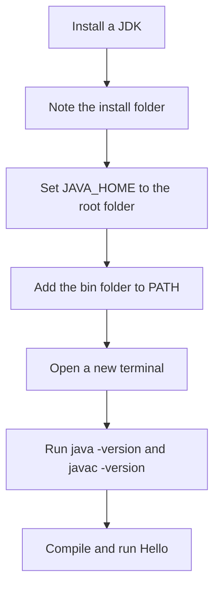

# Environment Setup

Setting up a JDK correctly is the first practical step in any Java course or interview task. Interviewers rarely ask about installers. They do ask why `javac` is "not recognized", or why a build tool picks the wrong Java version. In almost every case the answer is `JAVA_HOME` or `PATH`.

!!! note "In simple words"
    A JDK is the toolbox that turns Java code into programs. `JAVA_HOME` tells other tools where that toolbox is, and `PATH` lets your terminal find its commands from any folder.

## Why it matters

Every Java tool you will use later, including the compiler, Maven, Gradle, and most IDEs, starts by finding a JDK on your machine. If that lookup fails, or finds an old version, the errors look unrelated to the real cause. A short, correct setup saves hours of confusion in later topics. It also makes your local results match the build server, where the same two settings are used.

## How it works

### Choosing and installing a JDK

Install a JDK, not just a runtime. Several vendors publish OpenJDK builds, including Eclipse Temurin, Oracle JDK, and Amazon Corretto. For learning they are interchangeable. Pick a current LTS release, such as 21 or 25, as the roadmap suggests. Install it once, and note the folder it was installed into, because the next two steps need that path.

After installing, open a new terminal. Environment changes apply only to processes that start after the change. A terminal that was already open keeps the old values.

### JAVA_HOME

`JAVA_HOME` is an environment variable that points to the root folder of the JDK. That is the folder that contains `bin`, `lib`, and `conf`. It must point to the root, not to `bin`. Build tools such as Maven and Gradle, and many IDEs, read `JAVA_HOME` to find the compiler.

Example values. Your path will differ:

```text
Windows:  C:\Program Files\Java\jdk-21
macOS:    /Library/Java/JavaVirtualMachines/jdk-21.jdk/Contents/Home
Linux:    /usr/lib/jvm/java-21-openjdk-amd64
```

### PATH

`PATH` is the list of folders the shell searches when you type a command name. Add the JDK's `bin` folder so that `java` and `javac` work from any folder. Writing `%JAVA_HOME%\bin` on Windows, or `$JAVA_HOME/bin` on macOS and Linux, ties the entry to the variable. If you later move the JDK, you change one value instead of two.

### Setting the variables

**Windows, Command Prompt, for the current user:**

```text
setx JAVA_HOME "C:\Program Files\Java\jdk-21"
setx PATH "%PATH%;%JAVA_HOME%\bin"
```

`setx` writes values for future sessions only, so the current window does not see them. It also truncates values longer than 1024 characters. For a long `PATH`, edit it through **System Properties, then Environment Variables** instead. Note a subtle trap: `setx PATH "%PATH%;..."` expands the combined system and user `PATH` and writes the result into the user `PATH`. Over time this copies system entries into the user entry.

**Windows, PowerShell, for the current user:**

```text
[Environment]::SetEnvironmentVariable("JAVA_HOME", "C:\Program Files\Java\jdk-21", "User")
```

Open a new terminal afterwards.

**macOS, zsh, in `~/.zshrc`:**

```text
export JAVA_HOME=$(/usr/libexec/java_home -v 21)
export PATH="$JAVA_HOME/bin:$PATH"
```

**Linux, bash, in `~/.bashrc`:**

```text
export JAVA_HOME=/usr/lib/jvm/java-21-openjdk-amd64
export PATH="$JAVA_HOME/bin:$PATH"
```

Reload the file with `source ~/.zshrc` or `source ~/.bashrc`, or open a new terminal.

### Verifying the installation

Run these commands in a new terminal:

```text
java -version
javac -version
```

Both should report the same major version. Note that `java -version` writes to standard error, not standard output. That is why it can look silent when you pipe it.

To check where a command comes from, use `where java` on Windows or `which java` on macOS and Linux. The path should sit inside your JDK folder. To check the variable itself, use `echo %JAVA_HOME%` in Command Prompt, `echo $env:JAVA_HOME` in PowerShell, or `echo $JAVA_HOME` on macOS and Linux.

Finally, compile and run a small program to confirm the whole chain works:

```java
public class Hello {
    public static void main(String[] args) {
        System.out.println("JDK is working: " + Runtime.version().feature());
    }
}
```

```text
javac Hello.java
java Hello
```

`Runtime.version().feature()` returns the major version number of the running JDK. On a Java 21 install it prints `JDK is working: 21`.

The chain below shows the order of the steps:



### Step by step

1. Install a JDK and note its install folder.
2. Set `JAVA_HOME` to that folder. Use the root, not `bin`.
3. Add `%JAVA_HOME%\bin` on Windows or `$JAVA_HOME/bin` on macOS and Linux to `PATH`.
4. Open a new terminal so the changes take effect.
5. Run `java -version` and `javac -version`, then compile and run a test class.

## Where it is used

- Local development, where the IDE and the shell should use the same JDK.
- Command-line builds with Maven or Gradle, which read `JAVA_HOME` or a configured toolchain.
- Continuous integration agents, which install the same JDK version as the team.
- Docker base images, which set `JAVA_HOME` so that build steps find the compiler.

## Benefits

- A correct setup means every later command, build, and IDE run uses the same compiler.
- Checking the version with two commands catches problems before you write any code.
- Pinning a version in the project makes builds reproducible on other machines.

## Cons and limits

- Environment variables are read when a process starts. Old terminals and old IDE sessions keep stale values.
- `setx` has length limits and can copy the system `PATH` into the user `PATH`, so prefer the GUI or PowerShell for long values.
- Several JDKs on one machine make it easy to run the wrong one. The IDE may use a different JDK from the shell.
- Installers and vendors differ in default paths, so the example paths above may not match your machine.

## Common pitfalls

- Setting `JAVA_HOME` to the `bin` folder instead of the JDK root.
- Leaving an older JDK earlier in `PATH`, so `java -version` reports the wrong version. Put the JDK `bin` folder first, or fix the older entry.
- Having a JRE on `PATH` without a JDK. The `javac` command then fails with "not recognized".
- Forgetting to open a new terminal after changing environment variables.
- Using `setx` on a `PATH` value longer than 1024 characters, which truncates it.
- Mixing up the IDE's project SDK with the system `JAVA_HOME`. The IDE can use a different JDK from the one your shell uses.

## Best practices

- Install a current LTS JDK and write the version down in the project README or build file.
- Use a single source of truth for the version. Maven and Gradle toolchains can select a JDK by version, which is safer than hard-coding a path.
- Prefer a version manager, such as SDKMAN on macOS and Linux, when you work with several Java versions.
- Use `javac --release N` in build scripts so that the compiler checks the API against the target version.
- Keep the IDE project SDK and the shell `JAVA_HOME` on the same major version.

!!! tip "Interview tip"
    **Q: Your build fails with "invalid source release" or "unsupported class file version". What happened?** The compiler or runtime is older than the code expects. Check `java -version` and `JAVA_HOME`, then either install a newer JDK or set the compiler release, for example `javac --release 17`, to match the target. The fix is to align the JDK, `JAVA_HOME`, and the project's configured Java version.

## Quick recap

- Install a JDK, not just a JRE, preferably a current LTS release.
- `JAVA_HOME` points to the JDK root; `PATH` includes its `bin` folder.
- Open a new terminal after changing variables.
- Verify with `java -version` and `javac -version`, then compile and run a test class.
- Most "command not found" and wrong-version errors come from `PATH` order or a wrong `JAVA_HOME`.

## Official documentation

- [Java Developer Site](https://dev.java/)
- [Maven Guides](https://maven.apache.org/guides/)
- [Gradle User Guide](https://docs.gradle.org/current/userguide/userguide.html)

**See also:** [Java Overview and Platform](java-overview-platform.md), [Syntax Basics](syntax-basics.md), [Git, IDEs and Command-Line Tools](git-ide-tools.md)
