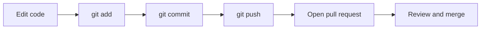

# Git, IDEs and Command-Line Tools

Day-to-day Java work depends on three tools: Git for version control, an IDE for editing and debugging, and the command line for compiling, running, and scripting. Interviewers often ask about the Git workflow, such as branches, merges, and conflicts. They also ask how you would compile and run code without an IDE. This page covers both.

!!! note "In simple words"
    Git saves snapshots of your work so you can go back and share changes. An IDE is an editor with buttons for running and debugging. The command line does the same jobs without any buttons.

## Why it matters

Your code is only useful to a team if it can be shared, reviewed, and rebuilt. Git gives you the history and the branching model for that. The command line shows what the IDE does for you, which helps when a build server or a container has no IDE at all. Knowing both makes problems easier to diagnose.

## How it works

### Git basics

Git records snapshots of a project called commits. A repository on your machine can be linked to a remote copy on a host such as GitHub. That remote is usually named `origin`.

| Task | Command |
|---|---|
| Get a copy of a remote repository | `git clone <url>` |
| See changed files | `git status` |
| Stage changes | `git add <file>` or `git add .` |
| Record a commit | `git commit -m "Describe the change"` |
| Upload commits | `git push` |
| Download and merge remote changes | `git pull` |
| List, create, and switch branches | `git branch`, `git switch -c <name>`, `git switch <name>` |
| Combine a branch into the current one | `git merge <branch>` |
| Show history | `git log --oneline --graph` |

A typical feature flow goes like this: create a branch, make and commit changes, push the branch, open a pull request, then merge it into `main` after review.

```text
git switch -c feature/parse-orders
# edit files
git add src/OrderParser.java
git commit -m "Add order parser"
git push -u origin feature/parse-orders
```

Use a `.gitignore` file to keep build output, such as `*.class` and `out/`, and IDE settings out of the repository.

### Merge conflicts

A conflict happens when two branches change the same lines. Git stops the merge and marks the file:

```text
<<<<<<< HEAD
int limit = 10;
=======
int limit = 20;
>>>>>>> feature/limits
```

To resolve it, edit the file to the correct final code and remove all the markers. Then run `git add <file>` and `git commit`. Use `git merge --abort` to cancel a merge that is not going well.

### Pull versus fetch

`git fetch` downloads remote commits without changing your working files. `git pull` is a fetch followed by a merge, or a rebase if you have configured it that way. Fetch first when you want to inspect changes before you combine them.

### Undoing changes safely

Git has several undo commands, and they differ in how much history they change.

- `git restore <file>` discards uncommitted edits in one file.
- `git reset --soft HEAD~1` removes the last commit but keeps its changes staged. Use it only on commits you have not pushed.
- `git revert <commit>` creates a new commit that undoes an earlier one. It is safe for shared branches.

### IDEs

| IDE | Strengths | Typical use |
|---|---|---|
| IntelliJ IDEA | Strong refactoring, code analysis, and built-in build tool integration | Large Java and enterprise projects |
| Eclipse | Long-standing, open source, extensible through plugins | Projects that already use Eclipse |
| VS Code | Lightweight editor; Java support comes from the Java extension pack | Quick edits and mixed-language work |

Whichever IDE you choose, learn these features: running and debugging with breakpoints, stepping into and over code, viewing variables, using the integrated terminal, and running Git from the UI. Configure the project's JDK once in the IDE settings, and check that it matches the JDK in your shell.

### The command line

Compiling and running from a terminal teaches you what the IDE does for you.

```text
javac -d out src/com/example/app/Main.java    # compile into the out folder
java -cp out com.example.app.Main             # run, with out on the classpath
```

Common navigation commands: `cd <folder>` changes the folder, `dir` on Windows or `ls` on macOS and Linux lists it, and `cd ..` moves up one level.

### JShell

`jshell` is a read-eval-print loop (REPL) that ships with the JDK. Use it to test expressions without writing a class.

```text
jshell> int square(int n) { return n * n; }
jshell> square(7)
$2 ==> 49
jshell> /exit
```

### Javadoc

Javadoc comments, written as `/** ... */`, document classes and methods. The `javadoc` tool turns them into HTML.

```java
/**
 * Adds two numbers.
 *
 * @param a the first operand
 * @param b the second operand
 * @return the sum of {@code a} and {@code b}
 */
public static int add(int a, int b) {
    return a + b;
}
```

```text
javadoc -d docs src/com/example/app/MathUtil.java
```

### Packaging: JAR files

A JAR is a ZIP archive of classes and resources, with an optional manifest. The `jar` tool creates one. Multi-release JARs can contain alternate class versions for newer Java releases.

```text
jar --create --file app.jar --main-class com.example.app.Main -C out .
java -jar app.jar
```

### Inspecting bytecode with javap

`javap` disassembles a compiled class. It lists fields and method signatures. With `-c` it prints the bytecode instructions. Use it to check what the compiler produced, for example how a string concatenation or an enhanced `for` loop is translated. The `-p` flag includes private members.

```text
javap -p out/com/example/app/Main.class       # signatures, including private members
javap -c -p out/com/example/app/Main.class    # plus the bytecode of each method
```

### Debugging from the terminal with jdb

`jdb` is the JDK's command-line debugger. It attaches to a program started with debugging enabled, or it launches one itself. Its commands match what an IDE debugger does: set a breakpoint, run, step, and print a variable.

```text
jdb -classpath out com.example.app.Main
> stop at com.example.app.Main:12    # breakpoint on line 12
> run
> print total                         # inspect a local variable
> step                                # run the current line, entering calls
> cont                                # resume until the next breakpoint
```

For a remote program, start the JVM with `-agentlib:jdwp` and attach `jdb` to the port it reports. The IDE debugger uses the same protocol.



### Step by step

1. Git tracks changes in three areas: the working tree, the staging area populated by `git add`, and the commit history written by `git commit`.
2. `git push` sends local commits to the remote. `git pull` brings remote commits in and merges them.
3. `javac` compiles source and writes `.class` files to the folder given by `-d`.
4. `java` runs classes using the classpath given by `-cp`.
5. `jshell` evaluates each entry as you type it, and `javadoc` reads doc comments from source files.

## Where it is used

- Team projects, where every change goes through a branch and a pull request.
- Build servers, which run the same `javac`, `java`, and `jar` commands as your terminal.
- Production debugging on a server with no IDE, using `jdb` or remote debugging.
- Scripts that compile and package a project in CI pipelines.

## Benefits

- Git keeps a full history, so you can find when a bug was introduced with `git log` and `git bisect`.
- Branches let several people work on the same project without blocking each other.
- Knowing the command line lets you work on any machine, even without an IDE installed.

## Cons and limits

- Git is powerful, and its history-rewriting commands can lose work when used on shared branches.
- Merge conflicts need human judgment. Git can place the markers, but it cannot decide which code is correct.
- IDE features depend on project setup. A misconfigured JDK or build file makes the IDE show false errors.
- Command-line debugging is more manual than an IDE debugger.

## Common pitfalls

- Committing build output or IDE folders because there is no `.gitignore`.
- Running `git add .` without checking `git status`, which can stage files you did not intend to commit.
- Resolving a merge conflict by deleting the markers and leaving both versions of the code.
- Working on `main` directly instead of a branch.
- Using a different JDK in the IDE than the one `java` uses on the command line.
- Forgetting the classpath. `java Main` fails when `Main.class` is not in the current folder or on `-cp`.
- Confusing `git fetch`, which does not change your files, with `git pull`, which merges changes.

## Best practices

- Create a branch for each change, and keep commits small with clear messages.
- Run `git status` and `git diff --staged` before each commit.
- Share a `.gitignore` for Java projects, and keep secrets out of the repository.
- Pick one JDK for the whole team and configure it in the build file, not only in each IDE.
- Learn the IDE debugger and the `jdb` basics, so you can debug on any machine.

!!! tip "Interview tip"
    **Q: How do you undo a commit that has already been pushed?** Do not rewrite shared history. Use `git revert <commit>`, which creates a new commit that undoes the change. `git reset` and rebase rewrite history, which is safe only on branches that nobody else uses.

## Quick recap

- Git: branch for each change, commit with clear messages, and merge after review.
- Resolve a conflict by editing the file to the correct result, then `git add` and `git commit`.
- Choose an IDE, learn its debugger, and make sure it uses the same JDK as your shell.
- `javac -d` compiles into an output folder. `java -cp` runs classes from it.
- `jshell` is for quick experiments. `javadoc` turns doc comments into HTML.

## Official documentation

- [Git Documentation](https://git-scm.com/doc)
- [Maven Guides](https://maven.apache.org/guides/)
- [Gradle User Guide](https://docs.gradle.org/current/userguide/userguide.html)

**See also:** [Environment Setup](environment-setup.md), [Java Overview and Platform](java-overview-platform.md), [Syntax Basics](syntax-basics.md)
