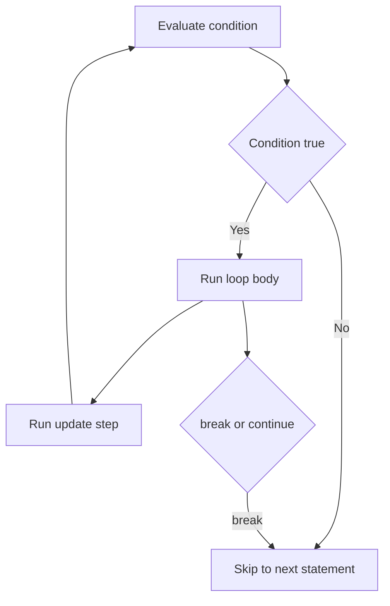

# Operators and Control Flow

Operators combine values, and control flow decides which code runs and how often. Interviewers test this through small puzzles: integer division, short-circuit evaluation, operator precedence, and whether a `switch` falls through. This page covers each operator family, the precedence rules, the decision and loop statements, and labelled `break` and `continue`.

!!! note "In simple words"
    Operators do arithmetic and comparisons. Control flow picks the path your code takes, using `if`, `switch`, and loops. Together they decide what the program does next.

## Why it matters

Most logic bugs live in conditions and loops. A missed parenthesis, a `&` where `&&` was meant, or a `switch` without `break` can change the result of a whole feature. Knowing how Java evaluates these constructs lets you read code quickly and write conditions that do what you intended.

## How it works

### Arithmetic operators

The arithmetic operators are `+`, `-`, `*`, `/`, and `%`, the remainder operator. Integer division truncates toward zero. The remainder takes the sign of the dividend. Dividing an integer by zero throws `ArithmeticException`. Dividing a floating-point number by zero gives `Infinity` or `NaN`.

```java
public class Arithmetic {
    public static void main(String[] args) {
        System.out.println(7 / 2);     // 3
        System.out.println(-7 / 2);    // -3
        System.out.println(-7 % 3);    // -1
        System.out.println(7.0 / 0);   // Infinity
    }
}
```

`Math.floorDiv` and `Math.floorMod` round toward negative infinity. Use them when that rounding is what you need.

### Increment, decrement, and assignment

`++` and `--` come in prefix and postfix forms. The prefix form changes the value before the expression is evaluated. The postfix form uses the old value. Compound assignment operators, such as `+=`, `-=`, and `*=`, include an implicit narrowing cast.

```java
public class Increments {
    public static void main(String[] args) {
        int i = 5;
        int a = i++;   // a = 5, i = 6
        int b = ++i;   // b = 7, i = 7

        byte small = 10;
        small += 300;  // compiles: implicit (byte) cast; 310 wraps to 54
        System.out.println(a + " " + b + " " + small); // 5 7 54
    }
}
```

### Relational and equality operators

The operators `<`, `<=`, `>`, `>=`, `==`, and `!=` each produce a `boolean`. For object references, `==` checks identity, not content.

### Logical operators and short-circuiting

`&&` (AND), `||` (OR), and `!` (NOT) work on `boolean` values. `&&` and `||` short-circuit. The right operand runs only when the left operand does not already decide the result. The non-short-circuit forms `&` and `|` always evaluate both sides.

```java
public class ShortCircuit {
    public static void main(String[] args) {
        String text = null;
        if (text != null && text.length() > 0) {   // safe: length() is skipped when text is null
            System.out.println(text);
        }

        int x = 0;
        boolean ok = (x != 0) & (10 / x > 1);       // ArithmeticException: both sides run
        System.out.println(ok);
    }
}
```

### Bitwise and shift operators

The bitwise operators are `&`, `|`, `^` (XOR), and `~` (complement). The shift operators are `<<` (left shift), `>>` (signed right shift), and `>>>` (unsigned right shift). On `boolean` values, `&`, `|`, and `^` are logical operators that do not short-circuit.

```java
public class Bits {
    public static void main(String[] args) {
        int flags = 0b0101;
        System.out.println(flags & 0b0100);  // 4: bit 2 is set
        System.out.println(flags << 1);      // 10
        System.out.println(-8 >> 1);         // -4: sign preserved
        System.out.println(-8 >>> 28);       // 15: zeros shifted in
    }
}
```

Bit flags like these are common in APIs, file permissions, and low-level protocols. Use named constants, so the numbers are not hidden in the code.

### The ternary operator

The form is `condition ? valueIfTrue : valueIfFalse`. It is an expression, so it can appear inside another expression. Keep it short, because nested ternaries are hard to read.

```java
int age = 20;
String label = age >= 18 ? "adult" : "minor";
```

### instanceof

`instanceof` tests the runtime type of an object. Since Java 16 it also supports pattern matching. A successful test declares a variable that you can use right away.

```java
public class Patterns {
    public static void main(String[] args) {
        Object value = "text";
        if (value instanceof String s && !s.isEmpty()) {
            System.out.println(s.toUpperCase());   // TEXT
        }
    }
}
```

### Operator precedence and associativity

Rows higher in the table bind more tightly. Most binary operators are left-associative. Assignment and the ternary are right-associative.

| Precedence (high to low) | Operators |
|---|---|
| Postfix | `expr++`, `expr--` |
| Unary | `++expr`, `--expr`, `+`, `-`, `~`, `!` |
| Multiplicative | `*`, `/`, `%` |
| Additive | `+`, `-` |
| Shift | `<<`, `>>`, `>>>` |
| Relational | `<`, `<=`, `>`, `>=`, `instanceof` |
| Equality | `==`, `!=` |
| Bitwise AND | `&` |
| Bitwise XOR | `^` |
| Bitwise OR | `\|` |
| Logical AND | `&&` |
| Logical OR | `\|\|` |
| Ternary | `? :` |
| Assignment | `=`, `+=`, and the other compound forms |

```java
public class Precedence {
    public static void main(String[] args) {
        int r = 2 + 3 * 4;            // 14, not 20
        boolean b = 5 > 3 == true;    // relational binds tighter than equality: true
        System.out.println(r + " " + b);
    }
}
```

Use parentheses whenever the precedence is not obvious to a reader. Clarity matters more than cleverness.

### if and if-else

```java
public class Grades {
    public static void main(String[] args) {
        int score = 72;
        if (score >= 90) {
            System.out.println("A");
        } else if (score >= 70) {
            System.out.println("C or B");
        } else {
            System.out.println("below C");
        }
    }
}
```

The branches are checked in order, and only the first one that matches runs. Put the most specific condition first when the ranges overlap.

### The classic switch statement

The classic `switch` jumps to a matching `case`. It then falls through to the next one until it meets a `break`. Fall-through is rarely useful and often a bug.

```java
public class ClassicSwitch {
    public static void main(String[] args) {
        int day = 3;
        switch (day) {
            case 1:
            case 7:
                System.out.println("weekend");
                break;
            case 3:
                System.out.println("midweek");
                // no break: falls through
            case 4:
                System.out.println("printed for 3 and 4");
                break;
            default:
                System.out.println("other");
        }
    }
}
```

The classic switch works on `int`-compatible types, `char`, `String`, and enums.

### Switch expressions

Since Java 14, the arrow form `case ... ->` does not fall through, and it can produce a value. Use `yield` inside a block to return a value from a block body. A switch expression must be exhaustive. For `int` and `String` selectors you usually need a `default`.

```java
public class SwitchExpr {
    public static void main(String[] args) {
        int day = 3;
        String kind = switch (day) {
            case 1, 7 -> "weekend";
            case 2, 3, 4, 5, 6 -> {
                String label = "weekday";
                yield label;
            }
            default -> throw new IllegalArgumentException("bad day: " + day);
        };
        System.out.println(kind);   // weekday
    }
}
```

### The five forms of switch

`switch` has grown over several releases. Knowing which form is available in which version is a common interview check.

| Form | Since | Produces a value | Falls through | Typical use |
|---|---|---|---|---|
| Classic statement (`case X:`) | Java 1.0 | No | Yes, unless `break` | Legacy code, deliberate fall-through |
| Arrow statement (`case X ->`) | Java 14 | No | No | Running one action per case |
| Switch expression | Java 14 | Yes | No | Computing a value, with `yield` in blocks |
| Pattern matching | Java 21 | Either | No | Type tests with `when` guards and `case null` |
| Record patterns | Java 21 | Either | No | Destructuring record components in a case |

The classic form accepts `int`-compatible primitives, their wrappers, `char`, `String`, and enums. It does not accept `long`, `float`, `double`, or `boolean`.

Pattern matching lets a `switch` select on any reference type. A sealed hierarchy lets the compiler check that every subtype is handled, so no `default` is needed:

```java
sealed interface Shape permits Circle, Square {}
record Circle(double radius) implements Shape {}
record Square(double side) implements Shape {}

public class Areas {
    static double area(Shape shape) {
        return switch (shape) {
            case Circle c -> Math.PI * c.radius() * c.radius();
            case Square s -> s.side() * s.side();
        };
    }

    static String classify(Object obj) {
        return switch (obj) {
            case null -> "null";
            case Integer i when i > 0 -> "positive int " + i;   // guard
            case Integer i -> "other int " + i;
            case String s -> "string of length " + s.length();
            default -> "something else";
        };
    }

    public static void main(String[] args) {
        System.out.println(area(new Square(2)));   // 4.0
        System.out.println(classify(-3));          // other int -3
    }
}
```

Record patterns destructure a record in the `case` label, and they can be nested:

```java
public class PointLocator {

    record Point(int x, int y) { }

    static String locate(Object obj) {
        return switch (obj) {
            case Point(int x, int y) when x == 0 && y == 0 -> "origin";
            case Point(int x, int y) -> "point at " + x + ", " + y;
            default -> "not a point";
        };
    }

    public static void main(String[] args) {
        System.out.println(locate(new Point(0, 0)));   // origin
        System.out.println(locate(new Point(2, 5)));   // point at 2, 5
    }
}
```

Pattern matching `switch` is final in Java 21. Before Java 21 these forms do not compile, so check the `--release` setting when a snippet fails.

### Loops

```java
public class Loops {
    public static void main(String[] args) {
        for (int i = 0; i < 3; i++) {          // classic for: init, condition, update
            System.out.print(i + " ");         // 0 1 2
        }
        int[] nums = {4, 8, 15};
        for (int n : nums) {                    // enhanced for-each: read-only traversal
            System.out.print(n + " ");         // 4 8 15
        }
        int count = 0;
        while (count < 2) {                     // condition checked first
            count++;
        }
        do {                                    // body runs at least once
            count--;
        } while (count > 0);
        System.out.println("count = " + count); // 0
    }
}
```

Use the enhanced `for` when you only need each element. Use an index loop when you need the index or want to modify the array.

### break and continue

`break` exits the nearest loop or `switch`. `continue` skips to the next iteration. Labels let you target an outer loop.

```java
public class Labels {
    public static void main(String[] args) {
        outer:
        for (int row = 0; row < 3; row++) {
            for (int col = 0; col < 3; col++) {
                if (col == 2) {
                    continue;              // next column
                }
                if (row == 1) {
                    continue outer;        // next row
                }
                if (row == 2 && col == 1) {
                    break outer;           // stop everything
                }
                System.out.print("(" + row + "," + col + ")");   // prints (0,0)(0,1)(2,0)
            }
        }
    }
}
```

### Problem solving with control flow

For a loop, write the loop invariant in a comment. An invariant is a statement that holds before each iteration. If you cannot state it, the loop is probably wrong. Trace the first two iterations and the last one by hand.



### Step by step

1. The expression is evaluated using precedence and associativity rules. Parentheses override them.
2. `&&` and `||` evaluate the left side. They evaluate the right side only when it is needed.
3. An `if` tests its condition and runs the first matching branch.
4. A classic `switch` jumps to the matching `case` and runs until a `break` or the end. A switch expression evaluates one arm and yields its value.
5. A loop checks its condition, before or after the body depending on the loop type, and repeats.
6. `break label` and `continue label` transfer control to the labelled loop.

## Where it is used

- Input validation, where `&&` guards a method call behind a null check.
- Business rules that map a status to a message, where a switch expression keeps every case explicit.
- Batch processing and parsing, where loops and labelled `break` stop nested searches early.
- Bit masks in protocol and permission code, where `&`, `|`, and shifts are common.

## Benefits

- Short-circuit operators prevent errors such as a null dereference or a division by zero.
- Switch expressions with sealed types let the compiler check that no case is missing.
- Enhanced `for` loops remove index mistakes when you only read elements.
- Labelled `break` avoids flag variables when you need to leave nested loops.

## Cons and limits

- Operator precedence rules are easy to misremember, so mixed expressions need parentheses.
- The classic `switch` allows silent fall-through, which the compiler does not warn about.
- Nested ternaries and deeply nested `if` blocks hurt readability.
- Labels are rarely needed, and they can make code harder to follow when overused.

## Common pitfalls

- Using `/` on two `int` values and expecting a fractional result. Cast one operand to `double` first.
- Using `&` where `&&` is meant. The right side then runs even when the left side is false.
- Forgetting `break` in a classic `switch`, which causes unintended fall-through.
- Writing `if (x = 5)` instead of `if (x == 5)`. Java rejects an `int` in an `if` condition, but a `boolean` assignment still compiles and is confusing.
- Comparing `String` values with `==` inside a condition.
- Modifying a collection inside an enhanced `for` loop, which throws `ConcurrentModificationException`.
- Writing `a == b == c` and assuming it means `a == b && b == c`. It is parsed as `(a == b) == c`.

## Best practices

- Put the cheap or safe check first in a `&&` chain, so the risky check runs only when needed.
- Use parentheses in mixed `&&` and `||` expressions.
- Prefer switch expressions with arrows over the classic form in new code.
- Keep loops small. Move the body into a method when it grows past a screen.
- Avoid changing the loop variable inside a `for` header to skip work. Write the condition clearly instead.

!!! tip "Interview tip"
    **Q: What is the difference between `&` and `&&`?** `&&` is short-circuit. The right side is evaluated only if the left side is `true`. `&` always evaluates both sides. Use `&&` for conditions that guard against errors, such as a null check before a method call.

## Quick recap

- Integer division truncates. `%` takes the sign of the dividend.
- `&&` and `||` short-circuit. `&` and `|` do not.
- Precedence puts `*` above `+`, and relational above equality. Ternary and assignment sit at the bottom. Use parentheses to be clear.
- A classic `switch` falls through without `break`. Arrow-form switch expressions do not, and they can yield values.
- Labelled `break` and `continue` target an outer loop.

## Official documentation

- [Java Language Specification, SE 21](https://docs.oracle.com/javase/specs/jls/se21/html/index.html)
- [JEP Index](https://openjdk.org/jeps/)
- [JDK 21 API Documentation](https://docs.oracle.com/en/java/javase/21/docs/api/index.html)

**See also:** [Data Types and Variables](data-types-variables.md), [Syntax Basics](syntax-basics.md), [Wrappers, Strings and Arrays](../02a-core-language/wrappers-strings-arrays.md)
