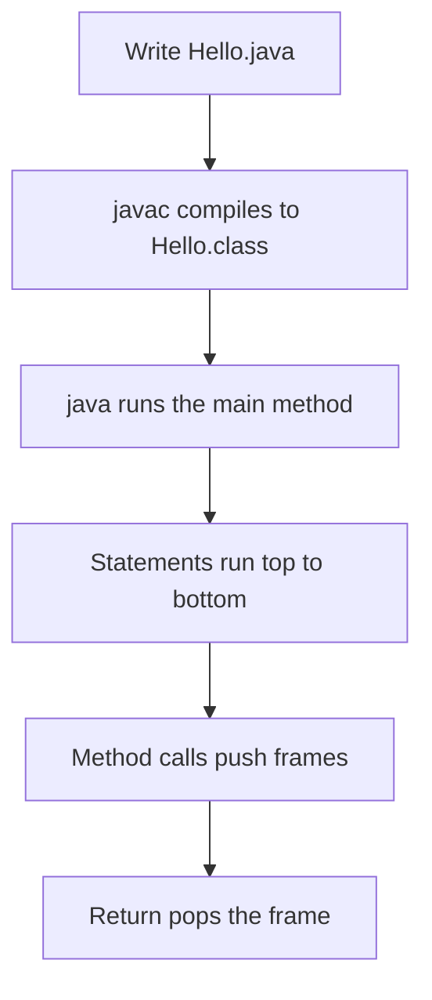

# Syntax Basics

Every Java program follows the same skeleton: a class, a `main` method, and a compile-then-run cycle. This page covers that structure, the naming rules and keywords the compiler enforces, console input with `Scanner`, methods and scope, and type casting. Interviewers use these topics to check that you can read and write basic Java without hesitation.

!!! note "In simple words"
    A Java program lives inside a class and starts at a `main` method. You compile the text into bytecode with `javac`, then run it with `java`.

## Why it matters

Syntax errors are the first thing a compiler reports, and many interview questions are small code puzzles about them. Knowing the naming rules, the reserved words, and how casts behave lets you read unfamiliar code quickly. It also helps you explain why a snippet prints a surprising value.

## How it works

### Program structure and the main method

A Java program needs at least one class. The entry point is a `public static void main(String[] args)` method. The JVM calls it with an array of command-line arguments. Every element of that array is a `String`, so numbers must be parsed.

```java
public class Hello {
    public static void main(String[] args) {
        System.out.println("Hello, " + (args.length > 0 ? args[0] : "world"));
    }
}
```

The file name must match the public class name, so this code lives in `Hello.java`. A file can hold other non-public classes, but only one public top-level class, and its name decides the file name.

### Compile, then run

`javac` compiles source into bytecode. `java` runs the class by its name, without the `.class` extension.

```text
javac Hello.java      # produces Hello.class
java Hello Ada        # prints: Hello, Ada
```

Since Java 11 you can also run a single source file directly. The launcher compiles it in memory first:

```text
java Hello.java Ada
```

### Naming conventions and case sensitivity

Java is case sensitive. `count`, `Count`, and `COUNT` are three different names. The compiler does not enforce the conventions below, but almost every Java codebase follows them:

| Element | Convention | Example |
|---|---|---|
| Class, interface, enum, record | PascalCase | `OrderService` |
| Method, variable, parameter | camelCase | `calculateTotal` |
| Constant (`static final`) | UPPER_SNAKE_CASE | `MAX_RETRIES` |
| Package | all lowercase, reverse domain | `com.example.orders` |

Identifiers may contain letters, digits, `_`, and `$`. They must not start with a digit and must not be a keyword. Unicode letters are allowed in identifiers.

### Keywords

Java reserves these words. They cannot be used as identifiers:

```text
abstract   assert    boolean    break      byte       case
catch      char      class      const      continue   default
do         double    else       enum       extends    final
finally    float     for        goto       if         implements
import     instanceof int       interface  long       native
new        package   private    protected  public     return
short      static    strictfp   super      switch     synchronized
this       throw     throws     transient  try        void
volatile   while
```

`true`, `false`, and `null` are literals, not keywords, but they are also reserved. The underscore `_` has been a reserved keyword since Java 9. `var`, `record`, `sealed`, `permits`, and `yield` are restricted or contextual identifiers. They have special meaning in some positions, and you can still use them as names in others.

### Comments

```java
// single-line comment
/* multi-line
   comment */
/**
 * Javadoc comment: documents the class or method for the javadoc tool.
 */
```

Java processes Unicode escapes such as `\uXXXX` before it reads the rest of the source. That creates a trap. A comment that contains `\u000a` ends early, because the escape becomes a line break.

### Unicode

Java source and `char` values use Unicode. A `char` is a 16-bit UTF-16 code unit. Characters outside the Basic Multilingual Plane, such as many emoji, need two `char` values. Use `codePointAt` or `codePoints()` when you need full code points.

```java
public class Unicode {
    public static void main(String[] args) {
        String greeting = "été";
        System.out.println(greeting.length());                                  // 3
        System.out.println(greeting.codePointCount(0, greeting.length()));      // 3
    }
}
```

### Console input with Scanner

`Scanner` reads tokens and lines from a source such as `System.in`.

```java
import java.util.Scanner;

public class Greeter {
    public static void main(String[] args) {
        try (Scanner in = new Scanner(System.in)) {
            System.out.print("Your name: ");
            String name = in.nextLine();
            System.out.print("Your age: ");
            int age = in.nextInt();
            System.out.println(name + " is " + age + " years old");
        }
    }
}
```

`nextInt()` reads the number but leaves the line break in the buffer. A following `nextLine()` then returns an empty string. Call `in.nextLine()` once after `nextInt()` to consume the leftover line break.

For high-volume input, `BufferedReader` is faster. Use `Integer.parseInt` to convert text. It throws `NumberFormatException` for bad input.

```java
import java.io.BufferedReader;
import java.io.IOException;
import java.io.InputStreamReader;
import java.io.PrintWriter;

public class EchoLines {
    public static void main(String[] args) throws IOException {
        try (BufferedReader reader = new BufferedReader(new InputStreamReader(System.in));
             PrintWriter writer = new PrintWriter(System.out)) {
            String line;
            while ((line = reader.readLine()) != null) {
                writer.println(line.toUpperCase());
            }
            writer.flush();
        }
    }
}
```

Reader and writer classes are covered in more depth in the file-handling material of the core Java section.

### Methods and scope

A method has a return type, a name, and parameters. Parameters are passed by value. A method receives a copy of a primitive value, or a copy of an object reference. It never receives the caller's variable itself.

```java
public class Scopes {
    static int total = 0;               // static field: class-level scope

    static int add(int a, int b) {      // a and b: parameter scope
        int sum = a + b;                // sum: local scope, lives until the method returns
        total += sum;
        return sum;
    }

    public static void main(String[] args) {
        int x = 2;
        add(x, 3);
        System.out.println(total + " " + x); // 5 2: x is unchanged
    }
}
```

A local variable is visible only inside the block where it is declared. Reusing the same name in a sibling block is allowed. Reusing it inside a nested block that is still in scope is not.

Each method call pushes a new frame onto the thread's stack. The frame holds the parameters and locals. When the method returns, the frame is removed, and any locals in it are gone.

### Problem solving: pseudocode and tracing

Before coding, write the steps in plain language or pseudocode. Then trace the code by hand with small inputs. Write each variable's value after every line. Most logic errors show up in the trace. A debugger's step-through works the same way, so tracing by hand trains the habit you need when debugging.

### Date and time basics

Modern date and time code uses `java.time`, not `java.util.Date`.

```java
import java.time.LocalDate;

public class DateBasics {
    public static void main(String[] args) {
        LocalDate release = LocalDate.of(2024, 1, 15);
        System.out.println(release.plusDays(30)); // 2024-02-14
    }
}
```

The fuller date and time API is outside this section's scope. The roadmap places it in the core Java and modern Java sections.

### Type casting

Casting converts a value from one type to another. There are two kinds.

- **Widening (implicit, safe):** `byte` to `short` to `int` to `long` to `float` to `double`. No data is lost in the normal case. `long` to `float` can lose precision for very large values.
- **Narrowing (explicit, may lose data):** you write the target type in parentheses. The value is truncated or wrapped.

```java
public class Casts {
    public static void main(String[] args) {
        int big = 300;
        byte small = (byte) big;        // 300 wraps to 44
        double d = 3.99;
        int truncated = (int) d;        // 3: truncates toward zero, does not round
        int code = 'A';                 // char widens to int automatically: 65
        char letter = (char) 66;        // 'B'
        System.out.println(small + " " + truncated + " " + code + " " + letter);
    }
}
```

Reference casts work differently. A cast to a subtype is checked at run time, and it throws `ClassCastException` if the object is not an instance of that type.



### Step by step

1. Write the class with a `public static void main(String[] args)` method. The file name matches the public class name.
2. Run `javac` to produce bytecode, then run `java` with the class name.
3. The JVM calls `main`, which runs its statements top to bottom.
4. A method call pushes a frame on the stack. `return` pops it and passes back a value.
5. A narrowing cast truncates or wraps. A widening cast happens automatically.

## Where it is used

- Command-line tools and scripts, which read `args` and print results.
- Coding tests and interview exercises, which often start with `Scanner` input.
- Small utilities and build helpers that run with `java File.java`.
- Every larger project, since the same structure, naming, and casting rules apply inside classes and packages.

## Benefits

- The compiler enforces the basic rules, so many mistakes are reported before the program runs.
- Consistent naming makes code easier to scan, even in a project you have never seen.
- Knowing how casts and `Scanner` behave prevents a class of silent bugs in input handling and arithmetic.

## Cons and limits

- Narrowing casts can lose data without any error. The compiler only checks that the cast is legal, not that the value fits.
- `Scanner` is simple, but it is slow for large inputs and its token rules surprise beginners.
- Naming conventions are not enforced by the compiler, so a team must agree on them and check them in review.
- The `public` class rule means small experiments in one file often need extra classes or non-public names.

## Common pitfalls

- Naming the file differently from the public class. The compiler reports "class X is public, should be declared in a file named X.java".
- Treating `"Hello"` and `'H'` as the same kind of value. Double quotes are `String`, single quotes are `char`.
- Expecting `(int) 3.99` to round to 4. It truncates to 3.
- Forgetting that `(byte) 200` is `-56`, because `byte` ranges from -128 to 127.
- Calling `nextLine()` straight after `nextInt()` and getting an empty string.
- Assuming `args[0]` exists. Always check `args.length` first.
- Using a keyword such as `class` or `default` as a variable name.

## Best practices

- Use descriptive names. `orderTotal` says more than `ot`.
- Keep `main` short. Call methods that do the real work, so the logic can be tested.
- Read input with `try` around the `Scanner` or reader, so the resource is always closed.
- Use `java.time` for dates and `Math.addExact` when overflow should be an error.
- Compile with warnings turned on, and fix them before you commit the code.

!!! tip "Interview tip"
    **Q: Is Java pass-by-value or pass-by-reference?** Java is always pass-by-value. For objects, the value passed is a copy of the reference. The method can change the object's fields, but it cannot make the caller's variable point to a different object. Swapping two object references inside a method does not swap them for the caller.

## Quick recap

- A Java program is a class with a `public static void main(String[] args)` method. The file name matches the public class name.
- `javac` compiles to bytecode. `java ClassName` runs it, and `java File.java` runs a single file since Java 11.
- Naming conventions are a convention, not a rule. Keywords and identifier rules are enforced.
- `Scanner.nextInt()` leaves the line break behind. Consume it with `nextLine()`.
- Widening casts are automatic. Narrowing casts truncate or wrap, so check the value range first.

## Official documentation

- [Java Language Specification, SE 21](https://docs.oracle.com/javase/specs/jls/se21/html/index.html)
- [JDK 21 API Documentation](https://docs.oracle.com/en/java/javase/21/docs/api/index.html)
- [Java Developer Site](https://dev.java/)

**See also:** [Data Types and Variables](data-types-variables.md), [Operators and Control Flow](operators-control-flow.md), [Environment Setup](environment-setup.md)
