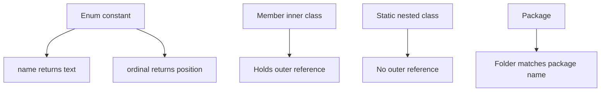

# Enums, Inner Classes and Packages

These three features organize code rather than add runtime behaviour. Enums model a fixed set of named constants, each with its own state and methods. Inner classes nest one class inside another, which is useful for helpers and callbacks. Packages group related classes and control access between them. Interviewers ask about `ordinal()` versus `name()`, the difference between inner and static nested classes, and how to write a safe singleton.

!!! note "In simple words"
    An enum is a list of named choices, such as `MONDAY` or `ADD`. An inner class is a class placed inside another class. A package is a folder-like name that groups related classes together.

## Why it matters

Code gets hard to read when it uses plain strings or numbers for fixed choices, or when helper classes are scattered across files. Enums make the choices explicit and checked by the compiler. Nested classes keep helpers close to the code that uses them. Packages keep names from colliding and let you hide internal classes. Together they make a codebase easier to navigate and change.

## How it works

### Enums

An enum is a special class with a fixed set of instances. Each constant is an object, created once when the enum class is initialized.

```java
public class Planets {
    enum Planet {
        MERCURY(3.303e+23, 2.4397e6),
        EARTH(5.976e+24, 6.37814e6);

        private final double mass;      // kg
        private final double radius;    // m

        Planet(double mass, double radius) {   // constructors are implicitly private
            this.mass = mass;
            this.radius = radius;
        }

        double surfaceGravity() {
            return 6.67300E-11 * mass / (radius * radius);
        }
    }

    public static void main(String[] args) {
        for (Planet p : Planet.values()) {
            System.out.printf("%s %.2f%n", p.name(), p.surfaceGravity());
        }
    }
}
```

Useful members:

| Member | Meaning |
|---|---|
| `values()` | Array of all constants, in declaration order |
| `valueOf("EARTH")` | Constant with that exact name; throws `IllegalArgumentException` if none exists |
| `name()` | The constant's declared name, such as `"EARTH"` |
| `ordinal()` | Zero-based position in declaration order |
| `toString()` | Returns `name()` by default; you may override it |
| `compareTo` | Compares by ordinal |

Enums can implement interfaces, have abstract methods with a body per constant, and be used in a `switch`. Use `EnumMap` and `EnumSet` for fast collections keyed by enum constants. They keep the constants in declaration order.

```java
public enum Operation {
    ADD { public int apply(int a, int b) { return a + b; } },
    MULTIPLY { public int apply(int a, int b) { return a * b; } };

    public abstract int apply(int a, int b);
}
```

Use `ordinal()` only for ordering. Storing an ordinal in a database breaks when someone reorders the constants, so store `name()` instead.

### Enums in a switch

A `switch` on an enum uses bare constant names. The arrow form, available since Java 14, returns a value. When every constant is covered, you do not need a `default`.

```java
public class EnumSwitch {
    enum Operation { ADD, MULTIPLY }

    static String describe(Operation op) {
        return switch (op) {
            case ADD -> "adds";
            case MULTIPLY -> "multiplies";
        };
    }

    public static void main(String[] args) {
        System.out.println(describe(Operation.ADD));   // adds
    }
}
```

### Inner classes

An inner class is declared inside another class. There are four kinds.

| Kind | Declared as | Has an enclosing instance? | Typical use |
|---|---|---|---|
| Member (non-static) | A class inside a class | Yes; created with `outer.new Inner()` | Iterators and helpers that need the outer object's state |
| Static nested | `static class` inside a class | No | Grouping helpers and builders; the closest equivalent of a top-level static class |
| Local | A class declared inside a method | Yes; may capture effectively final locals | A class used only in one method |
| Anonymous | `new Type() { ... }` | Yes; may capture effectively final locals | One-off implementations of an interface or class |

```java
import java.util.Iterator;

public class Playlist implements Iterable<String> {
    private final String[] songs = {"intro", "verse", "outro"};

    @Override
    public Iterator<String> iterator() {
        return new SongIterator();          // inner class uses the outer instance
    }

    private class SongIterator implements Iterator<String> {  // member inner class
        private int next = 0;

        @Override public boolean hasNext() { return next < songs.length; }
        @Override public String next()     { return songs[next++]; }
    }

    public static void main(String[] args) {
        for (String s : new Playlist()) {
            System.out.println(s);
        }
    }
}
```

A non-static inner class holds an implicit reference to its outer instance. That reference can keep the outer object alive. Make the class `static` when it does not need the reference.

Anonymous classes can capture local variables, but only if those variables are effectively final. Since Java 9, the diamond operator also works with anonymous classes:

```java
import java.util.Comparator;

public class ByLength {
    public static void main(String[] args) {
        Comparator<String> byLength = new Comparator<>() {
            @Override public int compare(String a, String b) {
                return Integer.compare(a.length(), b.length());
            }
        };
        System.out.println(byLength.compare("ab", "c")); // 1
    }
}
```

Today a lambda is usually a shorter choice for single-method interfaces. Anonymous classes still matter when you need extra state or several methods.

### Static nested classes and the diamond operator

A static nested class is a normal class scoped inside another class. Java has no top-level `static` class, so a static nested class is the closest equivalent. The diamond operator, `<>`, lets the compiler infer type arguments, as in `new ArrayList<>()`.

### Singleton

A singleton has exactly one instance. The most robust form in Java is an enum with one constant.

```java
public enum AppConfig {
    INSTANCE;

    private String environment = "dev";

    public String environment() {
        return environment;
    }
}
```

If you need a class instead, use a private constructor, a `private static final` instance, and a `public static` accessor. The holder idiom defers creation until first use. It is thread-safe, because the JVM synchronizes class initialization.

```java
public final class Registry {
    private Registry() { }

    private static class Holder {
        static final Registry INSTANCE = new Registry();
    }

    public static Registry getInstance() {
        return Holder.INSTANCE;
    }
}
```

### Packages

A package is a namespace for classes. Package names are lowercase and usually follow reverse-domain order, such as `com.example.orders`, to avoid collisions. Put the file in a folder that matches the package, such as `com/example/orders/Order.java`.

```java
package com.example.orders;

import java.util.List;           // single-type import
import java.util.*;              // on-demand import; prefer single-type imports

public class Order {
    List<String> items = new ArrayList<>();
}
```

`java.lang` is imported automatically. A static import brings in static members, as in `import static java.lang.Math.max;`.

### Access control across packages

| Modifier | Same class | Same package | Subclass, other package | Other packages |
|---|---|---|---|---|
| `private` | Yes | No | No | No |
| default | Yes | Yes | No | No |
| `protected` | Yes | Yes | Yes, via inheritance | No |
| `public` | Yes | Yes | Yes | Yes |

A class with package-private access is visible only inside its package. Keep helper classes package-private to narrow your public API.



### Step by step

1. An enum's constants are created in declaration order when the enum class is first initialized.
2. `ordinal()` returns the position of a constant. `name()` returns its text.
3. A member inner class holds a hidden reference to the outer instance. A static nested class does not.
4. A lambda or anonymous class that uses a local variable captures a copy of it. That is why the variable must be effectively final.
5. The compiler maps a package name to a folder. The JVM finds classes by their fully qualified name.

## Where it is used

- Status codes, order states, and currency or unit choices, modeled as enums.
- Iterators and builders, implemented as inner or static nested classes.
- Callbacks and event listeners, written as anonymous classes or lambdas.
- Libraries that hide internal classes behind package-private access.

## Benefits

- Enums give the compiler a closed set of values, so `switch` can check that every case is handled.
- Enums are singletons by design, and they serialize safely.
- Nested classes keep helpers close to their only user.
- Packages prevent name clashes and make the public API explicit.

## Cons and limits

- An enum cannot extend another class, because it already extends `Enum`.
- Adding a constant to an enum can break code that does not expect it, unless every switch uses an exhaustive form.
- Non-static inner classes can keep the outer object alive longer than needed.
- Packages do not enforce security by themselves. Access rules control source code, not runtime attacks.

## Common pitfalls

- Storing `ordinal()` in a database. Reordering constants silently changes the meaning.
- Calling `valueOf` with unknown input. It throws `IllegalArgumentException`, so validate input first.
- Creating a non-static inner class from a static method, which needs `outer.new Inner()`.
- Keeping a non-static inner class alive longer than needed, which keeps the outer object alive too.
- Writing a singleton that is not thread-safe, such as a lazy `if (instance == null)` without synchronization.
- Using `import java.util.*` everywhere, which hides which types a file really uses.
- Putting a `public` class in a file with a different name.

## Best practices

- Use an enum for any fixed set of choices, and store `name()` in external systems.
- Use `EnumMap` and `EnumSet` when keys are enum constants.
- Make helper classes `static` and `private` unless they need the outer instance.
- Prefer lambdas for single-method callbacks, and keep anonymous classes for complex cases.
- Use single-type imports so readers can see the real dependencies.

!!! tip "Interview tip"
    **Q: Why is an enum the best singleton?** The JVM creates each enum constant once. Serialization preserves the singleton, and reflection cannot create a second instance. The downside is that an enum cannot extend another class, so use the holder idiom when inheritance is required.

## Quick recap

- Enums are fixed sets of objects with their own fields and methods. Use `name()` for identity, and never persist `ordinal()`.
- Member inner classes need an outer instance. Static nested classes do not.
- Anonymous and local classes capture effectively final locals.
- An enum with one constant, or the holder idiom, makes a safe singleton.
- Packages group classes by namespace, and package-private access keeps helpers hidden.

## Official documentation

- [Java Language Specification, SE 21](https://docs.oracle.com/javase/specs/jls/se21/html/index.html)
- [JDK 21 API Documentation](https://docs.oracle.com/en/java/javase/21/docs/api/index.html)
- [Java Developer Site](https://dev.java/)

**See also:** [Classes, Objects and Encapsulation](oop-classes-encapsulation.md), [Inheritance, Polymorphism and Interfaces](inheritance-polymorphism-interfaces.md), [Exceptions](exceptions.md)
