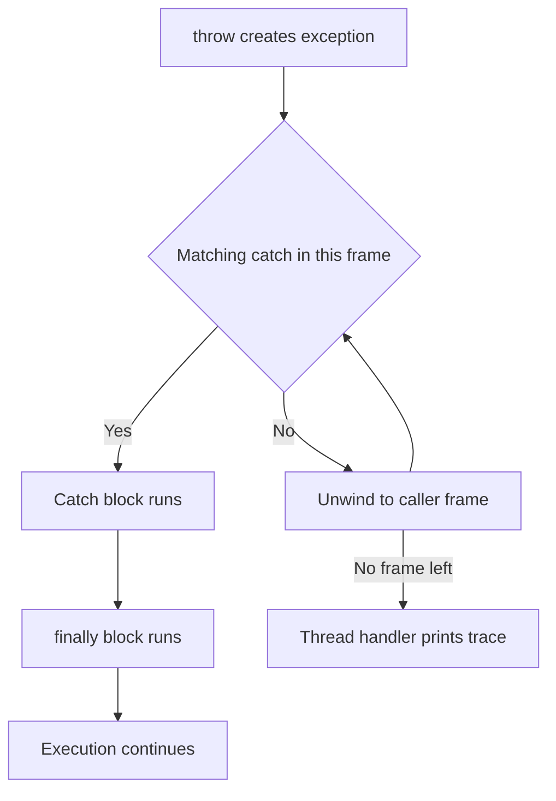

# Exceptions

An exception is an object that signals an abnormal condition and transfers control to a handler. Java splits throwables into errors and exceptions. Errors are serious JVM problems that you normally should not catch. Exceptions are conditions a program can recover from. Exceptions split further into checked and unchecked. Interviewers ask about this hierarchy, when to catch versus let errors propagate, how try-with-resources closes resources, and how to read a stack trace.

!!! note "In simple words"
    An exception is a signal that something went wrong. Java either makes you handle it, or lets it bubble up to a place that can handle it. A `finally` block is code that runs no matter what happened.

## Why it matters

Real systems fail all the time. Files go missing, networks time out, and users type bad input. Exceptions give you one consistent way to separate the normal path from the failure path. Handled well, they keep resources clean and messages clear. Handled badly, they hide bugs, lose the original cause, or leak open files. Interviewers test this because it shows how carefully you think about failure.

## How it works

### The hierarchy

Everything that can be thrown extends `Throwable`.

```text
Throwable
├── Error                 (serious JVM problems, e.g. OutOfMemoryError, StackOverflowError)
└── Exception
    ├── RuntimeException  (unchecked: programming errors, e.g. NullPointerException)
    └── other Exceptions  (checked: e.g. IOException, SQLException)
```

Catching `Throwable` or `Error` is almost never right. Catch the narrowest type that you can actually handle.

### Checked versus unchecked

- **Checked exceptions** extend `Exception` but not `RuntimeException`. The caller must catch them or declare them with `throws`. The compiler enforces this rule. They signal recoverable conditions, such as a missing file.
- **Unchecked exceptions** extend `RuntimeException`. They need no declaration. They usually signal bugs, such as an invalid argument or a null dereference.
- **Errors** are unchecked too, and you rarely handle them.

```java
import java.io.IOException;
import java.nio.file.Files;
import java.nio.file.Path;

public class ReadConfig {
    static String load(Path path) throws IOException {   // checked: declared
        return Files.readString(path);
    }

    static int parsePort(String text) {                   // unchecked: may throw
        return Integer.parseInt(text);                    // NumberFormatException
    }
}
```

### try, catch, and finally

The `try` block guards code. Each `catch` handles one type, or several types separated by `|`. The `finally` block runs whether or not an exception was thrown.

```java
public class ParseOrDefault {
    public static int parseOrDefault(String text, int fallback) {
        try {
            return Integer.parseInt(text);
        } catch (NumberFormatException e) {
            System.out.println("bad number: " + text);
            return fallback;
        } finally {
            System.out.println("parse attempted");
        }
    }

    public static void main(String[] args) {
        System.out.println(parseOrDefault("42", 0));    // parse attempted, then 42
        System.out.println(parseOrDefault("abc", -1));  // bad number: abc, parse attempted, then -1
    }
}
```

Multi-catch handles two or more unrelated types in one block:

```java
public class MultiCatch {
    static void riskyOperation() {
        throw new IllegalStateException("boom");
    }

    static void log(Exception e) {
        System.out.println("failed: " + e.getMessage());
    }

    public static void main(String[] args) {
        try {
            riskyOperation();
        } catch (IllegalArgumentException | IllegalStateException e) {
            log(e);   // prints: failed: boom
        }
    }
}
```

A `finally` block can override the return value or swallow an exception if it returns or throws. Keep `finally` for cleanup only.

### try-with-resources

Any object that implements `AutoCloseable` can be declared in the `try` header. The resource is closed automatically, in reverse declaration order, even when an exception occurs.

```java
import java.io.BufferedReader;
import java.io.IOException;
import java.io.StringReader;

public class FirstLine {
    static String firstLine(String text) throws IOException {
        try (BufferedReader reader = new BufferedReader(new StringReader(text))) {
            return reader.readLine();
        }   // reader.close() runs here, on success or failure
    }

    public static void main(String[] args) throws IOException {
        System.out.println(firstLine("alpha\nbeta")); // alpha
    }
}
```

If the body throws and `close()` also throws, the close exception is attached to the first one as a suppressed exception. You can read it with `getSuppressed()`. This is the main reason to prefer try-with-resources over a manual `finally` block that calls `close()`.

### Multi-catch and catch order

A multi-catch block handles several unrelated exception types with one handler. The alternatives must not be subclasses of each other. Catch clauses are checked from top to bottom, so put the most specific type first. Catching a superclass before its subclass is a compile error.

```java
import java.io.IOException;
import java.nio.file.Files;
import java.nio.file.NoSuchFileException;
import java.nio.file.Path;

public class CountReader {

    static int readCount(String path) {
        try {
            return Integer.parseInt(Files.readString(Path.of(path)).trim());
        } catch (NoSuchFileException e) {                   // most specific first: a missing file means zero
            return 0;
        } catch (IOException | NumberFormatException e) {   // multi-catch: unrelated types
            throw new IllegalStateException("cannot read count from " + path, e);
        }
    }
}
```

### throw versus throws

- `throw` raises an exception object: `throw new IllegalArgumentException("quantity must be positive");`
- `throws` declares what a method may raise: `void save() throws IOException`.

### Custom exceptions

Extend `RuntimeException` for programming errors. Extend `Exception` when callers should be forced to handle the case. Provide constructors that accept a message and a cause.

```java
public class InsufficientFundsException extends Exception {
    private final long shortfallCents;

    public InsufficientFundsException(String message, long shortfallCents) {
        super(message);
        this.shortfallCents = shortfallCents;
    }

    public long shortfallCents() {
        return shortfallCents;
    }
}
```

### Chained exceptions and propagation

When you translate one exception into another, pass the original as the cause. The stack trace then keeps the root problem.

```java
public class Settings {
    static int parseSetting(String raw) {
        try {
            return Integer.parseInt(raw);
        } catch (NumberFormatException e) {
            throw new IllegalArgumentException("invalid setting: " + raw, e);
        }
    }
}
```

An exception that is not caught propagates up the call stack until a handler is found. If none is found, the thread's uncaught exception handler prints it, and the thread ends.

### Handling InterruptedException

`Thread.sleep`, `join`, and many blocking calls throw `InterruptedException` when another thread interrupts them. Do not swallow it with an empty catch block. Either let it propagate, or restore the interrupt status so that code further up can see the request to stop.

```java
public class Pause {
    static void pause(long millis) {
        try {
            Thread.sleep(millis);
        } catch (InterruptedException e) {
            Thread.currentThread().interrupt();   // restore the flag for callers
        }
    }
}
```

### Reading stack traces

A stack trace lists the exception type and message. It then lists the frames, from the throw point up to the caller. The top line is the most specific frame in your code. The `Caused by:` section shows the chained root cause. Read from the top to find where the exception was created, and read down to find the entry point. Stack traces are captured when the exception object is created, so creating exceptions in a tight loop is expensive.



### Step by step

1. `throw` creates or uses an exception object and starts unwinding the call stack.
2. The JVM checks each frame for a `try` block with a matching `catch`.
3. If a `catch` matches, control jumps to it. `finally` runs before control leaves the `try` statement.
4. Try-with-resources closes each resource in reverse order before the `catch` or `finally` runs.
5. If nothing catches the exception, the thread ends and its handler reports the trace.

## Where it is used

- File and network code, where checked `IOException` signals failures the caller can recover from.
- Input validation in services, where an unchecked exception marks an invalid argument.
- Database and transaction code, where `finally` or try-with-resources releases connections.
- Framework error handlers, which convert exceptions into HTTP responses or log entries.

## Benefits

- Failure handling is separated from normal flow, so the main path stays readable.
- Checked exceptions make the compiler point out failures that callers must consider.
- Try-with-resources removes most manual cleanup code and records suppressed errors.
- Stack traces and chained causes make production problems easier to diagnose.

## Cons and limits

- Checked exceptions spread through method signatures, and many teams prefer unchecked ones for that reason.
- Exceptions are slower than normal returns, especially when the stack trace is captured often.
- Catching too broadly can hide bugs and make failures look like success.
- A `finally` block that throws can hide the original exception, which makes debugging harder.

## Common pitfalls

- Catching `Exception` or `Throwable` and ignoring it, which hides bugs.
- Logging and rethrowing the same exception at every layer, which produces duplicate log entries.
- Losing the cause by throwing a new exception without passing the original.
- Using exceptions for normal control flow, such as looping until a parse fails.
- Returning from `finally`, which silently discards the exception.
- Using `e.printStackTrace()` in production code instead of a logger.
- Declaring `throws Exception` on a method, which hides what can actually go wrong.
- Catching `NullPointerException` instead of preventing the null in the first place.
- Writing an empty catch block for `InterruptedException`, which loses the interrupt request.
- Throwing a generic `Exception` or `RuntimeException` with no message. Name the failure and include the values involved.

## Best practices

- Catch the narrowest type you can handle, and handle it in the layer that knows what to do.
- Use try-with-resources for every `AutoCloseable`.
- Include the failing value in the message, such as the file name or the order id.
- Pass the original exception as the cause whenever you wrap it.
- Log an exception once, at the boundary where it is finally handled.
- Validate arguments early, so the failure points at the real mistake.

!!! tip "Interview tip"
    **Q: When should you use a checked exception versus an unchecked one?** Use a checked exception when the caller can reasonably recover, such as a missing file that the caller can replace. Use an unchecked exception for programming errors or invalid arguments that the caller should not handle. Many modern APIs prefer unchecked exceptions, because checked ones spread through every signature.

## Quick recap

- Throwables split into errors (JVM problems), checked exceptions (must be handled or declared), and unchecked `RuntimeException`s.
- `finally` is for cleanup. A `return` or `throw` inside it can override the outcome.
- Try-with-resources closes `AutoCloseable` resources automatically and records suppressed exceptions.
- Custom exceptions should carry a message and a cause.
- Always pass the original exception as the cause when you translate errors.

## Official documentation

- [Java Language Specification, SE 21](https://docs.oracle.com/javase/specs/jls/se21/html/index.html)
- [JDK 21 API Documentation](https://docs.oracle.com/en/java/javase/21/docs/api/index.html)
- [Java Developer Site](https://dev.java/)

**See also:** [Wrappers, Strings and Arrays](wrappers-strings-arrays.md), [Enums, Inner Classes and Packages](enums-inner-classes-packages.md), [Generics](generics.md)
