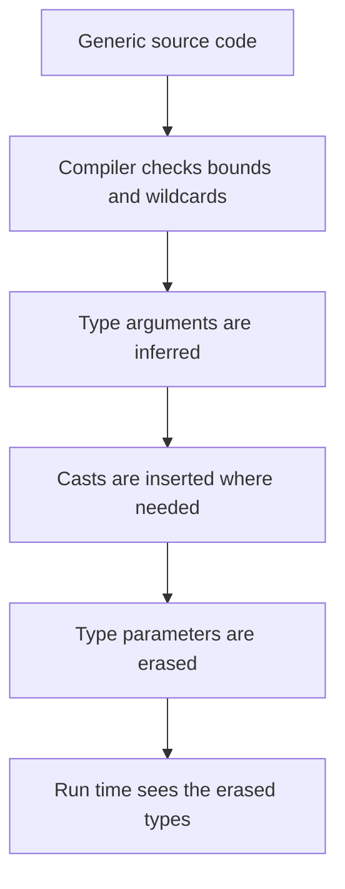

# Generics

Generics let a class or method work with many types while the compiler checks them. A `List<String>` cannot accidentally hold an `Integer`. Generics are compile-time checks implemented with type erasure, and erasure explains many of their limits. Interviewers ask about bounded types, wildcards, the PECS rule, and what erasure means for run-time checks.

!!! note "In simple words"
    A generic type has a placeholder for the type it holds, such as `List<String>`. The compiler checks every use of the placeholder, so you do not need casts and you cannot put the wrong kind of value in.

## Why it matters

Before generics, collections held `Object`, and every read needed a cast that could fail at run time. Generics move that failure to compile time. They also make APIs clearer, because the signature says what it accepts and returns. Interviewers focus on wildcards and erasure because those rules are the source of most confusing compiler errors.

## How it works

### Generic classes

A type parameter, commonly `T`, `E`, `K`, or `V`, is declared in angle brackets after the class name. Callers supply the actual type.

```java
public class Box<T> {
    private T value;

    public Box(T value) {
        this.value = value;
    }

    public T get() {
        return value;
    }

    public static void main(String[] args) {
        Box<String> name = new Box<>("Ada");   // diamond infers String
        String s = name.get();                 // no cast needed
        System.out.println(s.length());        // 3
    }
}
```

### Generic methods

A method can declare its own type parameters, placed before the return type. The compiler usually infers them from the arguments.

```java
import java.util.ArrayList;
import java.util.List;

public class Repeat {
    public static <T> List<T> repeat(T item, int times) {
        List<T> result = new ArrayList<>();
        for (int i = 0; i < times; i++) {
            result.add(item);
        }
        return result;
    }

    public static void main(String[] args) {
        List<String> words = repeat("hi", 3);   // [hi, hi, hi]
        System.out.println(words);
    }
}
```

### Bounded type parameters

A bound restricts which types can be used. `T extends Comparable<T>` means that `T` must implement `Comparable` of itself. A type parameter can have several bounds. A class bound comes first, then interfaces, and the bounds are joined with `&`.

```java
import java.util.List;

public class MaxDemo {
    public static <T extends Comparable<T>> T maxOf(List<T> items) {
        T best = items.get(0);
        for (T item : items) {
            if (item.compareTo(best) > 0) {
                best = item;
            }
        }
        return best;
    }

    public static void main(String[] args) {
        System.out.println(maxOf(List.of(3, 9, 4)));   // 9
    }
}
```

Bounds give you access to the bound's methods inside the generic code. Without a bound, you can call only the `Object` methods on `T`.

### Wildcards

A wildcard `?` stands for an unknown type inside a type argument.

| Form | Meaning | You can read | You can write |
|---|---|---|---|
| `List<?>` | Any type | As `Object` | Only `null` |
| `List<? extends Number>` | Number or a subtype | As `Number` | Only `null`, because the exact type is unknown |
| `List<? super Integer>` | Integer or a supertype | As `Object` | `Integer` values |

```java
import java.util.ArrayList;
import java.util.List;

public class Wildcards {
    public static double sum(List<? extends Number> numbers) {
        double total = 0;
        for (Number n : numbers) {          // reading: safe
            total += n.doubleValue();
        }
        return total;
    }

    public static void fill(List<? super Integer> target) {
        target.add(1);                      // writing: safe, since target holds Integer or a supertype
        target.add(2);
    }

    public static void main(String[] args) {
        List<Number> numbers = new ArrayList<>(List.<Number>of(1, 2.5));
        System.out.println(sum(numbers));   // 3.5
        List<Number> target = new ArrayList<>();
        fill(target);
        System.out.println(target);         // [1, 2]
    }
}
```

`sum` works with `List<Integer>` and `List<Double>`. `fill` works with `List<Integer>`, `List<Number>`, and `List<Object>`.

### PECS: producer extends, consumer super

PECS is the rule for choosing a wildcard. If a parameter only produces values for you to read, use `? extends T`. If it only consumes values you put in, use `? super T`. If it does both, use an exact type.

```java
import java.util.ArrayList;
import java.util.List;

public class Copy {
    public static <T> void copy(List<? extends T> source, List<? super T> destination) {
        for (T item : source) {       // source produces T
            destination.add(item);    // destination consumes T
        }
    }

    public static void main(String[] args) {
        List<Integer> source = List.of(1, 2);
        List<Number> destination = new ArrayList<>();
        copy(source, destination);
        System.out.println(destination);   // [1, 2]
    }
}
```

`Collections.copy(List<? super T> dest, List<? extends T> src)` follows the same pattern. PECS is the standard answer when interviewers ask about wildcards.

### Type erasure

The compiler checks generics, then removes the type arguments. At run time, `List<String>` and `List<Integer>` are both just `List`. Consequences:

- You cannot create instances of a type parameter, such as `new T()`. You cannot create generic arrays, such as `new T[10]` or `new List<String>[10]`.
- You cannot use `instanceof` with a parameterized type. `obj instanceof List<String>` is an error. `obj instanceof List<?>` is allowed.
- A class cannot implement two different parameterizations of the same generic interface.
- Static members cannot refer to the class's type parameters.
- Casts to a type parameter are unchecked and produce warnings. Use `@SuppressWarnings("unchecked")` only on a narrowly scoped, justified cast.

```java
import java.util.ArrayList;
import java.util.List;

public class ErasureDemo {
    public static void main(String[] args) {
        List<String> strings = new ArrayList<>();
        List<Integer> integers = new ArrayList<>();
        System.out.println(strings.getClass() == integers.getClass()); // true: both ArrayList
    }
}
```

### Raw types

A raw type is a generic type used without arguments, such as `List list = new ArrayList();`. It compiles, but it disables the checks and produces warnings. Avoid it in new code.

### Generic type inference with the diamond

`new ArrayList<>()` infers the type arguments from the variable's declared type. Since Java 9, the diamond also works with anonymous classes, as shown on the enums and inner-classes page.



### Step by step

1. The compiler checks that each use of a generic type matches its bounds and wildcards.
2. Type arguments are inferred from the target type and the arguments, where possible.
3. The compiler inserts casts where needed, then erases type parameters to their bounds or to `Object`.
4. At run time the JVM sees only the erased types. The generic information is gone, apart from some reflection metadata.
5. Unchecked operations, such as raw casts, are allowed with warnings, because the check cannot be made at run time.

## Where it is used

- Collections such as `List`, `Map`, and `Set`, and their implementations.
- `Optional<T>` for values that may be absent.
- Framework types such as repositories, which are often declared as `Repository<T, ID>`.
- Utility methods such as `Collections.sort`, `Collections.copy`, and stream operations.

## Benefits

- Type errors are reported at compile time instead of as `ClassCastException` at run time.
- Casts disappear from client code, which makes it shorter and clearer.
- Wildcards let one method accept a family of types safely.
- Generic APIs document their own constraints.

## Cons and limits

- Type erasure means the run time cannot check generic types, so some checks are impossible.
- Generic array creation is not allowed, which forces workarounds.
- Error messages with nested wildcards can be long and hard to read.
- Mixing raw and generic code can silently defeat the compiler's checks.

## Common pitfalls

- Expecting `List<String>` to reject an `Integer` at run time when it has been passed through a raw type.
- Writing `T[] array = new T[n];`. Create an `Object[]` and cast it, or use a `List<T>`.
- Using `? extends T` for a parameter you must write to. That forbids every value except `null`.
- Assuming `List<Object>` accepts any `List<String>`. Generics are invariant. Use `List<?>` or `List<? extends Object>` instead.
- Overusing `@SuppressWarnings("unchecked")` to hide a real type problem.
- Calling a method that needs `Comparable` on a `T` with no bound.
- Using primitives as type arguments. Use `Integer` instead of `int`.

## Best practices

- Use the diamond operator for constructor calls and let inference work.
- Choose wildcards with PECS for method parameters, and keep return types exact.
- Prefer generic methods over raw types, and avoid raw types in new code.
- Keep unchecked casts in the smallest possible scope, with a comment that explains why they are safe.
- Use bounded types when your code calls methods on the type parameter.

!!! tip "Interview tip"
    **Q: Why are generics invariant, and why does `List<Integer>` not extend `List<Number>`?** If it did, you could add a `Double` to a list that the reference says holds `Integer` values, and the compiler could not catch the error. Wildcards exist to express the safe variance cases explicitly.

## Quick recap

- Generic classes and methods let the compiler check element types without casts.
- Bounds (`extends`) restrict the types a parameter may take, and give access to their methods.
- Use `? extends` to read and `? super` to write. PECS is the rule.
- Type erasure removes type arguments at run time. You cannot create `T` instances or generic arrays, and you cannot check `instanceof List<String>`.
- Avoid raw types, and keep unchecked suppressions narrow.

## Official documentation

- [Java Language Specification, SE 21](https://docs.oracle.com/javase/specs/jls/se21/html/index.html)
- [JDK 21 API Documentation](https://docs.oracle.com/en/java/javase/21/docs/api/index.html)
- [Java Developer Site](https://dev.java/)

**See also:** [Inheritance, Polymorphism and Interfaces](inheritance-polymorphism-interfaces.md), [Collections Overview](../02b-collections/collections-overview.md), [Ordering: Comparable and Comparator](../02b-collections/ordering-comparable-comparator.md)
