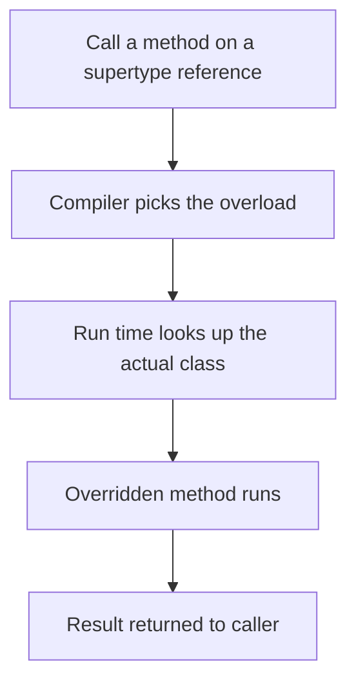

# Inheritance, Polymorphism and Interfaces

Inheritance lets a class reuse and specialize another class. Polymorphism lets code work with a general type while the right behaviour runs at run time. Java allows one superclass but any number of interfaces. Interviewers ask about overriding rules, overloading versus overriding, static versus dynamic binding, and default methods. Many also ask you to explain the SOLID principles with Java.

!!! note "In simple words"
    A subclass is a more specific kind of its parent. Code can talk to the parent type, and each object still does its own thing. An interface is a list of things an object promises it can do.

## Why it matters

Good use of inheritance and interfaces lets you add new behaviour without rewriting existing code. A payment service can accept a new payment method, a report can use a new output format, and tests can replace a real dependency with a fake one. Misused inheritance couples classes tightly, so a small change in a parent breaks many children. This page shows both sides.

## How it works

### extends and super

A subclass inherits the non-private members of its superclass and can add its own. `super` refers to the superclass. It calls a superclass constructor or an overridden method.

```java
public class Animal {
    protected final String name;

    public Animal(String name) {
        this.name = name;
    }

    public String sound() {
        return "...";
    }
}

public class Dog extends Animal {
    public Dog(String name) {
        super(name);                 // must run the superclass constructor
    }

    @Override
    public String sound() {
        return "Woof (" + super.sound() + ")";
    }
}
```

Every class extends `Object` implicitly. Java has single class inheritance. A class has at most one direct superclass.

### Types of inheritance

Inheritance is usually described in four shapes. Java supports three of them directly for classes. The fourth is possible only through interfaces.

| Type | Shape | Support in Java |
|---|---|---|
| Single | One class extends one superclass | Yes, for classes |
| Multilevel | A chain: C extends B, and B extends A | Yes, for classes |
| Hierarchical | Several classes extend the same superclass | Yes, for classes |
| Multiple | One class extends two or more classes | Not for classes; a class can implement many interfaces instead |

Hybrid designs mix these shapes. They are allowed as long as no class ends up with two superclasses.

```java
class Vehicle {                          // base class
    void start() { System.out.println("starting"); }
}

class Car extends Vehicle { }            // single: one superclass

class ElectricCar extends Car { }        // multilevel: Vehicle -> Car -> ElectricCar

class Bike extends Vehicle { }           // hierarchical: Car and Bike share Vehicle

interface Electric {
    default void charge() { System.out.println("charging"); }
}

interface Navigable {
    default void route() { System.out.println("routing"); }
}

// Multiple inheritance of behaviour: one superclass, two interfaces
class SmartCar extends Vehicle implements Electric, Navigable { }
```

Java avoids multiple class inheritance because of the diamond problem. If two superclasses define the same method, the compiler cannot tell which one to run. Default methods bring the same question into interfaces. When two interfaces provide a default method with the same signature, the implementing class must override it and choose which version to call:

```java
interface Left {
    default String hello() { return "left"; }
}

interface Right {
    default String hello() { return "right"; }
}

class Both implements Left, Right {
    @Override
    public String hello() {
        return Left.super.hello() + " and " + Right.super.hello();
    }
}
```

Without the override, the class does not compile. The `Interface.super.method()` form names the version you want.

### Method overriding

Overriding replaces an inherited instance method. The rules are:

- The signature must match: same name and same parameter types.
- The return type must be the same or a subtype. This is a covariant return.
- The access level must be the same or wider. You cannot override a `public` method as `private`.
- You cannot override a `final` method. A `static` method is hidden, not overridden. A `private` method is not inherited at all.
- The method cannot throw a new or broader checked exception than the overridden method declares.

Use `@Override` so the compiler checks these rules for you.

### Overloading versus overriding

| | Overloading | Overriding |
|---|---|---|
| Where | Same class, or a subclass adding a method | A subclass replaces an inherited method |
| Selection | At compile time, by declared argument types | At run time, by the object's actual class |
| Signature | Different parameter lists | Same parameter list |
| Name | Same name | Same name |

```java
public class Printer {
    void print(Object o)  { System.out.println("object"); }
    void print(String s)  { System.out.println("string"); }

    public static void main(String[] args) {
        Printer p = new Printer();
        Object o = "text";
        p.print(o);                 // prints "object": chosen by declared type
        p.print("text");            // prints "string"
    }
}
```

### Static versus dynamic binding

Overloaded methods, static methods, and fields are bound at compile time from the declared type. Overridden instance methods are bound at run time from the actual object. Fields are not polymorphic. A field access uses the declared type.

```java
class Base {
    String name = "base";
    static String kind() { return "base kind"; }
    String who() { return "base"; }
}

class Child extends Base {
    String name = "child";                        // hides the field
    static String kind() { return "child kind"; } // hides the static method
    @Override String who() { return "child"; }    // overrides
}

public class Binding {
    public static void main(String[] args) {
        Base b = new Child();
        System.out.println(b.name);   // base: field uses the declared type
        System.out.println(b.kind()); // base kind: static uses the declared type
        System.out.println(b.who());  // child: instance method uses the object
    }
}
```

### Polymorphism

Code written against a supertype works with any subtype. This is the main reason to use inheritance and interfaces.

```java
import java.util.List;

public class ZooDemo {
    static class Animal {
        private final String name;
        Animal(String name) { this.name = name; }
        String sound() { return name + " makes a sound"; }
    }

    static class Dog extends Animal {
        Dog(String name) { super(name); }
        @Override String sound() { return "Woof"; }
    }

    public static void main(String[] args) {
        List<Animal> zoo = List.of(new Animal("generic"), new Dog("Rex"));
        for (Animal a : zoo) {
            System.out.println(a.sound());   // each object chooses its own sound()
        }
    }
}
```

### Abstract classes and methods

An abstract class cannot be instantiated. It can have constructors, fields, and concrete methods. It can also declare abstract methods that subclasses must implement. Use it when subclasses share state or a partial implementation.

```java
public abstract class Shape {
    public abstract double area();

    public String describe() {
        return getClass().getSimpleName() + " with area " + area();
    }
}

public class Square extends Shape {
    private final double side;
    public Square(double side) { this.side = side; }
    @Override public double area() { return side * side; }
}
```

### Interfaces

An interface declares a contract. A class can implement any number of interfaces. Interface methods are implicitly `public`, unless they are `private` or `static`. Interface fields are implicitly `public static final`.

Interfaces have grown over time:

- **Abstract methods:** the classic contract.
- **Default methods (Java 8):** a concrete method marked `default`, so existing implementers keep working when you add behaviour.
- **Static methods (Java 8):** utility methods that belong to the interface.
- **Private methods (Java 9):** shared helpers used by default methods without exposing them.

```java
public interface Greeter {
    String name();

    default String greet() {
        return format("Hello, " + name());
    }

    private String format(String text) {
        return text + "!";
    }

    static Greeter of(String name) {
        return () -> name;   // a lambda works because Greeter has one abstract method
    }
}
```

When a class inherits two defaults with the same signature from two interfaces, it must override the method. It may call one of them with `Interface.super.method()`:

```java
interface A { default String hi() { return "A"; } }
interface B { default String hi() { return "B"; } }

class C implements A, B {
    @Override public String hi() { return A.super.hi() + B.super.hi(); } // "AB"
}
```

A class method always wins over an interface default with the same signature.

### Abstract class or interface?

Use an interface to describe a capability that unrelated classes can share. Use an abstract class when you need shared state, constructors, or a common base implementation within a hierarchy. A class can implement many interfaces but extend only one class.

| Question | Interface | Abstract class |
|---|---|---|
| Instance state | None; only constants (`public static final`) | Any fields, with any visibility |
| Constructors | None | Yes, to initialize shared state |
| How many per class | A class may implement many | A class may extend one |
| Method kinds | Abstract, default, static, and private (Java 9+) | Abstract and concrete, with any modifier |
| Typical meaning | "can do" a capability | "is a" kind of thing |

An abstract class fits a fixed algorithm with steps that subclasses fill in. This is the template method pattern. Mark the skeleton `final` so that subclasses cannot change the order of the steps:

```java
public abstract class DataProcessor {
    public final void process(String data) {          // fixed skeleton
        save(clean(data));
    }

    protected String clean(String data) {             // default step
        return data.trim();
    }

    protected abstract void save(String data);        // each subclass supplies this step
}

class ConsoleProcessor extends DataProcessor {
    @Override
    protected void save(String data) {
        System.out.println("saved: " + data);
    }
}
```

Rule of thumb: if you need shared fields, constructors, or a single base class for a family of types, use an abstract class. If you need a capability that unrelated types can share, or several at once, use an interface.

### SOLID principles

| Letter | Principle | Java example |
|---|---|---|
| S | Single responsibility: a class has one reason to change | A `ReportFormatter` formats, and a `ReportRepository` stores |
| O | Open/closed: extend behaviour without editing tested code | Add a new `PaymentMethod` implementation instead of editing a switch |
| L | Liskov substitution: subtypes can replace their base type | A `Square` that breaks a `Rectangle` width and height contract violates it |
| I | Interface segregation: small, focused interfaces | Split `Worker` into `Workable` and `Feedable` |
| D | Dependency inversion: depend on abstractions | An `OrderService` receives a `PaymentGateway` interface through its constructor |

```java
public interface PaymentGateway {
    void charge(long amountCents);
}

public class OrderService {
    private final PaymentGateway gateway;   // depends on the abstraction (D)

    public OrderService(PaymentGateway gateway) {
        this.gateway = gateway;
    }

    public void checkout(long amountCents) {
        gateway.charge(amountCents);
    }
}
```

The example follows the dependency inversion principle. Tests can pass a fake `PaymentGateway`, and production code can pass a real payment provider.



### Step by step

1. A call to an instance method finds the implementation by the object's actual class at run time. This is virtual dispatch.
2. The overload is chosen earlier, at compile time, by the declared argument types.
3. `super.method()` skips dynamic dispatch and calls the superclass implementation directly.
4. When a class implements an interface, the compiler checks that every abstract method has an implementation. Otherwise the class must be declared abstract.
5. Default methods are inherited like any other method. A method from a class takes precedence over a default method.

## Where it is used

- Frameworks that call your code through an interface, such as a handler or a listener.
- Plug-in designs, where new payment methods, exporters, or validators are added as new classes.
- Collections, where `List` and `Map` are interfaces with several implementations.
- Test code, where a fake object implements the same interface as the real service.

## Benefits

- New behaviour can be added as a new class, which supports the open/closed principle.
- Code that depends on an interface is easy to test with fakes.
- Default methods let an API grow without breaking existing implementers.
- Polymorphism removes long `if` or `switch` chains on types.

## Cons and limits

- Deep hierarchies are hard to follow, and a change to a base class affects every subclass.
- Java has no multiple class inheritance, so some designs need composition or extra interfaces.
- Default methods can hide missing logic in implementers, so some teams avoid them for core contracts.
- Dynamic dispatch and extra indirection cost a little speed, though the JIT usually removes most of it.

## Common pitfalls

- Adding an abstract method to an interface that other code implements. Every existing implementation breaks. Add a `default` method instead when the API is already in use.
- Forgetting `super(...)` when the superclass has no no-argument constructor. The compiler reports an error.
- Expecting field access to be polymorphic. It uses the declared type.
- Confusing overloading with overriding and expecting the runtime type to pick an overload.
- Making an overriding method less accessible, such as `public` to `protected`.
- Calling overridable methods from a constructor, which runs before subclass fields are set.
- Using inheritance for code reuse when composition fits better, which couples unrelated classes.
- Adding a checked exception to an overriding method that the interface method does not declare.

## Best practices

- Prefer small interfaces, and make a class implement only the capabilities it has.
- Use `@Override` on every overriding method.
- Make classes `final` unless they are designed for extension.
- Depend on interfaces in constructor parameters, so the wiring is visible and testable.
- Use inheritance only for a true "is a" relationship. Use composition for everything else.

!!! tip "Interview tip"
    **Q: Why does Java allow multiple interfaces but only one superclass?** Multiple inheritance of state causes ambiguity, such as two superclasses with fields of the same name or conflicting method bodies. Interfaces contribute behaviour and constants only. Since Java 8, default methods still require the implementing class to resolve conflicts explicitly.

## Quick recap

- One superclass, many interfaces. `super` calls the parent constructor or an overridden method.
- Overloading is chosen at compile time. Overriding is chosen at run time.
- Fields and static methods use the declared type, not the object's type.
- Interfaces can have default, static, and private methods. Resolve default conflicts explicitly.
- SOLID principles map to concrete Java design choices, such as interfaces and constructor injection.

## Official documentation

- [Java Language Specification, SE 21](https://docs.oracle.com/javase/specs/jls/se21/html/index.html)
- [JDK 21 API Documentation](https://docs.oracle.com/en/java/javase/21/docs/api/index.html)
- [Java Developer Site](https://dev.java/)

**See also:** [Classes, Objects and Encapsulation](oop-classes-encapsulation.md), [Enums, Inner Classes and Packages](enums-inner-classes-packages.md), [Generics](generics.md)
