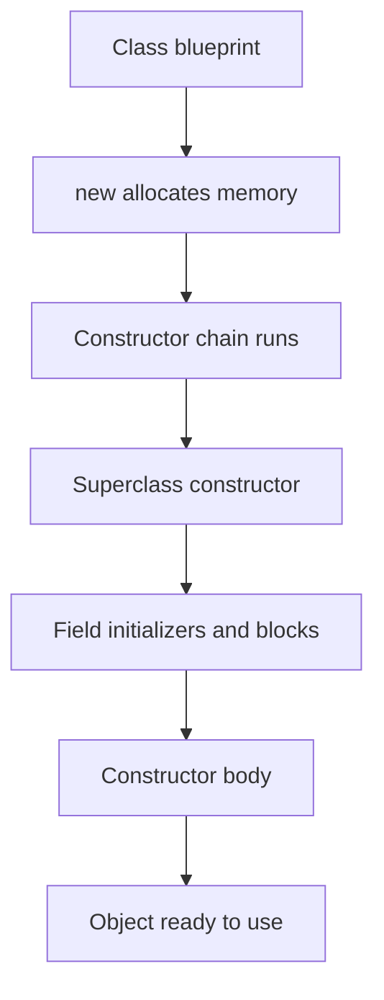

# Classes, Objects and Encapsulation

A class is a blueprint that defines state (fields) and behaviour (methods). An object is one instance of that blueprint. Encapsulation hides state behind a deliberate interface. Interviewers ask how constructors chain, what order initializers run in, and whether a relationship is composition or aggregation. This page covers those mechanics with small examples.

!!! note "In simple words"
    A class is a template, and an object is something you build from it. Encapsulation means the object keeps its own data private and lets other code use it only through safe methods.

## Why it matters

Object-oriented design is the way most Java systems are organized. Good class design keeps data consistent, limits what other code can break, and makes code easy to test. Poor design leaks internal state, so one change in a class breaks code in many places. Understanding constructors, initialization, and encapsulation is the foundation for the inheritance and design topics that follow.

## How it works

### Classes and objects

A class declares fields, constructors, and methods. The `new` keyword creates an object on the heap and runs a constructor. Each object gets its own copy of the instance fields. `static` members belong to the class itself, and all objects share them.

```java
public class BankAccount {
    private static int openedCount = 0;   // class-level, shared by all accounts
    private final String id;              // per object, set once
    private long balanceCents;            // per object

    public BankAccount(String id) {
        this.id = id;
        openedCount++;
    }

    public long balance() {
        return balanceCents;
    }

    public static int openedCount() {
        return openedCount;
    }

    public static void main(String[] args) {
        BankAccount a = new BankAccount("A-1");
        System.out.println(a.balance() + " " + BankAccount.openedCount()); // 0 1
    }
}
```

### Constructors and this

A constructor has the class name and no return type. If you write none, the compiler supplies a no-argument default constructor. Writing any constructor removes that default. Use `this` to refer to the current object. Use `this(...)` as the first statement to call another constructor in the same class.

```java
public class Point {
    private final int x;
    private final int y;

    public Point() {
        this(0, 0);            // constructor chaining within the class
    }

    public Point(int x, int y) {
        this.x = x;            // this.x is the field; x is the parameter
        this.y = y;
    }

    @Override
    public String toString() {
        return "(" + x + ", " + y + ")";
    }

    public static void main(String[] args) {
        System.out.println(new Point());      // (0, 0)
        System.out.println(new Point(3, 4));  // (3, 4)
    }
}
```

### Constructor chaining with super

A subclass constructor calls its superclass constructor first. If the first statement is not `this(...)` or `super(...)`, the compiler inserts `super()` for you. That is why a superclass with only a parameterized constructor forces every subclass to pass arguments up.

### Copy constructors and the builder pattern

A copy constructor takes an object of the same class and copies its state. It gives you an independent object without using `clone()`, which is awkward to implement correctly. A builder collects optional settings step by step, then creates an immutable object in one place.

```java
public class Settings {
    private final String host;
    private final int port;

    private Settings(Builder builder) {
        this.host = builder.host;
        this.port = builder.port;
    }

    public Settings(Settings other) {        // copy constructor
        this.host = other.host;
        this.port = other.port;
    }

    public static class Builder {
        private String host = "localhost";
        private int port = 8080;

        public Builder host(String host) {
            this.host = host;
            return this;
        }

        public Builder port(int port) {
            this.port = port;
            return this;
        }

        public Settings build() {
            return new Settings(this);
        }
    }

    public static void main(String[] args) {
        Settings s = new Settings.Builder().port(9000).build();
        Settings copy = new Settings(s);
        System.out.println(copy.host + ":" + copy.port);   // localhost:9000
    }
}
```

### Initialization order

When a class is first used, its static fields and static initializer blocks run once, in textual order. For each new object, the order is:

1. The superclass constructor chain runs. Its own initialization happens inside it.
2. Instance field initializers and instance initializer blocks run, in textual order.
3. The rest of the constructor body runs.

```java
public class Init {
    static { System.out.println("1. static block"); }
    { System.out.println("3. instance block"); }
    private int value = compute("4. field initializer");

    Init() {
        System.out.println("5. constructor body");
    }

    static int compute(String label) {
        System.out.println(label);
        return 1;
    }

    public static void main(String[] args) {
        System.out.println("0. main starts");
        new Init();
    }
}
```

The static block prints first, because the class is initialized before `main` runs. The output then reads: static block, `0. main starts`, instance block, field initializer, constructor body.

### Static members

A `static` member belongs to the class. Static fields have one copy shared by all instances. Static methods are called on the class and cannot use `this` or instance fields. A static nested class has no link to an instance of the outer class.

Static methods are hidden, not overridden. The method that runs is chosen by the declared type of the reference, not by the object's actual class:

```java
class Parent {
    static String name() { return "parent"; }
}

class Child extends Parent {
    static String name() { return "child"; }   // hides Parent.name(); does not override it
}

public class HidingDemo {
    public static void main(String[] args) {
        Parent p = new Child();
        System.out.println(p.name());          // parent: chosen by the declared type
        System.out.println(Child.name());      // child
    }
}
```

### Instance members and variable scope

Instance methods can read and write instance fields, and they can call other instance methods. Static methods cannot refer to `this` or instance fields directly. A parameter or local variable can hide a field with the same name. Use `this.name` to reach the field.

### Association, aggregation, composition, and dependency

Objects relate to each other in four common ways. The first three describe how long the linked objects live. Dependency describes how long one class relies on another.

| Relation | Meaning | Ownership and lifetime | Example |
|---|---|---|---|
| Association | One object knows about another through a link | Neither owns the other; both can exist alone | A `Student` is linked to a `Course` through an enrollment |
| Aggregation | A "has-a" link where the part can exist without the whole | The whole refers to parts it does not own | A `Team` refers to `Player` objects that can exist without it |
| Composition | A "part-of" link where the part cannot outlive the whole | The whole creates and owns the part | An `Order` creates its `OrderLine` objects |
| Dependency | A class uses another briefly, typically in a method | No field; the relation lasts for one call | A report service uses a printer inside one method |

```java
import java.util.ArrayList;
import java.util.List;

class Order {                         // composition: creates its own lines
    private final List<String> lines = new ArrayList<>();
    public void addLine(String item) { lines.add(item); }
}

class Player { }

class Team {                          // aggregation: receives players that exist elsewhere
    private final List<Player> players;
    public Team(List<Player> players) { this.players = players; }
}
```

Composition is usually preferred for code you control, because it keeps lifetimes simple. Aggregation fits when the parts are shared or managed by someone else.

A dependency keeps no field. The class uses the other one inside a method and forgets it afterwards:

```java
class Printer {
    void print(String text) {
        System.out.println(text);
    }
}

class ReportService {
    void publish(String text) {
        new Printer().print(text);   // dependency: no field, used only inside this method
    }
}
```

### Encapsulation

Encapsulation keeps fields `private` and exposes behaviour through methods. A getter returns a value. A setter validates the new value before it assigns. Avoid a setter for every field. A method that performs an operation, such as `deposit`, often expresses the intent better.

```java
public class Temperature {
    private double celsius;

    public double getCelsius() {
        return celsius;
    }

    public void setCelsius(double value) {
        if (value < -273.15) {
            throw new IllegalArgumentException("below absolute zero: " + value);
        }
        this.celsius = value;
    }
}
```

Return immutable views or copies of mutable state. Returning a live internal list lets callers change your object without going through its rules.

```java
import java.util.ArrayList;
import java.util.List;

public class Order {
    private final List<String> lines = new ArrayList<>();

    public List<String> lines() {
        return List.copyOf(lines);   // a copy: callers cannot change our list
    }
}
```

### JavaBeans, POJOs, and EJB

These three terms describe how a class is written and what it is for.

- **POJO (plain old Java object):** an ordinary class that does not extend or implement a framework type. Frameworks can use it without special rules. Most domain and DTO classes are POJOs.
- **JavaBean:** a POJO that follows conventions so tools can read and edit its properties. It has a public no-argument constructor, private fields exposed through getters and setters, and, as a common convention, it implements `Serializable`. The JavaBeans specification itself does not require `Serializable`.
- **EJB (Enterprise JavaBean):** a server-side component model from the enterprise platform. EJBs add transactions, security, and remote access managed by the container. They are heavier than beans and POJOs. In current code the package names are `jakarta.ejb.*`. Older code uses `javax.ejb.*`.

```java
import java.io.Serializable;

public class StudentBean implements Serializable {
    private static final long serialVersionUID = 1L;

    private String name;
    private int age;

    public StudentBean() { }                 // public no-argument constructor

    public String getName() { return name; }
    public void setName(String name) { this.name = name; }

    public int getAge() { return age; }
    public void setAge(int age) { this.age = age; }
}
```

Records, introduced in Java 16, are a compact way to write a POJO for data that should not change. They do not follow the bean setter convention.

### Serialization

Serialization turns an object's state into a byte stream, so it can be written to a file or sent over a network. Deserialization rebuilds the object from those bytes. A class opts in by implementing `java.io.Serializable`, which is a marker interface with no methods. Subclasses of a serializable class are serializable too.

Two details come up in interviews. A `transient` field is skipped, so it comes back as its default value. A `serialVersionUID` identifies the class version. Declare it explicitly. Otherwise the JVM computes one from the class shape, and a small edit can make old data unreadable.

```java
import java.io.ByteArrayInputStream;
import java.io.ByteArrayOutputStream;
import java.io.IOException;
import java.io.ObjectInputStream;
import java.io.ObjectOutputStream;
import java.io.Serializable;

class Profile implements Serializable {
    private static final long serialVersionUID = 1L;

    String user;
    transient String password;     // not written to the stream
}

public class SerializationDemo {
    public static void main(String[] args) throws IOException, ClassNotFoundException {
        Profile original = new Profile();
        original.user = "ada";
        original.password = "secret";

        ByteArrayOutputStream bytes = new ByteArrayOutputStream();
        try (ObjectOutputStream out = new ObjectOutputStream(bytes)) {
            out.writeObject(original);
        }

        try (ObjectInputStream in = new ObjectInputStream(new ByteArrayInputStream(bytes.toByteArray()))) {
            Profile copy = (Profile) in.readObject();
            System.out.println(copy.user + " " + copy.password);   // ada null
        }
    }
}
```

Avoid deserializing data from untrusted sources. Java deserialization has a long history of security bugs. For data that crosses a trust boundary, prefer a plain data format such as JSON.

### Object identity, equals and hashCode

`==` compares identity. Override `equals` and `hashCode` together when objects should compare by value. Keep them consistent: equal objects must have equal hash codes. Records generate both methods for you.



## Where it is used

- Domain models such as an order, a customer, or an account, which hold data and rules together.
- Value objects that compare by content, such as money or coordinates.
- Builders for configuration objects with many optional settings.
- Frameworks that create objects through no-argument constructors and setters, such as JavaBeans-based libraries.

## Benefits

- Encapsulation keeps invariants in one place, so the rules cannot be broken from outside.
- Builders and copy constructors make object creation readable and safe.
- Clear ownership between objects makes lifetimes and cleanup easier to reason about.
- Small classes with private state are easier to test in isolation.

## Cons and limits

- Too many getters and setters can make a class a thin wrapper around its fields.
- Composition adds more objects and more small methods to write.
- Serialization ties the stored format to the class shape, so changes need care.
- Records and immutable classes cannot be changed after creation, which means updates create new objects.

## Common pitfalls

- Assuming the default constructor still exists after you add a parameterized one. It does not.
- Forgetting `this.` when a parameter has the same name as a field, so the assignment does nothing useful.
- Calling an overridable method from a constructor, where the subclass field is still uninitialized.
- Exposing a mutable list or array through a getter.
- Writing a setter for every field, which defeats encapsulation.
- Overriding `equals` without `hashCode`, so hash-based collections fail to find objects.
- Assuming a static method can access an instance field.

## Best practices

- Make fields `private` and `final` by default. Add a setter only when the state really must change.
- Validate arguments in constructors and setters, and fail early with a clear message.
- Return copies or unmodifiable views of collections.
- Use a builder when a class has more than three or four optional parameters.
- Override `equals` and `hashCode` together, or use a record for value semantics.

!!! tip "Interview tip"
    **Q: Composition or inheritance?** Prefer composition when the relationship is "has a", or when you want to reuse behaviour without locking in a type hierarchy. Use inheritance for a true "is a" relationship with shared behaviour. Composition lets you swap the parts at run time and avoids the fragile base-class problem.

## Quick recap

- A class defines fields and methods. `new` creates an object and runs a constructor.
- `this(...)` chains constructors in one class. `super(...)` calls the parent constructor first.
- Initialization order: static blocks run once. Then each object runs its superclass, its field initializers and instance blocks, and its constructor body.
- Composition means the whole owns the part. Aggregation means a reference to an object that lives elsewhere.
- Keep fields private, validate in setters, and return copies of mutable state.

## Official documentation

- [Java Language Specification, SE 21](https://docs.oracle.com/javase/specs/jls/se21/html/index.html)
- [JDK 21 API Documentation](https://docs.oracle.com/en/java/javase/21/docs/api/index.html)
- [Java Developer Site](https://dev.java/)

**See also:** [Inheritance, Polymorphism and Interfaces](inheritance-polymorphism-interfaces.md), [Enums, Inner Classes and Packages](enums-inner-classes-packages.md), [Wrappers, Strings and Arrays](wrappers-strings-arrays.md)
