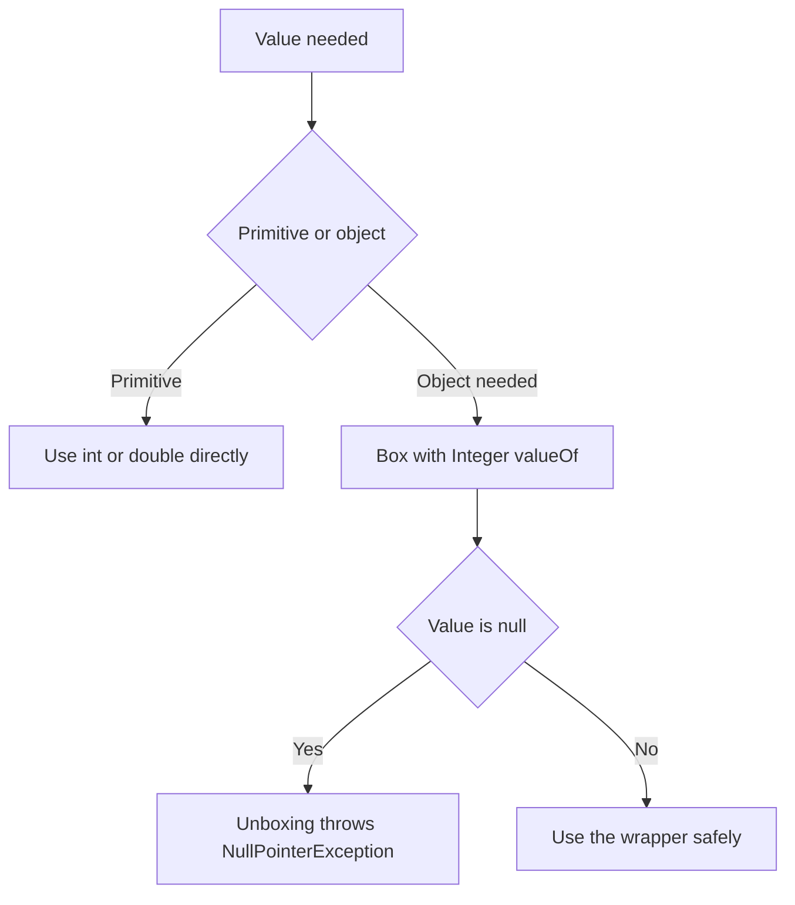

# Wrappers, Strings and Arrays

Java's primitives are fast, but they are not objects. The language provides wrapper classes so you can use primitives where objects are required. Strings and arrays are the two most common data holders in any program. Interviewers ask about `==` versus `equals()`, why `String` is immutable, how autoboxing can throw a `NullPointerException`, and how to choose between `StringBuilder` and `StringBuffer`.

!!! note "In simple words"
    A wrapper is a box that holds a primitive number so it can be used as an object. A `String` is text that never changes once created. An array is a fixed-size row of values of one type.

## Why it matters

Almost every program handles text, numbers, and lists of values. Mistakes with these types are common and costly. A `==` comparison that works in a quick test can fail in production, and a `null` from a map can crash a request. Knowing how these types behave keeps the code correct and the interview answers precise.

## How it works

### Wrapper classes

Each primitive has a wrapper class in `java.lang`: `Byte`, `Short`, `Integer`, `Long`, `Float`, `Double`, `Character`, and `Boolean`. Wrappers are immutable objects. You need them for generic collections, which hold only objects, for values that may be absent, and for utility methods such as parsing.

```java
public class Wrap {
    public static void main(String[] args) {
        Integer boxed = Integer.valueOf(42);       // explicit boxing, preferred over new Integer
        int primitive = boxed.intValue();          // explicit unboxing
        int parsed = Integer.parseInt("123");      // parsing text to a primitive
        System.out.println(boxed + parsed);        // 165: unboxing happens in the arithmetic
    }
}
```

The `new Integer(...)` constructors and the other wrapper constructors are deprecated for removal. Use `valueOf` or autoboxing instead.

### How int and double are represented

An `int` is a 32-bit two's-complement integer. Its range is -2,147,483,648 to 2,147,483,647. Arithmetic wraps silently on overflow, so `Integer.MAX_VALUE + 1` is `Integer.MIN_VALUE`. Use `Math.addExact` when overflow should be an error.

A `double` is a 64-bit IEEE 754 floating-point number. It has one sign bit, 11 exponent bits, and 52 bits of significand. That gives about 15 to 16 significant decimal digits. Most decimal fractions have no exact binary form, so rounding errors are normal:

```java
public class Representation {
    public static void main(String[] args) {
        System.out.println(Integer.MAX_VALUE + 1);   // -2147483648
        System.out.println(0.1 + 0.2);               // 0.30000000000000004
    }
}
```

Where a primitive lives depends on where it is declared. A local variable lives in its method's stack frame, and the JIT compiler may keep it in a register. A primitive field lives inside its object on the heap. An array of primitives is one heap object.

### Autoboxing and unboxing

The compiler inserts boxing (primitive to wrapper) and unboxing (wrapper to primitive) when a context needs the other form.

```java
import java.util.ArrayList;
import java.util.List;

public class Autoboxing {
    public static void main(String[] args) {
        List<Integer> numbers = new ArrayList<>();
        numbers.add(7);             // autoboxed: Integer.valueOf(7)
        int first = numbers.get(0); // auto-unboxed
        System.out.println(first);  // 7
    }
}
```

Unboxing a `null` wrapper throws `NullPointerException`. The cache for `Integer` values covers -128 to 127. `Integer.valueOf` returns the same object for those values. Outside that range, `==` between two boxed values usually compares different objects.

```java
public class BoxCache {
    public static void main(String[] args) {
        Integer a = 127, b = 127;
        Integer c = 128, d = 128;
        System.out.println(a == b);       // true: cached
        System.out.println(c == d);       // false: different objects
        System.out.println(c.equals(d));  // true: compare values with equals
    }
}
```

### Math and number utilities

`Math` has static helpers such as `abs`, `pow`, `sqrt`, `max`, `min`, `round`, `floor`, `ceil`, and `random`. The `*Exact` methods, such as `Math.addExact` and `Math.multiplyExact`, throw `ArithmeticException` on overflow instead of wrapping. `Math.floorDiv` and `Math.floorMod` round toward negative infinity.

```java
public class MathUtil {
    public static void main(String[] args) {
        System.out.println(Math.round(2.5));        // 3: rounds half up
        System.out.println(Math.floorMod(-7, 3));   // 2
        System.out.println(Integer.compare(3, 9));  // -1
        Math.addExact(Integer.MAX_VALUE, 1);        // throws ArithmeticException
    }
}
```

### Boolean and Character utilities

`Boolean.parseBoolean("TRUE")` returns `true`. Any string other than "true", ignoring case, gives `false`, so the method never throws. `Character` offers classification methods such as `isDigit`, `isLetter`, `isLetterOrDigit`, `isWhitespace`, and `getNumericValue`. `Character.isLetter` understands Unicode, so it accepts letters outside ASCII.

```java
public class CharUtil {
    public static void main(String[] args) {
        System.out.println(Character.isLetter('é'));          // true
        System.out.println(Character.isDigit('7'));           // true
        System.out.println(Character.getNumericValue('7'));   // 7
    }
}
```

### Strings are immutable

A `String` cannot change after it is created. Every "modification" returns a new string. The JVM keeps one copy of each literal in a pool, so identical literals usually refer to the same object.

```java
public class Immutable {
    public static void main(String[] args) {
        String s = "Java";
        s.toUpperCase();              // returns a new String; s is unchanged
        System.out.println(s);        // Java
        s = s.toUpperCase();          // reassign to keep the result
        System.out.println(s);        // JAVA
    }
}
```

Useful methods include `length`, `charAt`, `substring`, `indexOf`, `contains`, `replace`, `split`, `strip`, `isBlank`, `repeat`, `lines`, `String.join`, and `String.format`.

```java
public class StringMethods {
    public static void main(String[] args) {
        System.out.println("  hi  ".strip());                // hi
        System.out.println("ab".repeat(3));                   // ababab
        System.out.println(String.join(", ", "a", "b"));      // a, b
        System.out.println("a,b,,c".split(",").length);       // 4: the empty middle part is kept
        System.out.println("a,b,,".split(",").length);        // 2: trailing empty parts are dropped
    }
}
```

### The string pool and intern()

Literals that appear in the code are stored in the string pool, which lives in the heap. Two identical literals refer to the same object. `new String(...)` always creates a new object outside the pool. `intern()` returns the pooled instance for a string's contents, and adds it to the pool if needed.

```java
public class Pool {
    public static void main(String[] args) {
        String literal = "hello";
        String built = new String("hello");
        System.out.println(literal == built);             // false: separate object
        System.out.println(literal == built.intern());    // true: the pooled instance
    }
}
```

### == versus equals()

`==` compares references, which means identity, for objects. It compares values for primitives. `equals()` compares content when the class overrides it, and `String` does. Always compare strings with `equals()`. To ignore case, use `equalsIgnoreCase`. For a null-safe comparison against a value you control, write `"expected".equals(value)`.

```java
public class Equality {
    public static void main(String[] args) {
        String x = new String("ok");
        String y = "ok";
        System.out.println(x == y);            // false
        System.out.println(x.equals(y));       // true
        System.out.println("ok".equals(null)); // false, no exception
    }
}
```

### StringBuilder and StringBuffer

Concatenating in a loop creates many temporary strings. `StringBuilder` is mutable and not synchronized, so it is the default choice inside one method or one thread. `StringBuffer` has the same API, with synchronized methods. Use it only when a single builder is shared between threads, which is rare.

```java
public class Builder {
    public static void main(String[] args) {
        StringBuilder sb = new StringBuilder();
        for (int i = 0; i < 3; i++) {
            sb.append(i).append(',');
        }
        sb.setLength(sb.length() - 1);   // drop the trailing comma
        System.out.println(sb);          // 0,1,2
    }
}
```

### Hashing versus encryption

Both transform data, but they answer different questions.

| Feature | Hashing | Encryption |
|---|---|---|
| Purpose | Detect changes, or store secrets that must never be read back | Keep data confidential so that authorized parties can read it |
| Reversible | No: a one-way function | Yes, with the right key |
| Key | Not used, unless a keyed MAC is used | Required to encrypt and decrypt |
| Output size | Fixed for each algorithm | Depends on the input and the mode |
| Java API | `java.security.MessageDigest`, `Mac` | `javax.crypto.Cipher` |

A hash is useful for integrity checks, such as comparing a file's digest with a published value. The example below prints the SHA-256 digest of a short string. `HexFormat` needs Java 17 or later.

```java
import java.nio.charset.StandardCharsets;
import java.security.MessageDigest;
import java.util.HexFormat;

public class DigestDemo {
    public static void main(String[] args) throws Exception {
        MessageDigest sha = MessageDigest.getInstance("SHA-256");
        byte[] digest = sha.digest("order-42".getBytes(StandardCharsets.UTF_8));
        System.out.println(HexFormat.of().formatHex(digest));
    }
}
```

Passwords need more than a plain digest. Store them with a slow, salted password hash, such as bcrypt, scrypt, Argon2, or PBKDF2. The salt makes identical passwords produce different stored values, and the slow hash makes guessing expensive. A single fast hash such as SHA-256 is not enough.

### Arrays

Arrays have a fixed length, set at creation, and they store one type. They are objects, and they live on the heap.

```java
public class ArrayBasics {
    public static void main(String[] args) {
        int[] scores = {90, 75, 88};             // initializer
        int[] buckets = new int[5];              // all zeros
        String[] names = new String[2];          // all nulls

        int[][] grid = new int[3][4];            // 3 rows of 4 ints
        int[][] jagged = {{1}, {2, 3}, {4, 5, 6}}; // rows may differ in length

        System.out.println(scores.length);       // 3: length is a field, not a method
        System.out.println(grid[0].length);      // 4
        System.out.println(buckets[0] + " " + names[0]); // 0 null
        System.out.println(jagged[2][2]);        // 6
    }
}
```

### The Arrays utility class

`java.util.Arrays` provides `toString`, `deepToString` for nested arrays, `sort`, `binarySearch`, `fill`, `copyOf`, `equals`, `deepEquals`, `asList`, and `stream`.

```java
import java.util.Arrays;

public class ArraysDemo {
    public static void main(String[] args) {
        int[] data = {5, 2, 9, 1};
        int[][] grid = {{1, 2}, {3, 4}};
        Arrays.sort(data);
        System.out.println(Arrays.toString(data));           // [1, 2, 5, 9]
        System.out.println(Arrays.binarySearch(data, 5));    // 2
        System.out.println(Arrays.deepToString(grid));       // [[1, 2], [3, 4]]
    }
}
```

`Arrays.asList` returns a fixed-size list backed by the array. You can set elements, but you cannot add or remove them. Changes to the list write through to the array.

### final arrays

Declaring an array `final` fixes the reference, not the elements. The contents can still change.

```java
public class FinalArray {
    public static void main(String[] args) {
        final int[] counts = new int[2];
        counts[0] = 10;        // allowed
        // counts = new int[3]; // compile error
        System.out.println(counts[0]); // 10
    }
}
```



### Step by step

1. Assigning a primitive to a wrapper-typed variable runs `Integer.valueOf`, which may return a cached object.
2. Using a wrapper where a primitive is needed calls its `xxxValue()` method. A `null` reference throws `NullPointerException`.
3. A string literal is taken from the string pool. `new String(...)` creates a new object.
4. A `StringBuilder` appends into one growing buffer, and produces a `String` only when `toString` is called.
5. Arrays are allocated with a fixed size. Index access is bounds-checked and throws `ArrayIndexOutOfBoundsException` when the index is out of range.

## Where it is used

- Parsing user input and configuration values with `Integer.parseInt` and `Boolean.parseBoolean`.
- Storing values in collections such as `List<Integer>` and `Map<String, Long>`.
- Building log lines, CSV rows, and SQL-like text with `StringBuilder`.
- Fixed-size buffers, lookup tables, and matrices, which use arrays.

## Benefits

- Wrappers let primitives take part in generics, collections, and nullable fields.
- `String` immutability makes strings safe to share between threads and to use as map keys.
- Arrays are compact and fast, with direct index access.
- `Arrays` and `Math` helpers cover common tasks without custom code.

## Cons and limits

- Boxing creates extra objects, which costs memory and speed in tight loops.
- Every change to a `String` creates a new object, so repeated concatenation is slow.
- Arrays cannot grow, so most code uses a `List` when the size changes.
- Wrapper `null` values add a second kind of "missing value" that code must handle.

## Common pitfalls

- Using `==` to compare wrapper objects with values above 127. Use `equals()` or unbox first.
- Unboxing a `null` value from a map lookup, such as `int n = map.get(key);`, which throws `NullPointerException`.
- Concatenating strings in a loop with `+`. Use `StringBuilder` for loops.
- Ignoring the return value of a string method, as in `s.trim();` with no assignment.
- Expecting `"a,b,,c".split(",")` to keep trailing empty strings. It drops them.
- Using `Arrays.asList(...).add(...)`, which throws `UnsupportedOperationException`.
- Assuming a `final` array is read-only.
- Confusing `length`, a field on arrays, with `length()`, a method on strings.

## Best practices

- Use `equals()` for strings and wrapper values, and `Objects.equals` when either side may be null.
- Use `StringBuilder` for building text in a loop, and `String.join` for simple lists.
- Check a map result for null before unboxing it, or use `getOrDefault`.
- Use `Math.addExact` and similar methods when overflow must be detected.
- Prefer `List` over raw arrays in APIs, and copy arrays with `Arrays.copyOf` before returning them.

!!! tip "Interview tip"
    **Q: Why is `String` immutable?** Immutability makes strings safe to share. It also makes them usable as hash keys, because their hash code never changes, and it allows the string pool to reuse them. The cost is that every change creates a new object, which is why `StringBuilder` exists for building text in a loop.

## Quick recap

- Wrappers box primitives for objects and collections. Autoboxing is automatic, and unboxing `null` fails.
- `Integer` values from -128 to 127 are cached, so `==` on them can mislead.
- Strings are immutable. Use `equals()` for content and `StringBuilder` for repeated concatenation.
- Arrays have a fixed length. `length` is a field, and `Arrays` provides sort, search, and print helpers.
- A `final` array or reference does not make its contents immutable.

## Official documentation

- [JDK 21 API Documentation](https://docs.oracle.com/en/java/javase/21/docs/api/index.html)
- [Java Language Specification, SE 21](https://docs.oracle.com/javase/specs/jls/se21/html/index.html)
- [HashMap in JDK 21](https://docs.oracle.com/en/java/javase/21/docs/api/java.base/java/util/HashMap.html)

**See also:** [Data Types and Variables](../01-programming-basics/data-types-variables.md), [Collections Overview](../02b-collections/collections-overview.md), [Exceptions](exceptions.md)
