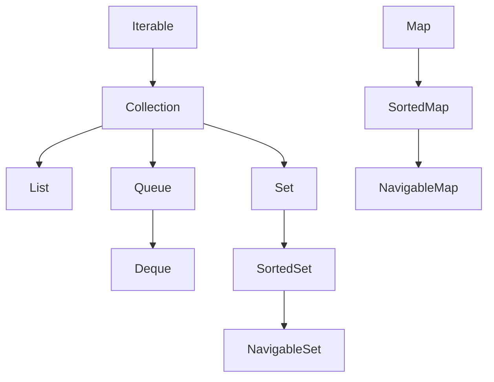
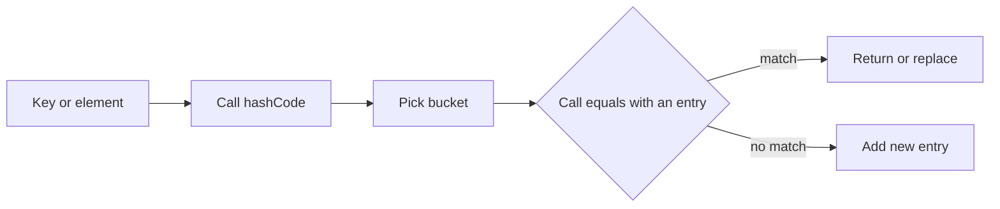

# Collections Overview

!!! note "In simple words"
    A collection is a container that holds many objects. Java offers several containers, and each one keeps its items in a different way, so the right choice depends on what you need to do most often.

## Why it matters

Almost every Java program stores groups of objects: orders, users, cached results, pending jobs. The Collections Framework gives you ready-made containers for these groups. It also separates two ideas. The interface, such as `List` or `Map`, describes what a container promises. The class, such as `ArrayList` or `HashMap`, decides how the data is stored and how fast each operation runs.

Interviewers start here because most later questions depend on it: the hierarchy, the `equals` and `hashCode` contract, and the cost of each operation.

## How it works

### The hierarchy

`Iterable` is the root for anything that works in an enhanced `for` loop. `Collection` extends `Iterable` and is the root for lists, sets, and queues. `Map` sits beside that tree. A map stores key-value pairs, not single elements, so it does not extend `Collection`.

```text
Iterable
└── Collection
    ├── List      (ordered, index-based, duplicates allowed)
    ├── Set       (no duplicates)
    │   └── SortedSet -> NavigableSet
    └── Queue     (ordered for processing)
        └── Deque (double-ended)

Map               (key -> value, unique keys)
└── SortedMap -> NavigableMap
```



### The main interfaces at a glance

| Interface | Stores | Duplicates | Typical implementations |
|---|---|---|---|
| `List` | Ordered elements, accessed by index | Yes | `ArrayList`, `LinkedList`, `Vector`, `CopyOnWriteArrayList` |
| `Set` | Unique elements | No | `HashSet`, `LinkedHashSet`, `TreeSet` |
| `Queue` | Elements in processing order | Yes | `PriorityQueue`, `ArrayDeque`, `LinkedList` |
| `Deque` | Elements at both ends | Yes | `ArrayDeque`, `LinkedList` |
| `Map` | Unique keys mapped to values | Values yes, keys no | `HashMap`, `LinkedHashMap`, `TreeMap`, `ConcurrentHashMap` |

The learning roadmap sometimes lists `ConcurrentHashSet` as a set type. The JDK has no class with that name. For a thread-safe set, call `ConcurrentHashMap.newKeySet()`, which returns a `Set<K>` backed by a `ConcurrentHashMap`.

```java
import java.util.Set;
import java.util.concurrent.ConcurrentHashMap;

public class SeenOrders {
    public static void main(String[] args) {
        Set<String> seen = ConcurrentHashMap.newKeySet();
        seen.add("order-1");
        System.out.println(seen.add("order-1")); // false: already present
    }
}
```

### The equals and hashCode contract

Hash-based collections (`HashSet`, `HashMap`) depend on two rules:

1. If `a.equals(b)` is true, then `a.hashCode()` and `b.hashCode()` must be equal.
2. An object's `hashCode` must not change while the object sits inside a hash collection.

If either rule breaks, the object lands in one bucket on insert and gets searched for in another bucket later, so the lookup fails. Build `hashCode` only from fields that stay fixed while the object is stored.

```java
import java.util.HashSet;
import java.util.Objects;
import java.util.Set;

public final class Sku {
    private final String code;

    public Sku(String code) {
        this.code = code;
    }

    @Override
    public boolean equals(Object o) {
        if (this == o) return true;
        if (!(o instanceof Sku other)) return false;
        return code.equals(other.code);
    }

    @Override
    public int hashCode() {
        return Objects.hash(code);
    }

    public static void main(String[] args) {
        Set<Sku> skus = new HashSet<>();
        skus.add(new Sku("A-100"));
        System.out.println(skus.contains(new Sku("A-100"))); // true
    }
}
```

Remove the `hashCode` override and `contains` will almost always return `false`, even though `equals` says the two objects match.

### Complexity at a glance

Big-O figures describe typical implementations and are the usual interview answer. Real timings depend on capacity, hash quality, and the JVM.

| Structure | Access by index or key | Search | Insert or remove |
|---|---|---|---|
| `ArrayList` | O(1) by index | O(n) | O(1) amortized at the end; O(n) in the middle |
| `LinkedList` | O(n) by index | O(n) | O(1) at a known node; O(n) to find the node |
| `HashSet` / `HashMap` | Average O(1) | Average O(1) | Average O(1) |
| `TreeSet` / `TreeMap` | O(log n) | O(log n) | O(log n) |
| `ArrayDeque` | n/a | O(n) | O(1) at either end |
| `PriorityQueue` | n/a | O(n) | `offer` and `poll` O(log n); `peek` O(1) |

### List versus Set

| Feature | `List` | `Set` |
|---|---|---|
| Order | Insertion order kept by all implementations | Not guaranteed, unless `LinkedHashSet` or `TreeSet` |
| Duplicates | Allowed | Rejected |
| Index access | `get(i)`, `set(i, x)` | Not available |
| Null | Multiple nulls allowed | One null in `HashSet` and `LinkedHashSet`; none in `TreeSet` |
| Typical use | Keeping a sequence | Uniqueness and fast membership tests |

Pick a list when order or position matters, such as the steps of a recipe. Pick a set when the question is "have I seen this before?", such as unique email addresses or tags.

### Immutable factory methods

Java 9 added `List.of`, `Set.of`, and `Map.of`. They return unmodifiable collections that reject `null` elements and throw `UnsupportedOperationException` on change. `Set.of` and `Map.of` also throw `IllegalArgumentException` when they see a duplicate. `List.copyOf`, `Set.copyOf`, and `Map.copyOf` make unmodifiable copies of an existing collection.

```java
import java.util.List;

public class ImmutableRoles {
    public static void main(String[] args) {
        List<String> roles = List.of("reader", "writer");
        System.out.println(roles);
        // roles.add("admin");  // UnsupportedOperationException
    }
}
```

### Step by step: what happens inside

1. A `HashSet` or `HashMap` calls `hashCode()` to pick a bucket.
2. Inside that bucket, it calls `equals()` to find the matching element or key.
3. A `TreeSet` or `TreeMap` uses `compareTo` or the comparator to walk a balanced tree.
4. An `ArrayList` keeps a backing array. When the array is full, it allocates a bigger one and copies the contents.
5. A `LinkedList` links nodes together, so inserting at a known position is cheap, but reaching index `i` means walking from one end.



### Choosing an implementation

- Index-based list, mostly reads: `ArrayList`.
- Unique items: `HashSet`, `LinkedHashSet` for insertion order, or `TreeSet` for sorted order.
- Key-value lookups: `HashMap`, `LinkedHashMap` for insertion order, or `TreeMap` for sorted keys.
- Stack or queue: `ArrayDeque`.
- Processing by priority: `PriorityQueue`.
- Thread-safe access: `ConcurrentHashMap` for maps, `CopyOnWriteArrayList` for lists that are read far more than written.

## Where it is used

- Service layers that hold lists of records returned from a database query.
- Lookup tables, such as a map from a product code to its price.
- Deduplication, such as a set of IDs already processed in a batch job.
- Task scheduling, where a priority queue or a deque holds pending work.
- Caches and registries that many threads read at the same time.

## Benefits

- One consistent API lets you swap the implementation without rewriting callers.
- Each implementation is tuned for a particular access pattern, so you can match cost to need.
- Standard collections are heavily tested, so you do not have to write your own hash table or tree.
- Immutable factories make it easy to share data safely between threads.

## Cons and limits

- No single collection is best at everything. Choosing the wrong one can turn a fast operation into a slow one.
- Hash-based collections depend on well-written `equals` and `hashCode` methods. A bad pair causes missed lookups and silent duplicates.
- Boxing: collections hold objects, so `List<Integer>` stores boxed values with extra memory cost.
- The big-O figures are averages or typical costs. A hash collection with many collisions, or a resize during a hot loop, can cost far more than the average.

### Legacy and specialist types

- `Vector` and `Hashtable` predate the framework. They are synchronized on every call, which costs time in single-threaded code. New code should prefer `ArrayList` or `HashMap`, and add explicit synchronization or a concurrent type when threads are involved.
- `Stack` extends `Vector`. Use `ArrayDeque` instead.
- `WeakHashMap` keeps an entry only while its key is reachable from somewhere else.
- `IdentityHashMap` compares keys with `==` instead of `equals`.
- `EnumMap` and `EnumSet` are fast, compact collections for enum keys and values.

### Common pitfalls

- Overriding `equals` but not `hashCode`, or the other way round. This breaks hash-based collections.
- Using a mutable object as a hash key and then changing the fields that feed `hashCode`.
- Choosing `LinkedList` for random access. `ArrayList` is almost always faster for lists.
- Using `Vector` or `Hashtable` in new single-threaded code out of habit.
- Assuming `List.of` results can be changed, or that `Arrays.asList` supports `add`.
- Expecting `HashMap` to keep insertion order. Use `LinkedHashMap` for that.
- Using `Stack` where `ArrayDeque` would do.

## Best practices

1. Declare variables with the interface type (`List`, `Map`) and choose the implementation at construction time.
2. Choose the structure from the operation you run most often, and measure when the cost matters.
3. Override `equals` and `hashCode` together, using only fields that do not change while the object is stored.
4. Use `List.of`, `Set.of`, and `Map.of` for fixed data, and `List.copyOf` when you need an immutable copy of a list you received.
5. Use `ConcurrentHashMap.newKeySet()` for a thread-safe set.
6. Pre-size large `HashMap` and `ArrayList` instances when you know the final size.

!!! tip "Interview tip"
    **Q: How does `HashMap` work internally?** It hashes the key, picks a bucket, and compares keys with `equals` inside that bucket. Since Java 8, a bucket that grows past a threshold turns into a balanced tree, so the worst case inside one bucket is O(log n) instead of O(n). A good `hashCode` spreads keys evenly, which keeps buckets short and makes the average cost O(1).

## Quick recap

- `Collection` covers lists, sets, and queues. `Map` is a separate tree.
- Hash-based collections need consistent `equals` and `hashCode`.
- Choose the implementation by the operation you run most often.
- `ConcurrentHashMap.newKeySet()` is the standard thread-safe set.
- `List.of`, `Set.of`, and `Map.of` create immutable collections that reject nulls.

## Official documentation

- [Java 21 API index](https://docs.oracle.com/en/java/javase/21/docs/api/index.html)
- [HashMap (Java 21 API)](https://docs.oracle.com/en/java/javase/21/docs/api/java.base/java/util/HashMap.html)
- [java.util.concurrent package (Java 21 API)](https://docs.oracle.com/en/java/javase/21/docs/api/java.base/java/util/concurrent/package-summary.html)

**See also:** [Lists](lists.md), [Sets and Maps](sets-and-maps.md), [Queues and Deques](queues-and-deques.md)
