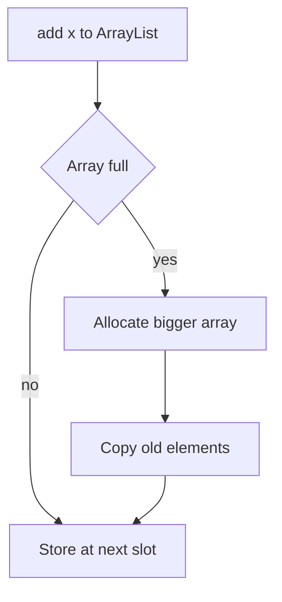

# Lists

!!! note "In simple words"
    A list is an ordered row of items, like a to-do list. Each item has a position, and you can add duplicates. `ArrayList` is the right choice in almost every case.

## Why it matters

A `List` keeps elements in order and lets you reach an element by its position. Most code that stores a sequence (rows from a query, steps in a workflow, items in a cart) uses a list. Interviewers often give you two list types and ask which one to pick, and why. The answer depends on the cost of reading by index versus inserting in the middle, and that is what this page covers.

## How it works

### The List interface

`List<E>` adds index-based methods on top of `Collection`: `get(int)`, `set(int, E)`, `add(int, E)`, `remove(int)`, `indexOf`, `subList`, and `listIterator`. Write your code against the `List` type and pick the implementation when you create the object.

```java
import java.util.ArrayList;
import java.util.List;

public class ListBasics {
    public static void main(String[] args) {
        List<String> tasks = new ArrayList<>();
        tasks.add("write");
        tasks.add("test");
        tasks.add(1, "review");           // insert at index 1
        System.out.println(tasks);        // [write, review, test]
        System.out.println(tasks.get(2)); // test
        tasks.remove("write");            // remove by value
        System.out.println(tasks);        // [review, test]
    }
}
```

Watch out for the overload trap. `remove(int)` removes by position, and `remove(Object)` removes by value. For a `List<Integer>`, `list.remove(1)` removes the element at index 1, while `list.remove(Integer.valueOf(1))` removes the value 1.

### ArrayList

`ArrayList` wraps a resizable array. Reading by index is O(1). Appending is amortized O(1): most appends write into free space, and only a full array triggers a grow-and-copy. Inserting or removing in the middle shifts the following elements, which is O(n).

```java
import java.util.ArrayList;
import java.util.List;

public class ListCapacity {
    public static void main(String[] args) {
        List<Integer> numbers = new ArrayList<>(100);   // initial capacity hint
        for (int i = 0; i < 5; i++) {
            numbers.add(i * i);
        }
        System.out.println(numbers.get(3));   // 9
    }
}
```

Capacity matters for memory and speed. An `ArrayList` built with the no-argument constructor starts with a shared empty array, then allocates 10 slots on the first `add`. When the array is full, OpenJDK grows it to about 1.5 times the old size and copies the references. The list therefore holds an array of references plus the element objects, and unused slots still take memory. If you know the final size, pass it to the constructor or call `ensureCapacity` before a bulk load.

Use `ArrayList` as the default list. Its elements sit next to each other in memory, so iteration and indexed reads are cache-friendly.

### LinkedList

`LinkedList` is a doubly linked list. Each element is a node with references to the previous and next node. It also implements `Deque`. Adding or removing at either end is O(1). Reaching an index means walking the nodes, so `get(i)` is O(n). Each node carries two extra references, and nodes are scattered in memory, so iteration is usually slower than with `ArrayList`.

Choose `LinkedList` mainly when you need the `Deque` methods on a list. For a plain queue or stack, `ArrayDeque` is the better choice.

### Iterating while removing

Removing an element inside a for-each loop throws `ConcurrentModificationException`. Use `Iterator.remove()` or `removeIf` instead.

```java
import java.util.ArrayList;
import java.util.List;

public class RemoveEmpty {
    public static void main(String[] args) {
        List<String> names = new ArrayList<>(List.of("ana", "", "ben", ""));
        names.removeIf(String::isEmpty);   // safe and concise
        System.out.println(names);         // [ana, ben]
    }
}
```

### Vector

`Vector` is an older, synchronized version of `ArrayList`. Every method takes a lock. That costs time in single-threaded code, and it still does not make a check-then-act sequence atomic. Use `ArrayList` for new code, and use a concurrent collection or `Collections.synchronizedList` when threads share the list.

### CopyOnWriteArrayList

`CopyOnWriteArrayList` is thread-safe. Each write copies the whole underlying array, so writes are expensive. Reads and iteration never lock, and each iterator sees a fixed snapshot of the list. It suits lists that are read very often and changed rarely, such as a set of event listeners.

```java
import java.util.List;
import java.util.concurrent.CopyOnWriteArrayList;

public class Listeners {
    public static void main(String[] args) {
        List<String> listeners = new CopyOnWriteArrayList<>();
        listeners.add("audit");
        for (String l : listeners) {       // iterates over a snapshot; no exception on concurrent add
            System.out.println(l);
        }
    }
}
```

Iterators of a `CopyOnWriteArrayList` do not support `remove`, and they do not show changes made after they were created.

### Unmodifiable and fixed-size lists

- `List.of(...)` and `List.copyOf(...)` return unmodifiable lists that reject `null`.
- `Arrays.asList(...)` returns a fixed-size list backed by the array. `set` works, but `add` and `remove` throw `UnsupportedOperationException`.
- `Collections.unmodifiableList(list)` returns a read-only view. Changes to the original list still show through the view.

### Sorting lists

`list.sort(comparator)` sorts in place. Passing `null` sorts by natural order, which requires the elements to implement `Comparable`. `Collections.sort(list)` does the same job.

```java
import java.util.ArrayList;
import java.util.Comparator;
import java.util.List;

public class SortByLength {
    public static void main(String[] args) {
        List<String> words = new ArrayList<>(List.of("pear", "fig", "apple"));
        words.sort(Comparator.comparing(String::length).thenComparing(Comparator.naturalOrder()));
        System.out.println(words); // [fig, pear, apple]
    }
}
```

The ordering page covers comparators in more depth.

### Cost of common list operations

| Operation | `ArrayList` | `LinkedList` |
|---|---|---|
| `get(i)` / `set(i, x)` | O(1) | O(n) |
| Add at the end | Amortized O(1) | O(1) |
| Add or remove at the front | O(n) | O(1) |
| Insert at a position held by a `ListIterator` | O(n) | O(1) once the node is held |
| `contains(x)` | O(n) | O(n) |

`LinkedList` wins only in the row about inserting through a `ListIterator`. Even then, the iterator must already point at the spot, as the next example shows.

```java
import java.util.LinkedList;
import java.util.List;
import java.util.ListIterator;

public class InsertAfterMatch {
    public static void main(String[] args) {
        List<String> steps = new LinkedList<>(List.of("plan", "build", "ship"));
        ListIterator<String> it = steps.listIterator();
        while (it.hasNext()) {
            if (it.next().equals("build")) {
                it.add("test");   // inserts right after "build" with no index arithmetic
            }
        }
        System.out.println(steps); // [plan, build, test, ship]
    }
}
```

`ArrayList` also supports `ListIterator.add`, so this code compiles with either type. The difference is the cost of the insert: linear for `ArrayList`, constant for `LinkedList`.

### Step by step: what happens inside

1. `ArrayList.add` writes into the backing array. If the array is full, it allocates a larger one and copies the old contents.
2. `ArrayList.add(i, x)` shifts every element from index `i` to the end by one slot, then stores `x`.
3. `LinkedList.get(i)` starts from the nearer end and follows `next` or `prev` references until it reaches index `i`.
4. `CopyOnWriteArrayList.add` copies the array, adds the element to the copy, and publishes the copy.
5. `ArrayList` iterators compare a modification counter on each step and throw `ConcurrentModificationException` if the list changed outside the iterator.



## Where it is used

- Rows returned from a query, kept in the order the database sent them.
- Form fields or menu items that must keep their display order.
- Event listeners and handlers, using `CopyOnWriteArrayList` when threads register them.
- Pipelines of steps, where position is part of the meaning.

## Benefits

- `ArrayList` gives fast reads by index and fast iteration, which covers most real workloads.
- The `List` interface lets you change the implementation later with a one-line edit.
- `removeIf` and `sort` make common changes short and clear.
- `CopyOnWriteArrayList` gives lock-free reads for listener-style lists.

## Cons and limits

- `ArrayList` is slow for inserts and removals near the front, because every later element shifts.
- `LinkedList` is slow for indexed access and uses more memory per element.
- `CopyOnWriteArrayList` is costly when the list changes often, since each write copies everything.
- Lists allow duplicates. Use a `Set` when uniqueness matters.

### Common pitfalls

- Using `LinkedList` for indexed access. Each call costs O(n), so a loop over the list becomes O(n²).
- Calling `remove(int)` when you meant to remove a value, with a `List<Integer>`.
- Removing elements inside a for-each loop.
- Assuming `Arrays.asList` returns a normal, resizable list.
- Using `CopyOnWriteArrayList` for a list that changes often.
- Expecting `Vector` to be safe for compound operations such as check-then-add.
- Skipping the capacity hint when the size is known, which causes repeated copying.

## Best practices

1. Use `ArrayList` by default, and declare variables as `List`.
2. Pass an initial capacity when you know roughly how many elements will arrive.
3. Delete with `removeIf` or `Iterator.remove()`, never with a for-each loop.
4. Return `List.copyOf(...)` or an unmodifiable view from APIs that should not expose changes.
5. Use `ArrayDeque` for queues and stacks instead of `LinkedList`.

!!! tip "Interview tip"
    **Q: When would you choose `LinkedList` over `ArrayList`?** Rarely. `ArrayList` wins for most index-based and iteration workloads. Consider `LinkedList` only when you insert or remove at positions you already hold through a `ListIterator` and the list is large enough to matter. Measure first. For queues and stacks, use `ArrayDeque`.

## Quick recap

- `List` is ordered, allows duplicates, and supports indexed access.
- `ArrayList` is the default: O(1) reads by index, amortized O(1) appends, O(n) middle inserts.
- `LinkedList` is O(1) at the ends but O(n) by index, so it is rarely the right list.
- `CopyOnWriteArrayList` gives lock-free iteration for read-heavy, rarely changed lists.
- Use `removeIf` or `Iterator.remove()` to delete while iterating.

## Official documentation

- [Java 21 API index](https://docs.oracle.com/en/java/javase/21/docs/api/index.html)
- [java.util.concurrent package (Java 21 API)](https://docs.oracle.com/en/java/javase/21/docs/api/java.base/java/util/concurrent/package-summary.html)

**See also:** [Collections Overview](collections-overview.md), [Queues and Deques](queues-and-deques.md), [Iterators and Utilities](iterators-and-utilities.md)
