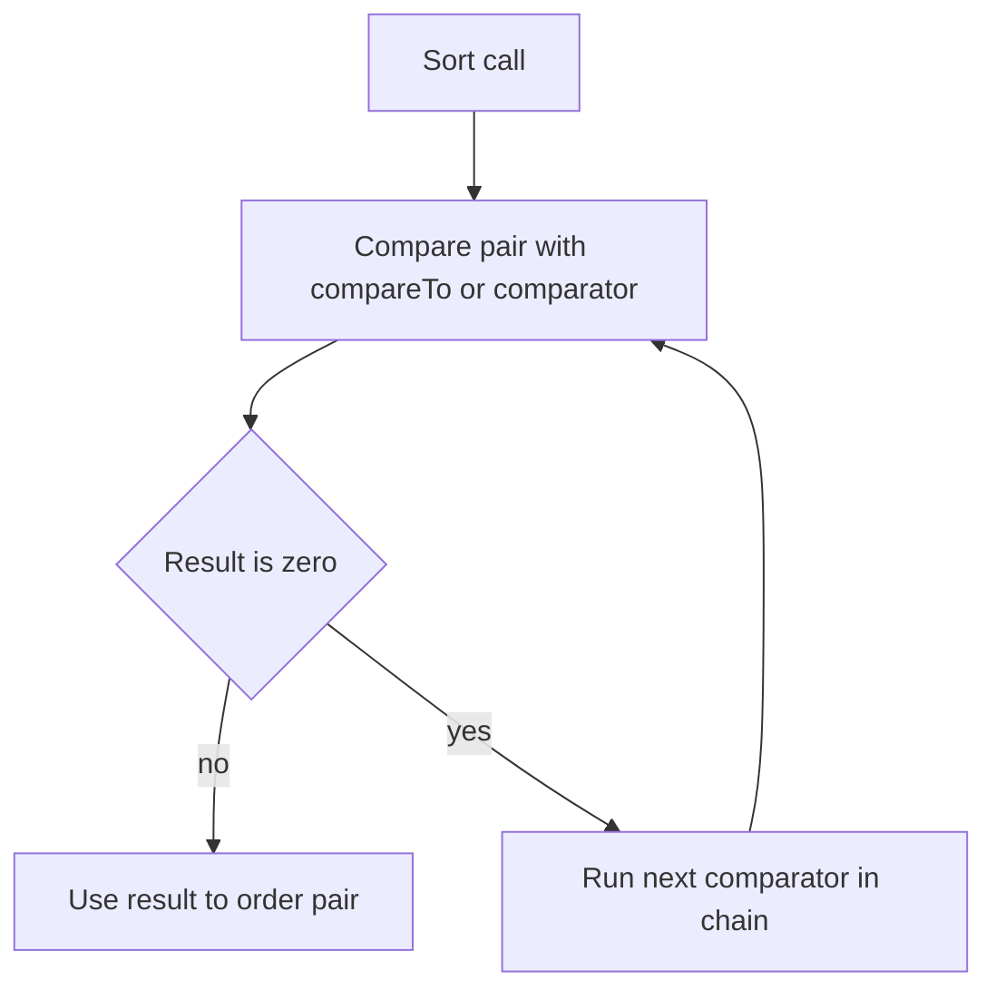

# Ordering: Comparable and Comparator

!!! note "In simple words"
    To sort things, Java needs a rule that says which of two items comes first. `Comparable` is the rule built into a class. `Comparator` is a separate rule you can hand over when you want a different order.

## Why it matters

Sorting a list, keeping a `TreeSet` in order, and finding the minimum or maximum all depend on comparing two objects. If the comparison rule is wrong, the results are wrong in quiet ways: a sorted set can lose items that `equals` says are different, and a comparator that breaks its contract can make `sort` throw. Interviewers ask about these two interfaces because the details are easy to get wrong.

## How it works

### Comparable: natural ordering

A class implements `Comparable<T>` and writes `compareTo`. The method returns a negative number when `this` comes before the argument, zero when they are equal in order, and a positive number when `this` comes after.

```java
import java.util.ArrayList;
import java.util.Collections;
import java.util.List;

public final class Version implements Comparable<Version> {
    private final int major;
    private final int minor;

    public Version(int major, int minor) {
        this.major = major;
        this.minor = minor;
    }

    @Override
    public int compareTo(Version other) {
        int byMajor = Integer.compare(major, other.major);
        return byMajor != 0 ? byMajor : Integer.compare(minor, other.minor);
    }

    @Override
    public String toString() {
        return major + "." + minor;
    }

    public static void main(String[] args) {
        List<Version> list = new ArrayList<>(List.of(new Version(2, 1), new Version(1, 9)));
        Collections.sort(list);
        System.out.println(list); // [1.9, 2.1]
    }
}
```

Use `Integer.compare` or `Long.compare`, not subtraction. A subtraction can overflow and flip the sign. `String` and the wrapper classes already implement `Comparable`.

### Comparator: external ordering

A `Comparator<T>` is a separate object, often a lambda, that compares two values. Use one when you need a different order, when the class belongs to a library you cannot change, or when the same type needs several orders.

```java
import java.util.ArrayList;
import java.util.Comparator;
import java.util.List;

public class ByLengthDemo {
    public static void main(String[] args) {
        Comparator<String> byLength = (a, b) -> Integer.compare(a.length(), b.length());
        List<String> names = new ArrayList<>(List.of("Grace", "Ada", "Linus"));
        names.sort(byLength);
        System.out.println(names); // [Ada, Grace, Linus]
    }
}
```

### Building comparators with factory methods

The `Comparator` interface has static factory methods and default methods that combine cleanly:

| Method | Purpose |
|---|---|
| `Comparator.comparing(keyExtractor)` | Order by a key that is `Comparable` |
| `comparingInt`, `comparingLong`, `comparingDouble` | Primitive keys, with no boxing |
| `thenComparing(...)` | Break ties with a second comparison |
| `reversed()` | Reverse the order |
| `Comparator.naturalOrder()` / `reverseOrder()` | Natural order or its reverse |
| `nullsFirst` / `nullsLast` | Place `null` values at one end |

```java
import java.util.Comparator;
import java.util.List;

public class EmployeeDemo {
    record Employee(String name, String dept, int salary) { }

    public static void main(String[] args) {
        List<Employee> staff = List.of(
            new Employee("Ana", "Sales", 900),
            new Employee("Ben", "Dev", 1200),
            new Employee("Cy", "Dev", 1100));

        List<Employee> sorted = staff.stream()
            .sorted(Comparator.comparing(Employee::dept)
                .thenComparing(Employee::salary, Comparator.reverseOrder()))
            .toList();

        sorted.forEach(e -> System.out.println(e.name())); // Ben, Cy, Ana
    }
}
```

The example sorts by department first. Within a department, it sorts by salary from high to low. `Stream.toList()` needs Java 16 or later.

Be careful with arithmetic comparators such as `(a, b) -> a.salary() - b.salary()`. Subtraction can overflow for large values. Use `Integer.compare` or `comparingInt` instead.

### The comparator contract

A comparator must be:

- **Antisymmetric:** if `compare(a, b)` is negative, then `compare(b, a)` is positive.
- **Transitive:** if `a < b` and `b < c`, then `a < c`.
- **Consistent:** repeated calls with the same arguments give the same answer.

Breaking the contract can make `sort` throw `IllegalArgumentException` with the message "Comparison method violates its general contract", or leave a `TreeMap` in a broken state.

### Consistency with equals

A sorted collection, such as `TreeSet` or `TreeMap`, decides that two items are the same by comparison, not by `equals`. If `compareTo` returns zero for two objects that `equals` says are different, the sorted collection keeps only the first one. Document any mismatch, and keep the two aligned where you can.

```java
import java.util.Set;
import java.util.TreeSet;

public class VersionSetDemo {
    record Version(int major, int minor) implements Comparable<Version> {
        @Override
        public int compareTo(Version other) {
            int byMajor = Integer.compare(major, other.major());
            return byMajor != 0 ? byMajor : Integer.compare(minor, other.minor());
        }
    }

    public static void main(String[] args) {
        Set<Version> versions = new TreeSet<>();
        versions.add(new Version(1, 0));
        versions.add(new Version(1, 0)); // compareTo returns 0, so this counts as a duplicate
        System.out.println(versions.size()); // 1
    }
}
```

### SortedSet, SortedMap, and their navigable forms

`SortedSet` and `SortedMap` describe collections kept in order. Their navigable successors, `NavigableSet` and `NavigableMap`, add methods such as `floor`, `ceiling`, `higher`, `lower`, `first`, `last`, `pollFirst`, and `descendingSet`. `TreeSet` and `TreeMap` implement the navigable interfaces. `ConcurrentSkipListSet` and `ConcurrentSkipListMap` are thread-safe sorted alternatives.

### Sorting arrays and lists

- `Arrays.sort(int[])` uses a dual-pivot quicksort for primitives. It is not stable, but for primitive values stability cannot be observed, so the difference never matters.
- `Arrays.sort(Object[])`, `List.sort`, and `Collections.sort` use a stable merge-based algorithm (TimSort). Equal elements keep their original relative order.
- Pass a comparator to sort objects by something other than their natural order.

### Step by step: what happens inside

1. `Collections.sort` or `List.sort` calls `compareTo`, or the comparator, on pairs of elements.
2. TimSort finds runs of data that are already in order and merges them. Nearly sorted input is therefore fast.
3. `TreeSet.add(x)` walks the tree and compares `x` with stored elements. If a comparison returns zero, the element counts as present and is not added.
4. `thenComparing` runs its second comparator only when the first one returns zero.
5. `reversed()` wraps the comparator so that `compare(a, b)` returns `compare(b, a)`.



## Where it is used

- Sorting search results by relevance, then by date.
- Keeping a sorted leaderboard or a set of software versions in a `TreeSet`.
- Ordering records for a report, such as by department and then by salary.
- Finding the earliest or latest item with `min` and `max` on a stream.

## Benefits

- `Comparable` gives every instance one clear default order, so callers need no extra setup.
- `Comparator` lets you define as many orders as you need without changing the class.
- The factory methods read close to plain English and combine without nested `if` blocks.
- Stable sorting keeps the earlier order when two items tie, which helps multi-step sorts.

## Cons and limits

- A class can have only one `compareTo`, so a second natural order needs a comparator.
- Comparators that break the contract give unpredictable results, and the bug often shows up only with particular data.
- A `TreeSet` drops items that compare as equal, even when `equals` says they differ.
- Sorting costs O(n log n). When you only need the top k items, a heap of size k is usually cheaper.

### Common pitfalls

- Subtracting values inside a comparator, which can overflow.
- Implementing `compareTo` in a way that disagrees with `equals`, so a `TreeSet` drops items that look different.
- Writing a comparator that is not transitive, such as one that compares some fields only in certain cases.
- Forgetting that `Comparator.comparing` throws `NullPointerException` when a key is `null`, unless you wrap it with `nullsFirst` or `nullsLast`.
- Mixing up `Collections.sort`, which sorts a list, with `Collections.reverseOrder()`, which returns a comparator.
- Sorting a list returned by `List.of`, which throws `UnsupportedOperationException`.

## Best practices

1. Implement `Comparable` only when there is one obvious natural order that you control.
2. Build comparators from `comparing`, `thenComparing`, and `reversed`, and use the primitive variants for `int`, `long`, and `double` keys.
3. Compare numbers with `Integer.compare`, never with subtraction.
4. Keep `compareTo` consistent with `equals` for any class used in a sorted collection.
5. Use `nullsFirst` or `nullsLast` whenever the key can be `null`.

!!! tip "Interview tip"
    **Q: `Comparable` or `Comparator`?** Use `Comparable` when the class has one obvious natural order and you control the class. Use a `Comparator` when you need several orders, when the class comes from a library, or when the order depends on the context. A class can have many comparators but only one `compareTo`.

## Quick recap

- `Comparable` defines a natural order through `compareTo`. `Comparator` defines an external order.
- Build comparators with `comparing`, `thenComparing`, and `reversed`, and use `comparingInt` for primitive keys.
- Use `Integer.compare`, not subtraction, to avoid overflow.
- Sorted collections use comparison, not `equals`, to detect duplicates.
- Object sorting in Java is stable. A valid comparator must be antisymmetric, transitive, and consistent.

## Official documentation

- [Java 21 API index](https://docs.oracle.com/en/java/javase/21/docs/api/index.html)
- [Java Language Specification, Java SE 21](https://docs.oracle.com/javase/specs/jls/se21/html/index.html)

**See also:** [Sets and Maps](sets-and-maps.md), [Lists](lists.md), [Iterators and Utilities](iterators-and-utilities.md)
