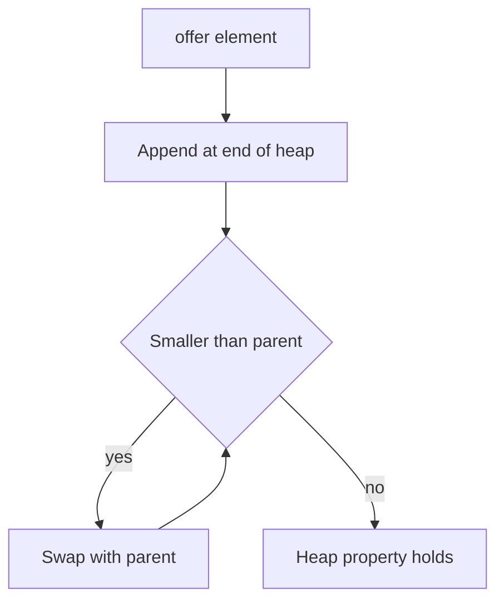

# Queues and Deques

!!! note "In simple words"
    A queue is a line of people: the first one in is the first one served. A deque is a line you can enter or leave from either end. A priority queue serves the most important item first, not the earliest one.

## Why it matters

Many programs need to hold work that waits its turn: requests to process, tasks to run, nodes to visit in a search, or the undo history of an editor. Java gives you several structures for this. Picking the right one decides whether an operation takes constant time or linear time, and interviewers ask about these choices to check that you understand the difference between a stack, a queue, and a heap.

## How it works

### The Queue and Deque interfaces

`Queue` offers two forms of each operation: one that throws an exception on failure, and one that returns a special value.

| Operation | Throws on failure | Returns a special value |
|---|---|---|
| Insert | `add(e)` | `offer(e)` |
| Remove head | `remove()` | `poll()` |
| Examine head | `element()` | `peek()` |

`Deque` adds the same pairs for both ends: `addFirst` and `offerFirst`, `addLast` and `offerLast`, `removeFirst` and `pollFirst`, `removeLast` and `pollLast`, `peekFirst`, and `peekLast`. Prefer `offer`, `poll`, and `peek`. They signal an empty or full collection with `null` or `false` instead of throwing.

### ArrayDeque

`ArrayDeque` is a resizable circular array. It is the default choice for both queues and stacks. Operations at either end take amortized O(1) time. It rejects `null` elements, and it is not thread-safe.

```java
import java.util.ArrayDeque;
import java.util.Deque;

public class DequeDemo {
    public static void main(String[] args) {
        Deque<String> stack = new ArrayDeque<>();
        stack.push("a");                  // push adds at the head
        stack.push("b");
        System.out.println(stack.pop());  // b: last in, first out

        Deque<String> queue = new ArrayDeque<>();
        queue.offer("first");             // offer adds at the tail
        queue.offer("second");
        System.out.println(queue.poll()); // first: first in, first out
    }
}
```

`push` and `pop` work on the head of the deque, so the same object acts as a stack. `offer` and `poll` make it act as a queue.

### Stack versus ArrayDeque

`Stack` extends `Vector`. It inherits index-based methods that let callers break the stack rule, and each call takes a lock. Use a `Deque` with `push` and `pop` instead.

### LinkedList as a queue

`LinkedList` implements `Deque`, so it can act as a queue too. It allows `null` elements, but each node carries extra memory for its references. For a plain queue, `ArrayDeque` is usually faster. Choose `LinkedList` only when you also need its `List` behaviour, such as removing through a `ListIterator`.

### PriorityQueue

`PriorityQueue` is a binary heap. `poll` always removes the smallest element by natural order or by a comparator. It is not a sorted collection. Iterating over it does not produce sorted output, and only the head is guaranteed to be the minimum.

```java
import java.util.Comparator;
import java.util.PriorityQueue;

public class TaskQueue {
    record Task(String name, int priority) { }

    public static void main(String[] args) {
        PriorityQueue<Task> tasks = new PriorityQueue<>(
            Comparator.comparingInt(Task::priority));   // lowest number first

        tasks.offer(new Task("backup", 3));
        tasks.offer(new Task("alert", 1));
        tasks.offer(new Task("report", 2));

        while (!tasks.isEmpty()) {
            System.out.println(tasks.poll().name());    // alert, report, backup
        }
    }
}
```

`offer` and `poll` cost O(log n), and `peek` costs O(1). Typical uses are top-k problems, scheduling by priority, and merging several sorted sources.

### Blocking queues (brief)

When one thread produces work and another consumes it, the `java.util.concurrent` package provides `BlockingQueue` implementations such as `ArrayBlockingQueue` and `LinkedBlockingQueue`. Their `put` and `take` methods wait when the queue is full or empty. The concurrency pages cover this in depth.

### Choosing a queue or stack

| Need | Use | Why |
|---|---|---|
| FIFO queue | `ArrayDeque` | Constant time at both ends, no per-node overhead |
| LIFO stack | `ArrayDeque` with `push` and `pop` | Replaces the synchronized `Stack` |
| Smallest or largest first | `PriorityQueue` | A heap gives O(log n) insert and removal of the head |
| Hand-off between producer and consumer threads | `BlockingQueue` | Blocks when full or empty |
| Queue that must hold `null` | `LinkedList` | `ArrayDeque` rejects `null` |

### Breadth-first search with a queue

Breadth-first search (BFS) visits nodes level by level, and a FIFO queue produces that order. The `visited` set stops the search from looping forever on cycles.

```java
import java.util.ArrayDeque;
import java.util.Deque;
import java.util.HashSet;
import java.util.List;
import java.util.Map;
import java.util.Set;

public class BreadthFirst {
    public static void main(String[] args) {
        Map<String, List<String>> graph = Map.of(
            "A", List.of("B", "C"),
            "B", List.of("D"),
            "C", List.of("D"),
            "D", List.of());

        Set<String> visited = new HashSet<>();
        Deque<String> queue = new ArrayDeque<>();
        queue.offer("A");
        visited.add("A");

        while (!queue.isEmpty()) {
            String node = queue.poll();
            System.out.println(node);          // A, B, C, D
            for (String next : graph.get(node)) {
                if (visited.add(next)) {       // true only the first time
                    queue.offer(next);
                }
            }
        }
    }
}
```

Swap the queue operations for stack operations (`push` and `pop`), and the same loop becomes a depth-first traversal. The only difference is which end you take items from.

### Step by step: what happens inside

1. `ArrayDeque.offerLast` writes at the tail index and moves the index forward. When the array is full, it doubles the array and copies the items.
2. `ArrayDeque.push` and `offerFirst` move the head index backward in the circular array.
3. `PriorityQueue.offer` appends the element at the end of the heap array, then sifts it up until the heap property holds.
4. `PriorityQueue.poll` removes the root, moves the last element into the root, and sifts it down.
5. Both `offer` and `poll` cost O(log n). `peek` reads the root in O(1).



## Where it is used

- Stacks for undo history, expression evaluation, and manual depth-first traversal.
- Queues for breadth-first search, request buffering, and tasks processed in arrival order.
- Priority queues for Dijkstra's shortest-path algorithm, job schedulers, and finding the k largest items.
- Blocking queues that pass work from a producer thread to a consumer thread.

## Benefits

- `ArrayDeque` gives constant-time access at both ends, with no per-element node objects.
- The `offer`, `poll`, and `peek` methods make empty checks simple and avoid exceptions for normal flow.
- A priority queue keeps the most urgent item at the head without sorting the whole collection each time.
- One `Deque` type covers both stack and queue behaviour.

## Cons and limits

- A priority queue does not support fast search. `remove(Object)` and `contains` take O(n).
- `PriorityQueue` iteration order is not sorted, which surprises people who print it.
- `ArrayDeque` is not thread-safe and rejects `null`.
- A heap offers no random access by index.

### Common pitfalls

- Using `Stack` in new code instead of `Deque`.
- Inserting `null` into an `ArrayDeque`, which throws `NullPointerException`.
- Expecting iteration over a `PriorityQueue` to produce sorted output.
- Calling `poll` on an empty queue, which returns `null`, and then unboxing that `null` into an `int`.
- Choosing `LinkedList` for a queue out of habit.
- Changing the priority field of an element that is already inside a `PriorityQueue`, which breaks the heap.
- Assuming `remove(Object)` on a `PriorityQueue` is O(log n). It is O(n) because it searches first.

## Best practices

1. Use `ArrayDeque` for every stack or queue that does not need `null` or list operations.
2. Use `offer`, `poll`, and `peek` and check for `null` or `isEmpty()`.
3. Use a `PriorityQueue` with a comparator that compares the field you care about, and keep that field unchanged while the element is queued.
4. Use a `BlockingQueue`, not a plain queue, when threads share the work.
5. Bound a work queue in production, so a burst of tasks cannot exhaust memory.

!!! tip "Interview tip"
    **Q: How do you find the k largest elements in a stream of n numbers?** Keep a min-heap (a `PriorityQueue` with natural order) of size k. For each number, add it, and if the heap grows past k, poll the smallest. At the end the heap holds the k largest values. The cost is O(n log k) time and O(k) space.

## Quick recap

- Use `offer`, `poll`, and `peek` on queues. They return `null` or `false` rather than throwing.
- `ArrayDeque` is the default for both queues and stacks. `push` and `pop` work on its head.
- `Stack` is legacy. `LinkedList` works as a deque, but it is heavier.
- `PriorityQueue` is a heap. Its head is the minimum by its comparator, and its iteration order is not sorted.
- Heap insert and removal cost O(log n), and peeking at the head costs O(1).

## Official documentation

- [Java 21 API index](https://docs.oracle.com/en/java/javase/21/docs/api/index.html)
- [java.util.concurrent package (Java 21 API)](https://docs.oracle.com/en/java/javase/21/docs/api/java.base/java/util/concurrent/package-summary.html)

**See also:** [Lists](lists.md), [Ordering: Comparable and Comparator](ordering-comparable-comparator.md), [Collections Overview](collections-overview.md)
