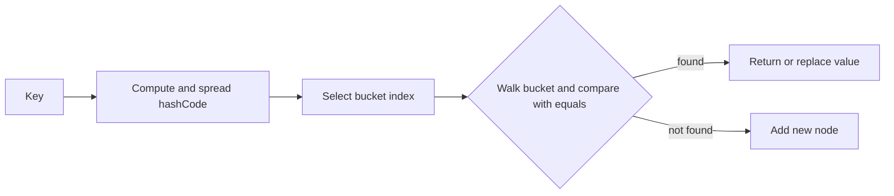
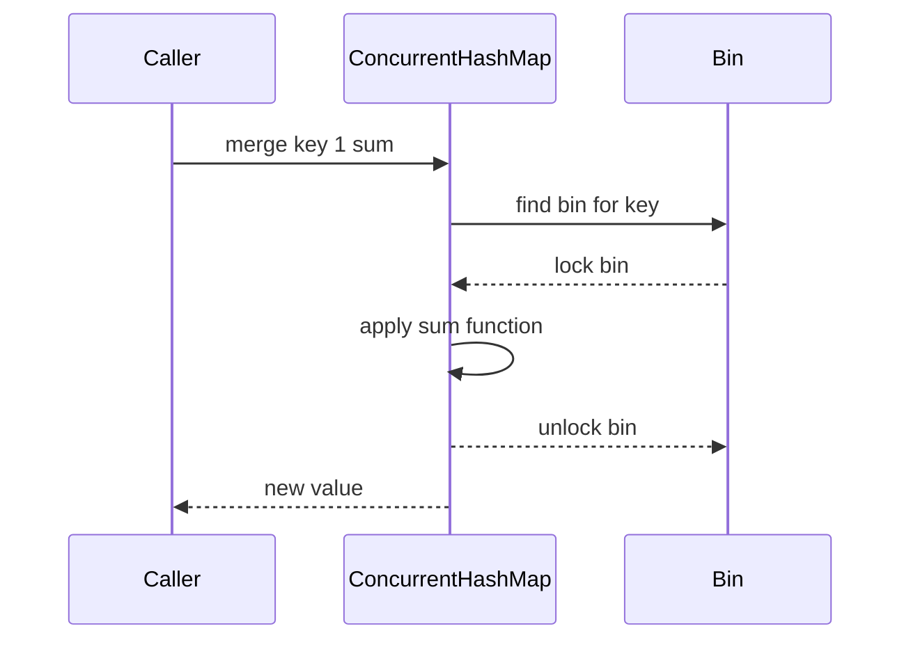

# Sets and Maps

!!! note "In simple words"
    A set is a bag that refuses duplicates, and a map is a labelled cabinet: each label (key) points to one drawer (value). Both can be fast, and both come in versions that keep order or sort the items.

## Why it matters

Sets answer "is this already here?" and maps answer "what belongs to this key?". Both show up in nearly every service: a set of IDs already processed, a map from a user ID to a profile, a cache keyed by a request. Interviewers test whether you can choose the right variant, explain how `HashMap` finds a key, and spot the bugs that come from mutable keys or unsafe sharing between threads.

## How it works

### Sets

A `Set` rejects duplicates. `add` returns `false` when the element is already present. The main reason to use a set is the fast membership test.

| Implementation | Ordering | Null elements | Typical use |
|---|---|---|---|
| `HashSet` | None | One `null` allowed | Fast membership checks |
| `LinkedHashSet` | Insertion order | One `null` allowed | Unique items that must keep their order |
| `TreeSet` | Sorted (natural order or comparator) | Not allowed | Sorted unique items and range queries |

```java
import java.util.HashSet;
import java.util.LinkedHashSet;
import java.util.List;
import java.util.Set;
import java.util.TreeSet;

public class SetBasics {
    public static void main(String[] args) {
        List<String> input = List.of("pear", "apple", "pear", "fig");

        Set<String> hash = new HashSet<>(input);
        Set<String> ordered = new LinkedHashSet<>(input);
        Set<String> sorted = new TreeSet<>(input);

        System.out.println(ordered);     // [pear, apple, fig]
        System.out.println(sorted);      // [apple, fig, pear]
        System.out.println(hash.size()); // 3
    }
}
```

Every set drops the duplicate `pear`. Do not rely on the order that `HashSet` prints in.

A `HashSet` is a thin layer over a `HashMap`, where the elements are the keys and a shared placeholder is the value. It inherits the same hashing rules, so elements need consistent `equals` and `hashCode`.

### Maps

A `Map<K, V>` links each key to one value. Keys are unique, but values can repeat. `put` replaces the value for an existing key and returns the old value. `get` returns `null` when the key is missing.

| Implementation | Ordering | Null keys and values | Notes |
|---|---|---|---|
| `HashMap` | None | One null key, many null values | General purpose |
| `LinkedHashMap` | Insertion order (or access order) | Same as `HashMap` | Can build an LRU cache |
| `TreeMap` | Sorted by key | Null key not allowed | Range and navigation methods |
| `Hashtable` | None | Neither nulls allowed | Legacy and synchronized |
| `ConcurrentHashMap` | None | Neither nulls allowed | Thread-safe and scalable |
| `WeakHashMap` | None | Null key allowed | Entries go away when keys are no longer referenced elsewhere |
| `IdentityHashMap` | None | Null allowed | Compares keys with `==` instead of `equals` |

```java
import java.util.HashMap;
import java.util.Map;

public class MapBasics {
    public static void main(String[] args) {
        Map<String, Integer> stock = new HashMap<>();
        stock.put("pen", 10);
        stock.put("pad", 4);
        stock.merge("pen", 5, Integer::sum);   // pen becomes 15
        stock.computeIfAbsent("ink", k -> 0);  // adds ink -> 0
        stock.putIfAbsent("pad", 99);          // no change: pad already exists

        System.out.println(stock.getOrDefault("cup", 0)); // 0
        for (Map.Entry<String, Integer> e : stock.entrySet()) {
            System.out.println(e.getKey() + " = " + e.getValue());
        }
    }
}
```

`merge`, `computeIfAbsent`, and `getOrDefault` replace the older check-then-put pattern. They are shorter, and on `ConcurrentHashMap` they run atomically for one key.

### How HashMap finds a key



1. The key's `hashCode()` is computed, and its high bits are mixed into the result so that the bucket index uses more of the hash.
2. The hash selects a bucket in an internal array.
3. Inside the bucket, `equals()` finds the matching key.
4. When one bucket grows long, Java 8 and later turn it into a balanced tree, which bounds the cost of a lookup in that bucket.

This is why `hashCode` and `equals` must agree, and why key fields must not change after insertion. A mutated key stays in its old bucket, so `get` with an equal-looking key returns `null`.

### Capacity, load factor, and resizing

A `HashMap` holds an array of buckets. Four numbers describe its growth:

- **Capacity:** the number of buckets. The default is 16, and the array is allocated on the first insertion.
- **Load factor:** the fraction of buckets that may fill before the map grows. The default is 0.75, a balance between memory and collisions.
- **Threshold:** capacity multiplied by load factor. With the defaults it is 12, so the 13th entry triggers a resize.
- **Rehashing:** when the threshold is crossed, the map allocates an array twice as large and moves every entry. That one insert costs O(n), but the amortized cost of `put` stays O(1).

A lower load factor resizes sooner, which means fewer collisions and more memory. A higher one saves memory but risks longer buckets. If you know the size in advance, pass an initial capacity so that no resize happens during the fill.

```java
import java.util.HashMap;
import java.util.Map;

public class PresizedMap {
    public static void main(String[] args) {
        int expected = 1_000;
        // Leave headroom so that 1,000 entries stay below the 0.75 threshold.
        Map<Integer, String> byId = new HashMap<>((int) (expected / 0.75f) + 1);
        for (int i = 0; i < expected; i++) {
            byId.put(i, "item-" + i);
        }
        System.out.println(byId.size()); // 1000
    }
}
```

### Collisions and tree bins

Two different keys can land in the same bucket. Java first links the entries into a chain. When a chain reaches 8 nodes and the table has at least 64 buckets, the chain becomes a red-black tree. If the table is smaller, the map resizes instead. A good `hashCode` keeps chains short in the first place, which matters far more than the tree fallback.

### LinkedHashMap and LRU caches

`LinkedHashMap` can keep entries in access order. Overriding `removeEldestEntry` gives you a simple least-recently-used (LRU) cache.

```java
import java.util.LinkedHashMap;
import java.util.Map;

public class LruCache<K, V> extends LinkedHashMap<K, V> {
    private final int capacity;

    public LruCache(int capacity) {
        super(16, 0.75f, true);   // true means access order
        this.capacity = capacity;
    }

    @Override
    protected boolean removeEldestEntry(Map.Entry<K, V> eldest) {
        return size() > capacity;
    }
}
```

### TreeSet and TreeMap

Both are red-black trees, so the core operations take O(log n). They keep elements sorted and offer navigation methods from `NavigableSet` and `NavigableMap`: `first`, `last`, `floor`, `ceiling`, `headMap`, `tailMap`, and `subMap`. They decide whether two keys are the same by using `compareTo` or the comparator, not `equals` and `hashCode`. An inconsistent comparator makes entries disappear.

```java
import java.util.TreeMap;

public class FloorDemo {
    public static void main(String[] args) {
        TreeMap<Integer, String> grades = new TreeMap<>();
        grades.put(90, "A");
        grades.put(80, "B");
        grades.put(70, "C");
        System.out.println(grades.floorKey(85)); // 80: greatest key <= 85
        System.out.println(grades.headMap(80));  // {70=C}
    }
}
```

## ConcurrentHashMap

`ConcurrentHashMap` is the standard map for several threads that read and write at the same time. It does not use one lock for the whole map, so threads that work on different keys rarely wait for each other.

### Internal structure (Java 8 and later)

The map is an array of bins, similar to `HashMap`. The difference is how writers coordinate:

- An empty bin is filled with a compare-and-set operation, so no lock is taken.
- A bin that already holds entries is locked with `synchronized` on its head node. Writers to different bins do not block each other.
- Reads normally take no lock and see the most recent values that were fully published.
- Threads that write during a resize help move the entries, so the work is shared.

Java 7 and earlier split the map into segments, each with its own lock. Java 8 replaced that design. An answer that mentions segments is out of date.

```text
HashMap: one structure, a writer must hold an outside lock
ConcurrentHashMap: many bins, each write locks only its own bin
  bin 0   bin 1   bin 2   bin 3   bin 4
   (a)     (b)     (c)     (d)     (e)
  Thread 1 writes bin 1, thread 2 writes bin 3, at the same time.
```

### Basic usage

```java
import java.util.Map;
import java.util.concurrent.ConcurrentHashMap;

public class ChmBasics {
    public static void main(String[] args) {
        // initial capacity 16, load factor 0.75, expected concurrency 4
        Map<String, Integer> prices = new ConcurrentHashMap<>(16, 0.75f, 4);

        prices.put("tea", 3);
        prices.put("cake", 5);
        prices.replace("tea", 4);
        prices.remove("cake");

        System.out.println(prices.get("tea")); // 4
        // Iterating while other threads write is safe; no external lock is needed.
        prices.forEach((item, cost) -> System.out.println(item + " costs " + cost));
    }
}
```

In Java 8 and later, the concurrency level argument is only a sizing hint. It no longer sets the number of locks.

### Atomic compound operations

Single calls such as `putIfAbsent`, `replace(key, old, new)`, `computeIfAbsent`, `computeIfPresent`, `compute`, and `merge` are atomic for one key. The function you pass runs while the bin is held, so keep it short and never touch other keys in the same map from inside it.

```java
import java.util.Map;
import java.util.concurrent.ConcurrentHashMap;

public class ChmAtomic {
    public static void main(String[] args) {
        Map<String, Integer> scores = new ConcurrentHashMap<>();

        scores.putIfAbsent("ana", 0);                     // only if missing
        scores.replace("ana", 0, 10);                     // only if still 0
        scores.computeIfPresent("ana", (k, v) -> v + 5);  // ana becomes 15
        scores.computeIfAbsent("ben", k -> 7);            // ben becomes 7
        int bonus = scores.getOrDefault("cy", -1);        // -1: no entry

        System.out.println(scores + " bonus=" + bonus);
    }
}
```

### Thread-safe counter

A check-then-act sequence is not atomic, even on a concurrent map:

```java
import java.util.HashMap;
import java.util.Map;

class UnsafeCounter {

    public static void main(String[] args) {
        Map<String, Integer> map = new HashMap<>();
        map.put("count", 0);

        // Not safe: two threads can read the same value and both write value + 1.
        Integer current = map.get("count");
        map.put("count", current + 1);
    }
}
```

Use one atomic call instead. `merge` adds the value with a function that runs under the bin lock:

```java
import java.util.Map;
import java.util.concurrent.ConcurrentHashMap;

public class SafeCounter {
    public static void main(String[] args) throws InterruptedException {
        Map<String, Integer> counts = new ConcurrentHashMap<>();
        Runnable work = () -> {
            for (int i = 0; i < 1_000; i++) {
                counts.merge("count", 1, Integer::sum);
            }
        };
        Thread a = new Thread(work);
        Thread b = new Thread(work);
        a.start();
        b.start();
        a.join();
        b.join();
        System.out.println(counts.get("count")); // 2000, every time
    }
}
```

For one very busy counter, `java.util.concurrent.atomic.LongAdder` spreads updates across several cells and is faster under heavy contention.

### Comparison with a synchronized map

`Collections.synchronizedMap(new HashMap<>())` wraps every call in one lock, so only one thread progresses at a time. `ConcurrentHashMap` lets threads that touch different bins run in parallel, and the gap grows with the number of threads and writes. Measure on your own workload. The result depends on hardware, key distribution, and the JVM.

| Aspect | `Collections.synchronizedMap` | `ConcurrentHashMap` |
|---|---|---|
| Locking | One lock for the whole map | Per-bin locks; reads usually lock-free |
| Concurrency | One thread at a time | Many threads on different bins |
| Iteration | Caller must lock the wrapper | Safe; weakly consistent |
| Compound actions | Caller must lock | `merge`, `compute`, `computeIfAbsent` are atomic per key |
| Null keys or values | Allowed | Rejected with `NullPointerException` |
| Best fit | Low contention, simple code | Frequent concurrent reads and writes |

### Iteration is weakly consistent

Iterators of a `ConcurrentHashMap` never throw `ConcurrentModificationException`. An iterator shows the map as it was at some point at or after its creation, so it may or may not see an entry that another thread adds during the walk. Each entry is returned at most once. This is fine for a slightly stale view, but do not use it to compute an exact total while writers are active.

```java
import java.util.Map;
import java.util.concurrent.ConcurrentHashMap;

public class WeaklyConsistent {
    public static void main(String[] args) throws InterruptedException {
        Map<String, Integer> map = new ConcurrentHashMap<>();
        Thread writer = new Thread(() -> {
            for (int i = 1; i <= 3; i++) {
                map.put("slot-" + i, i);
            }
        });
        writer.start();
        for (String slot : map.keySet()) {  // may print 0 to 3 keys, never throws
            System.out.println("seen " + slot);
        }
        writer.join();
    }
}
```

### Example: a small TTL cache

A cache that expires entries after a fixed time must read the value and its timestamp together. Storing both in one immutable record keeps that read consistent.

```java
import java.util.Map;
import java.util.concurrent.ConcurrentHashMap;

public class TtlCache<K, V> {
    private record Entry<T>(T value, long storedAtMillis) { }

    private final Map<K, Entry<V>> entries = new ConcurrentHashMap<>();
    private final long maxAgeMillis;

    public TtlCache(long maxAgeMillis) {
        this.maxAgeMillis = maxAgeMillis;
    }

    public void put(K key, V value) {
        entries.put(key, new Entry<>(value, System.currentTimeMillis()));
    }

    public V get(K key) {
        Entry<V> entry = entries.get(key);
        if (entry == null) {
            return null;
        }
        if (System.currentTimeMillis() - entry.storedAtMillis() > maxAgeMillis) {
            entries.remove(key, entry);   // remove only if it is unchanged since we read it
            return null;
        }
        return entry.value();
    }

    public int size() {
        return entries.size();
    }

    public static void main(String[] args) {
        TtlCache<String, String> cache = new TtlCache<>(60_000); // one minute
        cache.put("user:1", "Ana");
        System.out.println(cache.get("user:1")); // Ana
    }
}
```

Expired entries are removed lazily, when someone asks for them. A production cache would also sweep old entries and set a size limit.

### Other thread-safe options

- `ConcurrentHashMap.newKeySet()` gives a thread-safe `Set`. The JDK has no `ConcurrentHashSet` class.
- `ConcurrentSkipListSet` and `ConcurrentSkipListMap` are sorted concurrent alternatives.
- `Collections.synchronizedMap` is fine for simple cases, but iteration still needs manual locking.

### Iterating maps

Iterate `entrySet()` to get keys and values together. Looping over `keySet()` and calling `get` for each key adds an extra lookup. `Map.forEach((k, v) -> ...)` is shorter when you do not need to remove entries.

### Step by step: what happens inside

1. `HashSet.add(x)` calls `HashMap.put(x, PRESENT)` internally, and the set reports whether the key was new.
2. `HashMap.put` computes the hash, finds the bucket, and walks it while comparing keys with `equals`.
3. If the key exists, its value is replaced and the old value is returned. If not, a new node is added.
4. When the entry count passes the threshold (capacity times load factor), the table doubles and entries are redistributed.
5. `TreeMap.put` walks the balanced tree with `compareTo` or the comparator, then rebalances.
6. `ConcurrentHashMap.put` locks only the bin it writes to, and skips the lock when the bin is empty and a compare-and-set succeeds.



## Where it is used

- A set of IDs already handled, to skip duplicates in a batch job.
- A map from a session token to user data, read on every request.
- Word counts and group-by results in reporting code.
- An LRU cache of recently used results, built on `LinkedHashMap`.
- Sorted price tables or time-indexed events, using `TreeMap` navigation methods.
- Shared counters and registries that many threads update, using `ConcurrentHashMap`.

## Benefits

- Average O(1) lookups and inserts for hash-based types make them the default choice.
- `merge` and `compute` methods remove boilerplate and avoid check-then-act bugs on one thread.
- `TreeMap` gives range and nearest-key queries that a hash map cannot offer.
- `ConcurrentHashMap` lets many threads work at once without one global lock.

## Cons and limits

- Hash collections do not keep order, and their iteration order can change after a resize.
- Mutable keys break lookups silently.
- `TreeMap` and `TreeSet` cost O(log n), and they need a consistent comparison.
- `ConcurrentHashMap` rejects `null`, and its compound operations are atomic only for one key, not across several keys.
- Memory use is higher than the raw data, because each entry is an object with references.

### Common pitfalls

- Using a mutable object as a key and changing it after insertion.
- Relying on the iteration order of `HashMap` or `HashSet`.
- Calling `get(key)` and unboxing the result when the key is missing, which throws `NullPointerException`.
- Using `TreeMap` with keys whose `compareTo` disagrees with `equals`.
- Using `Hashtable` in new code. Use `HashMap` or `ConcurrentHashMap`.
- Modifying a `HashMap` while iterating over it, which throws `ConcurrentModificationException`.
- Assuming a `get` followed by a `put` on a `ConcurrentHashMap` is atomic. Use `merge` or `compute`.
- Passing a `null` key or value to a `ConcurrentHashMap`.

## Best practices

1. Use `HashMap` and `HashSet` by default, and add `Linked` or `Tree` variants only when you need order.
2. Use `merge`, `computeIfAbsent`, and `getOrDefault` instead of manual checks.
3. Presize maps when you know their final size.
4. Use immutable or final key types, such as records or `String`.
5. For shared data, prefer `ConcurrentHashMap` and keep the functions passed to it short.
6. Iterate with `entrySet()` or `forEach`, not with `keySet()` plus `get`.

!!! tip "Interview tip"
    **Q: How would you implement a thread-safe counter per key?** Use `ConcurrentHashMap<String, Long>` with `merge(key, 1L, Long::sum)`. The `merge` call runs atomically for that key, which removes the race between a separate `get` and `put`. For one very hot counter, `LongAdder` spreads the updates across cells.

## Quick recap

- `HashSet` and `HashMap` are the default choices, with average O(1) operations.
- `LinkedHashSet` and `LinkedHashMap` keep insertion order. `TreeSet` and `TreeMap` keep sorted order with O(log n) operations.
- A `HashMap` with 16 buckets resizes after 12 entries, then doubles.
- Keys need consistent `equals` and `hashCode` (or `compareTo` for trees), and must not change after insertion.
- `ConcurrentHashMap` locks per bin, rejects nulls, and is weakly consistent during iteration. Use `merge` and `compute` for atomic updates.

## Official documentation

- [HashMap (Java 21 API)](https://docs.oracle.com/en/java/javase/21/docs/api/java.base/java/util/HashMap.html)
- [java.util.concurrent package (Java 21 API)](https://docs.oracle.com/en/java/javase/21/docs/api/java.base/java/util/concurrent/package-summary.html)
- [Java 21 API index](https://docs.oracle.com/en/java/javase/21/docs/api/index.html)

**See also:** [Collections Overview](collections-overview.md), [Ordering: Comparable and Comparator](ordering-comparable-comparator.md), [Iterators and Utilities](iterators-and-utilities.md)
