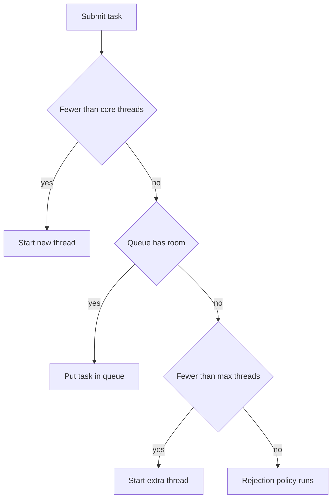

# Executors, Callable, Future, and CompletableFuture

!!! note "In simple words"
    Instead of creating a new thread for every job, you hand jobs to a pool of workers. The pool reuses its threads. A `Future` is a ticket for a result that will arrive later, and a `CompletableFuture` lets you describe what to do with that result.

## Why it matters

Creating a thread for every task is slow, uses a lot of memory, and gives you no control over how many run at once. The `java.util.concurrent` executor framework separates *what* to run from *how* the threads are managed. Thread pools are the default way production services run concurrent work, so interviewers ask about pool sizing, queues, shutdown, and the difference between `Future` and `CompletableFuture`.

## How it works

### Step by step: what happens inside

1. Create a pool, either with a factory method or with `ThreadPoolExecutor`.
2. Submit a `Callable` to get a `Future`, or submit a `Runnable` with `execute`.
3. The pool queues the task or hands it to a worker thread.
4. The result is available through `Future.get()` or through a `CompletableFuture` chain.
5. Call `shutdown()`, then `awaitTermination()`.

### ExecutorService

An `ExecutorService` accepts tasks and runs them on threads it manages. You submit the work, and the pool decides when and where it runs.

```java
import java.util.concurrent.ExecutorService;
import java.util.concurrent.Executors;
import java.util.concurrent.TimeUnit;

public class ExecutorBasics {
    public static void main(String[] args) throws InterruptedException {
        ExecutorService pool = Executors.newFixedThreadPool(4);
        for (int i = 1; i <= 8; i++) {
            int id = i;
            pool.execute(() -> System.out.println("Task " + id + " on "
                    + Thread.currentThread().getName()));
        }
        pool.shutdown();                            // stop accepting new tasks
        pool.awaitTermination(5, TimeUnit.SECONDS); // wait for queued work
    }
}
```

Common factory methods on `Executors`:

| Factory | Behaviour |
|---|---|
| `newFixedThreadPool(n)` | Fixed number of threads, unbounded queue |
| `newCachedThreadPool()` | Creates threads as needed and reuses idle ones |
| `newSingleThreadExecutor()` | One thread, tasks run in order |
| `newScheduledThreadPool(n)` | Runs tasks after a delay or on a fixed period |
| `newVirtualThreadPerTaskExecutor()` | One virtual thread per task (Java 21) |

The factory methods are convenient, but they hide the queue size and the thread limits. For production code, many teams build a `ThreadPoolExecutor` directly, so the limits are explicit.

### ThreadPoolExecutor

`ThreadPoolExecutor` is the class behind most pools. Its main constructor parameters are:

- `corePoolSize`: threads kept alive even when idle.
- `maximumPoolSize`: the upper limit on threads.
- `keepAliveTime`: how long extra threads stay idle before they are removed.
- `workQueue`: where waiting tasks sit.
- `RejectedExecutionHandler`: what happens when the pool and the queue are both full.

```java
import java.util.concurrent.ArrayBlockingQueue;
import java.util.concurrent.ThreadPoolExecutor;
import java.util.concurrent.TimeUnit;

public class CustomPool {
    public static void main(String[] args) {
        ThreadPoolExecutor pool = new ThreadPoolExecutor(
                2,                                  // core threads
                4,                                  // max threads
                30, TimeUnit.SECONDS,               // idle time for extra threads
                new ArrayBlockingQueue<>(10),       // bounded queue
                new ThreadPoolExecutor.CallerRunsPolicy()); // back-pressure

        for (int i = 0; i < 20; i++) {
            int id = i;
            pool.execute(() -> System.out.println("job " + id));
        }
        pool.shutdown();
    }
}
```

How a submitted task is handled:

1. If fewer than `corePoolSize` threads are running, a new thread is created for the task.
2. Otherwise, the task goes into the queue if there is room.
3. If the queue is full and fewer than `maximumPoolSize` threads are running, a new thread is created.
4. If none of these is possible, the rejection handler runs.

An unbounded queue, such as the one used by `newFixedThreadPool`, means the pool never grows past `corePoolSize`, and the queue can grow without limit. A bounded queue with a rejection policy protects the service from overload.

Built-in rejection policies: `AbortPolicy` (the default, throws `RejectedExecutionException`), `CallerRunsPolicy` (the submitting thread runs the task), `DiscardPolicy`, and `DiscardOldestPolicy`.



### Runnable vs Callable

`Runnable.run()` returns nothing and cannot throw checked exceptions. `Callable<V>.call()` returns a value and may throw. Use `Callable` when the task produces a result.

```java
import java.util.concurrent.Callable;
import java.util.concurrent.ExecutorService;
import java.util.concurrent.Executors;
import java.util.concurrent.Future;

public class CallableDemo {
    public static void main(String[] args) throws Exception {
        ExecutorService pool = Executors.newSingleThreadExecutor();
        Callable<Integer> square = () -> 7 * 7;
        Future<Integer> f = pool.submit(square);
        System.out.println(f.get()); // 49, blocks until ready
        pool.shutdown();
    }
}
```

### Future

`submit(Callable)` returns a `Future<V>`, a handle to a result that may not exist yet. Its main methods are:

- `get()`: blocks until the result is ready. It throws `ExecutionException` if the task failed, and `CancellationException` if the task was cancelled.
- `get(timeout, unit)`: the same, but throws `TimeoutException` if the wait runs out.
- `isDone()`: true when the task has finished, failed, or been cancelled.
- `cancel(mayInterrupt)`: tries to cancel. With `true`, the running thread is interrupted.

A `Future` alone cannot be chained or combined with other futures. That limitation led to `CompletableFuture`.

### FutureTask

`FutureTask<V>` is a concrete class that is both a `Runnable` and a `Future<V>`. Because it is a `Runnable`, you can give it to a `Thread` or submit it to an executor. Because it is a `Future`, you can read its result later. Build one yourself when you want a handle on work that you run directly.

```java
import java.util.concurrent.FutureTask;
import java.util.concurrent.TimeUnit;
import java.util.concurrent.TimeoutException;

public class FutureTaskDemo {
    public static void main(String[] args) throws Exception {
        FutureTask<String> task = new FutureTask<>(() -> {
            Thread.sleep(300);
            return "report ready";
        });
        new Thread(task, "reporter").start();   // a FutureTask is a Runnable

        try {
            System.out.println(task.get(100, TimeUnit.MILLISECONDS));
        } catch (TimeoutException e) {
            System.out.println("not finished yet, cancelling");
            task.cancel(true);                  // interrupts the reporter thread
        }
    }
}
```

A `get()` with no timeout blocks until the task completes, then returns the value or throws `ExecutionException`. The timed version stops waiting and throws `TimeoutException`, but the task keeps running unless you cancel it.

### CompletableFuture

`CompletableFuture<T>` is a `Future` that you can complete by hand, chain, and combine without blocking. Work runs on the common fork-join pool by default, or on an executor you pass in.

```java
import java.util.concurrent.CompletableFuture;

public class CfDemo {
    public static void main(String[] args) {
        CompletableFuture<String> result = CompletableFuture
                .supplyAsync(() -> 21)              // runs on a pool thread
                .thenApply(n -> n * 2)              // transform the value
                .thenApply(n -> "answer=" + n)
                .exceptionally(ex -> "failed: " + ex.getMessage());

        System.out.println(result.join());          // answer=42
    }
}
```

Useful methods:

- `supplyAsync` and `runAsync`: start work asynchronously.
- `thenApply`, `thenAccept`, and `thenRun`: continue after a result, by transforming it, consuming it, or running something.
- `thenCompose`: continue with another `CompletableFuture`, like a flat-map.
- `thenCombine`: combine two independent futures.
- `allOf` and `anyOf`: wait for many futures.
- `exceptionally`, `handle`, and `whenComplete`: deal with errors.
- `join()` (unchecked) and `get()` (checked) read the result.

Combining two independent calls:

```java
import java.util.concurrent.CompletableFuture;

public class CombineDemo {
    public static void main(String[] args) {
        CompletableFuture<String> user = CompletableFuture.supplyAsync(() -> "alice");
        CompletableFuture<Integer> score = CompletableFuture.supplyAsync(() -> 90);
        String summary = user.thenCombine(score, (u, s) -> u + " scored " + s).join();
        System.out.println(summary); // alice scored 90
    }
}
```

Pass a dedicated executor for blocking I/O. The common pool has few threads, and blocking calls on it can starve other work:

```java
import java.util.concurrent.CompletableFuture;
import java.util.concurrent.ExecutorService;
import java.util.concurrent.Executors;

public class IoPoolDemo {
    static String callRemoteService() {
        return "response";
    }

    public static void main(String[] args) {
        ExecutorService io = Executors.newFixedThreadPool(20);
        String reply = CompletableFuture.supplyAsync(IoPoolDemo::callRemoteService, io).join();
        System.out.println(reply); // response
        io.shutdown();
    }
}
```

### Handling errors in a chain

An exception in one stage skips the later `thenApply`-style stages and travels forward as a failure. Three methods handle it:

- `exceptionally(fn)`: returns a fallback value, which later stages receive.
- `handle(fn)`: receives either the result or the exception, and returns a new value in both cases.
- `whenComplete(action)`: observes the outcome without changing it. Use it for logging.

```java
import java.util.concurrent.CompletableFuture;

public class ErrorChain {
    public static void main(String[] args) {
        int value = CompletableFuture
                .supplyAsync(() -> Integer.parseInt("12x"))   // throws NumberFormatException
                .thenApply(n -> n * 2)                         // skipped
                .exceptionally(ex -> {
                    System.out.println("failed: " + ex.getMessage());
                    return -1;                                 // fallback value
                })
                .join();
        System.out.println(value);                             // -1
    }
}
```

The callback usually receives a `CompletionException` that wraps the original exception. Call `getCause()` when you need the original type.

### A parallel lookup pipeline

A typical service call fetches several independent pieces of data and combines them. Starting both calls before waiting for either one is what makes the work run in parallel.

```java
import java.util.concurrent.CompletableFuture;
import java.util.concurrent.ExecutorService;
import java.util.concurrent.Executors;

public class ProfileLookup {
    private final ExecutorService io = Executors.newFixedThreadPool(8);

    CompletableFuture<String> loadAccount(long id) {
        return CompletableFuture.supplyAsync(() -> "account-" + id, io);
    }

    CompletableFuture<Integer> countOrders(long id) {
        return CompletableFuture.supplyAsync(() -> 3, io);
    }

    CompletableFuture<String> profile(long id) {
        return loadAccount(id)
                .thenCombine(countOrders(id),
                        (account, orders) -> account + " has " + orders + " orders")
                .exceptionally(ex -> "profile unavailable");
    }

    public static void main(String[] args) {
        ProfileLookup lookup = new ProfileLookup();
        System.out.println(lookup.profile(42L).join());   // account-42 has 3 orders
        lookup.io.shutdown();
    }
}
```

For a variable number of futures, use `allOf`. It completes when all of them do, and it returns `CompletableFuture<Void>`, so read the results from the individual futures afterwards. `anyOf` completes with the first result to arrive.

```java
import java.util.List;
import java.util.concurrent.CompletableFuture;

public class AllOfDemo {
    public static void main(String[] args) {
        List<CompletableFuture<Integer>> tasks = List.of(
                CompletableFuture.supplyAsync(() -> 1),
                CompletableFuture.supplyAsync(() -> 2),
                CompletableFuture.supplyAsync(() -> 3));

        CompletableFuture.allOf(tasks.toArray(new CompletableFuture[0])).join();
        List<Integer> values = tasks.stream().map(CompletableFuture::join).toList();
        System.out.println(values);   // [1, 2, 3]
    }
}
```

| Aspect | `Future` | `CompletableFuture` |
|---|---|---|
| Chaining follow-up work | Not possible; you call `get()` and then act | `thenApply`, `thenCompose`, and similar |
| Combining several results | Manual loops with `get()` | `thenCombine`, `allOf`, `anyOf` |
| Error handling | `try` and `catch` around `get()` | `exceptionally`, `handle`, `whenComplete` |
| Completing it yourself | Not possible | `complete(value)` |
| Callbacks | Not available; you must poll or block | Run when the result arrives |

### Virtual threads and executors (Java 21)

Virtual threads became a final feature in Java 21. A per-task virtual-thread executor suits code that spends most of its time waiting on the network or disk, because waiting virtual threads do not hold operating system threads. Do not expect a speed-up for CPU-bound work, and do not pool virtual threads. Create one per task.

```java
import java.util.concurrent.ExecutorService;
import java.util.concurrent.Executors;

public class VirtualThreadsDemo {
    public static void main(String[] args) {
        try (ExecutorService vt = Executors.newVirtualThreadPerTaskExecutor()) {
            for (int i = 0; i < 10_000; i++) {
                vt.submit(() -> {
                    Thread.sleep(100);   // blocking is cheap for a virtual thread
                    return null;
                });
            }
        } // close() waits for submitted tasks; ExecutorService is AutoCloseable since Java 19
    }
}
```

### Shutting down

Always shut down an executor. Otherwise the JVM may not exit, because pool threads are non-daemon threads. `shutdown()` finishes the queued tasks and refuses new ones. `shutdownNow()` tries to interrupt the running tasks, and it returns the tasks that never started.

### Risks of thread pools

A pool removes the cost of creating threads, but it brings failure modes of its own:

- **Pool deadlock:** a task waits for the result of another task that is queued behind it in the same saturated pool. Every worker is blocked, so the queued task never runs. Keep tasks that depend on each other in separate pools.
- **Thread leakage:** a worker that dies from an uncaught exception has to be replaced. A hand-written pool that does not replace dead workers shrinks until nothing is left. The standard `ThreadPoolExecutor` replaces them, but you should still handle exceptions inside tasks.
- **Resource thrashing:** more threads than the work can use means the CPU spends its time switching contexts, and the threads compete for memory and locks. A common starting point for CPU-bound work is about one thread per core, with more for I/O-bound work. Measure before you settle on a number.

## Where it is used

- Web servers that hand each request to a pool.
- Batch jobs that process many files or records in parallel.
- Scheduled tasks, such as a cache refresh every five minutes.
- Service code that calls several downstream APIs and combines the answers with `CompletableFuture`.

## Benefits

- Thread reuse removes the cost of creating a thread for each task.
- A bounded pool and queue cap the number of threads and protect the service under load.
- `Future` and `CompletableFuture` separate submitting work from reading its result.
- Shutdown and timeout methods give you clear control over the lifecycle.

## Cons and limits

- Factory methods hide queue size and thread limits, which can lead to unbounded growth.
- Blocking inside a pool can cause starvation or deadlock.
- Exceptions inside tasks can be hidden inside futures until someone reads the result.
- `CompletableFuture` chains are harder to debug than straight-line code, because stack traces show the pool threads.

### Common pitfalls

- Using `newFixedThreadPool` or `newCachedThreadPool` in production without knowing the queue and thread limits. A cached pool can create unlimited threads.
- Forgetting `shutdown()`, which keeps the JVM alive.
- Calling `future.get()` inside a task that runs on the same saturated pool, which can deadlock.
- Ignoring the exception wrapped in `ExecutionException`.
- Running blocking calls on the `CompletableFuture` common pool.
- Calling `join()` on a future that never completes, without a timeout.

## Best practices

1. Create a `ThreadPoolExecutor` with explicit core size, maximum size, and a bounded queue for production work.
2. Give blocking I/O its own pool, and keep it separate from CPU work.
3. Always call `shutdown()`, and then `awaitTermination()` with a timeout.
4. Read every future's result, or log its failure, so errors do not disappear.
5. Use `allOf` and `thenCombine` for independent calls, and `thenCompose` for dependent ones.

!!! tip "Interview tip"
    **Q: Why use a thread pool instead of `new Thread` for each task?** Creating a thread takes time and memory, and unbounded threads can exhaust the machine. A pool reuses a bounded set of threads, queues the extra work, and gives you a place to set limits and rejection behaviour.

## Quick recap

- `ExecutorService` separates task submission from thread management.
- `ThreadPoolExecutor` parameters (core size, maximum size, queue, rejection policy) define behaviour under load.
- `Callable` returns a value and may throw. `Future.get()` blocks and wraps errors in `ExecutionException`.
- `CompletableFuture` chains and combines asynchronous work without blocking.
- Use bounded queues, and a dedicated executor for blocking I/O.
- Always call `shutdown()`.

## Official documentation

- [java.util.concurrent package (Java 21 API)](https://docs.oracle.com/en/java/javase/21/docs/api/java.base/java/util/concurrent/package-summary.html)
- [JEP 444: Virtual Threads](https://openjdk.org/jeps/444)
- [Java 21 API index](https://docs.oracle.com/en/java/javase/21/docs/api/index.html)

**See also:** [Threads Basics](threads-basics.md), [Locks and Atomics](locks-atomics.md), [Synchronisation and Volatile](synchronisation-volatile.md)
