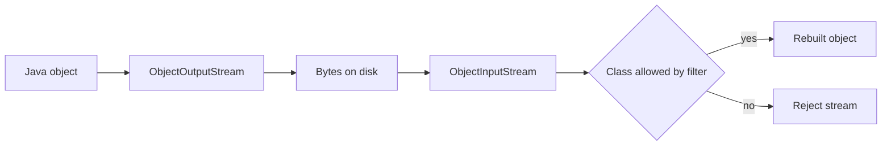

# I/O, Files, and Serialisation

!!! note "In simple words"
    Reading and writing files means moving bytes or characters between your program and the disk. Java gives you two families of tools: the older `java.io` streams and the newer `java.nio.file` helpers. Serialisation turns an object into bytes so it can be stored or sent, but loading untrusted bytes back into an object is dangerous.

## Why it matters

Almost every service reads configuration, writes logs, imports data, or stores generated reports. Doing this well means picking the right API, closing resources, and choosing a charset explicitly. Java has two generations of file APIs. `java.io` (streams and readers, from Java 1.0) is still everywhere, and `java.nio.file` (`Path` and `Files`, from Java 7) is the modern choice. Interviewers ask about streams, buffering, the `Path` API, and serialisation. Serialisation is also a frequent security topic.

## How it works

### Byte streams versus character streams

- **Byte streams** read and write raw bytes: `InputStream` and `OutputStream`, with subclasses such as `FileInputStream` and `FileOutputStream`.
- **Character streams** read and write text through a charset: `Reader` and `Writer`, such as `FileReader` and `FileWriter`.

Always name the charset explicitly. The default charset depends on the environment, and `FileReader` uses it without asking you.

```java
import java.io.FileInputStream;
import java.io.FileOutputStream;
import java.io.InputStream;
import java.io.IOException;
import java.io.OutputStream;
import java.io.OutputStreamWriter;
import java.io.Writer;
import java.nio.charset.StandardCharsets;

public class CopyBytes {
    public static void main(String[] args) throws IOException {
        try (InputStream in = new FileInputStream("in.bin");
             OutputStream out = new FileOutputStream("out.bin")) {
            in.transferTo(out);   // Java 9+: copies all bytes
        }

        try (Writer w = new OutputStreamWriter(
                new FileOutputStream("notes.txt"), StandardCharsets.UTF_8)) {
            w.write("hello\n");
        }
    }
}
```

### Buffered streams and readers

Each read or write on a raw `FileInputStream` can turn into an operating system call. Wrapping the stream in a buffered class moves data in chunks instead.

```java
import java.io.BufferedReader;
import java.io.FileReader;
import java.io.IOException;
import java.nio.charset.StandardCharsets;

public class ReadLines {
    public static void main(String[] args) throws IOException {
        try (BufferedReader reader = new BufferedReader(
                new FileReader("data.txt", StandardCharsets.UTF_8))) {
            String line;
            while ((line = reader.readLine()) != null) {
                System.out.println(line);
            }
        }
    }
}
```

`BufferedReader.lines()` returns a `Stream<String>`. It suits large files, but the stream must be closed, so use try-with-resources.

`PrintWriter` has convenient `print` and `println` methods. They do not throw `IOException`. Call `checkError()` to find out whether a write failed.

### RandomAccessFile

`RandomAccessFile` reads and writes at any byte position, which you choose with `seek(long)`. It suits fixed-size records or editing part of a file in place. It is lower level than NIO channels. Its `"rw"` mode creates the file if it does not exist.

```java
import java.io.IOException;
import java.io.RandomAccessFile;

public class RecordFile {
    public static void main(String[] args) throws IOException {
        try (RandomAccessFile raf = new RandomAccessFile("records.dat", "rw")) {
            raf.seek(16);                      // move to byte 16
            raf.writeInt(42);
            raf.seek(16);
            System.out.println(raf.readInt()); // 42
        }
    }
}
```

### The File class (legacy)

`java.io.File` represents a path name and offers `exists()`, `length()`, `delete()`, and `listFiles()`. These methods often return `false` instead of throwing, which hides the reason for the failure. Prefer `Path` and `Files` in new code.

### java.nio.file: Path and Files

`Path` is an immutable path object. `Path.of` (Java 11) and `Paths.get` create one. `Files` provides static helpers that throw informative exceptions, such as `NoSuchFileException`.

```java
import java.io.IOException;
import java.nio.file.Files;
import java.nio.file.Path;
import java.util.List;

public class NioBasics {
    public static void main(String[] args) throws IOException {
        Path file = Path.of("notes.txt");

        Files.writeString(file, "first line\nsecond line\n");   // Java 11+
        String all = Files.readString(file);
        List<String> lines = Files.readAllLines(file);

        System.out.println(lines.size());                       // 2
        System.out.println(all.length());                       // 23
        System.out.println(Files.exists(file));                 // true
        System.out.println(file.toAbsolutePath().getFileName());
    }
}
```

Common operations:

| Task | Call |
|---|---|
| Read a small file as text | `Files.readString(path)` or `Files.readAllLines(path)` |
| Stream a large text file lazily | `Files.lines(path)` (close it) |
| Write text | `Files.writeString(path, text)` |
| Copy or move | `Files.copy(src, dst, StandardCopyOption.REPLACE_EXISTING)` |
| Create directories | `Files.createDirectories(path)` |
| Walk a directory tree | `Files.walk(path)` (close it) |
| Compare two files | `Files.mismatch(path1, path2)` (Java 12+) |

`Files.mismatch` returns the index of the first differing byte, or `-1` when the files are identical. It compares contents without loading both files into memory.

### NIO channels and ByteBuffer

`java.nio` adds channels and buffers. A `FileChannel` reads and writes through a `ByteBuffer`, which has a position, a limit, and a capacity. After writing into a buffer, call `flip()` to switch it to reading.

```java
import java.nio.ByteBuffer;
import java.nio.channels.FileChannel;
import java.nio.file.Path;
import java.nio.file.StandardOpenOption;

public class ChannelDemo {
    public static void main(String[] args) throws Exception {
        try (FileChannel ch = FileChannel.open(Path.of("bytes.bin"),
                StandardOpenOption.CREATE, StandardOpenOption.WRITE)) {
            ByteBuffer buf = ByteBuffer.allocate(8);
            buf.putInt(7).putInt(9);
            buf.flip();                 // switch from writing to reading
            ch.write(buf);
        }
    }
}
```

NIO also has non-blocking channels for networking (see [Networking](networking.md)). For ordinary file work, `Files` covers most cases.

### Serialisation

Serialisation turns an object graph into bytes. A class opts in by implementing `java.io.Serializable`, which is a marker interface with no methods.

```java
import java.io.FileInputStream;
import java.io.FileOutputStream;
import java.io.ObjectInputStream;
import java.io.ObjectOutputStream;
import java.io.Serializable;

public class User implements Serializable {
    private static final long serialVersionUID = 1L;

    private final String name;
    private transient String password;  // not written to the stream

    public User(String name, String password) {
        this.name = name;
        this.password = password;
    }

    public static void main(String[] args) throws Exception {
        try (ObjectOutputStream out = new ObjectOutputStream(
                new FileOutputStream("user.ser"))) {
            out.writeObject(new User("ann", "secret"));
        }
        try (ObjectInputStream in = new ObjectInputStream(
                new FileInputStream("user.ser"))) {
            User u = (User) in.readObject();
            System.out.println(u.name + " " + u.password); // ann null
        }
    }
}
```

Key points:

- **`serialVersionUID`** identifies the class version. If you leave it out, the JVM computes one from the class structure, and a small change, such as adding a method, can make old data unreadable. Declare it explicitly.
- **`transient`** leaves a field out of serialisation. After deserialisation, object fields hold `null` and primitive fields hold their defaults.
- A serialisable subclass whose first non-serialisable superclass has no no-argument constructor cannot be restored correctly.
- Static fields are never serialised.
- For data that crosses service boundaries, prefer JSON or another explicit format. Java serialisation ties the bytes to Java class layout.

### Why deserialising untrusted data is dangerous

`ObjectInputStream.readObject()` can create objects of classes named in the stream, and it runs code during that process. Attackers have built gadget chains from classes already on the classpath, and those chains led to remote code execution. OWASP lists this under software and data integrity failures (A08:2021 in the OWASP Top 10 2021). The Top 10 is revised from time to time, so check the current edition.

Mitigations:

- Do not deserialise data from untrusted sources. Use JSON or another data-only format.
- If you must read serialised data, use an allowlist with an `ObjectInputFilter` (Java 9+), and reject unknown classes.
- Keep dependencies up to date, because many gadget chains depend on old library versions.

### Step by step: what happens inside

1. Open a stream on the file or socket, and wrap it in a buffered or character stream when needed.
2. Read or write inside try-with-resources, so the stream closes even when an error occurs.
3. When an object is serialised, the JVM writes the class name, the `serialVersionUID`, and the non-transient fields.
4. On read, the JVM checks the class name and `serialVersionUID`, creates the object without running the serialisable class's constructor, and restores the fields.
5. Compare files with `Files.mismatch` or a checksum, not by reading both fully into memory.



| Need | Use |
|---|---|
| Text file, small | `Files.readString` and `Files.writeString` |
| Text file, large | `Files.lines` or `BufferedReader` |
| Binary copy | `InputStream.transferTo` |
| Random access | `RandomAccessFile` or `FileChannel` |
| Save objects | JSON (preferred), or `Serializable` with care |

## Where it is used

- Reading configuration and templates from files at startup.
- Importing CSV or log files line by line with `BufferedReader` or `Files.lines`.
- Writing reports and exports with an explicit UTF-8 writer.
- Comparing generated files against expected output in tests with `Files.mismatch`.
- Legacy systems that store session or cache objects with Java serialisation.

## Benefits

- `java.nio.file` gives clear exceptions and short helper methods for common tasks.
- Buffered streams cut the number of system calls, which speeds up large reads and writes.
- Try-with-resources closes files reliably, even when an exception is thrown.
- `Serializable` is built into the language, so simple object saving needs no extra library.

## Cons and limits

- Reading a whole file into memory with `readString` or `readAllLines` fails on very large files.
- `java.io.File` methods hide failure reasons behind `false` return values.
- Java serialisation is fragile across class changes and is unsafe for untrusted input.
- `transient` and static fields are skipped, so the data you save may be incomplete.

### Common pitfalls

- Forgetting to close streams, or closing them in the wrong order. Use try-with-resources.
- Relying on the default charset instead of naming one.
- Reading a huge file with `readAllLines` or `readString`, and running out of memory.
- Omitting `serialVersionUID`, then breaking deserialisation with a harmless change.
- Storing secrets in a serialised object without `transient`, or expecting `transient` fields to survive.
- Calling `Files.lines` or `Files.walk` without closing the stream, which leaks file handles.
- Deserialising data from a network source with `ObjectInputStream`.

## Best practices

1. Use `Files` helpers for ordinary text work, and `Files.lines` for large files.
2. Always pass an explicit charset, such as `StandardCharsets.UTF_8`.
3. Wrap every stream in try-with-resources.
4. Prefer JSON or another data-only format for saved or transmitted objects.
5. If you must use serialisation, declare `serialVersionUID`, mark secrets `transient`, and apply an `ObjectInputFilter`.

!!! tip "Interview tip"
    **Q: What does `transient` do, and why is deserialising untrusted data dangerous?** `transient` skips a field during serialisation, so the field gets its default value after reading. Untrusted deserialisation is dangerous because `readObject` can create arbitrary classes and run code paths that an attacker can chain into remote code execution. The fix is to avoid it, or to filter classes strictly.

## Quick recap

- Byte streams handle binary data. Character streams handle text and need an explicit charset.
- Wrap streams in buffered readers and writers for speed.
- `Path` and `Files` are the modern file API. `Files.mismatch` compares two files.
- NIO channels and `ByteBuffer` offer lower-level, buffer-based access.
- `Serializable` needs `serialVersionUID`. `transient` excludes fields.
- Deserialising untrusted data can lead to remote code execution, so avoid it.

## Official documentation

- [Java 21 API index](https://docs.oracle.com/en/java/javase/21/docs/api/index.html)
- [OWASP Top 10](https://owasp.org/www-project-top-ten/)

**See also:** [Networking](networking.md), [Threads Basics](threads-basics.md), [Date and Time](../03c-tooling-utilities/date-time.md)
