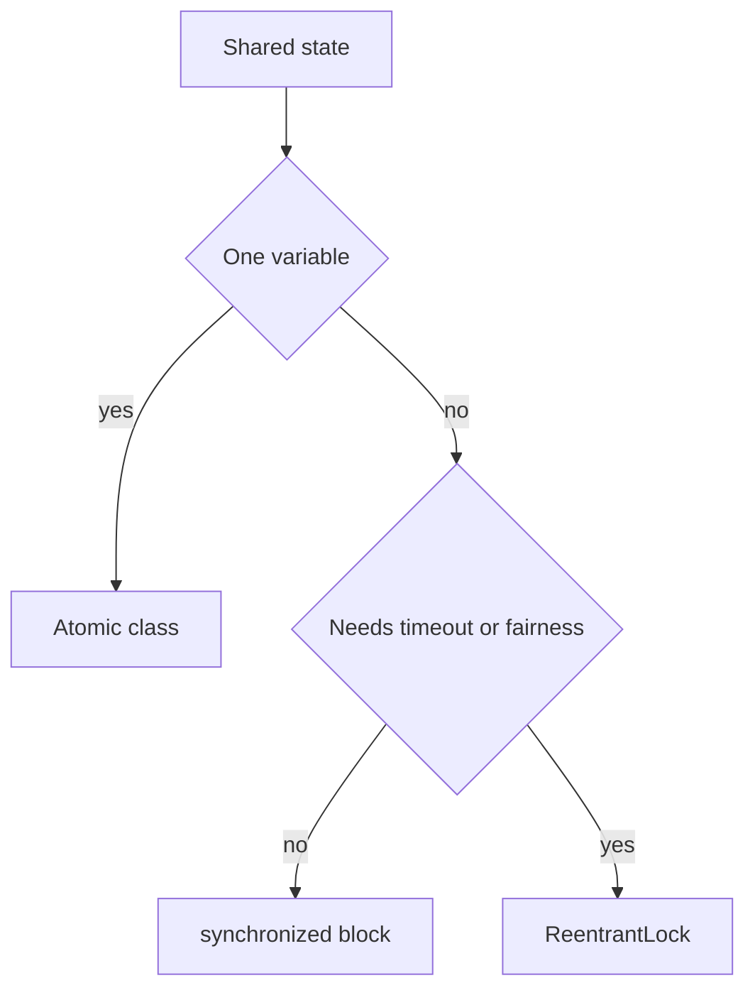

# Locks, Synchronisers, Atomics, and ThreadLocal

!!! note "In simple words"
    A lock lets only one thread into a section of code at a time. An atomic variable lets one thread change a single value safely without a lock. `ThreadLocal` gives each thread its own copy of a value, so threads never share it.

## Why it matters

`synchronized` is simple, but it cannot time out, cannot be interrupted while it waits, and cannot express "at most three threads at once". The `java.util.concurrent` package adds explicit locks, coordination helpers, and lock-free atomic variables. Interviewers ask about these tools to see whether you can pick the right one for a given problem, instead of reaching for a single lock every time.

## How it works

### ReentrantLock

`ReentrantLock` is an explicit lock with the same mutual exclusion as `synchronized`, plus extra features: `tryLock` with a timeout, interruptible locking, a fairness option, and several `Condition` objects. "Reentrant" means the thread that owns the lock can take it again without deadlocking itself.

Always release the lock in a `finally` block:

```java
import java.util.concurrent.TimeUnit;
import java.util.concurrent.locks.ReentrantLock;

public class Account {
    private final ReentrantLock lock = new ReentrantLock();
    private long balance;

    public void deposit(long amount) {
        lock.lock();
        try {
            balance += amount;
        } finally {
            lock.unlock();   // runs even if the body throws
        }
    }

    public boolean tryWithdraw(long amount) throws InterruptedException {
        if (!lock.tryLock(500, TimeUnit.MILLISECONDS)) {
            return false;    // could not get the lock in time
        }
        try {
            if (balance < amount) {
                return false;
            }
            balance -= amount;
            return true;
        } finally {
            lock.unlock();
        }
    }
}
```

Compared with `synchronized`:

| Feature | `synchronized` | `ReentrantLock` |
|---|---|---|
| Release | Automatic at block end | Manual, in `finally` |
| Timed attempt | No | `tryLock(timeout)` |
| Interruptible wait | No | `lockInterruptibly()` |
| Fairness option | No | `new ReentrantLock(true)` |
| Multiple conditions | One (`wait` and `notify`) | Many `Condition` objects |

A `ReadWriteLock` (`ReentrantReadWriteLock`) allows many readers or one writer, which helps when reads far outnumber writes. `StampedLock` offers optimistic reads, but it is not reentrant, so use it with care.

```java
import java.util.HashMap;
import java.util.Map;
import java.util.concurrent.locks.ReadWriteLock;
import java.util.concurrent.locks.ReentrantReadWriteLock;

public class ConfigCache<K, V> {
    private final Map<K, V> map = new HashMap<>();
    private final ReadWriteLock rw = new ReentrantReadWriteLock();

    public V get(K key) {
        rw.readLock().lock();          // many readers may hold this at once
        try {
            return map.get(key);
        } finally {
            rw.readLock().unlock();
        }
    }

    public void put(K key, V value) {
        rw.writeLock().lock();         // excludes readers and other writers
        try {
            map.put(key, value);
        } finally {
            rw.writeLock().unlock();
        }
    }
}
```

A plain `HashMap` is safe here only because every access goes through the lock. For a shared map with no extra logic, `ConcurrentHashMap` is usually the better choice.

### Semaphore

A `Semaphore` holds a number of permits. `acquire()` takes one, blocking when none are free, and `release()` gives one back. Use it to limit concurrent access, such as the number of connections to an external service.

```java
import java.util.concurrent.Semaphore;

public class ConnectionGate {
    private final Semaphore permits = new Semaphore(3); // at most 3 at once

    public void useConnection(Runnable work) throws InterruptedException {
        permits.acquire();
        try {
            work.run();
        } finally {
            permits.release();
        }
    }
}
```

A semaphore with one permit behaves like a lock that is not reentrant. Unlike a lock, it can be released by a different thread.

### CountDownLatch

A `CountDownLatch` starts with a count. Threads call `countDown()`, and threads that call `await()` wait until the count reaches zero. It is one-shot, so it cannot be reset.

```java
import java.util.concurrent.CountDownLatch;
import java.util.concurrent.ExecutorService;
import java.util.concurrent.Executors;

public class LatchDemo {
    public static void main(String[] args) throws InterruptedException {
        int workers = 3;
        CountDownLatch done = new CountDownLatch(workers);
        ExecutorService pool = Executors.newFixedThreadPool(workers);

        for (int i = 0; i < workers; i++) {
            int id = i;
            pool.submit(() -> {
                System.out.println("worker " + id + " finished");
                done.countDown();
            });
        }

        done.await();                 // main waits until all three call countDown
        System.out.println("All workers done");
        pool.shutdown();
    }
}
```

### CyclicBarrier

A `CyclicBarrier` makes a fixed group of threads wait for each other at a barrier point. When the last thread arrives, an optional action runs and everyone continues. Unlike a latch, it resets, so it can be reused for the next round.

```java
import java.util.concurrent.BrokenBarrierException;
import java.util.concurrent.CyclicBarrier;

public class BarrierDemo {
    public static void main(String[] args) {
        CyclicBarrier barrier = new CyclicBarrier(3,
                () -> System.out.println("-- all reached the barrier --"));

        for (int i = 0; i < 3; i++) {
            int id = i;
            new Thread(() -> {
                try {
                    System.out.println("thread " + id + " phase 1");
                    barrier.await();
                    System.out.println("thread " + id + " phase 2");
                    barrier.await();   // the barrier is reused
                } catch (InterruptedException | BrokenBarrierException e) {
                    Thread.currentThread().interrupt();
                }
            }).start();
        }
    }
}
```

Latch versus barrier, a common interview question:

| | `CountDownLatch` | `CyclicBarrier` |
|---|---|---|
| Reusable | No | Yes |
| Who waits | Any thread can `await`; others call `countDown` | The participating threads wait for each other |
| Typical use | Wait for N events or tasks to finish | Phased work where all threads sync at each step |

### Atomic classes

`java.util.concurrent.atomic` provides variables whose operations are atomic. They use hardware compare-and-set (CAS) instead of locks, so they stay fast under moderate contention.

```java
import java.util.concurrent.atomic.AtomicInteger;
import java.util.concurrent.atomic.AtomicReference;

public class AtomicDemo {
    public static void main(String[] args) {
        AtomicInteger hits = new AtomicInteger();
        hits.incrementAndGet();                  // 1, atomic
        hits.compareAndSet(1, 10);               // set to 10 only if the current value is 1
        System.out.println(hits.get());          // 10

        AtomicReference<String> state = new AtomicReference<>("NEW");
        state.compareAndSet("NEW", "PAID");
        System.out.println(state.get());         // PAID
    }
}
```

Other types include `AtomicLong`, `AtomicBoolean`, `AtomicIntegerArray`, and `LongAdder`. `LongAdder` spreads updates across cells and is often faster for a counter that is updated heavily and read rarely.

`compareAndSet` is the building block for lock-free algorithms. A typical retry loop looks like this:

```java
import java.util.concurrent.atomic.AtomicInteger;

public class Doubler {
    public static void main(String[] args) {
        AtomicInteger hits = new AtomicInteger(1);
        int current;
        do {
            current = hits.get();
        } while (!hits.compareAndSet(current, current * 2));
        System.out.println(hits.get()); // 2
    }
}
```

Atomics make one variable safe. They do not make two variables change together. Use a lock for that.

### ThreadLocal

`ThreadLocal<T>` gives each thread its own copy of a value. It suits per-thread context, such as a database connection, a user identity, or a formatter that is not thread-safe.

```java
import java.text.SimpleDateFormat;
import java.util.Date;

public class Formatting {
    // each thread gets its own SimpleDateFormat, which is not thread-safe
    private static final ThreadLocal<SimpleDateFormat> FORMAT =
            ThreadLocal.withInitial(() -> new SimpleDateFormat("yyyy-MM-dd"));

    public static String format(Date d) {
        return FORMAT.get().format(d);
    }
}
```

Two cautions:

- **Always call `remove()`** on pooled threads, because servlet containers and executors reuse them. Without it, the value leaks into the next task that runs on the thread, and the class loader may stay in memory.
- A new thread does not get the parent's values by default. `InheritableThreadLocal` copies the value when the thread is created. Virtual threads and structured concurrency change how this is used, so check the current docs before you rely on it.

For date work, `java.time` types and `DateTimeFormatter` are thread-safe, so they avoid this problem entirely (see [Date and Time](../03c-tooling-utilities/date-time.md)).

### Choosing a tool

| Situation | Reach for |
|---|---|
| Simple critical section, no timeout needed | `synchronized` |
| Timed `tryLock`, interruptible wait, fairness, or several conditions | `ReentrantLock` |
| Reads far outnumber writes on a shared structure | `ReentrantReadWriteLock` |
| One counter or flag updated by many threads | `AtomicInteger`, `AtomicBoolean`, or `LongAdder` |
| Several fields must change together | A lock (atomics cover one variable each) |
| Limit concurrent use of a resource | `Semaphore` |

In short, use `synchronized` for simple shared state, and atomics for a single value. Move to explicit locks only when you need a feature that `synchronized` lacks, because the extra control is also extra responsibility.



## Where it is used

- Connection limits for a database or an external API, using `Semaphore`.
- Metrics counters that many request threads increment, using `LongAdder` or `AtomicLong`.
- Configuration caches that are read often and rewritten rarely, using a read-write lock.
- Startup gates where a main thread waits for several services to be ready, using `CountDownLatch`.
- Per-thread formatters and request context, using `ThreadLocal`.

## Benefits

- Explicit locks offer timeouts, interruption, and fairness that `synchronized` does not.
- Atomic variables avoid lock overhead for single values, and they never block a thread.
- Latches, barriers, and semaphores express coordination directly, so the code states its intent.
- `ThreadLocal` avoids sharing objects that are not thread-safe.

## Cons and limits

- Explicit locks are easy to misuse: a missed `unlock` leaves other threads waiting forever.
- Atomics cover only one variable. Several atomics updated one after another can still show a half-finished state.
- Fair locks are slower than unfair ones, and read-write locks add overhead for short critical sections.
- `CountDownLatch` cannot be reset, and `ThreadLocal` values can leak in pooled threads.

### Common pitfalls

- Forgetting `unlock()`, or putting it outside `finally`, which leaves the lock held after an exception.
- Calling `unlock()` after a `tryLock()` that did not acquire the lock.
- Reusing a `CountDownLatch`, which cannot be reset. Use a `CyclicBarrier` or a new latch.
- Assuming two atomic variables updated one after the other are consistent together.
- Leaking `ThreadLocal` values in thread pools by not calling `remove()`.
- Using `AtomicInteger` for compound logic that needs several fields to change together.

## Best practices

1. Use `synchronized` until you need a timeout, interruption, fairness, or several conditions.
2. Always unlock in a `finally` block, and pair each `tryLock` with an unlock only when it succeeded.
3. Use a `Semaphore` to cap concurrent use of a scarce resource.
4. Use `LongAdder` for hot counters that are read rarely, and `AtomicLong` when you need the exact value often.
5. Call `ThreadLocal.remove()` at the end of each task in a pool.

!!! tip "Interview tip"
    **Q: When would you use `ReentrantLock` instead of `synchronized`?** When you need a timed or interruptible lock attempt, a fair lock, or more than one condition. For simple critical sections, `synchronized` is shorter and cannot be forgotten, because the JVM releases it automatically. Mention the `finally` rule either way.

### Step by step: what happens inside

1. A thread calls `lock()`. If another thread holds the lock, the caller waits.
2. The thread does its work inside `try`, and `unlock()` runs in `finally`.
3. A `Semaphore` hands out permits, and threads block when none remain.
4. A latch counts down to zero and then releases all waiters. A barrier releases all parties together and resets.
5. An atomic variable updates with CAS, and it retries if another thread changed the value first.

## Quick recap

- `ReentrantLock` adds timed, interruptible, and fair locking. Unlock in `finally`.
- `Semaphore` limits how many threads use a resource at once.
- `CountDownLatch` is one-shot. `CyclicBarrier` can be reused.
- Atomic classes use CAS for lock-free updates of single variables.
- `ThreadLocal` gives per-thread values. Call `remove()` in pooled threads.

## Official documentation

- [java.util.concurrent package (Java 21 API)](https://docs.oracle.com/en/java/javase/21/docs/api/java.base/java/util/concurrent/package-summary.html)
- [Java 21 API index](https://docs.oracle.com/en/java/javase/21/docs/api/index.html)

**See also:** [Synchronisation and Volatile](synchronisation-volatile.md), [Executors and Futures](executors-futures.md), [Threads Basics](threads-basics.md)
