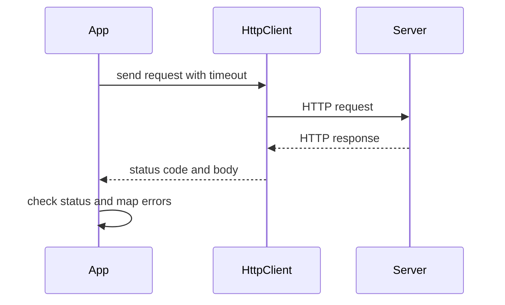

# Networking in Java

!!! note "In simple words"
    Networking code lets one program talk to another over the network. For web APIs, use the built-in HTTP client. Raw sockets are for custom protocols. Always set timeouts, so one slow server cannot freeze your program.

## Why it matters

Most services call other services: a payment API, a search index, a message broker. Each call crosses the network, where delays, errors, and slow responses are normal. Interviewers ask about these APIs to check that you know the difference between low-level sockets and the high-level HTTP client, and that you handle timeouts, response streams, and email delivery correctly.

## How it works

### Networking basics

Most application traffic uses TCP (reliable, ordered byte streams) or UDP (unreliable datagrams). Each endpoint is identified by an IP address and a port number. HTTP runs on top of TCP. Java offers several layers, from raw sockets up to a full HTTP client.

| Layer | Class or package | Use |
|---|---|---|
| Addresses | `java.net.InetAddress` | Resolve names and inspect addresses |
| URIs and URLs | `java.net.URI`, `java.net.URL` | Parse and build locations |
| Raw TCP | `java.net.Socket`, `ServerSocket` | Custom protocols |
| HTTP (current) | `java.net.http.HttpClient` (Java 11+) | Call REST APIs |
| HTTP (legacy) | `HttpURLConnection` | Maintenance of old code only |

### InetAddress

`InetAddress` represents an IP address and can resolve a host name through DNS.

```java
import java.net.InetAddress;
import java.net.UnknownHostException;

public class ResolveHost {
    public static void main(String[] args) throws UnknownHostException {
        InetAddress addr = InetAddress.getByName("localhost");
        System.out.println(addr.getHostAddress());    // typically 127.0.0.1
        System.out.println(addr.isLoopbackAddress()); // true
    }
}
```

`getByName` can block while DNS answers. Its failure is `UnknownHostException`, a checked exception, so handle it.

### URI and URL

`URI` is the modern parser for the general syntax (RFC 3986). It works without a network connection. `URL` is older, and it can open a connection, but it does not handle every URI form well. Prefer `URI` to parse and build addresses, and call `toURL()` only when an API needs a `URL`.

```java
import java.net.URI;

public class UriParts {
    public static void main(String[] args) {
        URI uri = URI.create("https://example.com/search?q=java");
        System.out.println(uri.getHost());   // example.com
        System.out.println(uri.getQuery());  // q=java
    }
}
```

`URLConnection` is the legacy way to read a resource through a `URL`. It works, but for HTTP calls use `HttpClient`.

### HttpClient (Java 11+)

`java.net.http.HttpClient` is the standard HTTP client. It supports HTTP/1.1 and HTTP/2, synchronous and asynchronous calls, and request timeouts. It replaces `HttpURLConnection` in new code.

```java
import java.net.URI;
import java.net.http.HttpClient;
import java.net.http.HttpRequest;
import java.net.http.HttpResponse;
import java.time.Duration;

public class HttpDemo {
    public static void main(String[] args) throws Exception {
        HttpClient client = HttpClient.newBuilder()
                .connectTimeout(Duration.ofSeconds(5))
                .build();

        HttpRequest request = HttpRequest.newBuilder(URI.create("https://example.com/"))
                .timeout(Duration.ofSeconds(10))
                .GET()
                .build();

        HttpResponse<String> response =
                client.send(request, HttpResponse.BodyHandlers.ofString());
        System.out.println(response.statusCode());
    }
}
```

An asynchronous call returns a `CompletableFuture` (see [Executors and Futures](executors-futures.md)):

```java
import java.net.URI;
import java.net.http.HttpClient;
import java.net.http.HttpRequest;
import java.net.http.HttpResponse;

public class AsyncFetch {
    public static void main(String[] args) {
        HttpClient client = HttpClient.newHttpClient();
        HttpRequest request = HttpRequest.newBuilder(URI.create("https://example.com")).build();
        client.sendAsync(request, HttpResponse.BodyHandlers.ofString())
              .thenApply(HttpResponse::body)
              .thenAccept(System.out::println)
              .join();
    }
}
```

Points to remember:

- Reuse one `HttpClient` across requests. It manages connections and a thread pool internally.
- Set a connect timeout on the client and a request timeout on each request. Without them, a stuck server can hold threads forever.
- `send` throws `IOException` and `InterruptedException`. A 4xx or 5xx response is not an exception, so check the status code yourself.
- Body handlers decide how the response is read. `ofString()` loads everything into memory. Use `ofInputStream()` or `ofFile(path)` for large bodies.

### Sockets: client and server

A `ServerSocket` listens on a port and returns a `Socket` for each connection. A `Socket` gives you an input stream and an output stream. The simplest server handles one client at a time.

```java
import java.io.BufferedReader;
import java.io.IOException;
import java.io.InputStreamReader;
import java.io.PrintWriter;
import java.net.ServerSocket;
import java.net.Socket;

public class EchoServer {
    public static void main(String[] args) throws IOException {
        try (ServerSocket server = new ServerSocket(5000);
             Socket client = server.accept();
             BufferedReader in = new BufferedReader(
                     new InputStreamReader(client.getInputStream()));
             PrintWriter out = new PrintWriter(client.getOutputStream(), true)) {

            String line;
            while ((line = in.readLine()) != null) {
                out.println("echo: " + line);
            }
        }
    }
}
```

A matching client:

```java
import java.io.BufferedReader;
import java.io.IOException;
import java.io.InputStreamReader;
import java.io.PrintWriter;
import java.net.Socket;

public class EchoClient {
    public static void main(String[] args) throws IOException {
        try (Socket socket = new Socket("localhost", 5000);
             PrintWriter out = new PrintWriter(socket.getOutputStream(), true);
             BufferedReader in = new BufferedReader(
                     new InputStreamReader(socket.getInputStream()))) {

            out.println("hello");
            System.out.println(in.readLine());   // echo: hello
        }
    }
}
```

Notes on sockets:

- `readLine()` returns `null` when the peer closes the connection. Always handle that case.
- A `PrintWriter` with `autoFlush` set to `true` flushes after each `println`. Without it, messages can sit in the buffer.
- For many clients, run each connection on an executor, or on a virtual thread on Java 21, instead of handling it in the accept loop.
- `socket.setSoTimeout(ms)` makes a blocking read give up after the timeout, by throwing `SocketTimeoutException`.

### NIO channels for networking

`java.nio.channels` provides non-blocking socket channels driven by a `Selector`. One thread can watch many connections. This model is behind many high-throughput servers, but it is harder to write than blocking sockets, so frameworks such as Netty wrap it. Mention it in interviews, and use blocking I/O or `HttpClient` unless you need the extra throughput.

### Sending email with Jakarta Mail

Sending email from Java uses the Jakarta Mail API (formerly JavaMail). From Jakarta EE 9 onward, the packages moved from `javax.mail` to `jakarta.mail`. Check your dependency: older code uses `javax.mail`, and new code uses `jakarta.mail`. The API jar alone cannot send mail. Add a compatible Jakarta Mail implementation as a runtime dependency, and match its version to your Jakarta EE release.

The example below is a Jakarta Mail sketch. It needs that library on the classpath, and it was not compiled here.

```java
import jakarta.mail.Authenticator;
import jakarta.mail.Message;
import jakarta.mail.MessagingException;
import jakarta.mail.PasswordAuthentication;
import jakarta.mail.Session;
import jakarta.mail.Transport;
import jakarta.mail.internet.InternetAddress;
import jakarta.mail.internet.MimeMessage;
import java.util.Properties;

public class MailSender {
    public static void send(String host, String from, String to, String body)
            throws MessagingException {
        Properties props = new Properties();
        props.put("mail.smtp.host", host);
        props.put("mail.smtp.port", "587");
        props.put("mail.smtp.starttls.enable", "true");

        Session session = Session.getInstance(props, new Authenticator() {
            @Override
            protected PasswordAuthentication getPasswordAuthentication() {
                return new PasswordAuthentication(
                        System.getenv("MAIL_USER"), System.getenv("MAIL_PASSWORD"));
            }
        });

        Message msg = new MimeMessage(session);
        msg.setFrom(new InternetAddress(from));
        msg.setRecipients(Message.RecipientType.TO, InternetAddress.parse(to));
        msg.setSubject("Status update");
        msg.setText(body);
        Transport.send(msg);
    }
}
```

Read credentials from environment variables, never from source code. Real services usually send mail through a transactional provider or an authenticated SMTP relay, and they put the send on a queue, so a slow mail server does not block a web request.

## Where it is used

- Calling REST APIs such as payment providers, search services, or internal microservices.
- Health checks and status pings that probe another service.
- Custom binary or text protocols between two internal systems.
- Sending notification emails from a background job.
- Local test servers that echo requests, used in integration tests.

## Benefits

- `HttpClient` ships with the JDK, so most REST calls need no third-party library.
- Sync and async calls share one client, and the async form fits `CompletableFuture` chains.
- Sockets give full control over a custom protocol's bytes.
- `URI` parsing is pure code, so it can be tested without a network.

## Cons and limits

- Network calls can fail or stall at any moment, so every call needs timeouts and error handling.
- Raw sockets make you own framing, timeouts, and error recovery.
- NIO selectors are powerful but complex to write correctly.
- Email delivery depends on an external server, and it can be delayed or rejected.

### Common pitfalls

- Creating a new `HttpClient` for every request, which wastes connections and threads.
- Leaving out timeouts, so one slow server stalls the whole service.
- Treating a 4xx or 5xx response as an exception. `HttpClient` returns it as a normal response.
- Reading an unbounded response body into a `String`.
- Forgetting `autoFlush` on a `PrintWriter` over a socket.
- Mixing `javax.mail` and `jakarta.mail` classes in one project.
- Hard-coding mail or API credentials in source code.
- Using `HttpURLConnection` in new code.

## Best practices

1. Create one shared `HttpClient` with a connect timeout, and set a request timeout on each request.
2. Check the status code, and map 4xx and 5xx responses to your own error types.
3. Read large bodies with `ofInputStream()` or `ofFile(path)`, not `ofString()`.
4. Close sockets and streams in try-with-resources, and treat `null` from `readLine()` as end of stream.
5. Keep credentials in environment variables or a secret store, and send email from a queue.

!!! tip "Interview tip"
    **Q: How would you call a REST API from Java 17 without third-party libraries?** Use `java.net.http.HttpClient`. Build one shared client with a connect timeout, build each `HttpRequest` with a request timeout, send it with `send` or `sendAsync`, and check the status code yourself. Mention that `HttpURLConnection` is legacy.

## Quick recap

- `InetAddress` resolves names. `URI` parses addresses without a network call.
- `HttpClient` (Java 11+) is the standard HTTP client, with synchronous and asynchronous calls.
- Always set connect and request timeouts, and reuse one client.
- `ServerSocket` and `Socket` give raw TCP streams. Close them with try-with-resources.
- Jakarta Mail uses `jakarta.mail` from Jakarta EE 9 onward. Keep credentials out of code.

### Step by step: what happens inside

1. Parse the target with `URI`, and resolve the host with `InetAddress` if you need the address.
2. For HTTP, build an `HttpRequest` with a timeout, send it through the shared `HttpClient`, and read the status and body.
3. For a custom protocol, open a `Socket`, write to its output stream, and read from its input stream.
4. Close connections in try-with-resources, and treat `null` from `readLine()` as end of stream.
5. For email, open a `Session` with SMTP settings, build a `MimeMessage`, and call `Transport.send`.



## Official documentation

- [Java 21 API index](https://docs.oracle.com/en/java/javase/21/docs/api/index.html)
- [RFC 9110: HTTP Semantics](https://www.rfc-editor.org/rfc/rfc9110)

**See also:** [I/O, Files, and Serialisation](io-files-serialisation.md), [Executors and Futures](executors-futures.md), [Threads Basics](threads-basics.md)
