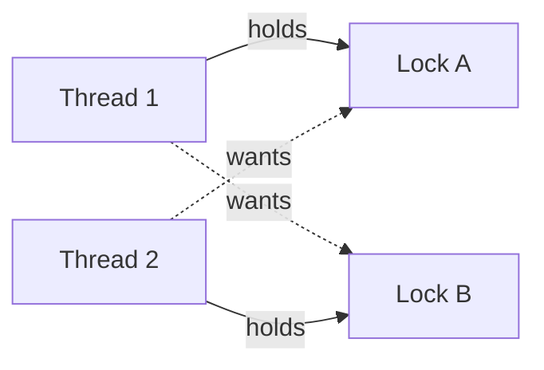

# Synchronisation, Volatile, and Deadlock

!!! note "In simple words"
    When two threads change the same data, the result can depend on timing. Synchronisation makes one thread wait its turn, and `volatile` makes sure a change made by one thread is seen by the others.

## Why it matters

When several threads share mutable state, a program can give a different answer on each run. That bug is hard to reproduce, and it often appears only under production load. Synchronisation prevents the bad interleavings and also makes changes visible to other threads. Interviewers use this topic to test whether you know the difference between visibility and atomicity, why a counter can still break with `volatile`, and how deadlocks form.

## How it works

### The race condition

A race condition happens when the correct result depends on the order in which threads run. `count++` looks like one step, but it is three: read the value, add one, write it back. Two threads can read the same value and both write back the same increment, so one update disappears.

```java
public class UnsafeCounter {
    private int count = 0;

    public void increment() {
        count++; // not atomic: read, add, write
    }

    public int get() {
        return count;
    }
}
```

Two threads that each call `increment()` one million times often end with a total below two million.

### synchronized methods and blocks

`synchronized` acquires the intrinsic lock (also called the monitor) of an object. Only one thread can hold a given monitor at a time. Leaving the block releases the lock. The release also makes the writes inside the block visible to the next thread that takes the same lock.

```java
public class SafeCounter {
    private int count = 0;

    public synchronized void increment() {  // locks this object
        count++;
    }

    public synchronized int get() {
        return count;
    }
}
```

A smaller critical section is often better. Lock only the code that touches shared state:

```java
public class Inventory {
    private final Object lock = new Object();
    private int stock = 10;

    public boolean reserve() {
        synchronized (lock) {
            if (stock == 0) {
                return false;
            }
            stock--;
            return true;
        }
    }
}
```

A private lock object, instead of `this`, keeps outside code from locking your object by accident.

### Static synchronisation

A `static synchronized` method locks the `Class` object, not an instance. Every thread that calls any static synchronized method of that class competes for the same lock. A `synchronized (Foo.class) { ... }` block does the same thing.

```java
public class IdGenerator {
    private static long next = 1;

    public static synchronized long nextId() {  // locks IdGenerator.class
        return next++;
    }
}
```

An instance method and a static method use different locks, so they can run at the same time.

### volatile: visibility, not atomicity

Without synchronisation, one thread may never see another thread's write. The compiler and the CPU can cache values or reorder instructions. Declaring a field `volatile` tells the JVM two things:

- Every read sees the latest value that was written (visibility).
- Reads and writes are ordered so that the happens-before rule holds (ordering).

`volatile` does **not** make a compound action atomic. `count++` on a volatile field is still a race.

```java
public class StopFlag implements Runnable {
    private volatile boolean running = true;

    @Override
    public void run() {
        while (running) {
            // do work
        }
        System.out.println("Stopped");
    }

    public void stop() {
        running = false; // the worker thread sees this change
    }
}
```

Use `volatile` for a simple flag, or for one value that one thread writes and others read. Use `synchronized`, or the atomic classes in [Locks and Atomics](locks-atomics.md), when a read-modify-write must be atomic.

### wait, notify, and notifyAll

These methods let a thread wait until another thread makes a condition true. They must be called while holding the object's monitor, or they throw `IllegalMonitorStateException`. `wait()` releases the monitor while it waits and takes it back before it returns.

```java
public class BoundedBox {
    private int item = -1;
    private boolean full = false;

    public synchronized void put(int value) throws InterruptedException {
        while (full) {          // always loop, never use 'if'
            wait();
        }
        item = value;
        full = true;
        notifyAll();
    }

    public synchronized int take() throws InterruptedException {
        while (!full) {
            wait();
        }
        full = false;
        notifyAll();
        return item;
    }
}
```

Two rules matter in interviews:

- Put `wait()` inside a `while` loop that re-checks the condition. A thread can wake up without a notification (a spurious wakeup), and another thread may have changed the state first.
- Prefer `notifyAll()`. `notify()` wakes one arbitrary waiter, which may be the wrong kind, and then the right one stays asleep.

For new code, the `java.util.concurrent` queues, and locks with `Condition` objects, are usually clearer than raw `wait` and `notify`.

### Deadlock

A deadlock happens when two or more threads each hold a lock that the others need, and none of them can move on.

```java
public class DeadlockDemo {
    private static final Object A = new Object();
    private static final Object B = new Object();

    public static void main(String[] args) {
        new Thread(() -> {
            synchronized (A) {
                sleep(50);
                synchronized (B) {
                    System.out.println("T1 got both");
                }
            }
        }).start();

        new Thread(() -> {
            synchronized (B) {
                sleep(50);
                synchronized (A) {          // waits forever for T1
                    System.out.println("T2 got both");
                }
            }
        }).start();
    }

    private static void sleep(long ms) {
        try {
            Thread.sleep(ms);
        } catch (InterruptedException e) {
            Thread.currentThread().interrupt();
        }
    }
}
```



Four conditions must all hold for a deadlock: mutual exclusion, hold and wait, no preemption, and circular wait. Prevention breaks one of them. The most practical fix is **lock ordering**: every thread takes the locks in the same global order, here always A and then B.

To detect a deadlock, take a thread dump with `jstack <pid>` or `jcmd <pid> Thread.print`. The dump reports "Found one Java-level deadlock" when the JVM sees a cycle. Using `tryLock` with a timeout (see [Locks and Atomics](locks-atomics.md)) is another way to avoid waiting forever.

### Happens-before in one sentence

An unlock happens before a later lock on the same monitor, and a write to a `volatile` field happens before a later read of that field. The Java Memory Model uses these edges to decide what one thread is guaranteed to see.

### Other concurrency problems

- **Livelock:** threads stay active but make no progress, because each keeps reacting to the other. Two people stepping aside for each other in a hallway is the usual picture. Random back-off helps.
- **Starvation:** a thread keeps losing the lock or the CPU to others. Fair locks (`new ReentrantLock(true)`) reduce this, at some cost in throughput.
- **Priority inversion:** a high-priority thread waits for a lock held by a low-priority thread, which cannot run because medium-priority threads keep the CPU busy. Java does not solve this for you. Keep critical sections short, and do not rely on priorities.

### Coordination patterns

Synchronisation is not only about protecting data. Threads also hand work to each other and wait for one another. Four patterns cover most cases.

**1. Producer-consumer** with a `BlockingQueue`. The queue does the waiting: `put` blocks when the queue is full, and `take` blocks when it is empty.

```java
import java.util.concurrent.ArrayBlockingQueue;
import java.util.concurrent.BlockingQueue;

public class ProducerConsumer {
    private static final int POISON = -1;   // tells the consumer to stop

    public static void main(String[] args) {
        BlockingQueue<Integer> queue = new ArrayBlockingQueue<>(5);

        Thread producer = new Thread(() -> {
            try {
                for (int i = 1; i <= 10; i++) {
                    queue.put(i);            // waits while the queue is full
                }
                queue.put(POISON);
            } catch (InterruptedException e) {
                Thread.currentThread().interrupt();
            }
        });

        Thread consumer = new Thread(() -> {
            try {
                while (true) {
                    int item = queue.take(); // waits while the queue is empty
                    if (item == POISON) {
                        break;
                    }
                    System.out.println("consumed " + item);
                }
            } catch (InterruptedException e) {
                Thread.currentThread().interrupt();
            }
        });

        producer.start();
        consumer.start();
    }
}
```

With several consumers, the producer must put one poison value for each of them.

**2 to 4. Latch, barrier, and semaphore.** These are coordination tools rather than data guards. Their full examples are in [Locks, Synchronisers, and Atomics](locks-atomics.md).

| Pattern | Class | Use it when |
|---|---|---|
| Wait for N tasks to finish (one-shot) | `CountDownLatch` | A main thread must wait for setup or workers to complete |
| Wait for N threads to reach a point (reusable) | `CyclicBarrier` | Threads work in phases and must align before each phase |
| Limit how many threads use a resource | `Semaphore` | A pool of connections or licences has a fixed size |

## Where it is used

- Counters and totals updated by request handlers, such as a count of active sessions.
- Shutdown flags that a worker loop checks on each pass.
- Shared caches and registries where readers and writers meet.
- Hand-off between a thread that receives input and a thread that writes to disk.
- Bounded buffers between a fast producer and a slower consumer.

## Benefits

- `synchronized` is simple to read, and the JVM releases the lock automatically.
- Synchronisation gives both mutual exclusion and visibility in one step.
- `volatile` is cheap for flags and single published values.
- Blocking queues and coordination classes take care of the hard waiting logic.

## Cons and limits

- Locks serialize access, so heavy contention limits throughput.
- Lock ordering must be enforced by convention. The compiler does not check it.
- `synchronized` cannot time out or be interrupted while it waits.
- `volatile` gives no atomicity, so it cannot protect counters or compound updates.
- Wrong locking can deadlock, and deadlocks are rare in tests but common in production.

### Common pitfalls

- Assuming `volatile` makes `count++` safe. It does not.
- Using `if` instead of `while` around `wait()`.
- Calling `wait()` or `notify()` without holding the monitor.
- Synchronising on a `String` literal or a boxed `Integer`, which other code may share.
- Locking in different orders in different methods, which creates deadlocks.
- Holding a lock during slow I/O or while calling code you do not control.
- Forgetting that `synchronized` on an instance method does not protect static state.

## Best practices

1. Keep critical sections small. Lock only the state that needs protection, and never hold a lock during network or disk I/O.
2. Use one global lock order. If a thread needs locks A and B, every thread takes A first.
3. Prefer `java.util.concurrent` types such as queues, latches, and executors. They are already tested against the hard cases.
4. Lock a private `final` object, not `this` or a shared string, so unrelated code cannot take your lock.

| Need | Tool |
|---|---|
| Mutual exclusion around several fields | `synchronized` block |
| Stop flag, or publish a single value | `volatile` |
| Atomic counter | `AtomicInteger` (see locks and atomics page) |
| Wait for a condition | `wait` and `notifyAll` in a loop, or a `Condition` |

### Step by step: what happens inside

1. Thread A enters a `synchronized` block and acquires the monitor of the object.
2. Thread B tries to enter the same monitor and moves to `BLOCKED`.
3. Thread A leaves the block, releases the monitor, and thread B acquires it.
4. A `volatile` write by one thread is visible to a later `volatile` read by another.
5. A deadlock forms when each thread holds one monitor and waits for the other.

!!! tip "Interview tip"
    **Q: Why is `volatile` not enough to make a counter thread-safe?** `volatile` guarantees visibility and ordering for each single read or write. `count++` is three operations (read, add, write), and `volatile` does not make the three happen as one unit. Use `synchronized`, `AtomicInteger`, or a lock.

## Quick recap

- `synchronized` gives mutual exclusion and visibility on the monitor it locks.
- `static synchronized` locks the `Class` object, not an instance.
- `volatile` gives visibility and ordering, but not atomicity.
- Always call `wait()` inside a `while` loop, and prefer `notifyAll()`.
- A deadlock needs circular waiting. Lock ordering prevents it, and thread dumps help find it.

## Official documentation

- [Java Language Specification, Java SE 21 (chapter on threads and locks)](https://docs.oracle.com/javase/specs/jls/se21/html/index.html)
- [java.util.concurrent package (Java 21 API)](https://docs.oracle.com/en/java/javase/21/docs/api/java.base/java/util/concurrent/package-summary.html)
- [Java 21 API index](https://docs.oracle.com/en/java/javase/21/docs/api/index.html)

**See also:** [Threads Basics](threads-basics.md), [Locks and Atomics](locks-atomics.md), [Executors and Futures](executors-futures.md)
