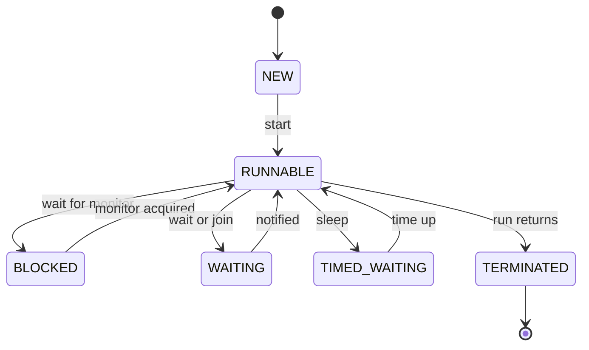

# Threads Basics

!!! note "In simple words"
    A thread is one path of work inside a running program. Several threads let a program do more than one thing at a time, for example answer a web request while a background job keeps running.

## Why it matters

Almost every later concurrency topic, such as locks, executors, and memory visibility, builds on how threads are created, started, scheduled, and finished. A program that starts a thread the wrong way, or stops it without care, can hang, lose data, or ignore a shutdown request. Interviewers ask about threads early because the answers show whether you understand what runs where.

## How it works

### Thread lifecycle and states

A `Thread` moves through the states defined by the `Thread.State` enum. `getState()` returns the current state. It is useful for debugging, but the value is only a snapshot, and it may change right after you read it.

| State | Meaning |
|---|---|
| `NEW` | Created, but `start()` has not been called yet |
| `RUNNABLE` | Running, or ready to run and waiting for CPU time |
| `BLOCKED` | Waiting to enter a `synchronized` block or method held by another thread |
| `WAITING` | Waiting with no time limit, for example after `Object.wait()`, `Thread.join()`, or `LockSupport.park()` |
| `TIMED_WAITING` | Waiting for a fixed time, for example `Thread.sleep(ms)` or `wait(ms)` |
| `TERMINATED` | `run()` has returned or thrown an exception |

```java
public class StateDemo {
    public static void main(String[] args) throws InterruptedException {
        Thread t = new Thread(() -> {
            try {
                Thread.sleep(200);
            } catch (InterruptedException ignored) {
            }
        });
        System.out.println(t.getState()); // NEW
        t.start();
        Thread.sleep(50);
        System.out.println(t.getState()); // TIMED_WAITING
        t.join();
        System.out.println(t.getState()); // TERMINATED
    }
}
```

Calling `start()` twice throws `IllegalThreadStateException`. A terminated thread cannot be restarted.

### Creating threads: extending Thread or implementing Runnable

There are two common ways to define the work a thread does.

```java
// 1. Extend Thread
class PrintTask extends Thread {
    @Override
    public void run() {
        System.out.println("Running in " + getName());
    }
}

// 2. Implement Runnable (preferred)
class PrintJob implements Runnable {
    @Override
    public void run() {
        System.out.println("Running in " + Thread.currentThread().getName());
    }
}

public class CreateThreads {
    public static void main(String[] args) {
        new PrintTask().start();
        new Thread(new PrintJob(), "worker-1").start();
        new Thread(() -> System.out.println("Lambda task")).start();
    }
}
```

Prefer `Runnable` for three reasons:

- Java has single inheritance. Extending `Thread` uses up the one superclass slot.
- The task is separate from the mechanism that runs it. The same `Runnable` can go to a thread, an executor, or a test.
- A `Runnable` can be submitted to an `ExecutorService` (see [Executors and Futures](executors-futures.md)), which manages the threads for you.

`Runnable` has one abstract method, so a lambda works too.

### Starting, joining, and naming threads

- `start()` asks the JVM to create a new thread that runs `run()`. Calling `run()` directly just runs the code on the current thread, which is a common mistake.
- `join()` makes the calling thread wait until the target thread ends. `join(ms)` waits at most the given time.
- The constructor argument or `setName()` gives a thread a readable name for logs and thread dumps.
- `setDaemon(true)` marks a daemon thread. The JVM exits when only daemon threads remain. Call it before `start()`.

```java
public class JoinDemo {
    public static void main(String[] args) throws InterruptedException {
        Thread a = new Thread(() -> System.out.println("A done"), "A");
        Thread b = new Thread(() -> System.out.println("B done"), "B");
        a.start();
        b.start();
        a.join(); // main waits for A
        b.join(); // main waits for B
        System.out.println("Both finished");
    }
}
```

### Interrupts

Interruption is a cooperative signal. One thread calls `interrupt()` on another, and the target decides what to do. Nothing stops the target automatically.

- If the target is blocked in `sleep`, `wait`, or `join`, that method throws `InterruptedException` and clears the interrupt flag.
- Otherwise the flag stays set. The code should check `Thread.currentThread().isInterrupted()` in its loop.

```java
public class InterruptDemo implements Runnable {
    @Override
    public void run() {
        while (!Thread.currentThread().isInterrupted()) {
            // do a small unit of work
        }
        System.out.println("Stopped cleanly");
    }

    public static void main(String[] args) throws InterruptedException {
        Thread t = new Thread(new InterruptDemo());
        t.start();
        Thread.sleep(100);
        t.interrupt();
        t.join();
    }
}
```

Never swallow an `InterruptedException` silently. Either rethrow it, or restore the flag with `Thread.currentThread().interrupt()`.

### Thread priority

`setPriority(1..10)` is only a hint to the scheduler. The operating system decides what it means, and it is not guaranteed. Do not use priority for correctness. Use locks, executors, or queues to control order.

### Virtual threads (Java 21)

A virtual thread is a lightweight thread that the JVM schedules onto a small pool of platform threads. Java 21 made virtual threads a final feature. They suit code that spends most of its time waiting on I/O, because a blocked virtual thread does not hold an operating system thread. Create one with `Thread.ofVirtual().start(runnable)` or `Thread.startVirtualThread(runnable)`. The API is the same `Thread` class, so the code inside is ordinary blocking Java.

### User threads and daemon threads

Every thread is either a user thread or a daemon thread. The JVM uses this flag only to decide when it may exit.

| | User thread | Daemon thread |
|---|---|---|
| JVM exit | Waits for every user thread to finish | Does not wait; it is abandoned when only daemon threads remain |
| Typical use | Application work | Background housekeeping, such as a heartbeat or cache cleaner |
| Default | Created by the application | A new thread inherits the daemon flag of the thread that created it |

```java
public class DaemonDemo {
    public static void main(String[] args) {
        Thread heartbeat = new Thread(() -> {
            while (true) {
                System.out.println("alive");
                try {
                    Thread.sleep(1000);
                } catch (InterruptedException e) {
                    return;
                }
            }
        });
        heartbeat.setDaemon(true);   // must be called before start()
        heartbeat.start();
        // main returns here, so the JVM exits without waiting for heartbeat
    }
}
```

A daemon thread can stop at any moment when the JVM exits. Never leave a file write or a transaction half done on one. The daemon flag does not change scheduling priority.

### Processes, threads, and IPC

A process is a running program with its own address space. A thread lives inside a process and shares that process's memory with its sibling threads.

| Aspect | Process | Thread |
|---|---|---|
| Memory | Separate, mostly isolated address space | Shares the heap and static fields of its process |
| Cost to create and switch | Higher | Lower |
| Sharing data | Needs inter-process communication (IPC) | Shares objects directly, so it needs synchronization |
| Isolation | A failing process usually does not corrupt others | A bug that corrupts shared state affects every thread |

Two processes can be independent, sharing neither data nor resources, or co-operating, exchanging data or resources. Co-operating processes need IPC. There are two basic models:

1. **Shared memory:** the processes map a common region of memory and coordinate access with a lock or semaphore.
2. **Message passing:** the processes exchange messages through a pipe, socket, or queue.

Inside one JVM you do not need IPC, because threads already share memory. Use IPC when your Java program talks to a separate program, such as a database or a sidecar process on the same host. The `java.net` and `java.nio` packages cover the socket side (see [Networking](networking.md)).

### Why programs use threads

- **Responsiveness:** a UI or request handler stays available while a slow job runs on another thread.
- **Hardware use:** on a multi-core machine, independent work can run at the same time.
- **Simpler structure:** a server can give each connection its own thread of control, which is easier to read than a hand-written state machine.



## Where it is used

- Web servers that handle each request on its own thread or virtual thread.
- Background jobs, such as sending email after a sign-up or refreshing a cache on a timer.
- Long-running workers that read from a queue and process messages.
- Parallel work on a multi-core machine, such as splitting a large calculation into chunks.

## Benefits

- Work that waits, such as a network call, does not stop the rest of the program.
- Independent tasks can use several CPU cores at once.
- Thread-per-task code is easy to read, because each thread runs straight-line code.
- Daemon threads let housekeeping work stop automatically at shutdown.

## Cons and limits

- Threads share memory, so any shared mutable data needs careful synchronization.
- Each platform thread costs memory for its stack, and creating many of them is slow.
- Scheduling is controlled by the operating system, so timing-based code is unreliable.
- Cancellation is cooperative. A thread stops only when its code checks for it.

### Common pitfalls

- Calling `run()` instead of `start()`. The code runs on the caller's thread, and no concurrency happens.
- Calling `start()` twice, which throws `IllegalThreadStateException`.
- Extending `Thread` when you only need a task. This ties the task to the thread and uses up the superclass slot.
- Relying on thread priority or timing, such as `sleep` to "wait for the other thread", for correctness.
- Swallowing `InterruptedException`, which makes the thread impossible to cancel.
- Reusing a `Thread` object after it has terminated.

## Best practices

1. Define tasks as `Runnable` or `Callable`, and let an executor run them. Create raw threads only for simple cases.
2. Give every thread a meaningful name, so logs and thread dumps are readable.
3. Handle interruption by stopping the work and restoring the flag.
4. Use `join` or executor shutdown to wait for threads at the end of a program.
5. Use `java.util.concurrent` tools instead of `sleep` for coordination.

!!! tip "Interview tip"
    **Q: What is the difference between `start()` and `run()`?** `start()` creates a new thread of execution and then calls `run()` on it. Calling `run()` directly is an ordinary method call on the current thread. Interviewers often ask this to check whether you understand threads at all.

## Quick recap

- A thread moves through `NEW`, `RUNNABLE`, `BLOCKED`, `WAITING`, `TIMED_WAITING`, and `TERMINATED`.
- Prefer implementing `Runnable` over extending `Thread`.
- `start()` creates the thread. `run()` is just a method.
- `join()` waits for a thread to finish. Interruption is cooperative.
- Priority is only a hint, so do not use it for correctness.
- Virtual threads (Java 21) suit I/O-heavy, blocking code.

## Official documentation

- [Java 21 API index](https://docs.oracle.com/en/java/javase/21/docs/api/index.html)
- [JEP 444: Virtual Threads](https://openjdk.org/jeps/444)
- [java.util.concurrent package (Java 21 API)](https://docs.oracle.com/en/java/javase/21/docs/api/java.base/java/util/concurrent/package-summary.html)

**See also:** [Synchronisation and Volatile](synchronisation-volatile.md), [Executors and Futures](executors-futures.md), [Locks and Atomics](locks-atomics.md)
