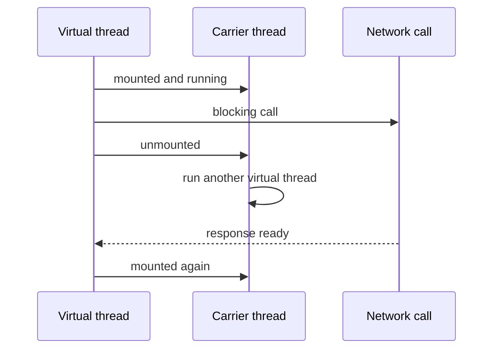

# Java 21 Features

!!! note "In simple words"
    Java 21 is a long-term support (LTS) release. Its headline feature, virtual threads, lets you write simple blocking code that still handles thousands of waiting tasks. Pattern matching and record patterns let you check the shape of data and pull out its parts in one step.

## Why it matters

Java 21 finalised virtual threads (Project Loom), record patterns, and pattern matching for `switch`, and it added sequenced collections. Teams often choose it as their LTS baseline, so interviewers ask about it. They want to know why virtual threads change how server code is written, and how pattern matching works with sealed types and records.

---

## How it works

### Virtual threads (Project Loom)

A platform thread maps one-to-one onto an operating system thread. That is expensive, so a server with thousands of blocking requests runs out of threads long before it runs out of CPU. A **virtual thread** is a lightweight thread managed by the JVM. Many virtual threads run on a small pool of carrier platform threads. When a virtual thread blocks on I/O, the JVM unmounts it from its carrier, and the carrier runs another virtual thread.

You keep the simple blocking style. You do not need callbacks or reactive chains to get scalability for I/O-bound work.

```java
import java.time.Duration;
import java.util.concurrent.Executors;

public class VirtualThreadBasics {
    public static void main(String[] args) throws InterruptedException {
        Thread t = Thread.ofVirtual()
                .name("worker")
                .start(() -> System.out.println("hello from " + Thread.currentThread().getName()));
        t.join();

        try (var executor = Executors.newVirtualThreadPerTaskExecutor()) {
            for (int i = 0; i < 10_000; i++) {
                executor.submit(() -> {
                    Thread.sleep(Duration.ofMillis(100)); // blocking call, cheap to park
                    return null;
                });
            }
        } // close() waits for all submitted tasks to finish
    }
}
```

`ExecutorService` is `AutoCloseable` from Java 19, so the try-with-resources block waits for every task. The example submits 10,000 blocking tasks, which would be costly with platform threads. Virtual threads are cheap to create, so the usual pattern is one virtual thread per task.

Virtual threads do not make CPU work faster. They help when tasks spend their time waiting. They are also not pooled. Create a new one for each task, and do not place them in a fixed-size pool.

### The problem: platform threads cap concurrency

A fixed pool of platform threads limits how many blocking calls can be in flight at once. Every extra task waits in the queue, even when the CPU is idle. Raising the pool size costs memory, because each platform thread reserves its own stack, and the operating system spends more time switching between threads.

```java
import java.util.concurrent.ExecutorService;
import java.util.concurrent.Executors;

public class PlatformPoolLimit {
    static String callRemoteService() throws InterruptedException {
        Thread.sleep(200);          // stands in for a slow network call
        return "ok";
    }

    public static void main(String[] args) {
        try (ExecutorService pool = Executors.newFixedThreadPool(200)) {
            for (int i = 0; i < 10_000; i++) {
                pool.submit(PlatformPoolLimit::callRemoteService); // queued until a thread is free
            }
        } // close() waits for the queue to drain; at most 200 calls run at once
    }
}
```

### The solution: one virtual thread per task

Replacing the fixed pool with a virtual-thread-per-task executor keeps the same blocking code. The JVM parks a virtual thread during the blocking call and reuses the carrier thread for other work, so thousands of waiting tasks can exist at the same time.

```java
import java.util.concurrent.ExecutorService;
import java.util.concurrent.Executors;

class RemoteCall {
    static void callRemoteService() {
        // simulated blocking call
    }
}

public class VirtualPerTask {
    public static void main(String[] args) {
        try (ExecutorService executor = Executors.newVirtualThreadPerTaskExecutor()) {
            for (int i = 0; i < 10_000; i++) {
                executor.submit(RemoteCall::callRemoteService);
            }
        } // close() waits for all 10,000 tasks; they run concurrently, not 200 at a time
    }
}
```

The difference is the scheduling model, not the code inside the task. To limit access to a scarce resource, use a `Semaphore` rather than a pool size. This is the usual pattern for a database connection limit.



### Virtual threads versus reactive frameworks

Reactive frameworks, such as Spring WebFlux, solved the same scaling problem by making every step non-blocking and chaining callbacks. Virtual threads let blocking code scale as well. For many request-per-thread services, they remove the main reason to adopt reactive code.

| Aspect | Virtual threads | Reactive (for example WebFlux) |
|---|---|---|
| Code style | Synchronous and imperative | Asynchronous operator chains |
| Learning curve | Ordinary Java; existing libraries work | Operators, subscriptions, and schedulers to learn |
| Stack traces | Complete, one thread per request | Split across operator stages |
| Blocking calls | Acceptable; the carrier is released | Not acceptable on the event loop |
| Error handling | `try` and `catch` | Error operators such as `onErrorResume` |
| Backpressure and streams | Not built in; use bounded queues or semaphores | Built in as part of the model |
| Best fit | Blocking I/O with existing libraries, on Java 21 or later | Streaming data, backpressure requirements, existing reactive systems |

Reactive code still earns its place when data flows as a stream that needs backpressure, or when a system is already built on reactive types. Frameworks such as Spring Boot can run requests on virtual threads. Check the framework's documentation for the setting that matches your version.

### Pinning

A virtual thread can be **pinned** to its carrier thread. A pinned virtual thread blocks the carrier. The two common causes are running inside a `synchronized` block or method, and calling native code. Java 21 still pins inside `synchronized`. Replace `synchronized` with `ReentrantLock` in code that blocks while it holds the lock.

```java
import java.util.concurrent.locks.ReentrantLock;

public class PinningFix {
    private final ReentrantLock lock = new ReentrantLock();
    private int counter;

    public void increment() {
        lock.lock();
        try {
            counter++;
        } finally {
            lock.unlock();
        }
    }

    public int get() {
        lock.lock();
        try {
            return counter;
        } finally {
            lock.unlock();
        }
    }
}
```

`ThreadLocal` values are per thread. With many virtual threads, they can use a lot of memory, so pass values explicitly where you can.

### Record patterns

A record pattern deconstructs a record in an `instanceof` check or a `switch` label. Record patterns were a preview in 19 and 20, and became final in Java 21.

```java
public class RecordPatternInstanceof {
    record Point(int x, int y) {}

    static String describe(Object obj) {
        if (obj instanceof Point(int x, int y) && x == y) {
            return "on the diagonal at " + x;
        }
        if (obj instanceof Point(int x, int y)) {
            return "point (" + x + ", " + y + ")";
        }
        return "not a point";
    }

    public static void main(String[] args) {
        System.out.println(describe(new Point(3, 3))); // on the diagonal at 3
        System.out.println(describe(new Point(1, 2))); // point (1, 2)
        System.out.println(describe("text"));          // not a point
    }
}
```

Record patterns can nest, so `Line(Point(var x1, var y1), Point p2)` matches a record that holds other records.

### Pattern matching for switch

`switch` can match on types, record components, and `null`. A `when` clause adds a guard. The compiler checks exhaustiveness for sealed hierarchies, so a sealed interface with every permitted type covered needs no `default`.

```java
public class PatternSwitch {
    sealed interface Shape permits Circle, Square, Rect {}
    record Circle(double radius) implements Shape {}
    record Square(double side) implements Shape {}
    record Rect(double w, double h) implements Shape {}

    static double area(Shape shape) {
        return switch (shape) {
            case Circle c when c.radius() <= 0 -> 0.0;
            case Circle c -> Math.PI * c.radius() * c.radius();
            case Square s -> s.side() * s.side();
            case Rect(double w, double h) -> w * h;
        };
    }

    static String label(Object o) {
        return switch (o) {
            case null -> "null value";
            case String s -> "string of length " + s.length();
            case Integer i when i > 100 -> "large integer";
            case Integer i -> "integer " + i;
            default -> "other";
        };
    }

    public static void main(String[] args) {
        System.out.printf("%.2f%n", area(new Rect(2, 5)));  // 10.00
        System.out.println(label(null));                    // null value
        System.out.println(label(250));                     // large integer
    }
}
```

Two rules matter in interviews. A `when` guard is checked after the type matches. Dominance is enforced: a more general case placed before a more specific one is a compile error. Putting `case Circle c` before `case Circle c when ...` would not compile.

### Sequenced collections

Java 21 added interfaces that describe a collection with a defined encounter order. `SequencedCollection` gives a uniform way to read the first and last element and to get a reversed view. `List` and `Deque` already had some of these operations, so Java 21 standardised the names across types.

```java
import java.util.ArrayList;
import java.util.List;

public class SequencedDemo {
    public static void main(String[] args) {
        List<String> letters = new ArrayList<>(List.of("a", "b", "c"));
        System.out.println(letters.getFirst());  // a
        System.out.println(letters.getLast());   // c
        System.out.println(letters.reversed());  // [c, b, a]
    }
}
```

`reversed()` returns a view, not a copy, so changes to the original are visible through it. `getFirst()` on an empty list throws `NoSuchElementException`.

### Preview features in Java 21

These were previews in 21. They need `--enable-preview` and may change or be removed.

- **String templates** (JEP 430): embedded expressions in string literals with a `STR` processor. They were withdrawn in Java 23, so do not use them in production code.
- **Unnamed patterns and variables** (JEP 443): the underscore `_` for unused parts of a pattern. They were a preview in 21.

### Other notable changes

- **Generational ZGC** (JEP 439) arrived as an option for the Z garbage collector. See [Garbage collection](../03b-jvm-internals/garbage-collection.md).
- Virtual threads are covered in more depth in [Threads basics](../02c-concurrency-io/threads-basics.md) and [Executors and futures](../02c-concurrency-io/executors-futures.md).

### Java 22 to 25

Java 22 through 25 each added incremental enhancements. Java 25 is also an LTS release. For the list of features in each release and their status, read the official OpenJDK release notes for that version. Do not rely on memory for the exact feature set of a specific non-LTS release.

### Step by step: what happens inside

1. A virtual thread is scheduled onto a carrier platform thread from a small pool.
2. When it calls a blocking operation, such as socket I/O or `sleep`, the JVM unmounts it from the carrier.
3. The carrier picks up another virtual thread, so the platform thread is not wasted.
4. When the blocking call completes, the virtual thread is mounted again and continues.
5. For pattern matching, the compiler checks the type, binds the pattern variables, applies guards in order, and verifies exhaustiveness for sealed types.

---

## Where it is used

- Servers that handle many concurrent HTTP requests, each with a blocking database or REST call.
- Batch jobs that fetch thousands of remote resources in parallel.
- Sealed domain models with records, such as a `Payment` that is either `Approved` or `Declined`, handled by one `switch`.
- Parsing or routing code that checks the shape of nested records.

## Benefits

- Blocking code scales to many concurrent I/O tasks without tuning a thread pool.
- Virtual threads keep full stack traces and work with existing blocking libraries.
- Pattern matching and record patterns remove casts and nested field access.
- The compiler checks `switch` coverage over sealed types, so a new case is not silently missed.
- Sequenced collections give one consistent way to read the first and last element.

## Cons and limits

- Virtual threads help I/O-bound work only. CPU-bound code gains nothing from them.
- Pinning inside `synchronized` can reduce the benefit in Java 21.
- Thread-local values can use a lot of memory when many virtual threads hold them.
- Preview features and the Java 22 to 25 additions change the language, so check the release for each feature you use.

### Common pitfalls

- Pooling virtual threads. They are cheap, so create one per task. Use a `Semaphore` to limit concurrent access to a scarce resource, such as a database connection pool.
- Using `synchronized` around blocking calls in virtual-thread code. This pins the carrier. Prefer `ReentrantLock` there.
- Treating virtual threads as a way to make computation faster. They help with waiting, not with computing.
- Putting a more general `case` before a more specific one. This is a compile error.
- Writing a `when` guard that is always true. The compiler does not warn about every redundant guard.
- Using string templates or unnamed variables in production code, since they were previews in 21.

## Best practices

1. Use `Executors.newVirtualThreadPerTaskExecutor()` for I/O-bound tasks, and close it with try-with-resources.
2. Limit access to shared resources with a `Semaphore`, not with thread-pool size.
3. Replace `synchronized` with `ReentrantLock` where a blocking call happens inside the lock.
4. Model closed sets of results with sealed interfaces and records, and handle them in a `switch` without `default`.
5. Keep preview features out of production code.

!!! tip "Interview tip"
    **Q: Do virtual threads make my code faster?** They let I/O-bound code scale to many concurrent tasks without thread-pool tuning, because a blocked task no longer holds an operating system thread. They do not make CPU-bound code faster, and they do not remove the need for locks, safe publication, or limits on scarce resources.

## Quick recap

- Virtual threads (final in 21) let blocking-style code handle many concurrent I/O tasks.
- Create virtual threads per task. Avoid `synchronized` around blocking calls to prevent pinning.
- Record patterns (final in 21) deconstruct records in `instanceof` and `switch`.
- Pattern matching for `switch` (final in 21) adds type patterns, `when` guards, and `case null`, with exhaustiveness for sealed types.
- Sequenced collections add `getFirst`, `getLast`, and `reversed` to ordered collections.
- String templates were a preview in 21 and were withdrawn in 23.

## Official documentation

- [JEP 444: Virtual Threads](https://openjdk.org/jeps/444)
- [JEP index (OpenJDK)](https://openjdk.org/jeps/)
- [Java 21 API index](https://docs.oracle.com/en/java/javase/21/docs/api/index.html)

**See also:** [Java 9 to 17 features](java9-to-17-features.md) - [Java 8 lambdas and streams](java8-lambdas-streams.md) - [Index](index.md)
