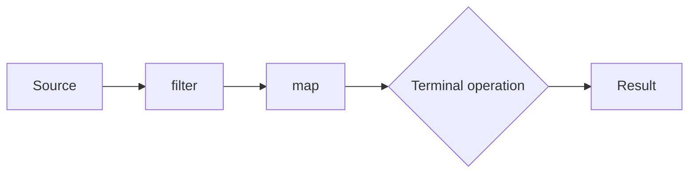

# Java 8: Lambdas, Method References and Streams

!!! note "In simple words"
    A lambda is a short piece of code you can pass around as a value. A stream is a chain of steps that you apply to a collection, such as filter, then transform, then collect. You describe what you want, and Java runs the steps.

## Why it matters

Before Java 8, changing behaviour meant writing a named class for each case, and transforming data meant writing loops by hand. Lambdas, method references, and the Stream API made that code shorter and easier to read. Interviewers use this topic to check that you understand functional interfaces, the difference between lazy intermediate operations and eager terminal operations, and when a stream is the wrong tool.

---

## How it works

### Functional interfaces

A functional interface has exactly one abstract method. A lambda is an instance of one. The `@FunctionalInterface` annotation asks the compiler to check that rule. It is optional, but it documents intent and gives a clear error if someone later adds a second abstract method.

```java
@FunctionalInterface
interface Discount {
    double apply(double price);
}

public class DiscountDemo {
    public static void main(String[] args) {
        Discount tenPercent = price -> price * 0.9;
        System.out.println(tenPercent.apply(200.0)); // 180.0
    }
}
```

### Lambda syntax

A lambda has a parameter list, `->`, and a body. Parentheses are optional for one parameter whose type is inferred. Use braces and an explicit `return` when the body has more than one statement.

```java
import java.util.function.BinaryOperator;
import java.util.function.Consumer;
import java.util.function.Supplier;

public class LambdaSyntax {
    public static void main(String[] args) {
        Supplier<String> zeroArgs = () -> "no parameters";     // zero parameters
        Consumer<String> oneArg = s -> System.out.println(s);  // one parameter, no parentheses
        BinaryOperator<Integer> add = (a, b) -> a + b;         // expression body
        BinaryOperator<Integer> max = (a, b) -> {              // block body
            if (a > b) {
                return a;
            }
            return b;
        };

        oneArg.accept(zeroArgs.get());       // no parameters
        System.out.println(add.apply(2, 3)); // 5
        System.out.println(max.apply(2, 3)); // 3
    }
}
```

A lambda can read a local variable only if that variable is effectively final, meaning it is never reassigned after it is set. The lambda may run after the method that created it has returned. Java copies the value into the lambda, so allowing reassignment would make the copy misleading.

### Method references

A method reference is a shorter form of a lambda that only calls an existing method. The `::` operator names the method, so you do not repeat the call.

| Form | Example | Equivalent lambda |
|---|---|---|
| Static method | `Integer::parseInt` | `s -> Integer.parseInt(s)` |
| Instance method of a particular object | `printer::print` | `x -> printer.print(x)` |
| Instance method of an arbitrary object of a type | `String::toUpperCase` | `s -> s.toUpperCase()` |
| Constructor | `ArrayList::new` | `() -> new ArrayList<>()` |
| Array constructor | `String[]::new` | `n -> new String[n]` |

```java
import java.util.List;

public class MethodRefs {
    public static void main(String[] args) {
        List<String> names = List.of("ada", "linus", "grace");
        names.stream()
             .map(String::toUpperCase)        // instance method of an arbitrary object
             .forEach(System.out::println);   // instance method of a particular object
    }
}
```

### Passing behaviour into methods

Before Java 8, a method that needed to vary its behaviour took an interface with one method, and every case needed its own named class. A lambda lets the caller pass the rule inline. The method below accepts a `Predicate` and sums the numbers that match it.

```java
import java.util.List;
import java.util.function.Predicate;

public class PassBehaviour {
    static int sumWhere(List<Integer> numbers, Predicate<Integer> rule) {
        return numbers.stream()
                .filter(rule)
                .mapToInt(Integer::intValue)
                .sum();
    }

    public static void main(String[] args) {
        List<Integer> numbers = List.of(1, 2, 3, 6, 7, 8);
        System.out.println(sumWhere(numbers, n -> true));        // 27
        System.out.println(sumWhere(numbers, n -> n % 2 == 0));  // 16
        System.out.println(sumWhere(numbers, n -> n > 5));       // 21
    }
}
```

The same idea works for a declarative primality test. The stream version reads close to the definition: greater than one, and no divisor in range.

```java
import java.util.stream.IntStream;

public class Primes {
    static boolean isPrime(int n) {
        return n > 1 && IntStream.range(2, n).noneMatch(d -> n % d == 0);
    }

    public static void main(String[] args) {
        System.out.println(isPrime(2));  // true
        System.out.println(isPrime(9));  // false
    }
}
```

---

## Streams

### What a stream is

A stream is a sequence of elements plus a pipeline of operations on them. A stream does not store elements, and it never changes its source. It is a view over data, so a pipeline over a `List` leaves the list untouched. A pipeline has three parts:

1. A **source**: a collection, an array, `Stream.of`, `IntStream.range`, or the lines of a file.
2. Zero or more **intermediate operations**, such as `filter`, `map`, `flatMap`, `sorted`, `distinct`, `limit`, `skip`, and `peek`. Each one returns a new stream.
3. One **terminal operation**, such as `forEach`, `collect`, `reduce`, `count`, `findFirst`, or `toList`. It runs the pipeline and produces a result or a side effect.

```java
import java.util.List;

public class PipelineShape {
    public static void main(String[] args) {
        long count = List.of(3, 8, 1, 9, 4).stream()  // source
                .filter(n -> n > 2)                   // intermediate
                .map(n -> n * n)                      // intermediate
                .count();                             // terminal
        System.out.println(count); // 4
    }
}
```

### Creating streams

| Source | Creates |
|---|---|
| `collection.stream()` / `collection.parallelStream()` | Sequential or parallel stream over a collection |
| `Arrays.stream(array)` / `Arrays.stream(array, from, to)` | Stream over an array or a slice of it |
| `Stream.of(a, b, ...)` / `Stream.empty()` | Fixed elements, or nothing |
| `Stream.<T>builder().add(x).build()` | Elements added one at a time; give the type explicitly |
| `Stream.iterate(seed, f)` | Infinite sequence; apply `limit` |
| `Stream.generate(supplier)` | Infinite sequence from a supplier; apply `limit` |
| `IntStream.range(a, b)` / `IntStream.rangeClosed(a, b)` | Primitive int sequence, excluding or including `b` |
| `Files.lines(path)` | Lines of a file; close it with try-with-resources |

```java
import java.util.Arrays;
import java.util.stream.IntStream;
import java.util.stream.Stream;

public class StreamSources {
    public static void main(String[] args) {
        System.out.println(Stream.of("apple", "banana").toList());           // [apple, banana]
        System.out.println(Arrays.stream(new String[] {"x", "y", "z"}, 1, 3).toList()); // [y, z]
        System.out.println(IntStream.range(1, 5).boxed().toList());          // [1, 2, 3, 4]
        System.out.println(Stream.iterate(0, n -> n + 2).limit(4).toList()); // [0, 2, 4, 6]
        System.out.println(Stream.<String>builder().add("a").add("b").build().toList()); // [a, b]
        System.out.println(Stream.generate(() -> "element").limit(3).toList());  // three copies
    }
}
```

`Stream.toList()` arrived in Java 16. `iterate` and `generate` produce infinite sequences, so always add a `limit` or a short-circuiting terminal operation after them. Otherwise the program runs until memory runs out.

A file stream holds an open file handle, so close it:

```java
import java.io.IOException;
import java.nio.file.Files;
import java.nio.file.Path;
import java.util.stream.Stream;

public class CountLines {
    static long countLines(Path path) throws IOException {
        try (Stream<String> lines = Files.lines(path)) {
            return lines.filter(line -> !line.isBlank()).count();
        }
    }
}
```

### Intermediate operations

Intermediate operations are lazy. Each one records a step and returns a stream. Nothing runs until a terminal operation is called.

| Operation | Effect |
|---|---|
| `filter(Predicate)` | Keeps elements that match |
| `map(Function)` | Transforms each element |
| `flatMap(Function)` | Each element becomes a stream, and the results are joined into one stream |
| `distinct()` | Removes duplicates (uses `equals` and `hashCode`) |
| `sorted()` / `sorted(Comparator)` | Sorts; this is stateful and buffers the whole stream |
| `limit(n)` / `skip(n)` | Keeps the first `n`, or drops the first `n` |
| `peek(Consumer)` | Runs a side effect per element, mainly for debugging |
| `takeWhile(Predicate)` / `dropWhile(Predicate)` | Java 9. Take or drop from the start while the predicate holds |
| `unordered()` | Tells the pipeline that order does not matter, which can speed up parallel work |

```java
import java.util.List;

public class IntermediateDemo {
    public static void main(String[] args) {
        List<Integer> nums = List.of(1, 2, 3, 4, 5, 1);

        System.out.println(nums.stream().takeWhile(n -> n < 4).toList()); // [1, 2, 3]
        System.out.println(nums.stream().dropWhile(n -> n < 4).toList()); // [4, 5, 1]

        List<List<Integer>> nested = List.of(List.of(1, 2), List.of(3), List.of());
        System.out.println(nested.stream().flatMap(List::stream).toList()); // [1, 2, 3]

        System.out.println(nums.stream().distinct().sorted().skip(1).toList()); // [2, 3, 4, 5]
    }
}
```

`takeWhile` stops at the first element that fails, even if later elements pass. `filter` keeps scanning. That difference is a common interview question.

### Terminal operations

A terminal operation runs the pipeline. After it runs, the stream is consumed and cannot be used again.

| Operation | Returns |
|---|---|
| `forEach(Consumer)` | `void`. Runs an action per element |
| `collect(Collector)` | A collection, map, or summary, built by a `Collector` |
| `toList()` | An unmodifiable list (Java 16) |
| `count()` | `long` number of elements |
| `anyMatch`, `allMatch`, `noneMatch` | `boolean`. These can stop early |
| `findFirst()` / `findAny()` | `Optional`. `findAny` may pick any element in parallel |
| `reduce(...)` | Combines elements into one value |
| `min(Comparator)` / `max(Comparator)` | `Optional` of the extreme element |
| `toArray()` / `toArray(String[]::new)` | An array |

```java
import java.util.Comparator;
import java.util.List;
import java.util.Optional;

public class TerminalDemo {
    public static void main(String[] args) {
        List<Integer> nums = List.of(5, 10, -2, 23, 7);

        int sum = nums.stream().reduce(0, Integer::sum);   // 43
        Optional<Integer> product = List.of(1, 2, 3, 4).stream()
                .reduce((a, b) -> a * b);                  // Optional[24]

        Optional<Integer> max = nums.stream().max(Comparator.naturalOrder());
        Optional<Integer> min = nums.stream().min(Comparator.naturalOrder());
        System.out.println(max.orElseThrow() + " " + min.orElseThrow()); // 23 -2

        System.out.println(nums.stream().anyMatch(n -> n > 20));   // true
        System.out.println(nums.stream().noneMatch(n -> n == 0));  // true
        System.out.println(sum + " " + product.orElseThrow());     // 43 24
    }
}
```

`reduce` with an identity value (`0` above) returns a plain value. Without one, it returns an `Optional`, because an empty stream has no result. The identity must be neutral for the operation: `0` for sum, `1` for product. A non-neutral identity gives wrong answers under parallel execution.

### Collectors

`collect` with a `Collector` turns a stream into a collection or a summary. The `Collectors` class provides the common ones.

| Collector | Result |
|---|---|
| `toList()`, `toSet()`, `toCollection(TreeSet::new)` | A list, set, or chosen collection |
| `toMap(keyFn, valueFn[, merge])` | A map; a duplicate key without a merge function throws |
| `groupingBy(classifier[, mapFactory][, downstream])` | Map from key to group; the default downstream is `toList()` |
| `partitioningBy(predicate[, downstream])` | Map with exactly two keys, `true` and `false` |
| `joining(sep, prefix, suffix)` | One string built from `CharSequence` elements |
| `counting()`, `summingInt`, `averagingDouble` | Numeric results, used as downstream collectors |
| `summingLong(fn)`, `averagingLong(fn)` | A `Long` sum (`0L` when empty) or a `Double` average (`0.0` when empty) |
| `toUnmodifiableList()`, `toUnmodifiableSet()` | A read-only list or set (Java 10); a set drops duplicates; a `null` element throws `NullPointerException` |
| `summarizingInt(fn)` | `IntSummaryStatistics` with count, sum, min, average, and max |
| `minBy`, `maxBy` | `Optional` with a comparator |

```java
import java.util.IntSummaryStatistics;
import java.util.List;
import java.util.Map;
import java.util.TreeMap;
import java.util.function.Function;
import java.util.stream.Collectors;

public class CollectorTour {
    public static void main(String[] args) {
        List<String> words = List.of("apple", "banana", "apple", "cherry", "fig");

        Map<String, Long> counts = words.stream()
                .collect(Collectors.groupingBy(Function.identity(), TreeMap::new, Collectors.counting()));
        System.out.println(counts); // {apple=2, banana=1, cherry=1, fig=1}

        Map<Integer, List<String>> byLength = words.stream()
                .distinct()
                .collect(Collectors.groupingBy(String::length, TreeMap::new, Collectors.toList()));
        System.out.println(byLength); // {3=[fig], 5=[apple], 6=[banana, cherry]}

        Map<Boolean, List<String>> longOrShort = words.stream()
                .collect(Collectors.partitioningBy(w -> w.length() > 4));
        System.out.println(longOrShort.get(true)); // [apple, banana, apple, cherry]

        System.out.println(words.stream().distinct()
                .collect(Collectors.joining(", ", "[", "]"))); // [apple, banana, cherry, fig]

        IntSummaryStatistics stats = words.stream()
                .collect(Collectors.summarizingInt(String::length));
        System.out.println(stats.getMin() + " " + stats.getMax() + " " + stats.getAverage()); // 3 6 5.0
    }
}
```

`toMap` throws `IllegalStateException` on a duplicate key unless you pass a merge function. Passing `Integer::sum` as the merge function is the usual fix when you count by hand. `groupingBy` returns a `HashMap` unless you pass a factory such as `TreeMap::new`, so use the factory when you print or compare results.

`Collectors.toList()` returns an `ArrayList` in practice, but the specification does not promise a type. Since Java 16, `Stream.toList()` returns an unmodifiable list and is usually the right choice when you do not need other collectors.

`toUnmodifiableList()` and `toUnmodifiableSet()` give a read-only result from `collect`, and they existed before `Stream.toList()`. Use them when a method hands a result to callers who must not change it. `summingLong` and `averagingLong` do their arithmetic on `long` values, so the sum does not overflow the way an `int` sum can.

```java
import java.util.List;
import java.util.Set;
import java.util.stream.Collectors;
import java.util.stream.Stream;

public class NewCollectors {
    public static void main(String[] args) {
        List<Long> sizes = List.of(100L, 200L, 300L);

        Double average = sizes.stream()
                .collect(Collectors.averagingLong(x -> x * 2));    // 400.0
        Long total = sizes.stream()
                .collect(Collectors.summingLong(Long::longValue)); // 600
        List<String> frozen = Stream.of("b", "a", "b")
                .collect(Collectors.toUnmodifiableList());         // [b, a, b]
        Set<String> frozenSet = Stream.of("b", "a", "b")
                .collect(Collectors.toUnmodifiableSet());          // two elements, order not guaranteed

        System.out.println(average + " " + total + " " + frozen + " " + frozenSet.size());
        // 400.0 600 [b, a, b] 2
    }
}
```

### Parallel streams

`parallelStream()` or `.parallel()` splits the work across the common `ForkJoinPool`. It helps with large, CPU-bound work on sources that split well, such as arrays and `ArrayList`. For small inputs, I/O waits, or work that touches shared mutable state, it is slower or gives wrong results.

| Sequential stream | Parallel stream |
|---|---|
| Runs on the calling thread | Splits work across pool threads |
| Low overhead; good for small inputs | Setup and merge cost; good only for large, CPU-heavy work |
| Encounter order is kept | Ordered terminal operations such as `collect` still respect encounter order; `forEach` does not, so use `forEachOrdered` when order matters |
| Mutating a shared list from `forEach` runs on one thread, so it looks correct | Mutating a shared list from `forEach` is a data race; use `collect` or `reduce` |

### Streams compared with loops

A loop is familiar, has very low overhead, and is easy to step through in a debugger. A stream expresses the same work as a pipeline that reads like a description. It avoids local mutable variables, and adding or removing a step is easy. Neither is always better. Choose a stream when the pipeline is clearer. Choose a loop on a hot path where measurement shows a difference, or when the logic needs early exits with several side effects.

### Step by step: what happens inside

| Step | What happens |
|---|---|
| 1. Build the pipeline | Each intermediate call records a stage and returns a new stream. Nothing runs. |
| 2. Call a terminal operation | The stream pulls elements from the source. |
| 3. Elements flow through the stages | Each element passes the whole chain before the next one starts (sequential streams). |
| 4. Short-circuit if possible | `findFirst`, `anyMatch`, `limit`, and `takeWhile` can stop early. |



---

## Where it is used

- Transforming API responses into view models, for example filtering active users and mapping them to names.
- Grouping orders by customer or status with `groupingBy` for reports.
- Reading log files line by line with `Files.lines`, then counting matches.
- Building lookup maps from lists with `toMap`.
- Checking business rules with `anyMatch` and `allMatch`.

## Benefits

- Pipelines read as a sequence of named steps, which makes intent clear.
- Lazy evaluation means work stops early when a short-circuit operation finds its answer.
- Collectors produce maps, groups, and summaries without manual bookkeeping.
- Method references and lambdas reduce boilerplate for simple rules.

## Cons and limits

- Stream code can be harder to step through in a debugger than a loop.
- A stream can be used only once, and it does not store its elements.
- `sorted` and `distinct` hold all elements in memory before passing them on.
- Parallel streams add overhead, and they can make results wrong when the work has side effects.
- Heavy chains with many small lambdas can be harder to read than a plain loop.

### Common pitfalls

- Using `forEach` to build a collection. Use `collect` or `toList()` instead. Mutating an external list inside a stream is a side effect, and it breaks under parallel execution.
- Reusing a stream after a terminal operation. It throws `IllegalStateException`. Create a new stream from the source.
- Relying on `peek` for real work. Some pipelines skip it when the count is already known, so use it only for debugging.
- Using `Collectors.toMap` without a merge function when keys can repeat.
- Capturing a variable that is not effectively final.
- Assuming `parallelStream` is always faster. Measure first.
- Writing `reduce` with a non-neutral identity, or with an operation that is not associative.
- Forgetting that `sorted()` and `distinct()` hold all elements in memory.

## Best practices

1. Build collections with `collect` or `Stream.toList()`, not with `forEach` side effects.
2. Put `limit` after `iterate` and `generate`.
3. Close streams from `Files.lines` and `Files.walk` with try-with-resources.
4. Use `Comparator.naturalOrder()` or `reverseOrder()` for simple sorting, and provide a merge function to `toMap`.
5. Use parallel streams only after measuring a clear gain on large, CPU-bound work.

!!! tip "Interview tip"
    **Q: What is the difference between intermediate and terminal operations?** Intermediate operations are lazy and return a new stream. Terminal operations trigger the pipeline and produce a result or a side effect. Without a terminal operation, nothing runs.

    **Q: What is the difference between `map` and `flatMap`?** `map` applies a function and gives back one element per input. `flatMap` applies a function that returns a stream for each input, then flattens those streams into one.

    **Q: Is a stream a collection?** No. A stream stores no elements and is consumed once. A collection stores its elements and can be traversed many times. Streams are lazy, so they can describe infinite sequences, which collections cannot.

    **Q: How do you get the second-highest number?** Sort in reverse, skip one, then take the first: `nums.stream().sorted(Comparator.reverseOrder()).skip(1).findFirst()`. With duplicates, call `distinct()` first.

## Quick recap

- A lambda is an instance of a functional interface, which has one abstract method.
- A method reference is a shorter form of a lambda that calls an existing method.
- A stream pipeline is one source, zero or more intermediate operations, and one terminal operation.
- Intermediate operations are lazy. Short-circuit terminal operations can stop early.
- A stream can be consumed only once, and it never changes its source.
- Prefer `collect` and `Stream.toList()` over side effects in `forEach`.

## Official documentation

- [java.util.stream package (Java 21 API)](https://docs.oracle.com/en/java/javase/21/docs/api/java.base/java/util/stream/package-summary.html)
- [Java Language Specification, Java SE 21](https://docs.oracle.com/javase/specs/jls/se21/html/index.html)
- [Java 21 API index](https://docs.oracle.com/en/java/javase/21/docs/api/index.html)

**See also:** [Optional and functional interfaces](optional-functional-interfaces.md) - [Java 21 features](java21-features.md) - [Java 9 to 17 features](java9-to-17-features.md) - [Index](index.md)
