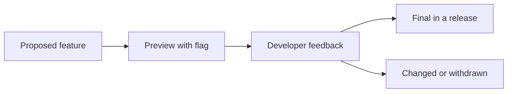

# Java 9 to 17 Features

!!! note "In simple words"
    From Java 9 to 17, Java added many small language and library improvements. Some arrived as "preview" features first, so people could try them and give feedback, before they became permanent. Most of them remove boilerplate you would otherwise type by hand.

## Why it matters

Between Java 9 and Java 17, Java moved to a fast, six-month release train. New features often shipped first as previews, then became final after feedback. Interviewers ask about these features to check three things: whether you know which features are final, which were preview, and what each one removes from the code you would otherwise write.

---

## How it works

### Release cadence and preview features

A feature can be marked **preview** in one release. Preview features are off by default. You need `--enable-preview` to compile and run them, and they can change or be removed. A feature becomes **final** only after one or more rounds of feedback. The table below lists the status points that matter in interviews.

| Feature | Preview | Final |
|---|---|---|
| Modules (JPMS) | - | Java 9 |
| `var` (local variable type inference) | - | Java 10 |
| `HttpClient` | incubator in 9 | Java 11 |
| `switch` expressions | Java 12 and 13 | Java 14 |
| Text blocks | Java 13 and 14 | Java 15 |
| Records | Java 14 and 15 | Java 16 |
| `instanceof` pattern matching | Java 14 and 15 | Java 16 |
| Sealed classes | Java 15 and 16 | Java 17 |
| Pattern matching for `switch` | Java 17 to 20 (several rounds) | Java 21 |



### Java 9: modules and private interface methods

The Java Platform Module System (JPMS) lets a library declare what it exports and what it needs. A `module-info.java` file sits at the root of a module. The fragment below shows its shape. It is not a complete program on its own.

```java
// module-info.java (a fragment for illustration)
module com.example.orders {
    requires java.sql;              // this module depends on java.sql
    exports com.example.orders.api; // other modules may use this package
}
```

Only exported packages are visible outside the module. Everything else is hidden, even if it is `public`. Modules are covered in more depth in [Java tools and utilities](../03c-tooling-utilities/java-tools-utilities.md).

Java 9 also allowed `private` methods in interfaces. A default method can share code through a private helper, and implementers never see that helper.

```java
public interface Logger {
    default void info(String message) {
        log("INFO", message);
    }

    default void warn(String message) {
        log("WARN", message);
    }

    private void log(String level, String message) {
        System.out.println("[" + level + "] " + message);
    }
}
```

Java 9 also added `Optional.ifPresentOrElse`, `Optional.or`, `Optional.stream`, and the `List.of`, `Set.of`, and `Map.of` factory methods for immutable collections.

### Java 10: local variable type inference (`var`)

`var` lets the compiler infer the type of a local variable from its initializer. It is not dynamic typing. The type is fixed at compile time, and a later assignment of the wrong type is still an error.

```java
import java.util.ArrayList;
import java.util.List;

public class VarDemo {
    public static void main(String[] args) {
        var names = new ArrayList<String>();   // inferred as ArrayList<String>
        names.add("ada");
        for (var name : names) {               // works in enhanced for loops
            System.out.println(name.length());
        }
        var count = 3;                         // int
        // count = "three";                    // compile error: incompatible types
        List<String> copy = List.copyOf(names);
        System.out.println(copy.size() + count);
    }
}
```

`var` works for local variables, for-loop variables, and lambda parameters (Java 11). It cannot be used for fields, method parameters, or return types. A local `var` needs an initializer.

### Java 11: HttpClient and new String methods

`java.net.http.HttpClient` is the standard HTTP client. It supports HTTP/1.1, HTTP/2, synchronous and asynchronous calls, and WebSocket. `HttpURLConnection` is legacy.

```java
import java.io.IOException;
import java.net.URI;
import java.net.http.HttpClient;
import java.net.http.HttpRequest;
import java.net.http.HttpResponse;

public class HttpDemo {
    public static void main(String[] args) throws IOException, InterruptedException {
        HttpClient client = HttpClient.newHttpClient();
        HttpRequest request = HttpRequest.newBuilder(URI.create("https://example.com/"))
                .GET()
                .build();
        HttpResponse<String> response = client.send(request, HttpResponse.BodyHandlers.ofString());
        System.out.println(response.statusCode());
    }
}
```

Java 11 also added these `String` methods:

| Method | Behaviour |
|---|---|
| `strip()` | Removes leading and trailing whitespace. Unlike `trim()`, it understands Unicode whitespace. |
| `isBlank()` | `true` when the string is empty or contains only whitespace. |
| `lines()` | Returns a `Stream<String>` split on line terminators. |
| `repeat(n)` | Repeats the string `n` times. |

```java
public class StringAdditions {
    public static void main(String[] args) {
        String text = "  alpha\n  beta  \n";
        text.lines().map(String::strip).forEach(System.out::println);
        System.out.println("ab".repeat(3));       // ababab
        System.out.println("   ".isBlank());      // true
    }
}
```

### Java 12 and 13: the first previews

Java 12 added two items that matter here. `Collectors.teeing` sends a stream to two collectors and merges their results with a function. `NumberFormat.getCompactNumberInstance` formats numbers such as `1.2K` or `3M`. Java 12 also introduced the first preview of `switch` expressions.

Java 13 previewed text blocks.

Check the official release notes for the exact details of these previews before you rely on them in an answer.

### Java 14: switch expressions and the CMS removal

`switch` became an expression in Java 14. It returns a value, uses `->` arms, and must be exhaustive when used as an expression. A `yield` statement returns a value from a block arm.

```java
public class SwitchExpr {
    enum Day { MON, TUE, SAT, SUN }

    static String kind(Day day) {
        return switch (day) {
            case SAT, SUN -> "weekend";
            case MON, TUE -> {
                String label = "weekday";
                yield label;
            }
        };
    }

    public static void main(String[] args) {
        System.out.println(kind(Day.SAT)); // weekend
        System.out.println(kind(Day.MON)); // weekday
    }
}
```

Java 14 also removed the Concurrent Mark Sweep (CMS) garbage collector. See [Garbage collection](../03b-jvm-internals/garbage-collection.md).

### Java 14 and 15: records and pattern matching previews

A record is a transparent, immutable data carrier. The compiler generates the constructor, the accessors, `equals`, `hashCode`, and `toString`. Records were a preview in 14 and 15, and became final in Java 16.

```java
public record Point(int x, int y) {
    public Point {                       // compact constructor for validation
        if (x < 0 || y < 0) {
            throw new IllegalArgumentException("negative coordinate");
        }
    }

    public double distanceFromOrigin() {
        return Math.sqrt(x * x + y * y);
    }
}
```

`instanceof` pattern matching removes the explicit cast after a type check. It was a preview in 14 and 15, and became final in Java 16.

```java
public class PatternInstanceof {
    static String describe(Object obj) {
        if (obj instanceof String s && !s.isBlank()) {
            return "non-blank string of length " + s.length();
        }
        return "something else";
    }

    public static void main(String[] args) {
        System.out.println(describe("hello")); // non-blank string of length 5
        System.out.println(describe(42));      // something else
    }
}
```

Java 15 finalised text blocks. A text block is a multi-line string literal, delimited by `"""`. The compiler strips common indentation, measured against the closing delimiter.

```java
public class TextBlockDemo {
    public static void main(String[] args) {
        String json = """
                {
                  "name": "ada",
                  "role": "engineer"
                }
                """;
        System.out.print(json);
    }
}
```

Java 15 also removed the Nashorn JavaScript engine, and it previewed sealed classes.

### Java 16: records and instanceof final

Java 16 made records and `instanceof` pattern matching final. It also added `Stream.toList()`, which returns an unmodifiable list. Finalising records is the change to name when someone asks what happened after the previews.

### Java 17: sealed classes

A sealed class or interface limits which classes may extend or implement it. The `permits` clause lists them. Each permitted subclass must be `final`, `sealed`, or `non-sealed`. The compiler then knows every subtype, so an exhaustive `switch` needs no `default` branch.

```java
sealed interface Shape permits Circle, Square {}

record Circle(double radius) implements Shape {}

record Square(double side) implements Shape {}

public class ShapeArea {
    static double area(Shape shape) {
        if (shape instanceof Circle c) {
            return Math.PI * c.radius() * c.radius();
        }
        if (shape instanceof Square s) {
            return s.side() * s.side();
        }
        throw new IllegalStateException("unknown shape"); // unreachable for these two types
    }

    public static void main(String[] args) {
        System.out.printf("%.2f%n", area(new Square(2.0))); // 4.00
    }
}
```

Records are implicitly `final`, so they satisfy the sealed subtype rule. Pattern matching for `switch` was a preview from Java 17 through Java 20 and became final in Java 21. That feature is covered in [Java 21 features](java21-features.md).

### Step by step: the release table

| Release | Headline items |
|---|---|
| 9 | JPMS modules, private interface methods, `List.of`, `Set.of`, `Map.of` |
| 10 | `var` |
| 11 | `HttpClient`, `String.strip`, `isBlank`, `lines`, `repeat` |
| 12 to 13 | Switch expression and text block previews, `Collectors.teeing`, compact number formatting |
| 14 | Switch expressions final, records and `instanceof` patterns in preview, CMS removed |
| 15 | Text blocks final, sealed classes preview, Nashorn removed, hidden classes |
| 16 | Records final, `instanceof` pattern matching final, `Stream.toList()` |
| 17 | Sealed classes final (LTS release) |

---

## Where it is used

- Records for DTOs, API responses, and value objects, such as a `Point` or a `Money` amount.
- Sealed interfaces for closed sets of results, such as `Success` and `Failure` types.
- Text blocks for embedded SQL, JSON samples, or HTML templates in tests.
- `HttpClient` for calling REST services without third-party libraries.
- `var` in code where the right-hand side already shows the type, such as `var list = new ArrayList<String>()`.

## Benefits

- Records remove the repetitive constructor, getter, `equals`, `hashCode`, and `toString` code.
- Pattern matching removes casts, which makes checks shorter and safer.
- Sealed types let the compiler verify that every case is handled.
- Text blocks and `String` helpers make text handling clearer.
- Switch expressions return values directly, so there is no need for a temporary variable.

## Cons and limits

- Preview features need a flag, and they can change or disappear, so do not depend on them in production.
- Records are shallowly immutable. A `List` field inside a record can still change.
- Sealed hierarchies must list every permitted type in one place, which means changes ripple through the permits list.
- Many of these features need Java 16 or 17 at least. Older runtimes cannot compile them.

### Common pitfalls

- Using `var` where the inferred type is hard to read. It reduces noise, but it should not hide meaning.
- Treating `var` as dynamic typing. The type is still checked at compile time.
- Using `trim()` when you want Unicode-aware whitespace removal. Use `strip()`.
- Forgetting that a record's fields are `final` and that the record class is `final`. Records are for values, not mutable state.
- Writing `permits` without matching modifiers. Each permitted class needs `final`, `sealed`, or `non-sealed`.
- Assuming a preview feature works in production. Preview needs `--enable-preview` and may change.
- Using `HttpURLConnection` in new code. Use `HttpClient`.

## Best practices

1. Use records for immutable data carriers, and validate in a compact constructor.
2. Use sealed interfaces with records to model a fixed set of cases.
3. Prefer `strip()`, `isBlank()`, and text blocks over manual string handling.
4. Use `Stream.toList()` for simple results, and `Collectors` when you need grouping.
5. Keep preview features out of production code.

!!! tip "Interview tip"
    **Q: Which Java version made records and sealed classes final?** Records became final in Java 16, and sealed classes in Java 17. Java 17 is an LTS release, so most production code that uses sealed types targets it or a later LTS.

## Quick recap

- Java 9 added modules, private interface methods, and immutable collection factories.
- `var` (Java 10) infers local variable types at compile time.
- `HttpClient` (Java 11) is the standard HTTP client. `String` gained `strip`, `isBlank`, `lines`, and `repeat`.
- Switch expressions (final in 14), text blocks (final in 15), records (final in 16), and sealed classes (final in 17) are the main final additions.
- Pattern matching removes casts after type checks, and sealed types make `switch` exhaustive.

## Official documentation

- [JEP index (OpenJDK)](https://openjdk.org/jeps/)
- [Java 21 API index](https://docs.oracle.com/en/java/javase/21/docs/api/index.html)
- [Java Language Specification, Java SE 21](https://docs.oracle.com/javase/specs/jls/se21/html/index.html)

**See also:** [Java 8 lambdas and streams](java8-lambdas-streams.md) - [Java 21 features](java21-features.md) - [Index](index.md)
