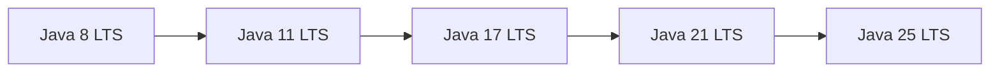

# Java LTS Versions and Migration

!!! note "In simple words"
    Java ships a new release about every six months, but only some releases get long-term support (LTS). Production systems should run an LTS version, and they should move up one LTS at a time, testing at each step.

## Why it matters

Teams need to know which Java version to run, which features made each LTS important, and how to move a codebase from one LTS to the next without breaking production. Interviewers ask these questions to see whether you can plan an upgrade, name the support dates that drive the decision, and find code that will break.

## How it works

### Release cadence and LTS

Java now follows a six-month release train, which began with Java 10. Only some releases are LTS, roughly one every two to three years. The LTS lines that matter most for interviews are 8, 11, 17, and 21. Java 25 is also an LTS, released in September 2025. Check the release notes for the version you target.

Feature releases that are not LTS receive updates only for a short overlap period. Production systems should therefore sit on an LTS line.



### Support windows

The table uses Oracle's published support dates for Oracle JDK builds. Oracle's support roadmap is the source of truth, and it changes, so check [Oracle's Java SE support roadmap](https://www.oracle.com/java/technologies/java-se-support-roadmap.html) before you rely on a date. Vendors such as Eclipse Temurin, Amazon Corretto, and Microsoft build OpenJDK on their own schedules, which are often longer.

| LTS | Released | Oracle extended support ends | Notes |
|---|---|---|---|
| Java 8 | March 2014 | December 2030 | Oracle's 2024 statement |
| Java 11 | September 2018 | January 2032 | Premier support ended September 2023 |
| Java 17 | September 2021 | September 2029 | Oracle waives the extended-support fee from October 2026 |
| Java 21 | September 2023 | See the roadmap | Premier end date not confirmed here |
| Java 25 | September 2025 | See the roadmap | LTS from most vendors, general availability 16 September 2025 |

Java 11 is still in Oracle's extended support, but a newer LTS is the better choice for new production work. Use Java 21 or 25 for a new service.

### Release timeline

The timeline lists the features an interviewer is most likely to ask about. Preview features are marked, because they are not part of the language until they are final.

| Version | Year | Headline features |
|---|---|---|
| 1.0 | 1996 | Classes, objects, interfaces, and the JVM |
| 1.2 | 1998 | Collections Framework, Swing |
| 1.4 | 2002 | `assert`, regular expressions, NIO |
| 5 | 2004 | Generics, enums, autoboxing, enhanced `for`, annotations |
| 7 | 2011 | try-with-resources, diamond operator, multi-catch |
| 8 | 2014 | Lambdas, Stream API, `java.time`, default methods (LTS) |
| 9 | 2017 | Module system (JPMS), JShell, private interface methods |
| 10 | 2018 | `var` for local variable type inference; first release on the six-month train |
| 11 | 2018 | Standard HTTP client, single-file source launch, Java EE modules removed (LTS) |
| 14 | 2020 | Switch expressions standard, records and `instanceof` patterns as previews |
| 15 | 2020 | Text blocks standard, Nashorn removed, sealed classes as preview |
| 16 | 2021 | Records standard, `instanceof` pattern matching standard |
| 17 | 2021 | Sealed classes standard, strong encapsulation of JDK internals (LTS) |
| 18 | 2022 | UTF-8 as the default charset |
| 19 | 2022 | Record patterns and `switch` patterns as previews |
| 21 | 2023 | Virtual threads, record patterns, `switch` pattern matching, sequenced collections (LTS) |
| 22 | 2024 | Foreign Function and Memory API and unnamed variables finalized |
| 23 | 2024 | String templates withdrawn; primitive types in patterns as a preview |

Two removals are worth remembering. CMS, the old concurrent collector, was removed in Java 14. Nashorn, the JavaScript engine, was deprecated in 11 and removed in 15.

## Migration path: 8, 11, 17, 21

Migrate one LTS at a time: 8 to 11, then 11 to 17, then 17 to 21. Each step is smaller than a jump across several versions, and it gives you a clear point to test and roll back.

### Java 8 to Java 11 (lowest effort)

**What breaks**

- The Java EE and CORBA modules were removed (JEP 320). This includes JAXB, JAX-WS, and the JavaBeans Activation Framework. Add them back as separate libraries if your code uses them.
- The `rmic` tool was removed. RMI itself remains in the JDK.
- Nashorn is deprecated, and it is removed in 15. Plan a replacement if you embed JavaScript.

**What works without change**

- Lambdas and streams keep the same API.
- `var` is available but optional.
- The threading model is unchanged.

Replacing an old URL-reading idiom with the standard HTTP client is a common first change:

```java
import java.io.IOException;
import java.net.URI;
import java.net.http.HttpClient;
import java.net.http.HttpRequest;
import java.net.http.HttpResponse;

public class FetchPage {
    public static void main(String[] args) throws IOException, InterruptedException {
        HttpClient client = HttpClient.newHttpClient();
        HttpRequest request = HttpRequest.newBuilder(URI.create("https://example.com/")).build();
        HttpResponse<String> response = client.send(request, HttpResponse.BodyHandlers.ofString());
        System.out.println(response.statusCode());
    }
}
```

### Java 11 to Java 17 (moderate effort)

**What breaks**

- Strong encapsulation: code that reflects into JDK internals, such as private fields in `java.base`, fails. The `--illegal-access` flag that allowed this was removed in 17. `sun.misc.Unsafe` remains reachable through the `jdk.unsupported` module, so check your warnings rather than assume it is gone.
- Code that depends on removed APIs needs a replacement.

**What is new and worth adopting**

- Records (standard in 16) replace hand-written data classes.
- `instanceof` pattern matching (standard in 16) removes a cast after a type check.
- Sealed classes (standard in 17) restrict which classes may extend a type.
- Text blocks (standard in 15) make multi-line strings readable.

```java
public record User(String name, int age) { }

class Greeting {
    static String describe(Object obj) {
        if (obj instanceof User user) {          // pattern variable, no cast
            return user.name() + " (" + user.age() + ")";
        }
        return "not a user";
    }
}
```

Record deconstruction patterns, such as `obj instanceof User(String name, int age)`, are a Java 21 feature. They do not compile on 17.

To find code that touches JDK internals, run the dependency analyzer on the built jar:

```bash
jdeps -jdkinternals myapp.jar
```

### Java 17 to Java 21 (low effort)

**What breaks**

- Very little. Java 21 is largely source-compatible with 17, so most of the work is testing rather than repair.

**What is new**

- Virtual threads (final in 21) are lightweight threads scheduled by the JVM. They suit I/O-bound code where each request blocks while it waits.
- Record patterns and `switch` pattern matching (final in 21) handle nested data cleanly. Sealed types let the compiler check that a `switch` is exhaustive.
- Sequenced collections give a common API for the first and last element of ordered collections.

A thread-per-task executor shows the change in style:

```java
import java.time.Duration;
import java.util.concurrent.ExecutorService;
import java.util.concurrent.Executors;
import java.util.stream.IntStream;

public class VirtualThreadsDemo {
    public static void main(String[] args) {
        try (ExecutorService executor = Executors.newVirtualThreadPerTaskExecutor()) {
            IntStream.range(0, 10_000).forEach(i ->
                executor.submit(() -> {
                    Thread.sleep(Duration.ofMillis(100));   // blocking call, cheap on a virtual thread
                    return i;
                }));
        }   // close() waits for all submitted tasks
    }
}
```

A fixed pool of platform threads limits how many blocking tasks run at once. A virtual thread that blocks costs little, so the pool bound goes away.

Two cautions for Java 21 adoption:

- Virtual threads help blocking I/O. They do not make CPU-bound code faster.
- In Java 21, a virtual thread that blocks inside a `synchronized` block pins its carrier thread. Prefer `ReentrantLock` in hot blocking paths, and check the JDK release notes for later fixes.

## Decision guide

- New project: start on the newest LTS that your frameworks and libraries support. At the time of writing, that is Java 25 or Java 21, depending on framework support.
- Existing Java 8 service: move to 11 first, test, then continue to 17 and 21.
- Latency-sensitive I/O service: 21 or later, with virtual threads, is the strongest option.
- Need sealed hierarchies and exhaustive pattern matching: 17 is the minimum.

## Migration practice

1. Compile with the target release, using `--release` for `javac` or `<maven.compiler.release>` in Maven. The compiler then rejects APIs that are not in the target.
2. Run the full test suite and any integration tests on the new JDK.
3. Scan for internal API use with `jdeps`.
4. Run the new version in staging with production-like load. Compare latency and GC behaviour, not only pass or fail.
5. Roll out gradually, and keep the old JDK available until the new one has run cleanly.

### Troubleshooting

- `NoSuchMethodError` at run time, for an API that exists in the source, often means the code was compiled with a newer JDK than the runtime. Compile with `--release` set to the runtime version.
- `InaccessibleObjectException` or an illegal reflective access error means code reflects into JDK internals. Replace the call with a public API, or open the package explicitly as a last resort.
- `NoClassDefFoundError` for `javax.xml.bind` or a similar class means a module was removed. Add the replacement library. Jakarta EE 9 and later use `jakarta.*` package names.

### Step by step: the upgrade path

1. Choose the target LTS and the framework versions that support it.
2. Upgrade one LTS at a time, starting from your current release.
3. At each step, compile with `--release`, run tests, scan with `jdeps`, and load-test in staging.
4. Roll out and keep a rollback path until the new runtime is proven.

## Where it is used

- Long-lived services that stay on one LTS for several years.
- Libraries that publish a minimum supported Java version, often 8, 11, or 17.
- Container base images, which pin a JDK LTS for every service built from them.
- Platform teams that run one upgrade programme across many services.

## Benefits

- LTS releases receive security and bug fixes for years, which reduces upgrade pressure.
- Each step adds language and library features, such as records, pattern matching, and virtual threads.
- Migrating one step at a time keeps each change small and easy to test.
- The JDK's compile flags and analysis tools catch many problems before deployment.

## Cons and limits

- Vendors differ in support dates, so the Oracle table is only one view.
- Libraries and frameworks can lag behind the newest JDK, and that limits the target version.
- Strong encapsulation can break reflection-heavy code, sometimes in ways that surface only at run time.
- Skipping LTS releases means facing several breaking changes at once.

### Common pitfalls

- Running a non-LTS release in production after its support window has ended.
- Compiling with a newer JDK than the runtime, which causes `NoSuchMethodError` at run time.
- Forgetting that `javax.*` and `jakarta.*` packages are different and not interchangeable.
- Testing only on the new JDK without a load test, which hides latency and GC changes.
- Moving straight from 8 to 21 without checking for removed APIs.

## Best practices

1. Pin the JDK version in build files, and compile with `--release`.
2. Read the vendor's support dates for the distribution you use.
3. Scan for internal API use with `jdeps` before each upgrade.
4. Upgrade one LTS at a time, and keep the previous JDK available for rollback.
5. Adopt new language features gradually, after the upgrade is stable.

!!! tip "Interview tip"
    **Q: Which LTS would you choose for a new service, and why?** Pick the newest LTS that your frameworks support. That is currently Java 25 or Java 21, depending on framework support. It gives records, sealed types, pattern matching, and virtual threads. If the team is stuck on Java 8, the upgrade path is 8 to 11 to 17 to 21, testing at each step. Name the support end date in your answer, because it decides how long you can run without an upgrade.

## Quick recap

- LTS releases are 8, 11, 17, and 21 in the interview canon. Java 25 is a later LTS that follows the same model.
- Java 11 removed the Java EE and CORBA modules. Nashorn was removed in 15.
- Records, `instanceof` pattern matching, sealed classes, and text blocks arrived between 15 and 17.
- Record deconstruction patterns and `switch` patterns are Java 21 features. Virtual threads are final in 21.
- Migrate one LTS at a time, compile with `--release`, and check for internal API use with `jdeps`.

## Official documentation

- [dev.java (Java developer site)](https://dev.java/)
- [JEP index (OpenJDK)](https://openjdk.org/jeps/)
- [Java 21 API index](https://docs.oracle.com/en/java/javase/21/docs/api/index.html)

**See also:** [Java Overview and Platform](../01-programming-basics/java-overview-platform.md), [Java 9 to 17 Features](java9-to-17-features.md), [Java 21 Features](java21-features.md), [Optional and Functional Interfaces](optional-functional-interfaces.md)
