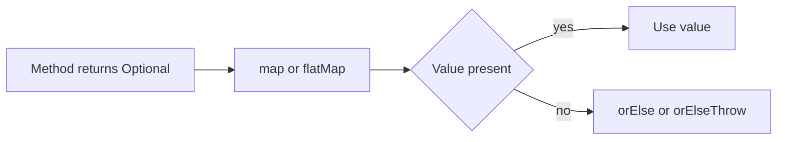

# Optional and Functional Interfaces

!!! note "In simple words"
    `Optional` is a box that holds either a value or nothing, so a method can say "this might be missing" in its return type. A functional interface is a type that a lambda can fill in, and the `java.util.function` package gives you the standard ones.

## Why it matters

Returning `null` forces every caller to remember a null check, and a forgotten check fails at runtime, often far from its cause. `Optional` moves that case into the method signature. The functional interfaces in `java.util.function` are the targets that lambdas and method references are written against. Interviewers ask about both to test null-safe API design and fluent stream code.

---

## How it works

### Why Optional exists

`Optional` is meant as a return type, not as a field, a parameter, or a replacement for every reference.

```java
import java.util.Map;
import java.util.Optional;

public class FindUser {
    static final Map<Integer, String> USERS = Map.of(1, "ada", 2, "linus");

    static Optional<String> findName(int id) {
        return Optional.ofNullable(USERS.get(id));
    }

    public static void main(String[] args) {
        System.out.println(findName(1).orElse("unknown")); // ada
        System.out.println(findName(9).orElse("unknown")); // unknown
    }
}
```

### Creating an Optional

| Factory | Use it when |
|---|---|
| `Optional.of(value)` | The value is known not to be null. Throws `NullPointerException` otherwise. |
| `Optional.ofNullable(value)` | The value may be null. |
| `Optional.empty()` | You need an explicitly empty result. |

### Reading an Optional

Prefer methods that state the intent over `isPresent()` followed by `get()`.

| Method | Behaviour |
|---|---|
| `orElse(x)` | Returns the value or `x`. `x` is always evaluated. |
| `orElseGet(supplier)` | Returns the value or the supplier's result. The supplier runs only when empty. |
| `orElseThrow()` | Returns the value or throws `NoSuchElementException`. The no-argument form came in Java 10. |
| `orElseThrow(supplier)` | Returns the value or throws the exception that the supplier builds. |
| `ifPresent(consumer)` | Runs the consumer when a value exists. |
| `ifPresentOrElse(consumer, runnable)` | Java 9. Runs one of two actions. |
| `map(function)` | Transforms the value. Returns an empty `Optional` if the result is null. |
| `flatMap(function)` | Use when the function itself returns an `Optional`. |
| `filter(predicate)` | Keeps the value only if it matches. |
| `or(supplier)` | Java 9. Supplies an alternative `Optional`. |
| `stream()` | Java 9. A present value becomes a one-element stream; an empty one becomes an empty stream. |

```java
import java.util.Optional;

public class OptionalChain {
    record Address(String city) {}
    record User(Address address) {}

    static Optional<String> cityOf(User user) {
        return Optional.ofNullable(user)
                .map(User::address)       // may return null, which becomes empty
                .map(Address::city);
    }

    public static void main(String[] args) {
        System.out.println(cityOf(new User(new Address("Pune")))); // Optional[Pune]
        System.out.println(cityOf(null).orElse("no city"));        // no city
    }
}
```

### Lazy versus eager fallbacks

`orElse` evaluates its argument even when a value is present. If building the fallback is expensive or has side effects, use `orElseGet`.

```java
import java.util.Optional;

public class EagerVsLazy {
    static String expensiveDefault() {
        System.out.println("building default");
        return "default";
    }

    public static void main(String[] args) {
        Optional<String> value = Optional.of("present");
        value.orElse(expensiveDefault());                // prints "building default"
        value.orElseGet(EagerVsLazy::expensiveDefault);  // prints nothing
    }
}
```

---

## Functional interfaces

A functional interface has exactly one abstract method, its single abstract method (SAM). A lambda or method reference can be written wherever one is expected. A functional interface may also have any number of `default` and `static` methods, and those carry much of the design value. The `@FunctionalInterface` annotation makes the compiler enforce the single-method rule.

### The four main shapes

Most interfaces in `java.util.function` fall into four shapes.

| Shape | Interface | Method | Typical use |
|---|---|---|---|
| Takes input, returns nothing | `Consumer<T>` | `void accept(T t)` | `forEach`, logging, saving |
| Takes input, returns a boolean | `Predicate<T>` | `boolean test(T t)` | `filter`, `anyMatch`, rules |
| Takes input, returns output | `Function<T, R>` | `R apply(T t)` | `map`, transforming values |
| Takes nothing, returns output | `Supplier<T>` | `T get()` | `orElseGet`, lazy creation |

**Consumer** runs an action. `andThen` chains two consumers, so both see the same input.

```java
import java.util.List;
import java.util.function.Consumer;

public class ConsumerDemo {
    public static void main(String[] args) {
        Consumer<String> log = s -> System.out.println("log: " + s);
        Consumer<String> save = s -> System.out.println("save: " + s);

        log.andThen(save).accept("order 7");   // log: order 7, then save: order 7
        List.of("a", "b").forEach(log);
    }
}
```

**Predicate** tests a value. `and`, `or`, and `negate` build new predicates from existing ones without changing the originals.

```java
import java.util.List;
import java.util.function.Predicate;

public class PredicateDemo {
    public static void main(String[] args) {
        Predicate<Integer> isEven = n -> n % 2 == 0;
        Predicate<Integer> isPositive = n -> n > 0;

        List<Integer> numbers = List.of(-2, -1, 0, 1, 2, 3, 4);
        System.out.println(numbers.stream().filter(isEven.and(isPositive)).toList()); // [2, 4]

        Predicate<String> startsWithA = s -> s.startsWith("A");
        System.out.println(List.of("Angela", "Bob", "Claire").stream()
                .filter(startsWithA.negate())
                .toList());                                                            // [Bob, Claire]
    }
}
```

**Function** transforms a value. `andThen` runs this function first and the argument second. `compose` runs in the reverse order. `Function.identity()` returns its input unchanged, which is handy for keys in `toMap` and `groupingBy`.

```java
import java.util.function.Function;

public class FunctionDemo {
    public static void main(String[] args) {
        Function<String, String> trim = String::trim;
        Function<String, Integer> length = String::length;

        System.out.println(trim.andThen(length).apply("  ada ")); // 3
        System.out.println(length.compose(trim).apply("  ada ")); // 3
        System.out.println(Function.<String>identity().apply("same")); // same
    }
}
```

**Supplier** produces values on demand. The supplier decides when the work happens, so a supplier is the right tool for lazy creation. The memoizing helper below runs its source once and returns the saved value afterwards.

```java
import java.util.function.Supplier;

public class Memoize {
    static <T> Supplier<T> memoize(Supplier<T> source) {
        return new Supplier<T>() {
            private T value;
            private boolean computed;

            @Override
            public T get() {
                if (!computed) {
                    value = source.get();
                    computed = true;
                }
                return value;
            }
        };
    }

    public static void main(String[] args) {
        Supplier<String> config = memoize(() -> {
            System.out.println("loading");   // printed once
            return "settings";
        });
        System.out.println(config.get());    // loading, then settings
        System.out.println(config.get());    // settings
    }
}
```

This helper is not thread-safe. Two threads calling `get` at the same moment could both run the source. Use a lock, or a library class, when the supplier is shared across threads.

### Binary operations

`BiFunction<T, U, R>` takes two inputs and returns one output. Its `andThen` adds a step after the result. Two specialisations fix the types so that both inputs and the output match:

- `BinaryOperator<T>` extends `BiFunction<T, T, T>`. It is the type `reduce` expects.
- `UnaryOperator<T>` extends `Function<T, T>`. It is the type `replaceAll` and `Stream.iterate` expect.

```java
import java.util.Comparator;
import java.util.function.BiFunction;
import java.util.function.BinaryOperator;

public class BinaryDemo {
    public static void main(String[] args) {
        BiFunction<Integer, Integer, Integer> add = (a, b) -> a + b;
        BiFunction<Integer, Integer, String> described = add.andThen(r -> "sum=" + r);

        System.out.println(add.apply(2, 3));        // 5
        System.out.println(described.apply(2, 3));  // sum=5

        BinaryOperator<Integer> max = BinaryOperator.maxBy(Comparator.naturalOrder());
        System.out.println(max.apply(4, 9));        // 9
    }
}
```

Primitive variants such as `IntPredicate`, `ToIntFunction`, and `IntBinaryOperator` avoid boxing in numeric pipelines.

### Writing your own functional interface

Write a custom interface when the same small operation keeps appearing. Default methods let it compose, and it stays a valid lambda target.

```java
@FunctionalInterface
interface Operation<T> {
    T execute(T input);                       // the single abstract method

    default Operation<T> andThen(Operation<T> next) {
        return input -> next.execute(execute(input));
    }

    default Operation<T> repeat(int times) {
        return input -> {
            T result = input;
            for (int i = 0; i < times; i++) {
                result = execute(result);
            }
            return result;
        };
    }

    static <T> Operation<T> identity() {
        return t -> t;
    }
}

public class OperationDemo {
    public static void main(String[] args) {
        Operation<Integer> doubleIt = n -> n * 2;
        Operation<Integer> addFive = n -> n + 5;

        System.out.println(doubleIt.andThen(addFive).execute(3));     // 11
        System.out.println(doubleIt.repeat(4).execute(1));            // 16
        System.out.println(Operation.<Integer>identity().execute(7)); // 7
    }
}
```

### More default-method patterns

The next block shows four patterns: a fallback (`orElse`), a varargs chain (`chain`), a default for missing results (`withDefault`), and two caching variants (`memoize`).

```java
import java.util.Map;
import java.util.concurrent.ConcurrentHashMap;
import java.util.function.Supplier;

@FunctionalInterface
interface Step<T> {
    T apply(T input) throws Exception;

    // Fallback: if this step fails, run the other step on the same input
    default Step<T> orElse(Step<T> fallback) {
        return input -> {
            try {
                return apply(input);
            } catch (Exception e) {
                return fallback.apply(input);
            }
        };
    }

    // Chain any number of steps, applied left to right
    @SafeVarargs
    static <T> Step<T> chain(Step<T>... steps) {
        return input -> {
            T result = input;
            for (Step<T> step : steps) {
                result = step.apply(result);
            }
            return result;
        };
    }
}

@FunctionalInterface
interface Source<T> {
    T provide();

    // Replace a null result with a fallback value
    default Source<T> withDefault(T fallbackValue) {
        return () -> {
            T value = provide();
            return value != null ? value : fallbackValue;
        };
    }
}

@FunctionalInterface
interface Compute<A, R> {
    R apply(A arg);

    // Variant 1: a function that caches its result for each argument
    default Compute<A, R> memoize() {
        Map<A, R> cache = new ConcurrentHashMap<>();
        return arg -> cache.computeIfAbsent(arg, this::apply);
    }
}

final class Once {
    private Once() { }

    // Variant 2: a supplier that runs its source once, on the first call
    static <T> Supplier<T> memoize(Supplier<T> source) {
        return new Supplier<T>() {
            private boolean done;
            private T value;

            @Override
            public synchronized T get() {
                if (!done) {
                    value = source.get();
                    done = true;
                }
                return value;
            }
        };
    }
}

public class DefaultMethodDemo {
    public static void main(String[] args) throws Exception {
        Step<Integer> doubleIt = n -> n * 2;
        Step<Integer> addOne = n -> n + 1;
        System.out.println(Step.chain(doubleIt, addOne, doubleIt).apply(3)); // ((3 * 2) + 1) * 2 = 14

        Step<Integer> risky = n -> {
            if (n < 0) {
                throw new IllegalArgumentException("negative input");
            }
            return n;
        };
        System.out.println(risky.orElse(n -> 0).apply(-5)); // 0

        Source<String> missing = () -> null;
        System.out.println(missing.withDefault("guest").provide()); // guest

        Compute<Integer, Integer> slowSquare = n -> {
            System.out.println("computing " + n);
            return n * n;
        };
        Compute<Integer, Integer> cached = slowSquare.memoize();
        System.out.println(cached.apply(4)); // prints "computing 4", then 16
        System.out.println(cached.apply(4)); // 16, with no recomputation

        Supplier<String> config = Once.memoize(() -> {
            System.out.println("loading config");
            return "loaded";
        });
        System.out.println(config.get()); // prints "loading config", then loaded
        System.out.println(config.get()); // loaded
    }
}
```

Points to remember with these patterns:

- `orElse` catches every `Exception`, including bugs. Narrow the catch in real code.
- A memoized function is correct only when its result depends solely on its argument. The cache here grows without limit, and `ConcurrentHashMap` rejects `null` arguments.

### Rules that decide whether an interface is functional

- Exactly one abstract method. Default and static methods do not count.
- Redeclaring a public `Object` method, such as `equals`, as abstract does not count. The interface below is still functional.

```java
@FunctionalInterface
interface Transform {
    String run(String s);            // the one abstract method

    @Override
    boolean equals(Object o);        // redeclares Object's method; does not count

    default Transform twice() {
        return s -> run(run(s));
    }
}

// Does not compile with @FunctionalInterface: two abstract methods.
// @FunctionalInterface
// interface TooMany {
//     String run(String s);
//     void validate(String s);
// }
```

### Step by step: what happens inside

1. A method returns `Optional<T>` to say that the result may be missing.
2. The caller transforms it with `map` or `flatMap`. These do nothing when the value is empty.
3. The caller finishes with `orElse`, `orElseGet`, or `orElseThrow`, choosing a default, a lazy default, or an exception.
4. A lambda or method reference is converted to a functional interface where it is passed. The interface's default methods then build the composed behaviour.



---

## Where it is used

- Repository lookups that may find no row, and configuration getters with defaults.
- Stream pipelines that finish with `findFirst` or `max`.
- Callbacks and strategies passed as `Predicate`, `Function`, or `Supplier` values.

## Benefits

- The signature shows that a result can be missing, so callers handle that case.
- Chains of `map` and `orElse` replace nested null checks.
- Default methods let a functional interface offer composition, such as `and`, `negate`, and `andThen`.

## Cons and limits

- `Optional` adds an allocation, which matters only in very hot code.
- `Optional` is not `Serializable`, so keep it out of serialized data.
- Heavy lambda composition can make stack traces harder to read.
- A `Supplier` memoizer is not thread-safe unless you add synchronization.

### Common pitfalls

- Calling `get()` without checking. Use `orElseThrow()` so the failure is explicit.
- Using `Optional` as a field, a method parameter, or a collection element.
- Using `orElse` with an expensive or side-effecting argument. Use `orElseGet`.
- Writing `opt.isPresent() ? opt.get() : x` when `orElse` says the same thing.
- Returning `Optional` from a method that returns a collection. Return an empty list instead.
- Confusing `map` and `flatMap`. If the mapping function returns `Optional`, `map` gives `Optional<Optional<T>>`.
- Adding a second abstract method to a `@FunctionalInterface` interface. Keep extra behaviour in default methods.
- Using a shared memoizing supplier across threads without synchronization.

## Best practices

1. Return `Optional` where absence is a normal outcome, and keep it out of fields and parameters.
2. Prefer `orElseThrow()` over `get()`, and `orElseGet` over `orElse` when the fallback costs something.
3. Use the standard functional interface that matches the shape, and write your own only when a pattern keeps repeating.

!!! tip "Interview tip"
    **Q: Why not return null instead of Optional?** `Optional` puts the empty case in the signature, so the compiler and the reader both see it. A null return depends on documentation and discipline. Keep `Optional` for return values, and do not use it to hide every null in the codebase.

    **Q: What is the difference between `Function` and `UnaryOperator`?** `UnaryOperator<T>` is a `Function<T, T>` where input and output have the same type. Use it when a step turns a value into the same kind of value, such as `String::trim`.

## Quick recap

- `Optional` is a return-type tool for "a value might be missing".
- Use `orElseGet` for expensive fallbacks, and `orElseThrow` for failures.
- `map` transforms a value. `flatMap` suits functions that already return an `Optional`.
- Consumer, Predicate, Function, and Supplier cover most lambda targets. Their default methods (`andThen`, `and`, `negate`, `compose`) let you build pipelines from small pieces.
- `BinaryOperator` and `UnaryOperator` fix the types so that a reduction or a same-type transform fits.
- A functional interface has one abstract method. Default and static methods are free to add.

## Official documentation

- [Java 21 API index (includes java.util.function and java.util.Optional)](https://docs.oracle.com/en/java/javase/21/docs/api/index.html)
- [java.util.stream package (Java 21 API)](https://docs.oracle.com/en/java/javase/21/docs/api/java.base/java/util/stream/package-summary.html)
- [Java Language Specification, Java SE 21](https://docs.oracle.com/javase/specs/jls/se21/html/index.html)

**See also:** [Java 8 lambdas and streams](java8-lambdas-streams.md) - [Java 21 features](java21-features.md) - [Java 9 to 17 features](java9-to-17-features.md) - [Index](index.md)
