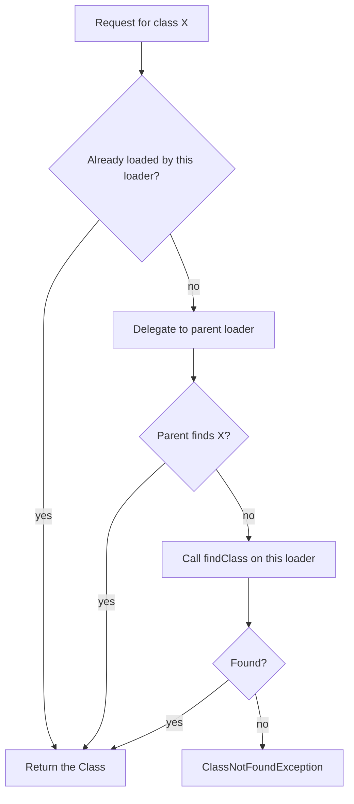

# Class Loading

Class loading is the process that turns a `.class` file into a `Class` object the JVM can use. Interviewers ask about it to check whether you understand the class loader hierarchy, why the same class name can behave differently in two loaders, and why you see `ClassNotFoundException` in one place and `NoClassDefFoundError` in another.

---

## Core concepts

### The class lifecycle

A class goes through these phases before its code runs:

1. **Loading:** a class loader finds the bytes (from a jar, a directory, the network, or generated code) and creates a `Class` object.
2. **Linking:** three steps:
   - **Verification** checks that the bytecode is safe (types match, no illegal jumps, stack is consistent).
   - **Preparation** allocates static fields and sets them to default values (`0`, `null`, `false`). Constant values are assigned here.
   - **Resolution** replaces symbolic references (names) with direct references. It can happen lazily, when the reference is first used.
3. **Initialisation:** static initialisers and static field assignments run, in textual order. This happens the first time the class is actively used.

```java
public class InitOrder {
    static class Config {
        static { System.out.println("Config initialised"); }
        static final String NAME = "app";     // compile-time constant: reading it does not initialise Config
        static int version = 1;               // ordinary static field: reading it triggers initialisation
    }

    public static void main(String[] args) {
        System.out.println("Name: " + Config.NAME);
        System.out.println("Version: " + Config.version);
    }
}
```

Output:

```text
Name: app
Config initialised
Version: 1
```

The constant `NAME` is inlined by `javac`, so the JVM never touches `Config` to read it. That surprises many people.

### The three built-in class loaders

| Loader | Java class | Loads | Parent |
|---|---|---|---|
| Bootstrap | (none; represented as `null`) | Core classes such as `java.lang.String` and the modules of the JDK base | None |
| Platform | `jdk.internal.loader.ClassLoaders$PlatformClassLoader` | Platform modules such as `java.sql` | Bootstrap |
| Application (system) | `jdk.internal.loader.ClassLoaders$AppClassLoader` | Your classes on the class path or module path | Platform |

Naming history: the middle loader was called the **Extension** class loader before Java 9. Java 9 renamed it to the **Platform** class loader when the module system was introduced. Older articles and interview answers may still use the old name.

```java
public class LoaderChain {
    public static void main(String[] args) {
        ClassLoader app = LoaderChain.class.getClassLoader();
        System.out.println("Application loader: " + app);
        System.out.println("Parent (platform): " + app.getParent());
        System.out.println("Grandparent (bootstrap): " + app.getParent().getParent());
        System.out.println("String is loaded by: " + String.class.getClassLoader());
    }
}
```

The bootstrap loader returns `null` from `getClassLoader()`, which is why `String` shows `null`.

### Parent delegation

When a loader is asked for a class, it does not look first in its own location. It asks its parent, then falls back to itself. The rule:

1. If the loader has already loaded the class, return it.
2. Otherwise, delegate the request to the parent.
3. If the parent cannot find it, call `findClass` on this loader.

This means core classes such as `java.lang.String` always come from the bootstrap loader. A user cannot replace them by putting a class with the same name on the class path, which protects the platform.



### Writing a custom class loader

You rarely need a custom loader, but application servers, plug-in systems, and test frameworks use them. The usual pattern is to override `findClass` and leave delegation in place.

```java
import java.io.IOException;
import java.nio.file.Files;
import java.nio.file.Path;

public class DirectoryClassLoader extends ClassLoader {
    private final Path dir;

    public DirectoryClassLoader(Path dir, ClassLoader parent) {
        super(parent);
        this.dir = dir;
    }

    @Override
    protected Class<?> findClass(String name) throws ClassNotFoundException {
        Path file = dir.resolve(name.replace('.', '/') + ".class");
        try {
            byte[] bytes = Files.readAllBytes(file);
            return defineClass(name, bytes, 0, bytes.length);
        } catch (IOException e) {
            throw new ClassNotFoundException(name, e);
        }
    }
}
```

Because the parent is asked first, `findClass` runs only for classes that the parent cannot find. A class loaded by this loader is a different `Class` object from the same-named class loaded by another loader, even though the bytes are identical.

### Namespaces: same name, different class

The identity of a runtime class is the pair (fully qualified name, defining class loader). Two loaders can define `com.example.Plugin` and get two unrelated classes. Casting one to the other throws `ClassCastException`, even though the names match. This is the most common source of confusing errors in plug-in and redeploy scenarios.

### Errors you will see

| Exception | When | Typical cause |
|---|---|---|
| `ClassNotFoundException` | Loading by name fails (`Class.forName`, `loader.loadClass`) | A class is missing from the class path at runtime |
| `NoClassDefFoundError` | A class was present at compile time but is missing or failed to initialise at runtime | Missing jar in the run configuration, or an exception in a static initialiser |
| `ExceptionInInitializerError` | A static initialiser threw an exception | Bad static configuration or a missing resource |
| `UnsatisfiedLinkError` | A native method cannot be linked | Missing native library |

`ClassNotFoundException` is a checked exception. `NoClassDefFoundError` is an `Error`, so you should not catch it in normal code.

### Loading without initialising

`Class.forName(name)` loads and initialises the class. The overload with `false` loads and links it without running static initialisers:

```java
Class<?> c = Class.forName("java.sql.Driver", false, ClassLoader.getSystemClassLoader());
```

JDBC drivers used to rely on this kind of static initialisation to register themselves. Modern drivers use the service loader instead (see the [Java Tools and Utilities](../03c-tooling-utilities/java-tools-utilities.md) notes for how modules expose services).

---

## How it works / Step by step

1. The JVM starts and creates the bootstrap loader, which loads core classes.
2. The platform and application loaders are created. The application loader's class path comes from `-cp` or the manifest.
3. `main` is requested through the application loader. It delegates upward first, then loads the class itself.
4. When code first refers to another class, the same process runs. Loading and linking happen, then initialisation runs the static initialisers.
5. Loaded classes stay in the loader until it is garbage collected. A loader is collected only when none of its classes or objects are reachable.

---

## Common pitfalls

- Expecting a class in your jar to override a JDK class. Parent delegation prevents it. Core packages such as `java.*` cannot be replaced this way.
- Treating `ClassNotFoundException` and `NoClassDefFoundError` as the same. One is a failed lookup by name; the other is a missing class during execution after compilation succeeded.
- Assuming that reading a `static final` constant initialises the class. Compile-time constants are inlined.
- Redeploying a web app without releasing the old class loader. Threads, `ThreadLocal`s, or static caches keep the old classes alive and leak Metaspace.
- Comparing classes from two loaders with `==` or casting them, then being surprised by `ClassCastException`.
- Using the old name "Extension class loader" in a Java 9+ discussion without explaining the rename.

!!! tip "Interview tip"
    **Q: What is parent delegation and why does Java use it?**
    Before a loader defines a class, it asks its parent to load it. The request goes up to the bootstrap loader first, and each loader only tries its own location when the parent cannot find the class. This keeps core classes such as `java.lang.String` consistent across the application and stops user code from replacing them by accident or on purpose.

    **Follow-up: Why does a class loaded by two loaders not match?**
    Runtime class identity is the class name plus the defining loader. Two loaders produce two distinct `Class` objects, so casts and `instanceof` checks between them fail. This matters in plug-in systems and in redeployed web applications.

## Quick recap

- Class loading has three phases: loading, linking (verification, preparation, resolution), and initialisation.
- The three built-in loaders are Bootstrap (core), Platform (formerly Extension, renamed in Java 9), and Application (your code).
- Parent delegation asks the parent loader first, which protects core classes.
- A class's runtime identity includes its loader, so the same name from two loaders is two different classes.
- `ClassNotFoundException` is a failed lookup; `NoClassDefFoundError` is a class missing or broken at runtime.

**See also:** [JVM Architecture and Memory](jvm-architecture-memory.md) (Metaspace holds loaded class metadata), [Garbage Collection](garbage-collection.md) (loader leaks), [JIT Compilation and Performance Tools](jit-and-performance-tools.md) (Class Data Sharing), [JVM Internals index](index.md)
