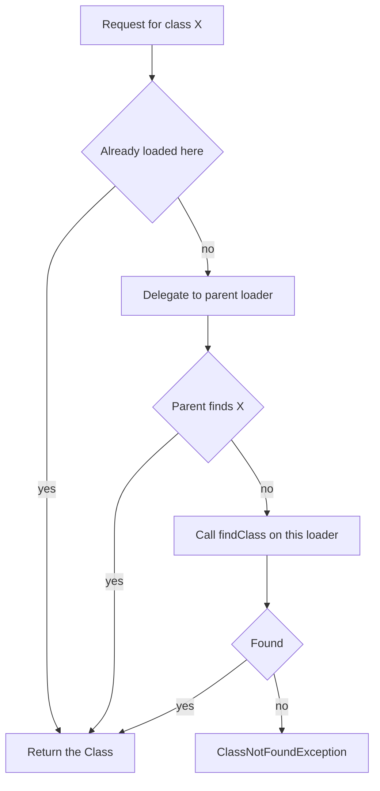

# Class Loading

!!! note "In simple words"
    Class loading is how the JVM finds a class file, reads it, and makes it ready to use. Each class is loaded by a class loader, and the loaders form a chain that asks the parent first.

## Why it matters

Class loading decides which version of a class your code really uses. It also explains two errors that look alike but mean different things: `ClassNotFoundException` and `NoClassDefFoundError`. Plug-in systems, application servers, and redeployed web apps all depend on how loaders behave, so these details come up often in senior interviews.

## How it works

### The class lifecycle

A class goes through three phases before its code can run.

1. **Loading.** A class loader finds the bytes of the class. The source can be a jar, a directory, the network, or generated code. The loader then creates a `Class` object.
2. **Linking.** Linking has three steps:
   - **Verification** checks that the bytecode is safe. Types must match, jumps must stay inside the method, and the operand stack must stay consistent.
   - **Preparation** creates the static fields and gives them default values such as `0`, `null`, or `false`. Constant values are assigned here.
   - **Resolution** turns symbolic references, which are names, into direct references. It can happen lazily, the first time the reference is used.
3. **Initialization.** Static initializers and static field assignments run in source order. This happens the first time the class is actively used, for example when an instance is created or a static method is called.

```java
public class InitOrder {
    static class Config {
        static { System.out.println("Config initialised"); }
        static final String NAME = "app";   // compile-time constant: reading it does not initialise Config
        static int version = 1;             // ordinary static field: reading it triggers initialisation
    }

    public static void main(String[] args) {
        System.out.println("Name: " + Config.NAME);
        System.out.println("Version: " + Config.version);
    }
}
```

Output:

```text
Name: app
Config initialised
Version: 1
```

`javac` copies the value of `NAME` into the code that reads it, because it is a compile-time constant. The JVM never touches `Config` to read that value, so the static block does not run until `version` is read.

### The three built-in class loaders

| Loader | Java class | Loads | Parent |
|---|---|---|---|
| Bootstrap | None; shown as `null` | Core classes such as `java.lang.String` and the base JDK modules | None |
| Platform | `jdk.internal.loader.ClassLoaders$PlatformClassLoader` | Platform modules such as `java.sql` | Bootstrap |
| Application (system) | `jdk.internal.loader.ClassLoaders$AppClassLoader` | Your classes on the class path or module path | Platform |

The middle loader was called the **Extension** class loader before Java 9. Java 9 renamed it to the Platform class loader when the module system arrived. Older articles and answers may still use the old name, so mention the rename if you use it.

```java
public class LoaderChain {
    public static void main(String[] args) {
        ClassLoader app = LoaderChain.class.getClassLoader();
        System.out.println("Application loader is not null: " + (app != null));
        System.out.println("Parent is the platform loader: " + (app.getParent() != null));
        System.out.println("Grandparent is the bootstrap loader: " + (app.getParent().getParent() == null));
        System.out.println("String is loaded by bootstrap: " + (String.class.getClassLoader() == null));
    }
}
```

The bootstrap loader returns `null` from `getClassLoader()`, which is why `String.class.getClassLoader()` is `null`.

### Parent delegation

When a loader gets a request for a class, it does not look in its own location first. It asks its parent, and it searches its own location only if the parent cannot find the class.

1. If the loader has already loaded the class, it returns that class.
2. Otherwise it delegates the request to its parent.
3. If the parent cannot find the class, the loader calls `findClass` on itself.

Because of this order, core classes such as `java.lang.String` always come from the bootstrap loader. Application code cannot replace them by putting a class with the same name on the class path. That protects the platform from accidental or deliberate replacement.



### Writing a custom class loader

Most applications never need a custom loader. Application servers, plug-in systems, and test frameworks do use them. The usual approach is to override `findClass` and keep the default delegation.

```java
import java.io.IOException;
import java.nio.file.Files;
import java.nio.file.Path;

public class DirectoryClassLoader extends ClassLoader {
    private final Path dir;

    public DirectoryClassLoader(Path dir, ClassLoader parent) {
        super(parent);
        this.dir = dir;
    }

    @Override
    protected Class<?> findClass(String name) throws ClassNotFoundException {
        Path file = dir.resolve(name.replace('.', '/') + ".class");
        try {
            byte[] bytes = Files.readAllBytes(file);
            return defineClass(name, bytes, 0, bytes.length);
        } catch (IOException e) {
            throw new ClassNotFoundException(name, e);
        }
    }
}
```

The parent is asked first, so `findClass` runs only for classes the parent cannot find. A class defined by this loader is a different `Class` object from a class with the same name defined elsewhere, even when the bytes are identical.

### Same name, different class

The identity of a runtime class is the pair of its fully qualified name and its defining class loader. Two loaders can each define `com.example.Plugin`, and the JVM treats them as two unrelated classes. Casting one to the other throws `ClassCastException`, even though the names match. This is the most common source of confusing errors in plug-in systems and in redeployed applications.

### Errors you will see

| Exception | When it happens | Typical cause |
|---|---|---|
| `ClassNotFoundException` | A lookup by name fails (`Class.forName` or `loader.loadClass`) | The class is missing from the class path at run time |
| `NoClassDefFoundError` | The class existed at compile time but is missing or failed to initialize at run time | A jar is missing from the run configuration, or a static initializer threw an exception |
| `ExceptionInInitializerError` | A static initializer threw an exception | Bad static configuration or a missing resource |
| `UnsatisfiedLinkError` | A native method cannot be linked | The native library is missing |

`ClassNotFoundException` is a checked exception that you can catch. `NoClassDefFoundError` is an `Error`, and normal code should not catch it.

### Loading without initializing

`Class.forName(name)` loads, links, and initializes the class. The three-argument form lets you choose whether to initialize it:

```java
public class LoadNoInit {
    public static void main(String[] args) throws ClassNotFoundException {
        Class<?> c = Class.forName("java.sql.Driver", false, ClassLoader.getSystemClassLoader());
        System.out.println("Loaded without initializing: " + c.getName());
    }
}
```

Old JDBC drivers relied on a static initializer to register themselves. Modern drivers use the service loader mechanism instead (see the [Java Tools and Utilities](../03c-tooling-utilities/java-tools-utilities.md) notes for how modules expose services).

### Step by step: what happens at start-up

1. The JVM starts and creates the bootstrap loader, which loads the core classes.
2. The platform loader and the application loader are created. The application loader's class path comes from `-cp` or from the jar manifest.
3. `main` is requested through the application loader. That loader delegates upward first, and then loads the class itself.
4. When code first refers to another class, the same steps run again. Loading and linking happen first, and initialization runs the static initializers.
5. A loaded class stays in memory as long as its loader is reachable. A loader can be garbage collected only when none of its classes or objects are still reachable.


## Where it is used

- **Application servers and web containers** give each deployed web app its own class loader, so two apps can use different versions of the same library.
- **Plug-in and extension systems** load optional modules from a folder at run time.
- **Test frameworks** create loaders to isolate test classes or to reload changed classes.
- **Build and code generation tools** define classes in memory from generated bytes.

## Benefits

- **Lazy loading.** Classes load only when they are first needed, which keeps start-up fast for large applications.
- **Isolation.** Separate loaders can keep different versions of one library apart.
- **Platform safety.** Parent delegation keeps core classes consistent and blocks accidental replacement.
- **Dynamic extension.** New code can be added at run time without restarting the process.

## Cons and limits

- **Debugging is harder.** The same class name can come from two places, so a stack trace may not show which version ran.
- **Loader leaks.** A loader stays in memory while anything refers to one of its classes. A static field, a thread, or a `ThreadLocal` can keep an old loader alive.
- **Casts across loaders fail.** Objects shared between loaders need a common interface that both loaders can see.
- **Loading costs time.** Each class must be read, verified, and linked. This is why startup optimizations such as Class Data Sharing exist.

## Best practices

- Keep one version of each library on the class path, unless you deliberately isolate applications with separate loaders.
- Share API types through a parent loader, and let each child loader supply only its own implementation.
- When an application is redeployed, stop its threads and clear `ThreadLocal` values, so the old loader can be collected.
- Do not expect a class in your jar to replace a JDK class such as `java.util.ArrayList`. Parent delegation prevents it.
- Catch `ClassNotFoundException` only when you have a sensible fallback. Do not hide a missing dependency.
- Do not read a `static final` constant in the hope that it starts a static initializer. Compile-time constants are inlined.
- Avoid comparing classes from two loaders with `==` or by casting them. Check the loader first.

!!! tip "Interview tip"
    **Q: What is parent delegation and why does Java use it?**
    Before a loader defines a class, it asks its parent to load it. The request reaches the bootstrap loader first, and each loader searches its own location only when the parent fails. This keeps core classes such as `java.lang.String` the same everywhere and stops user code from replacing them.

    **Follow-up: Why does a class loaded by two loaders not match?**
    Runtime class identity is the class name plus the defining loader. Two loaders produce two different `Class` objects, so casts and `instanceof` checks between them fail. This matters in plug-in systems and in redeployed web applications.

## Quick recap

- Class loading has three phases: loading, linking (verification, preparation, resolution), and initialization.
- The built-in loaders are Bootstrap (core), Platform (formerly Extension, renamed in Java 9), and Application (your code).
- Parent delegation asks the parent first, which protects core classes.
- A runtime class is identified by its name and its loader, so the same name from two loaders is two different classes.
- `ClassNotFoundException` is a failed lookup. `NoClassDefFoundError` means a class is missing or broken at run time.

## Official documentation

- [The Java Language Specification, Java SE 21](https://docs.oracle.com/javase/specs/jls/se21/html/index.html)
- [Java SE 21 API documentation](https://docs.oracle.com/en/java/javase/21/docs/api/index.html)
- [JEP index (OpenJDK)](https://openjdk.org/jeps/)

**See also:** [JVM Architecture and Memory](jvm-architecture-memory.md) (Metaspace holds loaded class metadata), [Garbage Collection](garbage-collection.md) (loader leaks), [JIT Compilation and Performance Tools](jit-and-performance-tools.md) (Class Data Sharing), [JVM Internals index](index.md)
