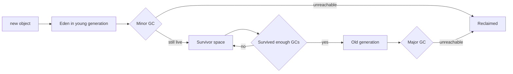

# Garbage Collection

!!! note "In simple words"
    The garbage collector finds objects that the program can no longer reach and frees their memory. It does not free objects that are still referenced, so a leak can still happen if old references stay around.

## Why it matters

Garbage collection removes the need to free memory by hand, but it has costs. It uses CPU, it can pause the application, and it cannot help when your code keeps references it no longer needs. Interviewers ask about GC to check three things: whether you know how an object becomes garbage, whether you can pick a collector for a workload, and whether you can read GC logs to tell if the collector is the cause of a slowdown.

## How it works

### Reachability: what counts as garbage

An object is garbage when no chain of live references connects it to a **GC root**. The GC roots are:

- local variables and parameters on each thread's stack
- static fields of loaded classes
- JNI global references and active monitors (locks that a thread holds)

The collector starts at the roots and marks every object it can reach. Anything left unmarked is garbage.

```java
public class Reachability {
    public static void main(String[] args) {
        StringBuilder sb = new StringBuilder("temporary");
        System.out.println(sb.length());
        sb = null;                   // the object is now unreachable and may be reclaimed later
        System.out.println("done");
    }
}
```

Setting a reference to `null` does not free memory on the spot. It only makes the object eligible for collection, and the collector decides when to run.

### The generational hypothesis

Most objects die young. Request handling, iterators, and temporary strings create many objects that live for a few milliseconds. The generational design uses this fact:

- New objects go into the **young generation** (Eden and survivor spaces).
- A **minor GC** collects the young generation. It runs often and is fast.
- Objects that survive enough minor GCs are promoted to the **old generation**.
- A **major GC** (also called a full GC) collects the old generation. It is slower and usually causes longer pauses.

### Stop-the-world pauses and concurrent work

Some collector phases must pause application threads. Otherwise the object graph could change while the collector walks it. These are **stop-the-world (STW)** pauses. Modern collectors do most of their marking and copying alongside the application, so they pause only briefly.

Three goals pull against each other:

- **Throughput:** the share of time spent running the application rather than GC.
- **Latency:** the length of each pause.
- **Footprint:** the memory the collector needs on top of the live data.

No collector is best at all three. Each one is a different balance, so the choice of collector is a choice about these trade-offs.

### The collectors in the JDK

| Collector | Flag | Design | Strength | Trade-off |
|---|---|---|---|---|
| Serial | `-XX:+UseSerialGC` | Single-threaded, stop-the-world | Small footprint, good for tiny heaps and single-CPU containers | Long pauses on large heaps |
| Parallel | `-XX:+UseParallelGC` | Multi-threaded, stop-the-world | High throughput for batch jobs | Pause length grows with heap size |
| G1 | `-XX:+UseG1GC` | Region-based, mostly concurrent, with a pause-time goal | Balanced throughput and latency, default since Java 9 | More CPU and memory overhead than Parallel |
| ZGC | `-XX:+UseZGC` | Region-based, concurrent compaction, very short pauses | Pauses stay low as the heap grows | More memory and CPU overhead |
| Epsilon | `-XX:+UseEpsilonGC` (experimental, needs `-XX:+UnlockExperimentalVMOptions`) | No-op collector that allocates but never frees | Performance tests and measuring allocation cost | Runs out of memory when the heap is full |

Shenandoah is another low-pause collector. It is present in some OpenJDK builds but not in every JDK distribution, so check your vendor before you rely on it.

### Default collector by Java version

If you do not pass a collector flag, the JVM picks one based on the machine. A "server-class" machine has at least two CPUs and about 2 GB of memory. That covers most servers and containers.

| Java version | Default collector on a server-class machine | Notes |
|---|---|---|
| Java 8 | Parallel GC | Small or single-CPU machines get Serial GC instead |
| Java 9 | G1 | G1 became the default with JEP 248 |
| Java 11 | G1 | No change from Java 9 |
| Java 17 | G1 | No change |
| Java 21 | G1 | No change. Virtual threads change how many threads run, not which collector is the default |

If you move a service from Java 8 to a newer JDK, measure the pauses again. G1 is tuned for pause time rather than raw throughput, so the same heap settings can behave differently.

### CMS was removed

The Concurrent Mark Sweep (CMS) collector was deprecated in Java 9 and removed in Java 14. G1 replaces it. Launch scripts that still pass `-XX:+UseConcMarkSweepGC` will not start on a current JDK, so update them.

### G1 in more detail

G1 splits the heap into regions of equal size. Each region can be an Eden, survivor, old, or humongous region. Humongous regions hold very large objects. G1 picks the regions with the most garbage first. That selection gives the collector its name: garbage first.

You give G1 a pause-time goal, and it tries to meet that goal:

```bash
java -XX:+UseG1GC -XX:MaxGCPauseMillis=200 MyApp
```

`MaxGCPauseMillis` is a goal, not a guarantee. If the goal is too strict for the live data, G1 may take longer pauses or fall back to a full collection.

### G1 phases

G1 does not run one large cycle. It alternates short young pauses with a background marking cycle. Then it runs mixed pauses that reclaim old regions a few at a time.

| Phase | Stops application threads | What happens |
|---|---|---|
| Young GC | Yes, briefly | Live objects in Eden and survivor regions are copied to survivor or old regions. Concurrent marking starts when old-generation occupancy passes `InitiatingHeapOccupancyPercent`, which defaults to 45. |
| Concurrent mark | No, runs alongside the application | Traces the live object graph from the GC roots. The initial mark step is done during a young pause. |
| Remark | Yes, briefly | Finishes marking and identifies regions that are now empty or nearly empty. |
| Cleanup | Short pause | Records live-data totals for each old region and frees regions with no live objects. It does not compact the heap. |
| Mixed GC | Yes | Copies the young regions together with the old regions that hold the most garbage. |

In normal operation the sequence is: young pauses, then a marking cycle (concurrent mark, remark, cleanup), then several mixed pauses, then young pauses again. If young collections cannot keep up while marking runs, G1 can fall back to a full stop-the-world collection.

### ZGC in more detail

ZGC aims for pauses of about a millisecond, and those pauses stay about the same as the heap grows. It does most of its work concurrently, including moving live objects. It uses colored pointers and load barriers so the application sees a consistent view while objects move.

```bash
java -XX:+UseZGC -Xmx16g MyApp
```

ZGC suits latency-sensitive services with large heaps. For a small heap with a throughput goal, Parallel or G1 is often the better choice. Measure before you switch.

### Choosing a collector

As a rough guide, confirm each choice with measurement:

- Small container, one CPU, small heap: Serial.
- Batch job where total run time matters more than pause length: Parallel.
- General-purpose service, the default choice: G1.
- Latency-sensitive service that must keep pauses short on a large heap: ZGC.

Check which collector is active with:

```bash
java -XX:+PrintFlagsFinal -version | grep -E "Use(G1|Serial|Parallel|Z)GC"
```

### Memory leaks in a garbage-collected language

Garbage collection prevents dangling pointers, but it does not prevent leaks. A leak happens when the program no longer needs an object but a live reference still points to it. The collector cannot free something that is reachable.

```java
import java.util.ArrayList;
import java.util.List;

public class LeakExample {
    private static final List<byte[]> CACHE = new ArrayList<>();

    static void handleRequest() {
        CACHE.add(new byte[1024]);      // never removed, so the static list keeps every array reachable
    }

    public static void main(String[] args) {
        for (int i = 0; i < 10; i++) {
            handleRequest();
        }
        System.out.println("cached entries: " + CACHE.size());   // prints 10
    }
}
```

Common sources of leaks are:

- static collections used as caches with no eviction policy
- listeners that are registered and never removed
- `ThreadLocal` values left behind in pooled threads
- class-loader leaks after a redeployment (see [Class Loading](class-loading.md))

### Weak references

A weak reference does not keep its target alive. When only weak references point to an object, the GC may reclaim it. Weak references suit caches where losing an entry under memory pressure is acceptable.

```java
import java.lang.ref.WeakReference;

public class WeakDemo {
    public static void main(String[] args) {
        Object strong = new Object();
        WeakReference<Object> weak = new WeakReference<>(strong);

        System.out.println("before: " + (weak.get() != null));  // true
        strong = null;
        System.gc();                                             // only a hint; the JVM may ignore it
        System.out.println("after: " + (weak.get() != null));   // may print true or false
    }
}
```

`WeakHashMap` uses the same idea for its keys. To run cleanup code after an object is collected, use `java.lang.ref.Cleaner`, which is available from Java 9. `Object.finalize()` is deprecated and should not appear in new code.

### Tuning flags you will see

```bash
-Xms2g -Xmx2g                       # fixed heap size, avoids resize pauses
-XX:MaxGCPauseMillis=200            # pause-time goal for G1
-XX:+HeapDumpOnOutOfMemoryError     # write a heap dump when the heap runs out
-XX:HeapDumpPath=/var/dumps/        # where to write the dump
```

Tune in response to measurements. Start with the default collector and a heap size that fits the machine. Change one flag at a time, then compare the GC logs and latency numbers.

### Step by step: one allocation to one reclaimed object

1. Allocation: `new` takes space from the young generation, or from a TLAB (a per-thread allocation buffer).
2. When Eden fills up, a minor GC runs. Live objects are copied to a survivor space or promoted to the old generation.
3. When the old generation passes a threshold, a major GC runs. G1 and ZGC do most of this work concurrently.
4. If concurrent work cannot keep up, the collector falls back to a longer stop-the-world collection.
5. If the live data still does not fit after a full collection, the JVM throws `OutOfMemoryError: Java heap space`.



### Reading GC logs

Turn on unified GC logging with:

```bash
java -Xlog:gc*:file=gc.log:time,uptime,level,tags -Xmx2g MyApp
```

A typical G1 young-collection line looks like this. The exact text changes between JDK versions, so treat it as an illustration:

```text
[2.345s][info][gc] GC(12) Pause Young (Normal) (G1 Evacuation Pause) 412M->96M(2048M) 9.871ms
```

Read it from left to right:

- `GC(12)` is the 13th collection since startup.
- `Pause Young` means a young-generation pause.
- `412M->96M(2048M)` is the heap used before and after the pause, and the heap size the JVM has committed.
- `9.871ms` is the pause length. Your latency objectives depend on this number.

Things to look for:

- Frequent pauses that free little memory suggest a leak, or a young generation that is too small.
- Old-generation use that rises after each full collection and never drops is a leak.
- Long pauses that match request timeouts point to the collector or the heap size.
- Many back-to-back "Allocation Failure" messages mean allocation is faster than collection.

GCViewer and GCEasy are third-party tools that read these logs. `jstat -gc <pid>` shows the same counters for a running process.

### Common GC symptoms and fixes

Most GC problems first appear as a latency or memory symptom. Match the symptom to a likely cause, then confirm it with GC logs or a heap dump before you change any flag.

| Symptom | Likely cause | Fix |
|---|---|---|
| Full GC thrashing: frequent full collections, high CPU, little memory freed | Live data close to `-Xmx`, a leak, or an allocation rate the old generation cannot absorb | Find what keeps the data alive with a heap dump. Reduce the live set or the allocation rate. Raise `-Xmx` only if the live data truly fits. |
| Long pauses: requests time out during collections | A large live set being copied, very large (humongous) objects, a throughput collector such as Parallel, or a pause goal the workload cannot meet | Shrink the live set. Use G1 or ZGC for latency-sensitive services. Set `MaxGCPauseMillis` to a value the workload can meet, and look for full collections in the log. |
| High GC overhead: a large share of CPU goes to collection | A high allocation rate with a small young generation, or a heap that stays nearly full | Reduce short-lived allocations, for example by reusing buffers. Give the young generation or the heap more room. |
| Memory leak: old-generation use climbs after each full collection | Static collections, caches without a size limit, listeners that are never removed, or `ThreadLocal` values left in pooled threads | Take a heap dump with `jmap -dump:live,format=b,file=heap.hprof <pid>`, or use `-XX:+HeapDumpOnOutOfMemoryError`. Open it in Eclipse MAT and follow the retaining paths. Bound the caches, remove listeners, and call `ThreadLocal.remove()` when the work ends. |

No fixed CPU percentage defines "high GC overhead". When the JVM spends almost all of its time collecting and recovers very little memory, it throws `OutOfMemoryError: GC overhead limit exceeded`. Treat that error as a sign that allocations or the heap need fixing. Do not turn the check off.

## Where it is used

- **Web and API services** use G1 by default and watch pause times against request latency targets.
- **Batch and data jobs** often choose Parallel GC, because total run time matters more than pause length.
- **Trading, gaming, and real-time systems** choose ZGC or a tuned G1 when pauses must stay short on large heaps.
- **Performance teams** read GC logs to confirm whether a slowdown comes from collection or from application code.

## Benefits

- **No manual free.** The collector reclaims memory automatically, which removes a large class of memory bugs.
- **Generational speed.** Collecting young objects often and old objects rarely keeps most collections cheap.
- **Choice of trade-offs.** Serial, Parallel, G1, and ZGC cover small, batch, general, and low-latency workloads.
- **Concurrent phases.** G1 and ZGC do most of their work while the application keeps running, so pauses stay short.

## Cons and limits

- **Leaks still happen.** Reachable but unused objects are never collected.
- **Pauses are a trade-off.** Stop-the-world phases exist in every collector, and their length grows with the live data for some designs.
- **Tuning is workload-specific.** A flag that helps one service can hurt another.
- **Finalization is unreliable.** `finalize()` runs at an unknown time, or not at all, so it cannot manage resources.
- **Measurement adds overhead.** Detailed GC logging and heap dumps cost time and disk space.

## Best practices

- Start with the default collector. Change it only after you measure pauses and throughput under realistic load.
- Use G1 as the general-purpose default on current JDKs. Consider ZGC when pauses must stay short on a large heap, and Parallel when throughput is the only goal.
- Do not call `System.gc()` in application code. It is only a hint and usually causes a full collection. Use it in tests, or when you have a specific reason.
- Do not set `-Xmx` very high without a plan for pauses. A larger heap can make some collectors pause longer.
- Change one GC flag at a time, so you can see which change helped.
- Remember that GC cannot fix a leak. Look for the live references with a heap dump.
- Reduce allocation rate where you can. Fewer short-lived objects often helps more than tuning.
- Release resources with try-with-resources, not with `finalize()` or the collector.
- Do not use CMS flags on Java 14 or later. The JVM will not start with them.

!!! tip "Interview tip"
    **Q: How do you decide which garbage collector to use?**
    Start with the default, which is G1 on current JDKs. Measure pauses and throughput under realistic load, and change the collector only if the measurements call for it. Use Parallel when throughput matters more than pauses, and ZGC when pauses must stay short on a large heap. Always confirm the choice with GC logs and latency metrics.

    **Follow-up: Can a Java program have a memory leak?**
    Yes. The collector frees only unreachable objects. If a static cache, a listener, or a `ThreadLocal` keeps references to objects that are no longer needed, they stay reachable and the heap fills up. A heap dump or an object histogram from `jmap -histo` shows what is holding them.

## Quick recap

- An object is garbage when no GC root can reach it. Setting a reference to `null` only makes the object eligible.
- The generational design collects young objects often and old objects rarely.
- Serial, Parallel, G1, and ZGC cover small, batch, general, and low-latency workloads. G1 has been the default since Java 9.
- CMS was removed in Java 14. Use G1 or ZGC instead.
- Read `-Xlog:gc*` output to find pause lengths, heap growth, and leaks.

## Official documentation

- [Java SE 21 Garbage Collection Tuning Guide](https://docs.oracle.com/en/java/javase/21/gctuning/)
- [Java SE 21 API documentation](https://docs.oracle.com/en/java/javase/21/docs/api/index.html)
- [JEP index (OpenJDK)](https://openjdk.org/jeps/)

**See also:** [JVM Architecture and Memory](jvm-architecture-memory.md), [JIT Compilation and Performance Tools](jit-and-performance-tools.md), [Class Loading](class-loading.md), [JVM Internals index](index.md)
