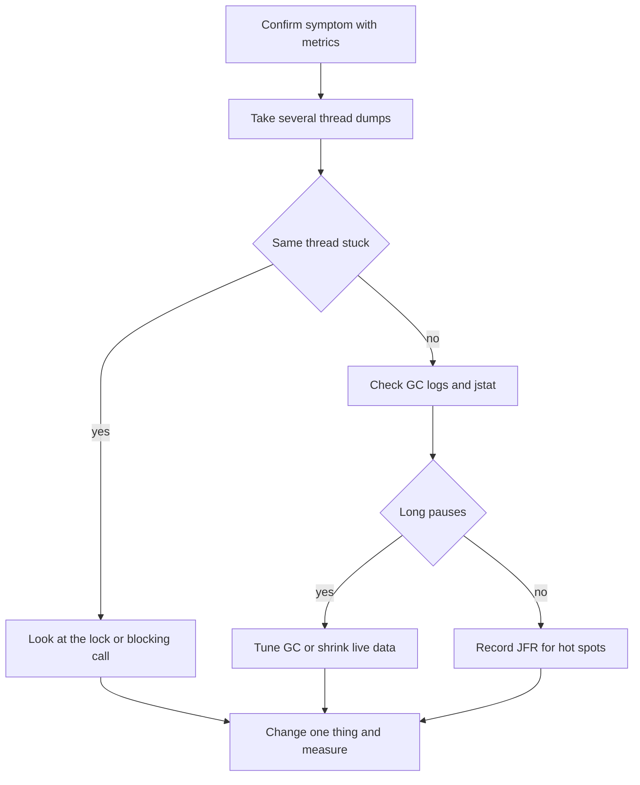

# JIT Compilation and Performance Tools

!!! note "In simple words"
    The JVM starts by running bytecode slowly, watches which code runs most often, and then compiles that code to fast machine code. Performance tools let you see what the program is doing while it runs.

## Why it matters

A Java service is often slow right after a deploy and faster an hour later. That change comes from the JIT compiler. If you do not understand it, you may benchmark too early, read the wrong numbers, or chase a problem that the JVM would have fixed by itself.

Interviewers ask about this topic to see whether you can explain warm-up and whether you can diagnose a slow service with evidence instead of guesses.

## How it works

### Interpreter first, then compiled code

The JVM does not compile every method when it starts. It interprets bytecode first, which starts quickly but runs slowly. It counts how often each method and loop runs. When a method becomes hot, the JIT compiles it to machine code and replaces the interpreted version.

The time before the hot code is ready is called **warm-up**. It explains why the first requests after a restart take longer than the later ones.

### Tiered compilation: C1 and C2

Since Java 8, HotSpot uses tiered compilation by default. It has two compilers:

| Compiler | Name | Goal | Behaviour |
|---|---|---|---|
| C1 | Client compiler | Fast compilation | Quick compile with light optimizations, and it adds profiling counters |
| C2 | Server compiler | Peak performance | Slower to compile, with aggressive optimizations based on the profile |

Code moves up through these tiers. It starts in the interpreter, moves to C1 with profiling, and the hottest code is recompiled by C2. If C2 made an assumption that later stops being true, for example after a new class is loaded, the JVM deoptimizes that code and falls back to a lower tier.

### What the optimizer does

The JIT decides what to optimize from runtime profiles. Common optimizations include:

- **Inlining.** A method call is replaced with the body of the method, which removes the call overhead.
- **Loop optimizations.** Loops are unrolled, and computations that do not change are moved out of the loop.
- **Escape analysis.** If an object never leaves a method, it can be allocated on the stack or removed. The JVM makes this decision, and you cannot force it.
- **Dead code elimination.** Calculations whose results are never used are removed.
- **Devirtualization.** A virtual call becomes a direct call when only one implementation has been seen.

```java
public class HotLoop {
    static long sumOfSquares(int n) {
        long total = 0;
        for (int i = 0; i < n; i++) {
            total += (long) i * i;
        }
        return total;
    }

    public static void main(String[] args) {
        long result = 0;
        for (int round = 0; round < 1_000; round++) {   // sumOfSquares becomes hot and gets compiled
            result += sumOfSquares(10_000);
        }
        System.out.println("result = " + result);
    }
}
```

Add `-XX:+PrintCompilation` to see methods being compiled at each tier. The text format changes between JDK versions, so use the output to confirm that compilation happens, not to parse exact lines.

### The code cache

Compiled machine code is stored in the **code cache**, a separate block of native memory. If the cache fills up, the JVM stops compiling and prints a warning, and the application can become much slower. You can change its size with `-XX:ReservedCodeCacheSize`. Most applications never need this, but the `CodeCache is full` message is worth investigating.

### Class Data Sharing (CDS)

Loading and verifying classes takes time at start-up. CDS stores the parsed form of classes in an archive that the JVM maps into memory when it starts.

- The JDK ships a **default CDS archive** for its own classes, and the JVM uses it automatically.
- **Application CDS (AppCDS)** adds your application's classes to the archive.

```bash
java -XX:ArchiveClassesAtExit=app.jsa -cp app.jar com.example.Main   # run once to record the archive
java -XX:SharedArchiveFile=app.jsa -cp app.jar com.example.Main      # later runs use the archive
```

CDS helps most with short-lived processes such as command-line tools and serverless functions, where start-up time is a large share of the total. The archive must match the JDK version and the class path it was created with. Otherwise the JVM ignores it.

### Ahead-of-time options

GraalVM native image compiles an application ahead of time into a standalone executable. It starts very quickly, but it can give up some peak throughput and makes builds slower. It also needs configuration for features such as reflection. Mention it as an option when startup is the main concern, not as a default.

### JMH: measuring correctly

A hand-written timing loop with `System.nanoTime()` usually gives wrong numbers. Warm-up, dead code elimination, and constant folding can all distort the result. The Java Microbenchmark Harness (JMH) handles warm-up, runs each benchmark in a fresh JVM, and stops the JIT from removing the work.

The example below needs the `jmh-core` dependency and its annotation processor on the build path. It is a JMH example and was not compiled here.

```java
import java.util.concurrent.TimeUnit;
import org.openjdk.jmh.annotations.Benchmark;
import org.openjdk.jmh.annotations.BenchmarkMode;
import org.openjdk.jmh.annotations.Mode;
import org.openjdk.jmh.annotations.OutputTimeUnit;
import org.openjdk.jmh.annotations.Scope;
import org.openjdk.jmh.annotations.State;

@BenchmarkMode(Mode.AverageTime)
@OutputTimeUnit(TimeUnit.NANOSECONDS)
@State(Scope.Thread)
public class ConcatBenchmark {
    private final String a = "hello";
    private final String b = "world";

    @Benchmark
    public String concatWithPlus() {
        return a + " " + b;              // returning the result stops the JIT from discarding the work
    }

    @Benchmark
    public String concatWithBuilder() {
        return new StringBuilder(a).append(' ').append(b).toString();
    }
}
```

JMH generates a main class from these annotations. Run the benchmark through the uber-jar that your build tool produces, and read the average time and the error margin. Results depend on hardware, JDK version, and machine load, so compare variants on the same machine.

### Diagnostic and profiling tools

| Tool | What it does | Example |
|---|---|---|
| `jcmd` | General control of a running JVM: thread dumps, heap dumps, flags, and JFR | `jcmd <pid> VM.flags`, `jcmd <pid> Thread.print` |
| `jstat` | Periodic counters for GC and class loading | `jstat -gc <pid> 1000` prints every second |
| `jmap` | Heap histograms and heap dumps | `jmap -histo:live <pid>` |
| `jstack` | Thread dump: what each thread does and which locks it holds | `jstack <pid>` |
| `jconsole` | Basic JMX graphical monitor shipped with the JDK | Start it and attach to a process |
| VisualVM | Graphical profiler and monitor, downloaded separately from the JDK | Heap, CPU, and thread views |
| Java Flight Recorder (JFR) | Low-overhead event recording that you analyze in JDK Mission Control | `jcmd <pid> JFR.start duration=60s filename=rec.jfr` |

To record from startup, pass the flag when the application starts:

```bash
java -XX:StartFlightRecording=duration=60s,filename=rec.jfr -jar app.jar
```

Open `rec.jfr` in JDK Mission Control. It shows allocation hot spots, GC pauses, lock contention, and method profiles, and the overhead is low enough for production use.

### Heap dumps and OutOfMemoryError

Ask the JVM to write a heap dump when it runs out of memory:

```bash
java -XX:+HeapDumpOnOutOfMemoryError -XX:HeapDumpPath=dumps -jar app.jar
```

Open the dump in a tool such as Eclipse MAT or VisualVM. Look at the dominator tree or the path to the GC root to see which objects are kept alive and by what. You can also take a dump on demand with `jcmd <pid> GC.heap_dump <file>`.

### A diagnostic workflow

When a service is slow, check things in this order:

1. Confirm the symptom with metrics: latency percentiles, CPU use, heap use, and GC pause time.
2. Take several thread dumps with `jstack` or `jcmd Thread.print`, a few seconds apart. A thread that stays in the same state points to a lock or a blocking call.
3. Check GC behaviour with `jstat -gc` or GC logs (see [Garbage Collection](garbage-collection.md)).
4. Record with JFR to find allocation and CPU hot spots.
5. Change one thing, measure again, and keep only the changes that improve the metric you care about.



## Where it is used

- **Latency-sensitive services** use JIT warm-up numbers to decide when a deploy is safe to receive full traffic.
- **Benchmark suites** use JMH to compare library choices, such as two JSON parsers or two string-building methods.
- **Command-line tools and serverless functions** use AppCDS or native images to cut start-up time.
- **Production support teams** use JFR and thread dumps to explain a slow request without restarting the process.

## Benefits

- **Speed where it matters.** The JIT spends its effort on the code that runs most, so the final speed is close to a native program for hot paths.
- **Adaptive.** Profiles come from the real workload, so the compiled code fits the traffic the service actually receives.
- **Low-overhead tooling.** JFR and `jcmd` are safe to use in production.

## Cons and limits

- **Warm-up cost.** The first requests run slower, and short runs may never reach peak speed.
- **Hard to predict.** Escape analysis, inlining, and deoptimization depend on the profile, so behaviour can change between JDK versions.
- **Benchmarks are easy to get wrong.** A naive timing loop can measure the JIT rather than the code.
- **AOT and CDS have limits.** CDS archives must match the JDK, and native images need configuration for reflection.

## Best practices

- Measure after warm-up. For benchmarks, use JMH rather than a hand-written loop.
- Return or consume the result of each benchmarked call, so the JIT cannot remove the work.
- Do not run with `-Xint` to see "the real cost". That runs an interpreter-only JVM, which is not how the service runs.
- Take several thread dumps, not one, before you draw a conclusion.
- Use the same JDK, flags, and machine for the before and after numbers.
- Do not assume escape analysis will remove an allocation. Reduce allocations in the code when they matter.
- Investigate the `CodeCache is full` warning rather than ignoring it.
- Do not call `System.gc()` before a measurement. It adds a collection that the real workload would not have.
- Create an AppCDS archive with the same JDK that runs the application.

!!! tip "Interview tip"
    **Q: Why does a Java service get faster after it has been running for a while?**
    The JVM starts by interpreting bytecode and profiling it. Hot methods are compiled by C1 and, if they stay hot, by C2 using the runtime profile. Inlining, loop optimizations, and devirtualization then apply. This is why benchmarks need warm-up and why the first requests after a deploy are slower.

    **Follow-up: How would you find out why a service is slow in production?**
    Start with metrics to see where the time goes. Take several thread dumps with `jstack` or `jcmd`, check GC pauses with `jstat -gc` or GC logs, and record a JFR file for hot spots. Change one thing at a time and measure again.

## Quick recap

- The JVM interprets first, then compiles hot code with C1 and C2 using runtime profiles. Tiered compilation is the default.
- CDS and AppCDS store pre-parsed classes to cut start-up time.
- JMH handles warm-up and dead code elimination, so it is the right tool for microbenchmarks.
- `jcmd`, `jstat`, `jmap`, `jstack`, `jconsole`, VisualVM, and JFR cover most production diagnosis.
- Diagnose with evidence: metrics first, then thread dumps, GC data, and recordings. Change one thing at a time.

## Official documentation

- [Java SE 21 Garbage Collection Tuning Guide](https://docs.oracle.com/en/java/javase/21/gctuning/)
- [Java SE 21 API documentation](https://docs.oracle.com/en/java/javase/21/docs/api/index.html)
- [JEP index (OpenJDK)](https://openjdk.org/jeps/)
- [Dev.java, the Java developer site](https://dev.java/)

**See also:** [JVM Architecture and Memory](jvm-architecture-memory.md), [Garbage Collection](garbage-collection.md), [Class Loading](class-loading.md), [JVM Internals index](index.md)
