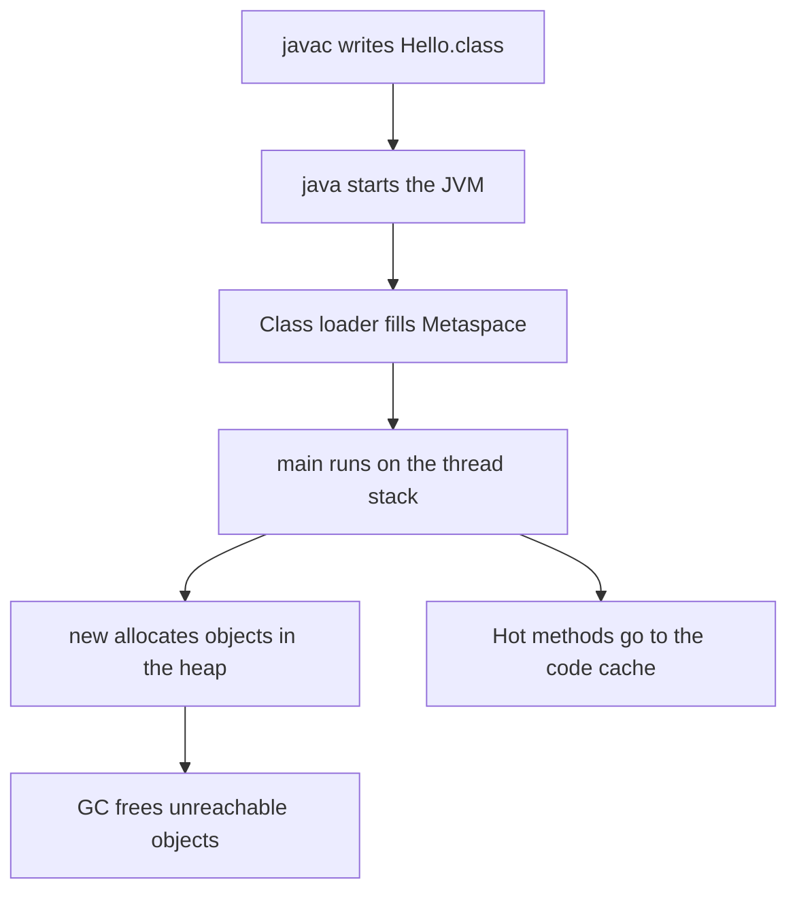

# JVM Architecture and Memory

!!! note "In simple words"
    The Java Virtual Machine (JVM) is the program that runs your Java code. Objects live in one shared area called the heap, and each method call lives in a small per-thread area called the stack.

## Why it matters

Most production Java problems come from memory: an `OutOfMemoryError`, a `StackOverflowError`, a leak that grows for days, or a pause that breaks a latency target. Each of these errors names a memory area. If you know what lives where and who frees it, the error message tells you where to look.

Interviewers ask about the JVM memory layout to check that you can reason about these failures, not just recite the names of the areas.

## How it works

### From source code to bytecode

Java source files (`.java`) are compiled by `javac` into bytecode (`.class` files). Bytecode is an instruction set that does not depend on the operating system or the processor. Any JVM that understands the class file version can run it. This is the reason Java programs can run on many platforms without a rebuild.

```java
// Hello.java
public class Hello {
    public static void main(String[] args) {
        int sum = 2 + 3;
        System.out.println("sum = " + sum);
    }
}
```

```bash
javac Hello.java        # produces Hello.class
javap -c Hello          # disassembles the bytecode so you can read it
java Hello              # starts the JVM, loads Hello.class, runs main
```

The output of `javap -c` uses stack-based instructions such as `iconst_2`, `iconst_3`, and `iadd`. The JVM first interprets these instructions one at a time. Methods that run often are later compiled to machine code (see [JIT Compilation and Performance Tools](jit-and-performance-tools.md)).

### JVM, JRE, and JDK

| Term | What it is | Contains |
|---|---|---|
| JVM | The virtual machine that runs bytecode | Class loaders, interpreter, JIT compiler, garbage collector |
| JRE | Runtime environment (older packaging) | JVM plus the core libraries |
| JDK | Development kit | JRE plus `javac`, `jshell`, `jar`, `javadoc`, and diagnostic tools |

Current JDK distributions no longer ship a separate JRE. You install a JDK, and it contains everything needed to build and run programs.

### Runtime data areas

The JVM splits its memory into several areas. The ones that matter most in interviews are listed below.

| Area | Shared or per thread | What it stores | Typical error |
|---|---|---|---|
| Heap | Shared by all threads | Objects and arrays | `OutOfMemoryError: Java heap space` |
| Thread stack | One per thread | Stack frames with locals, operands, and call data | `StackOverflowError` |
| Metaspace | Shared (native memory) | Class metadata, method and field info, constant pool | `OutOfMemoryError: Metaspace` |
| Program counter register | One per thread | Address of the bytecode instruction being run | None in practice |
| Native method stack | One per thread | Frames for native (JNI) code | `StackOverflowError` in native code |
| Code cache | Shared | Machine code produced by the JIT | `CodeCache is full` warning |

### Heap and stack

The heap holds objects. The stack holds method frames. Each call pushes a frame that contains the method's parameters and local variables. When the method returns, the frame is popped and its locals are gone.

```java
public class HeapVsStack {
    static int counter = 0;                     // static field: stored with the class

    public static void main(String[] args) {
        int local = 42;                         // primitive local: lives in main's frame
        StringBuilder sb = new StringBuilder("hi"); // reference on the stack, object on the heap
        helper(sb);
        System.out.println(local + " " + sb);   // prints: 42 hi!
    }

    static void helper(StringBuilder ref) {
        ref.append("!");                        // changes the shared object; the caller sees it
        counter++;
    }
}
```

The rules behind this example:

- A local variable of a primitive type holds its value directly in the stack frame.
- A local variable of a reference type holds a pointer to an object on the heap.
- Passing an object copies the reference, not the object. Java is always pass-by-value, and for objects the value copied is the reference.
- An object stays on the heap until no reference can reach it. Then the garbage collector reclaims it.

### Stack frames and StackOverflowError

Each thread has a stack of fixed maximum size. Unbounded recursion keeps adding frames until the stack is full, and then the JVM throws `StackOverflowError`.

```java
public class DeepRecursion {
    static int depth = 0;

    static void recurse() {
        depth++;
        recurse();                              // no base case: a new frame on every call
    }

    public static void main(String[] args) {
        try {
            recurse();
        } catch (StackOverflowError e) {
            System.out.println("Caught StackOverflowError: " + (depth > 0));
        }
    }
}
```

The exact depth depends on the platform and the JVM flags, so the example prints a boolean instead of a number. Use `-Xss` to change the stack size of each thread, for example `-Xss512k`. A bigger stack allows deeper recursion, but every thread pays for it, so a large value multiplied by many threads can use a lot of native memory.

### Heap generations

The default collectors divide the heap into generations:

- **Young generation.** New objects are allocated here. It contains an Eden space and two survivor spaces. Most objects die young, so collecting this area is cheap and happens often. That collection is called a minor GC.
- **Old generation (tenured).** Objects that survive several young collections are promoted here. Collecting this area is more expensive. It is called a major or full GC, depending on the collector.

Some collectors use different layouts. ZGC and Shenandoah are region-based, and ZGC gained a generational mode in Java 21. Choose the collector first, then read about its memory layout (see [Garbage Collection](garbage-collection.md)).

Set the heap size with these flags:

```bash
java -Xms512m -Xmx2g MyApp   # start with a 512 MB heap, grow up to 2 GB
```

Setting `-Xms` equal to `-Xmx` prevents the JVM from resizing the heap while the service runs. Many server applications use this setting for that reason.

### Metaspace replaced PermGen

Before Java 8, class metadata was stored in PermGen, a fixed-size area inside the heap. Applications that loaded many classes, such as application servers, code generators, and services that redeployed often, could run out of PermGen and fail with `OutOfMemoryError: PermGen space`.

Java 8 removed PermGen and added Metaspace. Metaspace lives in native memory outside the heap and grows as needed. Its limit is the amount of memory the operating system can give the process.

```bash
java -XX:MetaspaceSize=128m -XX:MaxMetaspaceSize=256m MyApp
```

- `MetaspaceSize` is the initial threshold. Reaching it triggers a garbage collection, but it is not a hard limit.
- `MaxMetaspaceSize` is the hard limit. Without it, Metaspace can keep growing until the machine runs out of memory.

A Metaspace that rises steadily after each redeploy usually points to a class-loader leak. An old class loader stays reachable from a long-lived object, so all of its classes stay in memory too.

### The memory model is a different topic

The Java Memory Model (JMM) defines how threads see each other's writes. Without synchronization, a thread can read a stale value, and writes can appear out of order. The rules that fix this come from `synchronized`, `volatile`, and `final` fields. The concurrency pages cover them in detail (see [Synchronisation and volatile](../02c-concurrency-io/synchronisation-volatile.md)).

The JMM is about visibility and ordering between threads. The heap and stack layout described above is about where data is stored. Both are sometimes called "the memory model" in casual talk, so be precise when you answer an interview question.

### Checking memory at runtime

```java
public class MemoryStats {
    public static void main(String[] args) {
        Runtime rt = Runtime.getRuntime();
        long mb = 1024L * 1024L;
        System.out.printf("max=%d MB, total=%d MB, free=%d MB, cpus=%d%n",
                rt.maxMemory() / mb,
                rt.totalMemory() / mb,
                rt.freeMemory() / mb,
                rt.availableProcessors());
    }
}
```

`maxMemory()` reflects `-Xmx`. `totalMemory()` is the heap the JVM has reserved so far. `freeMemory()` is the part of that reserved heap that is not in use. These numbers give a quick check, but for real diagnosis use the tools in [JIT Compilation and Performance Tools](jit-and-performance-tools.md).

### Step by step: from start-up to a running request

1. `javac` turns each `.java` file into a `.class` file of bytecode.
2. `java` starts the JVM, which creates the main thread and its stack.
3. The class loader loads `Main.class` and the classes it needs. Their metadata goes to Metaspace (see [Class Loading](class-loading.md)).
4. `main` runs. Every method call pushes a frame on the current thread's stack.
5. Every `new` allocates an object in the young generation of the heap.
6. When memory runs low, the garbage collector finds objects that no GC root can reach. GC roots are thread stacks, static fields, and JNI references. Unreachable objects are reclaimed (see [Garbage Collection](garbage-collection.md)).
7. Hot methods are compiled to machine code and stored in the code cache.



Use the symptom to choose the first place to look:

| Symptom | Likely area | First thing to check |
|---|---|---|
| `OutOfMemoryError: Java heap space` | Heap | Heap dump (object histogram) and the `-Xmx` value |
| `StackOverflowError` | Thread stack | Recursion depth and `-Xss` |
| `OutOfMemoryError: Metaspace` | Metaspace | Number of loaded classes and class-loader leaks |
| `OutOfMemoryError: unable to create native thread` | Native memory and thread count | Number of live threads and `-Xss` |

## Where it is used

- **Server applications** (web services, message consumers) rely on the heap for request data and on Metaspace for framework classes. Teams size `-Xmx` and `-Xms` from load tests.
- **Application servers and plug-in hosts** load many classes and redeploy often, so they are the usual place for Metaspace and class-loader problems.
- **Containers and Kubernetes pods** set a memory limit. The JVM must be configured to fit inside that limit, because native memory such as Metaspace and thread stacks counts toward it too.
- **Diagnostic tools** such as `jcmd`, `jmap`, and Java Flight Recorder read these areas directly.

## Benefits

- **Managed heap.** Programs allocate objects without calling `free`, so a whole class of dangling-pointer bugs cannot happen.
- **Per-thread stacks.** Each thread's frames are separate, so method calls in one thread never disturb another thread's locals.
- **Separate Metaspace.** Class metadata has its own area, so loading and unloading classes does not fragment the object heap.
- **Tunable.** Flags such as `-Xmx`, `-Xss`, and `-XX:MaxMetaspaceSize` let you match the memory layout to the workload.

## Cons and limits

- **Memory use is less visible than in native code.** An object can be kept alive by a forgotten reference, and nothing in the code signals the leak.
- **The heap limit is a trade-off.** A larger heap delays `OutOfMemoryError`, but it can also make garbage collection pauses longer.
- **Native memory is not covered by `-Xmx`.** Metaspace, thread stacks, the code cache, and direct buffers can all grow outside the heap limit.
- **Stack size is fixed per thread.** Deep recursion needs a bigger `-Xss` for every thread, not only the one that recurses.

## Best practices

- Read the error message first. The area named in the message tells you where to look.
- Set `-Xmx` to a value that fits the container limit and leave room for native memory.
- Do not fix a leak by raising `-Xmx`. A bigger heap only delays the failure if objects are still referenced.
- Avoid unbounded recursion. Add a base case, or use a loop or an explicit `Deque` when the depth can be large.
- Set `-XX:MaxMetaspaceSize` in containers, so Metaspace growth cannot take all of the memory limit.
- Do not treat `Runtime.freeMemory()` as the amount of memory the application needs. It reports only what the JVM has reserved at that moment.
- Keep the memory model (visibility between threads) and the memory layout (where data lives) apart when you discuss them.
- Assume that escape analysis might place an object on the stack. That is the JVM's decision, not something your code controls.

!!! tip "Interview tip"
    **Q: What is the difference between heap and stack?**
    The heap is shared by all threads and holds objects and arrays, and the garbage collector reclaims it. Each thread has its own stack that holds method frames, local variables, and references. Stack memory is released automatically when a method returns, so it never needs garbage collection.

    **Follow-up: Why did Java 8 replace PermGen with Metaspace?**
    PermGen was a fixed-size area inside the heap, so applications that loaded many classes could run out of it. Metaspace uses native memory that grows as needed. It can still be capped with `-XX:MaxMetaspaceSize`.

## Quick recap

- Bytecode is produced by `javac` and run by the JVM, which can interpret it or compile it with the JIT.
- The heap is shared and holds objects. Each thread has its own stack of frames.
- A reference lives on the stack or inside an object. The object itself lives on the heap.
- Metaspace holds class metadata in native memory and replaced PermGen in Java 8.
- `-Xms`, `-Xmx`, `-Xss`, `-XX:MetaspaceSize`, and `-XX:MaxMetaspaceSize` control the main memory areas.

## Official documentation

- [The Java Language Specification, Java SE 21](https://docs.oracle.com/javase/specs/jls/se21/html/index.html)
- [Java SE 21 API documentation](https://docs.oracle.com/en/java/javase/21/docs/api/index.html)
- [Java SE 21 Garbage Collection Tuning Guide](https://docs.oracle.com/en/java/javase/21/gctuning/)

**See also:** [Garbage Collection](garbage-collection.md), [Class Loading](class-loading.md), [JIT Compilation and Performance Tools](jit-and-performance-tools.md), [JVM Internals index](index.md)
