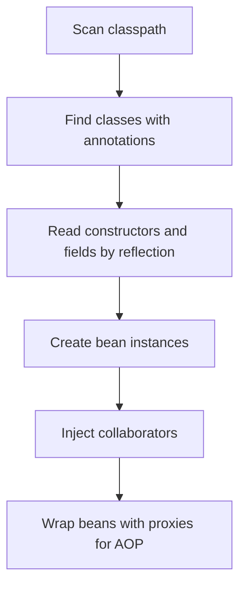

# Annotations and Reflection

!!! note "In simple words"
    An annotation is a label you attach to code, such as `@Override`. Reflection lets a program read those labels and use the classes and methods it finds, while the program is running.

## Why it matters

Frameworks look like magic. Spring finds your beans, JUnit finds your tests, and JPA maps your entities without you writing the wiring. Most of that work is done by annotations read through reflection. Interviewers ask about these two topics to check that you understand the mechanism, not just the syntax, and to test how you would debug a framework that does not find something you expected it to find.

## How it works

### What an annotation is

An annotation is metadata. By itself it does nothing. It has an effect only when a tool reads it. The tool can be the compiler, an annotation processor that runs during the build, or code that uses reflection at run time.

Annotations come in three forms:

- **Marker.** It has no elements, such as `@Override` or `@FunctionalInterface`.
- **Single-element.** It has one element, often named `value`, such as `@SuppressWarnings("unchecked")`.
- **Full.** It has several named elements with optional defaults, such as `@Retention(RetentionPolicy.RUNTIME)`.

### Built-in annotations

| Annotation | Purpose |
|------------|---------|
| `@Override` | The compiler checks that the method really overrides a method of a supertype |
| `@Deprecated` | Marks an element as discouraged. `forRemoval = true` warns that it will be removed |
| `@FunctionalInterface` | The compiler checks that the interface has exactly one abstract method |
| `@SafeVarargs` | Promises that a varargs method does not misuse its generic array |
| `@SuppressWarnings` | Turns off the named compiler warnings for the annotated element |

### Meta-annotations: annotations on annotations

Four meta-annotations control how your own annotation behaves:

- `@Retention` sets how long the annotation is kept. `SOURCE` drops it at compile time. `CLASS` keeps it in the class file but hides it at run time, and it is the default. `RUNTIME` makes it visible through reflection.
- `@Target` limits where the annotation may be placed, such as `METHOD`, `FIELD`, or `TYPE`.
- `@Documented` includes the annotation in the generated Javadoc.
- `@Inherited` lets a subclass inherit a class-level annotation from its superclass. It applies to classes only, not to interfaces or methods.

`@Repeatable` lets one element carry the same annotation more than once, with the help of a container annotation.

### Writing a custom annotation

Declare an annotation with `@interface`. Each element looks like a method and can have a `default` value.

```java
import java.lang.annotation.ElementType;
import java.lang.annotation.Retention;
import java.lang.annotation.RetentionPolicy;
import java.lang.annotation.Target;

@Retention(RetentionPolicy.RUNTIME)
@Target(ElementType.METHOD)
@interface Timed {
    String label() default "";
}

class ReportService {

    @Timed(label = "monthly")
    public void run() {
        System.out.println("Running report");
    }

    public void helper() {
        System.out.println("Not timed");
    }
}
```

Without `RUNTIME` retention, the reader in the next section cannot see this annotation.

### Reading annotations with reflection

Reflection reads annotations through the `AnnotatedElement` interface. `Class`, `Method`, `Field`, and `Constructor` all implement it.

```java
import java.lang.annotation.ElementType;
import java.lang.annotation.Retention;
import java.lang.annotation.RetentionPolicy;
import java.lang.annotation.Target;
import java.lang.reflect.Method;

@Retention(RetentionPolicy.RUNTIME)
@Target(ElementType.METHOD)
@interface Timed {
    String label() default "";
}

class ReportService {

    @Timed(label = "monthly")
    public void run() {
        System.out.println("Running report");
    }

    public void helper() {
        System.out.println("Not timed");
    }
}

public class TimedRunner {

    public static void main(String[] args) throws Exception {
        ReportService service = new ReportService();

        for (Method method : ReportService.class.getDeclaredMethods()) {
            Timed timed = method.getAnnotation(Timed.class);
            if (timed != null && method.getName().equals("run")) {
                System.out.println("Label: " + timed.label());
                method.invoke(service);
            }
        }
    }
}
```

The order that `getDeclaredMethods()` returns is not guaranteed. If the order matters, sort the methods or keep an explicit list.

### Annotation processing at compile time

Annotation processors run during compilation. They read annotations on source elements, and they can generate new source files or report errors. Lombok generates getters and builders this way, and MapStruct generates mapper implementations. Processing happens during the build, so it adds no run-time cost. Processors are written against `javax.annotation.processing`, which lives in the `java.compiler` module and keeps the `javax` package name in current JDKs.

### What reflection is

Reflection lets code inspect a type, including its name, constructors, fields, methods, and annotations. It also lets code act on the type by creating instances, reading and writing fields, and calling methods, all without knowing those members at compile time. The entry point is `Class`. You get one from `obj.getClass()`, from a class literal such as `Foo.class`, or from `Class.forName("...")`.

```java
import java.lang.reflect.Constructor;
import java.lang.reflect.Field;
import java.lang.reflect.Method;

class Person {
    private String name;

    public Person() {
        this.name = "unknown";
    }

    public String greet() {
        return "Hello, " + name;
    }
}

public class ReflectionDemo {
    public static void main(String[] args) throws Exception {
        Class<?> type = Person.class;

        Constructor<?> ctor = type.getConstructor();
        Object person = ctor.newInstance();

        Field name = type.getDeclaredField("name");
        name.setAccessible(true);       // allow access to a private field
        name.set(person, "Asha");

        Method greet = type.getMethod("greet");
        System.out.println(greet.invoke(person));   // Hello, Asha
    }
}
```

`setAccessible(true)` deliberately breaks encapsulation. Frameworks use it to inject values into private fields.

### Modules and strong encapsulation

From Java 16, `setAccessible` on a member of a JDK package that is not opened to your code throws `InaccessibleObjectException`. A library that needs deep reflection into a JDK package must be opened with `--add-opens` on the command line. Application code in the unnamed module is less affected, but this is a common surprise when an older framework moves to a newer JDK.

### Reflection on records

Records expose their components through `Class.getRecordComponents()`, which is available from Java 16. Serializers such as Jackson use this to read record fields without setters.

```java
public class RecordReflection {
    record Point(int x, int y) { }

    public static void main(String[] args) {
        for (var component : Point.class.getRecordComponents()) {
            System.out.println(component.getName() + " : " + component.getType());
        }
        // prints: x : int, then y : int
    }
}
```

### Cost and trade-offs

Reflection is slower than a direct call, and the compiler cannot check it. A wrong method name becomes a `NoSuchMethodException` at run time, not a compile error. Reflection also makes code harder to read and refactor, because an IDE cannot reliably rename a method referred to by a string.

Newer JDKs have reduced much of the cost. `MethodHandle` lookups are a faster choice for hot paths. For most application code the difference does not matter, so clarity should win.

### Step by step: how a framework finds a bean

The steps below show Spring in simplified form. The example is illustrative and was not compiled here.

1. Classpath scanning finds classes that carry `@Component`, `@Service`, or a similar annotation.
2. For each class, the container reads the constructors and fields with reflection, and checks annotations such as `@Autowired`.
3. The container creates the instances and injects their collaborators through the members it reflected on.
4. Annotations such as `@Transactional` or `@Cacheable` are applied by a proxy that wraps the bean (see [AOP](../08-spring-core/aop.md)).



Frameworks do most of this work once, at start-up. The cost of reflection is usually paid when beans are created, not on each request.

## Where it is used

- **Dependency injection frameworks** such as Spring read component and injection annotations to build the object graph.
- **Test frameworks** such as JUnit find methods marked as tests and run them.
- **Persistence libraries** such as JPA read mapping annotations to connect entity fields to database columns.
- **Serialization libraries** such as Jackson read fields and record components to convert objects to and from JSON.
- **Compile-time tools** such as Lombok and MapStruct read annotations through annotation processors.

## Benefits

- **Less boilerplate.** A single annotation can replace a lot of wiring code.
- **Declarative intent.** The annotation states what should happen, and the framework does the work.
- **Flexible tools.** Libraries can work with classes they have never seen before.
- **Compile-time options.** Annotation processors can generate code with no run-time cost.

## Cons and limits

- **Hidden behaviour.** An annotation can change the program in ways that are hard to see when you read the code.
- **Slower and less safe.** Reflection bypasses compile-time checks and adds run-time cost.
- **Fragile names.** String-based lookups break silently when a method is renamed.
- **Module restrictions.** Deep reflection into JDK internals can fail on newer JDKs without `--add-opens`.

## Best practices

- Use `@Retention(RetentionPolicy.RUNTIME)` on any annotation that code reads at run time. The default `CLASS` retention hides it from `getAnnotation`, and the lookup returns `null` without an error.
- Use `getDeclaredMethods()` or `getDeclaredFields()` for members declared in the class itself. `getMethods()` returns only public members, including inherited ones.
- Remember that `@Inherited` works only for class-level annotations, and only when the annotation is marked with it.
- Catch `InaccessibleObjectException` when reflecting into the JDK, and add `--add-opens` only when you need it.
- Prefer type-safe code where you can, and keep string-based lookups in one place with tests that protect them.
- Do not use `setAccessible` to get around a design problem in your own code. Use it only when a framework requires it.
- Keep annotation processing for generated code that you would otherwise write by hand.

!!! tip "Interview tip"
    **Q: How does Spring know which class is a bean?**
    Annotations plus classpath scanning. The container reads the annotations with reflection, creates the objects, and injects their dependencies. Mention that `@Retention(RUNTIME)` is what makes the annotation visible to that reading.

## Quick recap

- An annotation is metadata. It does nothing until a tool reads it.
- `@Retention` controls how long an annotation lasts: `SOURCE`, `CLASS`, or `RUNTIME`.
- `@Target`, `@Documented`, and `@Inherited` shape how an annotation is used.
- Reflection reads and changes types at run time through `Class`, `Method`, `Field`, and `Constructor`.
- `setAccessible` breaks encapsulation, and Java modules limit where it works.
- Reflection is flexible, but it is slower and gives fewer compile-time checks.

## Official documentation

- [The Java Language Specification, Java SE 21](https://docs.oracle.com/javase/specs/jls/se21/html/index.html)
- [Java SE 21 API documentation](https://docs.oracle.com/en/java/javase/21/docs/api/index.html)
- [Spring Framework reference documentation](https://docs.spring.io/spring-framework/reference/)

**See also:** [Java Tools and Utilities](java-tools-utilities.md), [AOP](../08-spring-core/aop.md), [Generics](../02a-core-language/generics.md), [Structural Patterns](../design-patterns/structural-patterns.md)
