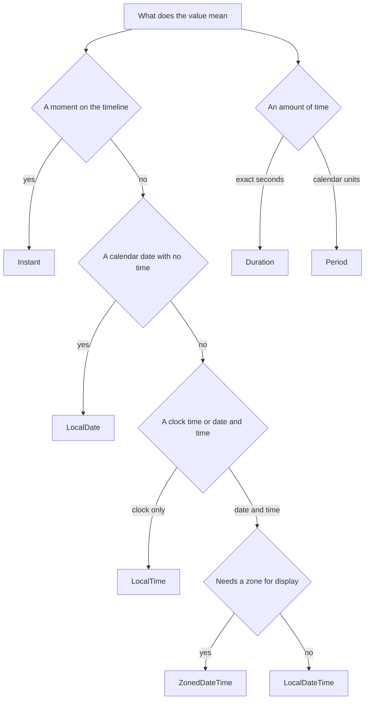

# Date and Time (java.time)

!!! note "In simple words"
    Use the `java.time` types for dates and times. Store a moment in time as an `Instant` in UTC, and convert it to a local time zone only when a person needs to read it.

## Why it matters

Date and time bugs are easy to write and hard to notice. They show up as off-by-one days, wrong hours after a daylight-saving change, and timestamps that differ between servers. The `java.time` package, added in Java 8, was designed to avoid these mistakes. Interviewers ask about it to check that you can pick the right type for each kind of value and that you know why the older `java.util.Date` and `Calendar` classes cause trouble.

## How it works

### Choosing the right type

Each `java.time` type models one idea. Picking the wrong one is the most common mistake.

| Type | Models | Example value |
|---|---|---|
| `LocalDate` | A date, with no time and no zone | `2026-10-29` |
| `LocalTime` | A time of day, with no date and no zone | `14:30` |
| `LocalDateTime` | A date and time, with no zone | `2026-10-29T14:30` |
| `ZonedDateTime` | A date and time in a specific zone | `2026-10-29T14:30+05:30[Asia/Kolkata]` |
| `Instant` | A point on the UTC timeline | `2026-10-29T09:00:00Z` |
| `Duration` | An amount of time in hours, minutes, and seconds | `PT2H30M` |
| `Period` | An amount in years, months, and days | `P1Y2M3D` |
| `ZoneId` | A set of time zone rules | `Europe/London` |

All of these types are immutable. A method that seems to change a value returns a new object instead. The same value can therefore be shared between threads without locks.



### LocalDate, LocalTime, and LocalDateTime

```java
import java.time.LocalDate;
import java.time.LocalDateTime;
import java.time.LocalTime;

public class LocalExample {
    public static void main(String[] args) {
        LocalDate due = LocalDate.of(2026, 11, 15);   // months start at 1, so 11 is November
        LocalTime noon = LocalTime.NOON;
        LocalDateTime meeting = LocalDateTime.of(due, noon);

        System.out.println(due.plusDays(10));          // 2026-11-25
        System.out.println(meeting);                    // 2026-11-15T12:00
        System.out.println(due.getDayOfWeek());         // SUNDAY
    }
}
```

`LocalDate.of` takes a month number that starts at 1. The legacy API started months at 0, so this is one of the easiest mistakes to make when you migrate code.

### Instant and ZonedDateTime

`Instant` is the right type for machine timestamps, such as log entries, database `created_at` columns, and events. `ZonedDateTime` is for showing a time to a person in their own zone.

```java
import java.time.Instant;
import java.time.ZoneId;
import java.time.ZonedDateTime;

public class TimestampExample {
    public static void main(String[] args) {
        Instant now = Instant.now();                                  // always UTC
        ZonedDateTime local = now.atZone(ZoneId.of("Asia/Kolkata"));  // the same moment, shown in a zone
        System.out.println(now);
        System.out.println(local);
    }
}
```

Zone IDs are region names such as `Europe/Paris`, not fixed offsets such as `+01:00`. A region name follows the daylight-saving rules of that place, and a fixed offset does not.

### Duration and Period

`Duration` measures elapsed time in seconds and nanoseconds. `Period` measures calendar amounts, such as "two months", which keep their meaning across months of different lengths and across daylight-saving changes.

```java
import java.time.Duration;
import java.time.LocalDate;
import java.time.Period;

public class AmountExample {
    public static void main(String[] args) {
        Duration d = Duration.ofMinutes(150);
        System.out.println(d);                    // PT2H30M
        System.out.println(d.toHours());          // 2

        Period p = Period.between(LocalDate.of(2024, 1, 31), LocalDate.of(2026, 3, 1));
        System.out.println(p);                    // P2Y1M1D
    }
}
```

To time a piece of code, use `Duration.between(start, end)` with two `Instant` values. Do not use `Period` for elapsed time. `Period.ofDays(1)` is not always 24 hours, because a day can be 23 or 25 hours on a daylight-saving change day.

### DateTimeFormatter

`DateTimeFormatter` parses and formats values. The built-in constants cover the ISO formats, and a pattern covers everything else. The example passes `Locale.ENGLISH` so that month names come out the same on every machine.

```java
import java.time.LocalDate;
import java.time.format.DateTimeFormatter;
import java.util.Locale;

public class FormatExample {
    public static void main(String[] args) {
        DateTimeFormatter fmt = DateTimeFormatter.ofPattern("dd MMM yyyy", Locale.ENGLISH);
        LocalDate d = LocalDate.parse("2026-10-29");               // ISO format by default
        System.out.println(d.format(fmt));                         // 29 Oct 2026
        System.out.println(LocalDate.parse("01 Jan 2027", fmt));   // 2027-01-01
    }
}
```

`DateTimeFormatter` is immutable and thread-safe, so one constant can be shared across the application. Use `yyyy` for the year in normal application code. `uuuu` is the choice when you need a proleptic year that also works with negative values.

### The legacy types: Date, Calendar, and SimpleDateFormat

`java.util.Date`, `java.util.Calendar`, and `java.text.SimpleDateFormat` were written before `java.time`. They have known problems:

- `Date` mixes a timestamp with the default time zone. A `Date` printed on one server can show a different wall-clock time on another.
- `Date.getMonth()` and `Calendar.MONTH` count months from 0, so January is 0. `Date.getYear()` counts years from 1900. Both are easy to misread.
- `Calendar` is mutable. Passing one to another method can change it without warning.
- `SimpleDateFormat` is not thread-safe. Sharing one instance between threads can corrupt parsed values.

Convert between the old and new types only at the edge of your code, using `date.toInstant()` and `Date.from(instant)`:

```java
import java.time.Instant;
import java.util.Date;

public class LegacyBridge {
    public static void main(String[] args) {
        Date legacy = new Date();
        Instant instant = legacy.toInstant();   // legacy to java.time
        Date back = Date.from(instant);         // java.time to legacy
        System.out.println(instant + " " + back);
    }
}
```

### Step by step: deciding how to store and show a time

1. Decide what the value means: a calendar date, a clock time, a moment on the timeline, or an amount of time.
2. Store machine timestamps as `Instant` in UTC, or in a database column type that maps to it.
3. Convert to `ZonedDateTime` or `LocalDateTime` only when you show or read a value for a user in a known zone.
4. Use `Duration` for elapsed time and `Period` for calendar offsets.
5. Format and parse with a shared `DateTimeFormatter` constant. Always state the zone or offset when data crosses a system boundary.

## Where it is used

- **Logging and auditing** store `Instant` values so that events from many servers can be sorted correctly.
- **Scheduling** uses `ZonedDateTime` or `LocalDateTime` with a zone, so that "every day at 09:00" follows the local clock.
- **Billing and due dates** use `LocalDate`, because a due date is a calendar day and not a moment.
- **Timeouts and metrics** use `Duration` to measure elapsed time between two `Instant` values.
- **Integrations** exchange ISO 8601 strings, which `java.time` parses directly.

## Benefits

- **Clear types.** Each type says what kind of time it holds, so mistakes show up in the code, not at run time.
- **Immutable values.** Shared values cannot change under another thread.
- **Correct arithmetic.** Calendar and exact-time arithmetic are kept apart.
- **Thread-safe formatting.** `DateTimeFormatter` can be shared across the application.

## Cons and limits

- **More types to learn.** New users must learn which type fits which case.
- **Zones need data.** Zone rules come from the JDK's time zone data, so they must be kept up to date for new daylight-saving rules.
- **Legacy code is everywhere.** Many libraries still expose `Date` or `Calendar`, so conversions appear at the boundaries.
- **Local values are ambiguous.** A `LocalDateTime` at an overlap or gap in daylight saving can map to two instants or none.

## Best practices

- Store timestamps as `Instant` or as an offset-aware value, and convert for display only.
- Use `LocalDate` for dates such as birthdays and due dates, which do not depend on a zone.
- Use `Duration` for code timing and `Period` for calendar steps such as "one month later".
- Keep `DateTimeFormatter` constants in one place and reuse them.
- Do not use `LocalDateTime` for a moment in time. The same value means different instants on different servers.
- Do not use fixed offsets such as `+05:30` where a region such as `Asia/Kolkata` is needed, because offsets ignore daylight-saving rules.
- Do not use `SimpleDateFormat` with multiple threads. Use `DateTimeFormatter`.
- Parse two-digit years with care, and check which century the pattern assumes.
- Remember that `java.time` months start at 1. `LocalDate.of(2026, 0, 1)` fails, because there is no month 0.

!!! tip "Interview tip"
    **Q: Why is `java.time` better than `java.util.Date`?**
    `java.time` types are immutable, cover the different kinds of time (local date, zoned time, instant, duration) as separate types, use months that start at 1, and keep the time zone rules apart from the value. `Date` is mutable, mixes a moment with the default zone, uses months that start at 0, and comes with `SimpleDateFormat`, which is not thread-safe. Store instants in UTC and convert to a zone only for display.

## Quick recap

- Use `LocalDate` and `LocalDateTime` for values without a zone, `Instant` for timestamps, and `ZonedDateTime` for zoned display.
- `Duration` measures exact elapsed time. `Period` measures calendar amounts.
- `java.time` types are immutable, and their months start at 1.
- `DateTimeFormatter` is thread-safe. `SimpleDateFormat` is not.
- `Date` and `Calendar` are legacy types. Convert to and from them only at the boundary, with `toInstant()` and `Date.from()`.

## Official documentation

- [Java SE 21 API documentation](https://docs.oracle.com/en/java/javase/21/docs/api/index.html)
- [The Java Language Specification, Java SE 21](https://docs.oracle.com/javase/specs/jls/se21/html/index.html)
- [Dev.java, the Java developer site](https://dev.java/)

**See also:** [Java Tools and Utilities](java-tools-utilities.md), [Annotations and Reflection](annotations-and-reflection.md), [Learning index](../index.md)
