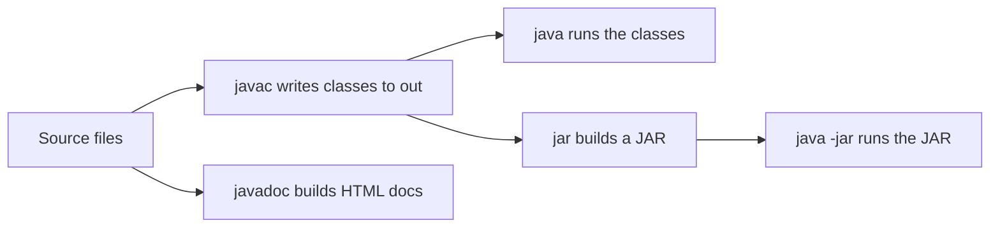

# Java Tools and Utilities

!!! note "In simple words"
    The JDK comes with small command-line tools. You can use them to compile a program, run it, try out code, write documentation, and package the result as a JAR file, all without an IDE.

## Why it matters

Interviewers ask about these tools to check that you understand what the build does underneath. If you can compile, run, document, and package a program by hand, you know what your IDE or build tool is doing for you, and you can debug a broken build without guessing.

The main tools are `java`, `javac`, `jshell`, `javadoc`, and `jar`. Each one is covered below.

## How it works

A typical build with only the JDK tools runs in these steps:

1. Write source files in a folder tree that matches the package names.
2. Compile with `javac -d out ...`, which writes the `.class` files to `out`.
3. Run with `java -cp out com.example.Main`, or package the classes first with `jar`.
4. Add Javadoc comments to public types and methods, then run `javadoc` to make HTML.
5. For a library that needs strong encapsulation, add `module-info.java` and compile with the module source path.



### Command-line arguments

The JVM passes whatever follows the class name on the `java` command line into the `String[] args` parameter of `main`. Every element is a `String`. If you need a number, you must parse it. The shell splits the command line into arguments, not the JVM.

```java
public class Greet {
    public static void main(String[] args) {
        if (args.length == 0) {
            System.out.println("Usage: java Greet <name> [times]");
            return;
        }
        int times = args.length > 1 ? Integer.parseInt(args[1]) : 1;
        for (int i = 0; i < times; i++) {
            System.out.println("Hello, " + args[0]);
        }
    }
}
```

Compile with `javac Greet.java`, then run `java Greet Asha 2`. Put quotes around an argument that contains spaces: `java Greet "Asha Nair"`.

### jshell: the REPL

`jshell` is an interactive read-eval-print loop (REPL), added in Java 9. It is the quickest way to try a library call or a language rule without writing a class.

```text
$ jshell
jshell> int square(int x) { return x * x; }
|  created method square(int)
jshell> square(7)
$2 ==> 49
jshell> /exit
```

Useful commands are `/exit` to leave, `/list` to see the snippets you entered, and `/save` to write them to a file. Snippets need no `public class` wrapper. Treat jshell as a sandbox, because its state exists only for that session.

### Javadoc

Javadoc comments start with `/**`. The `javadoc` tool reads them and produces HTML API documentation. Block tags such as `@param`, `@return`, and `@throws` describe the parameters, the result, and the exceptions.

```java
public class Pricing {
    /**
     * Returns the total price after applying a discount.
     *
     * @param price   the list price, must not be negative
     * @param percent the discount in the range 0 to 100
     * @return the discounted price
     * @throws IllegalArgumentException if {@code percent} is outside 0 to 100
     */
    public static double discounted(double price, double percent) {
        if (percent < 0 || percent > 100) {
            throw new IllegalArgumentException("percent out of range: " + percent);
        }
        return price * (1 - percent / 100);
    }

    public static void main(String[] args) {
        System.out.println(discounted(200.0, 25.0));   // 150.0
    }
}
```

Generate the HTML with `javadoc -d docs/api -sourcepath src -subpackages com.example`. Use `{@code ...}` for inline code and `{@link ...}` for a cross-reference. Write Javadoc for the public API, and use plain `//` comments for implementation details.

### JAR files

A JAR is a ZIP archive that contains a `META-INF/MANIFEST.MF` file. The manifest can name the entry-point class with `Main-Class`, which lets you run the archive with `java -jar`.

| Command | What it does |
|---|---|
| `jar cf app.jar -C out .` | Create a JAR from the compiled classes in `out` |
| `jar cfe app.jar com.example.Main -C out .` | Create a JAR and set `Main-Class` with the `e` option |
| `jar tf app.jar` | List the contents |
| `jar xf app.jar` | Extract the contents |
| `java -jar app.jar` | Run the entry point named in the manifest |

Dependencies on the class path are not bundled by default. Build tools such as Maven and Gradle can produce a "fat" or "uber" JAR when you need one self-contained file.

### Multi-release JARs

A multi-release JAR (MRJAR) contains one set of classes for the baseline Java version. It also contains versioned classes under `META-INF/versions/<N>/`. The JVM uses the highest version it supports. A library can therefore use newer APIs on new runtimes and still run on older ones.

```text
app.jar
  com/example/Hasher.class                       <- baseline, runs on any supported release
  META-INF/versions/9/com/example/Hasher.class   <- used on Java 9 and later
  META-INF/MANIFEST.MF                           <- must contain "Multi-Release: true"
```

The manifest needs the attribute `Multi-Release: true`. Without it, the JVM ignores the versioned directories.

### Modules (JPMS)

The Java Platform Module System (JPMS), added in Java 9, groups packages into named modules. A module states which other modules it needs and which of its packages it shares. The declaration lives in `module-info.java` at the root of the module's source tree.

```java
// src/com.example.shop/module-info.java
module com.example.shop {
    requires java.logging;          // this module reads the java.logging module
    exports com.example.shop.api;   // other modules may use this package
    // com.example.shop.internal is not exported, so it stays hidden
}
```

- `requires` declares a dependency on another module. Without it, your code cannot compile against that module's packages.
- `exports` makes a package visible to other modules. A package you do not export stays encapsulated, even when its classes are `public`.
- `opens` allows deep reflection into a package. Dependency injection containers need it to read private fields.

Compile and run a module from the command line like this, and check the flags for your JDK release in the official documentation:

```bash
javac -d out --module-source-path src $(find src -name "*.java")
java -p out -m com.example.shop/com.example.shop.api.Main
```

### Nashorn: history only

Nashorn was a JavaScript engine shipped with the JDK from Java 8. It was deprecated in Java 11 and removed in Java 15. Do not use it in new code. If you need scripting from Java today, call an external engine or run the script in a separate process.

## Where it is used

- **Quick experiments** in `jshell` replace a scratch project when you want to check a method call.
- **Library authors** generate API docs with `javadoc` and publish them with the release.
- **Continuous integration** runs `javac` and `jar` steps directly when a build tool is not in use.
- **Support and debugging** use `java -jar` on a delivered JAR, and `jar tf` to check what is inside it.
- **Modular libraries** use `module-info.java` to hide internal packages from callers.

## Benefits

- **Nothing extra to install.** The tools come with every JDK, so they work on a clean machine.
- **Fast feedback.** `jshell` shows results immediately, with no project setup.
- **Self-documenting code.** Javadoc turns comments on the public API into a reference site.
- **Portable packaging.** A JAR runs on any JVM that supports its class file version.

## Cons and limits

- **No dependency management.** The plain tools do not download libraries, so large projects need a build tool.
- **Manual steps are error-prone.** A missing `Main-Class` or `Multi-Release` entry fails silently or with a vague message.
- **jshell state is temporary.** Work done in one session is gone when you exit, unless you save it.
- **Modules add friction.** Encapsulation can break reflection-based frameworks until you open the packages they use.

## Best practices

- Treat every `args` element as text. Parse numbers explicitly and handle bad input with a clear usage message.
- Use `jshell` to test a single call, and move anything worth keeping into a class with a test.
- Document every public type and method with Javadoc. Keep implementation notes as ordinary comments.
- Check a new JAR with `jar tf` before you ship it, to confirm the manifest and the classes.
- Keep internal packages out of `exports`. An exported package becomes a public contract that you must maintain.
- Do not write `{@link}` references that do not resolve. The `javadoc` tool reports them as errors.
- Do not use Nashorn. Choose a supported scripting approach instead.

!!! tip "Interview tip"
    **Q: What is the difference between a JAR and a module?**
    A JAR is a packaging format: an archive of classes and resources. A module is a language-level unit that has a `module-info.java` file. That file declares what the module needs (`requires`) and what it offers (`exports`). A modular JAR is a JAR that includes a module descriptor. Modules give you strong encapsulation at compile time and at run time, while a plain JAR on the class path gives you only the usual `public` and non-public access rules.

## Quick recap

- `args` holds raw strings from the command line. Parse the values yourself.
- `jshell` is a REPL for quick experiments, and it does not keep state after you exit.
- Javadoc uses `@param`, `@return`, and `@throws`, and the `javadoc` tool turns it into HTML.
- A JAR is a ZIP archive with a manifest. The `Main-Class` attribute makes it runnable with `java -jar`.
- Multi-release JARs keep version-specific classes under `META-INF/versions/`.
- JPMS (Java 9+) uses `module-info.java`, `requires`, and `exports` to encapsulate packages. Nashorn was removed in Java 15.

## Official documentation

- [Java SE 21 API documentation](https://docs.oracle.com/en/java/javase/21/docs/api/index.html)
- [The Java Language Specification, Java SE 21](https://docs.oracle.com/javase/specs/jls/se21/html/index.html)
- [Dev.java, the Java developer site](https://dev.java/)

**See also:** [Date and Time (java.time)](date-time.md), [Annotations and Reflection](annotations-and-reflection.md), [Learning index](../index.md)
