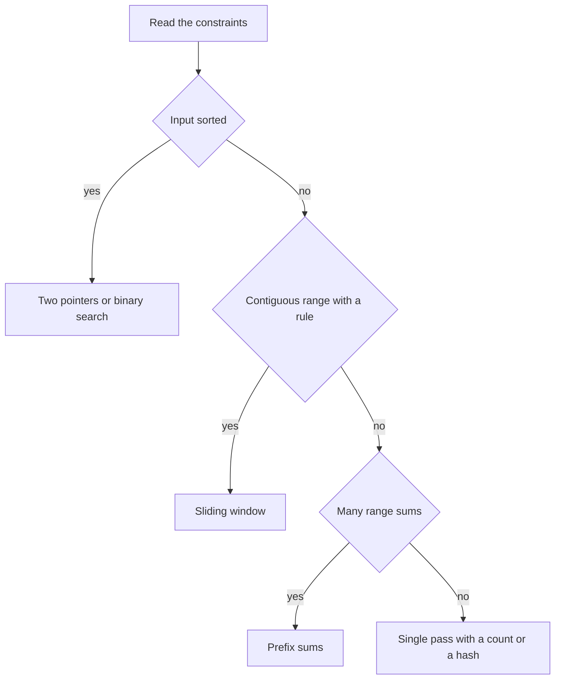

# Arrays and Strings

!!! note "In simple words"
    An array is a row of boxes with numbers, and you can jump straight to any box by its index. Most array and string problems ask you to replace a slow double loop with one pass over the data, or with a search that halves the range each time.

## Why it matters

Arrays and strings appear in almost every coding interview, often as the first question. The interviewer wants to see whether you can notice a pattern in the problem, such as sorted input, a contiguous range, or repeated range sums, and then pick the technique that reduces the work. A correct answer that uses nested loops is usually the starting point, and the follow-up is how to make it faster.

## How it works

### Array operations and their costs

An array is a fixed-size block of memory with elements stored next to each other. Reading an element by its index takes constant time. Finding a value in an unsorted array means checking each element. Inserting or deleting in the middle means shifting elements, which takes linear time. Sorting costs O(n log n) in general.

| Operation | Unsorted array | Sorted array |
|---|---|---|
| Access by index | O(1) | O(1) |
| Search by value | O(n) | O(log n) with binary search |
| Insert or delete in the middle | O(n) | O(n) |
| Append at the end of an `ArrayList` | O(1) amortized | O(1) amortized |
| Sort | O(n log n) | Already sorted |

In Java, `Arrays.sort` uses a dual-pivot quicksort for primitive arrays. For object arrays it uses TimSort, which is stable. For object lists, use `List.sort` or `Collections.sort`.

### Two pointers

Use two indexes that move toward each other, or both move in the same direction. On a sorted array, this finds a pair with a target sum in one pass.

```java
import java.util.Arrays;

public class TwoPointers {
    // Returns the indexes of two values that add up to target, or an empty array
    static int[] twoSumSorted(int[] a, int target) {
        int lo = 0;
        int hi = a.length - 1;
        while (lo < hi) {
            int sum = a[lo] + a[hi];
            if (sum == target) {
                return new int[] {lo, hi};
            }
            if (sum < target) {
                lo++;                 // the sum is too small, so move the left index right
            } else {
                hi--;                 // the sum is too large, so move the right index left
            }
        }
        return new int[0];
    }

    public static void main(String[] args) {
        System.out.println(Arrays.toString(twoSumSorted(new int[] {1, 2, 4, 7, 11, 15}, 15)));  // [2, 4]
    }
}
```

The loop runs in O(n) time and uses O(1) extra space. The same movement rule works for palindrome checks, reversing in place, and removing duplicates from a sorted array.

### Sliding window

A window is a contiguous range from `left` to `right`. Extend the window on the right. Move the left edge forward when the window breaks a rule. A fixed-size window moves one step at a time. A variable-size window keeps shrinking from the left until the rule holds again.

```java
public class SlidingWindow {
    // Longest contiguous run whose sum is at most k. Requires non-negative values.
    static int longestAtMost(int[] a, int k) {
        int best = 0;
        int sum = 0;
        int left = 0;
        for (int right = 0; right < a.length; right++) {
            sum += a[right];
            while (sum > k) {
                sum -= a[left];
                left++;
            }
            best = Math.max(best, right - left + 1);
        }
        return best;
    }

    public static void main(String[] args) {
        System.out.println(longestAtMost(new int[] {2, 1, 3, 1, 1}, 5));   // 3
    }
}
```

Each index enters the window once and leaves it at most once, so the total time is O(n).

### Binary search and its variants

Binary search halves the search range at each step. It takes O(log n) time and O(1) space. A common bug is overflow in the midpoint calculation. Write `lo + (hi - lo) / 2` and not `(lo + hi) / 2`.

The most useful variant is the **lower bound**. It returns the first index whose value is at least the target. The code below uses a half-open range `[lo, hi)`, which keeps the boundary rules simple.

```java
public class LowerBound {
    // First index i with a[i] >= target, or a.length when every value is smaller
    static int lowerBound(int[] a, int target) {
        int lo = 0;
        int hi = a.length;                 // half-open range [lo, hi)
        while (lo < hi) {
            int mid = lo + (hi - lo) / 2;
            if (a[mid] < target) {
                lo = mid + 1;
            } else {
                hi = mid;
            }
        }
        return lo;
    }

    public static void main(String[] args) {
        int[] sorted = {1, 2, 2, 2, 5, 8};
        System.out.println(lowerBound(sorted, 2));   // 1
        System.out.println(lowerBound(sorted, 6));   // 5
    }
}
```

The first occurrence of a value is the lower bound of that value. The last occurrence is the upper bound minus one. A rotated sorted array (distinct values) also works with a binary search. Compare `a[mid]` with `a[hi]`. If `a[mid]` is larger, the minimum lies to the right of `mid`. Otherwise the minimum is at `mid` or to its left.

```java
public class RotatedMin {
    // Minimum of a rotated sorted array with distinct values
    static int minimum(int[] a) {
        int lo = 0;
        int hi = a.length - 1;
        while (lo < hi) {
            int mid = lo + (hi - lo) / 2;
            if (a[mid] > a[hi]) {
                lo = mid + 1;
            } else {
                hi = mid;
            }
        }
        return a[lo];
    }

    public static void main(String[] args) {
        System.out.println(minimum(new int[] {4, 5, 6, 7, 0, 1, 2}));   // 0
    }
}
```

`Arrays.binarySearch` returns the index of a match. When the value is missing it returns `-(insertion point) - 1`. It does not promise which duplicate it returns, so write your own loop when duplicates matter.

### Prefix sums

Build a table of running totals once. After that, the sum of any range takes O(1) time.

```java
public class PrefixSums {
    public static void main(String[] args) {
        int[] a = {2, 4, 6, 8};
        int[] prefix = new int[a.length + 1];      // prefix[i] holds the sum of a[0..i-1]
        for (int i = 0; i < a.length; i++) {
            prefix[i + 1] = prefix[i] + a[i];
        }
        int l = 1;
        int r = 2;
        int rangeSum = prefix[r + 1] - prefix[l];  // sum of a[l..r], inclusive
        System.out.println(rangeSum);              // 10
    }
}
```

Building the table takes O(n) time and O(n) space. Each query is O(1). A hash map of prefix sums extends the idea: it counts subarrays with a given sum in O(n) time.

### Strings in Java

A `String` is immutable. Each concatenation in a loop creates a new object, so build text with `StringBuilder`. Compare text with `equals`, never `==`, because `==` compares references. Use `charAt` to read one character, and `toCharArray` when you need to sort or change characters.

The anagram check below counts letters. It is O(n) time, and its space is constant for a fixed alphabet.

```java
public class Anagram {
    // Lowercase letters only: count each letter, then check that all counts are zero
    static boolean isAnagram(String s, String t) {
        if (s.length() != t.length()) {
            return false;
        }
        int[] counts = new int[26];
        for (int i = 0; i < s.length(); i++) {
            counts[s.charAt(i) - 'a']++;
            counts[t.charAt(i) - 'a']--;
        }
        for (int c : counts) {
            if (c != 0) {
                return false;
            }
        }
        return true;
    }

    public static void main(String[] args) {
        System.out.println(isAnagram("listen", "silent"));   // true
        System.out.println(isAnagram("cat", "dog"));         // false
    }
}
```

### Palindrome checks

A palindrome reads the same forwards and backwards. Compare characters from both ends and move inward. If the problem ignores spaces and letter case, normalize the text first. The iterative version below is safe for long input. The recursive version uses one call-stack frame per pair, so very long input can overflow the stack.

```java
import java.util.stream.IntStream;

public class Palindrome {
    static boolean isPalindrome(String text) {
        String clean = text.replaceAll("\\s+", "").toLowerCase();
        return IntStream.range(0, clean.length() / 2)
                .allMatch(i -> clean.charAt(i) == clean.charAt(clean.length() - 1 - i));
    }

    static boolean isPalindromeRecursive(String clean, int lo, int hi) {
        if (lo >= hi) {
            return true;
        }
        return clean.charAt(lo) == clean.charAt(hi)
                && isPalindromeRecursive(clean, lo + 1, hi - 1);
    }

    public static void main(String[] args) {
        System.out.println(isPalindrome("A man a plan a canal Panama"));                 // true
        System.out.println(isPalindromeRecursive("racecar", 0, "racecar".length() - 1)); // true
    }
}
```

### String matching: KMP

Trying every start position to find a pattern of length m in a text of length n costs O(n·m). The Knuth-Morris-Pratt (KMP) algorithm avoids repeated comparisons with a prefix table. For each position in the pattern, the table stores the length of the longest proper prefix that is also a suffix. With that table, the search takes O(n + m) time.

```java
public class Kmp {
    // pi[i] = length of the longest proper prefix of pat[0..i] that is also a suffix
    static int[] prefixFunction(String pat) {
        int[] pi = new int[pat.length()];
        int k = 0;
        for (int i = 1; i < pat.length(); i++) {
            while (k > 0 && pat.charAt(i) != pat.charAt(k)) {
                k = pi[k - 1];
            }
            if (pat.charAt(i) == pat.charAt(k)) {
                k++;
            }
            pi[i] = k;
        }
        return pi;
    }

    // First index of pat in text, or -1. Assumes pat is not empty.
    static int kmpSearch(String text, String pat) {
        int[] pi = prefixFunction(pat);
        int k = 0;
        for (int i = 0; i < text.length(); i++) {
            while (k > 0 && text.charAt(i) != pat.charAt(k)) {
                k = pi[k - 1];
            }
            if (text.charAt(i) == pat.charAt(k)) {
                k++;
            }
            if (k == pat.length()) {
                return i - pat.length() + 1;
            }
        }
        return -1;
    }

    public static void main(String[] args) {
        System.out.println(kmpSearch("abxabcabcaby", "abcaby"));   // 6
    }
}
```

**Rabin-Karp** keeps a rolling hash of each window of the text and compares it with the hash of the pattern. It takes O(n + m) time on average, and O(n·m) in the worst case, when many hashes collide. Every hash match must be checked character by character.

**The Z-algorithm** builds an array where `z[i]` is the length of the longest substring starting at `i` that matches a prefix of the string. Joining the pattern, a separator character, and the text gives an O(n + m) search. Learn KMP first, because it is the answer interviewers expect most often.

### Worked example: longest run with sum at most k

Input `a = [2, 1, 3, 1, 1]` and `k = 5`. The table shows the window after each step.

| right | a[right] | sum before shrinking | left after shrinking | window | length |
|---|---|---|---|---|---|
| 0 | 2 | 2 | 0 | [2] | 1 |
| 1 | 1 | 3 | 0 | [2, 1] | 2 |
| 2 | 3 | 6, too large, remove 2 | 1 | [1, 3] | 2 |
| 3 | 1 | 5 | 1 | [1, 3, 1] | 3 |
| 4 | 1 | 6, too large, remove 1 | 2 | [3, 1, 1] | 3 |

The best length is 3. Each index entered once and left at most once, so the run is O(n).

### Complexity

| Technique | Time | Extra space | Typical input |
|---|---|---|---|
| Linear scan | O(n) | O(1) | Any array |
| Two pointers | O(n) | O(1) | Sorted array, pair search |
| Sliding window | O(n) | O(1) to O(k) | Contiguous range with a rule |
| Binary search | O(log n) | O(1) | Sorted array or monotonic condition |
| Prefix sums | O(n) build, O(1) per query | O(n) | Many range-sum queries |
| Counting anagram letters | O(n) | O(1) for a fixed alphabet | Lowercase letters |
| KMP search | O(n + m) | O(m) | Substring search |
| Brute-force substring search | O(n·m) | O(1) | Small inputs only |

### Choosing a pattern

| Clue in the problem | Pattern to try |
|---|---|
| Sorted array, find a pair or a triple | Two pointers |
| Longest or shortest contiguous range with a condition | Sliding window |
| Sorted or monotonic search space | Binary search |
| Many range-sum queries | Prefix sums |
| Find a substring in a large text | KMP |
| Count anagrams or letter frequencies | A count array of size 26 |



## Where it is used

- **Text processing** uses KMP-style matching in search tools and in text editors.
- **Analytics** uses prefix sums to answer "total sales between two dates" quickly.
- **Streaming and monitoring** use sliding windows to compute recent averages or maximum values.
- **Databases and libraries** use binary search on sorted data, such as an index or a sorted list.
- **Input validation** uses palindrome and anagram checks in parsers and in data cleaning.

## Benefits

- **Fast access.** Index access is O(1), which makes arrays a good base for many algorithms.
- **Compact memory.** Primitive arrays store values without object overhead.
- **Simple patterns.** Two pointers, windows, and binary search fit in a few lines of code.
- **Predictable cost.** The bounds are easy to state and to test.

## Cons and limits

- **Fixed size.** A plain array cannot grow. Use `ArrayList` when the size changes.
- **Costly middle edits.** Inserting or deleting in the middle shifts elements.
- **Strings are immutable.** Each change creates a new string, so loops need a `StringBuilder`.
- **Sliding windows need the right rule.** Shrinking-window logic is valid only when values are non-negative, or when the rule is monotonic.
- **Binary search needs order.** On unsorted data, it returns meaningless results.

## Best practices

- Read the constraints first. Sorted input suggests binary search or two pointers. Non-negative values suggest a sliding window.
- Choose one bound convention, either closed or half-open, and keep it for the whole method.
- Use `lo + (hi - lo) / 2` in binary search.
- Compare strings with `equals`, and build long strings with `StringBuilder`.
- Check `i < s.length()` before you call `charAt`.
- Test the edge cases: an empty array, one element, all equal values, and a target that is not present.
- Do not rely on `Arrays.binarySearch` to return the first of several duplicates.
- Say the time and space cost before you finish the answer.

!!! tip "Interview tip"
    **Q: Why does a sliding window run in O(n) when it has a nested `while` loop?**
    Each index is added to the window once, on the right, and removed at most once, on the left. The total number of moves is at most 2n, so the work is linear.

## Quick recap

- Index access is O(1). Search is O(n) on unsorted data and O(log n) on sorted data.
- Two pointers and sliding windows turn nested loops into one pass.
- Binary search needs a monotonic condition, and the boundary rules need one clear convention.
- Prefix sums turn repeated range sums into O(1) queries.
- KMP finds a pattern in O(n + m) using a prefix table.
- Palindrome checks compare pairs from both ends, after you normalize case and spaces.

## Official documentation

- [Java SE 21 API documentation](https://docs.oracle.com/en/java/javase/21/docs/api/index.html)
- [The Java Language Specification, Java SE 21](https://docs.oracle.com/javase/specs/jls/se21/html/index.html)
- [Dev.java, the Java developer site](https://dev.java/)

**See also:** [Linked Lists](linked-lists.md), [Stacks and Queues](stacks-queues.md), [Trees](trees.md), [DSA Foundations](index.md)
