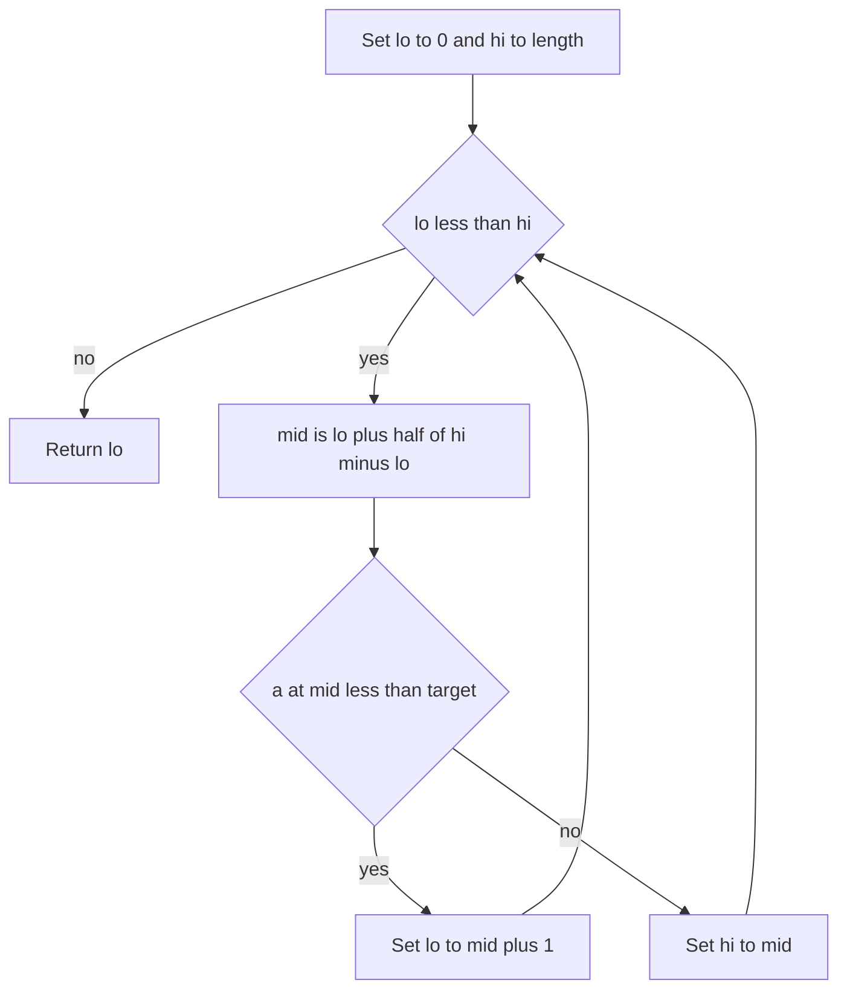
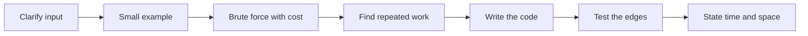

# Complexity, Sorting and Searching

!!! note "In simple words"
    Big-O notation tells you how much work an algorithm does as the input grows. Sorting puts items in order, and searching finds an item. Knowing the cost of each choice lets you pick the one that stays fast on large input.

## Why it matters

Expect interviewers to ask for the time and space cost of each answer you give, along with the usual costs for sorting, searching, and common data structures. A correct O(n²) solution can break down on big inputs, and you will likely be asked to speed it up. This page supplies the terms and reference figures for that conversation.

## How it works

### Growth rates

The rows below run from the slowest-growing class to the fastest, showing what happens when the input size doubles.

| Class | Typical example | Work when n doubles |
|---|---|---|
| O(1) | Indexing an array; average hash lookup | Unchanged |
| O(log n) | Binary search | One extra step |
| O(n) | A single loop over an array | Doubles |
| O(n log n) | A fast comparison-based sort | Slightly more than doubles |
| O(n²) | Two nested loops over one input | Quadruples |
| O(2ⁿ) | Listing every subset | Squares |
| O(n!) | Listing every permutation | Blows up |

Strip constant multipliers and lower-order terms: `3n² + 5n + 2` simplifies to O(n²). Report time and space as two separate figures, and specify whether you mean worst case, average case, or amortized cost. Hash lookups are O(1) on average, while appending to an `ArrayList` is O(1) amortized, since the rare resize that copies every element gets spread across many appends.

### Worked example: how many steps for n = 1,000,000

Plugging in a real size makes the classes easier to picture. Figures are approximate.

| Class | Approximate operations for n = 1,000,000 | Comment |
|---|---|---|
| O(log n) | 20 | About 20 halvings with binary search |
| O(n) | 1,000,000 | One pass touches every element |
| O(n log n) | 20,000,000 | Typical of efficient sorts |
| O(n²) | 1,000,000,000,000 | Far beyond a usual time limit |

That gulf between n log n and n² is why interviewers care so much about which sort or search you pick.

### Operation costs of common structures

| Structure | Access by index | Search | Insert | Delete | Notes |
|---|---|---|---|---|---|
| Array | O(1) | O(n) | O(n) | O(n) | Fixed length; inserts and deletes shift elements |
| `ArrayList` | O(1) | O(n) | O(1) amortized at the end, O(n) in the middle | O(n) | Occasional resizing |
| Linked list | O(n) | O(n) | O(1) at a known node | O(1) at a known node | Reaching the node first costs O(n) |
| `ArrayDeque` | None | O(n) | O(1) at either end | O(1) at either end | The API offers no index access |
| `HashMap` and `HashSet` | None | O(1) average | O(1) average | O(1) average | Heavy collisions drag it toward O(n) |
| `TreeMap` and `TreeSet` | None | O(log n) | O(log n) | O(log n) | Stores keys in order and allows range queries |
| `PriorityQueue` | None | O(n) | O(log n) | O(log n) to remove the top | Reading the top is O(1) |

The hash row relies on a well-distributed hash function and a controlled load factor. When buckets get crowded, Java's `HashMap` turns them into trees, which caps the cost of heavy collisions (see [Greedy, Bit Manipulation and Hashing](../04b-dsa-advanced/greedy-bit-manipulation-hashing.md)).

### Sorting algorithms

| Algorithm | Average time | Worst time | Extra space | Stable |
|---|---|---|---|---|
| Quicksort | O(n log n) | O(n²) | O(log n) | No |
| Mergesort | O(n log n) | O(n log n) | O(n) | Yes |
| Heapsort | O(n log n) | O(n log n) | O(1) | No |
| Insertion sort | O(n²) | O(n²) | O(1) | Yes |

Quicksort degrades to its O(n²) case only when pivots keep landing badly. Choosing pivots at random or by median-of-three makes that improbable. Insertion sort falls behind on large unordered data, yet it beats most algorithms on tiny or almost-sorted arrays, which is why hybrid sorts hand small ranges to it. Heapsort offers O(n log n) without a second array, but it lacks stability and tends to trail quicksort on ordinary data.

**Java.** For primitive arrays, `Arrays.sort` runs a dual-pivot quicksort. Stability is irrelevant there, since equal primitives are indistinguishable. For object arrays, `Arrays.sort`, `Collections.sort`, and `List.sort` rely on TimSort, a stable merge-style algorithm whose worst case is O(n log n).

### Searching

- **Linear search** inspects elements one by one. It runs in O(n) and needs no ordering.
- **Binary search** discards half of a sorted range on every step, giving O(log n). The same logic applies to any monotonic yes-or-no condition, not just to sorted arrays.

Variations you will meet:

- **First or last occurrence.** On a hit, save the index and keep searching the half where an earlier or later match could still sit.
- **Rotated sorted array.** Each step identifies the half that is still in order, then tests whether the target falls inside it.
- **Search on the answer.** If a yes-or-no test flips monotonically as some quantity grows, binary search that quantity. One example: find the least capacity that finishes a job within d days.

A lower-bound search finds the earliest index holding a value at least as large as the target. Working with a half-open range `[lo, hi)` keeps the boundary logic simple:

```java
public class LowerBound {
    // First index i with a[i] >= target, or a.length if none
    static int lowerBound(int[] a, int target) {
        int lo = 0;
        int hi = a.length;                 // search the range [lo, hi)
        while (lo < hi) {
            int mid = lo + (hi - lo) / 2;
            if (a[mid] < target) {
                lo = mid + 1;
            } else {
                hi = mid;
            }
        }
        return lo;
    }

    public static void main(String[] args) {
        int[] sorted = {1, 2, 2, 2, 5, 8};
        System.out.println(lowerBound(sorted, 2));   // 1
        System.out.println(lowerBound(sorted, 6));   // 5
    }
}
```

`Arrays.binarySearch` hands back the index of a match, yet with duplicates it gives no guarantee about which copy. For a missing key it returns a negative number that still encodes where the key would be inserted.

### Complexity summary for sorting and searching

| Task | Algorithm | Best or average time | Worst time | Extra space |
|---|---|---|---|---|
| Lookup, unordered input | Linear search | O(n) | O(n) | O(1) |
| Lookup, ordered input | Binary search | O(log n) | O(log n) | O(1) |
| Sorting primitives | Dual-pivot quicksort (`Arrays.sort`) | O(n log n) | O(n²) in theory | O(log n) |
| Stable sort of objects | TimSort (`List.sort`) | O(n) on sorted runs, O(n log n) typical | O(n log n) | O(n) |
| Sort with a firm upper bound | Mergesort or heapsort | O(n log n) | O(n log n) | O(n) or O(1) |

### Worked trace: lower bound of 2

Take `a = [1, 2, 2, 2, 5, 8]` with target `2`, tracking the half-open range `[lo, hi)`.

| Step | lo | hi | mid | a[mid] | Decision |
|---|---|---|---|---|---|
| 1 | 0 | 6 | 3 | 2 | Not below 2, so set hi to 3 |
| 2 | 0 | 3 | 1 | 2 | Not below 2, so set hi to 1 |
| 3 | 0 | 1 | 0 | 1 | Below 2, so set lo to 1 |
| End | 1 | 1 | | | Range is empty, so return lo = 1 |

Index 1 is the earliest spot holding a value of at least 2. That took three comparisons across six elements.



### Core patterns and where they live

| Pattern | Use it for | Covered in |
|---|---|---|
| Two pointers | Pair finding in sorted arrays, palindrome checks, deduplication | [Arrays and Strings](arrays-strings.md) |
| Sliding window | Longest valid substring, top sum for a fixed-size window | [Arrays and Strings](arrays-strings.md) |
| Recursion and backtracking | Subsets, permutations, combinations, N-queens | [Backtracking and Recursion](../04b-dsa-advanced/backtracking-recursion.md) |
| BFS and DFS | Trees and graphs; BFS for shortest unweighted paths, topological ordering of DAGs | [Trees](trees.md), [Graphs](../04b-dsa-advanced/graphs.md) |
| Dynamic programming | Problems with overlapping subproblems and optimal substructure | [Dynamic Programming](../04b-dsa-advanced/dynamic-programming.md) |
| Greedy | Local choices that provably produce a global optimum, e.g. interval scheduling | [Greedy, Bit Manipulation and Hashing](../04b-dsa-advanced/greedy-bit-manipulation-hashing.md) |

A few algorithms span more than one pattern. Kadane's method for the maximum subarray sum sits in [Dynamic Programming](../04b-dsa-advanced/dynamic-programming.md). Dijkstra's algorithm for non-negative edge weights, Union-Find, and Floyd's cycle detection are discussed in [Graphs](../04b-dsa-advanced/graphs.md) and [Linked Lists](linked-lists.md).

### Choosing a data structure

| Need | Pick | Why |
|---|---|---|
| Lookup by key | `HashMap` or `HashSet` | Average O(1) |
| Sorted keys and range queries | `TreeMap` or `TreeSet` | O(log n) operations with sorted iteration |
| FIFO order | `ArrayDeque` with `offer` and `poll` | Constant-time work at both ends |
| LIFO order | `ArrayDeque` with `push` and `pop` | Sidesteps the old `Stack` class |
| Repeated min/max or top-k queries | `PriorityQueue` | O(log n) per change |
| Prefix queries on strings | Trie | Cost scales with word length |
| Fixed size, indexed reads | Array | Constant-time indexing |

### Step by step: answering a coding question

1. Pin down the input, its size limits, the expected output, and tricky edge cases.
2. Trace a tiny example manually.
3. Describe a brute-force approach with its time and space cost.
4. Locate the duplicated work or wasted search and remove it.
5. Write readable code with descriptive names.
6. Probe the boundaries: empty input, a single element, duplicates, negatives, and the maximum size.
7. Close with the final time and space complexity and the reasoning behind it.



## Where it is used

- **Database indexes and sorted files** rely on binary search and balanced trees to find rows quickly.
- **Reporting and ranking** sort data, often with a stable sort so earlier orderings survive.
- **Caches and symbol tables** depend on hash maps for almost-constant-time access.
- **Leaderboards and schedulers** keep the best items within reach using heaps or tree sets.
- **Input validation and search boxes** binary-search sorted reference lists.

## Benefits

- **Shared vocabulary.** Big-O lets you compare approaches on paper, without benchmarking them.
- **Reliable decisions.** Familiar sort and search costs help you match a tool to the input size.
- **Early warnings.** A quick estimate reveals whether a design can handle a large input.

## Cons and limits

- **Big-O ignores constants.** On very small inputs, an O(n log n) sort can lose to an O(n²) approach.
- **Averages can mislead.** Hash tables reach O(1) only when the hash function spreads keys well and collisions stay in check.
- **Rare worst cases still happen.** Poor or adversarial pivot choices can push quicksort to O(n²).
- **Memory counts too.** A quick method that demands a big auxiliary array may be unsuitable.

## Best practices

- State both time and space for every answer, and name the case you are describing: worst, average, or amortized.
- Include the call stack when you count the space of a recursive solution.
- Attach assumptions to any hash table cost you quote, and bring up collisions.
- Pick one boundary convention for binary search, closed or half-open, and stick with it.
- Reach for `Arrays.sort` on primitives, and for `List.sort` or `Collections.sort` when objects need a stable order.
- Prefer `ArrayDeque` over the legacy `java.util.Stack`.
- Try your binary search on short arrays containing duplicates, plus a target that is absent.

!!! tip "Interview tip"
    **Q: Which sort would you use for a list of objects in Java, and why?**
    Call `List.sort` or `Collections.sort`, both backed by TimSort. Stability matters when you sort by one field and then by another. Its worst case is O(n log n). For primitive arrays, `Arrays.sort` is typically quicker, and stability is irrelevant. Point out that quicksort can degrade to O(n²).

## Quick recap

- Order the growth classes O(1), O(log n), O(n), O(n log n), O(n²), O(2ⁿ), O(n!), and give time and space for every answer.
- Hash tables offer average O(1) lookups; tree maps offer O(log n) lookups that stay ordered.
- Mergesort and heapsort are guaranteed O(n log n). Quicksort is quick on average but can hit O(n²).
- Binary search applies to any monotonic condition, and it needs a single, consistent boundary rule.
- Choose the data structure around the operation you run most.

## Official documentation

- [java.util.HashMap, Java SE 21](https://docs.oracle.com/en/java/javase/21/docs/api/java.base/java/util/HashMap.html)
- [Java SE 21 API documentation](https://docs.oracle.com/en/java/javase/21/docs/api/index.html)
- [The Java Language Specification, Java SE 21](https://docs.oracle.com/javase/specs/jls/se21/html/index.html)

**See also:** [Arrays and Strings](arrays-strings.md), [Heaps and Tries](heaps-and-tries.md), [Trees](trees.md), [Dynamic Programming](../04b-dsa-advanced/dynamic-programming.md), [DSA Foundations](index.md)
