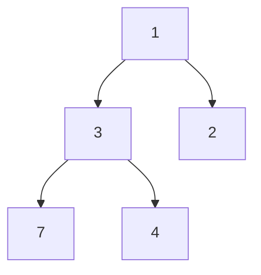
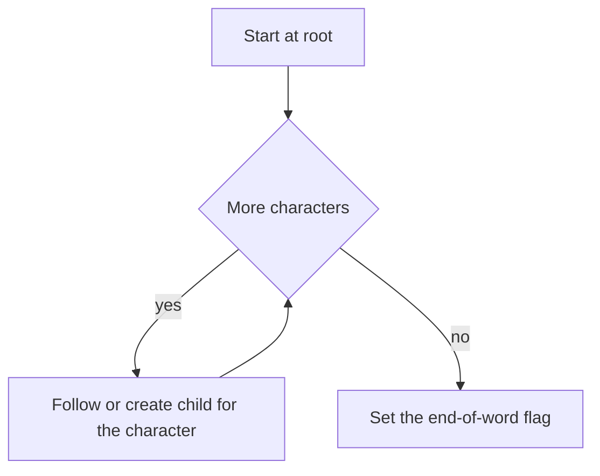

# Heaps and Tries

!!! note "In simple words"
    A heap is a structure that always gives you the smallest (or largest) item fastest. A trie is a tree of characters that groups words by the start they share, so you can check prefixes quickly.

## Why it matters

Heaps answer questions about "the best item so far", such as the top k values, the next task to run, or the merge of several sorted streams. Tries answer questions about words, such as autocomplete, dictionary lookup, and prefix checks. Interviewers ask about both to see whether you can pick a structure that matches the question, and whether you know what each one costs.

## How it works

### Heaps as complete binary trees

A heap is a complete binary tree. Every level is full except possibly the last, and the last level fills from left to right. A heap also follows the heap property. In a min-heap, each parent is less than or equal to its children, so the smallest value sits at the root. A max-heap reverses the comparison.



Because the shape is complete, the heap fits into an array without pointers. With zero-based indexes, the parent of index `i` is `(i - 1) / 2`, and its children are `2i + 1` and `2i + 2`. The tree above is stored as `[1, 3, 2, 7, 4]`.

| Operation | Cost | How it works |
|---|---|---|
| Peek at the root | O(1) | Read index 0 |
| Insert | O(log n) | Append at the end, then move the value up while it is smaller than its parent |
| Remove the root | O(log n) | Move the last element to the root, then move it down toward the smaller child |
| Build from an array | O(n) | Heapify: sift down from the last parent to the root |
| Search for a value | O(n) | Only the root is ordered, so every node may need checking |

A heap is not a sorted list. It guarantees the root, and nothing more.

### PriorityQueue in Java

`java.util.PriorityQueue` is a binary heap. It is a min-heap by default. For a max-heap, pass `Collections.reverseOrder()` or your own comparator.

```java
import java.util.Collections;
import java.util.PriorityQueue;

public class HeapDemo {
    public static void main(String[] args) {
        PriorityQueue<Integer> minHeap = new PriorityQueue<>();
        PriorityQueue<Integer> maxHeap = new PriorityQueue<>(Collections.reverseOrder());
        for (int v : new int[] {5, 1, 4}) {
            minHeap.offer(v);
            maxHeap.offer(v);
        }
        System.out.println(minHeap.poll());   // 1
        System.out.println(maxHeap.poll());   // 5
        System.out.println(minHeap.peek());   // 4
    }
}
```

Only `poll` returns elements in priority order. Iterating over a `PriorityQueue`, or printing it, shows the internal array order, which is not sorted.

### Worked example: building a min-heap by inserting 5, 3, 8, 1

Each insert appends the value at the end of the array, then moves it up while it is smaller than its parent.

| Insert | Array after append | Swaps while sifting up | Array after sifting |
|---|---|---|---|
| 5 | [5] | none | [5] |
| 3 | [5, 3] | 3 is smaller than 5, so swap | [3, 5] |
| 8 | [3, 5, 8] | 8 is larger than 3, so no swap | [3, 5, 8] |
| 1 | [3, 5, 8, 1] | 1 swaps with 5 at index 1, then with 3 at index 0 | [1, 3, 8, 5] |

The root is now 1, the smallest value. Removing the root moves 5, the last element, to index 0 and then sifts it down past its smaller child.

### Top k with a bounded heap

To find the k largest values, keep a min-heap of size k. Add each new value. If the heap grows past k, remove its smallest element. At the end, the root is the k-th largest value. This takes O(n log k) time and O(k) space, which is better than sorting the whole input when k is small.

```java
import java.util.PriorityQueue;

public class KthLargest {
    static int kthLargest(int[] nums, int k) {
        PriorityQueue<Integer> minHeap = new PriorityQueue<>();
        for (int n : nums) {
            minHeap.offer(n);
            if (minHeap.size() > k) {
                minHeap.poll();                // discard the smallest candidate
            }
        }
        return minHeap.peek();                 // the k-th largest value
    }

    public static void main(String[] args) {
        System.out.println(kthLargest(new int[] {3, 2, 1, 5, 6, 4}, 2));   // 5
    }
}
```

To find the k smallest values instead, mirror the idea: keep a max-heap of size k.

### Tries

A trie, also called a prefix tree, stores strings one character per node. The path from the root spells a prefix. A flag on a node marks that the path so far is a complete word. Two words that share a prefix share the nodes for that prefix.

Each operation takes time proportional to the length of the word, not to the number of words stored:

- `insert` walks the characters and creates the missing nodes.
- `search` walks the characters, then checks the end-of-word flag.
- `startsWith` walks the characters and does not need the flag.

```java
import java.util.HashMap;
import java.util.Map;

public class Trie {
    private static class Node {
        final Map<Character, Node> children = new HashMap<>();
        boolean isWord;
    }

    private final Node root = new Node();

    public void insert(String word) {
        Node cur = root;
        for (char c : word.toCharArray()) {
            cur = cur.children.computeIfAbsent(c, k -> new Node());
        }
        cur.isWord = true;
    }

    public boolean search(String word) {
        Node node = find(word);
        return node != null && node.isWord;
    }

    public boolean startsWith(String prefix) {
        return find(prefix) != null;
    }

    private Node find(String s) {
        Node cur = root;
        for (char c : s.toCharArray()) {
            cur = cur.children.get(c);
            if (cur == null) {
                return null;
            }
        }
        return cur;
    }

    public static void main(String[] args) {
        Trie trie = new Trie();
        trie.insert("car");
        trie.insert("cart");
        System.out.println(trie.search("car"));       // true
        System.out.println(trie.search("ca"));        // false, a prefix but not a stored word
        System.out.println(trie.startsWith("ca"));    // true
    }
}
```

Autocomplete uses the same structure. Walk to the node for the typed prefix. Then run a depth-first search below that node, and collect words until you have enough suggestions.

Space is the main cost. Every node stores links to its children. A `HashMap` per node works for any characters. A fixed array of 26 links per node is faster for lowercase English, but it wastes memory on nodes with few children.

### Step by step

**Heap insert (min-heap):**

1. Append the value to the next free slot of the array.
2. Compare it with its parent. If it is smaller, swap and repeat from the parent's index.
3. Stop when the parent is smaller, or when the value reaches the root.

**Heap remove the root:**

1. Save the root value so it can be returned.
2. Move the last element to index 0 and shrink the array.
3. Compare it with the smaller child. If that child is smaller, swap and repeat from the child's index.

**Trie insert:**

1. Start at the root.
2. For each character, follow the child link, and create a node if it is missing.
3. Set the end-of-word flag on the final node.



### Complexity

| Structure | Operation | Time | Space | Notes |
|---|---|---|---|---|
| Binary heap | peek | O(1) | O(1) | Root is the min or max |
| Binary heap | offer, poll | O(log n) | O(1) extra | Sift up or down |
| Binary heap | build from n values | O(n) | O(n) | Heapify |
| Bounded heap | top k of n values | O(n log k) | O(k) | Better than sorting when k is small |
| Trie | insert, search, startsWith | O(L) | O(total characters) | L is the word length |
| Trie with 26 links per node | insert, search | O(L) | Large fixed cost per node | Fast for lowercase letters |
| HashSet | exact match | O(1) average | O(n) | No prefix queries |

## Where it is used

- **Task schedulers** keep the next job to run in a priority queue, ordered by priority or due time.
- **Event-driven simulations and shortest-path algorithms** use a heap to pick the next event or the closest unvisited node (see [Graphs](../04b-dsa-advanced/graphs.md)).
- **Merging sorted streams** uses a heap of the current front value of each stream.
- **Search engines and keyboards** use tries for autocomplete and prefix suggestions.
- **Spell checkers and routers** use tries to match words or IP prefixes.

## Benefits

- **Fast extremes.** A heap gives the best item in O(1) and updates it in O(log n).
- **Compact heap storage.** A heap fits in an array with no pointers.
- **Prefix speed.** A trie answers prefix questions in time that depends on the word length.
- **Shared prefixes save space.** Words with the same start reuse the same nodes.

## Cons and limits

- **Heaps are not sorted.** Searching for a value or iterating in order takes extra work.
- **Mutable keys break heaps.** If an object's priority changes while it is in the heap, the heap order breaks silently.
- **Tries use memory.** Each node carries child links, which can be expensive for large alphabets.
- **Tries are often overkill.** A `HashSet` answers exact-match questions with less code.

## Best practices

- Use a min-heap of size k for the k largest values, and a max-heap of size k for the k smallest.
- Do not iterate a `PriorityQueue` and expect sorted output. Use repeated `poll` calls.
- Do not change the fields that decide an object's priority while the object is in the heap. Remove it first, change it, and add it back.
- Mark the end of each word in a trie. Without the flag, `search("ca")` returns true after you insert `car`.
- Choose a trie only when you need prefix queries. Use a `HashSet` for exact matches.
- Pick the child storage to match the alphabet: a map for arbitrary characters, a fixed array for lowercase letters.

!!! tip "Interview tip"
    **Q: How do you find the k largest numbers in a stream of n numbers?**
    Keep a min-heap of size k. Each value costs O(log k), so the total is O(n log k) time and O(k) space. Sorting the whole stream costs O(n log n) time and needs all the input at once. Say which bound matters for the input size you were given, and point out that the heap also works when the numbers arrive one at a time.

## Quick recap

- A heap is a complete binary tree stored in an array. The root is the minimum in a min-heap, or the maximum in a max-heap.
- Insert and remove-root take O(log n). Peek takes O(1).
- Java's `PriorityQueue` is a min-heap. Use `Collections.reverseOrder()` for a max-heap.
- A bounded heap of size k finds the top k values in O(n log k).
- A trie stores strings by their shared prefixes. Insert, search, and prefix checks cost O(length of the word).

## Official documentation

- [Java SE 21 API documentation](https://docs.oracle.com/en/java/javase/21/docs/api/index.html)
- [java.util.HashMap, Java SE 21](https://docs.oracle.com/en/java/javase/21/docs/api/java.base/java/util/HashMap.html)
- [The Java Language Specification, Java SE 21](https://docs.oracle.com/javase/specs/jls/se21/html/index.html)

**See also:** [Trees](trees.md), [Stacks and Queues](stacks-queues.md), [Complexity, Sorting and Searching](complexity-sorting-searching.md), [Graphs](../04b-dsa-advanced/graphs.md), [DSA Foundations](index.md)
