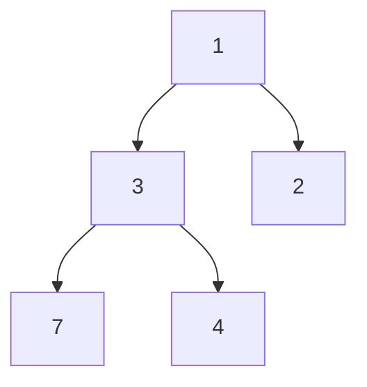

# Heaps and Tries

A heap keeps its smallest (or largest) element at the top, and a trie stores strings by their shared prefixes. Interviewers ask about heaps for top-k, merging sorted streams, and scheduling problems. They ask about tries for autocomplete, dictionary lookup, and prefix checks.

## Core concepts

### Heaps as complete binary trees

A heap is a complete binary tree: every level is full except possibly the last, which fills from left to right. It also obeys the heap property. In a min-heap, each parent is less than or equal to its children, so the smallest value sits at the root. In a max-heap the comparison flips.



Because the shape is complete, a heap fits in an array with no pointers. With zero-based indexes, the parent of `i` is `(i - 1) / 2`, and the children are `2i + 1` and `2i + 2`. The diagram above is stored as `[1, 3, 2, 7, 4]`.

| Operation | Cost | How |
|---|---|---|
| Peek at the root | O(1) | Read index 0 |
| Insert | O(log n) | Append at the end, then sift up while smaller than the parent |
| Remove the root | O(log n) | Move the last element to the root, then sift down toward the smaller child |
| Build from an array | O(n) | Heapify: sift down from the last parent to the root |
| Search for a value | O(n) | Nothing orders the lower levels, so every node may need a check |

A heap is not a sorted list. It guarantees the root, and nothing more.

### PriorityQueue in Java

`java.util.PriorityQueue` is a binary heap. It is a min-heap by default. For a max-heap, pass `Collections.reverseOrder()`, or a comparator of your own.

```java
import java.util.Collections;
import java.util.PriorityQueue;

public class HeapDemo {
    public static void main(String[] args) {
        PriorityQueue<Integer> minHeap = new PriorityQueue<>();
        PriorityQueue<Integer> maxHeap = new PriorityQueue<>(Collections.reverseOrder());
        for (int v : new int[]{5, 1, 4}) {
            minHeap.offer(v);
            maxHeap.offer(v);
        }
        System.out.println(minHeap.poll());   // 1
        System.out.println(maxHeap.poll());   // 5
        System.out.println(minHeap.peek());   // 4
    }
}
```

Only `poll` returns elements in priority order. Iterating over a `PriorityQueue` or printing it shows the internal array order, which is not sorted.

### Top-k with a bounded heap

To find the k largest values, keep a min-heap of size k. Each new value enters the heap. If the heap grows past k, remove its smallest element. At the end, the root is the k-th largest value. This takes O(n log k) time and O(k) space, which beats sorting the whole input when k is small.

```java
import java.util.PriorityQueue;

public class KthLargest {
    static int kthLargest(int[] nums, int k) {
        PriorityQueue<Integer> minHeap = new PriorityQueue<>();
        for (int n : nums) {
            minHeap.offer(n);
            if (minHeap.size() > k) {
                minHeap.poll();              // discard the smallest candidate
            }
        }
        return minHeap.peek();               // the k-th largest value
    }

    public static void main(String[] args) {
        System.out.println(kthLargest(new int[]{3, 2, 1, 5, 6, 4}, 2));   // 5
    }
}
```

To find the k smallest values instead, mirror the idea: keep a max-heap of size k.

### Tries

A trie (prefix tree) stores strings one character per node. The path from the root spells a prefix. A flag on a node marks that the path so far is a complete word. Two words that share a prefix share the nodes for that prefix.

Operations take time proportional to the length of the word, not the number of words stored:

- `insert` walks the characters and creates missing nodes.
- `search` walks the characters and checks the end flag.
- `startsWith` walks the characters and does not need the flag.

```java
import java.util.HashMap;
import java.util.Map;

public class Trie {
    private static class Node {
        final Map<Character, Node> children = new HashMap<>();
        boolean isWord;
    }

    private final Node root = new Node();

    public void insert(String word) {
        Node cur = root;
        for (char c : word.toCharArray()) {
            cur = cur.children.computeIfAbsent(c, k -> new Node());
        }
        cur.isWord = true;
    }

    public boolean search(String word) {
        Node node = find(word);
        return node != null && node.isWord;
    }

    public boolean startsWith(String prefix) {
        return find(prefix) != null;
    }

    private Node find(String s) {
        Node cur = root;
        for (char c : s.toCharArray()) {
            cur = cur.children.get(c);
            if (cur == null) {
                return null;
            }
        }
        return cur;
    }

    public static void main(String[] args) {
        Trie trie = new Trie();
        trie.insert("car");
        trie.insert("cart");
        System.out.println(trie.search("car"));       // true
        System.out.println(trie.search("ca"));        // false: a prefix, not a word
        System.out.println(trie.startsWith("ca"));    // true
    }
}
```

Autocomplete uses the same structure. Walk to the node for the typed prefix, then run a depth-first search below it and collect words until you have enough suggestions.

Space is the cost. Every node holds child links. A `HashMap` per node is flexible and works for any characters. A fixed array of 26 links per node is faster for lowercase English but wastes memory on sparse nodes.

## How it works / Step by step

**Heap insert (min-heap):**

1. Append the value at the next free array slot.
2. Compare it with its parent. If it is smaller, swap and repeat from the parent's index.
3. Stop when the parent is smaller or the value reaches the root.

**Heap remove root:**

1. Save the root value to return.
2. Move the last element into index 0 and shrink the array.
3. Compare it with the smaller child. If the child is smaller, swap and repeat from that child's index.

**Trie insert:**

1. Start at the root.
2. For each character, follow its child link, creating a node if it is missing.
3. Set the end flag on the final node.

## Common pitfalls

- Assuming a `PriorityQueue` is sorted when you iterate it. Only `poll` gives priority order.
- Using a max-heap for the k largest values. Keep a min-heap of size k for that.
- Mutating an object after it enters a heap in a way that changes its priority. The heap order then breaks silently.
- Forgetting the end-of-word flag, so `search("ca")` returns true after inserting `"car"`.
- Choosing a trie when a `HashSet` is enough. A set answers exact-match questions with less code. A trie earns its memory when you need prefix queries.
- Using a 26-link array per node for text with arbitrary characters.

!!! tip "Interview tip"
    **Q: How do you find the k largest numbers in a stream of n numbers?**
    Keep a min-heap of size k. Each value costs O(log k), so the total is O(n log k) time and O(k) space. Sorting the whole stream costs O(n log n) time and needs the full input. Say which bound matters for the input size you were given, and mention that the heap also works when the numbers arrive one at a time.

## Quick recap

- A heap is a complete binary tree stored in an array; the root is the minimum (min-heap) or maximum (max-heap).
- Insert and remove-root cost O(log n); peek costs O(1).
- Java's `PriorityQueue` is a min-heap; use `Collections.reverseOrder()` for a max-heap.
- A bounded heap of size k solves top-k problems in O(n log k).
- A trie stores strings by shared prefixes; insert, search, and prefix checks cost O(length of the word).
- Tries suit autocomplete and prefix queries; a `HashSet` suits exact matches.

**See also:** [Trees](trees.md), [Stacks & Queues](stacks-queues.md), [Complexity, Sorting and Searching](complexity-sorting-searching.md), [Graphs](../04b-dsa-advanced/graphs.md)
