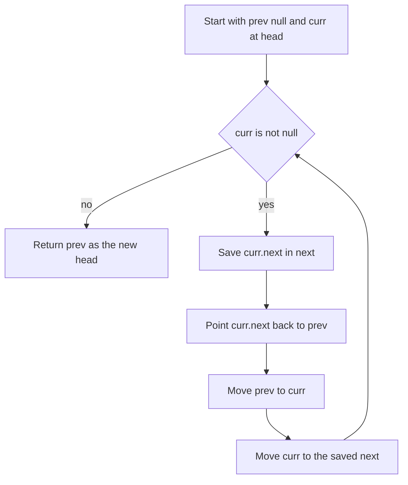

# Linked Lists

!!! note "In simple words"
    A linked list is a chain of boxes. Each box holds a value and an arrow to the next box. To reach the fifth box you must follow the arrows from the start, but adding or removing a box is cheap once you are standing next to it.

## Why it matters

Linked-list questions test pointer handling. Interviewers want to see whether you can reverse links without losing part of the list, find a cycle without extra memory, and keep track of the head when it changes. The code is short, and that is exactly why small mistakes, such as a lost reference or a missing null check, are easy to make and easy to spot.

## How it works

### Node structure

Each list is built from nodes. A node holds a value and a reference to the next node. The examples on this page assume the following node class.

```java
public class ListNode {
    int val;
    ListNode next;

    ListNode(int val) {
        this.val = val;
    }
}
```

A list is identified by its `head`. If an operation changes the head, the method must return the new head to the caller.

### Singly, doubly, and circular lists

- **Singly linked.** Each node has one `next` reference, so you can move forward only. Inserting or deleting a node takes O(1) time once you have a reference to the node before it.
- **Doubly linked.** Each node also has a `prev` reference. You can unlink a known node in O(1) time without searching for its predecessor. The cost is one extra reference per node.
- **Circular.** The last node points back to the head, in a singly or a doubly linked list. Traversal needs a stop condition, usually "return to the start node".

Reading by index costs O(n) in all three forms, because you must walk from the head.

```java
public class DoublyLinkedNode {
    int val;
    DoublyLinkedNode prev;
    DoublyLinkedNode next;

    DoublyLinkedNode(int val) {
        this.val = val;
    }

    // Unlink this node in O(1), because prev is known
    void remove() {
        if (prev != null) {
            prev.next = next;
        }
        if (next != null) {
            next.prev = prev;
        }
    }
}
```

In the JDK, `java.util.LinkedList` is a doubly linked list that also implements `Deque`. For stacks and queues, `ArrayDeque` is faster. For index access, `ArrayList` is faster. Use `LinkedList` mainly when you need cheap insertion or removal through a list iterator.

### Reversing a list

Reversal is the most common linked-list task. Keep three references: `prev`, `curr`, and `next`. Save `curr.next` in `next` before you change it, or the rest of the list is lost.

```java
public class ReverseList {
    static ListNode reverse(ListNode head) {
        ListNode prev = null;
        ListNode curr = head;
        while (curr != null) {
            ListNode next = curr.next;   // save the rest of the list
            curr.next = prev;            // flip this link
            prev = curr;                 // move prev forward
            curr = next;                 // move curr forward
        }
        return prev;                     // prev is the new head
    }

    public static void main(String[] args) {
        ListNode head = new ListNode(1);
        head.next = new ListNode(2);
        head.next.next = new ListNode(3);
        ListNode reversed = reverse(head);
        for (ListNode n = reversed; n != null; n = n.next) {
            System.out.print(n.val + " ");   // 3 2 1
        }
        System.out.println();
    }
}
```

The loop runs in O(n) time and uses O(1) extra space. A recursive version uses O(n) call-stack space, so mention that trade-off if you choose it.

### Dummy nodes

A dummy (sentinel) node placed before the head removes special cases. When the first real node might be removed or replaced, return `dummy.next` at the end.

```java
public class RemoveNthFromEnd {
    static ListNode removeNthFromEnd(ListNode head, int n) {
        ListNode dummy = new ListNode(0);
        dummy.next = head;
        ListNode fast = dummy;
        ListNode slow = dummy;
        for (int i = 0; i <= n; i++) {       // move fast n + 1 steps ahead
            fast = fast.next;
        }
        while (fast != null) {               // keep the gap; slow stops before the target
            fast = fast.next;
            slow = slow.next;
        }
        slow.next = slow.next.next;          // unlink the target
        return dummy.next;
    }

    public static void main(String[] args) {
        ListNode head = new ListNode(1);
        head.next = new ListNode(2);
        head.next.next = new ListNode(3);
        ListNode result = removeNthFromEnd(head, 2);   // removes the value 2
        for (ListNode n = result; n != null; n = n.next) {
            System.out.print(n.val + " ");             // 1 3
        }
        System.out.println();
    }
}
```

This takes one pass and O(1) extra space. It assumes `1 <= n <= length`. Without the dummy node, removing the head would need a separate branch.

### Fast and slow pointers

Move one pointer one step at a time and another pointer two steps at a time. This pattern finds the middle node, detects cycles, and finds where a cycle starts.

```java
public class MiddleNode {
    // For an even count, returns the second of the two middle nodes
    static ListNode middle(ListNode head) {
        ListNode slow = head;
        ListNode fast = head;
        while (fast != null && fast.next != null) {
            slow = slow.next;
            fast = fast.next.next;
        }
        return slow;
    }

    public static void main(String[] args) {
        ListNode head = new ListNode(1);
        head.next = new ListNode(2);
        head.next.next = new ListNode(3);
        System.out.println(middle(head).val);   // 2
    }
}
```

### Cycle detection with Floyd's algorithm

If a list has a cycle, the fast pointer eventually lands on the slow pointer inside the cycle. If there is no cycle, the fast pointer reaches `null`.

```java
public class CycleCheck {
    static boolean hasCycle(ListNode head) {
        ListNode slow = head;
        ListNode fast = head;
        while (fast != null && fast.next != null) {
            slow = slow.next;
            fast = fast.next.next;
            if (slow == fast) {
                return true;
            }
        }
        return false;
    }

    public static void main(String[] args) {
        ListNode a = new ListNode(1);
        ListNode b = new ListNode(2);
        ListNode c = new ListNode(3);
        a.next = b;
        b.next = c;
        System.out.println(hasCycle(a));   // false
        c.next = b;                        // create a cycle back to b
        System.out.println(hasCycle(a));   // true
    }
}
```

To find where the cycle starts, reset one pointer to the head after the two pointers meet. Then move both pointers one step at a time. They meet at the first node of the cycle.

```java
public class CycleStart {
    static ListNode cycleStart(ListNode head) {
        ListNode slow = head;
        ListNode fast = head;
        while (fast != null && fast.next != null) {
            slow = slow.next;
            fast = fast.next.next;
            if (slow == fast) {
                ListNode p = head;
                while (p != slow) {
                    p = p.next;
                    slow = slow.next;
                }
                return p;
            }
        }
        return null;   // no cycle
    }

    public static void main(String[] args) {
        ListNode a = new ListNode(1);
        ListNode b = new ListNode(2);
        ListNode c = new ListNode(3);
        a.next = b;
        b.next = c;
        c.next = b;                                  // cycle starts at b
        System.out.println(cycleStart(a).val);       // 2
    }
}
```

Both checks take O(n) time and O(1) space. A `HashSet` of visited nodes also takes O(n) time, but it needs O(n) space.

### Merging sorted lists

Use a dummy node as the tail anchor. Attach the smaller of the two front nodes each time, then attach whatever is left over.

```java
public class MergeLists {
    static ListNode merge(ListNode a, ListNode b) {
        ListNode dummy = new ListNode(0);
        ListNode tail = dummy;
        while (a != null && b != null) {
            if (a.val <= b.val) {
                tail.next = a;
                a = a.next;
            } else {
                tail.next = b;
                b = b.next;
            }
            tail = tail.next;
        }
        tail.next = (a != null) ? a : b;
        return dummy.next;
    }

    public static void main(String[] args) {
        ListNode a = new ListNode(1);
        a.next = new ListNode(4);
        ListNode b = new ListNode(2);
        b.next = new ListNode(3);
        for (ListNode n = merge(a, b); n != null; n = n.next) {
            System.out.print(n.val + " ");   // 1 2 3 4
        }
        System.out.println();
    }
}
```

The merge takes O(n + m) time and O(1) extra space, because it reuses the existing nodes.

### Removing duplicates

In a sorted list, duplicates sit next to each other. Skip the next node whenever its value matches the current one.

```java
public class DedupeSorted {
    static ListNode dedupeSorted(ListNode head) {
        ListNode cur = head;
        while (cur != null && cur.next != null) {
            if (cur.val == cur.next.val) {
                cur.next = cur.next.next;   // drop the duplicate
            } else {
                cur = cur.next;
            }
        }
        return head;
    }
}
```

To partition a list around a value, build two lists, one with the values less than `x` and one with the rest, and then join them. Many reordering problems follow the same pattern: split, transform, and reconnect.

### Worked example: reversing 1 to 2 to 3

| Step | prev | curr | next (saved) | Action taken |
|---|---|---|---|---|
| Start | null | 1 | not set | Nothing yet. The list is 1 to 2 to 3 |
| 1 | null | 1 | 2 | Point 1 at null. Move prev to 1 and curr to 2 |
| 2 | 1 | 2 | 3 | Point 2 at 1. Move prev to 2 and curr to 3 |
| 3 | 2 | 3 | null | Point 3 at 2. Move prev to 3 and curr to null |
| End | 3 | null | not set | curr is null, so return prev, which is the new head 3 |

The final list is 3 to 2 to 1 to null.

### Complexity

| Task | Technique | Time | Extra space |
|---|---|---|---|
| Read by index | Walk from head | O(n) | O(1) |
| Insert or delete at a known node | Relink | O(1) | O(1) |
| Reverse | Three pointers | O(n) | O(1) |
| Middle | Fast and slow | O(n) | O(1) |
| Cycle detection | Floyd | O(n) | O(1) |
| Cycle start | Floyd, then reset one pointer | O(n) | O(1) |
| Merge sorted lists | Dummy tail | O(n + m) | O(1) |
| Remove nth from end | Gap of n between pointers | O(n) | O(1) |



## Where it is used

- **Undo history and browser navigation** store steps as linked nodes, so adding a step is cheap.
- **Operating system schedulers and memory allocators** keep free lists as linked structures.
- **Java collections** use linked nodes internally in `LinkedList`, and in the bucket chains of `HashMap`.
- **LRU caches** combine a doubly linked list with a hash map, so both lookup and eviction are fast.

## Benefits

- **Cheap changes at a known node.** Insertion and deletion take O(1) time once you have the node.
- **No big copies.** Growing the list adds one node at a time, with no array resize.
- **Flexible shape.** Singly, doubly, and circular forms cover many designs.

## Cons and limits

- **Slow access.** Reading the k-th item takes O(k) steps.
- **Poor cache use.** Nodes are scattered in memory, so walking the list is slower than scanning an array.
- **Extra memory per node.** Each node stores at least one reference on top of its value.
- **Easy to break.** A lost reference silently cuts off the rest of the list.

## Best practices

- Draw the list on paper with arrows, and label `head`, `prev`, `curr`, and `next`, before you write code.
- Decide whether the head can change. If it can, use a dummy node and return `dummy.next`.
- Save the old `next` reference before you overwrite a link.
- Check `fast != null && fast.next != null` before reading `fast.next.next`.
- Test with an empty list, a one-node list, and a two-node list. Most pointer bugs appear in these cases.
- Compare boxed values with `equals`, because `Integer` objects are compared by reference with `==`. The examples use `int`, where `==` is correct.
- Do not call `LinkedList.get(i)` in a loop. Each call walks from the start, which makes the loop O(n²).
- In a circular list, remove the link to a node as well as the node itself. Otherwise the loop stays intact.
- Prefer `ArrayDeque` for stack and queue work in Java.

!!! tip "Interview tip"
    **Q: How do you find the middle of a singly linked list in one pass?**
    Use two pointers. The slow pointer moves one step and the fast pointer moves two. When the fast pointer reaches the end, the slow pointer sits at the middle. You do not need to know the length first.

## Quick recap

- A linked list gives O(1) insertion and deletion at a known node, and O(n) access by index.
- Reversal uses three pointers, and it must save `next` before it changes a link.
- A dummy node removes special cases when the head might change.
- Floyd's fast and slow pointers detect cycles in O(n) time and O(1) space.
- In Java, use `ArrayDeque` for stacks and queues, and `LinkedList` only when you need list operations.

## Official documentation

- [Java SE 21 API documentation](https://docs.oracle.com/en/java/javase/21/docs/api/index.html)
- [The Java Language Specification, Java SE 21](https://docs.oracle.com/javase/specs/jls/se21/html/index.html)
- [Dev.java, the Java developer site](https://dev.java/)

**See also:** [Arrays and Strings](arrays-strings.md), [Stacks and Queues](stacks-queues.md), [Trees](trees.md), [DSA Foundations](index.md)
