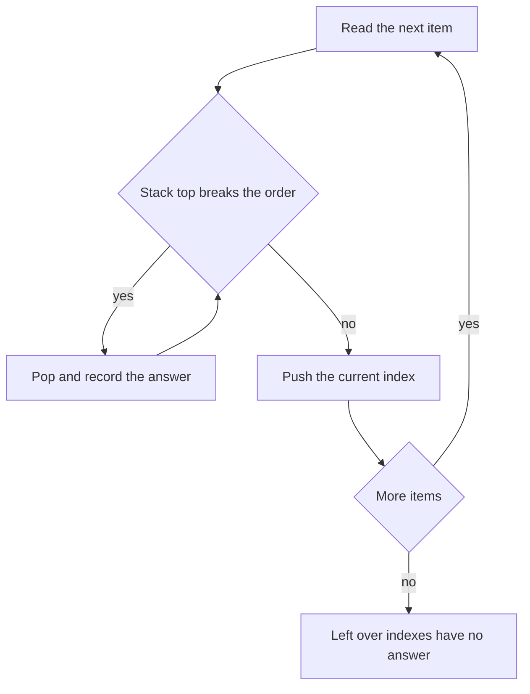

# Stacks and Queues

!!! note "In simple words"
    A stack is a pile of plates: you add and remove from the top, so the last plate added is the first one taken. A queue is a line at a counter: the first person in line is served first.

## Why it matters

Stacks and queues model real work. Parsers check brackets with a stack, undo features replay a stack of actions, and job systems serve requests from a queue. Many harder interview problems use a **monotonic** stack or deque, which keeps items in order so that questions such as "next greater element" or "maximum in each window" are answered in linear time. Interviewers use these problems to see whether you can name the right structure before you write any loop.

## How it works

### Stack: last in, first out

A stack supports three operations: `push` adds to the top, `pop` removes from the top, and `peek` reads the top. Each one takes O(1) time.

In Java, use `Deque<Integer> stack = new ArrayDeque<>();` and call `push`, `pop`, and `peek`. These methods work at the head of the deque.

Avoid `java.util.Stack`. It is a legacy class that extends `Vector`, so every method is synchronized, and it exposes index-based methods that a stack does not need.

```java
import java.util.ArrayDeque;
import java.util.Deque;

public class StackDemo {
    public static void main(String[] args) {
        Deque<Integer> stack = new ArrayDeque<>();
        stack.push(1);
        stack.push(2);
        int top = stack.peek();      // 2, not removed
        int popped = stack.pop();    // 2
        System.out.println(top + " " + popped + " " + stack.size());   // 2 2 1
    }
}
```

### Queue: first in, first out

A queue supports `offer` (add at the back), `poll` (remove from the front), and `peek` (read the front). `ArrayDeque` also works as a queue. Prefer `offer` and `poll`. When the queue is empty, `poll` and `peek` return `null`. The methods `remove` and `element` throw `NoSuchElementException` instead.

```java
import java.util.ArrayDeque;
import java.util.Queue;

public class QueueDemo {
    public static void main(String[] args) {
        Queue<String> queue = new ArrayDeque<>();
        queue.offer("first");
        queue.offer("second");
        String next = queue.poll();   // "first"
        System.out.println(next + " " + queue.peek());   // first second
    }
}
```

### Array-based and linked implementations

An array-backed stack keeps items in an array with a `top` index. It is simple and cache-friendly, but its capacity is fixed unless you resize it. A linked-list stack pushes and pops at the head, so both operations are O(1) and the capacity grows without copying.

A fixed-size queue needs a circular array. Without wrap-around, the array looks full even when slots at the front are free.

```java
import java.util.NoSuchElementException;

public class ArrayQueue {
    private final int[] data;
    private int head;    // index of the front element
    private int size;

    ArrayQueue(int capacity) {
        data = new int[capacity];
    }

    boolean offer(int x) {
        if (size == data.length) {
            return false;                       // full
        }
        data[(head + size) % data.length] = x;  // wrap around the end of the array
        size++;
        return true;
    }

    int poll() {
        if (size == 0) {
            throw new NoSuchElementException();
        }
        int x = data[head];
        head = (head + 1) % data.length;
        size--;
        return x;
    }

    public static void main(String[] args) {
        ArrayQueue q = new ArrayQueue(2);
        q.offer(10);
        q.offer(20);
        System.out.println(q.offer(30));   // false, the queue is full
        System.out.println(q.poll());      // 10
        System.out.println(q.offer(30));   // true, the freed slot wraps around
    }
}
```

Each operation is O(1) time and O(1) extra space.

### Application: matching brackets

A stack matches each closing bracket with the most recent unmatched opening bracket. This is the standard "valid parentheses" check.

```java
import java.util.ArrayDeque;
import java.util.Deque;

public class Brackets {
    static boolean isValid(String s) {
        Deque<Character> stack = new ArrayDeque<>();
        for (char c : s.toCharArray()) {
            if (c == '(' || c == '[' || c == '{') {
                stack.push(c);
            } else {
                if (stack.isEmpty()) {
                    return false;
                }
                char open = stack.pop();
                if ((c == ')' && open != '(')
                        || (c == ']' && open != '[')
                        || (c == '}' && open != '{')) {
                    return false;
                }
            }
        }
        return stack.isEmpty();          // leftover openers mean something is unmatched
    }

    public static void main(String[] args) {
        System.out.println(isValid("{[()]}"));   // true
        System.out.println(isValid("{[(])}"));   // false
    }
}
```

Time is O(n). Space is O(n) in the worst case, when every character is an opener.

### Monotonic stack

A monotonic stack keeps its items in increasing or decreasing order. When a new value breaks that order, the items it beats are popped, and each pop records an answer. Each index is pushed and popped at most once, so the total time is O(n) even though there is a loop inside a loop.

The classic problem is the **next greater element**. For each position, find the first later value that is larger. The stack holds the indexes of values that are still waiting for a larger value.

```java
import java.util.ArrayDeque;
import java.util.Arrays;
import java.util.Deque;

public class NextGreater {
    static int[] nextGreater(int[] a) {
        int[] res = new int[a.length];
        Arrays.fill(res, -1);                          // -1 when no greater value exists
        Deque<Integer> stack = new ArrayDeque<>();     // indexes whose values are decreasing
        for (int i = 0; i < a.length; i++) {
            while (!stack.isEmpty() && a[stack.peek()] < a[i]) {
                res[stack.pop()] = a[i];               // a[i] is the next greater value for the popped index
            }
            stack.push(i);
        }
        return res;
    }

    public static void main(String[] args) {
        System.out.println(Arrays.toString(nextGreater(new int[] {2, 1, 5, 6, 2, 3})));
        // [5, 5, 6, -1, 3, -1]
    }
}
```

Time is O(n), and space is O(n).

### Monotonic deque: sliding window maximum

A monotonic deque applies the same idea to a window of fixed size k. It keeps indexes whose values decrease from front to back. The front is always the maximum of the current window. Remove the front when it has left the window. Remove values from the back when a new value is at least as large, because those values can never be a maximum again.

```java
import java.util.ArrayDeque;
import java.util.Arrays;
import java.util.Deque;

public class SlidingWindowMax {
    static int[] maxSlidingWindow(int[] a, int k) {
        int n = a.length;
        int[] res = new int[n - k + 1];
        Deque<Integer> dq = new ArrayDeque<>();        // indexes, with decreasing values
        for (int i = 0; i < n; i++) {
            while (!dq.isEmpty() && dq.peekFirst() <= i - k) {
                dq.pollFirst();                        // front index has left the window
            }
            while (!dq.isEmpty() && a[dq.peekLast()] <= a[i]) {
                dq.pollLast();                         // smaller values at the back can never win
            }
            dq.offerLast(i);
            if (i >= k - 1) {
                res[i - k + 1] = a[dq.peekFirst()];
            }
        }
        return res;
    }

    public static void main(String[] args) {
        System.out.println(Arrays.toString(maxSlidingWindow(new int[] {1, 3, -1, -3, 5, 3, 6, 7}, 3)));
        // [3, 3, 5, 5, 6, 7]
    }
}
```

The method assumes `1 <= k <= a.length`. Time is O(n), because each index enters and leaves the deque once.

### Trapping rain water

Water above a bar depends on the shorter of the tallest bars on its left and its right. A monotonic stack collects water one layer at a time. When a taller bar arrives, each bar it passes is the bottom of a basin, bounded on the left by the bar below it in the stack and on the right by the new bar.

```java
public class RainWater {
    static int trap(int[] h) {
        java.util.Deque<Integer> stack = new java.util.ArrayDeque<>();   // indexes, non-increasing heights
        int water = 0;
        for (int i = 0; i < h.length; i++) {
            while (!stack.isEmpty() && h[i] > h[stack.peek()]) {
                int bottom = stack.pop();
                if (stack.isEmpty()) {
                    break;                             // no left wall, so no water here
                }
                int left = stack.peek();
                int width = i - left - 1;
                int boundedHeight = Math.min(h[left], h[i]) - h[bottom];
                water += width * boundedHeight;
            }
            stack.push(i);
        }
        return water;
    }

    public static void main(String[] args) {
        System.out.println(trap(new int[] {0, 1, 0, 2, 1, 0, 1, 3, 2, 1, 2, 1}));   // 6
    }
}
```

Time is O(n) and space is O(n). A two-pointer solution also runs in O(n) time with O(1) extra space, which is a good follow-up to mention.

### Priority queue

`PriorityQueue` is a binary heap. `offer` and `poll` take O(log n) time, and `peek` takes O(1). Iterating over the queue does not return items in sorted order. Only repeated `poll` calls give the priority order.

For the k smallest values, keep a max-heap of size k. Each time the heap grows past k, remove its largest element.

```java
import java.util.Arrays;
import java.util.Comparator;
import java.util.PriorityQueue;

public class KSmallest {
    static int[] kSmallest(int[] a, int k) {
        PriorityQueue<Integer> maxHeap = new PriorityQueue<>(Comparator.reverseOrder());
        for (int x : a) {
            maxHeap.offer(x);
            if (maxHeap.size() > k) {
                maxHeap.poll();                        // drop the largest of the candidates
            }
        }
        int[] res = new int[maxHeap.size()];
        int i = 0;
        for (int x : maxHeap) {
            res[i++] = x;                              // heap order, not sorted
        }
        Arrays.sort(res);
        return res;
    }

    public static void main(String[] args) {
        System.out.println(Arrays.toString(kSmallest(new int[] {7, 2, 9, 4, 1}, 2)));   // [1, 2]
    }
}
```

This takes O(n log k) time and O(k) space. That beats sorting when k is much smaller than n.

### Worked example: next greater element on [2, 1, 5, 6, 2, 3]

The stack holds indexes. Each row shows the state after handling one index.

| i | a[i] | Pops (index: answer) | Stack after push (values) | res so far |
|---|---|---|---|---|
| 0 | 2 | none | [2] | -1 |
| 1 | 1 | none | [2, 1] | -1 |
| 2 | 5 | index 1 gets 5, then index 0 gets 5 | [5] | indexes 0 and 1 are both 5 |
| 3 | 6 | index 2 gets 6 | [6] | index 2 is 6 |
| 4 | 2 | none | [6, 2] | index 3 still -1 |
| 5 | 3 | index 4 gets 3 | [6, 3] | index 4 is 3 |

Indexes 3 and 5 never find a greater value, so they keep -1. The answer is `[5, 5, 6, -1, 3, -1]`. Each index is pushed once and popped at most once, so the run is O(n).

### Complexity

| Structure or task | Operation | Time | Notes |
|---|---|---|---|
| Stack (`ArrayDeque`) | push, pop, peek | O(1) | Works at the head |
| Queue (`ArrayDeque`) | offer, poll, peek | O(1) | Works at the ends |
| Circular array queue | offer, poll | O(1) | Fixed capacity |
| Bracket matching | scan the string | O(n) | O(n) space in the worst case |
| Next greater element | monotonic stack | O(n) | Each index pushed and popped once |
| Sliding window maximum | monotonic deque | O(n) | Each index added and removed once |
| Trapping rain water | monotonic stack | O(n) | Two pointers give O(1) extra space |
| Top k of n values | heap of size k | O(n log k) | Better than sorting when k is small |
| Priority queue | offer, poll | O(log n) | peek is O(1) |



### Choosing the structure

| Problem type | Structure | Time |
|---|---|---|
| Matching or nesting | Stack | O(n) |
| Next greater or smaller value | Monotonic stack | O(n) |
| Sliding window maximum or minimum | Monotonic deque | O(n) |
| Top k of a stream | Heap of size k | O(n log k) |
| Breadth-first ordering | Queue | O(n) over the input |

## Where it is used

- **Parsers and compilers** match brackets and track nesting with a stack.
- **Editors and forms** keep undo and redo history as two stacks.
- **Job processing and messaging** serve tasks in arrival order from a queue.
- **Breadth-first search** uses a queue to visit nodes level by level (see [Trees](trees.md)).
- **Monitoring and trading** use monotonic deques to track a maximum over a rolling window.

## Benefits

- **Simple rules.** The last-in or first-in order is easy to reason about and easy to test.
- **Constant-time core operations.** Push, pop, offer, and poll take O(1) time.
- **Powerful patterns.** Monotonic structures solve several problems that look like O(n²) at first sight.

## Cons and limits

- **No random access.** A stack or queue gives access only to its ends.
- **Fixed capacity needs care.** A circular array must handle wrap-around, or it reports full too early.
- **Priority queues do not sort.** Iterating over one gives heap order.
- **Monotonic logic is easy to get wrong.** The choice of `<` or `<=` changes the answer when values repeat.

## Best practices

- Use `ArrayDeque` for stacks and queues. Do not use `java.util.Stack` in new code.
- Check `isEmpty()` before `pop`, `poll`, or `peek` when the structure might be empty. `pop` and `remove` throw on an empty deque, while `poll` and `peek` return `null`.
- Store indexes, not values, when the answer depends on distance or on a window boundary. Equal values can sit at different positions.
- For a window, check the front index against the window's left edge before you read the answer.
- Decide between `<` and `<=` on purpose. Test with repeated values.
- Trace a small example by hand, such as `[2, 1, 5, 6, 2, 3]`, through each push and pop.
- Do not assume a `PriorityQueue` is sorted when you iterate it.
- Remember that `PriorityQueue.remove(Object)` removes by value. It does not remove by index.

!!! tip "Interview tip"
    **Q: Why is a monotonic stack O(n) when it has a `while` loop inside a `for` loop?**
    Each index is pushed once and popped at most once, so the total number of pops across the whole run is at most n. The inner loop does not revisit an index that it has already handled.

## Quick recap

- Use `ArrayDeque` for stacks and queues, and avoid `java.util.Stack`.
- Stack and queue operations are O(1). A fixed-size queue needs a circular array.
- A monotonic stack answers next-greater and previous-smaller questions in O(n).
- A monotonic deque gives the maximum of every window in O(n).
- A heap of size k gives the top k values in O(n log k).

## Official documentation

- [Java SE 21 API documentation](https://docs.oracle.com/en/java/javase/21/docs/api/index.html)
- [The Java Language Specification, Java SE 21](https://docs.oracle.com/javase/specs/jls/se21/html/index.html)
- [Dev.java, the Java developer site](https://dev.java/)

**See also:** [Arrays and Strings](arrays-strings.md), [Linked Lists](linked-lists.md), [Trees](trees.md), [DSA Foundations](index.md)
