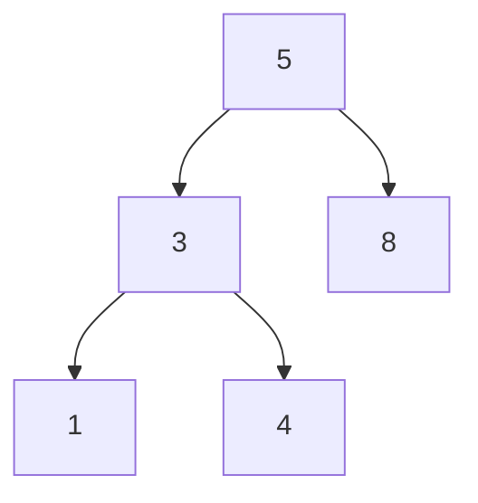
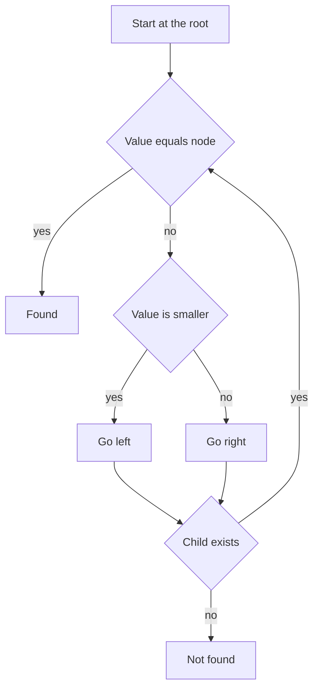

# Trees

!!! note "In simple words"
    A tree is a set of nodes linked from one top node, the root, down to leaves that have no children. A binary search tree keeps smaller values on the left and larger values on the right, so you can find a value by going down one path.

## Why it matters

Trees show up in interviews because recursion fits them naturally. A few techniques cover a wide range of questions: traversal, passing information from children up to the parent, and keeping track of a best answer as you go. A strong answer also states the cost in terms of the tree's height, not only its number of nodes, because the height is what decides the speed of a search in a binary search tree.

## How it works

### Node structure

The examples on this page use the node class below. Save it as `TreeNode.java` in the same folder as the examples.

```java
public class TreeNode {
    int val;
    TreeNode left;
    TreeNode right;

    TreeNode(int val) {
        this.val = val;
    }
}
```

### Binary search trees

A binary search tree (BST) keeps every value in the left subtree smaller than the node, and every value in the right subtree larger. Search, insert, and delete all follow a single path from the root. Their cost is O(h), where h is the height. In a balanced tree, h is about log n. In a skewed tree, where every node has one child, h equals n, and the BST behaves like a linked list.

```java
class TreeNode {
    int val;
    TreeNode left;
    TreeNode right;

    TreeNode(int val) {
        this.val = val;
    }
}

public class BstOps {
    static TreeNode insert(TreeNode root, int val) {
        if (root == null) {
            return new TreeNode(val);
        }
        if (val < root.val) {
            root.left = insert(root.left, val);
        } else if (val > root.val) {
            root.right = insert(root.right, val);
        }
        return root;                 // duplicates are ignored in this version
    }

    static boolean contains(TreeNode root, int val) {
        TreeNode cur = root;
        while (cur != null) {
            if (val == cur.val) {
                return true;
            }
            cur = (val < cur.val) ? cur.left : cur.right;
        }
        return false;
    }

    public static void main(String[] args) {
        TreeNode root = null;
        for (int v : new int[] {5, 3, 8, 1, 4}) {
            root = insert(root, v);
        }
        System.out.println(contains(root, 4));   // true
        System.out.println(contains(root, 7));   // false
    }
}
```

Inserting values in sorted order creates a skewed tree, so a plain BST is unsafe for sorted input. That is the reason balanced trees exist.

### Traversals

There are four standard orders. Three are depth-first: pre-order, in-order, and post-order. The fourth is breadth-first, called level-order.

| Order | Visit sequence | Typical use |
|---|---|---|
| Pre-order | Node, left, right | Copying a tree, serializing it |
| In-order | Left, node, right | Sorted output of a BST |
| Post-order | Left, right, node | Deleting a tree, computing values from children |
| Level-order | Level by level | Printing layers, finding the shallowest match |

In-order traversal of a BST returns the values in ascending order.

```java
import java.util.ArrayList;
import java.util.List;

class TreeNode {
    int val;
    TreeNode left;
    TreeNode right;

    TreeNode(int val) {
        this.val = val;
    }
}

class BstOps {
    static TreeNode insert(TreeNode root, int val) {
        if (root == null) {
            return new TreeNode(val);
        }
        if (val < root.val) {
            root.left = insert(root.left, val);
        } else if (val > root.val) {
            root.right = insert(root.right, val);
        }
        return root;
    }
}

public class TreeTraversal {
    static void inorder(TreeNode node, List<Integer> out) {
        if (node == null) {
            return;
        }
        inorder(node.left, out);
        out.add(node.val);
        inorder(node.right, out);
    }

    public static void main(String[] args) {
        TreeNode root = BstOps.insert(null, 5);
        for (int v : new int[] {3, 8, 1, 4}) {
            BstOps.insert(root, v);
        }
        List<Integer> out = new ArrayList<>();
        inorder(root, out);
        System.out.println(out);   // [1, 3, 4, 5, 8]
    }
}
```

An iterative version uses an explicit stack. It walks left as far as it can, visits a node, and then moves to the node's right child.

```java
import java.util.ArrayDeque;
import java.util.ArrayList;
import java.util.Deque;
import java.util.List;

class TreeNode {
    int val;
    TreeNode left;
    TreeNode right;

    TreeNode(int val) {
        this.val = val;
    }
}

public class IterativeInorder {
    static List<Integer> inorderIterative(TreeNode root) {
        List<Integer> out = new ArrayList<>();
        Deque<TreeNode> stack = new ArrayDeque<>();
        TreeNode cur = root;
        while (cur != null || !stack.isEmpty()) {
            while (cur != null) {
                stack.push(cur);
                cur = cur.left;
            }
            cur = stack.pop();
            out.add(cur.val);
            cur = cur.right;
        }
        return out;
    }
}
```

Level-order uses a queue. Read the queue size at the start of each pass, so that the nodes of one level stay separate from the next level.

```java
import java.util.ArrayDeque;
import java.util.ArrayList;
import java.util.List;
import java.util.Queue;

class TreeNode {
    int val;
    TreeNode left;
    TreeNode right;

    TreeNode(int val) {
        this.val = val;
    }
}

public class LevelOrder {
    static List<List<Integer>> levelOrder(TreeNode root) {
        List<List<Integer>> levels = new ArrayList<>();
        if (root == null) {
            return levels;
        }
        Queue<TreeNode> queue = new ArrayDeque<>();
        queue.offer(root);
        while (!queue.isEmpty()) {
            int size = queue.size();                 // nodes in the current level
            List<Integer> level = new ArrayList<>();
            for (int i = 0; i < size; i++) {
                TreeNode node = queue.poll();
                level.add(node.val);
                if (node.left != null) {
                    queue.offer(node.left);
                }
                if (node.right != null) {
                    queue.offer(node.right);
                }
            }
            levels.add(level);
        }
        return levels;
    }
}
```

Every traversal visits each node once, so it takes O(n) time. Recursive depth-first traversal uses O(h) stack space. Level-order uses O(w) queue space, where w is the width of the widest level.

### Morris traversal

Morris traversal performs an in-order walk with O(1) extra space. It uses the unused `right` pointer of each node's in-order predecessor as a temporary link back to the node. When the walk returns to that node, it removes the link. The tree is restored by the time the traversal ends.

```java
import java.util.ArrayList;
import java.util.List;

class TreeNode {
    int val;
    TreeNode left;
    TreeNode right;

    TreeNode(int val) {
        this.val = val;
    }
}

public class MorrisInorder {
    static List<Integer> morrisInorder(TreeNode root) {
        List<Integer> out = new ArrayList<>();
        TreeNode cur = root;
        while (cur != null) {
            if (cur.left == null) {
                out.add(cur.val);
                cur = cur.right;
            } else {
                TreeNode pred = cur.left;                 // in-order predecessor
                while (pred.right != null && pred.right != cur) {
                    pred = pred.right;
                }
                if (pred.right == null) {
                    pred.right = cur;                     // create the temporary link
                    cur = cur.left;
                } else {
                    pred.right = null;                    // remove the link
                    out.add(cur.val);
                    cur = cur.right;
                }
            }
        }
        return out;
    }
}
```

Each edge is walked a fixed number of times, so the time is O(n). The extra space is O(1). Use Morris traversal when the interviewer asks you to avoid recursion and extra stack space. Be ready to say that it changes `right` pointers while it runs.

### Tree dynamic programming

Many tree questions compute one value for each subtree from its children, then combine those values at the parent. The trick is to return one value to the parent, and to record a second, possibly larger, answer in a side variable. The diameter, which is the longest path between any two nodes measured in edges, is the standard example.

```java
class TreeNode {
    int val;
    TreeNode left;
    TreeNode right;

    TreeNode(int val) {
        this.val = val;
    }
}

public class TreeDiameter {
    static int diameter(TreeNode root) {
        int[] best = new int[1];          // side answer, updated during the recursion
        height(root, best);
        return best[0];
    }

    // Returns the number of nodes on the longest downward path from node
    private static int height(TreeNode node, int[] best) {
        if (node == null) {
            return 0;
        }
        int left = height(node.left, best);
        int right = height(node.right, best);
        best[0] = Math.max(best[0], left + right);   // edges that pass through this node
        return 1 + Math.max(left, right);
    }

    public static void main(String[] args) {
        TreeNode root = new TreeNode(1);
        root.left = new TreeNode(2);
        root.right = new TreeNode(3);
        root.left.left = new TreeNode(4);
        System.out.println(diameter(root));   // 3, the path 4 to 2 to 1 to 3
    }
}
```

Each node is visited once, so the time is O(n), and the stack space is O(h).

### Path sum

For root-to-leaf path sums, subtract each node's value from the target as you go down. At a leaf, check whether the remaining amount is zero.

```java
class TreeNode {
    int val;
    TreeNode left;
    TreeNode right;

    TreeNode(int val) {
        this.val = val;
    }
}

public class PathSum {
    static boolean hasPathSum(TreeNode node, int target) {
        if (node == null) {
            return false;
        }
        if (node.left == null && node.right == null) {
            return node.val == target;      // only a leaf ends a path
        }
        int rest = target - node.val;
        return hasPathSum(node.left, rest) || hasPathSum(node.right, rest);
    }

    public static void main(String[] args) {
        TreeNode root = new TreeNode(5);
        root.left = new TreeNode(4);
        root.left.left = new TreeNode(11);
        System.out.println(hasPathSum(root, 20));   // true: 5 + 4 + 11
    }
}
```

The check must happen at a leaf. A node with only one child is not the end of a path.

### Lowest common ancestor

In a BST, the lowest common ancestor (LCA) of two values is the first node where the two values split onto different sides, or the node that equals one of them. You do not need to search the whole tree.

```java
class TreeNode {
    int val;
    TreeNode left;
    TreeNode right;

    TreeNode(int val) {
        this.val = val;
    }
}

public class BstLca {
    static TreeNode lcaBst(TreeNode root, int p, int q) {
        TreeNode cur = root;
        while (cur != null) {
            if (p < cur.val && q < cur.val) {
                cur = cur.left;
            } else if (p > cur.val && q > cur.val) {
                cur = cur.right;
            } else {
                return cur;          // the split point, or one value equals cur.val
            }
        }
        return null;
    }
}
```

In a general binary tree there is no ordering to use. Search both subtrees. Return a node when it is one of the targets, and return the common node when both subtrees report a target. The cost is O(n) time and O(h) stack space.

```java
class TreeNode {
    int val;
    TreeNode left;
    TreeNode right;

    TreeNode(int val) {
        this.val = val;
    }
}

public class TreeLca {
    static TreeNode lca(TreeNode root, TreeNode p, TreeNode q) {
        if (root == null || root == p || root == q) {
            return root;
        }
        TreeNode left = lca(root.left, p, q);
        TreeNode right = lca(root.right, p, q);
        if (left != null && right != null) {
            return root;            // the targets were found on different sides
        }
        return (left != null) ? left : right;
    }
}
```

### Serialization

Serialization turns a tree into a string that can be stored or sent, and deserialization rebuilds the tree from that string. Pre-order traversal with a marker for `null` is enough to rebuild a unique tree, because the markers show where each subtree ends.

```java
import java.util.ArrayDeque;
import java.util.Deque;
import java.util.List;

class TreeNode {
    int val;
    TreeNode left;
    TreeNode right;

    TreeNode(int val) {
        this.val = val;
    }
}

public class TreeSerialize {
    static String serialize(TreeNode root) {
        StringBuilder sb = new StringBuilder();
        serializeHelper(root, sb);
        return sb.toString();
    }

    private static void serializeHelper(TreeNode node, StringBuilder sb) {
        if (node == null) {
            sb.append("#,");
            return;
        }
        sb.append(node.val).append(',');
        serializeHelper(node.left, sb);
        serializeHelper(node.right, sb);
    }

    static TreeNode deserialize(String data) {
        Deque<String> tokens = new ArrayDeque<>(List.of(data.split(",")));
        return build(tokens);
    }

    private static TreeNode build(Deque<String> tokens) {
        String t = tokens.poll();
        if (t == null || t.equals("#")) {
            return null;
        }
        TreeNode node = new TreeNode(Integer.parseInt(t));
        node.left = build(tokens);
        node.right = build(tokens);
        return node;
    }

    public static void main(String[] args) {
        TreeNode root = new TreeNode(2);
        root.left = new TreeNode(1);
        root.right = new TreeNode(3);
        String s = serialize(root);
        System.out.println(s);                              // 2,1,#,#,3,#,#,
        System.out.println(serialize(deserialize(s)).equals(s));   // true
    }
}
```

Both directions take O(n) time. `List.of` rejects `null` elements, and `split` never produces `null`, so the call is safe here.

### Balanced trees and other tree types

A plain BST gives no guarantee about its height, so production code uses self-balancing trees.

- **AVL trees** keep the heights of the two subtrees of every node within one of each other. Lookups take O(log n).
- **Red-black trees** use node colors and rotations to stay balanced. Java's `TreeMap` and `TreeSet` are built on a red-black tree, so their operations take O(log n).
- **B-trees** store many keys in each node to reduce disk reads. Database indexes often use this design.
- **Tries** store strings one character per level. A lookup costs O(L) for a string of length L, no matter how many strings are stored (see [Heaps and Tries](heaps-and-tries.md)).
- **Segment trees** answer range queries and point updates in O(log n).

You will rarely implement these from scratch in an interview. Know which problem each one solves and what its operations cost.

### Worked example: building a BST and reading it back

Insert `5, 3, 8, 1, 4` in that order. The tree has 5 at the root, 3 and 8 below it, then 1 and 4 under 3.



Each insert follows one path from the root. Searching for 4 visits 5, then 3, then 4, which is three comparisons on a tree of height 2. In-order traversal visits 1, 3, 4, 5, 8, which is the sorted order of the values.

### Complexity

| Operation | Balanced tree | Skewed tree | Notes |
|---|---|---|---|
| BST search, insert, delete | O(log n) | O(n) | Cost is O(h) |
| Full traversal (any order) | O(n) | O(n) | Each node visited once |
| Recursive stack depth | O(log n) | O(n) | Depth equals height |
| LCA in a BST | O(log n) | O(n) | Walk from the root |
| LCA in a general tree | O(n) | O(n) | Visit each node once |
| Morris in-order traversal | O(n) | O(n) | O(1) extra space |
| Serialize or deserialize | O(n) | O(n) | Output size is n markers |



## Where it is used

- **Databases** use B-trees for indexes, so a lookup reads only a few disk pages.
- **Java collections** use red-black trees for `TreeMap` and `TreeSet`.
- **File systems and XML or JSON parsers** represent nested data as trees.
- **Compilers** build syntax trees from source code.
- **Search and autocomplete** use tries for prefix queries.

## Benefits

- **Ordered data.** A BST keeps keys sorted, and in-order traversal reads them back in order.
- **Natural recursion.** Many problems split into a root and two smaller subtrees.
- **Logarithmic lookups.** A balanced tree finds a value in O(log n) comparisons.
- **Flexible shapes.** Trees express hierarchies such as folders, menus, and expression syntax.

## Cons and limits

- **Height decides speed.** An unbalanced BST degrades to O(n).
- **Recursion depth.** A deep, skewed tree can overflow the call stack.
- **Pointer-heavy.** Each node adds references, which costs memory and cache locality.
- **Balancing adds complexity.** Self-balancing trees are harder to write and to debug.

## Best practices

- State tree costs in terms of the height h. Give the balanced and the skewed case when the input is not guaranteed to be random.
- Write the base case first. `null` is the usual boundary.
- Ask what the parent needs from each child. If it needs one number, return it. If the question asks for a global best, record it in a side variable.
- Check `root.left != null` before reading `root.left.val`.
- Use an explicit stack or queue when the tree may be very deep.
- Compare values with `val` when the problem asks about values. Comparing node references checks identity.
- Do not confuse height with depth. Height is measured from a node down to its deepest leaf. Depth is measured from the root down to a node.
- Test with an empty tree, one node, a skewed tree, and a balanced tree. The skewed case often reveals a wrong complexity claim.

!!! tip "Interview tip"
    **Q: How would you find the lowest common ancestor in a binary search tree and in a general binary tree?**
    In a BST, start at the root. If both values are smaller than the current node, go left. If both are larger, go right. Otherwise the current node is the answer, in O(h) time and O(1) extra space. A general tree has no ordering, so recurse into both subtrees and return the node where the two results meet, in O(n) time.

## Quick recap

- A BST operation costs O(h). Only a balanced tree gives O(log n).
- Pre-order, in-order, post-order, and level-order cover the standard traversals, each in O(n) time.
- Morris traversal performs an in-order walk in O(1) extra space by temporarily linking the tree.
- For tree DP, return one value to the parent and keep the global answer in a side variable.
- Serialize with pre-order and `#` markers to rebuild the same tree.

## Official documentation

- [Java SE 21 API documentation](https://docs.oracle.com/en/java/javase/21/docs/api/index.html)
- [The Java Language Specification, Java SE 21](https://docs.oracle.com/javase/specs/jls/se21/html/index.html)
- [Dev.java, the Java developer site](https://dev.java/)

**See also:** [Arrays and Strings](arrays-strings.md), [Linked Lists](linked-lists.md), [Stacks and Queues](stacks-queues.md), [Heaps and Tries](heaps-and-tries.md), [DSA Foundations](index.md)
