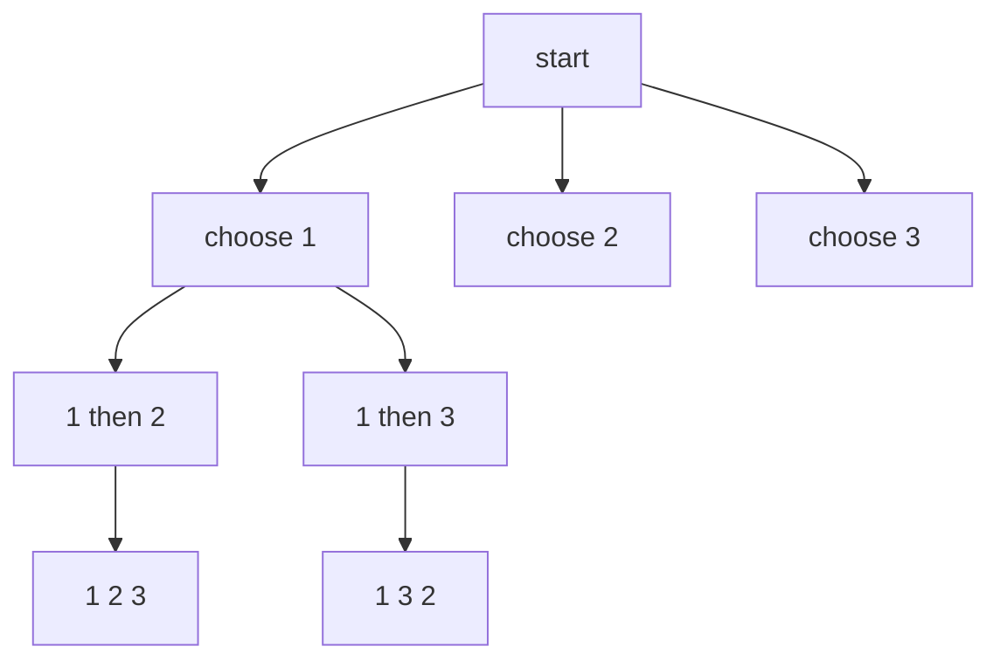

# Backtracking and Recursion

!!! note "In simple words"
    Recursion means a method solves a big problem by calling itself on a smaller version. Backtracking is a careful kind of recursion for searching: try a choice, go as far as it helps, undo the choice, and try the next one.

## Why it matters

Many interview problems ask for every arrangement, every subset, or every valid board. Brute force tries everything, but backtracking stops early when a partial answer cannot work. Interviewers use these problems to check whether you can define a base case, keep the state correct while you search, and cut the search space with pruning.

## How it works

### Recursion: base cases and recurrence

Every recursive method needs two parts:

1. A **base case** that returns without calling itself.
2. A **recursive case** that moves closer to the base case.

```java
public class Factorial {
    static long factorial(int n) {
        if (n <= 1) {
            return 1;                  // base case
        }
        return n * factorial(n - 1);   // recursive case
    }

    public static void main(String[] args) {
        System.out.println(factorial(10));   // 3628800
    }
}
```

Each call adds a frame to the call stack. The default thread stack holds a limited number of frames, so deep recursion throws `StackOverflowError`. The number of frames that fit depends on the frame size and the JVM settings, so do not rely on one exact number.

### Tail recursion

A call is in tail position when nothing happens after it returns. Some languages reuse the current frame for a tail call. Java does not guarantee this optimization, so tail-recursive code in Java still grows the stack.

```java
public class TailSum {
    // Tail-recursive in form, but the JVM does not remove the frames
    static long sumTo(long n, long acc) {
        return n == 0 ? acc : sumTo(n - 1, acc + n);
    }

    // The same result with a loop, which is the safe choice in Java
    static long sumToLoop(long n) {
        long acc = 0;
        for (long i = n; i > 0; i--) {
            acc += i;
        }
        return acc;
    }

    public static void main(String[] args) {
        System.out.println(sumToLoop(100));   // 5050
    }
}
```

When the depth can be large, for example for a linked list with a million nodes, convert the recursion to a loop or to an explicit `Deque` that acts as a stack.

### Warm-up: recursion instead of a loop

Recursion can replace a counting loop when the base case is clear. The call on `n - 1` finishes before the current level prints, so the output runs from 1 up to n.

```java
public class CountUp {
    static void printUpTo(int n) {
        if (n <= 0) {                  // base case: nothing left to print
            return;
        }
        printUpTo(n - 1);              // smaller problem first
        System.out.print(n + " ");     // then this level's work
    }

    public static void main(String[] args) {
        printUpTo(5);                  // prints: 1 2 3 4 5
    }
}
```

Interviewers use this example to check the base case and the order of work. If you move the print before the recursive call, the output reverses.

### Backtracking: choose, explore, un-choose

The backtracking template has three steps inside a loop over the choices:

```text
for each choice c:
    if c is allowed:
        apply c            (choose)
        recurse            (explore)
        undo c             (un-choose, the backtrack)
```

**Permutations.** Generate every ordering of distinct numbers. A boolean array marks which numbers are already in the current path.

```java
import java.util.ArrayList;
import java.util.List;

public class Permutations {
    static List<List<Integer>> permute(int[] nums) {
        List<List<Integer>> out = new ArrayList<>();
        build(nums, new boolean[nums.length], new ArrayList<>(), out);
        return out;
    }

    private static void build(int[] nums, boolean[] used, List<Integer> path, List<List<Integer>> out) {
        if (path.size() == nums.length) {
            out.add(new ArrayList<>(path));         // copy, because path keeps changing
            return;
        }
        for (int i = 0; i < nums.length; i++) {
            if (used[i]) {
                continue;
            }
            used[i] = true;                          // choose
            path.add(nums[i]);
            build(nums, used, path, out);            // explore
            path.remove(path.size() - 1);            // un-choose
            used[i] = false;
        }
    }

    public static void main(String[] args) {
        System.out.println(permute(new int[] {1, 2, 3}).size());   // 6
    }
}
```

**N-Queens.** Place n queens so that none attacks another. Track the used columns and both diagonals with boolean arrays, so each check takes O(1) time.

```java
public class NQueens {
    static int count(int n) {
        return place(0, n, new boolean[n], new boolean[2 * n], new boolean[2 * n]);
    }

    // cols: used columns. d1: row plus column. d2: row minus column, shifted by n so it is not negative.
    private static int place(int row, int n, boolean[] cols, boolean[] d1, boolean[] d2) {
        if (row == n) {
            return 1;
        }
        int total = 0;
        for (int c = 0; c < n; c++) {
            if (cols[c] || d1[row + c] || d2[row - c + n]) {
                continue;
            }
            cols[c] = d1[row + c] = d2[row - c + n] = true;
            total += place(row + 1, n, cols, d1, d2);
            cols[c] = d1[row + c] = d2[row - c + n] = false;
        }
        return total;
    }

    public static void main(String[] args) {
        System.out.println(count(6));   // 4
    }
}
```

**Sudoku.** Fill the empty cells one at a time, trying the digits 1 to 9 and checking the row, the column, and the 3 by 3 box. Backtrack when a cell has no valid digit. Pruning makes this fast. Choosing the empty cell with the fewest candidates is a common speed-up.

**Subsets and combinations.** Use the same template, but each choice decides whether to include an element, and the recursion starts at the next index. Starting at the next index means each subset is produced once, in one order.

### Worked example: permutations of 1, 2, 3

The search tree below shows the first two levels. Each path from the root to a leaf is one permutation.



The table shows what happens at the first branch. Each undo step returns the path to its previous state.

| Step | Action | path | used | Result |
|---|---|---|---|---|
| 1 | Choose 1 | [1] | {1} | Go deeper |
| 2 | Choose 2 | [1, 2] | {1, 2} | Go deeper |
| 3 | Choose 3 | [1, 2, 3] | {1, 2, 3} | Length is 3, so copy and store [1, 2, 3] |
| 4 | Undo 3 | [1, 2] | {1, 2} | No choices are left at this level, so return |
| 5 | Undo 2 | [1] | {1} | Try index 2 next |
| 6 | Choose 3 | [1, 3] | {1, 3} | Continue the same way |

The full search stores 3! = 6 permutations. Below the root, the tree has 3 + 6 + 6 = 15 nodes. The cost is O(n · n!), because each stored permutation has length n and must be copied.

### Pruning

Pruning cuts branches that cannot lead to a valid answer. Some examples:

- Sort the input, and skip repeated values at the same level of the recursion.
- Stop when the running sum already exceeds the target, if all values are positive.
- Check the constraints before the recursive call rather than after it.

### Complexity

| Problem | Time | Space (call stack) | Output size |
|---|---|---|---|
| Factorial, linear recursion | O(n) | O(n) | One value |
| Permutations of n distinct values | O(n · n!) | O(n) | n! lists |
| Subsets of n values | O(n · 2ⁿ) | O(n) | 2ⁿ lists |
| N-Queens, count only | About O(n!) with pruning | O(n) | One number |
| Sudoku | Exponential in the worst case | O(81) | One board |
| Recursive tree traversal | O(n) | O(h) | Visit order |

## Where it is used

- **Puzzle solvers** such as Sudoku and crosswords use backtracking to fill cells that satisfy the rules.
- **Scheduling and configuration** search for assignments that meet constraints, such as seats or shifts.
- **Parsers** backtrack through grammar alternatives until one matches the input.
- **Test generators and combinatorics** list permutations, combinations, or subsets of options.
- **Graph search** uses DFS, which is recursion over a graph (see [Graphs](graphs.md)).

## Benefits

- **Clear structure.** The choose, explore, and undo steps are the same for many problems.
- **Early exit.** Pruning avoids large parts of the search space.
- **Small code.** A correct backtracking solution is often short and easy to read.
- **Complete answers.** Backtracking finds all solutions when you ask for them.

## Cons and limits

- **Exponential time.** The search tree grows very fast with the input size.
- **Stack depth.** Each level adds a call frame, so deep recursion can overflow the stack.
- **Memory for results.** Storing all permutations or subsets can use far more memory than the search itself.
- **Easy to forget the undo.** A missing undo leaves stale state that corrupts later branches.

## Best practices

- Define the state first: what the partial solution looks like at each level.
- Write the base case early, and check that each recursive call makes progress toward it.
- Undo exactly the changes you made. Use the same variable and the same value.
- Copy the partial solution before you store it. A stored reference points to a list that will change later.
- Prune before you recurse. A constraint check that comes too late does not save time.
- Sort the input and skip equal neighbors when the input may contain duplicates.
- Replace deep recursion with an explicit stack or a loop when the depth can be large.
- Say that backtracking is usually exponential in the worst case, and explain how pruning helps in practice.

!!! tip "Interview tip"
    **Q: How is backtracking different from brute force?**
    Brute force generates every candidate and checks each one at the end. Backtracking builds candidates step by step, and it drops a partial candidate as soon as it breaks a constraint. The search tree has the same shape, but the pruned branches are never explored. The worst case is still exponential, so say so.

## Quick recap

- Every recursive method needs a base case that makes progress toward it.
- Java does not remove tail-call frames, so deep recursion can throw `StackOverflowError`.
- Backtracking follows choose, explore, and un-choose.
- Copy partial results before you store them.
- Prune early, with constraint checks before the recursive call, to make exponential search practical.

## Official documentation

- [The Java Language Specification, Java SE 21](https://docs.oracle.com/javase/specs/jls/se21/html/index.html)
- [Java SE 21 API documentation](https://docs.oracle.com/en/java/javase/21/docs/api/index.html)
- [Dev.java, the Java developer site](https://dev.java/)

**See also:** [Graphs](graphs.md) (DFS is recursion over a graph), [Dynamic Programming](dynamic-programming.md), [Greedy, Bit Manipulation and Hashing](greedy-bit-manipulation-hashing.md), [Trees](../04a-dsa-foundations/trees.md)
