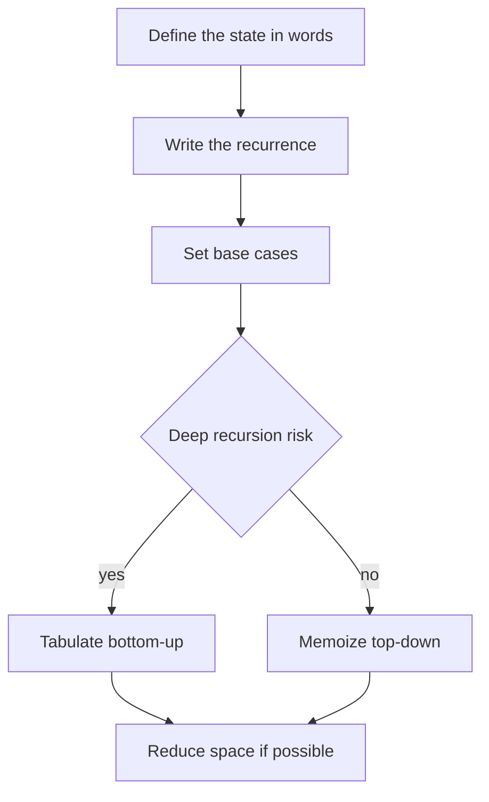

# Dynamic Programming

!!! note "In simple words"
    Dynamic programming (DP) is remembering answers you have already worked out. When the same smaller question shows up again, you look up the saved answer instead of solving it again.

## Why it matters

Plain recursion often solves the same subproblem many times. Fibonacci computed the naive way takes exponential time, while a saved table of answers takes linear time. DP appears in many interview questions, including coin change, knapsack, edit distance, and subarray sums. Interviewers use DP to check whether you can define a state, write the recurrence, and then reduce time and space.

## How it works

### Overlapping subproblems and optimal substructure

DP applies when two conditions hold:

- **Optimal substructure.** The best answer to the whole problem can be built from the best answers to smaller parts.
- **Overlapping subproblems.** The same smaller part is needed many times. Plain recursion recomputes it every time, and DP stores the result.

The naive Fibonacci function is a clear case. `fib(n-2)` is computed inside `fib(n-1)` and again inside `fib(n)`. Storing each result removes the repeated work.

### Memoization and tabulation

There are two ways to apply DP:

| Approach | How it works | Pros | Cons |
|---|---|---|---|
| Memoization (top-down) | Recursion plus a cache | Computes only the states you need; follows the recurrence directly | Recursion depth and call overhead |
| Tabulation (bottom-up) | Fill a table in dependency order | No recursion; easy to reduce space | Computes some states you may not need |

Memoized Fibonacci:

```java
public class FibMemo {
    static long fib(int n, long[] memo) {
        if (n < 2) {
            return n;
        }
        if (memo[n] != 0) {
            return memo[n];         // 0 is a safe "not computed" marker, since fib(n) >= 1 for n >= 2
        }
        memo[n] = fib(n - 1, memo) + fib(n - 2, memo);
        return memo[n];
    }

    public static void main(String[] args) {
        System.out.println(fib(50, new long[51]));   // 12586269025
    }
}
```

Avoid `Map.computeIfAbsent` with a recursive call that writes to the same map. From Java 9, a `HashMap` throws `ConcurrentModificationException` in that case.

Tabulated coin change, which finds the minimum number of coins:

```java
import java.util.Arrays;

public class CoinChange {
    static int minCoins(int[] coins, int amount) {
        int[] dp = new int[amount + 1];
        Arrays.fill(dp, amount + 1);           // larger than any valid answer, so it acts as infinity
        dp[0] = 0;
        for (int a = 1; a <= amount; a++) {
            for (int c : coins) {
                if (c <= a) {
                    dp[a] = Math.min(dp[a], dp[a - c] + 1);
                }
            }
        }
        return dp[amount] > amount ? -1 : dp[amount];
    }

    public static void main(String[] args) {
        System.out.println(minCoins(new int[] {1, 2, 5}, 11));   // 3 (5 + 5 + 1)
    }
}
```

#### Worked example: coin change table for coins 1, 2, 5

Each cell `dp[a]` is the fewest coins that make the amount `a`. Each value comes from the smallest of `dp[a - c] + 1` over the coins `c` that fit.

| Amount a | 0 | 1 | 2 | 3 | 4 | 5 | 6 | 7 | 8 | 9 | 10 | 11 |
|---|---|---|---|---|---|---|---|---|---|---|---|---|
| dp[a] | 0 | 1 | 1 | 2 | 2 | 1 | 2 | 2 | 3 | 3 | 2 | 3 |

For amount 11, the candidates are dp[10] + 1 = 3, dp[9] + 1 = 4, and dp[6] + 1 = 3. The minimum is 3, which is 5 + 5 + 1. The answer is in the last cell, and the table is filled from left to right, so each value needs only earlier values.

### Classic problems

**0/1 knapsack.** Each item can be used at most once. If you loop over the capacity in reverse, a single one-dimensional array works, because each item is counted once.

```java
public class Knapsack {
    static int knapsack(int[] weight, int[] value, int capacity) {
        int[] best = new int[capacity + 1];
        for (int i = 0; i < weight.length; i++) {
            for (int c = capacity; c >= weight[i]; c--) {      // reverse order: each item used once
                best[c] = Math.max(best[c], best[c - weight[i]] + value[i]);
            }
        }
        return best[capacity];
    }

    public static void main(String[] args) {
        int[] w = {1, 3, 4, 5};
        int[] v = {1, 4, 5, 7};
        System.out.println(knapsack(w, v, 7));   // 9: items of weight 3 and 4
    }
}
```

**Longest common subsequence (LCS).** A two-dimensional table is used here. `dp[i][j]` is the LCS length of the first `i` characters of `a` and the first `j` characters of `b`.

```java
public class Lcs {
    static int lcs(String a, String b) {
        int[][] dp = new int[a.length() + 1][b.length() + 1];
        for (int i = 1; i <= a.length(); i++) {
            for (int j = 1; j <= b.length(); j++) {
                dp[i][j] = a.charAt(i - 1) == b.charAt(j - 1)
                        ? dp[i - 1][j - 1] + 1
                        : Math.max(dp[i - 1][j], dp[i][j - 1]);
            }
        }
        return dp[a.length()][b.length()];
    }

    public static void main(String[] args) {
        System.out.println(lcs("abcde", "ace"));   // 3
    }
}
```

**Longest increasing subsequence (LIS).** The O(n²) version is a direct recurrence: `dp[i]` is the longest increasing subsequence that ends at index `i`. The O(n log n) version keeps a "tails" array and uses binary search to place each value. Mention it when the interviewer asks for a faster solution.

**Grid paths.** Count the paths from the top-left corner to the bottom-right corner, moving only right or down. Use `dp[r][c] = dp[r-1][c] + dp[r][c-1]`, with the first row and the first column set to 1. For a 3 by 3 grid, the answer is 6.

**Maximum subarray (Kadane's algorithm).** Let `endingHere` be the best sum of a subarray that ends at the current element. Each step either extends the previous subarray or starts fresh at the current element. The answer is the largest `endingHere` seen. The algorithm runs in O(n) time and O(1) space, and it needs at least one element.

```java
public class MaxSubarray {
    static int maxSubarraySum(int[] nums) {
        int best = nums[0];
        int endingHere = 0;
        for (int n : nums) {
            endingHere = Math.max(n, endingHere + n);    // extend, or start fresh at n
            best = Math.max(best, endingHere);
        }
        return best;
    }

    public static void main(String[] args) {
        System.out.println(maxSubarraySum(new int[] {-2, 1, -3, 4, -1, 2, 1, -5, 4}));   // 6
    }
}
```

Starting `best` at `nums[0]`, rather than at `Integer.MIN_VALUE`, keeps the answer correct when every element is negative.

#### Kadane's algorithm as a one-state DP

Kadane's algorithm is a DP with one state. `endingHere[i]` is the best subarray sum that ends at index `i`, and the recurrence is `endingHere[i] = max(nums[i], endingHere[i-1] + nums[i])`. Only the previous value is needed, so a single variable replaces the array. Interview problems about the maximum circular subarray, or the maximum product of a subarray (which also needs a running minimum), use the same pattern. The array-focused version of the problem appears in [Arrays and Strings](../../interview-questions/coding/arrays-strings-part-1.md).

Trace for the example input, showing the state after each element:

| Index | `nums[i]` | `endingHere` (extend or restart) | `best` so far |
|---|---|---|---|
| 0 | -2 | max(-2, 0 - 2) = -2 | -2 |
| 1 | 1 | max(1, -2 + 1) = 1 | 1 |
| 2 | -3 | max(-3, 1 - 3) = -2 | 1 |
| 3 | 4 | max(4, -2 + 4) = 4 | 4 |
| 4 | -1 | max(-1, 4 - 1) = 3 | 4 |
| 5 | 2 | max(2, 3 + 2) = 5 | 5 |
| 6 | 1 | max(1, 5 + 1) = 6 | 6 |
| 7 | -5 | max(-5, 6 - 5) = 1 | 6 |
| 8 | 4 | max(4, 1 + 4) = 5 | 6 |

The answer is 6, from the subarray `[4, -1, 2, 1]`. In the code above, `endingHere` starts at 0. That gives the same result, because the first step computes `max(n, 0 + n)`.

### Less common DP families

- **Interval DP.** `dp[i][j]` covers the subarray or substring from `i` to `j`. It fits problems such as matrix-chain multiplication and burst balloons. Loop by interval length.
- **Tree DP.** Compute a value for each child, then combine the values at the parent in a post-order walk. Typical examples are the maximum path sum and the diameter (see [Trees](../04a-dsa-foundations/trees.md)).
- **Digit DP.** Count the numbers in a range that have a digit property. The state includes the position, a flag that says whether the prefix is still tight to the bound, and the property so far.
- **Bitmask DP.** The state is a subset encoded in an integer. The travelling salesman problem over n cities takes O(2ⁿ × n²) time, so it works only for small n.

## Where it is used

- **Shipping and budgeting** use knapsack-style DP to pick the best set of items within a limit.
- **Spell checkers and diff tools** use LCS and edit distance to compare text.
- **Bioinformatics** uses sequence alignment, which is DP over two strings.
- **Pricing and finance** use DP for optimal decisions over time, such as when to sell.
- **Route planning** uses DP on grids and on small graphs with fixed stages.

## Benefits

- **Large speed-ups.** Turning exponential recursion into a table often gives polynomial time.
- **Systematic method.** The same steps solve many different problems.
- **Clear answers.** The table or the cache shows exactly how the answer was built.
- **Space reduction.** Many tables need only the previous row or a few values.

## Cons and limits

- **Finding the state is hard.** Choosing the right state is the main challenge, and a wrong state gives wrong answers.
- **Memory can grow.** Tables over several dimensions can be too big for large inputs.
- **Recursion depth.** Memoized recursion can overflow the call stack on large inputs.
- **Not every problem fits.** Without overlapping subproblems or optimal substructure, DP does not help.

## Best practices

- Define the state in words first, for example "`dp[i]` is the best answer for the first `i` items".
- Write the recurrence, then the base cases (an empty input, or a zero amount).
- Start with memoization when the recurrence is hard to see. Switch to tabulation for a deep recursion or to save space.
- Use a sentinel that cannot be a valid answer, such as `amount + 1` or `Integer.MAX_VALUE`. Do not use 0 when 0 is also a valid answer.
- Check overflow before you add two sentinel values, or use `long`.
- Iterate the knapsack capacity in reverse for a single array.
- Keep the table indexes and the input indexes in step. A table with one extra row or column is a common source of off-by-one errors.
- Reduce space when each row depends only on the previous row.



### Complexity

| Problem | Time | Space | Notes |
|---|---|---|---|
| Fibonacci, memoized | O(n) | O(n) | Naive recursion is exponential |
| Coin change, minimum coins | O(amount × coins) | O(amount) | Unreachable amounts need a sentinel |
| 0/1 knapsack | O(items × capacity) | O(capacity) | One array with reverse loop |
| Longest common subsequence | O(n × m) | O(n × m), or O(min(n, m)) with rolling rows | Two strings |
| LIS, quadratic | O(n²) | O(n) | Direct recurrence |
| LIS, with binary search | O(n log n) | O(n) | Tails array |
| Grid paths | O(rows × cols) | O(cols) with rolling row | Right and down moves |
| Maximum subarray (Kadane) | O(n) | O(1) | Needs one element |
| Interval DP | O(n³) typical | O(n²) | Loop by interval length |
| Bitmask DP (travelling salesman) | O(2ⁿ × n²) | O(2ⁿ × n) | Only for small n |

## Worked example summary

Coin change for amount 11 with coins 1, 2, 5 was traced above with the full table. The answer is 3, and it takes O(amount × coins) = 11 × 3 = 33 updates.

## Common pitfalls

- Defining a state that does not hold enough information for the next decision.
- Off-by-one errors between a table that starts at index 1 and an input that starts at index 0.
- Using 0 to mean "unreachable" when 0 is also a valid answer.
- Overflow when adding two `Integer.MAX_VALUE` sentinels.
- Iterating the knapsack capacity forwards, which counts an item more than once.
- Forgetting that memoized recursion can overflow the call stack on a large input.

!!! tip "Interview tip"
    **Q: How do you decide between memoization and tabulation?**
    Start with memoization, because it follows the recurrence directly and computes only the states you need. Switch to tabulation when recursion depth is a risk, or when you want to reduce space row by row. Both have the same time complexity, which is the number of states multiplied by the cost of each state.

## Quick recap

- DP needs optimal substructure and overlapping subproblems.
- Memoization is top-down recursion with a cache. Tabulation fills a table bottom-up.
- Define the state first, then the recurrence, then the base cases.
- Knapsack iterates the capacity in reverse. LCS and grid paths use two-dimensional tables.
- Kadane's algorithm is a one-variable DP for the maximum subarray sum.
- Choose sentinels with care, so that a value meaning "unreachable" never looks like a valid answer.

## Official documentation

- [java.util.HashMap, Java SE 21](https://docs.oracle.com/en/java/javase/21/docs/api/java.base/java/util/HashMap.html)
- [Java SE 21 API documentation](https://docs.oracle.com/en/java/javase/21/docs/api/index.html)
- [The Java Language Specification, Java SE 21](https://docs.oracle.com/javase/specs/jls/se21/html/index.html)

**See also:** [Graphs](graphs.md), [Backtracking and Recursion](backtracking-recursion.md), [Greedy, Bit Manipulation and Hashing](greedy-bit-manipulation-hashing.md), [Arrays and Strings](../../interview-questions/coding/arrays-strings-part-1.md)
