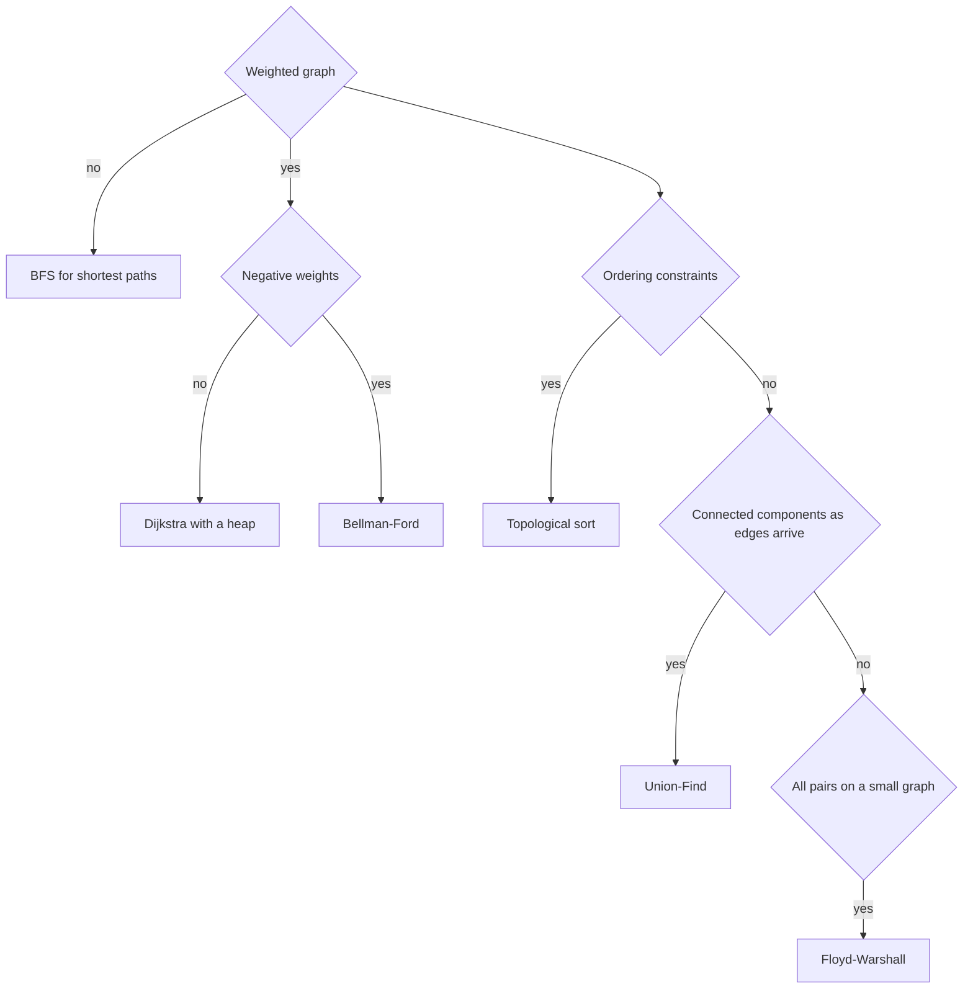

# Graphs

!!! note "In simple words"
    A graph is a set of points joined by lines, such as cities and roads or tasks and their dependencies. Many problems reduce to one question: which points can I reach, and how cheaply?

## Why it matters

Graphs model things that connect: road networks, dependency lists, social links, and task schedules. Interviewers use graph questions because one model covers many problems. The skill they test is choosing the right algorithm for the structure of the input. BFS, DFS, Dijkstra, and Union-Find each answer a different kind of question, and using the wrong one gives a wrong or slow answer.

## How it works

### Representations

A graph has vertices (V) and edges (E). The two common ways to store one are listed below.

| Representation | Space | Check if edge u to v exists | Best for |
|---|---|---|---|
| Adjacency list | O(V + E) | O(degree of u) | Sparse graphs, which are most real graphs |
| Adjacency matrix | O(V²) | O(1) | Dense graphs, and Floyd-Warshall |

```java
import java.util.ArrayList;
import java.util.List;

public class GraphBuild {
    public static void main(String[] args) {
        int n = 4;
        List<List<Integer>> adj = new ArrayList<>();
        for (int i = 0; i < n; i++) {
            adj.add(new ArrayList<>());
        }
        int[][] edges = {{0, 1}, {1, 2}, {2, 3}};
        for (int[] e : edges) {
            adj.get(e[0]).add(e[1]);
            adj.get(e[1]).add(e[0]);   // undirected: store both directions
        }
        System.out.println(adj);       // [[1], [0, 2], [1, 3], [2]]
    }
}
```

### BFS and DFS

Both visit every reachable vertex in O(V + E) time. BFS uses a queue and finds shortest paths in unweighted graphs, because it reaches vertices in order of their distance. DFS uses a stack or recursion, and it suits connectivity checks, cycle detection, and topological ordering.

```java
import java.util.ArrayDeque;
import java.util.Arrays;
import java.util.Deque;
import java.util.List;

public class Bfs {
    static int[] distances(List<List<Integer>> adj, int src) {
        int[] dist = new int[adj.size()];
        Arrays.fill(dist, -1);             // -1 means not visited yet
        Deque<Integer> queue = new ArrayDeque<>();
        dist[src] = 0;
        queue.add(src);
        while (!queue.isEmpty()) {
            int u = queue.poll();
            for (int v : adj.get(u)) {
                if (dist[v] == -1) {
                    dist[v] = dist[u] + 1;
                    queue.add(v);
                }
            }
        }
        return dist;
    }

    public static void main(String[] args) {
        // Edges: 0-1, 0-2, 1-3, 2-3, 3-4
        List<List<Integer>> adj = List.of(
                List.of(1, 2), List.of(0, 3), List.of(0, 3), List.of(1, 2, 4), List.of(3));
        System.out.println(Arrays.toString(distances(adj, 0)));   // [0, 1, 1, 2, 3]
    }
}
```

Mark a vertex as visited when you enqueue it, not when you dequeue it. If you wait until dequeue, the same vertex can be queued many times.

### Shortest paths

| Algorithm | Handles negative weights | Complexity | Typical use |
|---|---|---|---|
| BFS | Not applicable, all weights are 1 | O(V + E) | Shortest path in an unweighted graph |
| Dijkstra | No | O((V + E) log V) with a binary heap | One source, non-negative weights |
| Bellman-Ford | Yes, and it detects negative cycles | O(V × E) | One source, negative edges allowed |
| Floyd-Warshall | Yes, and it detects negative cycles | O(V³) | All pairs, small graphs |

Dijkstra's algorithm with a `PriorityQueue` uses lazy deletion. When the queue returns an entry that is out of date, it skips it.

```java
import java.util.Arrays;
import java.util.List;
import java.util.PriorityQueue;

public class Dijkstra {
    static final long INF = Long.MAX_VALUE / 4;

    // adj.get(u) holds {v, weight} pairs. Weights must be non-negative.
    static long[] shortest(List<List<int[]>> adj, int src) {
        long[] dist = new long[adj.size()];
        Arrays.fill(dist, INF);
        dist[src] = 0;
        PriorityQueue<long[]> pq = new PriorityQueue<>((a, b) -> Long.compare(a[0], b[0]));
        pq.add(new long[] {0, src});
        while (!pq.isEmpty()) {
            long[] cur = pq.poll();
            int u = (int) cur[1];
            if (cur[0] > dist[u]) {
                continue;                       // stale entry: a shorter path was already found
            }
            for (int[] edge : adj.get(u)) {
                int v = edge[0];
                long nd = dist[u] + edge[1];
                if (nd < dist[v]) {
                    dist[v] = nd;
                    pq.add(new long[] {nd, v});
                }
            }
        }
        return dist;
    }

    public static void main(String[] args) {
        // 0 to 1 costs 4, 0 to 2 costs 1, 2 to 1 costs 2, 1 to 3 costs 1
        List<List<int[]>> adj = List.of(
                List.of(new int[] {1, 4}, new int[] {2, 1}),
                List.of(new int[] {3, 1}),
                List.of(new int[] {1, 2}),
                List.of());
        System.out.println(Arrays.toString(shortest(adj, 0)));   // [0, 3, 1, 4]
    }
}
```

Bellman-Ford relaxes every edge V - 1 times. If a further pass can still relax an edge, a negative cycle is reachable from the source. Floyd-Warshall is a triple loop over k, i, and j. It is short enough to write in an interview when V is small:

```java
import java.util.Arrays;

public class FloydWarshall {
    static final long INF = Long.MAX_VALUE / 4;

    static void floyd(long[][] d) {              // d[i][i] = 0; d[i][j] = INF when there is no edge
        int n = d.length;
        for (int k = 0; k < n; k++) {
            for (int i = 0; i < n; i++) {
                for (int j = 0; j < n; j++) {
                    d[i][j] = Math.min(d[i][j], d[i][k] + d[k][j]);
                }
            }
        }
    }

    public static void main(String[] args) {
        long[][] d = {
                {0, 3, INF},
                {INF, 0, 1},
                {2, INF, 0}};
        floyd(d);
        System.out.println(Arrays.toString(d[0]));   // [0, 3, 4]
    }
}
```

With `INF = Long.MAX_VALUE / 4`, adding two infinities cannot overflow, so the loop needs no extra checks.

### Minimum spanning trees

A spanning tree connects all the vertices using V - 1 edges. The minimum spanning tree (MST) is the spanning tree with the smallest total weight.

- **Kruskal.** Sort the edges by weight. Add each edge that joins two different components, using Union-Find to check. The cost is O(E log E).
- **Prim.** Grow one tree from a start vertex, and always take the cheapest edge that leaves the tree. A priority queue makes this O(E log V) with a binary heap.

### Union-Find (disjoint set union)

Union-Find answers the question "are these two vertices in the same component?" with almost constant time per operation. Path compression and union by rank make each operation nearly O(1), with an inverse-Ackermann bound.

```java
public class DisjointSet {
    private final int[] parent;
    private final int[] rank;

    public DisjointSet(int n) {
        parent = new int[n];
        rank = new int[n];
        for (int i = 0; i < n; i++) {
            parent[i] = i;
        }
    }

    public int find(int x) {
        if (parent[x] != x) {
            parent[x] = find(parent[x]);      // path compression
        }
        return parent[x];
    }

    public boolean union(int a, int b) {
        int ra = find(a);
        int rb = find(b);
        if (ra == rb) {
            return false;                     // already connected: this edge would close a cycle
        }
        if (rank[ra] < rank[rb]) {
            int t = ra;
            ra = rb;
            rb = t;
        }
        parent[rb] = ra;
        if (rank[ra] == rank[rb]) {
            rank[ra]++;
        }
        return true;
    }

    public static void main(String[] args) {
        DisjointSet ds = new DisjointSet(4);
        ds.union(0, 1);
        ds.union(2, 3);
        System.out.println(ds.find(0) == ds.find(1));   // true
        System.out.println(ds.find(1) == ds.find(2));   // false
    }
}
```

### Topological sort and cycle detection

A topological order exists only for a directed acyclic graph (DAG). Kahn's algorithm removes the vertices with in-degree 0, one at a time. If some vertices are never removed, the graph has a cycle.

```java
import java.util.ArrayDeque;
import java.util.ArrayList;
import java.util.Deque;
import java.util.List;

public class TopoSort {
    // Returns a valid order, or an empty list when the graph has a cycle
    static List<Integer> order(int n, int[][] edges) {
        List<List<Integer>> adj = new ArrayList<>();
        int[] indeg = new int[n];
        for (int i = 0; i < n; i++) {
            adj.add(new ArrayList<>());
        }
        for (int[] e : edges) {
            adj.get(e[0]).add(e[1]);
            indeg[e[1]]++;
        }
        Deque<Integer> q = new ArrayDeque<>();
        for (int i = 0; i < n; i++) {
            if (indeg[i] == 0) {
                q.add(i);
            }
        }
        List<Integer> result = new ArrayList<>();
        while (!q.isEmpty()) {
            int u = q.poll();
            result.add(u);
            for (int v : adj.get(u)) {
                if (--indeg[v] == 0) {
                    q.add(v);
                }
            }
        }
        return result.size() == n ? result : List.of();
    }

    public static void main(String[] args) {
        int[][] edges = {{0, 1}, {0, 2}, {1, 3}, {2, 3}};
        System.out.println(order(4, edges));   // [0, 1, 2, 3]
    }
}
```

For an undirected graph, detect a cycle with a DFS that remembers the parent of each vertex. Union-Find also works: an edge that joins two vertices already in the same set closes a cycle. For a directed graph, a DFS with three colors (unvisited, in progress, and done) finds back edges.

### Strongly connected components

In a directed graph, a strongly connected component (SCC) is a largest set of vertices that can all reach each other. Tarjan's and Kosaraju's algorithms find the SCCs in O(V + E). Know what they compute. You rarely need to write them from memory in an interview.

### Bipartite graphs and 0/1 BFS

A graph is bipartite when its vertices can be split into two sets, with every edge going between the sets. Color the vertices with BFS or DFS. A conflict means the graph is not bipartite. Any odd-length cycle breaks bipartiteness.

0/1 BFS handles graphs whose edge weights are only 0 or 1. Push a neighbor reached by a 0-weight edge to the front of a deque, and a neighbor reached by a 1-weight edge to the back. It runs in O(V + E) without a heap.

### Articulation points and bridges

An articulation point is a vertex whose removal increases the number of connected components. A bridge is an edge with the same effect. Tarjan's DFS-based algorithm finds both in O(V + E) time, using discovery times and low-link values. Explain the idea first (discovery time, and the lowest ancestor a subtree can reach), and only then write any code.

### Worked example: BFS distances on a small graph

Edges: 0-1, 0-2, 1-3, 2-3, 3-4. Start at vertex 0. The table shows the queue after each dequeue.

| Dequeued | Neighbors checked | New distances set | Queue after |
|---|---|---|---|
| start | 0 has distance 0 | none | [0] |
| 0 | 1 and 2 | 1 = 1, 2 = 1 | [1, 2] |
| 1 | 0 is done, 3 | 3 = 2 | [2, 3] |
| 2 | 0 is done, 3 is done | none | [3] |
| 3 | 1 and 2 are done, 4 | 4 = 3 | [4] |
| 4 | 3 is done | none | [] |

The result is `[0, 1, 1, 2, 3]`. Each vertex is enqueued once, and each edge is looked at twice, which is the O(V + E) bound.



### Complexity

| Problem | Algorithm | Time | Space |
|---|---|---|---|
| Reachability, connected components | BFS or DFS | O(V + E) | O(V) |
| Shortest path, unweighted | BFS | O(V + E) | O(V) |
| Shortest path, non-negative weights | Dijkstra with a heap | O((V + E) log V) | O(V) |
| Shortest path, negative weights | Bellman-Ford | O(V × E) | O(V) |
| All pairs shortest paths | Floyd-Warshall | O(V³) | O(V²) |
| Minimum spanning tree | Kruskal | O(E log E) | O(V + E) |
| Minimum spanning tree | Prim with a heap | O(E log V) | O(V + E) |
| Same component queries | Union-Find | Nearly O(1) per operation | O(V) |
| Topological order | Kahn | O(V + E) | O(V + E) |
| Strongly connected components | Tarjan or Kosaraju | O(V + E) | O(V) |

## Where it is used

- **Maps and navigation** run Dijkstra or A* on road networks to find routes.
- **Build systems and package managers** use topological sort to order tasks and dependencies.
- **Social networks** use BFS to find friends of friends within a given distance.
- **Network design** uses minimum spanning trees to connect sites at the lowest cost.
- **Clustering and deduplication** use Union-Find to merge items that are linked by a relation.

## Benefits

- **One model, many problems.** Vertices and edges describe roads, tasks, users, and states alike.
- **Well-known algorithms.** BFS, DFS, Dijkstra, and topological sort are standard tools with predictable costs.
- **Scales with sparse data.** An adjacency list uses memory in proportion to the edges that exist.

## Cons and limits

- **Algorithm choice matters.** Dijkstra gives wrong answers with negative edges, and it does not report that it has done so.
- **Dense graphs cost more.** An adjacency matrix uses O(V²) memory, which is large for a big sparse graph.
- **Deep recursion is risky.** A recursive DFS on a large graph can overflow the call stack.
- **Cycles need care.** Topological sort only works on directed acyclic graphs.

## Best practices

- Ask first whether the graph is weighted, directed, and sparse or dense. The answers decide the algorithm.
- For undirected edges, add both directions to the adjacency list.
- Mark vertices visited when you enqueue them in BFS.
- Use `long` for path sums, because they can exceed the range of `int`.
- Loop over every vertex when the graph may be disconnected, not only over one source.
- Use an explicit stack or a larger thread stack for deep DFS.
- Use lazy deletion with a priority queue rather than trying to update entries in place.
- Check that a topological sort returned every vertex before you trust the order.

!!! tip "Interview tip"
    **Q: How do you find the shortest path in a weighted graph with no negative edges?**
    Use Dijkstra's algorithm with a min-heap. Its cost is O((V + E) log V). If all weights are equal, plain BFS costs O(V + E). If there are negative edges, switch to Bellman-Ford, and mention that it also detects negative cycles.

## Quick recap

- Adjacency lists suit most graphs. Adjacency matrices suit dense graphs and Floyd-Warshall.
- BFS gives shortest paths in unweighted graphs. DFS handles connectivity and cycles.
- Dijkstra needs non-negative weights. Bellman-Ford handles negative weights.
- Kruskal and Prim both build a minimum spanning tree. Union-Find is the core of Kruskal.
- Kahn's topological sort works only on DAGs. A missing vertex in the output means a cycle.

## Official documentation

- [Java SE 21 API documentation](https://docs.oracle.com/en/java/javase/21/docs/api/index.html)
- [java.util.HashMap, Java SE 21](https://docs.oracle.com/en/java/javase/21/docs/api/java.base/java/util/HashMap.html)
- [The Java Language Specification, Java SE 21](https://docs.oracle.com/javase/specs/jls/se21/html/index.html)

**See also:** [Dynamic Programming](dynamic-programming.md), [Backtracking and Recursion](backtracking-recursion.md), [Greedy, Bit Manipulation and Hashing](greedy-bit-manipulation-hashing.md), [Heaps and Tries](../04a-dsa-foundations/heaps-and-tries.md), [Trees](../04a-dsa-foundations/trees.md)
