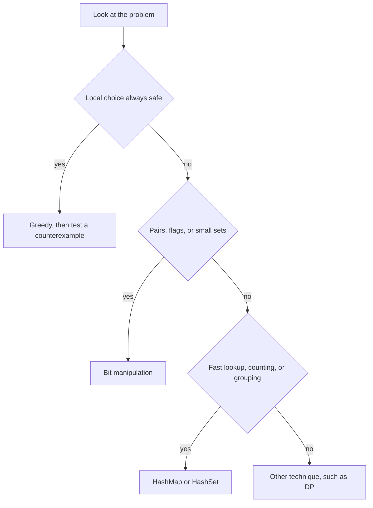

# Greedy, Bit Manipulation and Hashing

!!! note "In simple words"
    Greedy means taking the best-looking option right now and never going back. Bit manipulation means working on the 0s and 1s inside a number. Hashing means turning a key into a position so you can find it almost instantly.

## Why it matters

These three techniques often give the fastest answer once you spot the pattern. Greedy is short and quick, but only when the local choice is provably safe. Bit tricks cut memory and work on flags and sets. Hashing gives near-constant lookup, which is why `HashMap` and `HashSet` appear in so many solutions. Interviewers ask about them to see whether you can prove a greedy choice is safe and whether you understand the trade-offs of hash-based structures.

## How it works

### Greedy algorithms

A greedy algorithm picks the best-looking option at each step and never reconsiders it. It gives the optimal answer only when the problem has two properties:

- **Greedy choice property.** A locally best choice can be part of some globally optimal solution.
- **Optimal substructure.** After the greedy choice, the remaining problem has the same form, so the same reasoning applies again.

Proving these properties is part of a good answer. A quick way to test a greedy idea is to look for a small counterexample.

A classic example is the maximum number of non-overlapping intervals. Sort the intervals by their end time. Then take each interval that starts at or after the end of the last one you took.

```java
import java.util.Arrays;

public class Intervals {
    static int maxNonOverlapping(int[][] intervals) {
        Arrays.sort(intervals, (a, b) -> Integer.compare(a[1], b[1]));   // sort by end time
        int count = 0;
        int end = Integer.MIN_VALUE;
        for (int[] iv : intervals) {
            if (iv[0] >= end) {
                count++;
                end = iv[1];
            }
        }
        return count;
    }

    public static void main(String[] args) {
        int[][] iv = {{1, 3}, {2, 4}, {3, 5}, {6, 7}};
        System.out.println(maxNonOverlapping(iv));   // 3
    }
}
```

Other greedy classics include Huffman coding, Kruskal and Prim (see [Graphs](graphs.md)), and the jump game. Greedy fails for coin change with arbitrary denominations, so use [dynamic programming](dynamic-programming.md) there.

#### Worked example: why greedy fails for coin change

Coins are 1, 3, and 4, and the amount is 6. Greedy takes the largest coin first.

| Step | Remaining | Greedy choice | Coins used so far |
|---|---|---|---|
| 1 | 6 | 4 | 1 |
| 2 | 2 | 1 | 2 |
| 3 | 1 | 1 | 3 |

Greedy uses three coins. The best answer is two coins, 3 plus 3. The greedy choice of 4 blocked the better combination, so the greedy choice property does not hold for this coin set.

### Bit manipulation

Java's integer types use two's complement. The bit operators are `&` (AND), `|` (OR), `^` (XOR), `~` (NOT), `<<` (left shift), `>>` (arithmetic right shift), and `>>>` (unsigned right shift).

| Expression | Meaning |
|---|---|
| `x & (x - 1)` | Clears the lowest set bit |
| `x & -x` | Isolates the lowest set bit |
| `x ^ x` | Gives 0 |
| `x ^ 0` | Gives x |
| `(x >> i) & 1` | The value of bit i |
| `x \| (1 << i)` | Sets bit i |
| `x & ~(1 << i)` | Clears bit i |

XOR cancels equal pairs. So the single number that appears once among pairs can be found in O(n) time and O(1) space:

```java
public class SingleNumber {
    static int singleNumber(int[] nums) {
        int result = 0;
        for (int n : nums) {
            result ^= n;                 // equal pairs cancel to 0
        }
        return result;
    }

    public static void main(String[] args) {
        System.out.println(singleNumber(new int[] {4, 1, 2, 1, 2}));   // 4
    }
}
```

Counting set bits and checking for a power of two:

```java
public class Bits {
    public static void main(String[] args) {
        int x = 0b1011;                                // 11
        System.out.println(Integer.bitCount(x));       // 3
        System.out.println((x & (x - 1)) == 0);        // false: 11 is not a power of two
        System.out.println(Integer.highestOneBit(x));  // 8
        System.out.println(Integer.toBinaryString(x)); // 1011
    }
}
```

A bitmask can represent a subset. For n elements, the integers from 0 to 2ⁿ - 1 each describe one subset, where bit i means "element i is in the subset". This is the basis of bitmask dynamic programming.

Watch the shift distance. For an `int`, the shift count is taken modulo 32, so `1 << 32` equals `1 << 0`. Use `1L << k` when k is 32 or more.

### Hashing

A hash function maps a key to an index in a table. With a good hash function, lookup, insert, and delete take O(1) time on average. `HashMap` and `HashSet` are the Java implementations.

**The `equals` and `hashCode` contract.** If `a.equals(b)` is true, then `a.hashCode()` and `b.hashCode()` must be equal. Breaking this rule makes lookups in `HashSet` and `HashMap` fail. Records generate both methods correctly:

```java
import java.util.HashSet;
import java.util.Set;

public class HashContract {
    record Point(int x, int y) { }      // equals and hashCode come from the components

    public static void main(String[] args) {
        Set<Point> seen = new HashSet<>();
        seen.add(new Point(1, 2));
        System.out.println(seen.contains(new Point(1, 2)));   // true
    }
}
```

Do not use a mutable object as a key when the fields that feed `hashCode` can change after insertion. The entry then sits in the wrong bucket, and the map can no longer find it.

**Collision handling.** Two keys can map to the same bucket. There are two common strategies:

- **Separate chaining.** Each bucket holds a list of entries. Java's `HashMap` uses this approach. When a bucket becomes long, Java converts it into a tree, which keeps the worst-case lookup at O(log n). Treeification happens only when a bucket holds 8 or more entries and the table has at least 64 slots. Otherwise the table resizes instead. Tree bins order keys by `Comparable` when the keys implement it.
- **Open addressing.** On a collision, the table probes for another empty slot, using linear, quadratic, or double hashing. It needs a lower load factor to stay fast.

The default load factor of `HashMap` is 0.75. When the number of entries passes the threshold, the table doubles in size and the entries are moved.

**Rolling hashes and Rabin-Karp.** A polynomial rolling hash updates in O(1) time when the window slides one character. Substring search can then run in expected O(n + m) time. Equal hashes do not prove equal strings, so verify each match character by character.

**Suffix arrays.** A suffix array lists the starting positions of all suffixes of a string, in sorted order. It can be built in O(n log n) time with doubling, or in O(n log² n) time with simple sorting. Combined with an LCP (longest common prefix) array, it answers substring queries quickly. Explain the idea and its use in text search. Full construction is rarely required in an interview.

#### Worked example: hash lookup with collisions

A table has 4 buckets, and the hash is the key modulo 4. Insert the keys 5, 9, and 13. All three map to bucket 1, so they form a chain.

| Key | Key mod 4 | Bucket after insert | Chain length |
|---|---|---|---|
| 5 | 1 | 1 holds [5] | 1 |
| 9 | 1 | 1 holds [5, 9] | 2 |
| 13 | 1 | 1 holds [5, 9, 13] | 3 |

Searching for 13 checks bucket 1, then walks the chain until it finds 13. The lookup costs the length of the chain. With a good hash, the chains stay short and the lookup is O(1) on average. With a bad hash, every key lands in one bucket, and the lookup becomes O(n).

### Choosing among these techniques



### Complexity

| Technique | Operation | Time | Space | Notes |
|---|---|---|---|---|
| Greedy, sort then scan | Interval selection | O(n log n) | O(1) extra | The sort dominates |
| Greedy, coin change | Pick the largest coin that fits | O(number of coins) per amount | O(1) | Not always optimal |
| Bit tricks | XOR of all values | O(n) | O(1) | Single number that appears once |
| Bit tricks | Count set bits (`Integer.bitCount`) | O(1) | O(1) | Intrinsic on common JVMs |
| Hash map | Get, put, remove | O(1) average | O(n) | Long chains slow it down; treeified buckets cost O(log n) |
| Hash set | Duplicate check in one pass | O(n) | O(n) | Common for "seen before" checks |
| Rabin-Karp | Substring search | O(n + m) average | O(1) extra | O(n·m) worst case |
| Suffix array | Build | O(n log n) with doubling | O(n) | Used for text indexes |

## Where it is used

- **Scheduling and resource allocation** pick the earliest finishing job with a greedy rule.
- **Compression** uses Huffman coding, a greedy algorithm, to build prefix codes.
- **Permissions and feature flags** store small sets of options as bit masks.
- **Caches, deduplication, and indexes** use hash maps and sets for near-constant lookup.
- **Text editors and search tools** use rolling hashes and suffix arrays for fast substring search.

## Benefits

- **Simple and fast.** A correct greedy solution is often short, and it runs in O(n log n) or better.
- **Compact flags.** Bit masks store many yes-or-no options in one integer.
- **Fast lookup.** Hash structures give near-constant access to keys.
- **Easy duplicate checks.** A `HashSet` finds repeats in a single pass.

## Cons and limits

- **Greedy is not always correct.** A wrong greedy choice gives a wrong answer without any error message.
- **Bit tricks reduce clarity.** Clever code can be hard for the next reader to follow.
- **Hash performance depends on keys.** Poor hash codes, or mutable keys, slow the table down or break it.
- **Hashing uses memory.** Tables keep spare slots to stay fast, and collision chains add overhead.

## Best practices

- Before you use greedy, state the greedy choice property and try a small counterexample.
- Sort by the right key. For interval selection, sort by end time.
- Use `>>>` for an unsigned shift, and `>>` only when you want the sign kept.
- Use `long` and `1L <<` for values beyond the range of `int`.
- Override `equals` and `hashCode` together. Records do this for you.
- Do not use a key whose hash-relevant fields change after insertion.
- Treat a hash match as a candidate only. Verify it when the answer depends on it.
- Choose `HashSet` for "have I seen this?" checks, and `HashMap` when you need a count or a value as well.

!!! tip "Interview tip"
    **Q: Why does the XOR trick find the single number in O(1) space?**
    XOR is commutative and associative, and `x ^ x` equals 0. Each value that appears twice cancels itself out, which leaves the unique value. The answer does not depend on the order, so you need no sorting and no extra array.

## Quick recap

- Greedy works only when a local best choice is provably part of a global optimum. Check with a counterexample.
- `x & (x - 1)` clears the lowest set bit, and XOR cancels equal pairs.
- Use `>>>` for unsigned shifts, and `1L <<` for shifts of 32 or more.
- Override `equals` and `hashCode` together. Records do this automatically.
- Hash collisions are handled by chaining, as in Java's `HashMap`, or by open addressing.

## Official documentation

- [java.util.HashMap, Java SE 21](https://docs.oracle.com/en/java/javase/21/docs/api/java.base/java/util/HashMap.html)
- [Java SE 21 API documentation](https://docs.oracle.com/en/java/javase/21/docs/api/index.html)
- [The Java Language Specification, Java SE 21](https://docs.oracle.com/javase/specs/jls/se21/html/index.html)

**See also:** [Graphs](graphs.md), [Dynamic Programming](dynamic-programming.md), [Backtracking and Recursion](backtracking-recursion.md), [Heaps and Tries](../04a-dsa-foundations/heaps-and-tries.md), [Complexity, Sorting and Searching](../04a-dsa-foundations/complexity-sorting-searching.md)
