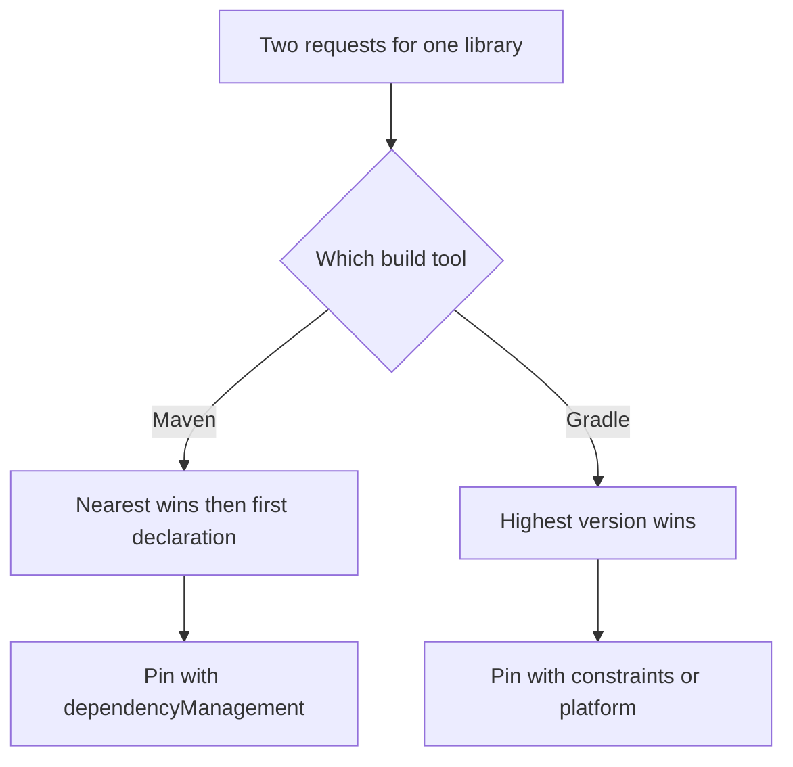
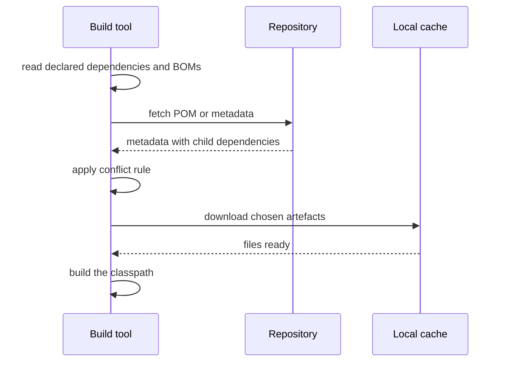

# Dependency Management

!!! note "In simple words"
    Your project uses libraries, and those libraries use other libraries. Dependency management is how the build picks one version of each library, downloads it, and makes sure the versions work together.

## Why it matters

Most production bugs in Java services do not come from the team's own code. They come from a library version that is not the one the developer expected: a method that is missing at runtime, a class loaded twice, or a security fix that never reached the running app. Interviewers ask about dependency management because it shows whether you can reason about what actually ends up on the classpath, and whether you can keep a build reproducible.

## How it works

### Semantic versioning

Semantic versioning (SemVer) uses three numbers, `MAJOR.MINOR.PATCH`:

- **MAJOR** changes mean the API is incompatible with the previous major version.
- **MINOR** changes add features and stay backward compatible.
- **PATCH** changes fix bugs and stay backward compatible.

SemVer is a convention, not a guarantee. Some libraries break compatibility in a minor release. Read the release notes before a major upgrade, and treat a minor or patch upgrade as low risk, not no risk. Suffixes such as `-SNAPSHOT`, `-RC1`, and `-beta` mark versions that are not final.

### Version ranges and dynamic versions

Maven and Gradle can request a range such as `[1.2,2.0)`, which accepts any version from 1.2 up to but not including 2.0. They can also request a dynamic version such as `1.+` or `latest.release`.

Dynamic versions make a build non-reproducible. The same commit can resolve different libraries on Monday and Friday. For applications, pin exact versions. Ranges are reasonable for a library that deliberately publishes a compatibility policy and wants its consumers to float within it.

### Transitive dependencies

A transitive dependency is a library that one of your libraries needs. Maven and Gradle download these automatically, so the real classpath is usually much larger than the dependency list in your build file.

Inspect the full tree with these commands:

```bash
mvn dependency:tree          # Maven
./gradlew dependencies       # Gradle, prints every configuration
```

Declare the libraries your code uses directly. A transitive dependency works until the library that brings it changes. Depending on a transitive dependency without declaring it is a hidden risk.

### Resolution strategies

When two requests for the same library name different versions, each tool has a rule:

- **Maven:** nearest wins. The version closest to the project in the tree is chosen. If the distance is equal, the first declaration wins. You can override this with `<dependencyManagement>`.
- **Gradle:** highest version wins by default. You can change this with a `resolutionStrategy`, or with platforms and constraints.



```kotlin
// Gradle build script (not compiled Java): force a version everywhere
configurations.all {
    resolutionStrategy {
        force("com.fasterxml.jackson.core:jackson-databind:2.17.2") // example version
    }
}
```

Forcing a version is a last resort. It hides the conflict instead of fixing it, and it can break a library that was built against the other version. Prefer a BOM or a platform, which keeps related libraries aligned.

### Bills of materials (BOM)

A BOM is a POM that lists compatible versions of many artefacts. Import it in `<dependencyManagement>` with `<scope>import</scope>`. After that, the libraries it covers do not need a version in your own POM. The Spring Boot BOM (`spring-boot-dependencies`) is the most common example in Java backends. Its version is a library version, so check the Spring Boot reference when you upgrade.

```xml
<dependencyManagement>
    <dependencies>
        <dependency>
            <groupId>org.springframework.boot</groupId>
            <artifactId>spring-boot-dependencies</artifactId>
            <version>${spring-boot.version}</version>
            <type>pom</type>
            <scope>import</scope>
        </dependency>
    </dependencies>
</dependencyManagement>
```

Gradle has the same idea as a **platform**, declared with `implementation(platform(...))`, and a **version catalog** that names every version in one file.

### Classpath conflicts ("JAR hell")

JAR hell is the name for a set of failures caused by two JARs that clash. Two JARs may contain a class with the same name. Or the code may expect one version of a class and receive another. Typical symptoms:

- `NoSuchMethodError` or `NoClassDefFoundError` at runtime, even though the code compiled.
- `ClassCastException` between two objects whose class names look identical.
- Behaviour that differs between the IDE and the command line, because the IDE puts a different set of JARs on the classpath.

How to diagnose it:

1. Find the failing class and method in the stack trace.
2. Find the JARs that contain that class. Search the dependency tree, or list the JAR contents.
3. Check which version wins in the resolved tree.
4. Fix it by aligning versions with a BOM, excluding the duplicate, or upgrading the older library.

On the Java module path (JPMS), two modules that contain the same package make startup fail, so the conflict is found early. On the classpath, which most applications use, no such check runs, so duplicates can slip through until a method call fails.

### Private repositories and credentials

Private repositories such as Nexus, Artifactory, GitHub Packages, or a cloud registry need credentials. Keep the credentials out of the project's source control:

- **Maven:** store the credentials in `~/.m2/settings.xml` under `<servers>`. The POM refers to the server by its `<id>`.
- **Gradle:** read them from `gradle.properties` in the user's Gradle home, or from environment variables. Reference them in the build script, never write them into it.

```kotlin
// build.gradle.kts (Gradle build script): credentials come from properties, not the script
repositories {
    maven {
        url = uri("https://repo.example.com/maven")
        credentials {
            username = providers.gradleProperty("repoUser").orNull
            password = providers.gradleProperty("repoToken").orNull
        }
    }
}
```

Use a short-lived token where the registry supports one. If a secret was ever committed by mistake, treat it as leaked: revoke it and issue a new one. Deleting the line from a later commit is not enough, because the old commit still holds the value.

### Lock files and reproducible builds

A lock file records the exact version resolved for every dependency. Gradle supports this with dependency locking. Enable it in the build script and then run `./gradlew dependencies --write-locks` to write the lock files. Maven has no built-in lock file. A BOM plus pinned versions gives similar results, but it does not capture transitive versions unless you pin them too.

Commit lock files for applications, so CI and production resolve the same versions. For shared libraries, the trade-off is different, and many teams skip locking there.

### Checking for vulnerable dependencies

A library version can contain a known security flaw. Scan dependencies in CI with a tool such as OWASP Dependency-Check, or with the dependency scanner that your code host or cloud provider offers. The OWASP Top 10 lists "Vulnerable and Outdated Components" as one of its risk categories. The list is updated from time to time, so check the current version before quoting it.

### Step by step: what a build does during resolution



1. The build tool reads the declared dependencies, along with any BOMs or platforms.
2. For each artefact, it reads the POM or metadata and follows the transitive dependencies.
3. It applies the conflict rule for each library: nearest wins in Maven, highest version wins in Gradle unless a constraint says otherwise.
4. It downloads the chosen artefacts into its local cache and builds the classpath.

To audit a change, save the dependency tree before the upgrade and after it, then compare the two.

## Where it is used

- **Application services** such as an order service or a payment service, which need a stable set of versions for each release.
- **Multi-module projects**, where one parent defines the versions used by every module.
- **Shared libraries** published internally, where the version is part of the public contract.
- **CI pipelines** that scan dependencies for known vulnerabilities before a release.

## Benefits

- **Reproducible builds.** Pinned versions and lock files give the same classpath on every machine.
- **Less duplication.** A BOM or version catalog keeps one version per library across modules.
- **Earlier detection.** Tree inspection and vulnerability scans find problems before production does.
- **Clear upgrade path.** Comparing trees before and after an upgrade shows exactly what changed.

## Cons and limits

- **Hidden complexity.** A small change at the top of the tree can change dozens of transitive versions.
- **Forcing hides conflicts.** A forced version can work today and fail on a method that the library added later.
- **SemVer is not a guarantee.** A patch release can break behaviour that someone relied on.
- **Lock files need upkeep.** They must be updated on purpose, or they go stale and block security fixes.
- **Scanning finds only known issues.** A scanner cannot report a flaw nobody has catalogued yet.

## Best practices

- Pin exact versions in applications. Avoid dynamic versions.
- Import a BOM or use a Gradle platform for framework libraries, and declare the rest of the versions once.
- Read release notes before a major upgrade, and run the test suite after a minor or patch upgrade too.
- Declare the libraries your code uses directly, and do not rely on a transitive copy.
- Check the tree after every dependency change, and review the diff.
- Keep credentials in `settings.xml` or `gradle.properties` outside the project, and rotate any token that leaked.
- Run a vulnerability scan in CI and fail the build for high-severity findings.
- Fail the build on duplicate classes when you need a hard guarantee.

!!! tip "Interview tip"
    **Q: How do you prevent version conflicts across a multi-module project?**
    Declare every shared version once, using a parent POM with `<dependencyManagement>`, an imported BOM, or a Gradle platform or version catalog. Modules then request the library without a version, so all of them resolve the same one. Check the tree after changes, and add a duplicate-class check to the build if you need a hard guarantee.

## Quick recap

- SemVer tells you the likely impact of an upgrade. Check the release notes anyway.
- Pin versions in applications and avoid dynamic version ranges.
- Use BOMs or platforms to align related libraries.
- Diagnose JAR hell from the stack trace, then check the resolved tree.
- Keep repository credentials out of version control, and rotate any that leak.

## Official documentation

- [Apache Maven guides](https://maven.apache.org/guides/)
- [Gradle User Manual](https://docs.gradle.org/current/userguide/userguide.html)
- [Spring Boot reference documentation](https://docs.spring.io/spring-boot/reference/index.html) (library: the Spring Boot BOM)
- [OWASP Top Ten](https://owasp.org/www-project-top-ten/)

**See also:** [Maven](maven.md), [Gradle](gradle.md), [Index](index.md)
