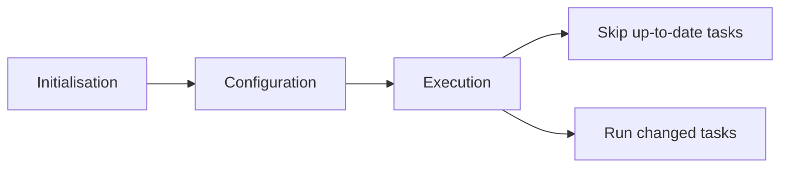
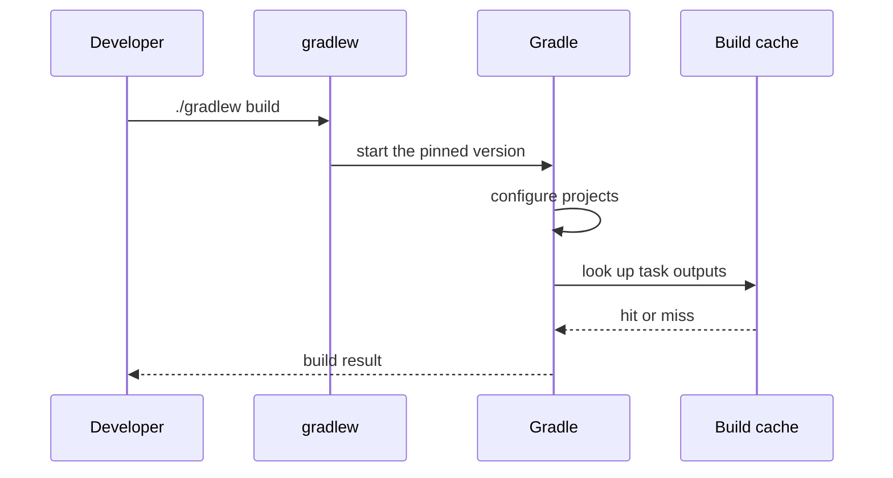

# Gradle

!!! note "In simple words"
    Gradle runs a build as a set of named tasks, such as compile, test, and package. It works out which tasks depend on which, skips the ones that did not change, and runs the rest. You describe the tasks in a script file.

## Why it matters

Gradle is a build tool like Maven, but it models a build as a graph of tasks instead of a fixed list of phases. That model lets Gradle skip work it has already done, cache results, and run tasks in parallel. Interviewers ask about Gradle to see whether you can compare it with Maven, explain tasks and incremental builds, and set up a multi-project build that stays consistent.

## How it works

### Build scripts: Groovy and Kotlin DSL

Gradle has two script languages. `build.gradle` uses Groovy. `build.gradle.kts` uses Kotlin. Both configure the same underlying model. The Kotlin DSL gives type-checked code and better IDE completion, so most new projects use it.

```kotlin
// build.gradle.kts (Gradle build script, not compiled Java)
plugins {
    java
    id("org.springframework.boot") version "3.3.4"        // example version; check the current release
    id("io.spring.dependency-management") version "1.1.6" // example version; check the current release
}

group = "com.example"
version = "1.0.0-SNAPSHOT"

java {
    toolchain {
        languageVersion.set(JavaLanguageVersion.of(21))
    }
}

repositories {
    mavenCentral()
}

dependencies {
    implementation("org.springframework.boot:spring-boot-starter-web")
    testImplementation("org.springframework.boot:spring-boot-starter-test")
}

tasks.withType<Test> {
    useJUnitPlatform()
}
```

The Spring plugin versions above are placeholders. Check the current release before you copy them.

### Tasks, actions, and dependencies

A Gradle build is a graph of **tasks**. Each task has:

- **Inputs:** files or values the task reads.
- **Outputs:** files the task writes.
- **Actions:** the code that runs.

A task can depend on other tasks. Gradle runs them in dependency order. If a task's inputs and outputs have not changed since the last run, Gradle marks it **up-to-date** and skips it.

```kotlin
// Gradle build script (not compiled Java)
tasks.register("hello") {
    doLast {
        println("Hello from a custom task")
    }
}

tasks.named("build") {
    dependsOn("hello")   // hello runs before build
}
```

Lifecycle tasks you will use often:

- `assemble` builds the artefacts.
- `check` runs verification, such as tests and linters.
- `build` runs `assemble` and `check`.
- `clean` deletes the build output.

Run `./gradlew tasks` to list the tasks in a project. Run `./gradlew build --dry-run` to see what would run without running it.

### The Gradle wrapper

The wrapper is a small set of files: `gradlew` for Unix shells, `gradlew.bat` for Windows, and `gradle/wrapper/`. When you run the wrapper, it downloads the Gradle version named in the project and uses it. Commit these files to version control, so every developer and every CI server runs the same Gradle version. Run `./gradlew` instead of a globally installed `gradle`.

### Configurations and dependencies

Gradle uses **configurations** where Maven uses scopes. The table compares the common ones. Maven equivalents are approximate.

| Configuration | Purpose | Maven equivalent |
|---|---|---|
| `implementation` | Used inside this module; hidden from consumers' compile classpath | `compile` (roughly) |
| `api` | Part of this module's public API (needs the `java-library` plugin) | `compile`, exposed to consumers |
| `compileOnly` | Needed to compile only | `provided` |
| `runtimeOnly` | Needed at runtime only | `runtime` |
| `testImplementation` | Needed to compile and run tests | `test` |

Prefer `implementation`. When a dependency only changes internally, consumers of your module do not recompile. `api` pushes the dependency onto every consumer, which increases rebuild work and widens the public surface of your module.

### Multi-project builds

A `settings.gradle.kts` file lists the projects in the build. Shared configuration can live in the root build script, or in **convention plugins** under `buildSrc` or an included build. Convention plugins are the cleaner option for large builds because each module applies one named plugin instead of copying settings.

```kotlin
// settings.gradle.kts
rootProject.name = "shop"
include("order-service", "payment-client")
```

A subproject depends on another one with a project dependency:

```kotlin
// order-service/build.gradle.kts (Gradle build script)
dependencies {
    implementation(project(":payment-client"))
}
```

### Version catalogs

A version catalog keeps versions and library coordinates in one file, `gradle/libs.versions.toml`. Each module refers to an entry as `libs.<alias>`, so a version bump happens in one place.

```toml
[versions]
junit = "5.10.2"

[libraries]
junit-jupiter = { module = "org.junit.jupiter:junit-jupiter", version.ref = "junit" }
```

```kotlin
// Gradle build script (not compiled Java)
dependencies {
    testImplementation(libs.junit.jupiter)
}
```

### Custom tasks

A custom task is a class that extends `DefaultTask`, or a built-in task type such as `Copy` or `Exec`. Declare inputs and outputs with properties and annotations. Gradle uses these declarations to decide whether the task is up-to-date. A task with no declared outputs can never be skipped.

### Gradle versus Maven

| Area | Maven | Gradle |
|---|---|---|
| Model | Fixed lifecycle and phases, XML file | Task graph, Groovy or Kotlin script |
| Customisation | Plugins and goals | Plugins, custom tasks, ordinary code |
| Incremental build | Limited | Up-to-date checks, build cache, configuration cache |
| Readability | Verbose but very predictable | Shorter, more flexible, easier to get wrong |
| Typical home | Many enterprise teams | Android, and many Spring projects |

On large projects Gradle often builds faster, because of up-to-date checks, the build cache, and parallel execution. Those gains depend on well-written tasks. A slow build is usually a configuration problem, not a tool problem.

### Three build phases



1. **Initialisation.** Gradle reads `settings.gradle(.kts)` and decides which projects take part.
2. **Configuration.** Gradle runs each project's build script and builds the task graph. The configuration cache can save this result and reuse it on later builds.
3. **Execution.** Gradle runs the requested tasks and their dependencies. Up-to-date tasks are skipped.

To find slow tasks, run `./gradlew build --profile` for a local report or `--scan` for a shareable build scan.



## Where it is used

- **Android apps.** Gradle is the default build tool for Android.
- **Large multi-module backends.** Teams use convention plugins and version catalogs to keep many services consistent.
- **Spring Boot services.** The Spring Boot Gradle plugin builds executable JARs and runs the application. This is a library example; its exact plugin version changes often.
- **CI pipelines.** CI runs `./gradlew build` and can reuse a shared build cache between machines.

## Benefits

- **Incremental builds.** Up-to-date checks skip work that has not changed.
- **Build cache.** Task outputs can be reused across builds and machines.
- **Flexible logic.** You can write normal code in the build script when a task needs it.
- **Good multi-project support.** Project dependencies, convention plugins, and version catalogs scale to many modules.
- **Wrapper for consistency.** Everyone builds with the same Gradle version.

## Cons and limits

- **Harder to get right.** Flexibility means that a build script can contain slow or wrong logic. Those mistakes are less visible than a Maven XML error.
- **Configuration-time cost.** Every build runs configuration. Heavy work in a script slows down even `./gradlew clean`.
- **Script language choice.** Groovy and Kotlin scripts look similar but are not identical. Mixing them in one project is confusing.
- **Plugin upgrades.** Plugins and Gradle versions can change APIs, so upgrades need care.
- **Less uniform.** Two Gradle builds can look very different, which makes them harder to compare for a newcomer.

## Best practices

- Commit the wrapper and run builds with `./gradlew`.
- Use the Kotlin DSL and a Java toolchain set to the version you target.
- Prefer `implementation`. Use `api` only for types that appear in a module's public signatures.
- Keep versions in `gradle/libs.versions.toml`, not in each module.
- Do not read files or call the network during configuration. Move that work into a task.
- Declare inputs and outputs on custom tasks so they can be skipped safely.
- Use `--profile` or `--scan` when a build is slow, and fix the task that dominates the time.

!!! tip "Interview tip"
    **Q: Why would you choose Gradle over Maven, or the reverse?**
    Gradle suits large or multi-language builds that need incremental builds, caching, and custom logic, and it is the default for Android. Maven suits teams that want one fixed convention and simple XML. Either tool can build a Spring Boot service. Name the trade-off you care about (speed, flexibility, or predictability) and the cost you accept for it.

## Quick recap

- A Gradle build is a graph of tasks. Scripts are `build.gradle` (Groovy) or `build.gradle.kts` (Kotlin).
- Up-to-date checks skip tasks whose inputs and outputs have not changed.
- Commit the wrapper and run `./gradlew`.
- Use `implementation` by default and reserve `api` for types exposed to consumers.
- Version catalogs keep versions in one place.

## Official documentation

- [Gradle User Manual](https://docs.gradle.org/current/userguide/userguide.html)
- [Apache Maven guides](https://maven.apache.org/guides/) (for comparison with Maven)
- [Spring Boot reference documentation](https://docs.spring.io/spring-boot/reference/index.html) (library: the Spring Boot Gradle plugin)

**See also:** [Maven](maven.md), [Dependency Management](dependency-management.md)
