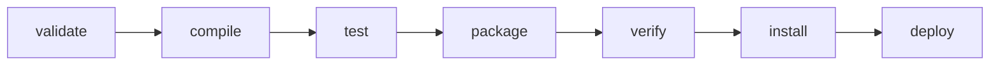
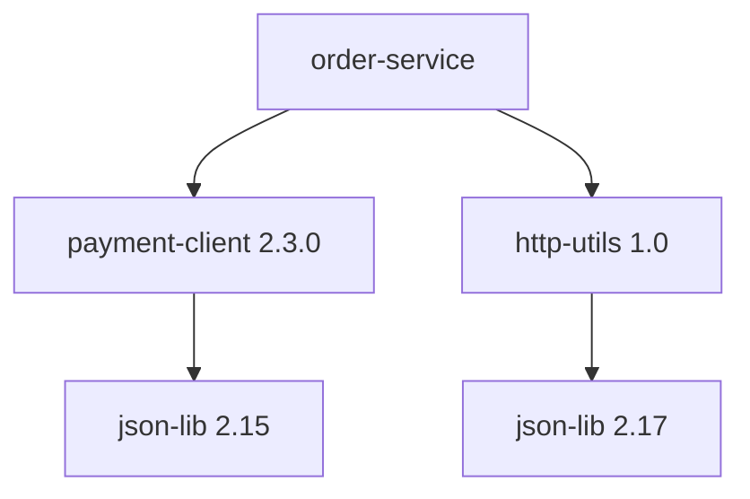
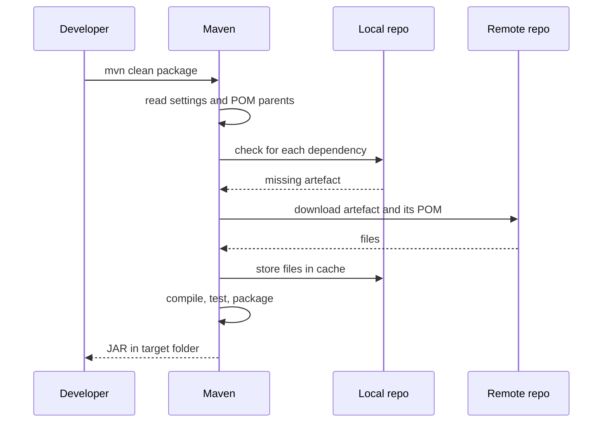

# Maven

!!! note "In simple words"
    Maven reads one file, `pom.xml`, that says what your project is, which libraries it needs, and how to build it. It downloads those libraries and then runs the build steps in a fixed order.

## Why it matters

A build tool turns source code into something you can run or ship. Maven does this in a predictable way: one project file, one set of standard steps, and one shared repository for libraries. Interviewers ask about Maven to check three things. Do you know how a build moves from source to artefact? Do you know how library versions are chosen? And can you fix a broken build by reading its output instead of guessing?

## How it works

### The POM

The Project Object Model (POM) is the `pom.xml` file at the root of a project. It records the project's identity, its packaging, its properties, its dependencies, and its plugins.

```xml
<project xmlns="http://maven.apache.org/POM/4.0.0"
         xmlns:xsi="http://www.w3.org/2001/XMLSchema-instance"
         xsi:schemaLocation="http://maven.apache.org/POM/4.0.0
                             https://maven.apache.org/xsd/maven-4.0.0.xsd">
    <modelVersion>4.0.0</modelVersion>

    <groupId>com.example</groupId>
    <artifactId>order-service</artifactId>
    <version>1.0.0-SNAPSHOT</version>
    <packaging>jar</packaging>

    <properties>
        <maven.compiler.release>21</maven.compiler.release>
    </properties>

    <dependencies>
        <dependency>
            <groupId>org.junit.jupiter</groupId>
            <artifactId>junit-jupiter</artifactId>
            <version>5.10.2</version>
            <scope>test</scope>
        </dependency>
    </dependencies>
</project>
```

`maven.compiler.release` tells the compiler to target Java 21 and to reject APIs that do not exist in that release.

### Coordinates

Every artefact has a coordinate made of three parts: `groupId`, `artifactId`, and `version`. A dependency is named by its coordinate, and so is the artefact your project produces. Maven uses the coordinate to decide where a file lives in a repository. For example, `org.junit.jupiter:junit-jupiter:5.10.2` is stored under a folder path built from the group, the artefact name, and the version.

### The build lifecycle

A lifecycle is an ordered list of phases. When you run a phase, Maven also runs every phase that comes before it in the same lifecycle.

| Phase | What it does |
|---|---|
| `validate` | Checks that the project is complete and readable |
| `compile` | Compiles the main source code into `target/classes` |
| `test` | Compiles and runs unit tests with Surefire |
| `package` | Builds the artefact, such as a JAR or WAR, into `target/` |
| `verify` | Runs integration checks on the packaged artefact |
| `install` | Copies the artefact into the local repository at `~/.m2` |
| `deploy` | Copies the artefact to a remote repository |

The `clean` lifecycle is separate. `mvn clean package` runs the clean lifecycle first, which deletes `target/`, and then runs the default lifecycle up to `package`.



### Plugins and goals

A phase does nothing by itself. Plugins attach goals to phases. For example, the compiler plugin binds its `compile` goal to the `compile` phase. You can also run a goal directly from the command line, such as `mvn dependency:tree`, without running a whole phase.

Common plugins:

- **Surefire** runs unit tests. It picks up classes named `*Test` by default.
- **Failsafe** runs integration tests in the `integration-test` and `verify` phases. Use it when tests need a database or a running server.
- **Shade** builds an uber JAR that contains the application and its dependencies, so `java -jar` works.
- **Spring Boot Maven plugin** repackages the JAR into an executable form with the `repackage` goal.

Plugin settings go under `<build><plugins>`.

### Dependencies and scopes

A scope decides when a dependency is on the classpath. Choose the narrowest scope that works.

| Scope | Compile | Test | Runtime | Typical example |
|---|---|---|---|---|
| `compile` (default) | Yes | Yes | Yes | A library the code calls directly |
| `provided` | Yes | Yes | No | Servlet API that the application server supplies |
| `runtime` | No | Yes | Yes | A JDBC driver the code never names |
| `test` | No | Yes | No | JUnit, Mockito |

A **transitive dependency** is a dependency of one of your dependencies. Maven downloads it automatically, so the classpath can be much bigger than the list in your POM.

### Nearest wins and version mediation

Two paths in the tree may bring different versions of the same library. Maven picks one with the **nearest wins** rule. The version reached by the shortest path from your project is used. If two paths have the same length, the first declaration in the POM wins.



In this tree, `json-lib 2.15` is two steps from the project and `json-lib 2.17` is also two steps, so the first declaration wins. If you want a version that does not depend on order, pin it.

Two tools control versions explicitly:

- **`<dependencyManagement>`** sets the version of a dependency for the whole project and its child modules. It does not add the dependency to the classpath. Importing a BOM with `<scope>import</scope>` is the standard way to align many versions at once.
- **`<exclusions>`** remove one transitive dependency from one declared dependency.

```xml
<dependency>
    <groupId>com.example</groupId>
    <artifactId>payment-client</artifactId>
    <version>2.3.0</version>
    <exclusions>
        <exclusion>
            <groupId>commons-logging</groupId>
            <artifactId>commons-logging</artifactId>
        </exclusion>
    </exclusions>
</dependency>
```

### Profiles

A profile changes the build for an environment or a condition. You activate it with `-P prod`, or automatically through an activation rule such as a property value or the JDK version.

```xml
<profiles>
    <profile>
        <id>prod</id>
        <properties>
            <skipTests>true</skipTests>
        </properties>
    </profile>
</profiles>
```

Keep secrets out of profiles in the POM. The POM is committed to version control. Pass secrets at runtime through environment variables or a user-level settings file.

### Repositories and settings.xml

Maven looks for artefacts in this order: the local repository at `~/.m2/repository`, then the remote repositories. Maven Central is the default remote. A company can add a private repository such as Nexus or Artifactory.

Repository addresses can go in `pom.xml`, but credentials belong in `~/.m2/settings.xml`. Each credential is stored under `<servers>` with an `<id>`, and the repository in the POM uses the same `<id>`. That way the POM stays free of passwords.

### Multi-module projects

A parent POM uses `<packaging>pom</packaging>` and lists its children with `<modules>`. Children inherit the parent's properties, plugins, and `<dependencyManagement>` entries. Running `mvn install` from the parent builds the modules in dependency order.

```xml
<project>
    <modelVersion>4.0.0</modelVersion>
    <groupId>com.example</groupId>
    <artifactId>shop-parent</artifactId>
    <version>1.0.0-SNAPSHOT</version>
    <packaging>pom</packaging>

    <modules>
        <module>payment-client</module>
        <module>order-service</module>
    </modules>
</project>
```

### Step by step: what happens during `mvn clean package`



1. Maven reads `settings.xml` and the POM. It merges parent POMs and active profiles into one effective model.
2. It resolves dependencies. Missing files are downloaded into `~/.m2/repository`.
3. The `clean` lifecycle deletes `target/`.
4. The default lifecycle runs `compile`, which writes `target/classes`, then `test`, which runs Surefire, then `package`, which writes the JAR to `target/`.

When a build fails, three commands help most:

- `mvn -e` prints the stack trace behind the error message.
- `mvn dependency:tree` shows which version of each library won.
- `mvn help:effective-pom` prints the final merged POM, including values from parents and profiles.

## Where it is used

- Backend services, such as an order service or a payment service, that run on Spring Boot or Jakarta EE.
- Libraries published to Maven Central, where the coordinate is the public name.
- Enterprise teams that want one standard layout and one set of conventions across many projects.
- CI pipelines, which run `mvn verify` on each commit to test and package the code.

## Benefits

- **Convention over configuration.** The standard directory layout and phases mean a new developer can build an unfamiliar project with `mvn package`.
- **Declarative dependencies.** You list what you need; Maven works out the rest, including transitive dependencies.
- **Reproducible resolution.** A fixed coordinate and a fixed version give the same artefact on any machine that can reach the repository.
- **Large ecosystem.** Almost every Java library is published to Maven Central with a POM.
- **Predictable output.** Two engineers running the same phase get the same steps in the same order.

## Cons and limits

- **XML is verbose.** Long POMs are hard to read, and small changes can need several blocks.
- **Limited customisation.** Non-standard build steps need a custom plugin or an `exec` workaround. Gradle handles custom logic more directly.
- **Slower on large builds.** Maven has limited incremental build support, so unchanged modules may still run their steps.
- **Transitive surprises.** Nearest wins can pick a version you did not expect when the tree changes.
- **No built-in lock file.** Maven cannot record the exact resolved versions by default. You pin versions yourself with a BOM or explicit versions.
- **Local cache can hide problems.** `~/.m2` may contain a stale artefact from an earlier `install`, so a build can pass on one machine and fail on another.

## Best practices

- Put shared versions in `<properties>` or import a BOM, so every module uses the same version.
- Declare every library your code uses directly. Do not rely on a transitive dependency that might disappear after an upgrade.
- Use `test` scope for test-only libraries and `provided` for libraries the server supplies.
- Use release versions in production. Keep `-SNAPSHOT` for work in progress.
- Keep credentials in `~/.m2/settings.xml`, never in the POM.
- Run `mvn dependency:tree` after any dependency change and review the diff.
- Run integration tests with Failsafe in `verify`, and keep unit tests fast in Surefire.

!!! tip "Interview tip"
    **Q: How does Maven resolve a version conflict?**
    Maven uses nearest wins. The version reached by the shortest path in the dependency tree is chosen; ties go to the first declaration. To control it explicitly, pin the version in `<dependencyManagement>` or import a BOM. Use `mvn dependency:tree` to confirm the result.

## Quick recap

- The POM declares coordinates, dependencies, and plugins. Lifecycles run phases in a fixed order.
- `mvn package` runs `validate` through `package`. `clean` is a separate lifecycle.
- Scopes control the classpath. `test` and `provided` stay out of the production JAR.
- Nearest wins resolves conflicts. `dependencyManagement` and BOMs pin versions.
- Surefire runs unit tests, Failsafe runs integration tests, and Shade or the Spring Boot plugin builds runnable JARs.

## Official documentation

- [Apache Maven guides](https://maven.apache.org/guides/)
- [Spring Boot reference documentation](https://docs.spring.io/spring-boot/reference/index.html) (library: covers the Spring Boot BOM and Maven plugin)

**See also:** [Gradle](gradle.md), [Dependency Management](dependency-management.md)
