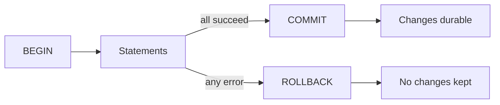
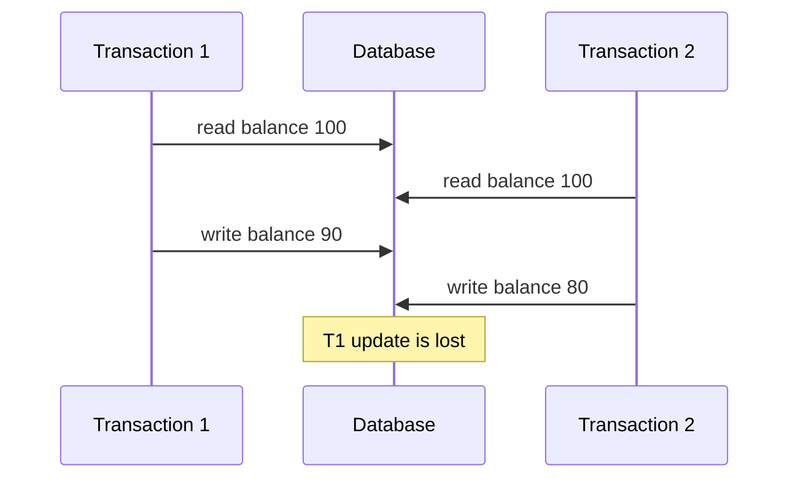

# Advanced SQL and Transactions

!!! note "In simple words"
    A transaction is a group of database changes that either all happen or none happen. Isolation decides what a transaction can see while other transactions run at the same time, and locks or atomic updates stop two people from overwriting each other.

## Why it matters

Single queries are easy. The hard part is what happens when many users change the same data at once. A bank transfer must not debit one account and then fail to credit the other. Two customers must not both buy the last item in stock. Advanced SQL gives you the tools for analysis (window functions and CTEs), and transactions give you the tools for correctness. Interviewers ask about ACID and isolation levels to see whether you can reason about race conditions, not just write queries.

## How it works

### Window functions

A window function computes a value across a set of related rows without collapsing them into one row, which is the big difference from `GROUP BY`. The `OVER` clause defines the window. `PARTITION BY` splits the rows into groups, and `ORDER BY` sets the order inside each group.

```sql
SELECT customer_id,
       order_id,
       total_cents,
       ROW_NUMBER() OVER (PARTITION BY customer_id ORDER BY total_cents DESC) AS rn,
       RANK()       OVER (PARTITION BY customer_id ORDER BY total_cents DESC) AS rnk,
       DENSE_RANK() OVER (PARTITION BY customer_id ORDER BY total_cents DESC) AS drnk
FROM orders;
```

| Function | Behaviour |
|---|---|
| `ROW_NUMBER` | Unique sequence 1, 2, 3 with no ties |
| `RANK` | Ties share a rank and the next rank is skipped (1, 1, 3) |
| `DENSE_RANK` | Ties share a rank and there are no gaps (1, 1, 2) |
| `LAG(col, n)` | The value from `n` rows earlier |
| `LEAD(col, n)` | The value from `n` rows later |
| `FIRST_VALUE`, `LAST_VALUE` | The first or last value in the window frame |

A common use is "latest order for each customer":

```sql
SELECT customer_id, order_id, total_cents
FROM (
    SELECT o.*,
           ROW_NUMBER() OVER (PARTITION BY customer_id ORDER BY created_on DESC) AS rn
    FROM orders AS o
) AS ranked
WHERE rn = 1;
```

`LAST_VALUE` needs an explicit frame, such as `ROWS BETWEEN UNBOUNDED PRECEDING AND UNBOUNDED FOLLOWING`. Without it, the default frame ends at the current row, and the result often surprises people.

### Common table expressions (CTEs)

A CTE gives a name to a subquery with `WITH`. Long queries become easier to read, and each step can be checked on its own.

```sql
WITH paid AS (
    SELECT customer_id, total_cents
    FROM orders
    WHERE status = 'PAID'
)
SELECT customer_id, SUM(total_cents) AS spent_cents
FROM paid
GROUP BY customer_id;
```

A **recursive CTE** walks a hierarchy, such as an org chart. It has an anchor member, which gives the starting rows, and a recursive member, which joins back to the CTE. The two are combined with `UNION ALL`:

```sql
WITH RECURSIVE reports AS (
    SELECT employee_id, manager_id, full_name, 1 AS depth
    FROM employee
    WHERE manager_id IS NULL                              -- anchor: top of the hierarchy
    UNION ALL
    SELECT e.employee_id, e.manager_id, e.full_name, r.depth + 1
    FROM employee AS e
    JOIN reports AS r ON e.manager_id = r.employee_id     -- recursive member
)
SELECT full_name, depth FROM reports;
```

Guard against cycles in the data. If one manager reports to someone who reports back to them, the recursion can run forever in some databases. Use a depth limit or a cycle check.

### Transactions

A transaction groups statements so they succeed or fail as one unit.

```sql
-- Transaction: all-or-nothing
BEGIN;                                  -- or START TRANSACTION in MySQL
UPDATE account SET balance = balance - 100 WHERE account_id = 1;
UPDATE account SET balance = balance + 100 WHERE account_id = 2;
COMMIT;                    -- Both succeed together
-- Or: ROLLBACK; (undo all changes)
```

`SAVEPOINT` marks a point inside a transaction that you can roll back to without losing the earlier work:

```sql
SAVEPOINT before_fee;
UPDATE account SET balance = balance - 5 WHERE account_id = 1;
ROLLBACK TO SAVEPOINT before_fee;       -- undoes only the fee
COMMIT;
```

Many JDBC drivers run in auto-commit mode by default, so each statement commits on its own. A Java service that needs a transaction turns auto-commit off, runs the statements, and then commits or rolls back:

```java
import java.sql.Connection;
import java.sql.PreparedStatement;
import java.sql.SQLException;

public class TransferService {

    static void transfer(Connection conn, long fromId, long toId, long cents) throws SQLException {
        boolean previousAutoCommit = conn.getAutoCommit();
        conn.setAutoCommit(false);
        try (PreparedStatement debit = conn.prepareStatement(
                 "UPDATE account SET balance = balance - ? WHERE account_id = ? AND balance >= ?");
             PreparedStatement credit = conn.prepareStatement(
                 "UPDATE account SET balance = balance + ? WHERE account_id = ?")) {

            debit.setLong(1, cents);
            debit.setLong(2, fromId);
            debit.setLong(3, cents);
            if (debit.executeUpdate() != 1) {
                throw new SQLException("insufficient funds or unknown source account");
            }

            credit.setLong(1, cents);
            credit.setLong(2, toId);
            if (credit.executeUpdate() != 1) {
                throw new SQLException("unknown destination account");
            }

            conn.commit();
        } catch (SQLException e) {
            conn.rollback();
            throw e;
        } finally {
            conn.setAutoCommit(previousAutoCommit);
        }
    }
}
```

This is plain JDBC and should compile with Java 21. It has not been run against a database. The debit checks the balance inside the same `UPDATE`, which avoids a read-then-write race.

### ACID

| Property | Meaning |
|---|---|
| Atomicity | All statements in the transaction apply, or none of them do |
| Consistency | The database moves from one valid state to another, and constraints hold |
| Isolation | Concurrent transactions do not see each other's partial work, to the degree the isolation level allows |
| Durability | Committed data survives a crash, typically because the change was written to a log first |



### BASE and the CAP theorem

Many distributed NoSQL systems relax some of ACID's strictness to gain availability and scale. The informal name for that trade-off is BASE:

- **Basically available:** the system keeps answering when some nodes fail, possibly with partial or stale data.
- **Soft state:** a replica's contents can change over time without new client writes, because it is still catching up.
- **Eventual consistency:** once writes stop and updates propagate, all replicas converge to the same value.

The CAP theorem applies when a network partition splits the nodes. During a partition, the system must choose between **consistency** (every read returns the latest write, or fails) and **availability** (every request gets a non-error response, which may be stale). Partition tolerance is not optional in a distributed system, because networks do fail. A CP system refuses some requests to stay consistent. An AP system answers and reconciles later.

CAP is often misquoted as "pick any two of three, always." It describes behaviour during a partition only. PACELC extends it: when there is no partition, the system still trades latency against consistency. A single-node relational database avoids the distributed trade-off, which is why it can offer full ACID transactions.

### Isolation levels and anomalies 

Concurrent transactions can cause these anomalies:

- **Dirty read:** reading another transaction's change before it commits.
- **Non-repeatable read:** the same row, read twice, returns different values.
- **Phantom read:** the same query, run twice, returns a different set of rows.
- **Lost update:** two transactions read the same value and both write, so one update is overwritten.



The diagram shows a lost update. Both transactions read 100, and the second write overwrites the first one.

| Isolation level | Dirty read | Non-repeatable read | Phantom read |
|---|---|---|---|
| Read Uncommitted | Possible | Possible | Possible |
| Read Committed | No | Possible | Possible |
| Repeatable Read | No | No | Possible in the SQL standard |
| Serializable | No | No | No |

```sql
-- Isolation levels (trade consistency vs performance)
SET TRANSACTION ISOLATION LEVEL READ COMMITTED;
-- READ UNCOMMITTED: dirty reads (see uncommitted data)
-- READ COMMITTED: no dirty reads (see committed data only)
-- REPEATABLE READ: no non-repeatable reads (consistent within transaction)
-- SERIALIZABLE: full isolation (safest, slowest)
```

Implementations differ, so check your database's documentation as well as the standard. PostgreSQL treats Read Uncommitted as Read Committed, and its Repeatable Read is snapshot-based, so it does not allow phantoms. MySQL InnoDB's default level is Repeatable Read.

The table does not list lost updates, and no isolation level is a complete answer to them. Read Committed can lose an update when the code reads a value, computes, and writes it back. MySQL InnoDB's Repeatable Read can do the same. PostgreSQL's Repeatable Read detects some of these conflicts and aborts one transaction, which the application must then retry. Do not depend on the isolation level alone. Prevent lost updates with an atomic update, a row lock, or a version check.

### Locking and deadlocks

Databases use locks to stop conflicting writes:

- **Shared (read) lock:** many transactions can hold it at once.
- **Exclusive (write) lock:** only one transaction can hold it, and other writers must wait for it.
- **Pessimistic locking:** `SELECT ... FOR UPDATE` locks the selected rows until the transaction ends.
- **Optimistic locking:** each row carries a version number. An update succeeds only if the version is unchanged, and otherwise the application retries.

```sql
-- Pessimistic: lock the row before changing it
BEGIN;
SELECT balance FROM account WHERE account_id = 1 FOR UPDATE;
UPDATE account SET balance = balance - 100 WHERE account_id = 1;
COMMIT;
```

```sql
-- Optimistic: succeed only if nobody changed the row since it was read
UPDATE account
SET balance = ?, version = version + 1
WHERE account_id = ? AND version = ?;
-- Row count 0 means a concurrent change happened: reload and retry
```

A **deadlock** happens when transactions wait on each other in a cycle. The database detects it and aborts one transaction, which the application must retry. Reduce deadlocks by acquiring locks in the same order everywhere and by keeping transactions short.

### Step by step: a safe concurrent update

1. Decide which protection the business rule needs: no lost update, no double spend, or no overbooking.
2. Prefer one atomic statement, such as `UPDATE ... SET qty = qty - 1 WHERE qty > 0`, and check the affected row count.
3. If the decision needs a read first, lock the rows with `FOR UPDATE`, or use optimistic versioning.
4. Keep the transaction short, and acquire locks in the same order everywhere.
5. Retry on a deadlock or serialization failure.

## Where it is used

- **Payments and transfers**, where a debit and a credit must both happen or neither.
- **Inventory and booking**, where two buyers must not take the last seat or item.
- **Analytics** that rank rows per customer or per region with window functions.
- **Hierarchies** such as org charts, category trees, or bills of materials, handled with recursive CTEs.
- **Distributed NoSQL systems**, where BASE and CAP describe the trade-offs.

## Benefits

- **Correctness under concurrency.** ACID transactions stop partial changes from being visible or kept.
- **Clear recovery.** A failed transaction rolls back to a known state, so the application can retry.
- **Expressive analysis.** Window functions answer ranking and "previous row" questions in one statement.
- **Fine control.** Isolation levels, locks, and savepoints let you trade concurrency for safety where it matters.

## Cons and limits

- **Locks reduce concurrency.** Strict isolation and long transactions make other sessions wait.
- **Deadlocks happen.** They are rare but real, and the code must handle the error.
- **Defaults vary.** The same isolation name can behave differently across databases.
- **Recursive queries can be expensive** on deep or wide hierarchies, and they need cycle guards.
- **Distributed transactions are hard.** Across services, a single ACID transaction is usually not available, so teams use patterns such as sagas.

## Best practices

- Choose the protection the business rule needs: no lost updates, no double spend, no overbooking.
- Prefer one atomic statement such as `UPDATE ... SET qty = qty - 1 WHERE qty > 0`, and check the row count.
- Use `SELECT ... FOR UPDATE` when a decision must read data before writing, and lock rows in a fixed order.
- Use optimistic versioning for data that is read often and changed rarely, and retry on conflict.
- Keep transactions short. Never wait for an external HTTP call while holding locks.
- Retry transactions that fail with a deadlock or serialization error, with a limit on the number of attempts.
- Test concurrency with two sessions, not only with one.
- Check your database's real isolation behaviour before you rely on it.

!!! tip "Interview tip"
    **Q: How would you prevent two customers from buying the last item?**
    Make the decrement atomic, for example `UPDATE stock SET qty = qty - 1 WHERE item_id = ? AND qty > 0`, and check the row count. Alternatively, lock the row with `SELECT ... FOR UPDATE` inside a transaction. Mention that a read-then-write in application code is the classic race condition.

## Common pitfalls

- Running a long transaction that holds locks while it waits for an external HTTP call.
- Assuming Read Committed prevents lost updates. It does not. Use an atomic update or a lock.
- Reading a value in the application, computing a new value, and writing it back without a lock or version check.
- Forgetting that auto-commit is on in many drivers, so each statement commits on its own.
- Not retrying deadlock or serialization errors.
- Using `LAST_VALUE` without a full frame clause.
- Treating CAP as "choose two of three at all times". It applies during partitions, and PACELC covers the normal case.

## Quick recap

- Window functions compute per-row results over partitions without collapsing rows.
- Recursive CTEs walk hierarchies. Guard them against cycles.
- ACID covers atomicity, consistency, isolation, and durability.
- Isolation levels trade anomalies for concurrency. Check your database's actual behaviour.
- Prevent lost updates with atomic updates, `FOR UPDATE`, or optimistic versioning.

## Official documentation

- [PostgreSQL documentation](https://www.postgresql.org/docs/current/) (window functions, CTEs, transactions, and locking)
- [MySQL 8.0 reference manual](https://dev.mysql.com/doc/) (InnoDB transactions and isolation levels)
- [Java SE 21 API documentation](https://docs.oracle.com/en/java/javase/21/docs/api/index.html) (`java.sql.Connection` transaction methods)

**See also:** [Intermediate SQL](intermediate-sql.md), [Query Optimisation](query-optimisation.md), [JDBC](../07-jdbc-jpa/jdbc.md)
